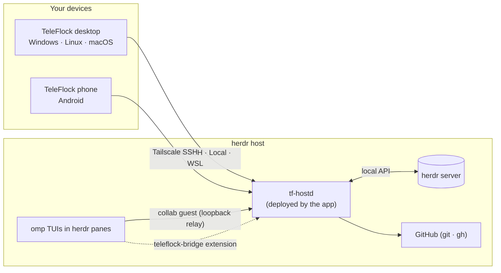

<div align="center">


# TeleFlock

### Your agents, herded.

TeleFlock is a native desktop and phone app for the [omp](https://github.com/can1357/oh-my-pi) coding agents you run inside [herdr](https://herdr.dev). Every agent lands on one live board: you see what each one is doing right now, answer its questions and approvals with one tap, dispatch new tasks into fresh worktrees, review and ship the diff, and drop into a real terminal whenever you need it. It connects over Tailscale SSH, to herdr on this machine, or inside WSL. Your sessions keep running in herdr as they always did; TeleFlock is the window onto them.

[](https://github.com/studioplascode/TeleFlock/releases)
[](https://github.com/studioplascode/TeleFlock/releases)
[](LICENSE)
[](#install)
<br>
[](https://v2.tauri.app)
[](crates/)
[](src/)

**Download:**
[Windows](https://github.com/studioplascode/TeleFlock/releases/latest) ·
[Android](https://github.com/studioplascode/TeleFlock/releases/latest) ·
[Linux .deb / AppImage / Arch](https://github.com/studioplascode/TeleFlock/releases/latest) ·
[macOS](https://github.com/studioplascode/TeleFlock/releases/latest)

<br>


</div>

<br>

## Contents

[Feature tour](#feature-tour) · [Install](#install) · [Set up a host](#set-up-a-host) · [How it works](#how-it-works) · [Build from source](#build-from-source) · [Repository](#repository) · [Status](#status) · [Credits](#credits) · [License](#license)

## Feature tour

<sub>All screenshots are from the built-in demo host (`?demo`), which simulates a flock of agents. Nothing in them is mocked up.</sub>

### The board: is everything alive?

Four lanes, **Running · Needs you · In review · Done**, with every omp agent on every host. Cards fly between lanes and keep a live heartbeat: the streaming line, tool timers, a todo ring, context, cost and the subagent swarm. Agents that go quiet while working are called out. The board also gives you the day's spend, host load and a live terminal tile. Questions and approvals are answered right on the card. You can drag cards to archive, multi-select, filter, and drive everything from the keyboard (`J`/`K`, `Enter`, `A` answer, `T` terminal).


### A native session for every agent

A real GUI for the omp transcript: streaming markdown, rich tool cards (diffs, bash with ANSI colours, search, todos, subagents, web, images) and thinking blocks. Click any image to open it full screen, then zoom and pan (wheel, pinch, double-click) and page through the rest of the message. When the agent asks, its question becomes a card you answer with a click or `1`–`9`. The composer steers the running turn or queues a follow-up, with an editable queue, a `/` palette covering omp's commands and your own, `@` file search, and images. Whatever you type, anywhere in the app, stays put: drafts and pasted images survive switching agents, closing dialogs and restarts until you send them. Model, thinking, plan, goal and fast mode sit in the header. The inspector shows context, cost, throughput, todos, changed files, the session tree (branch, fork, navigate) and more.

| Ask cards | Approvals |
|---|---|
|  |  |

### Dispatch: fire tasks into fresh worktrees

Pick a repository and send tasks like chat messages. Each one gets its own `dispatch/<slug>` worktree and omp agent, and they all run side by side. A thread per repo shows every agent's progress live: queued, creating the worktree, starting, then the agent's status and streaming line. You can answer its questions inline and jump to its session, terminal or review. Templates, model, thinking and plan mode are set per message. Up to three worktrees are created at once; the rest queue.


### Subagents and agent chat

When omp fans out, TeleFlock shows the swarm live: each subagent's own estimate of how far it is (**% done**), its context meter, tool count and cost. Open any of them in the full-height **subagent viewer** to read its transcript as it streams, message or steer it, kill it or revive it (`[` / `]` jump between siblings). When agents talk to each other over omp's IRC, the messages appear as **chat bubbles** in the transcript, and the **Agent chat** tab collects every thread.

| Agent chat in the transcript | Subagent viewer |
|---|---|
|  |  |

### Cost, throughput and subscription limits

Every agent's spend counts its subagents and the advisor too, broken down by source in the inspector, alongside a live tokens-per-second meter. The Usage page tracks spend per day, model and agent. **Subscriptions & limits** reads the quota windows of every account omp is logged into (Claude 5-hour, 7-day, Codex…), with reset countdowns and a pace projection that warns before you hit a limit. The session inspector has a limits tile, and a header chip appears when an account runs low.


### Review and ship

A diff viewer (unified or split) for any worktree. From there you commit (or ask the agent to write the message), push, open a PR, watch the checks and merge.


### A real terminal when you need it

xterm.js attached to any herdr pane, in **Fira Code** with **Nerd Font** icons. It supports control or observe mode with take-over, search, tabs, `localhost` preview tunnels, and an extra-keys row on phones. omp keeps running as its normal TUI inside herdr, so the terminal is always the real thing.


### In your pocket

The phone layout is built for one thumb. You get a Flock home with what needs you, swipeable sessions, an inbox, Dispatch and the terminal with extra keys. Bottom sheets, edge-swipe back, pull to refresh and haptics come with it.


### Notifications that clear themselves

When an agent needs you, you get an OS notification you can act on: a Windows toast with buttons and inline reply, or an Android notification with up to three actions and inline reply. Once a question is handled anywhere (the card, the toast, the board, `Ctrl+J` "answer next", another device or the omp TUI itself), its notification disappears everywhere. Read ones are retracted too. Desktop also has a tray icon with a live badge, a taskbar overlay on Windows, and per-agent mute and quiet hours. Linux and macOS have no OS notifications yet; there the inbox and the tray badge carry the same information.

### Updates

The app finds new versions on GitHub releases by itself:

| Platform | How it updates |
|---|---|
| Windows | Downloads the signed installer, installs it with a progress window (no prompts) and relaunches |
| Linux AppImage / .deb | Downloads the signed package, replaces the AppImage or installs the .deb (password prompt), restarts |
| Android | Downloads the APK, checks its checksum and signing certificate, then Android asks you to confirm |
| macOS | Tells you a new version is out and opens the download (the CI-built app is not signed for auto-install) |
| Arch | Through pacman / the AUR, like any other package |

Desktop packages are verified against the release signing key and the release version before anything is installed. Turn automatic updates off in Settings → Updates.

### And more

Command palette (`Ctrl+K`), an activity feed with a "while you were away" digest, a usage dashboard, agent templates, fan-out (N approaches in parallel), worktree and agent wizards with a remote folder browser, past sessions and resume, offline-first cached state, and the built-in demo host.

## Install

Grab the files from the [latest release](https://github.com/studioplascode/TeleFlock/releases/latest). Every package has a `.sha256` next to it.

| Platform | File | Notes |
|---|---|---|
| **Windows 10/11** (x64) | `TeleFlock_<version>_x64-setup.exe` | Per-user install, no admin. Needs WebView2, which Windows 11 includes. |
| **Android 7+** | `TeleFlock_<version>_universal.apk` | Allow installs from this source. Grant notifications on first launch; for background alerts, allow the battery-optimisation exemption in Settings. Updates need the "install unknown apps" permission once. |
| **Debian / Ubuntu** (x64) | `TeleFlock_<version>_amd64.deb` | `sudo apt install ./TeleFlock_<version>_amd64.deb`. Debian 12+, Ubuntu 22.04+. |
| **Any Linux** (x64) | `TeleFlock_<version>_amd64.AppImage` | `chmod +x` and run. Registers `teleflock://` links on first launch. |
| **Arch Linux** (x64) | `teleflock-bin-<version>-1-x86_64.pkg.tar.zst` | `sudo pacman -U teleflock-bin-…pkg.tar.zst`. The PKGBUILD is in [`packaging/arch/`](packaging/arch/PKGBUILD). |
| **macOS 11+** (Apple silicon + Intel) | `TeleFlock_<version>_universal.dmg` | Not notarized (no paid Apple account), so see below. |

<details>
<summary><b>macOS first launch (Gatekeeper)</b></summary>

The app is ad-hoc signed but not notarized, so macOS blocks it the first time:

1. Drag TeleFlock to Applications and open it once. macOS says it can't be verified.
2. Open System Settings → Privacy & Security, scroll down and click **Open Anyway** (on macOS 14 and older you can instead right-click the app → **Open**).

Or, in Terminal: `xattr -dr com.apple.quarantine /Applications/TeleFlock.app`.
</details>

**iOS** is not offered. Without the paid Apple Developer Program, an app can only be sideloaded with a 7-day signature, and iOS would also suspend the live host connection in the background.

## Set up a host

On the machine that runs herdr and omp:

1. **Tailscale SSH (remote hosts):**
   - Run `sudo tailscale set --ssh`.
   - Make sure your tailnet policy lets your devices SSH to this host as your user.
   - If the policy uses `check` mode, TeleFlock shows an **Open browser** card to finish the login.
2. **herdr and omp** must be installed (`herdr --version`, `omp --version`; omp ≥ 18.12).
3. **In TeleFlock:** Hosts → **Add host** → Tailscale SSH (MagicDNS name or 100.x IP, user), Local, or WSL (pick a distro) → **Test** → **Save**. TeleFlock deploys `tf-hostd` to `~/.teleflock/` and connects.
4. **Host setup checklist** (Hosts → Host setup) offers one-tap fixes. Each runs only when you tick its consent box:
   - `install-herdr-integration`: herdr's omp integration, which gives accurate working/blocked/idle states.
   - `enable-global-sharing`: sets `collab.autoStart: control` and `collab.relayUrl: ws://127.0.0.1:47466` in omp's global config. Every omp session, including ones you start by hand or herdr restores, then appears live in TeleFlock.
   - `install-global-bridge`: copies the TeleFlock extension into `~/.omp/agent/extensions/` so precise controls work for every session.

   You can skip all three. Agents started from TeleFlock are shared and bridged per process anyway, and an unshared session can be connected with one click (**Connect** injects `/collab` into it).

Phones connect over Tailscale SSH only. Your tailnet identity is the login, so no keys or passwords are stored. Desktops can also use **Local** (herdr on this machine) and, on Windows, **WSL**.

## How it works



- omp keeps running as its normal TUI inside herdr, so herdr's state tracking and the real terminal keep working.
- The app's Rust core uploads and starts a small host daemon, `tf-hostd`, over SSH (or locally), and speaks one protocol to it whatever the transport.
- All your devices share that daemon. When they run different app versions, the host keeps the newest `tf-hostd` and older apps attach to it instead of replacing it, so one device never knocks the other off.
- `tf-hostd` joins each omp session as a private collab guest on a loopback relay. Room keys never leave the host.
- A companion omp extension adds structured controls (model, thinking, tree, queue, …).
- herdr is driven through its local API; git and `gh` run on the host for review and shipping.
- The UI is React, rendered by the system webview through Tauri 2. Desktop and Android share all of it.

Details: [`docs/architecture.md`](docs/architecture.md) · spec: [`docs/spec.md`](docs/spec.md) · feature coverage: [`docs/coverage.md`](docs/coverage.md) · bridge protocol: [`docs/bridge-protocol.md`](docs/bridge-protocol.md).

## Build from source

Toolchain, CI, signing and every command are in [`docs/build.md`](docs/build.md).

```bash
bun install
bun run dev                  # UI with the demo host: http://127.0.0.1:1420/?demo
cargo test --workspace && bun test && bun run typecheck
scripts/build-windows.sh     # → dist-release/TeleFlock_<v>_x64-setup.exe (cross-compiled, NSIS)
scripts/build-android.sh     # → dist-release/TeleFlock_<v>_universal.apk (signed)
scripts/build-linux.sh       # → dist-release/ .deb + AppImage + Arch package (docker)
```

macOS is built on GitHub's macOS runners (`.github/workflows/macos.yml`). Releases come from `scripts/release.sh`.

To run the real stack in a browser against a herdr session on this machine, start the dev server below. It prints a tokened URL; open that.

```bash
cargo run -p tf-devserver -- --static dist --bind 127.0.0.1:7420 --hostd-bin target/<dir>/debug/tf-hostd
```

## Repository

| Path | What |
|---|---|
| `crates/tf-proto` | Wire protocol, the single source of truth (TypeScript generated into `src/core/gen` by `scripts/gen-proto-ts.sh`) |
| `crates/tf-hostd` | Host daemon: collab relay and guests, herdr client, state, ops, bridge server |
| `crates/tf-collab` · `crates/tf-herdr` | omp collab protocol (relay, guest, replica) · herdr API client |
| `crates/tf-transport` · `crates/tf-client` | Tailscale SSH / Local / WSL transports · the app's core engine |
| `crates/tf-devserver` | Browser bridge to the app core (token-protected) |
| `src-tauri/` | Tauri 2 shell: tray, toasts, Snap Layouts, deep links, self-update; Android Kotlin plugin (keep-alive service, notifications) |
| `host/teleflock-bridge/` | omp companion extension |
| `src/` | React UI: `core` (transports, stores, demo host), `design` (Bento design system), `features/*` |
| `packaging/` | Linux release build container, Arch PKGBUILD |
| `scripts/` | Build, version and release scripts |
| `docs/` | Architecture, spec, coverage, build, research (herdr / omp / collab maps with captured samples) |

## Status

What has been verified, and how:

- **Test suites:** the Rust workspace tests, the frontend unit tests and the typecheck.
- **Real omp + herdr, on Linux:** the full stack was exercised end to end through the UI in herdr lab sessions, via `tf-devserver` with the local transport, including subscription limits against real Claude and Codex accounts.
- **Packages:** the Windows installer, the signed APK and the Linux .deb, AppImage and Arch package build from this tree. The Linux app was smoke-run: the window renders, the tray starts, a second launch hands its `teleflock://` link to the first, and the .deb installs and runs on a clean Ubuntu 22.04.

**Not yet exercised:**
- on real Windows, Android or macOS hardware (macOS is built only in CI);
- on a real Linux desktop session (tray rendering, the update password prompt);
- against a real remote Tailscale SSH peer (the SSH path is covered by an in-process server that imitates Tailscale);
- WSL mode.

Smoke-test those on your devices first, and please report what you find.

## Credits

- [Tauri](https://tauri.app) (MIT / Apache-2.0) for the app shell, its plugins (updater, deep link, single instance, log) and [`tauri-plugin-snap-layout`](https://crates.io/crates/tauri-plugin-snap-layout).
- [xterm.js](https://xtermjs.org) (MIT) for the terminal.
- [Fira Code](https://github.com/tonsky/FiraCode) by The Fira Code Project Authors, [SIL Open Font License 1.1](src/assets/fonts/fira-code/LICENSE).
- [Nerd Fonts](https://www.nerdfonts.com) Symbols Only v3.5.1 by Ryan L McIntyre, [MIT](src/assets/fonts/symbols-nerd-font/LICENSE); the bundled icon sets keep their own licenses, listed in [its README](src/assets/fonts/symbols-nerd-font/README.md).
- [React](https://react.dev), [Radix UI](https://www.radix-ui.com), [Tailwind CSS](https://tailwindcss.com), [Lucide](https://lucide.dev), [Motion](https://motion.dev), [zustand](https://github.com/pmndrs/zustand), [russh](https://github.com/Eugeny/russh), [tokio](https://tokio.rs) and the rest of the dependency tree in `package.json` and `Cargo.lock`.
- [omp](https://github.com/can1357/oh-my-pi) and [herdr](https://herdr.dev), which do the actual herding of agents.

## License

[MIT](LICENSE) © 2026 Studio Plascode
