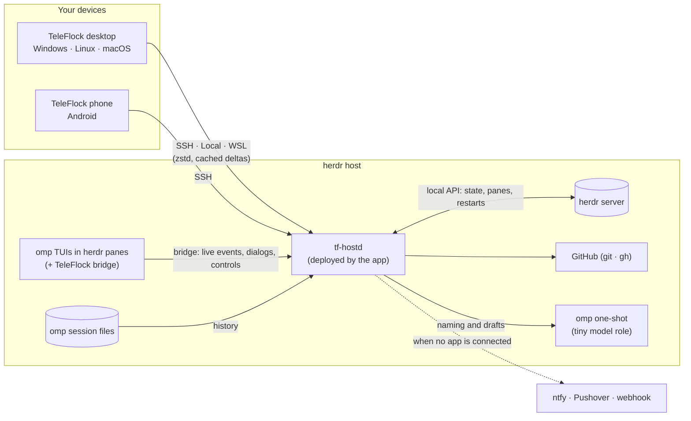

<div align="center">


# TeleFlock

### Your agents, herded.

TeleFlock is a native desktop and phone app for the [omp](https://github.com/can1357/oh-my-pi) coding agents you run inside [herdr](https://herdr.dev). Every agent lands on one live board: you see what each one is doing right now, answer its questions and approvals with one tap, dispatch new tasks into fresh worktrees, review and ship the diff, and drop into a real terminal whenever you need it. It connects over Tailscale SSH or plain SSH, to herdr on this machine, or inside WSL. Your sessions keep running in herdr as they always did; TeleFlock is the window onto them, and the safety net under them.

[](https://github.com/studioplascode/TeleFlock/releases)
[](https://github.com/studioplascode/TeleFlock/releases)
[](LICENSE)
[](#install)
<br>
[](https://v2.tauri.app)
[](crates/)
[](src/)

**Download:**
[Windows](https://github.com/studioplascode/TeleFlock/releases/latest) ·
[Android](https://github.com/studioplascode/TeleFlock/releases/latest) ·
[Linux .deb / AppImage / Arch](https://github.com/studioplascode/TeleFlock/releases/latest) ·
[macOS](https://github.com/studioplascode/TeleFlock/releases/latest)

<br>


</div>

<br>

## Contents

[Feature tour](#feature-tour) · [Install](#install) · [Set up a host](#set-up-a-host) · [How it works](#how-it-works) · [Build from source](#build-from-source) · [Repository](#repository) · [Credits](#credits) · [License](#license)

## Feature tour

<sub>All screenshots are from the built-in demo host (`?demo`), which simulates a flock of agents. Nothing in them is mocked up.</sub>

### The board: is everything alive?

Four lanes, **Needs you · Running · Review · Done**, with every omp agent on every host. Needs you comes first, and its oldest question sits on top, answerable right on the card. Every card has the same layout in every lane: the state and its time on top (`turn 27:24`, `waiting 6:13`, `finished 25m ago`), then who and where (each repository has a chip in its own colour), the task, and what it is doing right now, or, once it has gone quiet, omp's own recap of where it stands. Labelled meters show context, subagent progress, the diff and the model. Running cards keep a live heartbeat with the streaming line, tool timers and tokens per second; agents that go quiet while working, agents that are only waiting for their background jobs and agents waiting out a provider rate limit each say so.

Above the lanes sit today's spend with the subscription limit you will hit first, every host's health and a live terminal tile. Mark a reviewed card done (with Undo) and its herdr pane closes; the card stays in Done with its transcript, and **Resume**, opening its terminal or simply sending it a message picks the session back up. Once a card's pull request is merged or closed, **Delete worktree** removes the worktree and keeps the branch. Drag a card back to reopen it, multi-select, filter by host or repository, and drive everything from the keyboard (`J`/`K`, `Enter`, `A` answer, `T` terminal).


### Built to run overnight

Leave a flock working and come back to finished work, not to a wall of stopped agents.

- **Auto-resume after usage limits.** When an agent or its subagents stop on a provider usage or rate limit after omp's own retries, the host waits until a limit window reopens (counting every account omp can switch to), then resumes the subagents and the agent where they stopped, without a new prompt. Provider overloads and server errors are retried too, with a growing pause. The limit errors are kept out of what the model sees afterwards, so agents don't start economising out of caution. It runs on the host, so no app needs to be connected; the card says when it will resume, with **Resume now** and **Don't auto-resume** (Settings → Auto-resume turns it off per host). While omp itself is still retrying, the card says so: "Rate limit · retrying in 4:54 (1/10)".
- **Decide for me.** Per agent, per Dispatch message, per automation or as a host default: if a question waits longer than you choose, the host picks omp's ★ recommended option. It can apply only while no TeleFlock app is connected to the host. Approvals and plan reviews are never answered for you, and every automatic answer is logged and notified.
- **Nothing is lost when something crashes.** If herdr stops or crashes, the machine reboots or an omp process dies, the host notices within seconds, says so on the board instead of showing stale "running" cards, starts herdr again and brings the agents back under their names, in their folders, with their model and settings. After a reboot that happens by itself only on Linux hosts with systemd (as root, or as a user with lingering enabled: Settings → Auto-resume says whether the boot service can be installed on a host); on macOS, Windows and Linux without systemd it happens once the host daemon runs again. A turn that was cut off continues when its last step is safe to repeat; otherwise the agent is told what happened and checks before running anything again. An omp you stopped yourself, an agent that keeps crashing, and one that ended before its first reply (its prompt and images are kept) stay on the board as ended cards until you press **Continue**.
- **New herdr versions without restarts.** The host installs herdr updates and loads them into the running server by live handoff once the host has been idle for a while, so agents and terminals keep running. An update that would need a restart waits for you.
- **Resume a stopped turn.** **Resume** (or `F5`) continues an agent you stopped, or one whose turn failed, without sending a new prompt, as omp's own `F5` does. Failed subagents have **Retry**.

### Easy to start, nothing hidden

New to omp and herdr? The board's **First steps** checklist walks you through the demo flock (answer a question, approve a command, steer an agent, review, dispatch, the palette) and retires itself. Dotted terms such as *pane*, *steer*, *follow-up*, *worktree* or *compact* explain themselves on hover or tap, and every launcher and palette action says what it does. Motion is calm by default: only changes and what needs you move, briefly, then the screen holds still; nothing animates while the window is in the background, and Settings → Motion → Lively brings back the full show.

### AI naming with omp's tiny model

TeleFlock uses the **tiny model role** you set up in omp (`modelRoles.tiny`, falling back to `smol`) as its AI provider, on the host and through your own omp login. It names Dispatch worktrees and branches, wizard branches and agents, fan-out runs and templates, suggests names when you rename a session or workspace, and drafts commit messages and pull request titles and descriptions in Review. AI-made names carry a ✨, are always editable, and fall back to names made from your own text when the model is slow or switched off (Settings → AI naming). Nothing is stored: the text goes only to your own model provider, through omp.

### Every omp setting, in the app

Everything you can configure in omp is on the **omp settings** page (`Ctrl+8`, a host card's ⋯ menu, or Settings → New agents), per host: all of omp's settings under omp's own tabs, groups, labels and descriptions, with search, the right control for each, a modified dot and reset to default. TeleFlock reads omp's settings schema from the omp on the host and writes through `omp config`, so omp validates every change; secrets are write-only.

- **Model roles.** The editor at the top of the Model tab assigns a model and thinking level to every role (default, smol, slow, plan, tiny, task, advisor, …) and to roles of your own.
- **Fallback models.** Model → Retry & Fallback → **Retry Fallback Chains** has a guided editor: pick what a chain applies to (a role, an exact model, every model of a provider, or a provider id prefix) and list the models to try next, each with an optional thinking level. Retry Model Fallback and the Fallback Trigger sit next to it. omp switches along the chain after a provider error once retries on the current model are used up.
- **Roles for one agent only.** **Agent options → Model roles** in New agent, New worktree, Dispatch, Fan out and Automations sets the model of every role, and fallback chains, for that one agent without touching the host's settings (the host needs TeleFlock 0.7.0 or later; older hosts say so). A running agent's roles can be changed from its model menu (**Roles (this session)…**).


### MCP servers, skills and plugins

The **MCP servers** page, next to omp settings on every host, lists each MCP server omp loads there, user-wide and per project, with its live status and tool count. Add a server from popular templates, the Smithery registry or by hand (stdio, HTTP or SSE), edit it with its secrets masked, test it, switch it off and on, or remove it; running sessions pick the change up through omp's own `/mcp reload`. A server that needs an OAuth login signs in from the app even when omp runs on a remote host: TeleFlock opens the sign-in page on your device and carries the redirect back to the host.

The **Skills and plugins** page next to it lists the omp skills and plugins installed on the host with their versions, updates them, switches them on and off, and installs new ones from the Skillshare registry and plugin marketplaces. It also reloads running sessions, so a change takes effect without restarting them (a plugin's own code loads when a session starts).


### Your subscriptions and sign-ins, linked from the app

The **Accounts** page shows the subscriptions and API keys omp signs in with on each host (ChatGPT, Claude, GitHub Copilot, Gemini and the rest): every account's plan, its live sessions and its quota windows, with a pace warning before one runs out. **Link account** runs omp's own login on the host and brings the sign-in to you: a page on this device whose redirect comes back to the host over a tunnel, a device code to enter, or a code to paste. The same flow signs the host's GitHub CLI in for reviews and pull requests, and Host setup checks that git knows your name and email.


### A native session for every agent

A real GUI for the omp transcript: streaming markdown, rich tool cards (diffs, bash with ANSI colours, search, todos, subagents, web, images) and thinking blocks. When the agent asks, its question becomes a card you answer with a click or `1`–`9`, with each option's trade-off written inside its button. `Enter` sends, or steers the running turn, and `Alt+Enter` queues a follow-up, with an editable queue, a `/` palette covering omp's commands and your own, `@` file search, images and videos. Large pastes become a compact attachment, and from omp's threshold on you choose, as in omp, between an attachment block, a file the agent reads on demand, or inline text. Whatever you type stays put: drafts, pasted images and attachments survive switching agents and restarts until you send them.

- **Find** (`Ctrl+F`) searches the whole transcript, tool output included, and Past sessions searches the text of every session on the host.
- **Errors say what happened.** A failed request shows its message and status, a provider refusal shows its category and explanation (for example a cyber safety refusal) with what to do next, and omp's warnings (extension notices, fallbacks, configuration problems) appear in the transcript where they happened.
- **The inspector** shows context and subscription left, spend by source and throughput, then the btw side question, todos, subagents (finished ones grouped), background **jobs** with their output and a stop button, the session's **documents** (plans, reports, handoffs and subagent outputs), changed files, agent chat and the session tree. **Context X-ray** breaks down what fills the context window and compacts with a focus in one tap.

| Ask cards | Approvals |
|---|---|
|  |  |

**Attached natively, even to big swarms.** TeleFlock follows each omp session through the TeleFlock bridge, an extension running inside omp that streams the session's live events and takes questions, approvals and controls over a private local socket, while `tf-hostd` reads the history straight from omp's session file. A session running dozens of subagents stays live, and a restarted host daemon picks every session up again with the same rows. Sessions are also cached on your devices: reopening one, reconnecting or restarting the app fetches only the rows that changed, over a zstd-compressed link.

### Dispatch: fire tasks into fresh worktrees

Pick a repository and send tasks like chat messages. omp's tiny model names each one (`dispatch/offline-board-cache`), and each gets its own worktree and omp agent; they all run side by side. A thread per repo shows every agent's progress live, and you can answer its questions inline and jump to its session, terminal or review. Templates, model, thinking, plan mode and agent options are set per message, and images and videos go to the agent with its first message. Every worktree forks from a freshly fetched `origin/main`. Put hosts in a **group** and pick **Auto**: each task goes to the host with the most room, counting running agents, CPU and memory and how much of the chosen model's subscription window is left there, and its card says why it went there.

Tasks reach Dispatch from anywhere: **Quick capture** (an optional system-wide shortcut you set in Settings, or the tray) opens a small box over any app to send a task, paste a screenshot or answer the next question, and on Android you can **share** text, links, screenshots or a GitHub issue to TeleFlock.


### Automations: agents on a schedule

A host can start an omp agent on a schedule: a nightly dependency audit, a weekday standup summary, a weekly flaky-test triage. Each automation has a prompt, a model, agent options, and either a fresh worktree per run or a folder it runs in. Schedules are cron expressions in the host's time zone; the editor has presets and reads the next runs back in plain English. A run whose previous agent is still busy is skipped instead of piling up, and a run missed while the host was off can catch up once. `tf-hostd` runs the schedules itself, so no app needs to be connected.


### Subagents and agent chat

When omp fans out, TeleFlock shows the swarm live: each subagent's own estimate of how far it is (**% done**), its context meter, tool count and cost, with finished ones collected in a group you can open. Open any of them in the full-height **subagent viewer** to read its transcript as it streams, message or steer it, retry, kill or revive it (`[` / `]` jump between siblings). When agents talk to each other over omp's IRC, the messages appear as **chat bubbles** in the transcript, and the **Agent chat** tab collects every thread.

| Agent chat in the transcript | Subagent viewer |
|---|---|
|  |  |

### Usage, limits and Flock Wrapped

Every agent's spend counts its subagents and the advisor too, alongside a live tokens-per-second meter. The **Usage** page reads omp's own usage index on each host, kept up to date by the host, so the history is complete and the same on every device: spend and tokens per day or hour in your time zone, by model, provider, project and agent type, with cache hit rate, error rate, speed per model, top tools, longest sessions, streaks and records. Subscription prices are shown as API-equivalent estimates. **Subscriptions & limits** reads the quota windows of every account omp is logged into, with reset countdowns and a pace projection that warns before you hit a limit. **Flock Wrapped** turns your week into one card (unattended hours, agents run, lines changed, pull requests merged, the longest overnight streak, the fastest model) that you can save or copy as an image.


### Review and ship

A diff viewer (unified or split) for any worktree. From there you commit (✨ let the tiny model draft the message, or ask the agent), push, open a PR (✨ title and description), watch the checks and merge. When checks fail, **Make it green** has the worktree's agent run omp's `/green` (fix, push, repeat until the checks pass); when the branch conflicts or falls behind, **Rebase and resolve** hands that to the agent. A ship stepper shows where the worktree stands and its next step, and Review cards on the board show that next step too.


### Hosts you don't have to babysit

- **Move an agent to another host.** "My laptop is going to sleep": the branch is pushed, uncommitted changes and the session (subagents and documents included) are carried over, and the agent resumes on the other host in its worktree. If any step fails, nothing is half-moved.
- **Make this host like that one.** Copy omp settings, model roles and MCP servers from one host to another after a preview of every difference (omp ≥ 18.13.3 on both); sign-ins can come along, each with its own consent, encrypted between the two hosts.
- **Clean up.** A page per host lists every worktree with its pull request state, age, size and changes, removes merged and stale ones in bulk with the usual safety checks (a worktree with changes needs force, a locked one is refused, branches are kept), and runs omp's storage cleanup without touching sessions. The board warns when a host runs low on disk.
- **Tools stay current.** Every host keeps omp and herdr up to date by itself, and Host setup offers one-tap fixes for whatever is missing.

### A real terminal when you need it

xterm.js attached to any herdr pane, in **Fira Code** with **Nerd Font** icons. Beside it, **Running panes** lists every pane on the host, shells and agents, with the program running in each (`vim`, `bun run dev`, `htop`); opening one attaches to the existing pane instead of starting a new shell. It supports control or observe mode with take-over, search, tabs, `localhost` preview tunnels, and an extra-keys row on phones. Paste or drop an image or a video and it is uploaded to the host and its path pasted, so omp in the pane attaches it as it would in a local terminal.


### Wall and ambient mode

**Wall** fills a big monitor with a 2×2 or 3×3 grid of live transcripts that fills itself with whoever needs you or is working, and you can answer from any tile. **Ambient mode** turns an old tablet or a second screen into one orb per agent: needs-you glows, an optional chime marks changes, and a tap answers.

### In your pocket

The phone layout is built for one thumb: **Flock · Inbox · Dispatch · Terminal · More**. Flock home puts what needs you first, with each option's trade-off on the card. Sessions swipe between agents, and a Next chip jumps to the next one waiting. The composer's mic dictates through Android's speech recognizer, and anything shared to TeleFlock becomes a task.


### Notifications that find you

When an agent needs you, you get a notification you can act on: a Windows toast with buttons and inline reply, an Android notification with actions and inline reply, and native notifications on Linux and macOS. The host notices which of your devices you are using and notifies that one first, then the others if nobody answers. Once a question is handled anywhere (a card, a notification, another device or the omp TUI itself), its notification disappears everywhere. With no app connected at all, the host can push to [ntfy](https://ntfy.sh), Pushover or a webhook of your own, which also reaches an iPhone. The **Inbox** holds what needs you first, then unread updates; desktop also has a tray icon with a live badge, per-agent mute and quiet hours.

### Updates

The app finds new versions on GitHub releases by itself: shortly after launch, about every hour while it keeps running, and when you come back to it after 20 minutes or more. A check you start yourself (Settings → Updates) installs at once. An automatic check downloads and verifies the package in the background, and installs it only while the window is away (hidden, minimized or unfocused for 20 seconds); while you are looking at the app it shows "TeleFlock vX is ready" with **Restart now** instead of restarting under you.

| Platform | How it updates |
|---|---|
| Windows | Downloads the signed installer, installs it with a progress window (no prompts) and relaunches, at once when you ask, otherwise while the window is away |
| Linux AppImage / .deb | Downloads the signed package. The AppImage is replaced and restarted while the window is away (also when the app quits); the .deb install needs your password, so it always waits for **Install** |
| Android | Downloads the APK, checks its checksum and signing certificate, then Android asks you to confirm |
| macOS | Tells you a new version is out and opens the download (the CI-built app is not signed for auto-install) |
| Arch | Through pacman / the AUR, like any other package |

Desktop packages are verified against the release signing key and the release version before anything is installed. Turn automatic updates off in Settings → Updates.

### And more

Command palette (`Ctrl+K`) with a one-line description for every action, an activity feed with a "while you were away" digest, agent templates, fan-out (N approaches in parallel), worktree and agent wizards with a remote folder browser, past sessions and resume, offline-first cached state, and the built-in demo host.

## Install

Grab the files from the [latest release](https://github.com/studioplascode/TeleFlock/releases/latest). Every package has a `.sha256` next to it.

| Platform | File | Notes |
|---|---|---|
| **Windows 10/11** (x64) | `TeleFlock_<version>_x64-setup.exe` | Per-user install, no admin. Needs WebView2, which Windows 11 includes. |
| **Android 7+** | `TeleFlock_<version>_universal.apk` | Allow installs from this source. Grant notifications on first launch; for background alerts, allow the battery-optimisation exemption in Settings. Updates need the "install unknown apps" permission once. |
| **Debian / Ubuntu** (x64) | `TeleFlock_<version>_amd64.deb` | `sudo apt install ./TeleFlock_<version>_amd64.deb`. Debian 12+, Ubuntu 22.04+. |
| **Other Linux** (x64) | `TeleFlock_<version>_amd64.AppImage` | `chmod +x` and run. Needs glibc 2.35 or newer (distros from 2022 on). Registers `teleflock://` links on first launch. |
| **Arch Linux** (x64) | `teleflock-bin-<version>-1-x86_64.pkg.tar.zst` | `sudo pacman -U teleflock-bin-…pkg.tar.zst`. The PKGBUILD is in [`packaging/arch/`](packaging/arch/PKGBUILD). |
| **macOS 11+** (Apple silicon + Intel) | `TeleFlock_<version>_universal.dmg` | Not notarized, so see below. |

<details>
<summary><b>macOS first launch (Gatekeeper)</b></summary>

The app is ad-hoc signed but not notarized, so macOS blocks it the first time:

1. Drag TeleFlock to Applications and open it once. macOS says it can't be verified.
2. Open System Settings → Privacy & Security, scroll down and click **Open Anyway** (on macOS 14 and older you can instead right-click the app → **Open**).

Or, in Terminal: `xattr -dr com.apple.quarantine /Applications/TeleFlock.app`.
</details>

**iOS** is not offered: without the paid Apple Developer Program an app can only be sideloaded with a 7-day signature, and iOS would also suspend the live host connection in the background. Push notifications through ntfy, Pushover or a webhook (see [Notifications](#notifications-that-find-you)) reach an iPhone.

## Set up a host

On the machine that runs herdr and omp:

1. **Make it reachable.**
   - **Tailscale SSH** (recommended for remote hosts): run `sudo tailscale set --ssh` and make sure your tailnet policy lets your devices SSH to this host as your user. If the policy uses `check` mode, TeleFlock shows an **Open browser** card to finish the login.
   - **Any OpenSSH server** works too: open **Advanced: authentication** in the host dialog and pick **Private key** or **Password**. The secret stays on that device, readable by your user only, and is sent only to that host. The host's key is shown for you to confirm on the first connect.
   - On the desktop, **Local** uses herdr on the same machine, and on Windows **WSL** uses a WSL distro.
2. **herdr and omp** (omp ≥ 18.12). You don't have to install them first: **Host setup** installs whatever is missing, and from then on the host keeps both current.
3. **In TeleFlock:** **Add host** (first launch, or the **+** next to HOSTS in the sidebar), pick the kind, **Test**, then **Add host**. The test looks for herdr and omp the way the host daemon will and says what Host setup can install. TeleFlock deploys its host daemon, `tf-hostd`, to `~/.teleflock/` and connects.
4. **Host setup** (on the Hosts page, which opens it by itself while items are open) offers one-tap fixes, each explained by what goes wrong without it, and each runs only with your consent: installing omp, bun, herdr, gh, git and ffmpeg; herdr's omp integration (accurate working/blocked/idle states, with an update when it is outdated); the **TeleFlock bridge for every session** (recommended: TeleFlock follows and controls every omp session, including ones you start by hand); signing the GitHub CLI in; setting the git name and email; and, on Linux with systemd, moving herdr out of a login session that would take every agent down when it ends.

**WSL:** Windows stops a WSL distro about 15 s after the last Windows program using it exits, and every agent inside stops with it. TeleFlock keeps the distro running while the app runs. For agents that keep working after you quit TeleFlock, add this to `%UserProfile%\.wslconfig` and run `wsl --shutdown` once:

```ini
[general]
instanceIdleTimeout=-1
```

## How it works



- omp keeps running as its normal TUI inside herdr, so herdr's state tracking and the real terminal keep working.
- The app's Rust core uploads and starts a small host daemon, `tf-hostd`, over SSH (or locally), and speaks one protocol to it whatever the transport. All your devices share that daemon; when they run different app versions, the host keeps the newest `tf-hostd`.
- `tf-hostd` follows each omp session through the TeleFlock bridge, an omp extension that streams the session's live events (messages, tools, subagents at any depth, questions and approvals) over a private local socket and carries every control back, while the history comes straight from omp's session file. Sessions started without the bridge fall back to a private collab guest on a loopback relay.
- `tf-hostd` is also the host's caretaker, with or without an app connected: it watches herdr and restarts it, brings agents back after crashes and reboots, resumes agents after usage limits, answers questions you delegated, runs automations, keeps omp and herdr up to date and sends push notifications. On Linux with systemd it and the herdr servers it starts run in scopes of their own, so the SSH login that started them can end without taking the agents down.
- Each device keeps the sessions it opened in a compressed cache; reopening, reconnecting or restarting sends what the device holds, and the host answers with only the missing or changed rows.
- herdr is driven through its local API; git and `gh` run on the host for review and shipping. AI naming runs one short `omp` call on the host with the `tiny` role.
- The UI is React, rendered by the system webview through Tauri 2. Desktop and Android share all of it.

Details: [`docs/architecture.md`](docs/architecture.md) · spec: [`docs/spec.md`](docs/spec.md) · bridge protocol: [`docs/bridge-protocol.md`](docs/bridge-protocol.md) · feature coverage: [`docs/coverage.md`](docs/coverage.md).

## Build from source

Toolchain, signing and every command are in [`docs/build.md`](docs/build.md).

```bash
bun install
bun run dev                  # UI with the demo host: http://127.0.0.1:1420/?demo
cargo test --workspace && bun test && bun run typecheck
scripts/build-windows.sh     # → dist-release/TeleFlock_<v>_x64-setup.exe (cross-compiled, NSIS)
scripts/build-android.sh     # → dist-release/TeleFlock_<v>_universal.apk (signed)
scripts/build-linux.sh       # → dist-release/ .deb + AppImage + Arch package (in a container)
```

macOS is built on GitHub's macOS runners (`.github/workflows/macos.yml`), and releases come from `scripts/release.sh`.

## Repository

| Path | What |
|---|---|
| `crates/tf-proto` | Wire protocol, the single source of truth (TypeScript generated into `src/core/gen` by `scripts/gen-proto-ts.sh`) |
| `crates/tf-hostd` | Host daemon: bridge server, session feeds, state, herdr client, recovery, automations, ops |
| `crates/tf-collab` · `crates/tf-herdr` | omp session replica and collab protocol · herdr API client |
| `crates/tf-transport` · `crates/tf-client` | SSH / Local / WSL transports · the app's core engine |
| `crates/tf-devserver` | Browser bridge to the app core (token-protected) |
| `src-tauri/` | Tauri 2 shell: tray, notifications, quick capture, deep links, self-update; Android Kotlin plugin |
| `host/teleflock-bridge/` | omp companion extension |
| `src/` | React UI: `core` (transports, stores, demo host), `design` (design system), `features/*` |
| `packaging/` · `scripts/` | Linux release build container, Arch PKGBUILD · build, release and lab scripts |
| `docs/` | Architecture, spec, coverage, build, research notes |

## Credits

- [Tauri](https://tauri.app) (MIT / Apache-2.0) for the app shell, its plugins (updater, deep link, single instance, global shortcut, log) and [`tauri-plugin-snap-layout`](https://crates.io/crates/tauri-plugin-snap-layout).
- [xterm.js](https://xtermjs.org) (MIT) for the terminal.
- [Fira Code](https://github.com/tonsky/FiraCode) by The Fira Code Project Authors, [SIL Open Font License 1.1](src/assets/fonts/fira-code/LICENSE).
- [Nerd Fonts](https://www.nerdfonts.com) Symbols Only v3.5.1 by Ryan L McIntyre, [MIT](src/assets/fonts/symbols-nerd-font/LICENSE); the bundled icon sets keep their own licenses, listed in [its README](src/assets/fonts/symbols-nerd-font/README.md).
- [React](https://react.dev), [Radix UI](https://www.radix-ui.com), [Tailwind CSS](https://tailwindcss.com), [Lucide](https://lucide.dev), [Motion](https://motion.dev), [zustand](https://github.com/pmndrs/zustand), [russh](https://github.com/Eugeny/russh), [tokio](https://tokio.rs) and the rest of the dependency tree in `package.json` and `Cargo.lock`.
- [omp](https://github.com/can1357/oh-my-pi) and [herdr](https://herdr.dev), which do the actual herding of agents.

## License

[MIT](LICENSE) © 2026 Studio Plascode
