<div align="center">

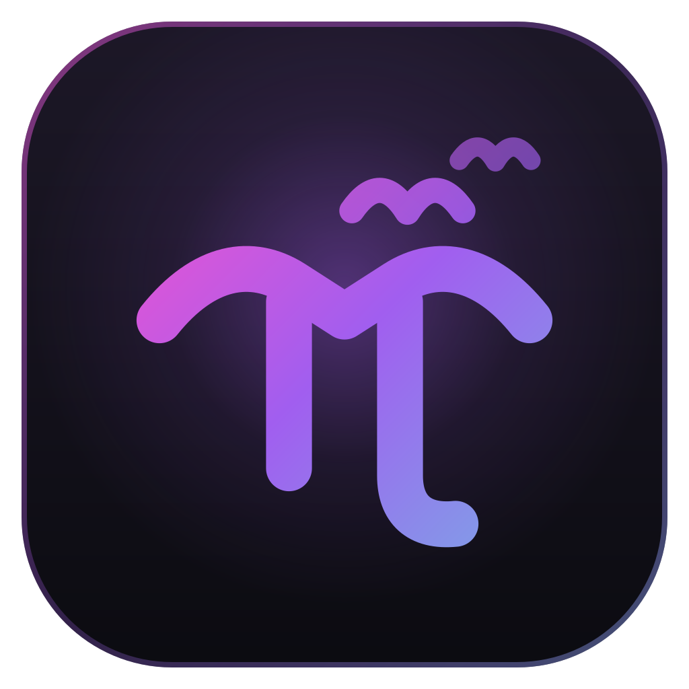

# TeleFlock

### Your agents, herded.

TeleFlock is a native desktop and phone app for the [omp](https://github.com/can1357/oh-my-pi) coding agents you run inside [herdr](https://herdr.dev). Every agent lands on one live board: you see what each one is doing right now, answer its questions and approvals with one tap, dispatch new tasks into fresh worktrees, review and ship the diff, and drop into a real terminal whenever you need it. It connects over Tailscale SSH, to herdr on this machine, or inside WSL. Your sessions keep running in herdr as they always did; TeleFlock is the window onto them.

[](https://github.com/studioplascode/TeleFlock/releases)
[](https://github.com/studioplascode/TeleFlock/releases)
[](LICENSE)
[](#install)
<br>
[](https://v2.tauri.app)
[](crates/)
[](src/)

**Download:**
[Windows](https://github.com/studioplascode/TeleFlock/releases/latest) ·
[Android](https://github.com/studioplascode/TeleFlock/releases/latest) ·
[Linux .deb / AppImage / Arch](https://github.com/studioplascode/TeleFlock/releases/latest) ·
[macOS](https://github.com/studioplascode/TeleFlock/releases/latest)

<br>

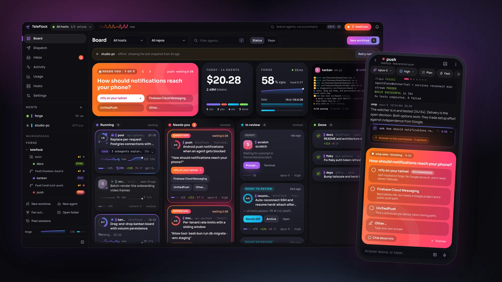

</div>

<br>

## Contents

[Feature tour](#feature-tour) · [Install](#install) · [Set up a host](#set-up-a-host) · [How it works](#how-it-works) · [Build from source](#build-from-source) · [Repository](#repository) · [Status](#status) · [Credits](#credits) · [License](#license)

## Feature tour

<sub>All screenshots are from the built-in demo host (`?demo`), which simulates a flock of agents. Nothing in them is mocked up.</sub>

### The board: is everything alive?

Four lanes, **Needs you · Running · Review · Done**, with every omp agent on every host. Needs you comes first, and its oldest question sits on top, answerable right on the card. Every card has the same layout in every lane: the state and its time on top (`turn 27:24`, `waiting 6:13`, `finished 25m ago`), then who and where (each repository has a chip in its own colour, and a card outside a git repository shows its folder), the task, what it is doing right now, and labelled meters (`ctx 61%`, `subs 59%`, `+188 −74 · 3 files`, model, thinking). Running cards keep a live heartbeat with the streaming line, tool timers and tokens per second, and agents that go quiet while working are called out. Above the lanes sit today's spend with the subscription limit you will hit first, every host's health and a live terminal tile. Mark a reviewed card done (with Undo) and its herdr pane closes, worktree workspace included; the card stays in Done with its transcript, and **Resume**, opening its terminal or simply sending it a message picks the session back up with `omp --resume`. Once a card's pull request is merged or closed, **Delete worktree** on the card (or in its ⋯ menu) removes the worktree, also on a Done card whose pane is already closed (the card keeps its transcript), and marks the agent done. Drag a card back to reopen it, multi-select, filter by host or repository (on the phone too), and drive everything from the keyboard (`J`/`K`, `Enter`, `A` answer, `T` terminal). When omp's cleanup (or you) deletes an agent's session file, the agent disappears from the board, the inbox and Dispatch.

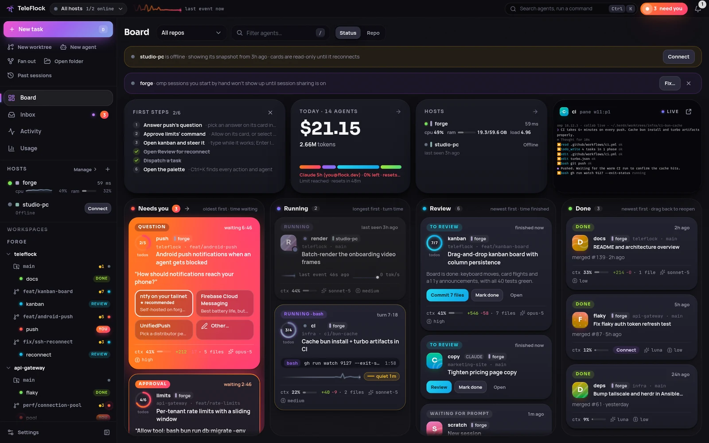

### Easy to start, nothing hidden

New to omp and herdr? The board's **First steps** checklist walks you through the demo flock (answer a question, approve a command, steer an agent, review, dispatch, the palette) and retires itself. Dotted terms such as *pane*, *steer*, *follow-up*, *worktree* or *compact* explain themselves on hover or tap, short hints beside the composer and the phone pager retire after a few sightings, and every launcher and palette action says what it does. Each fact is shown once, in one place, with its unit. Motion is calm by default: only changes and what needs you move, briefly, then the screen holds still; nothing animates while the window is in the background, and Settings → Motion → Lively brings back the full show.

### AI naming with omp's tiny model

TeleFlock uses the **tiny model role** you set up in omp (`modelRoles.tiny`, falling back to `smol`) as its AI provider, on the host and through your own omp login. It names Dispatch worktrees and branches, wizard branches and agents, fan-out runs and templates, suggests a name when you rename a session or workspace, and drafts commit messages and pull request titles and descriptions in Review. AI-made names carry a ✨, are always editable, and fall back to names made from your own text when the model is slow or switched off (Settings → AI naming). Nothing is stored: the text goes only to your own model provider, through omp.

### Every omp setting, in the app

Everything you can configure in omp is on the **omp settings** page (`Ctrl+8`, a host card's ⋯ menu, or Settings → New agents), per host: all of omp's settings under omp's own tabs, groups, labels and descriptions, with search, the right control for each (switches, choices with their explanations, numbers with omp's presets, lists, JSON), a modified dot and reset to default. The **model roles** editor at the top of the Model tab assigns a model and thinking level to every role (default, smol, slow, plan, tiny, task, advisor, …) and to roles of your own. TeleFlock reads omp's own settings schema from the omp on the host and writes through `omp config`, so omp validates every change; secrets are write-only.

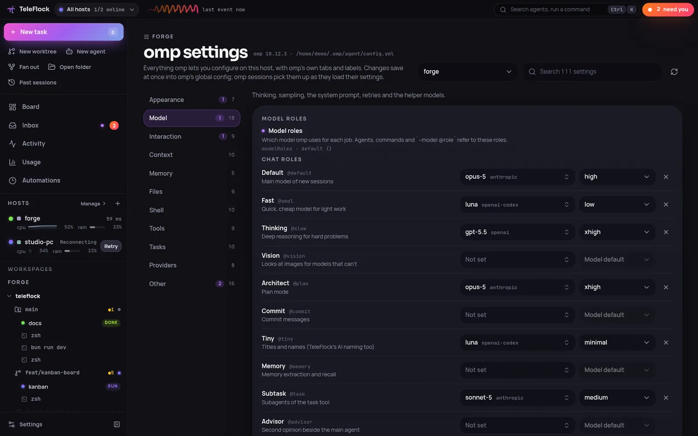

### MCP servers, signed in from anywhere

The **MCP servers** page, next to omp settings on every host, lists each MCP server omp loads there, user-wide and per project, with its live status and tool count; expand a row to read its tools. Add a server from popular templates, the Smithery registry or by hand (stdio, HTTP or SSE), edit it with its secrets masked, test it, switch it off and on, or remove it. Running sessions pick the change up through omp's own `/mcp reload`, or say they need a restart. Servers you already have are marked in the templates, so nothing gets added twice. A server that needs an OAuth login signs in from the app even when omp runs on a remote host: TeleFlock opens the sign-in page on your device and carries the redirect back to the host on the same port, or takes the address you landed on when that port is busy.

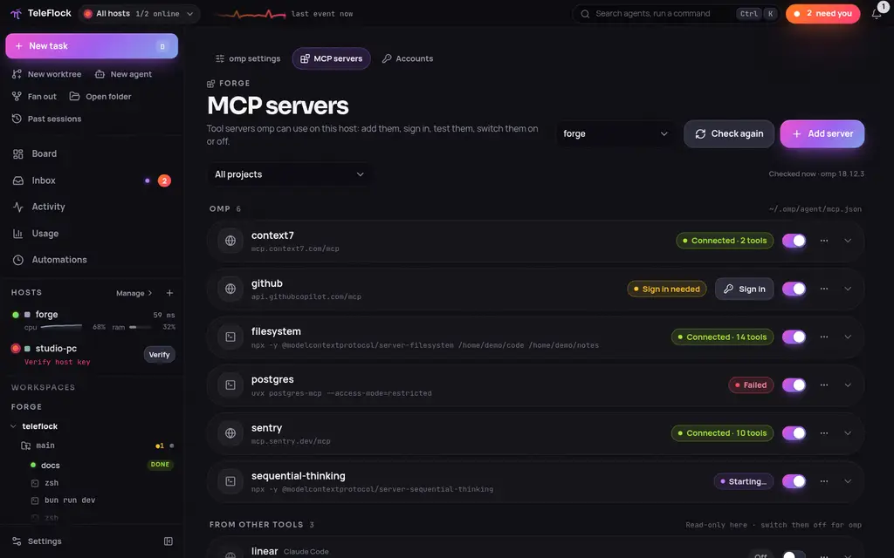

### Your subscriptions, linked from the app

The **Accounts** page shows the subscriptions and API keys omp signs in with on each host (ChatGPT, Claude, GitHub Copilot, Gemini and the rest): every account's plan, its live sessions and its quota windows, with a pace warning before one runs out. **Link account** runs omp's own login on the host and brings the sign-in to you: a page on this device whose redirect comes back to the host over a tunnel, a device code to enter, or a code to paste. Prefer an account for new sessions, re-link an expired login, or unlink one. A host with no usable account says so on the board and offers the link.

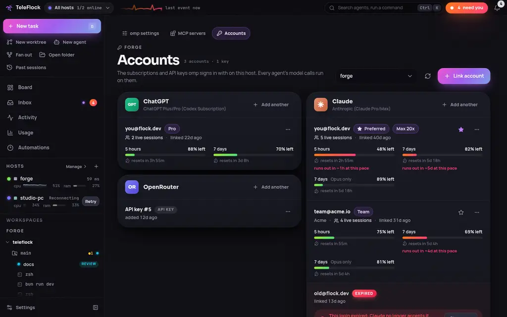

### A native session for every agent

A real GUI for the omp transcript: streaming markdown, rich tool cards (diffs, bash with ANSI colours, search, todos, subagents, web, images) and thinking blocks. Click any image to open it full screen, then zoom and pan (wheel, pinch, double-click) and page through the rest of the message. When the agent asks, its question becomes a card you answer with a click or `1`–`9`, with each option's trade-off written inside its button (Skip answers nothing). `Enter` sends, or steers the running turn, and `Alt+Enter` queues a follow-up, with an editable queue, a `/` palette covering omp's commands and your own, `@` file search, images and videos (a video is uploaded to the host with a progress chip, and the agent gets its path; omp reads it with ffmpeg). Whatever you type, anywhere in the app, stays put: drafts and pasted images survive switching agents, closing dialogs and restarts until you send them. Model, thinking, plan, goal and fast mode sit in the header and say whether they are on. The inspector shows how much context is used and how much of your subscription is left, spend by source, throughput, todos, changed files, the session tree (branch, fork, navigate) and more. A fresh agent offers starter prompts.

| Ask cards | Approvals |
|---|---|
| 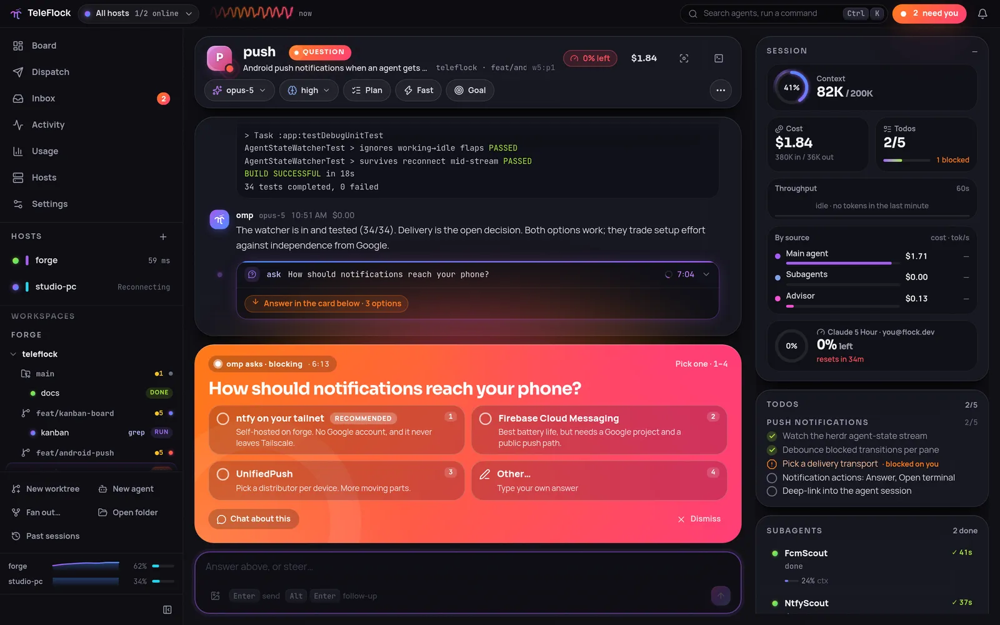 | 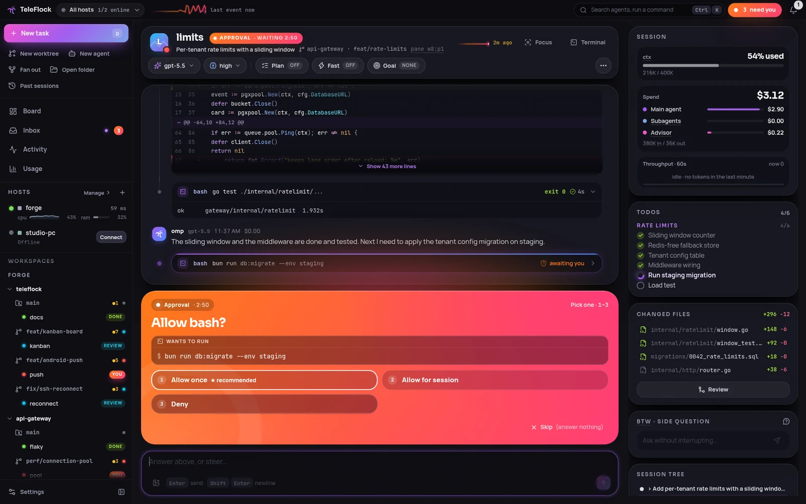 |

**Attached natively, even to big swarms.** TeleFlock follows each omp session through the TeleFlock bridge, an extension running inside omp that streams the session's live events and takes questions, approvals and controls over a private local socket, while `tf-hostd` reads the history straight from omp's session file. A session running dozens of subagents stays live, and a restarted host daemon picks every session up again with the same rows. Sessions are also cached on your devices: reopening one, reconnecting or restarting the app fetches only the rows that changed, over a zstd-compressed link. In the lab, a cached re-open of a 1,190-entry session moved about 3 KB instead of 476 KB.

### Dispatch: fire tasks into fresh worktrees

Pick a repository and send tasks like chat messages. omp's tiny model names each one (`dispatch/offline-board-cache`), and each gets its own worktree and omp agent; they all run side by side. A thread per repo shows every agent's progress live: naming, creating the worktree, starting, then the agent's status and streaming line. You can answer its questions inline and jump to its session, terminal or review. Templates, model, thinking and plan mode are set per message, and you can paste, drop or attach images and videos that go to the agent with its first message (a video is uploaded to the host the task goes to). Every worktree forks from a freshly fetched `origin/main`, not a local `main` that may be behind. Put hosts in a **group** (host editor) and pick **Auto · <group>**: each task goes to the least busy host of the group that has the repository (running agents, tasks on their way, CPU and memory; clones are matched by their `origin` URL), and its card says where it went and why. Up to three worktrees are created at once; the rest queue. Need a specific branch or several attempts? New worktree and Fan out are one click away, with the repository filled in.

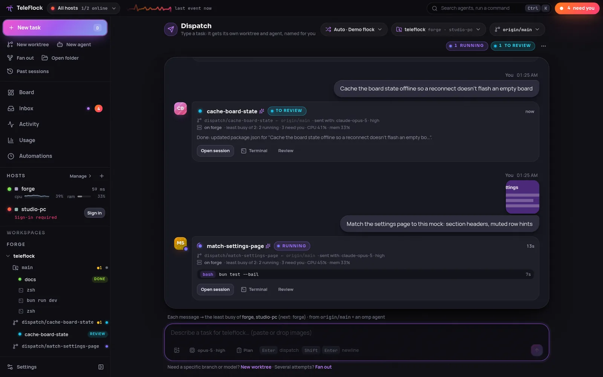

### Automations: agents on a schedule

A host can start an omp agent on a schedule: a nightly dependency audit, a weekday standup summary, a weekly flaky-test triage. Each automation has a prompt, a model, thinking level and plan mode, and either a fresh worktree per run (forked from `origin/main`) or a folder it runs in. Schedules are cron expressions in the host's time zone; the editor has presets and reads the next runs back in plain English. A run whose previous agent is still busy is skipped instead of piling up, and a run missed while the host was off can catch up once. Every run lands in the history with a link to its agent, and your devices get a notification. `tf-hostd` runs the schedules itself, so no app needs to be connected; on Linux with systemd a timer brings it back after reboots and crashes while an automation is enabled.

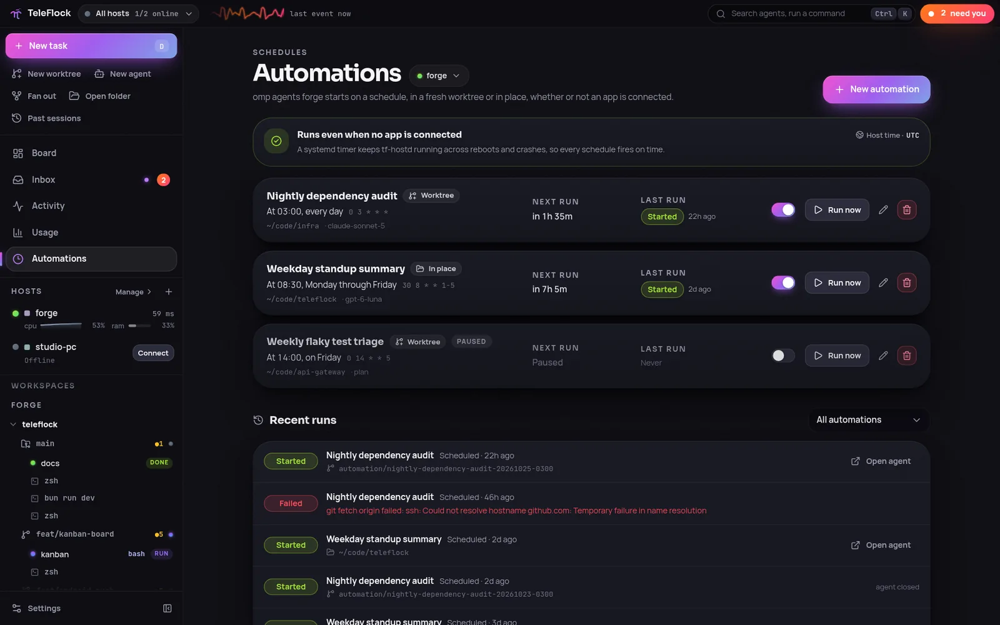

### Subagents and agent chat

When omp fans out, TeleFlock shows the swarm live: each subagent's own estimate of how far it is (**% done**), its context meter, tool count and cost. Open any of them in the full-height **subagent viewer** to read its transcript as it streams, message or steer it, kill it or revive it (`[` / `]` jump between siblings). When agents talk to each other over omp's IRC, the messages appear as **chat bubbles** in the transcript, and the **Agent chat** tab collects every thread.

| Agent chat in the transcript | Subagent viewer |
|---|---|
| 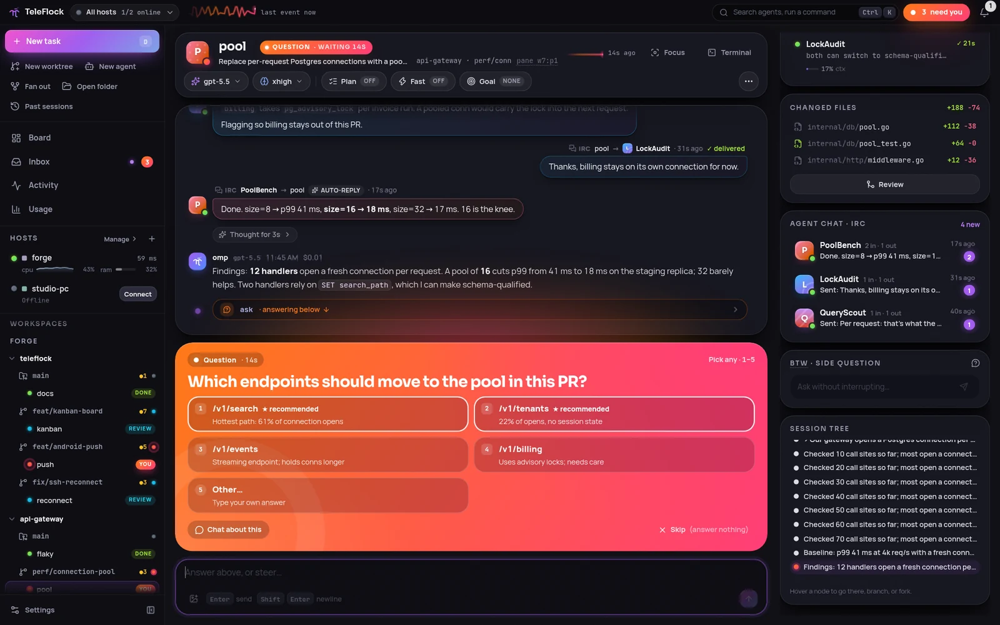 | 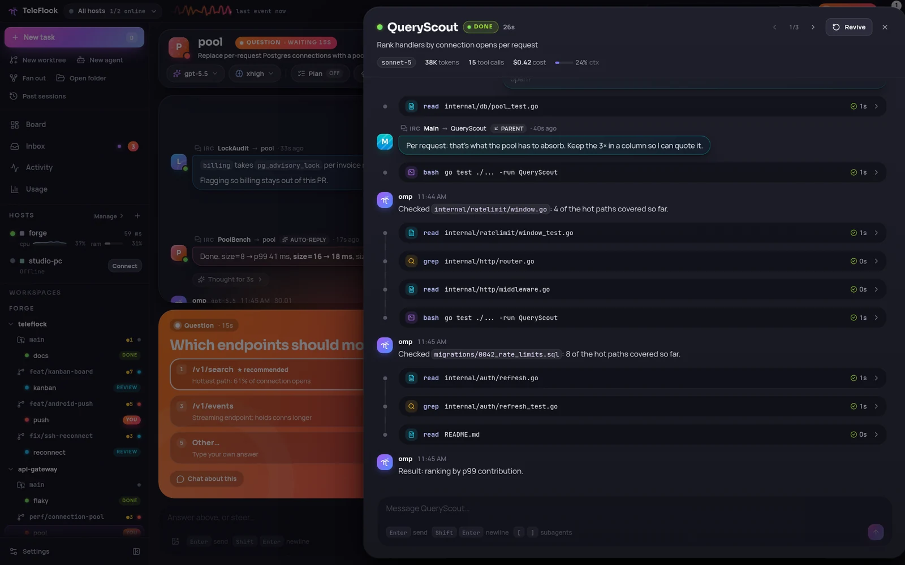 |

### Cost, throughput and subscription limits

Every agent's spend counts its subagents and the advisor too, broken down by source in the inspector, alongside a live tokens-per-second meter. The Usage page tracks spend per day, model and agent. **Subscriptions & limits** reads the quota windows of every account omp is logged into (Claude 5-hour, 7-day, Codex…), with reset countdowns and a pace projection that warns before you hit a limit. The session inspector has a limits tile, and a header chip appears when an account runs low.

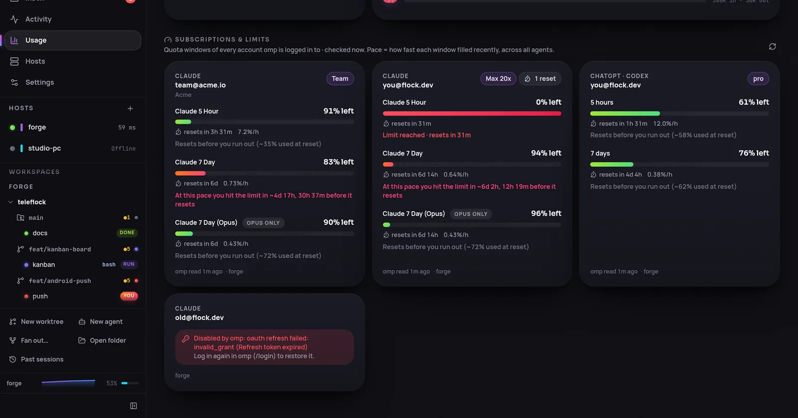

### Review and ship

A diff viewer (unified or split) for any worktree. From there you commit (✨ let the tiny model draft the message, or ask the agent), push, open a PR (✨ title and description), watch the checks and merge. A ship stepper shows where the worktree stands and its next step, even on a laptop screen, and Review cards on the board show that next step too.

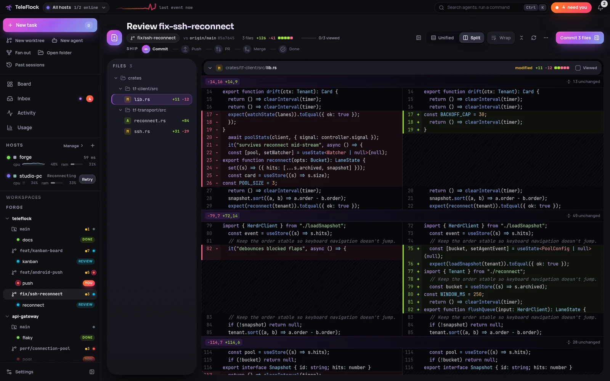

### A real terminal when you need it

xterm.js attached to any herdr pane, in **Fira Code** with **Nerd Font** icons. Beside it, **Running panes** lists every pane on the host, shells and agents, grouped by workspace and tab with the program running in each (`vim`, `bun run dev`, `htop`); the sidebar shows shells under their workspace and the palette finds them, and opening one attaches to the existing pane instead of starting a new shell. It supports control or observe mode with take-over, search, tabs, `localhost` preview tunnels, and an extra-keys row on phones. Paste or drop an image or a video (on the phone, the image key) and it is uploaded to the host and its path pasted, so omp in the pane attaches it as it would in a local terminal; pasted text arrives as one paste, line breaks included. omp keeps running as its normal TUI inside herdr, so the terminal is always the real thing.

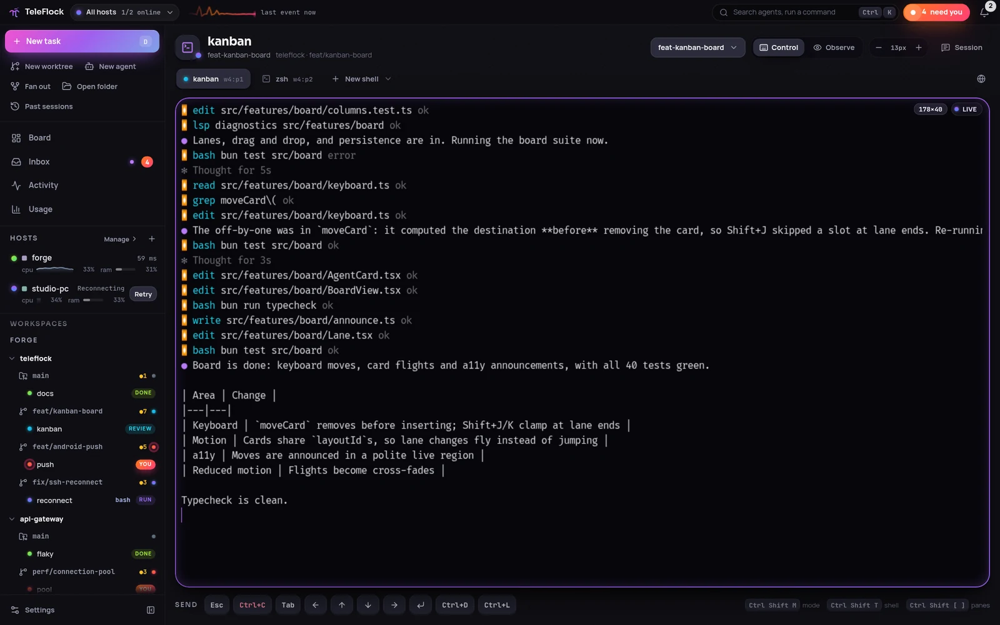

### In your pocket

The phone layout is built for one thumb: **Flock · Inbox · Dispatch · Terminal · More**. Flock home puts what needs you first, with each option's trade-off on the card, tiles that take you somewhere (Answer →, running ↓, today's spend ›) and a ⋯ menu on every row. Sessions swipe between agents, and a Next chip jumps to the next one waiting; the Terminal tab reopens the terminal you used last. The composer's mic dictates through Android's speech recognizer and asks for the microphone the first time you tap it. Bottom sheets, pull to refresh and haptics come with it.

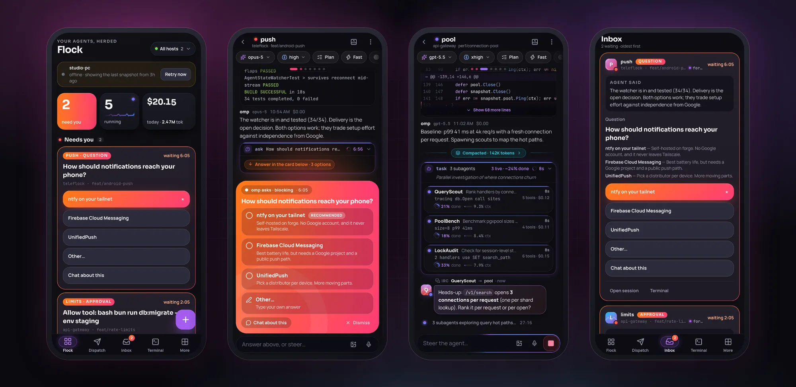

### Notifications that clear themselves

When an agent needs you, you get an OS notification you can act on: a Windows toast with buttons and inline reply, or an Android notification with up to three actions and inline reply. Once a question is handled anywhere (the card, the toast, the board, `Ctrl+J` "answer next", another device or the omp TUI itself), its notification disappears everywhere. Read ones are retracted too. The **Inbox** holds what needs you first, then unread updates (finished, errors, quiet agents); the bell is a quick peek at the same list. Desktop also has a tray icon with a live badge, a taskbar overlay on Windows, and per-agent mute and quiet hours. Linux and macOS have no OS notifications yet; there the inbox and the tray badge carry the same information.

### Updates

The app finds new versions on GitHub releases by itself: shortly after launch, about every hour while it keeps running, and when you come back to it after 20 minutes or more. On Android, an update found in the background asks to install the next time you open the app.

| Platform | How it updates |
|---|---|
| Windows | Downloads the signed installer, installs it with a progress window (no prompts) and relaunches |
| Linux AppImage / .deb | Downloads the signed package, replaces the AppImage or installs the .deb (password prompt), restarts |
| Android | Downloads the APK, checks its checksum and signing certificate, then Android asks you to confirm |
| macOS | Tells you a new version is out and opens the download (the CI-built app is not signed for auto-install) |
| Arch | Through pacman / the AUR, like any other package |

Desktop packages are verified against the release signing key and the release version before anything is installed. Turn automatic updates off in Settings → Updates.

### And more

Command palette (`Ctrl+K`) with a one-line description for every action, an activity feed with a "while you were away" digest, a usage dashboard, agent templates, fan-out (N approaches in parallel), worktree and agent wizards with a remote folder browser, past sessions and resume, offline-first cached state, and the built-in demo host.

## Install

Grab the files from the [latest release](https://github.com/studioplascode/TeleFlock/releases/latest). Every package has a `.sha256` next to it.

| Platform | File | Notes |
|---|---|---|
| **Windows 10/11** (x64) | `TeleFlock_<version>_x64-setup.exe` | Per-user install, no admin. Needs WebView2, which Windows 11 includes. |
| **Android 7+** | `TeleFlock_<version>_universal.apk` | Allow installs from this source. Grant notifications on first launch; for background alerts, allow the battery-optimisation exemption in Settings. Updates need the "install unknown apps" permission once. |
| **Debian / Ubuntu** (x64) | `TeleFlock_<version>_amd64.deb` | `sudo apt install ./TeleFlock_<version>_amd64.deb`. Debian 12+, Ubuntu 22.04+. |
| **Any Linux** (x64) | `TeleFlock_<version>_amd64.AppImage` | `chmod +x` and run. Registers `teleflock://` links on first launch. |
| **Arch Linux** (x64) | `teleflock-bin-<version>-1-x86_64.pkg.tar.zst` | `sudo pacman -U teleflock-bin-…pkg.tar.zst`. The PKGBUILD is in [`packaging/arch/`](packaging/arch/PKGBUILD). |
| **macOS 11+** (Apple silicon + Intel) | `TeleFlock_<version>_universal.dmg` | Not notarized (no paid Apple account), so see below. |

<details>
<summary><b>macOS first launch (Gatekeeper)</b></summary>

The app is ad-hoc signed but not notarized, so macOS blocks it the first time:

1. Drag TeleFlock to Applications and open it once. macOS says it can't be verified.
2. Open System Settings → Privacy & Security, scroll down and click **Open Anyway** (on macOS 14 and older you can instead right-click the app → **Open**).

Or, in Terminal: `xattr -dr com.apple.quarantine /Applications/TeleFlock.app`.
</details>

**iOS** is not offered. Without the paid Apple Developer Program, an app can only be sideloaded with a 7-day signature, and iOS would also suspend the live host connection in the background.

## Set up a host

On the machine that runs herdr and omp:

1. **Tailscale SSH (remote hosts):**
   - Run `sudo tailscale set --ssh`.
   - Make sure your tailnet policy lets your devices SSH to this host as your user.
   - If the policy uses `check` mode, TeleFlock shows an **Open browser** card to finish the login.
   - **No Tailscale SSH?** Any OpenSSH server works too: open **Advanced: authentication** in the host dialog and pick **Private key** (a key file on the desktop, imported or pasted on the phone, optional passphrase) or **Password**. The secret stays on that device (`secrets.json` in the app's data folder, readable by your user only), is sent only to that host, and is tried once, with nothing else as a fallback. The host's key is shown for you to confirm on the first connect.
2. **herdr and omp** (`herdr --version`, `omp --version`; omp ≥ 18.12). You don't have to install them first: when one is missing, **Host setup** (step 4) installs it for you. From then on the host keeps them current: `tf-hostd` checks for new releases every 6 hours and installs them (`omp update`, plain `herdr update`, never a live server handoff, so running agents keep running). The host card shows both versions with Check now / Update now and a switch to turn it off. `tf-hostd` runs with the PATH of your interactive shell (read once when it starts), so an omp installed with bun, npm/nvm, cargo or mise is found the way your terminal finds it.
3. **In TeleFlock:** **Add host** (first launch, or the **+** next to HOSTS in the sidebar) → Tailscale SSH (MagicDNS name or 100.x IP, user), Local, or WSL (pick a distro) → **Test** → **Add host**. The test looks for herdr and omp the way `tf-hostd` will, says where it found them, and notes what Host setup can install. TeleFlock deploys `tf-hostd` to `~/.teleflock/` and connects.
4. **Host setup** (on the Hosts page, which opens it by itself while items are open; the board shows a **Fix…** strip too) offers one-tap fixes, each explained by what goes wrong without it. Each runs only when you tick its consent box, every ticked fix runs even when another one fails, and each shows its own outcome:
   - **Install what's missing:** omp (`install-omp`, omp's official installer as a standalone binary into `~/.local/bin`; also the fix when your omp is a node script without node), bun (`install-bun`, when your omp is a bun script and bun is nowhere), herdr (`install-herdr`, herdr's installer, then its server is started), gh (`install-gh`, the latest GitHub CLI release, checksum-verified, into `~/.local/bin`), and git and ffmpeg (`install-git`, `install-ffmpeg`; ffmpeg lets omp read attached videos) through the system package manager when `tf-hostd` runs as root or may use `sudo` without a password, otherwise the item shows the command to run. "What exactly runs?" on each item shows the command.
   - **herdr's omp integration** (`install-herdr-integration`): accurate working/blocked/idle states.
   - **TeleFlock bridge for every session** (`install-global-bridge`, recommended): copies the TeleFlock bridge into `~/.omp/agent/extensions/`, so TeleFlock follows and controls every omp session, including ones you start by hand or herdr restores (herdr's restore drops TeleFlock's own launch flags). `tf-hostd` keeps that copy current from then on; it never creates one you didn't ask for.
   - **Share sessions with TeleFlock** (`enable-global-sharing`, fallback): sets `collab.autoStart: control` and `collab.relayUrl: ws://127.0.0.1:47466` in omp's global config, so sessions that run without the bridge are still followed through omp's collab room on the host's private relay.
   - **herdr outside login sessions** (`move-herdr-out-of-login-session`, Linux with systemd, root): appears when the running herdr server still lives in the login session that started it. systemd kills everything in a login session's scope when logind tears the session down (on logout with `KillUserProcesses=yes`, or when a restarted logind cleans up sessions that already ended), and every agent goes with it. The fix moves herdr and all its processes into a scope of their own; nothing is stopped or restarted. Non-root users see what to do instead (`loginctl enable-linger`).

   You can skip all of them. Agents started from TeleFlock carry the bridge anyway, a session without it can be connected with one click (**Connect** injects `/collab` into it, also while the agent is working), and on Linux with systemd the herdr servers TeleFlock starts get their own scope from the start.

5. **AI naming** needs nothing extra: it uses omp's `tiny` model role (or `smol`) on the host. Check it with `omp config get modelRoles`.

Phones connect over SSH: Tailscale SSH (your tailnet identity is the login, nothing is stored) or, under **Advanced: authentication**, a key or password kept on the phone. Desktops can also use **Local** (herdr on this machine) and, on Windows, **WSL**.

**WSL:** Windows stops a WSL distro about 15 s after the last Windows program using it exits, and every agent inside stops with it. TeleFlock keeps the distro running while the app runs (also while it reconnects). For agents that keep working after you quit TeleFlock, add this to `%UserProfile%\.wslconfig` and run `wsl --shutdown` once:

```ini
[general]
instanceIdleTimeout=-1
```

## How it works

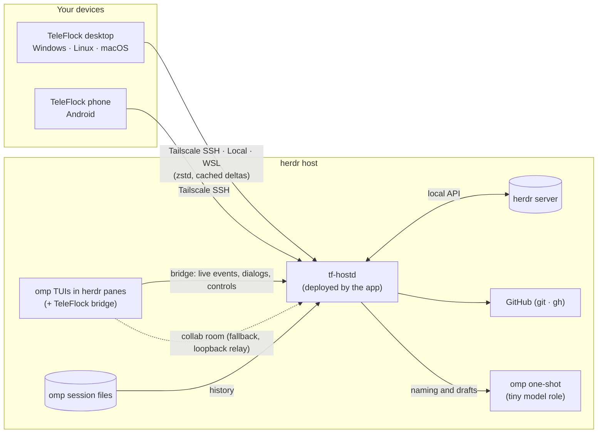

- omp keeps running as its normal TUI inside herdr, so herdr's state tracking and the real terminal keep working.
- The app's Rust core uploads and starts a small host daemon, `tf-hostd`, over SSH (or locally), and speaks one protocol to it whatever the transport.
- All your devices share that daemon. When they run different app versions, the host keeps the newest `tf-hostd` and older apps attach to it instead of replacing it, so one device never knocks the other off.
- On Linux with systemd, `tf-hostd` and any herdr server it starts run in transient scopes of their own (root: the system manager; other users: their user manager when lingering is on), so the SSH login that started them can end, or be cleaned up, without taking the agents down.
- `tf-hostd` follows each omp session through the TeleFlock bridge, an omp extension that streams the session's live events (messages, tools, subagents at any depth, questions and approvals) over a private local socket and carries every control back, while the history comes straight from omp's session file. Updates are throttled and merged at the source and the stream resynchronizes itself instead of ever dropping a session, so busy sessions stay attached. Sessions without the bridge (an omp started without it) fall back to a private collab guest on a loopback relay; room keys never leave the host.
- When omp loads more than one copy of the bridge (the global install and TeleFlock's own), only the newest one talks to `tf-hostd`.
- Each device keeps the sessions it opened in a compressed cache. Opening a cached session shows it at once; reopening, reconnecting or restarting sends what the device holds, and the host answers with only the missing or changed rows. The link to the host is zstd-compressed both ways (older apps and hosts keep the plain protocol).
- herdr is driven through its local API; git and `gh` run on the host for review and shipping.
- AI naming runs `omp --mode json` once per request on the host with the `tiny` role (no tools, no session), reads the answer and stops the process.
- `tf-hostd` also runs the host's automations and keeps omp and herdr up to date; on Linux with systemd a timer restarts it after a reboot while an automation is enabled.
- omp settings come from omp's own schema (read once per omp build by a throwaway headless omp with the TeleFlock extension) and are written through `omp config set`.
- The UI is React, rendered by the system webview through Tauri 2. Desktop and Android share all of it.

Details: [`docs/architecture.md`](docs/architecture.md) · spec: [`docs/spec.md`](docs/spec.md) · feature coverage: [`docs/coverage.md`](docs/coverage.md) · bridge protocol: [`docs/bridge-protocol.md`](docs/bridge-protocol.md).

## Build from source

Toolchain, CI, signing and every command are in [`docs/build.md`](docs/build.md).

```bash
bun install
bun run dev                  # UI with the demo host: http://127.0.0.1:1420/?demo
cargo test --workspace && bun test && bun run typecheck
scripts/build-windows.sh     # → dist-release/TeleFlock_<v>_x64-setup.exe (cross-compiled, NSIS)
scripts/build-android.sh     # → dist-release/TeleFlock_<v>_universal.apk (signed)
scripts/build-linux.sh       # → dist-release/ .deb + AppImage + Arch package (docker)
```

macOS is built on GitHub's macOS runners (`.github/workflows/macos.yml`). Releases come from `scripts/release.sh`.

To run the real stack in a browser against a herdr session on this machine, start the dev server below. It prints a tokened URL; open that.

```bash
cargo run -p tf-devserver -- --static dist --bind 127.0.0.1:7420 --hostd-bin target/<dir>/debug/tf-hostd
```

## Repository

| Path | What |
|---|---|
| `crates/tf-proto` | Wire protocol, the single source of truth (TypeScript generated into `src/core/gen` by `scripts/gen-proto-ts.sh`) |
| `crates/tf-hostd` | Host daemon: collab relay and guests, herdr client, state, ops, bridge server |
| `crates/tf-collab` · `crates/tf-herdr` | omp collab protocol (relay, guest, replica) · herdr API client |
| `crates/tf-transport` · `crates/tf-client` | Tailscale SSH / Local / WSL transports · the app's core engine |
| `crates/tf-devserver` | Browser bridge to the app core (token-protected) |
| `src-tauri/` | Tauri 2 shell: tray, toasts, Snap Layouts, deep links, self-update; Android Kotlin plugin (keep-alive service, notifications) |
| `host/teleflock-bridge/` | omp companion extension |
| `src/` | React UI: `core` (transports, stores, demo host), `design` (Bento design system), `features/*` |
| `packaging/` | Linux release build container, Arch PKGBUILD |
| `scripts/` | Build, version and release scripts |
| `docs/` | Architecture, spec, coverage, build, research (herdr / omp / collab maps with captured samples) |

## Status

What has been verified, and how:

- **Test suites:** the Rust workspace tests, the frontend unit tests and the typecheck.
- **Real omp + herdr, on Linux:** the full stack was exercised end to end through the UI in herdr lab sessions, via `tf-devserver` with the local transport, including subscription limits against real Claude and Codex accounts. AI naming (`ai.complete`) was run against omp 18.12.3's real `tiny` model role (an answer in about 4 s).
- **0.4.0 interface:** the changed screens were walked in the demo at 1440×900, 1280×720 and on a Pixel 5 profile, and the whole change went through a code review.
- **0.4.1 fixes:** each was reproduced first and re-checked after the fix: the collab join of resumed sessions against a live omp 18.12.3 room (joined in about 1 s instead of timing out every 30 s), queued steers, omp's own `/btw` with follow-ups, kept image originals and the observed terminal size in herdr lab sessions, the systemd scopes and the herdr move on a throwaway process tree, and the update schedule in unit tests plus a live run against GitHub. The Android lifecycle hook for updates was compiled only in the release build.
- **0.5.0:** the Rust and frontend suites, plus lab runs against real omp 18.12.3 and herdr 0.9.0: Mark done closing the pane, the parked card, Resume, a prompt resuming a parked agent, a daemon restart and pruning after the session file was deleted; a Dispatch task whose image reached omp with its first prompt (the agent answered "Red") in a worktree forked from the fetched `origin/main` with no upstream; all 559 omp settings read from omp's schema and a set/reset round trip in a temporary agent dir; scheduled, catch-up and skipped automation runs and the systemd timer on a lab home; the omp/herdr updater against fake binaries; every pane of a lab herdr session listed with its program. Rendering was measured in headless Chromium and in WebKitGTK at 2× scale: on an idle board the GPU process went from 97% to 3% CPU and compositor layers from 75 to 17, and WebKitGTK's web process from 584% to 114%. The new screens were walked in the demo at 1440×900 and 412×892, and the whole change went through a code review.
- **0.5.1:** the Rust and frontend suites, plus lab runs against real omp 18.13.1 and herdr 0.9.5 on Linux. Each fix was reproduced first: New session with the old global extension copy loaded next to TeleFlock's own (7 of 10 before, 20 of 20 after); Connect on an unshared omp while it streamed (refused before, live in 0.8 s after); the composer check against 94 real omp screens (52 misread before, none after); a pane whose shell needs 12 s to start (failed at 2 s before, started after); a daemon with `PATH=/usr/bin:/bin` running an omp installed with bun; real installs of bun, omp, herdr and gh into sandbox homes; three resumed 6 MB sessions at 10 % CPU (two showed errors before, all three connected after); a two-line paste into a pane (the first line ran before, both stayed in the prompt after); a suspended app, attach and daemon (reconnected before, kept the link after); a 14.4 MB video read by an omp agent after upload, and a PNG pasted into the terminal attached by omp; password and key sign-in against a real OpenSSH server. The board, session and phone layouts were walked in the demo at 1440×900 and phone widths from 360 to 412 px, and the Calm board, unfocused window and React Compiler coverage were measured before and after in headless Chromium (a frozen Calm board at 4× CPU throttling: 20 → 1.5 frames/s).
- **0.5.2:** the real flow that 0.5.1 missed, through the UI on a lab host with real omp and herdr: an agent in a new worktree, Mark done, the pane and its workspace closed 11 s later, then Delete worktree on the parked Done card (its pull request reported merged by a stand-in `gh`): the checkout was gone from disk and from `git worktree list`, the branch was kept, and the card stayed in Done with its transcript.
- **0.5.3:** a test with real git, failing before the fix and passing after: of two worktrees whose folders were deleted, removing one keeps the other registered, and a locked one is refused. On a lab host, Delete worktree on a parked card whose folder had been deleted by hand dropped only that worktree's registration; another missing worktree of the repository stayed listed.
- **0.6.0:** the Rust suites (tf-hostd 346, tf-collab 81, tf-client 69 tests, clippy clean, Windows test builds checked) and 543 frontend tests, plus labs against real omp 18.13.2/18.13.3 and herdr 0.9.5 on Linux, all in isolated homes and agent dirs:
  - **Bridge attach:** an agent started from the UI went live through bridge 2.0.0 with no collab join; a prompt streamed; an `ask` answered in the UI reached omp; five parallel subagents (one of them nested) showed live and the session never left `live`; omp with the old 1.4.0 bridge still attached through collab; after a `SIGKILL`ed daemon restart the session came back through its bridge in about 5 s with the same rows, authors and usage. The bridge itself was checked against the real omp binary for answering an `ask` and an approval from the app, subagent chat, nested subagents and an overflow that resynchronized once.
  - **Session sync:** on a copy of a real 3.5 MB session, the first open moved 78 KB instead of 428 KB, a cached re-open 3 KB instead of 477 KB, a reconnect mid-stream 3 KB instead of 475 KB; every cached row matched a fresh snapshot afterwards. Through the UI, an app restart re-opened a session with 0 rows resent.
  - **MCP:** a stdio server added from the page connected with its tools in a lab omp session, and was switched off, on and removed with running sessions reloading; an OAuth MCP server signed in through the same-port tunnel from a host in its own network namespace, and through the paste fallback with the device port taken; a server that never answers is reported as pending within the test window and leaves no processes behind.
  - **Accounts:** the real `omp login` output for Claude and GitHub Copilot (URL, callback port, paste prompt, device code) reached the app through the tunnel; cancel closed the tunnel and stopped `omp login` on the host.
  - Every 0.6.0 area went through a code review (bridge, session sync, MCP, accounts) and a UX review of the whole app, and their findings were fixed before release.
- **Packages:** the Windows installer, the signed APK and the Linux .deb, AppImage and Arch package build from this tree. The Linux app was smoke-run: the window renders, the tray starts, a second launch hands its `teleflock://` link to the first, and the .deb installs and runs on a clean Ubuntu 22.04.

**Not yet exercised:**
- on real Windows, Android or macOS hardware (macOS is built only in CI);
- on a real Linux desktop session (tray rendering, the update password prompt, a fractional-scale monitor) and real WebView2 GPU usage;
- against a real remote Tailscale SSH peer (the SSH path is covered by an in-process server that imitates Tailscale);
- WSL mode on a real Windows machine (the WSL keepalive and the Windows builds are compile-checked and unit-tested only);
- Android dictation and the key import on a real phone.

Smoke-test those on your devices first, and please report what you find.

## Credits

- [Tauri](https://tauri.app) (MIT / Apache-2.0) for the app shell, its plugins (updater, deep link, single instance, log) and [`tauri-plugin-snap-layout`](https://crates.io/crates/tauri-plugin-snap-layout).
- [xterm.js](https://xtermjs.org) (MIT) for the terminal.
- [Fira Code](https://github.com/tonsky/FiraCode) by The Fira Code Project Authors, [SIL Open Font License 1.1](src/assets/fonts/fira-code/LICENSE).
- [Nerd Fonts](https://www.nerdfonts.com) Symbols Only v3.5.1 by Ryan L McIntyre, [MIT](src/assets/fonts/symbols-nerd-font/LICENSE); the bundled icon sets keep their own licenses, listed in [its README](src/assets/fonts/symbols-nerd-font/README.md).
- [React](https://react.dev), [Radix UI](https://www.radix-ui.com), [Tailwind CSS](https://tailwindcss.com), [Lucide](https://lucide.dev), [Motion](https://motion.dev), [zustand](https://github.com/pmndrs/zustand), [russh](https://github.com/Eugeny/russh), [tokio](https://tokio.rs) and the rest of the dependency tree in `package.json` and `Cargo.lock`.
- [omp](https://github.com/can1357/oh-my-pi) and [herdr](https://herdr.dev), which do the actual herding of agents.

## License

[MIT](LICENSE) © 2026 Studio Plascode
