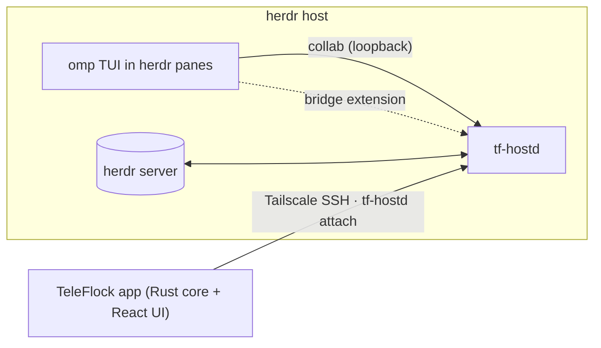

# TeleFlock

**Your agents, herded.** A native Windows and Android app for omp coding agents that run inside [herdr](https://herdr.dev). You get a live kanban of every agent, a native GUI for everything omp can do, one-tap answers to questions and approvals, herdr worktree management, and a real terminal for the rest.

- **Desktop (Windows):** connect to a remote herdr host over **Tailscale SSH**, to herdr on this machine (**Local**), or to herdr in a **WSL** distro.
- **Mobile (Android):** connect over **Tailscale SSH**. Your tailnet identity is the login, so no keys or passwords are stored.

## What you get

| Area | Highlights |
|---|---|
| Board | Lanes: Running · Needs you · In review · Done. Answer questions and approvals inline. Cards fly between lanes and keep a live heartbeat with streaming line, tool timers, todo ring, context, cost and a subagent swarm. Agents that go quiet are called out. Drag to archive, multi-select, filters, J/K keyboard. |
| Session | Native omp transcript with streaming markdown, rich tool cards (diffs, bash with ANSI, search, todos, subagents, web, images) and thinking blocks. Ask, approval and plan-review cards. A composer that steers or queues a follow-up, with an editable queue, `/` palette for all omp commands plus custom ones, `@` file search and images. Model, thinking, plan, goal and fast controls. Inspector with context, cost, tok/s, todos, subagents (steer, kill, revive), changed files, session tree (branch, fork, navigate) and btw. Focus mode. |
| Needs-you | Inbox, Ctrl+J "answer next" HUD, OS notifications with actions (Windows toast, Android with inline reply), tray and taskbar badge, per-agent mute. |
| herdr | Wizards for new worktree, new agent and fan-out (N approaches in parallel), with a remote folder browser. Workspace, tab and pane actions. Past sessions and resume. |
| Ship | Review: diff viewer (unified or split), commit (or ask the agent to write the message), push, open PR, checks, merge. |
| Terminal | xterm.js attached to any herdr pane, with take-over, search, tabs and a mobile extra-keys row. Preview tunnels for `localhost` URLs. |
| Extras | Command palette (Ctrl+K), activity feed with a "while you were away" digest, usage and cost dashboard, templates, offline-first cached state, built-in demo host. |

## How it works



- omp keeps running as its normal TUI inside herdr, so herdr's state tracking and the real terminal keep working.
- The app uploads and starts a small host daemon, `tf-hostd`, over SSH.
- `tf-hostd` joins each omp session as a private collab guest on a loopback relay. Room keys never leave the host.
- A companion omp extension adds structured controls (model, thinking, tree, queue, …).
- herdr is driven through its local API.

Details: [`docs/architecture.md`](docs/architecture.md). Spec: [`docs/spec.md`](docs/spec.md). Feature coverage: [`docs/coverage.md`](docs/coverage.md).

## Install

1. **Windows:** run `TeleFlock_<version>_x64-setup.exe`. It needs WebView2, which Windows 11 includes.
2. **Android:** install `TeleFlock_<version>_universal.apk` (allow installs from this source). On first launch, grant notification permission. For background alerts, allow the battery-optimisation exemption in Settings.

## Set up a host

On the machine that runs herdr and omp:

1. **Tailscale SSH (remote hosts):**
   - Run `sudo tailscale set --ssh`.
   - Make sure your tailnet policy lets your devices SSH to this host as your user.
   - If the policy uses `check` mode, TeleFlock shows an **Open browser** card to finish the login.
2. **herdr and omp** must be installed (`herdr --version`, `omp --version`; omp ≥ 18.12).
3. **In TeleFlock:** Hosts → **Add host** → Tailscale SSH (MagicDNS name or 100.x IP, user), Local, or WSL (pick a distro) → **Test** → **Save**. TeleFlock deploys `tf-hostd` to `~/.teleflock/` and connects.
4. **Host setup checklist** (Hosts → Host setup) offers one-tap fixes. Each runs only when you tick its consent box:
   - `install-herdr-integration`: herdr's omp integration, which gives accurate working/blocked/idle states.
   - `enable-global-sharing`: sets `collab.autoStart: control` and `collab.relayUrl: ws://127.0.0.1:47466` in omp's global config. Every omp session, including ones you start by hand or herdr restores, then appears live in TeleFlock.
   - `install-global-bridge`: copies the TeleFlock extension into `~/.omp/agent/extensions/` so precise controls work for every session.

   You can skip all three. Agents started from TeleFlock are shared and bridged per process anyway, and an unshared session can be connected with one click (**Connect** injects `/collab` into it).

## Build from source

The toolchain setup, CI and every command are in [`docs/build.md`](docs/build.md).

```bash
bun install
bun run dev                  # UI with the demo host: http://127.0.0.1:1420/?demo
cargo test --workspace && bun test && bun run typecheck
scripts/build-windows.sh     # → dist-release/TeleFlock_<v>_x64-setup.exe (cross-compiled, NSIS)
scripts/build-android.sh     # → dist-release/TeleFlock_<v>_universal.apk (signed)
```

Run the real stack in a browser against a herdr session on this machine. It prints a tokened URL; open that.

```bash
cargo run -p tf-devserver -- --static dist --bind 127.0.0.1:7420 --hostd-bin target/<dir>/debug/tf-hostd
```

## Repository

| Path | What |
|---|---|
| `crates/tf-proto` | Wire protocol (single source of truth; TS generated into `src/core/gen` by `scripts/gen-proto-ts.sh`) |
| `crates/tf-hostd` | Host daemon: collab relay and guests, herdr client, state, ops, bridge server |
| `crates/tf-collab` · `crates/tf-herdr` | omp collab protocol (relay, guest, replica) · herdr API client |
| `crates/tf-transport` · `crates/tf-client` | Tailscale SSH / Local / WSL transports · app core engine |
| `crates/tf-devserver` | Browser bridge to the app core (token-protected) |
| `src-tauri/` | Tauri 2 shell: Windows tray, toasts, Snap Layouts; Android Kotlin plugin (keep-alive service, notifications) |
| `host/teleflock-bridge/` | omp companion extension |
| `src/` | React UI: `core` (transports, stores, demo host), `design` (Bento design system), `features/*` |
| `docs/` | Architecture, spec, coverage, build, research (herdr / omp / collab maps with captured samples) |

## Status

v0.1.0. What has been verified, and how:

- **Test suites:** the Rust workspace, the frontend unit tests and typecheck are green.
- **Real omp + herdr, on Linux:** the full stack was exercised end to end through the UI in herdr lab sessions on Linux, via `tf-devserver` with the local transport.
- **Packages:** the Windows installer and the signed APK build from this tree.

**Not yet exercised:**
- on real Windows or Android hardware;
- against a real remote Tailscale SSH peer (the SSH path is covered by an in-process server that imitates Tailscale);
- WSL mode.

Smoke-test those on your devices first.
