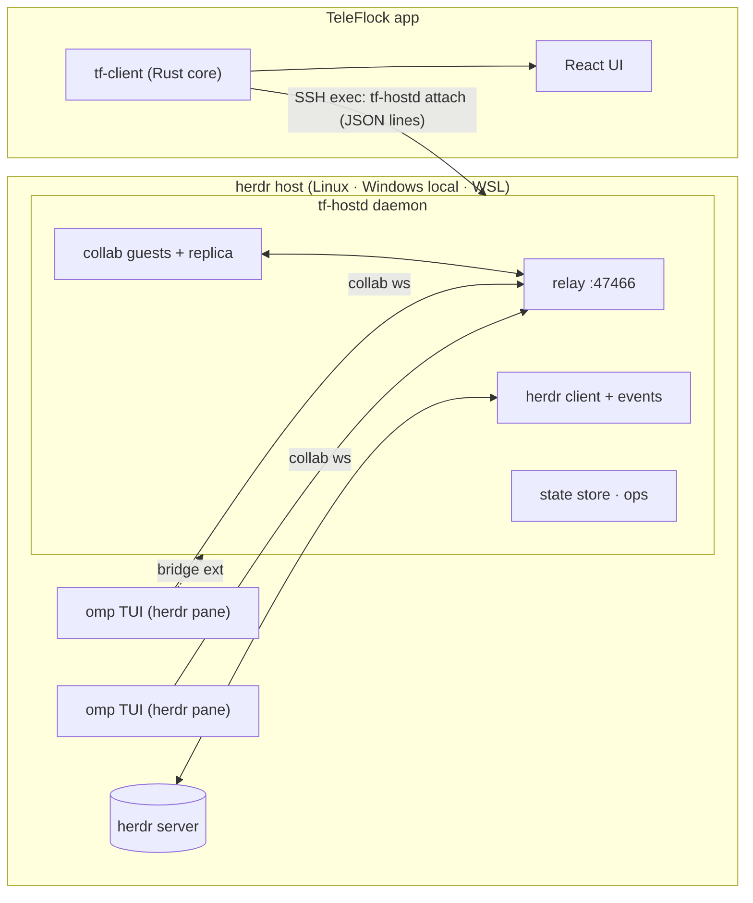

# TeleFlock architecture (v1)

Status: **decided** (phase B). Inputs:
- `docs/research/herdr.md`
- `docs/research/omp-collab.md`
- `docs/research/omp.md`
- `docs/research/platform.md`
- `docs/build.md`

The wire protocol lives in **`crates/tf-proto`**, the single source of truth. Its TypeScript bindings are generated into `src/core/gen/` by `scripts/gen-proto-ts.sh`.

## 1. Decision (ADR-001): how omp runs and how TeleFlock talks to it
**omp runs as the normal interactive TUI inside a herdr pane.**
- herdr keeps tracking its state through omp's own herdr integration (`working`/`blocked`/`idle`).
- The terminal in TeleFlock shows the real omp TUI.

**TeleFlock reaches omp through a host daemon, `tf-hostd`.** It runs on the herdr host, outlives app disconnects, and is shared by all clients (desktop and phone at once). It does four jobs:
1. **Relay.** It embeds an omp **collab relay** on `127.0.0.1:47466`, a private loopback port. omp sessions host collab rooms on it.
2. **Data plane.** It joins every hosted session as a **full-control collab guest** (`tf-collab`). That yields entries, live events, state, subagents, `ui-request`, prompt, abort, ui-response, agent-cmd and fetch-transcript. Host-side, it **compacts** omp's quadratic `message_update` stream into deltas; the keys never leave the host.
3. **Control plane.** It talks to the **TeleFlock companion extension** (`host/teleflock-bridge/teleflock-bridge.ts`) loaded in omp. The extension provides precise controls that a collab guest lacks: model, thinking, fast, plan-review answers, rename, compact, fork/branch/tree, follow-up queue, btw, export.
   - When the extension is absent, the fallback is herdr keystroke injection, following the safety rules in §5.4.
4. **herdr.** It drives herdr through the local API socket: one request per connection, plus one `events.subscribe` stream, coalesced. It bridges terminals through `herdr terminal session control`.

**How sessions get shared and bridged:**
- **Agents TeleFlock starts** are launched with:
  - `--config ~/.teleflock/omp-overlay.yml`, which sets `collab.autoStart: control` and `collab.relayUrl: ws://127.0.0.1:47466`;
  - `-e ~/.teleflock/ext/teleflock-bridge.ts`.

  No global config is touched.
- **Global opt-in (recommended).** Host setup can, with the user's consent:
  - write the two collab settings to omp's global config with `omp config set`;
  - copy the extension into `~/.omp/agent/extensions/`.

  This covers sessions the user starts by hand and sessions herdr restores (restore drops `--config`/`-e`).
- **Existing unshared sessions.** `agent.connect` injects `/collab ws://127.0.0.1:47466` while the session is idle. This creates a room but no bridge.

**Rejected alternatives:**
- **omp RPC mode in the pane.** It loses the real TUI and herdr's state target, and a second process cannot attach to a live session (it forks).
- **Guest inside the app over a `direct-tcpip` tunnel.** About 10× the bandwidth on mobile, and the room keys would travel to the device.
- **Slash injection only.** Fragile (see `omp.md` §1.2).



## 2. Repository layout and ownership

| Path | What |
|---|---|
| `crates/tf-proto` | Wire types and methods (orchestrator-owned contract). Run `scripts/gen-proto-ts.sh` after changes. |
| `crates/tf-herdr` | herdr API client: socket/pipe, typed calls, events, terminal sessions, server discovery. |
| `crates/tf-collab` | omp collab: link, crypto, frames, relay server, guest, registry, **replica normalizer** (omp → tf-proto). |
| `crates/tf-hostd` | Host daemon binary: daemon/attach, client protocol, state store, agent ops, injection, bridge server, fs/git/gh/host ops. |
| `host/teleflock-bridge/` | omp companion extension (TypeScript, loaded by omp directly). |
| `crates/tf-transport` | App-side transports: Tailscale SSH (russh), Local, WSL. |
| `crates/tf-client` | App core: profiles, connections, deploy, protocol client, aggregation, app methods, tunnels, notification policy. |
| `crates/tf-devserver` | WebSocket bridge exposing tf-client to a browser (dev and verification) and serving `dist/`. |
| `src-tauri/` | Tauri app shell (Windows + Android) and Kotlin plugin under `src-tauri/plugins/` or `plugins/`. |
| `src/core/` | Frontend core: transports (tauri, ws, demo), typed client, zustand stores, rAF batching, **demo host**. |
| `src/features/*` | Feature UIs. |
| `src/design/` | Design system (done, see the DesignSystem inventory). |

Every Rust crate is a workspace member (`crates/*`). Each agent compiles with its own `CARGO_TARGET_DIR=target/<Agent>`.

## 3. Host daemon `tf-hostd`

### 3.1 Files and processes (Linux/macOS; Windows uses the same paths under `%USERPROFILE%`)

| Path | Purpose |
|---|---|
| `~/.teleflock/bin/tf-hostd` | Binary, uploaded by the app. Its version must equal the app's embedded version. |
| `~/.teleflock/run/hostd.sock` | Client socket (0600). On Windows: pipe `\\.\pipe\teleflock-hostd-<user>`. |
| `~/.teleflock/run/bridge.sock` | Companion-extension socket. On Windows: pipe `\\.\pipe\teleflock-bridge-<user>`. |
| `~/.teleflock/run/hostd.lock` | Single-instance lock (holds the pid). |
| `~/.teleflock/state.json` | Persistent per-herdr-session state: archived agents, turn counters, acks, activity ring. |
| `~/.teleflock/hostd.log` | Rolling log. |
| `~/.teleflock/ext/teleflock-bridge.ts` | Companion extension, uploaded by the app. |
| `~/.teleflock/omp-overlay.yml` | Per-process collab overlay, uploaded by the app. |

### 3.2 Commands
- `tf-hostd daemon`: the long-running daemon.
  - Binds the relay port and the sockets; refuses to start if another instance holds the lock.
  - Logs to `~/.teleflock/hostd.log`.
- `tf-hostd attach [--session <herdr-session>]`: connects stdio to `hostd.sock`, starting the daemon detached (`setsid -f`, `</dev/null`) if needed, and waits up to 10 s for the socket. This is the **only** thing the app runs for the data channel.
- `tf-hostd stop`: graceful shutdown. A daemon that is replaced by a newer binary gets `stop` from `attach --replace`.
- `tf-hostd --version`: prints the version on one line (`tf-hostd 0.1.0 proto 1`).

### 3.3 Client protocol
`tf_proto::host::{ClientMsg, ServerMsg}` as JSON lines (`host.rs` documents the flow).

**Revisions.** Revisions are per herdr session.

**Coalescing.** The daemon coalesces before sending:
- state patches: at most 10 Hz
- pulses: at most 10 Hz
- session `append` deltas: one per 50 ms per item

A client sees one `snapshot` on hello, then patches.

### 3.4 Internal modules (crate `tf-hostd`)

| Module | Owner | Responsibility |
|---|---|---|
| `main.rs`, `daemon.rs`, `attach.rs` | HostdCore | CLI, lock, sockets, detach/replace, logging |
| `clients.rs` | HostdCore | Per-client sessions: hello/welcome, rev, subscriptions, request dispatch, pulse fan-out |
| `state/` | HostdCore | `HostState` builder: herdr ↔ omp merge, columns, liveness, needs, archive persistence, activity, notifications |
| `omp.rs` | HostdCore | Registry polling, one `tf_collab::guest` + `Replica` per session, link lifecycle |
| `ops/agent.rs`, `inject.rs` | HostdCore | All `agent.*` and `session.*` methods. Bridge first, collab second, injection last. |
| `bridge.rs` | BridgeExt | Extension socket server and typed control calls |
| `ops/{fs,git,gh,workspace,worktree,host,term}.rs` | HostdOps | fs.*, git.*, gh.*, workspace.*, worktree.*, host.*, term.* |
| `ops/limits.rs` | HostdOps | `host.limits`: subscription limits from `omp usage --json` / `--history --json` (see below) |

**Dispatcher contract.** HostdCore owns it. `clients.rs` parses `HostMethod::parse(method, params)`. For each method family it calls an async handler fn:

```rust
pub async fn handle(ctx: &Ctx, req: HostMethod, client: &ClientHandle) -> Result<serde_json::Value, ApiError>
```

`Ctx` gives:
- `ctx.herdr: Arc<HerdrClient>`
- `ctx.state: StateHandle` (read snapshot, mutate, emit)
- `ctx.omp: OmpHandle` (guests by agent)
- `ctx.bridge: BridgeHandle`
- `ctx.terms: TermRegistry`
- `ctx.paths: Paths`

HostdOps implements `ops::{fs,git,gh,workspace,worktree,host,term}::handle(ctx, req, client)` against that `Ctx`.

**Subscription limits (`host.limits`).** omp already knows each connected account's quota windows: it fetches per-account reports from the provider usage endpoints (Claude `api/oauth/usage`, ChatGPT/Codex `backend-api`, Copilot, Gemini, …), caches them ~5 min ±25 % per account in `~/.omp/agent/agent.db` (`cache` rows `usage_cache:report:…`), refreshes the window rows from live response headers at most once a minute, and appends hourly `usage_history` rows. `ops/limits.rs` never calls a provider and never sees a token: it runs `omp usage --json` (60 s hostd cache, `refresh: true` → 10 s) and `omp usage --history --json --days 8` (10 min cache), keeps its own per-poll readings, and returns `AccountLimits { fetchedAt, accounts: LimitAccount[], sessions: LimitSession[], error? }`. Each `LimitAccount` (`key` = `provider|email:…|org:…`) carries `plan`, `fetchedAt`, `resetsAvailable`, `error`/`disabled` (omp's `accountsWithoutUsage` / `disabledCredentials`) and `LimitWindow`s (`used` fraction, `resetsAt`, `durationMs`, `tier`, `status`, ≤ 120 `samples` of the current window period). `sessions` maps each live omp session to the account omp pinned it to: `agent.db` `cache` row `session:sticky:<provider>:<sessionId>` → `credentialId` → `auth_credentials.identity_key` (read-only; the credential `data` column is never selected); a provider with one account needs no pin. The client (`src/core/limits.ts`) computes the pace (used-fraction change per hour over a fifth of the window, 30 min … 24 h) and projects "runs out in ~X" vs "resets first".

### 3.5 Board mapping and liveness (state store)

**Columns:**
- `needs` if herdr is `blocked`, or the replica has a pending `UiRequest`, or the bridge reports a plan review.
- Otherwise `running` if herdr is `working`.
- Otherwise `done` if archived.
- Otherwise `review`. This covers idle/done after work, and also fresh idle agents, which the UI labels "Ready".

**Archive state.** Archiving is persisted. An agent that starts working again is un-archived automatically (activity `unarchived`).

**Liveness:**
- `lastEventAt` comes from any guest event; for non-omp agents it comes from herdr `pane_updated`.
- `streaming`/`thinking` reflect `message_update` deltas.
- `tool` is the open `tool_execution_*` call.
- `tps` sums every spender's output rate, split in `tpsSplit {main, subagents, advisor}`. The main agent's rate is a 3-second rolling count of its streamed deltas (chars / 4). Subagents and advisors stream nowhere a guest can see, so each of their finished replies (read from the session's artifacts dir, below) is replayed at its real decode rate, `usage.output / (duration − ttft)`, from the moment tf-hostd reads it: the sparkline's area is exact, its timing one reply late. Replies that ended over a minute ago are not replayed, and `tps` is absent when nothing produces output.
- `cost` (`OmpInfo.cost`, `SessionMeta.cost`) is omp's status-line total `$main (+subagents) + advisor`, split in `cost.split`. Main: the main agent's assistant `usage.cost.total` (collab entries) plus `model_usage` side calls (journal). Subagents: `max` of completed `task` results (`details.usage`), the artifact tree and the live `progress.cost` sum. Advisor: `__advisor*.jsonl` at the top of the artifacts dir. Collab mirrors neither advisor turns nor subagent transcripts, so tf-hostd tails `<session>/` (the dir next to `<session>.jsonl`, found under `<omp agent dir>/sessions/*/`) with `tf_collab::ArtifactLedger`: top-level `__advisor*.jsonl` bill the advisor, every other session transcript (subagents, nested subagents and their advisors) bills the subagent tree, counting only assistant turns and `model_usage` entries so nothing is counted twice. The host usage ledger (board "today") accounts the growth of this total with a high-water mark per session.
- `line` uses the active tool label, else the last assistant sentence fragment (≤ 80 chars).
- Pulses carry kind and intensity per agent at ≤ 10 Hz.

**Needs-you:**
- `ask` comes from select/editor ui-requests. Options use the **exact labels**. "Other (type your own)" becomes `allowOther`; "Chat about this" becomes `allowChat`.
- `approval` comes from `Allow tool:` selects (`omp-collab.md` §7).
- `planReview` comes from the bridge.
- `blocked` without a visible request (`answerable:false`) means: open the terminal.

**Notifications** fire on these transitions:
- → `needs`
- `running` → `review` (finished)
- an error notice
- quiet (> 120 s of no events while `working`), at most once per turn

Each notification carries actions for the first ≤ 3 options.

### 3.6 Herdr injection safety (`inject.rs`), from `omp.md` §1.2

Only inject when all of these hold:
- the agent is idle, or the command is safe while streaming;
- the composer line is visible (read the pane's `detection` source);
- no overlay is visible.

Always use canonical full forms:
- `/switch <provider/id:level>`
- `/effort <level>`
- `/fast on|off`
- `/plan`
- `/goal …`
- `/compact`
- `/rename …`
- `/collab ws://127.0.0.1:<port>`

After submitting, re-read the pane. If the composer still holds the text, send one more `enter`. Never inject names that aren't in the catalog: unknown commands go to the model and cost tokens.

### 3.7 Launch recipe (`agent.start`, `worktree.create` + agent, `host.resume`)

```
herdr --session S agent start <name> --kind omp --pane <pane> -- \
  --config ~/.teleflock/omp-overlay.yml -e ~/.teleflock/ext/teleflock-bridge.ts \
  [--model <provider/id>] [--thinking <level>] [--resume=<file>]
```

Once the agent is idle and `link=live`:
- `plan: true` → bridge `setPlan`, or inject `/plan`;
- an initial prompt → collab `prompt`.

The new agent appears through herdr events. The response returns `Started{paneId, workspaceId, agentId?}`.

## 4. Companion extension `teleflock-bridge.ts` (owner: BridgeExt)

**Connection.** At load it connects to `bridge.sock` and retries every 5 s while hostd is absent. It never throws into omp: every timer goes through `ctx.setInterval`, and every handler is wrapped in try/catch.

**Protocol** (JSON lines, documented in `docs/bridge-protocol.md`):
- On connect, the extension sends `hello {pid, sessionId, sessionFile, cwd, ompVersion, bridgeVersion}`.
- **Events** (extension → hostd):
  - `session_switch`
  - `plan_review_requested` / `plan_review_resolved`
  - `model` / `thinking` changes
  - `queue_update`
  - `btw_delta`
- **Requests** (hostd → extension), answered with `res`:
  - `setModel`, `setThinking`, `setFast`, `setPlan`
  - `goal`, `compact`, `rename`
  - `followUp`, `navigateTree`, `branch`, `fork`, `newSession`
  - `resolvePlanReview`, `btw`, `export`, `handoff`
  - `getTree`, `getQueue`

## 5. App side

### 5.1 `tf-transport` (owner: AppTransport)

```rust
#[async_trait] pub trait Transport: Send + Sync {
    async fn exec(&self, cmd: &Cmd) -> Result<Output, TransportError>;       // one-shot (stdin optional, timeout)
    async fn spawn(&self, cmd: &Cmd) -> Result<Child, TransportError>;       // long-lived stdio (attach, uploads)
    async fn forward_tcp(&self, host: &str, port: u16) -> Result<BoxedStream, TransportError>; // previews
    fn kind(&self) -> HostKind;
    async fn close(&self);
}
pub struct Cmd { pub argv: Vec<String>, pub env: Vec<(String, String)>, pub cwd: Option<String>, pub stdin: Option<Vec<u8>>, pub timeout: Option<Duration> }
pub async fn connect(profile: &HostProfile, opts: &ConnectOptions, ev: mpsc::Sender<TransportEvent>) -> Result<Arc<dyn Transport>, TransportError>; // opts: known_hosts path (TOFU), timeouts
pub enum TransportEvent { Phase(ConnPhase, Option<String>), AuthUrl(String), Latency(u32), Closed(Option<String>) }
```

**SSH:**
- russh with the `ring` backend.
- `none` auth first.
- A banner containing a `login.tailscale.com` URL becomes `AuthUrl` and the `authRequired` phase; keep waiting up to 30 min.
- Our own keepalive runs after login (avoid the russh `keepalive_interval` bug).
- Remote argv is POSIX-quoted and run via `exec sh -c 'exec "${SHELL:-/bin/sh}" -lc "$1"' sh '<cmd>'` (login shell → PATH includes `~/.local/bin`).

**Local:** `tokio::process`, no shell.

**WSL:** `wsl.exe -d <distro> --exec sh -c <login wrapper> sh <cmd>` (`--exec`: no Windows-side shell layer; the same login wrapper as SSH). `wsl.exe -l -v` lists distros. Previews use plain localhost (WSL2 forwards it).

### 5.2 `tf-client` (owner: AppCore)
- **Engine API:**
  ```rust
  Engine::start(cfg: EngineConfig, platform: Arc<dyn Platform>) -> (Engine, broadcast::Receiver<AppEvent>)
  engine.call(host_id: Option<String>, method: &str, params: Value) -> Result<Value, ApiError>
  ```
  - Host methods require `host_id` and are forwarded to that host's hostd.
  - App methods are handled locally.
- **`Platform` trait:**
  - `notify(host, &Notification, style)` (one live OS notification per agent; a newer one replaces it)
  - `retract(host_id, &Notification)` (remove it unless a newer one of the agent replaced it)
  - `open_external(url)`
  - `set_keep_alive(bool)`
  - `device_name()`
  - `set_badge(BadgeState)`
- **Notification sync** ("handled in one place = done everywhere"). The engine remembers the last 100 notifications per host with their state (posted to the OS, read, resolved) and reports changes as `AppEvent::NotifyDone { hostId, ids, resolved }`:
  - **Needs-you, from host state.** After every snapshot/patch, a needs-you notification whose request left the state (the agent's `needs.requestId` went away or changed, or the agent is gone or archived) is resolved, whoever handled it: inline card, toast, board quick answer, Answer-next HUD, OS action or reply, another device, the omp TUI, cancel/stop. Resolution needs the request to have been seen pending first (hostd publishes the state before the notification). Its OS notification is retracted and the UI dismisses the toast and shows the list item as resolved.
  - **Read.** `app.notifyRead { hostId, agentId? }` (the UI calls it when an agent's session is viewed with the app in front, on "mark all read" and on "clear"), an OS body tap (`notification_action` without action) and an OS dismissal (`notification_dismissed`) mark notifications read; read ones are retracted from the OS, except needs-you ones whose request is still pending. The UI dismisses read toasts except pending needs-you ones.
  - **Fail safe.** OS answers (`notification_action` with an action or reply) to a needs-you notification whose request is resolved or no longer the pending one fail with `stale` instead of reaching the next request.
  - Removing a host retracts all its notifications. Cross-device sync is what host state carries: needs-you resolution; read state is per device. The ring lives in memory, so OS notifications left by a previous process (Android) are not retracted.
- **Per-host connection state machine.** Phases: connecting → authenticating → (authRequired) → deploying → starting → online. On failure: reconnecting with backoff 1, 2, 4 … 30 s plus jitter, reset after 60 s online. It resumes immediately on `hosts.connect`, network changes and foreground.
- **Deploy:**
  1. Run `uname -sm` to pick the embedded hostd for that arch.
  2. Compare `~/.teleflock/bin/tf-hostd --version`.
  3. If it differs, upload through `exec` with stdin (`mkdir -p … && cat > tmp && chmod +x && mv`).
  4. Also upload the extension and the overlay (with the relay port).
  5. Then `spawn tf-hostd attach --session S`.
- **Protocol client.**
  - Hello and welcome.
  - Relays snapshot/patch, session, term, pulse and notify messages as `AppEvent`s.
  - Correlates requests (30 s default timeout; `term.open` 15 s).
  - Pings every 15 s to measure latency.
- **Cache.** The last `HostState` per host is stored in `data_dir/cache/<hostId>.json` and emitted as `HostSnapshot` with `status.phase` ≠ online before the live connection is up (the UI marks it stale).
- **Tunnels.** `tunnel.open` binds `127.0.0.1:0` and pipes each accepted connection over `transport.forward_tcp`.
- **Embedded artifacts.** `build.rs` embeds the binaries found under `$TF_HOSTD_DIST` (default `target/hostd-dist/<triple>/tf-hostd[.exe]`) plus `host/teleflock-bridge/teleflock-bridge.ts`. The devserver may override this with `--hostd-bin`.

### 5.3 `tf-devserver` (owner: AppCore)
`tf-devserver --bind 127.0.0.1:7420 --data-dir <dir> [--static dist] [--hostd-bin <path>] [--token <t>] [--allow-host <name[:port]>]… [--allow-origin <origin>]… [--allow-remote]`.

**Access control.** `/ws` drives every host, so it is gated against other web origins (CSWSH), DNS rebinding and other machines:
- **Token.** A random 256-bit token is generated per launch (`--token` overrides it; at least 22 chars of `[A-Za-z0-9_-]`). Startup prints `http://<bind>/?token=<t>`. `/ws` requires it as `?token=<t>` or as the subprotocol `teleflock.<t>` (echoed back); otherwise it answers 401.
- **Origin.** If present, `Origin` must be the served origin (`http[s]://<Host>`) or an `--allow-origin` (e.g. `http://localhost:5173` for a `vite dev` UI using `?core=`); otherwise 403. Non-browser clients without `Origin` need only the token.
- **Host.** Every route rejects (421) a `Host` other than the bind IP, `localhost` or a loopback IP on the bound port (any IP literal when bound to `0.0.0.0`/`::`), or an `--allow-host` name (`name` matches any port).
- **Remote.** A non-loopback `--bind` is refused unless `--allow-remote` is passed.
- **Index.** The served `index.html` (also for `/` and SPA routes, `Cache-Control: no-store`) gets `<meta name="tf-token" content="<t>">` after `<head>` when a loopback client addresses a loopback name, or when the page URL has the right `?token=`.

**WebSocket `/ws`:**
- **Client → server:** `{id, hostId?, method, params}`.
- **Server → client:**
  - `{id, result}` or `{id, error}`
  - `{event: AppEvent}`
  - a terminal input fast path: `{termIn: {hostId, termId, data}}`

**Static.** It serves the built UI, so a browser on the tailnet (with `--allow-remote`, `--allow-host` and the token URL) can run the full app against real hosts. This is used for verification.

### 5.4 `src-tauri` (owner: TauriShell)
- **Core bridge.** Commands are `core_call(hostId?, method, params)` and `core_term_input(hostId, termId, data)`. `core_events(channel: Channel<AppEvent>)` subscribes the webview.
- **Windows:**
  - Custom chrome via `TitleBar`; Snap Layouts via `tauri-plugin-snap-layout`.
  - Tray icon with the needs-you count, taskbar overlay badge, single instance, deep link `teleflock://`.
  - Toast notifications with actions; retracted from Action Center (tag + group) when handled elsewhere, user dismissal reported to the engine.
- **Android.** A Kotlin plugin provides:
  - a foreground service (`remoteMessaging`) holding the core alive while `keepAlive`;
  - notifications with action buttons (≤ 3) and inline reply, routed back to `agent.answer` / `agent.prompt`; cancelled by tag + id when handled elsewhere (group summary follows), swipe-away reported over JNI;
  - `POST_NOTIFICATIONS` permission flow and haptics.
- **Builds.** Windows NSIS via cargo-xwin; signed APK (`docs/build.md`). `scripts/build-hostd.sh` builds tf-hostd for `x86_64/aarch64-unknown-linux-musl` (zigbuild) and `x86_64-pc-windows-msvc` before the app.

## 6. Frontend

### 6.1 Core (`src/core`, owner: FrontCore)
**Transports** (`CoreTransport`):
```ts
interface CoreTransport {
  call(hostId: string | null, method: string, params: unknown): Promise<unknown>;
  termInput(hostId: string, termId: string, data: string): void;
  subscribe(onEvent: (e: AppEvent) => void): () => void;
}
```
- `tauri`: invoke + Channel.
- `ws`: devserver. Its URL comes from `?core=ws://…` or the same origin `/ws` when served by the devserver.
- `demo`: in-process TS simulator, `src/core/demo/`.
- Selection:
  - Inside Tauri, use tauri.
  - When served by the devserver, use ws.
  - With `?demo` or when no backend is reachable, use demo.
  - The demo host is also a selectable host kind (`demo`) inside the real app: demo profiles are routed to the demo engine.

**Typed client:**
```ts
core.app<M extends keyof AppMethods>(method: M, params: AppMethods[M]['params']): Promise<AppMethods[M]['result']>
core.host(hostId)<M extends keyof HostMethods>(method: M, params: HostMethods[M]['params']): Promise<HostMethods[M]['result']>
```
Errors reject with `ApiError`.

**Event pipeline.**
- Events are queued and flushed once per animation frame into zustand (`unstable_batchedUpdates` is not needed with React 19).
- Pulses and terminal frames bypass React: they go to imperative subscriber registries (`pulseBus`, `termBus`).

**Stores and hooks.** Fine-grained selectors only. Agent keys are `${hostId}::${agentId}`.
- `useHosts()`: profiles, statuses, active filter.
- `useHostState(hostId)`.
- `useAgent(key)`.
- `useAgentKeys(filter)`.
- `useColumnKeys(column, filter)`.
- `useWorkspaces(hostId)`.
- `useSession(key)`:
  - meta, `ui`, ordered item ids;
  - `useSessionItem(key, itemId)`: per-row subscription;
  - `openSession(key)` and `closeSession(key)` are ref-counted.
- `useInbox()`: needs items across hosts, oldest first.
- `useNotifications()`, `useActivity(hostId)`, `useSettings()`, `useTunnels()`.
- `pulseBus.subscribe(key, cb)`.
- `termBus.subscribe(hostId, termId, cb)`.
- `useUi()`: navigation (view, selected agent, split, palette, sheets, mobile tab, pager).

**Demo host.** A rich live simulation of the draft data:
- 10 agents across 4 repos, every column populated;
- streaming tokens around 40 tok/s with thinking;
- tool calls including diffs and bash output;
- asks and approvals that can be answered;
- todos progressing, subagents, a cost ticker, health jitter;
- fake terminal frames (ANSI).

It must exercise every UI state, including disconnected, stale and auth-required on a second demo host.

### 6.2 Feature ownership

| Agent | Owns | Scope |
|---|---|---|
| FrontShell | `src/app/**`, `src/features/{shell,hosts,settings,palette,notify}/**` | Desktop chrome and layout (title bar with host pill and global heartbeat, sidebar tree, view routing, split view frame, ambient glow), command palette, notification center and toasts, hosts manager and connect flow (Tailscale auth-required card, diagnostics), host setup checklist, settings, keyboard map and shortcuts sheet, mobile shell (bottom nav, sheets host, gestures) |
| FrontBoard | `src/features/{board,inbox,activity,usage}/**` | Bento summary row, kanban (dnd-kit, card flights, liveness cards, quick answers, filters, J/K), mobile Flock home, inbox and answer-next HUD (Ctrl+J), activity feed with "while you were away", usage dashboard |
| FrontSession | `src/features/session/**` | Session view on desktop and mobile: virtualized transcript, streaming markdown with highlighting, tool cards, ask/approval/plan-review cards, composer (slash palette, @files, images, steer/follow-up queue), model/thinking/plan/goal/fast controls, inspector (context, cost, tps, todos, subagents, files, tree, actions), btw, non-omp terminal-first view, mobile agent pager |
| FrontTerminal | `src/features/terminal/**` | xterm.js WebGL terminal (frames, input, resize, scroll), tabs, send-keys bar, mobile extra keys (sticky Ctrl/Alt), embeddable `<TerminalPane>` for split view and session |
| FrontOps | `src/features/{worktree,workspace,review,preview,history}/**` | New worktree/agent wizard with remote folder browser, workspace ops, review and ship (git diff viewer, commit/push/PR/merge), preview tunnels, past sessions and resume |
| Dispatch | `src/features/dispatch/**` | Dispatch screen: per-repo chat thread where each message creates a worktree + omp agent, with live reply cards |
| FrontCore | `src/core/**` (except `gen/`) | §6.1 |

Shared UI building blocks come from `@/design` only. A feature that needs a cross-cutting primitive asks FrontShell (for layout) or adds it in its own folder.

Routes (hash router, `src/app/router.ts`):
- `#/board` and `#/` (home)
- `#/dispatch`
- `#/agent/:hostId/:agentId` (session)
- `#/terminal/:hostId[/:termTarget]`
- `#/review/:hostId/:workspaceId`
- `#/activity`
- `#/usage`
- `#/hosts`
- `#/settings`
- `#/design`

On mobile, the same routes render mobile layouts (`useIsMobile`).

## 7. Testing and verification
- **Golden fixtures.** Collab frames (`docs/research/omp-collab-samples/`) feed `tf-collab` replica tests. herdr samples (`docs/research/herdr-samples/`) feed `tf-herdr` parser tests.
- **Lab sessions.** E2E runs use the herdr session `tf-lab` (never `default`), with a dedicated hostd instance through `TF_HOSTD_HOME=/tmp/tf-lab-home` (the env var overrides `~/.teleflock`). The relay uses a non-default port in the lab (`--relay-port 47566`) so it never collides with a real daemon.
- **UI verification.** Headless Chromium against the devserver (real host = this machine, lab session) and against the demo host, at 1440×900 and 412×892.

## 8. Security model (post-review, phase D)

**Trust boundary.** Whoever can reach a host's TeleFlock surfaces can drive that host's agents and shells. Every surface is therefore bound to the host user:

| Surface | Protection |
|---|---|
| App ⇄ host | **Tailscale SSH**: tailnet identity, no stored credentials. |
| Host keys | Tailnet addresses (100.64.0.0/10, fd7a:115c:a1e0::/48) are pinned on first use silently, because Tailscale authenticates the node. Any other address stops at `ConnPhase::HostKey` until the user confirms the fingerprint (`hosts.trustKey`). A changed key is always an error. |
| `tf-hostd` sockets | Unix sockets are 0600 inside a 0700 `run/` dir. On Windows, both pipes have a DACL for the current user SID plus SYSTEM, and the Rust client refuses a pipe owned by another user. |
| Companion extension | hostd writes `run/bridge.secret` (0600 / user ACL). The extension accepts requests only after the secret handshake (`docs/bridge-protocol.md`). |
| Collab relay (`127.0.0.1:47466`) | Loopback only. Requests carrying an `Origin` header (browsers) get 403. Caps: 256 rooms, 512 connections, 32 MiB queued per guest. hostd checks its own relay with a `/healthz?nonce=` proof before joining rooms. A failed bind is surfaced as a setup issue. Room keys never leave the host. |
| Files | `~/.teleflock` is 0700; `state.json`, logs and the secret are 0600; deploys run under `umask 077`. Uploaded binaries are verified with sha256 on the host before the atomic `mv`. |
| git | Read-only calls run with `core.fsmonitor=false` and hooks off. Diff/show/log add `--no-textconv --no-ext-diff`. **Folder browsing never runs git**: badges come from `.git`/`HEAD` on disk, because filter drivers can't be disabled per call. |
| Preview tunnels | Bound to `127.0.0.1` on the device; targets are restricted to host loopback; tunnels close on disconnect. |
| `tf-devserver` | Per-launch 256-bit token, Origin and Host checks, loopback-only unless `--allow-remote`. |
| Webview | Strict CSP. Agent-controlled links (markdown, web sources, xterm OSC 8) allow only `http(s)` and open externally through `app.openExternal`; other schemes render inert. `TF_HOSTD_BIN` deploy override works in debug builds only. Android has backups disabled (`allowBackup=false`, data-extraction rules exclude everything); cleartext traffic is allowed only to loopback (preview iframe). |
| Host config | `host.setupApply` is the only code path that changes omp or herdr config. It accepts only fixed fix ids and runs only on explicit user consent in the UI. |
