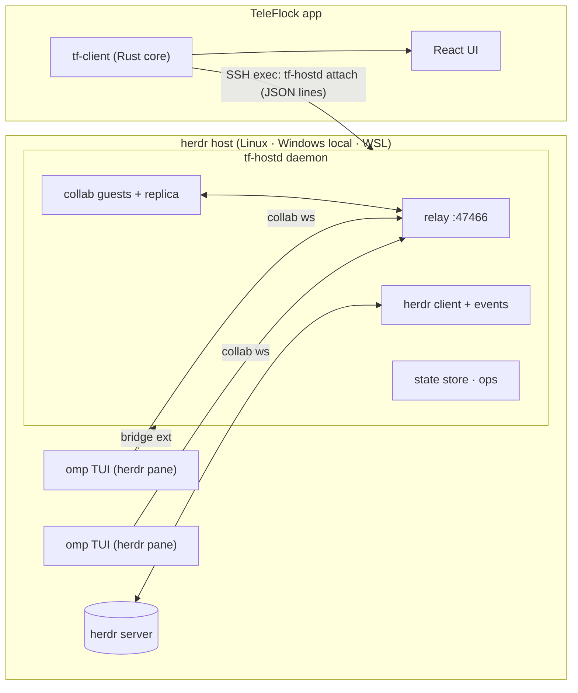

# TeleFlock architecture (v1)

Status: **decided** (phase B). Inputs:
- `docs/research/herdr.md`
- `docs/research/omp-collab.md`
- `docs/research/omp.md`
- `docs/research/platform.md`
- `docs/build.md`

The wire protocol lives in **`crates/tf-proto`**, the single source of truth. Its TypeScript bindings are generated into `src/core/gen/` by `scripts/gen-proto-ts.sh`.

## 1. Decision (ADR-001): how omp runs and how TeleFlock talks to it
**omp runs as the normal interactive TUI inside a herdr pane.**
- herdr keeps tracking its state through omp's own herdr integration (`working`/`blocked`/`idle`).
- The terminal in TeleFlock shows the real omp TUI.

**TeleFlock reaches omp through a host daemon, `tf-hostd`.** It runs on the herdr host, outlives app disconnects, and is shared by all clients (desktop and phone at once). It does four jobs:
1. **Relay.** It embeds an omp **collab relay** on `127.0.0.1:47466`, a private loopback port. omp sessions host collab rooms on it (the fallback data plane, below).
2. **Data plane.** One session replica per omp session (`tf-collab` `Replica`), fed by the first of:
   - **the companion extension's data plane** (bridge ≥ 2.0, `hello.caps.live`, `crate::feed`): its ordered live feed (collab-shaped `live` frames, a `resync` of everything in flight) plus omp's session `.jsonl`, read by hostd itself (`crate::journal`). No collab room is joined for these sessions: omp ends a room at 256 queued frames, which busy sessions with several streaming subagents hit. Prompts (images, delivery), aborts, dialog answers (`uiResponse`), subagent commands and transcripts (their files) go through the bridge;
   - **a full-control collab guest** in the session's room, for sessions without such a bridge (bridges < 2.0, no extension). That yields entries, live events, state, subagents, `ui-request`, prompt, abort, ui-response, agent-cmd and fetch-transcript.

   Either way hostd **compacts** omp's quadratic `message_update` stream into deltas; the keys never leave the host.
3. **Control plane.** It talks to the **TeleFlock companion extension** (`host/teleflock-bridge/teleflock-bridge.ts`) loaded in omp. The extension provides precise controls that a collab guest lacks: model, thinking, fast, plan-review answers, rename, compact, fork/branch/tree, follow-up queue, btw, export.
   - When the extension is absent, the fallback is herdr keystroke injection, following the safety rules in §5.4.
4. **herdr.** It drives herdr through the local API socket: one request per connection, plus one `events.subscribe` stream, coalesced. It bridges terminals through `herdr terminal session control`.

**How sessions get shared and bridged:**
- **Agents TeleFlock starts** are launched with:
  - `--config ~/.teleflock/omp-overlay.yml`, which sets `collab.autoStart: control` and `collab.relayUrl: ws://127.0.0.1:47466`;
  - `-e ~/.teleflock/ext/teleflock-bridge.ts`.

  No global config is touched.
- **Global opt-in (recommended).** Host setup can, with the user's consent:
  - write the two collab settings to omp's global config with `omp config set`;
  - copy the extension into `~/.omp/agent/extensions/`.

  This covers sessions the user starts by hand and sessions herdr restores (restore drops `--config`/`-e`). A TeleFlock-started omp then loads the extension twice (the global copy plus `-e`); the copies elect one bridge per process (§4), and hostd routes a pid's requests to its newest bridge when older copies that don't negotiate connect too.
- **Existing unshared sessions.** `agent.connect` submits `/collab ws://127.0.0.1:47466`, through the bridge's `slash` op when the global extension is connected, else by injection (§3.6). omp runs this builtin at once even while the agent streams, so Connect works while it is working. This creates a room but no bridge.

**Rejected alternatives:**
- **omp RPC mode in the pane.** It loses the real TUI and herdr's state target, and a second process cannot attach to a live session (it forks).
- **Guest inside the app over a `direct-tcpip` tunnel.** About 10× the bandwidth on mobile, and the room keys would travel to the device.
- **Slash injection only.** Fragile (see `omp.md` §1.2).



## 2. Repository layout and ownership

| Path | What |
|---|---|
| `crates/tf-proto` | Wire types and methods (orchestrator-owned contract). Run `scripts/gen-proto-ts.sh` after changes. |
| `crates/tf-herdr` | herdr API client: socket/pipe, typed calls, events, terminal sessions, server discovery, and the server's lifecycle as hostd drives it (`lifecycle.rs`, §3.29). |
| `crates/tf-collab` | omp collab: link, crypto, frames, relay server, guest, registry, **replica normalizer** (omp → tf-proto). |
| `crates/tf-hostd` | Host daemon binary: daemon/attach, client protocol, state store, agent ops, injection, bridge server, fs/git/gh/host ops, and the 0.7.0 services (auto-resume, bring agents back, decide for me, notifications, host sync, moves, cleanup, search, herdr lifecycle; §3.16–§3.29). |
| `host/teleflock-bridge/` | omp companion extension (TypeScript, loaded by omp directly). |
| `host/teleflock-mcp/`, `host/teleflock-plugins/` | Helper extensions hostd runs in throwaway `omp --mode rpc` processes for omp's own code: MCP servers (§3.15) and skills and plugins (§3.26). |
| `crates/tf-transport` | App-side transports: Tailscale SSH (russh), Local, WSL. |
| `crates/tf-client` | App core: profiles, connections, deploy, protocol client, aggregation, app methods, tunnels, notification policy, device presence. |
| `crates/tf-devserver` | WebSocket bridge exposing tf-client to a browser (dev and verification) and serving `dist/`. |
| `src-tauri/` | Tauri app shell (Windows, macOS, Linux and Android) and Kotlin plugin under `src-tauri/plugins/` or `plugins/`; native notifications, system presence, quick capture and share. |
| `src/core/` | Frontend core: transports (tauri, ws, demo), typed client, zustand stores, rAF batching, **demo host**. |
| `src/features/*` | Feature UIs. |
| `src/capture/` | The quick capture window's page (§5.4, §6.4). |
| `src/design/` | Design system (done, see the DesignSystem inventory). |

Every Rust crate is a workspace member (`crates/*`). Each agent compiles with its own `CARGO_TARGET_DIR=target/<Agent>`.

## 3. Host daemon `tf-hostd`

### 3.1 Files and processes (Linux/macOS; Windows uses the same paths under `%USERPROFILE%`)

| Path | Purpose |
|---|---|
| `~/.teleflock/bin/tf-hostd` | Binary, uploaded by the app. Its version must equal the app's embedded version. |
| `~/.teleflock/run/hostd.sock` | Client socket (0600). On Windows: pipe `\\.\pipe\teleflock-hostd-<user>`; a home other than `~/.teleflock` (lab) adds `-<FNV-1a of the home>`. The suffix follows the home path, not whether `TF_HOSTD_HOME` is set: the app runs `attach` without it and `attach` starts the daemon with it, and both must name the same pipe. |
| `~/.teleflock/run/bridge.sock` | Companion-extension socket. On Windows: pipe `\\.\pipe\teleflock-bridge-<user>`. |
| `~/.teleflock/run/hostd.lock` | Single-instance lock (holds the pid). |
| `~/.teleflock/state.json` | Persistent per-herdr-session state: archived agents (by agent id and omp session), turn counters, first-seen times, activity ring, parked agents (`parked`: agent id → snapshot record, §3.5) and the prune list (`pruned`, ≤ 200, 30 days); plus the daily usage ledger and image-original links. Every field defaults when absent, so older files load unchanged. Compact JSON (older pretty files load the same), written within a second of a change, except usage-ledger-only changes (a working agent's cost moves with every reply): at most every 60 s, and at shutdown. |
| `~/.teleflock/hostd.log` | Rolling log. |
| `~/.teleflock/ext/teleflock-bridge.ts` | Companion extension, uploaded by the app. |
| `~/.omp/agent/extensions/teleflock-bridge.ts` (omp's agent dir: `PI_CODING_AGENT_DIR`, else `~/.omp/agent`) | Global copy of the extension, present only after the user applied the `install-global-bridge` fix. tf-hostd never creates it, but keeps it equal to the uploaded `ext/teleflock-bridge.ts` (at daemon start and on every host probe; only when it is a TeleFlock bridge), because omp loads it next to the `-e` copy in every session TeleFlock starts and a stale one breaks the bridge. Daemons on other homes (lab / dev) leave it alone unless `PI_CODING_AGENT_DIR` gives them their own. |
| `~/.teleflock/omp-overlay.yml` | Per-process collab overlay, uploaded by the app. |
| `~/.teleflock/agent-config/<id>.yml`, `agent-config/agents.json` | omp settings for one agent only (§3.7): each agent's own `--config` overlay (model roles, retry fallback chains) and the index (herdr session → agent id → overlay + settings) it is rendered from; 0600 in a 0700 folder. Removed with the agent (5 min after it left the board; files no record names after an hour). |
| `~/.teleflock/originals/<sha256>.<ext>` | Full-size originals of images TeleFlock sent while omp was working (omp saves only a downscaled copy then), served by `session.image {original}`; 0600, pruned after 30 days and above 1 GiB, oldest first. |
| `~/.teleflock/notes/<omp session id>.jsonl` | Row notes (`notes.rs`): what hostd saw of a session's transcript rows live that omp's session file does not keep (the TeleFlock device that sent a prompt, a steer, how long the model thought), one appended line per note; handed back to the replica before its next snapshot so rows rebuilt from the file (a resync, a hostd restart) equal the live ones field for field and keep their row hash. 0600 in a 0700 folder, pruned at start after 90 days and above 64 MiB, oldest first. |
| `~/.teleflock/rows/<omp session id>.jsonl` | Live rows (`live_rows.rs`): transcript rows hostd showed that omp's session file never gets: warning and error notices, and a run's terminal error row (omp never persists a provider refusal), each with the row it followed (`after`); one appended line per row (`Signal::RowKept`). Handed back to the replica (`Replica::keep_rows`) with the notes, so a rebuild (a resync, a hostd restart) puts them back where they were, same id and row hash. Never the text of a refused reply nor omp's fallback-credit token. The newest 500 per session (a file past 2 000 lines is rewritten to them at the next append; an append after a torn last write starts on a new line); 0600 in a 0700 folder, pruned at start after 90 days and above 16 MiB, oldest first. |
| `~/.teleflock/uploads/<yyyy-mm-dd>/<name>` | Files uploaded for prompts (`upload.*`, §3.13: videos from the composers, terminal pastes): 0600 in 0700 folders, outside every repo and worktree; `uploads/.partial/<uploadId>.part` while one runs. Pruned after 30 days and above 10 GiB, oldest first. |
| `~/.teleflock/moves/<move id>/` | Moves to and from other hosts (§3.28), 0700: the source's packed parts (`session.tar` from `omp session pack`, `changes.patch`) and `source.json` while a move runs (deleted when it finishes, rolls back, or the next daemon starts); the target's undo journal and status `target.json` (kept a day for `move.status`). |
| `~/.teleflock/tools.json` | Tool updater status (§3.9): the per-host `auto` switch, last check/install per tool. |
| `~/.teleflock/herdr.json` | herdr lifecycle (§3.29): the per-host settings (`autoRestart`, `idleUpdate`, `idleMinutes`) and the herdr sessions TeleFlock serves (watched and started at daemon start). |
| `~/.teleflock/herdr-config.toml` | herdr's config for the servers TeleFlock starts (`HERDR_CONFIG_PATH`, §3.29): the user's `config.toml` with `session.resume_agents_on_restore = false`, re-rendered when the user's file changes. |
| `~/.cache/teleflock-tools.lock` | Per-user install lock of the tool updater (§3.9) and of Host setup installs (§3.12): held by whichever daemon (real or lab home) is installing. |
| `~/.teleflock/tmp/` | Scratch space of Host setup installs (§3.12): downloaded installer scripts and the gh archive, removed after each install. |
| `~/.teleflock/automations.json` | Automations (definitions per herdr session), their last ≤ 100 runs, per-automation schedule cursors, the pile-up guard's last started agent and skip streaks (§3.11); 0600, atomic writes. |
| `~/.teleflock/auto-answer.json` | Decide for me (§3.23), per herdr session: the host default, the agents' own policies and the running countdowns; 0600, atomic writes. |
| `~/.teleflock/ledger.json` | The agent ledger (§3.25), per herdr session: every live omp agent with what it takes to bring it back (card record, pane, process and command line, own settings and policy copies, what it was doing, boot and herdr server), and an ended agent's plan until it is back; 0600, atomic writes; an unreadable file is set aside as `.bad-<ms>`. |
| `~/.teleflock/ledger-images/<sha256>.img` | The images of a first prompt omp has not saved yet (§3.25), content-addressed, 0600 in a 0700 directory, at most 16 images / 16 MiB each / 64 MiB per prompt; removed with the ledger entry that names them (unreferenced files older than 10 minutes are swept at the next ledger write). |
| `~/.teleflock/autoresume.json` | Auto-resume (§3.22): the host's settings (`enabled`, `bringBack`) and one ticket per root omp session and herdr session (status, kind, reason, `resumeAt`, attempts, the stopped agents); owner-only, atomic writes; an unreadable file is set aside as `.bad-<ms>`. |
| `~/.teleflock/notify.json` | Notifications (§3.21): the host's routing policy (`route`, `escalateAfterS`, `escalateTo`) and up to 10 push channels (ntfy, Pushover, webhook) with their secrets; 0600, atomic writes. |
| `~/.teleflock/ext/teleflock-mcp.ts`, `ext/teleflock-plugins.ts` | The helper extensions of §3.15 and §3.26, embedded in tf-hostd and written next to the bridge. |
| `~/.teleflock/cache/` | Scratch of the helpers and the usage sync: `omp-stats` (cwd of `omp stats --summary`, §3.16), `plugins-user` (neutral cwd of user-scope plugin work, §3.26). |
| `/etc/systemd/system/teleflock-hostd-<hash>.{service,timer}` (root) or `~/.config/systemd/user/…` (lingering users) | Keepalive units, present only while an automation is enabled (§3.11) or the agent ledger holds agents to bring back after a reboot with auto-resume on (§3.25). `<hash>` = FNV-1a of the hostd home, so lab homes get their own pair. |

**Processes outlive the login that started them.** On Linux with systemd, a process started from an SSH command lives in that login's `session-*.scope`, and systemd kills everything in the scope when logind tears the session down (logout with `KillUserProcesses=yes`, or a restarted logind cleaning up sessions that already ended). So the daemon (`attach`) and every herdr server it starts (`tf_herdr::durable`) each run in a fresh transient scope: `systemd-run --scope` of the system manager for root (`teleflock-hostd-*.scope`, `teleflock-herdr-<session>-*.scope` in `system.slice`), of the user manager for other users only when lingering is enabled (without it the user manager stops with the last session). herdr has its own scope, so replacing or stopping the daemon never touches herdr and its agents. When `systemd-run` is missing or cannot create the unit (no bus, no permission), and on macOS, Windows and Linux without systemd, both are started plainly (`setsid`, null stdio). A herdr server that already runs in a login-session scope is a setup issue (`move-herdr-out-of-login-session`, §3.4 `ops::scope`); for root, `host.setupApply` moves it and its live process tree into a new scope without stopping anything.

**WSL stops idle distros.** WSL shuts a distro down `instanceIdleTimeout` (15 s by default) after its last `wsl.exe` client exits, and the daemon, herdr and every agent stop with it, scopes or not. While a WSL host is wanted, the app holds one client open across reconnects and backoff (`WslKeepalive`, §5.1–5.2); after Disconnect or quitting the app, agents keep running only with `instanceIdleTimeout=-1` in the `[general]` section of `%UserProfile%\.wslconfig`.

### 3.2 Commands
- `tf-hostd daemon`: the long-running daemon.
  - Startup order: the instance lock (refuses to start if another instance holds it), the client socket (unix: bound before anything else runs, so `attach` connects at once and its hello waits in the backlog), the user's PATH (below), logging, then the runtime with the relay port and the other sockets.
  - **The user's PATH.** `attach` runs in a login shell, `ensure` from a systemd timer: neither has what interactive rc files add (Ubuntu's `~/.bashrc` returns early unless interactive, and bun's and nvm's installers write there), so omp installed with bun (`#!/usr/bin/env bun`) failed with "/usr/bin/env: 'bun': No such file or directory". Before any thread exists, the daemon (`userenv.rs`) asks the user's shell (`$SHELL`, else the passwd entry) as an interactive login shell for its PATH: `$SHELL -i -l -c 'exec sh -c '\''eval "$TF_EXEC"'\'''` (csh/tcsh: `-i -c`, they take `-l` only alone) with the POSIX `printf … "$PATH"` in `TF_EXEC`, so the shell only reads a line that sh, bash, zsh, fish, nushell and tcsh read alike (§5.1), with stdin `/dev/null`, in its own session, stderr dropped, the PATH read between unique markers (rc-file noise around it is ignored), killed after 6 s. The app's connection test (`diag.rs`) asks the same way. PATH becomes that PATH, then entries only the inherited PATH has, then the well-known install dirs that exist (`~/.local/bin` and `~/.bun/bin` always: TeleFlock installs there), absolute entries only, each once. It is set for the whole process, so every child inherits it: omp and its interpreter, the herdr server and its panes, git, gh, installers. Any failure falls back to the inherited PATH plus the well-known dirs; the log says which (`user PATH source=… entries=… bytes=…`). `resolve_bin` still searches the well-known dirs after PATH, and `omp_bin` prefers an omp that can start (a script whose interpreter is missing loses to a later standalone binary). Windows: unchanged.
  - Logs to `~/.teleflock/hostd.log`.
- `tf-hostd attach [--session <herdr-session>]`: connects stdio to `hostd.sock`, starting the daemon detached (`setsid`, `</dev/null`; in its own systemd scope where §3.1 applies) if needed, and waits up to 30 s for the socket (a daemon that exits is noticed at once; the full wait only runs while it is still starting, e.g. on a cold WSL VM). This is the **only** thing the app runs for the data channel.
- `tf-hostd stop [--force]`: graceful shutdown. A daemon that is replaced by a newer binary gets `stop` from `attach --replace`.
- `tf-hostd ensure`: starts the daemon detached (same scope path as `attach`) unless it is running, then exits. The automations keepalive timer runs it (§3.11).
- **Several devices, one daemon.** Every device of the user attaches to the same daemon, and their apps update at different times. A host therefore only moves forward (`tf_proto::version`: semver, then protocol):
  - `attach --replace` replaces an older daemon (its clients reconnect to the new one), never a newer one, and another build of the same version only when no client is connected.
  - While clients are connected, the daemon refuses `stop` from an older build, and from builds that predate this rule (they send no version with `stop`); that build's `attach` then connects to the running daemon. An idle daemon always stops.
  - Without these rules two apps of different versions restart the daemon under each other on every reconnect, and both devices drop every few seconds.
- `tf-hostd --version`: prints the version on one line (`tf-hostd 0.1.0 proto 1`).

### 3.3 Client protocol
`tf_proto::host::{ClientMsg, ServerMsg}` as JSON lines (`host.rs` documents the flow).

**Liveness.** The app pings every 15 s (§5.2). The daemon drops a client after 45 s without a line from it, counted in steps of at most 5 s of the daemon's own running time (`clients.rs` `read_or_silence`): after the daemon itself was suspended (system sleep, which Windows' clock counts; a stopped process, whose first wake-up on Linux fires overdue timers before it reads the socket), the overdue check counts one step and the ping the client queued meanwhile is read first. A client that really says nothing is dropped after 45 s as before.

**Revisions.** Revisions are per herdr session. Session subscriptions with `sessionSync` are numbered per subscription (`seq`, below).

**Coalescing.** The daemon coalesces before sending:
- state patches: at most 10 Hz
- pulses: at most 10 Hz
- session `append` deltas: one per 50 ms per item
- session `meta`: at most one per session per 500 ms, rebuilt from the latest state after the flush's other events (the ones in between fold into it); nothing is built for a session nobody has open. The session tree (`meta.tree`, 38–104 KB on long sessions) goes to apps ≥ 0.5.1 (hello `client.version`, pre-releases included) only when it changed, since their reducer keeps the previous tree when a `meta` comes without one; older apps get it in every `meta`, and `reset` snapshots always carry it.

A client sees one `snapshot` on hello, then patches.

**Features and zstd** (`clients.rs`). `hello.client.features` lists what the app speaks; hostd answers with the subset it accepts in `welcome.features` (an app that asks for nothing gets the welcome and messages it always got; an older hostd ignores the field). With `zstd`, everything after `welcome` is one zstd stream per direction (hostd → app with a 2 MiB window; app → hostd with 128 KiB, since requests and keystrokes are small and the window is what each side allocates per connection; inbound windows capped at 8 MiB); every batch of queued lines is written and flushed as one zstd block, so nothing waits for more input.

**Session sync** (`sessionSync`, `sync.rs`; the app side is §5.2). `omp.rs` hands each omp session's subscribers to a `sync::Fanout`. A plain subscription (old apps, `session.open` without `have`) gets exactly the stream above. With `have` (the omp session id, the client's newest rows with the hashes hostd gave them, its meta hash), `session.open` answers a delta: the window (newest `limit` rows of the replica's current path) minus the rows held with the same hash, `sync.order` listing the whole window, and a placeholder meta when the meta hash matches (`metaSame`). Row hashes are sha-256 of the row's JSON (first 8 bytes). Every later `session` message of the subscription carries `seq` (a re-open continues the numbering, so the client can drop the old subscription's messages); upserts carry their hash `h`, appends the UTF-8 length of the field before them (`at`), computed backwards from the replica in the flush (appends a later upsert/remove/reset of the row makes moot are dropped); `meta` becomes `metaPatch` (changed top-level fields, `null` clears) and `treePatch` (changed/removed nodes and the leaf; a reorder falls back to remove-all + upsert-all); live `reset`s (collab or bridge resyncs, rewritten files) become delta snapshots against what that subscriber holds (hostd tracks it: its snapshot window, then every upsert/append/remove it was sent). The session tree is hashed and copied once per tree revision (`OmpSession` bumps it when the tree changes) and shared by every subscriber's meta: a `meta` flush with the tree unchanged (`tps`, context and cost change twice a second while streaming) serializes the small fields only. `session.history` with a cursor the session does not have (a live-only notice a client kept from before tf-hostd restarted) answers `not_found`, never other rows; notice and retry row ids carry the replica's lifetime (`n<epoch>.<seq>`, `r<epoch>.<seq>`), so a later replica never reuses one a client keeps.

### 3.4 Internal modules (crate `tf-hostd`)

| Module | Owner | Responsibility |
|---|---|---|
| `main.rs`, `daemon.rs`, `attach.rs` | HostdCore | CLI, lock, sockets, detach/replace, logging |
| `userenv.rs` | HostdCore | The user's PATH for the daemon and every child (§3.2); `#!` interpreter detection |
| `clients.rs` | HostdCore | Per-client sessions: hello/welcome, rev, subscriptions, request dispatch, pulse fan-out |
| `state/` | HostdCore | `HostState` builder: herdr ↔ omp merge, columns, liveness, needs, archive persistence, activity, notifications |
| `omp.rs` | HostdSessions | One `Replica` per omp session and its transport (bridge feed or collab guest), registry polling, collab joins, link lifecycle and reasons, routing of prompt/abort/answer/agent-cmd/transcripts to the path serving the session |
| `feed.rs` | HostdSessions | Bridge data plane: per-session feed driver (`liveSubscribe`, resync, `seq`-ordered live frames, session-file tail interleaved before frames that start something, every file read on the blocking pool and outside the session lock), bridge loss and collab fallback, subagent transcripts from their files |
| `journal.rs` | HostdSessions | omp's session `.jsonl`: full read through the resync's `lastEntryId`, tail of complete lines (both blocking, run off the runtime); shrink, inode change or changed anchor bytes → rewrite, vanished → moved |
| `notes.rs` | HostdSessions | Row notes store (`<home>/notes/<session>.jsonl`): persists the replica's `Signal::Noted` and hands the notes back (`Replica::keep_notes`) before a session's first snapshot, so rows rebuilt from the session file equal the live ones |
| `live_rows.rs` | HostdSessions | Live rows store (`<home>/rows/<session>.jsonl`): persists the replica's `Signal::RowKept` (warnings, errors, unpersisted terminal errors such as refusals) and hands them back (`Replica::keep_rows`) with the notes; the replica restores each after the row it followed (`tf_collab` `replica/live_rows.rs`) |
| `ops/agent.rs`, `inject.rs` | HostdCore | All `agent.*` and `session.*` methods. Session data path first (bridge data plane, else collab), bridge control plane second, injection last. |
| `bridge.rs` | BridgeExt | Extension socket server, typed control calls, `hello.caps`, the lossless per-session live feed and the data-plane ops (`prompt`, `uiResponse`, `agentCmd`) |
| `ops/{fs,git,gh,workspace,worktree,host,term}.rs` | HostdOps | fs.*, git.*, gh.*, workspace.*, worktree.*, host.*, term.* |
| `ops/limits.rs` | HostdOps | `host.limits`: subscription limits from `omp usage --json` / `--history --json` (see below) |
| `ops/usage/` | HostdOps | `host.usage`: omp's stats index resolved like omp, kept current with `omp stats --summary` (on demand + warm-up), insights and freshness (see §3.16) |
| `ops/wrapped/` | HostdOps | `host.wrapped`: one host's share of the weekly Flock Wrapped card: usage-report figures, automation runs, commits and merged pull requests (see §3.19) |
| `ops/ai.rs` | HostdOps | `ai.complete`: one short completion from omp's `tiny` model role (see §3.8) |
| `ops/scope.rs` | HostdOps | Setup issue + fix `move-herdr-out-of-login-session`: a herdr server (`SO_PEERCRED` on its socket) in a `session-*.scope` is moved with its process tree into a new scope (`StartTransientUnit`, see §3.1) |
| `ops/tools.rs` | HostdOps | omp/herdr updater (one per daemon), `host.toolsUpdate`, `host.toolsConfig`, `HostInfo.tools` (see §3.9); its process runner and install lock also serve `ops/install.rs` |
| `herdr_health/` | HerdrGuard | herdr's server lifecycle (§3.29): per-session watch (`machine.rs`, pure), restarts with backoff, idle-time loads of a newer herdr (`idle.rs`), the managed herdr config (`managed.rs`), stale saved sessions (`saved.rs`); `subscribe` / `current` for agent recovery; `host.herdrRestart` / `host.herdrLoad` / `host.herdrConfig`, `HostInfo.herdrHealth` |
| `ops/install.rs` | HostdOps | Setup issues + fixes for missing omp (or its interpreter), herdr, gh, git, ffmpeg (see §3.12) |
| `ops/upload.rs` | HostdOps | Owner-only chunked uploads for prompts and pastes: names, offsets, caps, idle and age cleanup (see §3.13) |
| `ops/moves/` | Move | `move.*` (§3.28): preflights (`facts.rs`), the source job (`source.rs`: push, changes patch, close, `omp session pack`, read, finish, rollback), the target job with its undo journal (`target.rs`), omp's `session pack|unpack|moved` argv (`ompcli.rs`), remote URL matching (`url.rs`) |
| `ops/omp_config.rs` | OmpSettings | `omp.settings` / `omp.settingsSet` / `omp.settingValues`: omp's own settings schema + global config (see §3.10) |
| `ops/hostsync/`, `ops/mcp/sync.rs` | HostSync | `hostSync.*`: a host's exportable omp profile, the plan against this host (`plan.rs`, pure), one-time keys and sealing (`seal.rs`), sign-ins from `omp auth export` by identity (`signins.rs`), apply through the existing write paths (§3.24) |
| `agentcfg.rs`, `ops/roles.rs` | AgentRoles | One agent's own omp model roles and fallback chains: validation, per-agent `--config` overlay and its index, file lifetime; `agent.getRoleModels` / `agent.setRoleModels` through the bridge (§3.7) |
| `automations/`, `ops/automation.rs` | Automations | Store, cron/next-run, scheduler loop, run recipe, systemd keepalive; `automation.*` (§3.11) |
| `restart/` | Lifeboat | Bring agents back (§3.25): the agent ledger (`ledger.rs`), how a session stood when its omp ended (`detect.rs`), the decision table and note (`decide.rs`), ended cards, relaunching and going on (`mod.rs`), start-timeout adoption and relaunch in place (`launch.rs`), the resume command reported to herdr (`herdr.rs`) |
| `autoanswer/` | AutoAnswer | Decide for me: policies and countdowns (`core.rs`, pure), `auto-answer.json` (`store.rs`), the per-session worker that answers what falls due, `agent.setAutoAnswer` / `agent.autoAnswerCancel` / `agent.autoAnswerPostpone` / `host.autoAnswerSet`, the daemon-start hook (§3.23) |
| `ops/cleanup/` | Janitor | `cleanup.*`: worktree report (discovery, git facts, sizes, pull requests, board and session facts), removal re-checked right before, omp's storage gc without sessions (§3.17) |
| `ops/artifact_files.rs`, `ops/xray.rs` | Artifacts | `session.artifacts` / `session.artifact`: a session's artifacts dir, scoped; `session.writeLocal`: a pasted text saved as `local://paste-<n>.md`; `session.context`: the bridge's `context` breakdown, bounded (§3.20) |
| `recovery.rs`, `limit_resume.rs` | AutoResume | Auto-resume tickets (`<home>/autoresume.json`): one per root omp session, executors per kind (`usageLimit` / `rateLimit` → the bridge's `resumeTree`, `restart` → `restart/`), the worker that runs due tickets; `limit_resume.rs` opens them from the bridge's `turn_error` with `resumeAt` from the accounts' limit windows; `agent.retry`, `agent.autoResume*`, `host.autoResume*` (§3.22) |
| `notify/` | Notify | Notifications that find you: connected apps and their presence (`presence.rs`), routing and escalation (`route.rs`, pure), push channels ntfy / Pushover / webhook with write-only secrets (`push.rs`, `store.rs` → `notify.json`), `notify.*` (`ops.rs`) (§3.21) |
| `ops/jobs.rs`, `ops/services.rs` | Jobs | `jobs.list` / `jobs.cancel` through the bridge; `services.*` over `omp ps` (list, logs, stop, kill, restart) (§3.18) |
| `ops/plugins/`, `ops/mcp/helper.rs` | HostTools | `skills.*` / `plugins.*`: reads through the embedded helper extension, changes through omp's CLI, `/reload-plugins` in running sessions (§3.26) |
| `ops/gh_auth.rs`, `ops/gh_auth/` | HostTools | `gh.auth*`: GitHub CLI sign-in as an `AuthFlow` (§3.14) |
| `find/`, `ops/search.rs` | Search | `session.find` (literal matching over a transcript's rows, `text.rs`, `rows.rs`) and `search.*` over every omp session file on the host (§3.27) |
| `state/recaps.rs` | HostdCore | omp's idle recaps (`recap.idleSeconds`) for `OmpInfo.recap` on Review and Done cards (§3.5) |
| `artifacts.rs` | HostdSessions | Reads a session's artifacts dir for the spend collab never mirrors: subagent transcripts and the advisor's `__advisor*.jsonl` (§3.16) |

**Link lifecycle (`omp.rs`, `feed.rs`, `tf_collab::{registry, guest, relay}`).** What a session's `omp.link`, `linkReason`, `linkVia`, `linkSince` and `linkError` say and when hostd retries. `linkReason` names the situation (`starting`, `syncing`, `joining`, `joinFailed`, `reconnecting`, `bridgeLost`, `roomClosed`, `noRoom`, `sharedElsewhere`, `viewOnly`, `relayDown`, `fallbackCollab`); `linkSince` is when the (state, reason, path) triple began (state store, per agent). Nothing gives up while the bridge or the room can come back; slow hosts (omp needs minutes to start and to serialize a large session on a starved WSL laptop) only make each step wait longer.
- **Bridge ≥ 2.0 (`caps.live`).** Its hello attaches the session (`syncing`, via `bridge`): `liveSubscribe`, then the `resync` → the session file through `lastEntryId` (or the resync's entries while omp has never written the file) → the in-flight frames (the resync's `streaming` flag, not the debounced `state` frame, says whether a turn runs; one that runs is a turn whose end counts) → `live` frames in `seq` order → `live` (via `bridge`). The file's tail is read after a frame that can start something arrives and applied before it, after a frame that settles something once the feed is idle, and every 250 ms; the read (a `stat` plus the appended bytes) runs on the blocking pool and only applying it takes the session lock. A `seq` gap, a rewritten or moved file (also a resync naming a file omp wrote that is gone: omp's `/move` renames it before the session points at the new path), a file that cannot be read, or `agent.connect` while the session loads subscribe again; live frames that arrive before the new resync belong to the subscription it replaced and are dropped. Restarts in a row (each subscription between them ending within 10 s) pause before subscribing again: not after the first, then 250 ms, doubling up to 30 s (`agent.connect` ends the pause), so neither omp's resyncs nor full reads of a large file run in a loop; a session that never loaded says why meanwhile (`syncing`: "TeleFlock could not load the session (…); retrying"). Rooms of such processes are never joined; a session a collab guest served is taken over at the first resync (the guest leaves). A session switch ends the old session; omp's `bye` ends it once the bridge does not return.
- **Stalled feed (`feed.rs` `check_stall`, `supervise`; `lossy_json.rs`).** A live feed that misses something repairs itself. On every registry poll, a bridge-served session whose replica says a turn runs while omp's control state says idle (`hello`/`state` `idle`, its own channel), or the other way round, for 30 s gets a fresh resync (warn-logged; the next one at the earliest 60 s later, doubling while it keeps happening, up to 15 min). A panic in a feed driver is logged and the feed starts over, instead of leaving the driver slot taken and the link `live` with nothing feeding it. Bridge and session file lines carrying half a UTF-16 surrogate pair (omp cuts text by UTF-16 index; serde_json refuses `\udXXX` escapes alone) are decoded with U+FFFD in its place, not dropped. This was the 0.6.x freeze with many subagents and long `wait`s: a subagent's cut `stage` repeats in every `wait` update and every resync, so each frame and each resync carrying it was dropped while the link looked live. Lab (real omp 18.13.3, tf-devserver, a mock model whose completion-probe answer puts 🔍 at UTF-16 index 78 of a subagent's `stage`): v0.6.1 dropped 322 lines as `bad json` from the probe on, and its transcript stayed on the running `wait` after omp's TUI showed the final answer; the current tree showed the final answer with omp, with bridge 2.1.0 and with a 2.0.0 bridge (hostd's repair alone).
- **Bridge lost.** The replica and its subscribers stay (`connecting`, `bridgeLost`, "TeleFlock's bridge in omp disconnected; waiting for it to reconnect"). If it is not back within 10 s and the session's room is published, the room takes over (`live`, via `collab`, `fallbackCollab`); the bridge takes the session back when it returns. Without a room the link says so, in the same words on every poll (`linkSince` tells how long; a changing text would patch every board each poll); the session is dropped once its omp process is gone (Linux `/proc`) or after 10 min.
- **Join grace.** A room is joined only once it was listed for 8 s, unless its process's bridge is connected and lacks the data plane: after a hostd restart bridges reconnect within 5 s, and a join would make omp serialize a session its bridge serves. Meanwhile the session is `connecting` (`starting`: "waiting for TeleFlock's bridge in omp to connect before joining its collab room"), not `joining`.
- **Just started.** For 8 s after hostd starts (bridges reconnect within 5 s) and until its first registry poll, an omp session that has neither a room nor a bridge yet is `connecting` (`starting`: "TeleFlock just started; waiting for this omp's bridge or collab room"), whatever its pane runs, never `notShared`; the next poll after that announces the end of the grace so the boards read the link again.
- **No room yet.** An omp process started with TeleFlock's overlay (`--config …/omp-overlay.yml` in `/proc/<pid>/cmdline`), or any omp while omp's global config shares (`HostInfo.setup.globalSharing`), is `connecting` (`starting`: "omp is starting; waiting for its TeleFlock bridge or collab room") for up to 5 min after hostd first sees it, then `notShared` (`noRoom`). Other omp processes are `notShared` (`noRoom`) at once (Connect injects `/collab`). A room on another relay is `sharedElsewhere`, one without control access `viewOnly`; a relay that is not listening `relayDown`.
- **Registry polls** every 1.5 s, 2.5 s per host (omp's own lister: 1.5 s). A host that accepts but does not answer in time (busy event loop) keeps its last snapshot for 45 s instead of dropping out; `link` requests wait 10 s. A poll lists `collab-hosts` once and re-reads a publication only when its size or mtime changed; one that refuses the connection while its process is gone (Linux: no `/proc/<pid>`; killed omps leave their files behind) is not asked again until its file changes.
- **Joins.** Join timeouts start at omp's 30 s (welcome, then per snapshot chunk) and double after each join that timed out, up to 4 min. A failed join is retried after 2 s, doubling to 60 s (±25 %), while the room is published; failure records outlive a missed poll by 2 min, a new room generation starts over. Meanwhile the link stays `connecting` (`joinFailed`) with `linkError` "join attempt N failed: …; retrying". Only failures retrying cannot fix change it: another relay answering our port (identity proof) or an unusable link → `error`; a collab protocol mismatch → `unsupported`.
- **Room reset.** From the second join in a row that timed out on one room, hostd resets the room before the next try: the relay closes the host's connection with 1012, omp reconnects within ~1 s and the room starts over without per-guest state (observed: a resumed session's room that let every join time out for hours until a relay restart). The same applies to a joined guest whose reconnects time out twice in a row.
- **Joined.** The guest reconnects by itself (1 → 30 s backoff, `connecting`: `roomClosed` "omp closed its collab room; waiting for omp to reopen it" for 4001/4004, else `reconnecting` with the cause; its join timeouts double after a reconnect that timed out). A guest that ends (room gone, fatal) rejoins through the registry after the join backoff; a `bye` (rotation) at once.
- **Relay.** Drops a silent peer after 180 s (omp, which answers pings on its event loop, can block for over a minute serializing a large session; a dead loopback peer closes its socket anyway).
- **Retry now.** `agent.connect` on a `connecting` session calls `OmpHandle::retry_now`: the bridge feed subscribes again (unless the subscription that was loading has gone live meanwhile), or the join (or the guest's reconnect) runs now, after a room reset when its joins were timing out.

**Turn errors, refusals and notices (0.7.0; `tf_collab` `replica/failure.rs`, `replica/live_rows.rs`, `live_rows.rs`).** Every way an assistant message can fail shows exactly one error: on its last visible text row, else on its own error row `a<ts>.e` (omp's thrown-error message is `[{type:"text",text:""}]`, a refusal often `[]`, a failure after thinking or tool calls has no text either). What shows follows omp's TUI: a failed request's `errorMessage` (`provider error` without one) with `errorStatus` as the HTTP status, an abort's own reason (a stalled stream), never a user interrupt or a reasonless abort. A provider refusal (`stopDetails.type` `refusal` / `sensitive`) also carries `AssistantItem.refusal {kind, category, explanation}`; the app shows it as "Refused · cyber" with the explanation and a hint (rephrase or switch model), the board's activity and the notification use the same words (`Signal::TurnEnded.refusal`). Attempts omp's auto-retry superseded stay hidden: live, `auto_retry_start` drops the attempt's error row (a late copy of its entry does not bring it back); rebuilt, an attempt stamped `retryRecovery` or followed by another assistant message before the next prompt builds no error row. Rows omp's session file never gets are kept as **live rows** with the row each followed: warning and error notices (not collab presence, not retry streaks) and a run's terminal error row (omp never persists a refusal; it is kept without the refused text and without omp's fallback credit). hostd appends them to `<home>/rows/<session>.jsonl` (`Signal::RowKept`) and hands them back with the notes, so a resync or a hostd restart puts each back after its row (by time when that row is gone), same id and hash; a row the file has stays as the file has it. Bridges ≥ 2.1 (`caps.notices`) also forward what omp's TUI shows alone: extension `ui.notify`, retry fallbacks, config warnings (keyed: one row however often a resync repeats them). omp's `xd://` mount notices (`source: xdev`, info) are no rows. Info notices stay live-only.

**Dispatcher contract.** HostdCore owns it. `clients.rs` parses `HostMethod::parse(method, params)`. For each method family it calls an async handler fn:

```rust
pub async fn handle(ctx: &Ctx, req: HostMethod, client: &ClientHandle) -> Result<serde_json::Value, ApiError>
```

`Ctx` gives:
- `ctx.herdr: Arc<HerdrClient>`
- `ctx.state: StateHandle` (read snapshot, mutate, emit)
- `ctx.omp: OmpHandle` (guests by agent)
- `ctx.bridge: BridgeHandle`
- `ctx.terms: TermRegistry`
- `ctx.paths: Paths`

HostdOps implements `ops::{fs,git,gh,workspace,worktree,host,term,ai}::handle(ctx, req, client)` against that `Ctx`.

**Subscription limits (`host.limits`).** omp already knows each connected account's quota windows: it fetches per-account reports from the provider usage endpoints (Claude `api/oauth/usage`, ChatGPT/Codex `backend-api`, Copilot, Gemini, …), caches them ~5 min ±25 % per account in `~/.omp/agent/agent.db` (`cache` rows `usage_cache:report:…`), refreshes the window rows from live response headers at most once a minute, and appends hourly `usage_history` rows. `ops/limits.rs` never calls a provider and never sees a token: it runs `omp usage --json` (5 min hostd cache, matching omp's own; `refresh: true` → 10 s) and `omp usage --history --json --days 8` (10 min cache), keeps its own per-poll readings, and returns `AccountLimits { fetchedAt, accounts: LimitAccount[], sessions: LimitSession[], error? }`. Each `LimitAccount` (`key` = `provider|email:…|org:…`) carries `plan`, `fetchedAt`, `resetsAvailable`, `error`/`disabled` (omp's `accountsWithoutUsage` / `disabledCredentials`) and `LimitWindow`s (`used` fraction, `resetsAt`, `durationMs`, `tier`, `status`, ≤ 120 `samples` of the current window period). `sessions` maps each live omp session to the account omp pinned it to: `agent.db` `cache` row `session:sticky:<provider>:<sessionId>` → `credentialId` → `auth_credentials.identity_key` (read-only; the credential `data` column is never selected); a provider with one account needs no pin. The client (`src/core/limits.ts`) computes the pace (used-fraction change per hour over a fifth of the window, 30 min … 24 h) and projects "runs out in ~X" vs "resets first".

### 3.5 Board mapping and liveness (state store)

**Columns:**
- `needs` if herdr is `blocked` (unless omp's provider retry explains it: "Provider retry" below), or the replica has a pending `UiRequest`, or the bridge reports a plan review.
- Otherwise `running` if herdr is `working`.
- Otherwise `done` if archived.
- Otherwise `review`. This covers idle/done after work, and also fresh idle agents, which the UI labels "Ready".

**Archive state.** Archiving is persisted. An agent that starts working again is un-archived automatically (activity `unarchived`).

**Parked agents (Mark done closes the pane, `state/parked.rs`).** `agent.archive {archived:true, close:true}` archives as before and starts a 10 s undo window; un-archiving (Undo) or a newer Mark done cancels it. The pending window stays registered until the close is done, so an Undo that arrives just after the deadline, while the pane is being closed, still cancels it (the archive mark is re-checked right before closing). At the deadline the agent is parked only if it is still archived, idle (herdr `idle`/`done`, no needs), an omp agent, and its session file exists; otherwise its pane stays open. Parking snapshots a `ParkedRecord` into `state.json` (agent id, herdr name, kind, title, cwd, repo, branch, omp session id + file, model, thinking, started/archived/parked times, turns, diff, cost, last line, the linked worktree and the workspace it lived in), then closes: the whole herdr workspace when the agent's pane is its only pane (a Dispatch / worktree workspace), a shell tab first and then the pane when that sole pane belongs to a primary workspace grouping linked worktrees (never close a group), else just the pane. The board can lag herdr (panes opened seconds ago, a busy event stream), so the choice is verified against herdr right before closing (`parked::verify_close`): `pane.get` must still show the agent's terminal in that pane (else nothing is closed and the record is dropped), and a workspace is closed only when `workspace.get` reports exactly one tab with one pane; otherwise just the pane goes. Activity: `stopped` "Closed X (done)". Every rebuild adds a parked card per record: same agent id, `paneId/tabId/workspaceId` empty, `state idle`, column `done`, `archived`, `parked {at, sessionFile, worktree?}`, `omp.link notShared`, default liveness. `parked.worktree {path, repoRoot}` (hosts ≥ 0.5.2) is the linked worktree it ran in, because the workspace that named it is usually gone: `worktree.remove {workspaceId: "", path}` deletes that checkout (`ops/worktree.rs`: through herdr when a workspace holds the folder again, else `git worktree remove` run from the main worktree, only for a linked worktree, with `-c safe.directory=*` under `trust`; a folder already gone counts as removed, and only its own registration is dropped, never a repository-wide `git worktree prune` that would also drop other missing worktrees such as one on an unmounted disk) and then drops `worktree` from every parked record at that path; the card stays in Done with its transcript, and resuming it fails with `not_found` (its folder is gone). A record whose agent id is still live (pane closing) stays hidden; a record whose omp session (id or file) runs in another live agent is dropped together with its archive marks (it is live again). Per-agent controls on a parked card fail with code `parked` ("Resume it first"); `session.open` returns a read-only snapshot (meta from the record, caps all off but `prompt`; the last rows of the session file, ≤ 16 MiB tail, mapped by `tf_collab::replica::transcript_page`, no subscription or paging) because that parser already reads omp session files cheaply; `term.open` on it fails with `parked`. `host.sessions` lists a parked session with its `agentId` and `live: false`. Existing archived agents with open panes are left alone on upgrade.

**Pruning.** At start and every 60 s the store stats the session file of each parked record and of each archived, idle live omp agent. Only a definite deletion counts (`parked::check_file`): `NotFound` while the file's folder is a folder (or, that folder deleted too, the sessions root above it is a non-empty folder). Any other outcome (permission or I/O errors, a stale or unmounted file system, folders gone) skips every file under the same sessions root (`<sessions>/<slug>/<file>` → `<sessions>`; a file system that errs may err for all its files) for that pass: nothing under it is pruned or forgotten, while other roots are judged as usual (an archived agent whose session lived in a deleted lab folder no longer blocks pruning everywhere). Each skipped root is logged once, again when its reason changes or after an hour. A missing parked file removes the record, its archive marks, turns and activity and adds `PrunedAgent {agentId, sessionId, at}` to `HostInfo.pruned` (newest first, ≤ 200, 30 days). An archived live agent is pruned the same way (pane closed first, verified as above) once its file was seen on disk and then was missing on two passes in a row (omp writes the file lazily). `HostInfo.pruned` comes from `state.json` in every rebuild and survives info re-probes.

**Background work and its pace.** Repo facts (`RepoInfo` of agent cwds and workspace folders) come from one `git rev-parse` per folder and one `git status` per worktree top (folders in one worktree share it). They are refreshed at once on turn ends, cwd changes (new folders in a snapshot or `pane_updated`), TeleFlock's own git operations and a client connecting; while clients are connected, facts older than 5 min are refreshed (checked every 30 s); with no client nothing polls. Host facts (`probe_info`: versions, setup checklist, herdr sessions, global bridge refresh) are probed at context start, when a client connects, after setup fixes and tool installs, and every 10 min while clients are connected; `omp --version` is cached per binary (path, size, mtime) and omp's `collab.autoStart` / `collab.relayUrl` are read from its `config.yml` (cached by mtime; `omp config get` only for shapes the reader does not take on). A board rebuild reads the persisted maps without the activity ring and a slim omp view (summaries, no lists or tree); the 5 s clock rebuild runs only while an agent works.

**Liveness:**
- `lastEventAt` comes from any guest event; for non-omp agents it comes from herdr `pane_updated`.
- `streaming`/`thinking` reflect `message_update` deltas.
- `tool` is the open `tool_execution_*` call.
- `tps` sums every spender's output rate, split in `tpsSplit {main, subagents, advisor}`. The main agent's rate is a 3-second rolling count of its streamed deltas (chars / 4). Subagents and advisors stream nowhere a guest can see, so each of their finished replies (read from the session's artifacts dir, below) is replayed at its real decode rate, `usage.output / (duration − ttft)`, from the moment tf-hostd reads it: the sparkline's area is exact, its timing one reply late. Replies that ended over a minute ago are not replayed, and `tps` is absent when nothing produces output.
- `cost` (`OmpInfo.cost`, `SessionMeta.cost`) is omp's status-line total `$main (+subagents) + advisor`, split in `cost.split`. Main: the main agent's assistant `usage.cost.total` (collab entries) plus `model_usage` side calls (journal). Subagents: `max` of completed `task` results (`details.usage`), the artifact tree and the live `progress.cost` sum. Advisor: `__advisor*.jsonl` at the top of the artifacts dir. Collab mirrors neither advisor turns nor subagent transcripts, so tf-hostd tails `<session>/` (the dir next to `<session>.jsonl`, found under `<omp agent dir>/sessions/*/`) with `tf_collab::ArtifactLedger`: top-level `__advisor*.jsonl` bill the advisor, every other session transcript (subagents, nested subagents and their advisors) bills the subagent tree, counting only assistant turns and `model_usage` entries so nothing is counted twice. The host usage ledger (board "today") accounts the growth of this total with a high-water mark per session.
- `line` uses the active tool label, else the last assistant sentence fragment (≤ 80 chars).
- `OmpInfo.recap` is omp's idle recap (`state/recaps.rs`). After `recap.idleSeconds` (default 240) of an idle TUI, omp journals a short LLM recap to `<omp agent dir>/history.db`, table `session_recaps` (never in the session file). hostd reads the newest row of each board session read-only, only when `history.db` or its WAL changed (a `stat` every 5 s otherwise), and attaches it while it is current: no newer conversation row in the replica (`Replica::last_turn_row_at`; `created_at` has second precision), else, without a replica (parked agents), written after the turn end hostd saw; unknown → none. Review/Done cards show it instead of `line` (fallback `line`), phone rows and the session headers show it when present. There is none while a draft sits in omp's composer or with `recap.enabled: false`.
- `SessionMeta.subagents[].status` (`replica/subagents.rs`): `running`, `done`, `failed`, `aborted`. omp's roster says `parked` for an agent it parked after its idle TTL (minutes after it finished) and for every persisted subagent after a restart, so `parked` tells that it finished, never how. The replica keeps the outcome it knows (bus `lifecycle`/`progress`, a settled `task` result's `details.results[]`/`progress[]`, and `details.jobs[]` of the `async-result` messages omp delivers for background tasks (`{agentId, status, durationMs}`) and of `wait` results (`{id, agentUrlId, status, durationMs}`; job `WslFix-2` is the agent `WslFix`'s next run), all in the session file, so a rebuilt replica learns them again; the last record of an agent wins and a `running` job settles nothing) and shows `parked` with no known outcome as `done`, unless its own transcript was cut off (below). A nested subagent's end is recorded only by its parent's transcript: `ArtifactLedger` (§3.20) reads the same records from every transcript under the artifacts dir and `Replica::apply_artifacts` folds them in (the session file's own record first). The ledger also keeps where each transcript's last turn stands (`subagents::TailTurn`, a port of omp's `hasRestorableTurn`, as `restart/detect.rs` has it): the last message is a prompt, a tool result the model never answered (unless the reply before it ended in an error or abort) or an assistant message with tool calls, with no `session_exit` of kind `normal` after it, i.e. omp's process died under the agent (crash, herdr outage, reboot). Order: `failed`/`aborted` (live, or a tombstoned roster entry) → live `completed` → roster `running` (a revived agent) → recorded outcome → roster `idle`/`parked` with a cut-off transcript → `aborted` (the UI says "Stopped", grey, counted as "N stopped" in the group header) → roster `idle`/`parked` → `done`. A finished agent's run is `progress.durationMs`, else the recorded `durationMs`, else the roster's `lastActivity` (which only says when omp last wrote its transcript: 7 minutes after the run for an agent omp parked, the relaunch for one it restored). The wire's `SubagentStatus::Parked` is no longer produced (older hostds and session caches still carry it; the UI shows it as done). The Subagents panel keeps running and failed agents on top and collects the rest in a collapsed "N completed" group (open state kept per session while the app runs).
- Pulses carry kind and intensity per agent at ≤ 10 Hz.

**Needs-you:**
- `ask` comes from select/editor ui-requests. Options use the **exact labels** as ids. "Other (type your own)" becomes `allowOther`; "Chat about this" becomes `allowChat`. The ★ `recommended` option comes from the ask call's `questions[].recommended` (omp's dialog only preselects it) or omp's ` (Recommended)` label mark, which the label then drops (§3.23).
- `approval` comes from `Allow tool:` selects (`omp-collab.md` §7).
- `planReview` comes from the bridge.
- `blocked` without a visible request (`answerable:false`) means: open the terminal. That is the last resort: herdr's omp integration also reports `blocked` while omp waits to retry a provider error and after a run ended in one (rate limit, usage limit, overload), and neither is a question (see "Provider retry" below).

**Provider retry (`OmpInfo.retry`, `state/build.rs` `provider_wait`, `replica/retry.rs`).** omp retries a provider error on its own (`auto_retry_start {attempt, maxAttempts, delayMs, errorMessage}` … `auto_retry_end`). The replica turns that into a `RetryWait {kind, attempt, maxAttempts, since, retryAt, error}`: `kind` is `rateLimit` / `usageLimit` / `overloaded` / `other` by omp's error text (a usage or quota word first, then overload words or HTTP 503/529, then rate-limit words or HTTP 429), `retryAt` is the host time of the event plus `delayMs` (a resync mid-wait restarts the count from the resync). It ends with `auto_retry_end`, with omp's delayed continue (an `agent_start` once the retry is due; a background turn that starts earlier does not end it), with an abort and with a new run. A wait still shown two minutes after it was due, with none of those, is no longer claimed (`STALE_AFTER_MS`; the board maps again then). The replica also remembers how the last run ended (`tail_error`, omp's error text, until a new run starts). A herdr `blocked` agent whose omp link is live, with no pending dialog and no plan review, maps by that:

| herdr `blocked`, no dialog / plan review | column | needs |
|---|---|---|
| live link, a retry wait is on (herdr `blocked`; also herdr `idle`/`done` while the replica's run is on: its omp integration is missing or behind) | `running` (omp waits on the provider; the card says "Rate limit · retrying in 4:54 (1/10)") | none |
| live link, the last run ended in a provider error (nothing runs), and the bridge's dialogs reach hostd | `review` (`done` when archived); the auto-resume ticket and its badge take over once the bridge reports the give-up (§3.22) | none |
| live link, the last run ended in a provider error but the bridge's dialogs do not reach hostd (`caps.dialogs` off while it serves the session): a terminal-only prompt is possible | `needs` | `blocked`, `answerable:false` (open the terminal) |
| live link, neither a retry wait nor a failed last run | `needs` | `blocked`, `answerable:false` |
| no live link (no replica, `notShared`, connecting) | `needs` | `blocked`, `answerable:false` |

A pending dialog or plan review always wins (`needs` with its question). `Agent.state` stays what herdr says (`blocked`), only the column and `needs` differ. While a retry wait is on, the quiet heuristics (the card's quiet chip, FlockHome's quiet count, the quiet notification) are off; once omp gives up, the auto-resume ticket (`Agent.autoResume`) wins over the wait in every UI.

**Notifications** fire on these transitions:
- → `needs`
- `running` → `review` (finished)
- an error notice
- quiet (> 120 s of no events while `working`), at most once per turn

Each notification carries actions for the first ≤ 3 options. A question with a decide-for-me countdown says in its notification when it will be answered (§3.23).

**Panes** (`Workspace.tabs[].panes[]`) list every herdr pane, agent or not, so clients can attach to panes opened anywhere (herdr's TUI or CLI included): `workspace.*`, `tab.*` and `pane.created/closed` events trigger a debounced re-snapshot (~120 ms), plus a 15 s healing snapshot. `PaneInfo.process` is the pane's foreground process (`state/procs.rs`). herdr has no batch process API, so hostd asks `pane.process_info` once per pane terminal (new pane or respawned terminal) for the shell pid; on Linux, rebuilds then read the terminal's foreground group from `/proc/<shell>/stat` (`tpgid`) and its `comm` (at most every 250 ms per pane, the same lookup herdr does). Without readable `/proc` (Windows, foreign pid namespace) the name comes from herdr and is refetched every 60 s at snapshot time. Older apps ignore the field.

### 3.6 Herdr injection safety (`inject.rs`), from `omp.md` §1.2

Only inject when all of these hold:
- the agent is idle, or the command is safe while streaming;
- the composer is visible at the bottom of the pane (read the pane's `detection` source, 12 lines);
- no overlay is visible.

`parse_composer` knows omp's 8 `composer.shape`s (default `band`) and its 3 symbol presets (`unicode` default, `nerd`, `ascii`); the locale changes nothing (lab: identical captures with `LANG`/`LC_*` unset). It skips up to 6 rows under the composer: extension statuses from `ui.setStatus` (the bridge's `⇄ teleflock`), the status bar and widgets of the non-box shapes. It refuses a box border at the bottom (ask, approval, selector, `/session` or `/model` panel), a box border directly above the composer (approvals and asks over a draft render above a still-mounted composer, and typing there would deny the tool and steer), and the autocomplete menu. Refusals are retryable `busy`: "a dialog or panel is open in the omp TUI", "omp's autocomplete menu is open", else "omp's composer isn't visible at the bottom of the pane". Fixtures: 94 omp 18.13.1 captures in `docs/research/omp-samples/composer/`.

Always use canonical full forms:
- `/switch <provider/id:level>`
- `/effort <level>`
- `/fast on|off`
- `/plan`
- `/goal …`
- `/compact`
- `/rename …`
- `/collab ws://127.0.0.1:<port>`

After submitting, re-read the pane. If the composer still holds the text, send one more `enter`. Never inject names that aren't in the catalog: unknown commands go to the model and cost tokens.

### 3.7 Launch recipe (`agent.start`, `worktree.create` + agent, `host.resume`)

```
herdr --session S agent start <name> --kind omp --pane <pane> -- \
  --config ~/.teleflock/omp-overlay.yml [--config ~/.teleflock/agent-config/<id>.yml] \
  -e ~/.teleflock/ext/teleflock-bridge.ts \
  [--model <provider/id>] [--thinking <level>] [--resume=<file>]
```

Once the agent is idle and `link=live`:
- `plan: true` → bridge `setPlan`, or inject `/plan`;
- an initial prompt and/or `images` (`AgentSpec.images`, image-only allowed) → collab `prompt` with the images as `ImageContent` (same mapping as `agent.prompt`). If the link never comes up (90 s; the omp registry is re-polled once per second meanwhile), the text goes in through herdr and the images, which herdr cannot type, are reported as an `error` activity ("Image not delivered") instead of being dropped silently.

**Slow shells.** herdr refuses `agent start` with `agent_pane_busy` while the pane's foreground job is not its bare shell, e.g. a fresh shell still running its startup files. In a pane hostd just created (`Workspace`/`Cwd` targets, `worktree.create`, automations, a parked resume into a new tab or worktree) the start is retried for 45 s; in a pane the client picked (`StartTarget::Pane`) for 2 s. Then it fails as a retryable `busy`: "the new pane's shell never became ready (waited 45 s)" with a hint about slow shell startup files, or "the shell in pane <id> is not at an idle prompt". omp then gets 90 s to become interactive (herdr `timeout_ms`). Creating a workspace, tab or pane gets a 30 s herdr request timeout, starting a herdr server 45 s. A launch can therefore take ~140 s; the app's request timeout for launch methods is 180 s.

The new agent appears through herdr events. The response returns `Started{paneId, workspaceId, agentId?}`. A start herdr times out on (an omp busy at once, a slow host: herdr's managed launch drops the name at its deadline) counts as started when an omp runs in the pane within a minute; it gets its name back with `agent.rename` (`restart::launch::after_timeout`).

**The agent's own omp settings** (`AgentSpec.roleModels` / `fallbackChains`; `agentcfg.rs`, `ops/roles.rs`). Model roles (role → `provider/id[:thinking]`: `default`, `smol`, `slow`, `vision`, `plan`, `commit`, `tiny`, `memory`, `task`, `advisor`, `widget`, the model-kind roles and custom roles) and retry fallback chains (key → ordered selectors) for one agent only. New agent, New worktree, Dispatch, Fan-out and automations send them; the host's omp config is never written. A tf-hostd from before 0.7 ignores the fields (its `AgentSpec` has no `deny_unknown_fields`) and would start the agent on the host's models: the app therefore sends none to such a host (`hostTakesRoles`, hostd < 0.7) and its forms replace the roles section with a note to update the daemon.
- **Overlay.** hostd writes them to `~/.teleflock/agent-config/<random id>.yml` (0600 in a 0700 folder) and passes it as a second `--config` right after TeleFlock's overlay: omp merges it over its global and project config (`modelRoles` per role, `retry.fallbackChains` per key; the host's other retry settings stay). The YAML is block style with every key and value written as a JSON string, which YAML reads as a double-quoted scalar, so no value can break out of its place. Bad role names or selectors are refused before anything starts (`invalid_params`; the rules are in bridge-protocol "Session model roles").
- **Precedence.** omp applies `--model` (like `PI_SMOL_MODEL`, …) as a runtime override above every config file. `roleModels.default` is the agent's main model and wins: hostd then passes neither `--model` nor `--thinking`. Without it, `model` / `thinking` go out as before. The launch forms keep their Model and Thinking fields as the main model and never send `roleModels.default`.
- **Lifetime.** `agent-config/agents.json` (herdr session → agent id → overlay file + settings) is the truth; the YAML is rendered from it. omp refuses to start when a `--config` file is missing, and re-reads it when it changes, so the file lives as long as the agent: written right before `herdr agent start`, deleted when the launch fails, rewritten by `agent.setRoleModels`, kept while the agent is parked; resuming starts the new agent with the same settings in a new file and drops the parked agent's record. The prune pass (§3.5) drops the record and file of an agent that has been off the board for 5 minutes (only once herdr's view is loaded), and files no record names after an hour.
- **Running agents** (`agent.getRoleModels` / `agent.setRoleModels`, bridge ≥ 2.1.0 with `caps.roleModels`; bridge-protocol "Session model roles"). The result splits roles and chains into the agent's own (what TeleFlock set, plus omp's `--model` / `PI_*_MODEL` overrides) and the host's. `setRoleModels` takes the agent's complete maps (a role or key left out = host default again), saves them (rewriting the overlay its omp watches, so a resume reproduces them; an agent started without one gets a record without a file), then the bridge reloads that overlay and makes the maps omp's runtime overrides; a changed `default` switches the session to it (this session only). A change the bridge refuses restores the saved settings. They hold for the agent's omp process (also after `/new`) and for subagents it spawns later. Older bridges: `unsupported` with the hint to restart the agent (Mark done, then Resume).

**Resuming a parked agent** (`agent.resume`; also `agent.prompt` and `agent.archive {archived:false}` on a parked card, and `host.resume` of its session file). Live agents fail with `invalid_params`; a second concurrent resume of the same card fails with `busy`; a session file that is definitely deleted (as for pruning, §3.5) prunes the card and fails with `not_found`; one that cannot be read (permissions, I/O, unmounted) fails with a retryable `io_error` and the card stays. Target: a new tab in its old workspace when that is still open at the same folder; else, for a linked git worktree (from the record, else `git rev-parse --git-dir --git-common-dir`), herdr `worktree.open {cwd: <repo root>, path: <checkout>}` so the workspace is grouped under its repo again (falls back to a plain workspace when herdr refuses); else a new workspace at its folder (a missing folder fails with `not_found` and a hint). The launch above runs with the parked name (deduped against live names), model and thinking level, `--resume=<file>`, and, for a prompt, `spec.prompt`/`spec.images` delivered once linked. The archive marks are cleared, so the agent lands in Review; the parked card is dropped in the same patch that first shows the new agent (a start that never shows up gives the card back after 90 s). Activity: `unarchived` "Resumed X".

**Worktree base (`worktree.create`, `ops/worktree.rs`).** A new branch forks from the given `base`, else from `git.branches`' `defaultBase`: `origin/<default>` when that remote-tracking ref exists (else the local default's remote upstream, else the local default), never herdr's implicit HEAD, which is usually a local `main` that only moves when someone pulls. Before forking from a remote-tracking base hostd runs `git fetch <remote> refs/heads/<branch>` (no hooks, no prompts: `GIT_TERMINAL_PROMPT=0`, an empty `GIT_ASKPASS` so neither `core.askPass` nor `SSH_ASKPASS` dialogs open, `SSH_ASKPASS_REQUIRE=never`, and `-o BatchMode=yes -o ConnectTimeout=5` appended to the ssh command git would use (`GIT_SSH_COMMAND`, else `core.sshCommand`, else an OpenSSH `GIT_SSH` program); 8 s, so fetch + checkout + agent start fit the app's 180 s launch timeout even when the remote silently drops traffic on a slow host; single-flight per repo + branch with a 20 s answer cache for fan-outs); a failure is logged and creation continues from the ref it has, so offline hosts still create worktrees. herdr's `git worktree add -b B P origin/main` makes `B` track `origin/main`; hostd then removes that upstream (retrying while parallel creations hold `.git/config.lock`, then verifying), so ahead/behind and review don't compare against main. `git.push` never relies on it: a branch whose upstream is not its namesake on a remote (no upstream, a local one, or the base it forked from) pushes with `--set-upstream <the upstream's remote, else origin> HEAD`, so `B` is published under its own name and never pushed into main. Review's merge-base uses the default branch's local and remote refs together (`git merge-base HEAD main origin/main`), so it is the real fork point whichever one the branch came from. Clients send no `base` when the Base select is untouched (they show `defaultBase`); older hosts without `defaultBase` get the shown ref, as before.

### 3.8 AI through omp's tiny role (`ai.complete`, `ops/ai.rs`)

TeleFlock names dispatch branches, agents and titles and drafts commit messages, PR titles/bodies and template names with the user's own omp, on the host. There is no TeleFlock model key and no TeleFlock server.

**Flow.** UI → `src/core/ai.ts` (`suggestBranch`, `suggestCommitMessage`, …: per-task system prompt, input clipped to 2 000 chars of task text / 12 000 of patch, 10 min cache per host + task + input, shared in-flight calls) → `ai.complete { task, system, prompt, role?, timeoutMs?, cwd? }` → hostd runs

```
omp --mode json --no-session --no-tools --no-extensions --no-skills --no-rules --no-lsp --no-title \
    --model @tiny --system-prompt <system>      # prompt on stdin, NO_COLOR=1, cwd = given dir or home
```

without a shell, reads the JSONL events and answers with the last assistant text of `agent_end` (text parts only, thinking dropped; the assistant `message_end` if the stream ends first). The child is killed as soon as the answer is in: the reply takes ~4–8 s and omp would otherwise linger ~8 s more. The client sanitizes the text (first usable line, labels/quotes/prefixes stripped, kebab case or sentence case, word and length caps) and returns `null` for junk, so every caller keeps a deterministic fallback.

**Naming prompts.** omp appends its own agent instructions ("each response MUST advance the task", verify before yielding) and, with `cwd` in a repo, that repo's context files to every system prompt, even a custom one, so a tiny model easily answers a long task as if it had to do it ("I need to inspect the repository" → `need-inspect-repository`). The naming prompts (`branch`, `agentName`, `title`, `templateName`) therefore put the user's text between tags (`<task>…</task>`, a closing tag inside it is dropped), state that it is text to label and not an instruction, ask for the overall goal of multi-point tasks, and end with "Branch slug for the task above:". The sanitizer rejects agent-speak (first person, "let me", apologies, refusals, requests for details) and slugs that start with `i`/`need`/`sure`/… or are about looking at the repository (unless the task is), so the caller falls back to `slugFromPrompt`, which names the lead sentence's goal ("Fix the following points and release 0.5.0 when you are done. - … - …" → `release-0-5-0-fixes`). A version (`0-5-0`) counts as one word.

**Limits.** Role default `tiny` (validated `^[a-z][a-z0-9-]{0,31}$`); a failed attempt (exit, error event, empty text) is retried once with `smol` while ≥ 1.5 s remain. Timeout default 20 s, clamped 2–60 s, queue time included → `timeout` (retryable). At most 3 omp processes per daemon (semaphore). Errors: omp missing or no such role → `ai_unavailable`; anything else → `ai_failed` with ≤ 300 chars of stderr/error text. The client treats `ai_unavailable` and `unknown_method` (older hostd) as "skip this host for 10 min".

**Privacy.** Prompts (task text, file lists, patches) go only to omp on the host and from there to the model provider the user configured for omp's tiny role, like any other omp session. Nothing is stored: `--no-session` writes no session file, hostd neither logs nor returns prompt or system text (logs carry task, role, model, ms, outcome), and the client cache lives in memory only. Settings → AI naming turns it all off.

### 3.9 Keeping omp and herdr up to date (`ops/tools.rs`)

Every tf-hostd keeps the host's omp and herdr current, so all hosts run the versions TeleFlock is tested against without anyone logging in. On by default for the real home (`~/.teleflock`; `attach` starts every daemon with `TF_HOSTD_HOME` set, so the check compares the home itself); a daemon on any other home (lab / dev) starts with it off unless its `tools.json` says otherwise, so it never updates the machine's tools by itself. `host.toolsConfig {auto}` turns it on or off per host (persisted in `tools.json`).

**Cadence.** One updater per daemon. First run 2 min after the daemon starts (or 6 h after the last complete check when that is later, so restarts don't refetch), then every 6 h + up to 10 min jitter while `auto` is on. One tool at a time; every command runs without a shell, stdin closed, `NO_COLOR=1`, in its own process group, with a timeout; on timeout (or when the run is dropped) the whole group is killed, installers it started (`bun install -g`, `npm i -g`, …) included (Windows: `taskkill /T`, best effort). Runs that may install take an OS lock on `~/.cache/teleflock-tools.lock` first (per user, not per hostd home), so the real daemon and lab daemons never run installers at the same time; a run waits up to 12 min for it, then reports that another daemon is updating. Installed versions are probed at start (no network). `tools.json` saves are serialized (snapshot and write under one lock).

**omp.** `omp update --check` (60 s) → `Already up to date` / `New version available: X` / `… kept up to date by <manager>` (bun/npm global installs owned by Homebrew, mise, …: a note, nothing runs) / `Failed to check for updates: …`. When newer: `omp update` (5 min), then `omp --version`. Never `--force`, `--canary` or `--stable`: the channel stays whatever the user chose. Running agents keep the old omp until they restart (shown as a note).

**herdr.** `herdr --version`, `herdr status` (channel, server version, `server_binary_stale`), and on the stable channel the manifest `herdr update` itself reads (`curl https://herdr.dev/latest.json`). When newer (or the manifest is unreachable), plain `herdr update` (5 min) with `HERDR_ENV`/`HERDR_SOCKET_PATH`/`HERDR_CLIENT_SOCKET_PATH`/`HERDR_SESSION` removed so it plans against every session. It installs the new client and keeps running servers (and their agents) running; the status then notes "the herdr server keeps running X until it restarts" (apps that read `HostInfo.herdrHealth.update` show its plan instead). The updater never passes `--handoff`: it only installs, and the herdr lifecycle (§3.29) loads the installed herdr into each served session's server once that session has been idle long enough (live handoff, else stop + start), or on Load now. A release for another endpoint generation would need servers stopped: herdr declines that by itself when stdin is not a terminal ("Herdr was not updated"), and the updater doesn't even start it when the manifest's `endpoint_generation` differs from the running client's; the note asks the user to run `herdr update` when ready. Homebrew / mise / Nix installs refuse self-update; their command becomes the note.

**Status.** `ToolUpdates {auto, omp, herdr, nextCheckAt}` lives in a `watch` channel; every herdr session context publishes it as `HostInfo.tools` (an `info` patch on each change: `updating`, results, errors, notes) and re-probes `HostInfo.omp/herdr` after an install. `set_info` keeps `tools`, so the periodic host probe never drops it. Older apps ignore the field; older hostds don't send it, and the app hides the row.

**Methods.** `host.toolsUpdate {tool?, checkOnly}` starts a run now (manual runs work with `auto` off; `checkOnly` never installs). A request covered by the newest run (same or more tools, install ⊇ check) joins it; others queue behind it. The reply comes when the run is done or after 20 s (the app's request timeout is 30 s) with the current status; progress keeps arriving through `HostInfo.tools`. `host.toolsConfig {auto}` persists and reschedules.

The updater only updates what is installed; installing a missing omp or herdr is a Host setup fix (§3.12), which uses the same runner (`tools::run`) and the same install lock.

### 3.10 omp settings (`omp.settings`, `omp.settingsSet`, `ops/omp_config.rs`)

The app's omp settings page (`src/features/ompSettings`) edits everything `omp config` can, with omp's own labels, tabs, groups and choices.

**Schema.** `omp config list --json` only has key, type and description. The full registry (`@oh-my-pi/pi-coding-agent/config/all-settings` → `orderedSettings()`: type, default, enum values, item vocabularies, env override, credential flag, and `ui {tab, group, label, description, options | "runtime", condition, warning, editor}`) is only reachable from inside omp, so hostd starts a throwaway

```
omp --mode rpc --no-session --no-skills --no-rules --no-lsp --no-tools --no-extensions -e <home>/ext/teleflock-bridge.ts
    # env TF_OMP_SCHEMA_OUT=<home>/run/omp-schema-<pid>-<ns>.json, NO_COLOR=1, stdin /dev/null, cwd home
```

and the companion extension's schema-dump mode (§4) writes the definitions there and exits. hostd waits ≤ 20 s for the file, kills the child, deletes the file, and caches the schema per omp binary (canonical path + size + mtime) in memory and in `<home>/cache/omp-settings-schema.json` (≈ 2 s once per omp build; `refresh: true` reads again). A failed dump is remembered for that omp binary + extension file until either changes. An extension without the dump mode (bridge < 1.2.0, detected by the `TF_OMP_SCHEMA_OUT` marker in the file) is never started for a dump: it would run as a normal bridge.

**Values.** `omp config list --json` (omp's global config, else defaults; omp itself redacts credentials), cached 10 s, dropped after every write; a list that started before a write never fills the cache (generation counter), so a write's answer never shows the old value. Credentials (`credential`, `ui.secret`, or `redacted` in the list) never carry a value or default in the answer. Without a schema the answer is `source: "cli"` from the list alone (omp's order, no labels/tabs): every key stays editable.

`omp.settingValues {keys}` (≤ 64 keys, else `invalid_params`) answers `{values: {key: value}}` for just those keys from the same cached list (what the app needs to follow omp's own behaviour, e.g. `paste.largeMenuThreshold`): unknown keys, unset ones without a default and credentials (`redacted`) are absent.

**Writes.** `omp.settingsSet` checks every key against the current settings first (one unknown key → `invalid_params`, nothing written), then runs `omp config set -- <key> <text>` / `omp config reset -- <key>` one at a time without a shell (writes are serialized per daemon). Text per type: strings as-is unless omp's parser would alter them (surrounding whitespace, leading `"`, line breaks: then JSON-quoted, which omp unquotes exactly), numbers/booleans as text, arrays/records as compact JSON. omp validates (enum values, item vocabularies, shapes); its message (`Invalid value: x. Valid values: …`) comes back as `invalid_params`, earlier changes of the batch stay applied. A `modelRoles` write also drops the `host.models` cache. Logs carry keys and outcomes only, never values. The answer is the fresh `OmpSettings`.

**Fallback chains** (`retry.fallbackChains`). The page edits them with a guided editor instead of raw JSON (JSON stays as an advanced toggle): one card per chain key (a role, an exact `provider/model[:thinking]`, a provider wildcard `provider/*` or an id-prefixed wildcard `provider/prefix/*`), its fallbacks in order with a model picker and an optional thinking level each (wildcard fallbacks always inherit the failing turn's level), and the related switches read next to it (Retry Model Fallback, Fallback Trigger, Rate Limit Walks Chain, Usage-Aware Fallback, Fallback Revert Policy). It saves the whole record through `omp.settingsSet` like any record setting: host-global. One agent's own chains go through §3.7 instead.

**Credential writes never use argv** (`/proc/<pid>/cmdline` is readable by every local user). A batch that sets a credential (schema `credential`; with `source: "cli"` also keys named like secrets: `…token`, `…apiKey`, `…password`, `…secret`, `…credential`) goes whole through the companion extension's settings-write mode (bridge ≥ 1.3.0, §4): hostd writes `{changes: [{key, text}]}` (`text` exactly as for `config set`, `null` = reset) to an owner-only `<home>/run/omp-settings-in-<pid>-<ns>.json`, starts the same throwaway omp as for the schema with `TF_OMP_SETTINGS_IN=<that file>` and `TF_OMP_SETTINGS_OUT=<home>/run/omp-settings-out-….json` (paths only), and the extension reads and deletes the input at once, applies the changes in order through omp's Settings API exactly as `omp config set|reset` does (`setting.parse(text)` → `set`, or `unset`; `flush`), stops at the first failure and writes `{results: [{key, ok, error?}], error?}`. hostd waits ≤ 20 s, kills the child, removes both files and maps the results as above. An extension without the mode (no `TF_OMP_SETTINGS_IN` marker in the file) is never started for it: the write is refused with `unsupported`, nothing is saved, and the hint names the setting's environment override (`$OMP_…`) as the other way to set it. Resetting a credential carries no value and stays on the CLI.

### 3.11 Automations (`automations/`, `ops/automation.rs`)

Scheduled omp agents: at every tick of a 5-field cron schedule tf-hostd starts an agent with the configured prompt, whether or not an app is connected.

**Storage.** `~/.teleflock/automations.json` (0600, written atomically after every change, under the store lock): `automations` (the `Automation` wire type minus `nextRunAt`/`lastRun`, which `automation.list` computes), `runs` (newest first, ≤ 100 for the whole host), `scheduledThrough` (automation id → the latest schedule time already handled), `lastStarted` (automation id → `{runId, agentId, at}` of its latest started run, outside the capped history so the pile-up guard never forgets it; seeded from `runs` for older files) and `skipStreaks` (automation id → the history entry standing for its current run of identical skips). An unreadable file is renamed to `automations.json.bad-<ms>` and the daemon starts empty. An automation belongs to the herdr session of the client that created it (`herdrSession`); `automation.list|save|delete|run` only see the caller's session.

**Schedules** (`automations/cron.rs`, `jiff` for the zone). Fields `min hour dom month dow` with `*`, `a`, `a-b`, `*/n`, `a-b/n`, `a/n`, lists, month/day names, `0`/`7` = Sunday, macros `@hourly|@daily|@midnight|@weekly|@monthly|@yearly|@annually`; restricted dom and dow match with OR (classic cron). Times are the host's local zone (`AutomationScheduler.timezone`: IANA name, else `UTC±hh:mm`). DST as Vixie cron: a specific time inside the skipped spring hour runs once right after the jump; every-hour jobs simply skip the missing hour; in the repeated autumn hour specific times run once (the first), every-hour jobs run in both. `automation.preview` returns the next 5 times and a description (`At 09:00, Monday through Friday`); a schedule that never fires (`0 0 30 2 *`) is invalid.

**Scheduler** (one per daemon, started in `daemon::async_main`). It sleeps until the earliest next fire time (at most 60 s, so suspend and clock changes are noticed) or a change (save/delete). Per enabled automation it decides from its cursor (`automations::decide`):
- next time in the future → wait;
- due, and the latest due time is ≤ 2 min old → run (`trigger: schedule`);
- older (the daemon was down, the machine slept) → only the latest missed time counts: with `catchUp` it runs once (`trigger: catchUp`), otherwise it is passed over. Several missed times never run more than once.

The cursor moves before the run starts, so a crash never repeats a run; saving an automation sets it to now (edits and re-enabling never fire past times).

**Pile-up guard.** A scheduled or catch-up run is recorded as `skipped` when the agent of the automation's last started run (`lastStarted`) is still `working` or `blocked` (needs you), or when the previous launch is still in progress. `Run now` (`manual`) skips only the in-progress case. Consecutive skips for the same reason fold into one history entry (same run id, moved to the top with the latest time, `error` ending in "(skipped N times in a row since Fri 18:00)"); only the first one logs an activity event. So a blocked agent over a weekend costs one row of the shared 100-run history, not all of it.

**Run recipe** (`Automations::launch`). `daemon.ctx_for(herdrSession)` (creates the context and starts the herdr server when needed), then with `AgentSpec { kind: omp, model, thinking, plan, prompt, roleModels, fallbackChains }` (the automation's own model roles and fallback chains reach each run's agent through its per-agent overlay, §3.7):
- worktree mode: `ops::worktree::checkout` (the worktree part of `worktree.create`) with branch `automation/<slug>-<yyyymmdd-hhmm>` (host local time; `-2`…`-5` when it exists), `base: None` (the default base, §`worktree.create`), label = the automation's name, then the agent in the new workspace's root pane. Should the agent not start, the worktree stays and the failed run names it (`branch`, `path`, `workspaceId`, and "the worktree … was kept" in `error`);
- in place: a new workspace at `cwd` (`ops::agent::open_workspace`), then the agent in its root pane; should the agent not start, that workspace is closed again when herdr reports it holds nothing else.

Agent names are `auto-<slug>` made unique (`-2`, `-3`, …) against the board **and** the names other launches in flight in the same herdr session have claimed (automations that fire together, whose slugs share the 24-char prefix, never pick the same name); when herdr still answers `agent_name_taken` (a launch elsewhere won it), the next free name is tried, up to 4 times.

Both follow §3.7. The run (agent, workspace, branch, path, or the error) is stored, an activity event goes to the agent's feed, and the session's clients get a `Notification { kind: info, title: "Automation <name> started <agent>" }` (failures: `… failed` with the error; skips don't notify). Nothing else is published.

**systemd keepalive** (`automations/systemd.rs`). Schedules only fire while the daemon runs, so on Linux with systemd, while at least one automation is enabled, or the agent ledger holds agents to bring back after a reboot with auto-resume on and "Bring agents back after a reboot" on (the host setting, default on; §3.25), hostd installs `teleflock-hostd-<hash>.service` (`Type=oneshot`, `Environment=TF_HOSTD_HOME=…` plus the installing daemon's `HOME`, `PATH`, `USER`, `LANG`, `ExecStart=<this binary> ensure --relay-port <port>`) and `.timer` (`OnBootSec=1min`, `OnUnitActiveSec=10min`, `WantedBy=timers.target`), runs `daemon-reload` when they changed and `enable --now` the timer; it removes both (`disable --now`, delete the units and the `timers.target.wants` link, `daemon-reload`) when neither needs them. Root uses the system manager (`/etc/systemd/system`); other users their user manager (`~/.config/systemd/user`) only with lingering — without it the user manager neither starts at boot nor survives logout, so `scheduler.note` asks for `loginctl enable-linger <user>`. Units installed while lingering was on are still removed once none is enabled after lingering was turned off (the files always; `systemctl --user` too while a user manager runs). `ensure` starts the daemon in its own transient scope (§3.1), so the oneshot service's cgroup teardown does not kill it. Elsewhere (macOS, Windows, no systemd) `scheduler.kind` is `daemon`: automations run while tf-hostd runs, which starts when an app connects and keeps running after it disconnects, until the host restarts.

Reported `AutomationList.scheduler`: `systemd` + `persistent` while the timer is active; `systemd` without `persistent` and without a note while nothing is enabled (no timer needed yet); `systemd` with a note when lingering is missing or installing failed; `daemon` + note elsewhere. Reconciling runs at daemon start and inside `automation.save|delete` before they answer, so the next `automation.list` is current.

**Security.** Automations run only what the user configured through an authenticated client of this host (same trust as `agent.start`): a prompt, a folder, model/thinking/plan, model roles and fallback chains (validated like `agent.start`'s). hostd never runs commands from the store other than `herdr`/`git`/`omp` through the regular launch path; the store is owner-only. The keepalive units run only `tf-hostd ensure` from the installing binary's path, as the same user.

### 3.12 Installing what a host lacks (`ops/install.rs`, Host setup)

`host.setup` lists what is missing next to TeleFlock's own items, and `host.setupApply` installs it, only on an explicit request with the fix ids (the app asks for consent and says what runs and where it installs):

| Issue / fix id | When | What runs |
|---|---|---|
| `install-omp` | no omp; or omp is a script whose interpreter (node, …) is missing | omp's official installer in binary mode: `curl -fsSL https://omp.sh/install \| sh -s -- --binary` (Windows-local: `& ([scriptblock]::Create((irm https://omp.sh/install.ps1))) -Binary`) → `~/.local/bin/omp`. `omp_bin` then prefers it: a standalone binary needs no interpreter |
| `install-bun` | omp is a `#!/usr/bin/env bun` script and bun is not on the daemon's PATH | bun's installer `curl -fsSL https://bun.sh/install \| bash` → `~/.bun/bin/bun` (it also adds that dir to the user's shell rc file); needs unzip |
| `install-herdr` | the session's herdr binary does not exist | herdr's installer `curl -fsSL https://herdr.dev/install.sh \| sh` (Windows-local: `irm https://herdr.dev/install.ps1 \| iex`) → `~/.local/bin/herdr`, then `ensure_server` for the session |
| `install-gh` | no gh | the latest GitHub CLI release archive for the host's OS/arch (`api.github.com/repos/cli/cli/releases/latest`; Linux `.tar.gz`, macOS `.zip`), sha256-checked against the release's `checksums.txt`, `bin/gh` copied to `~/.local/bin/gh` (no root). Windows: not fixable, `winget install --id GitHub.cli -e` |
| `install-git`, `install-ffmpeg` | no git; no ffmpeg or ffprobe (omp reads video attachments with them) | the system package manager (apt-get, then dnf, pacman, zypper, apk; Fedora's package is `ffmpeg-free`) as root or through passwordless `sudo -n` (checked with `sudo -n true`, cached 10 min); else Homebrew as the user. Otherwise not fixable, and the detail names the command to run (`sudo apt-get install -y -q --no-install-recommends git`). apt: `DEBIAN_FRONTEND=noninteractive`, one `apt-get update` and retry when the install fails. Windows: `winget` hints |
| `sign-in-gh` | gh is installed and none of its accounts works (`gh auth status`, §3.14), unless `GH_TOKEN` / `GITHUB_TOKEN` is in tf-hostd's environment (signing in can't change what gh uses then) | not a `host.setupApply` fix: the app's "Sign in to GitHub" runs `gh.authStart` (§3.14). `SetupStatus.ghSignedIn` (absent without gh) |
| `set-git-identity` | git is installed and `git config --global user.name` or `user.email` is not set | not a `host.setupApply` fix: the app's inline form sends `git.setIdentity` (§3.14). `SetupStatus.gitIdentity` (absent without git) |

A host without herdr still serves its sessions: when herdr is not found, the session's client points at herdr's install path (`$HERDR_INSTALL_DIR`, else `~/.local/bin/herdr`; Windows `%LOCALAPPDATA%\Programs\Herdr\bin`), so the checklist can offer `install-herdr` and the server starts once it ran; the herdr integration item waits until herdr exists.

The two GitHub items come last, the sign-in first. Their details name the manual path (`gh auth login`, `git config --global user.name …`), so apps older than them still read well. `gh auth status` asks GitHub about every token, so its answer is cached for 60 s and the checklist waits at most 1.5 s for one that isn't (the first host probe of a session must fit in 3 s): it answers the previous look, or leaves `ghSignedIn` out, and republishes `HostInfo.setup` once the look lands.

**Running.** Installer scripts are downloaded into `~/.teleflock/tmp/<fix>-…` first (curl, else wget) and run from there with `sh`/`bash`, so a failed download never runs half a script. Every install runs through `tools::run` (no shell, no TTY, stdin closed, `NO_COLOR=1`, its own process group, killed with the group on timeout: 10 min per script, 15 min per package-manager run) under the user-wide install lock (`~/.cache/teleflock-tools.lock`, shared with §3.9). Then the tool must be found where hostd looks for it (the daemon's PATH already holds `~/.local/bin` and `~/.bun/bin`, §3.2; `git_bin` caches only a found git), else the fix fails with `install_failed` "the installer finished, but … is still not found". omp's, bun's and herdr's scripts download with curl themselves, so without curl only gh is fixable; the others say which package to install first. The log has one line per install (fix, seconds, outcome; never installer output beyond the error's last line).

**Independent fixes, progress.** One batch per daemon at a time, fixes in a fixed order (installs, then the herdr scope, integration, sharing, bridge, then git, gh, ffmpeg); each runs on its own and a failure never stops the next. `SetupStatus` carries `applying` (fixes queued or running, host-wide) and `failed` (`SetupFixError {id, error}`: open issues whose last attempt failed and that are not being retried). `host.setupApply` answers once the batch is done or after 20 s (the app's request timeout is 30 s) with the current status; a batch with installs republishes `HostInfo` (with `setup`) when it starts and after each fix, and every batch at its end. Older apps ignore the new fields; older hostds fail the whole call at the first failing fix, which the app still shows as one error.

**Lab hook.** `TF_HOSTD_TEST_INSTALLERS=<dir>`: a fix whose `<dir>/<fix id>.sh` exists runs that script (with `sh`) instead of its real procedure; lock, timeout, verification and publishing stay the same.

### 3.13 Uploads (`upload.*`, `ops/upload.rs`)

Videos reach an agent as files on the host, not inline like images (a prompt's images stay under the relay's 16 MiB message cap, and app requests time out after 30 s). The agent reads the file with its own tools: omp's `read` turns a video into a preview grid plus metadata, or one frame with a `:412` / `:1m30s` selector (needs ffmpeg and ffprobe on the host, a Host setup item). Prompts carry one line per video, `Attached video "clip.mp4" (12.3 MB): <absolute host path> (read it to see it)`; omp expands `@path` mentions only for prompts typed in its own editor, not for the collab frames hostd sends.

- `upload.begin {name, size, mime?}` → `{uploadId, path, maxChunk}`: 1 B to 2 GiB, at most 8 uploads at once (`busy`, retryable). The name is the client's last path component reduced to letters, digits, `-_.` (anything else becomes `-`), no leading or trailing dots and dashes, ≤ 64 characters before the extension, which is kept lowercased (omp tells videos by it) or taken from `mime`; Windows device names get `-file`; `-2`, `-3`, … when the day folder already has it or a running upload reserved it. Any mime is accepted (terminal pastes send images).
- `upload.chunk {uploadId, offset, data}` → `{received, size}`: base64, ≤ `maxChunk` (1 MiB) decoded. `offset` must equal the bytes received so far: a repeated or skipped chunk is `upload_offset` (message: where it stands), one past the size `invalid_params`; nothing is written then. Bytes go to `.partial/<uploadId>.part` and into a running SHA-256. A failed write ends the upload.
- `upload.status {uploadId}` → `{received, size}`: where to continue after a lost answer or a reconnect. `upload.finish {uploadId, sha256?}` → `{path, size, sha256}`: checks the size (and the digest when given; a mismatch is `checksum_mismatch` and drops the upload), renames the partial into place (another free name if one appeared meanwhile), prunes. A finished id answers `finish`/`status` again for a day. `upload.cancel {uploadId}` deletes the partial, or the finished file (its prompt was never sent); unknown ids are fine.
- One registry per daemon; per upload, chunk/status/finish/cancel run one at a time. Uploads without a chunk for an hour are dropped with their partial (swept every 5 min); partials no running upload owns (an earlier daemon run) are deleted when the first session context starts, which also prunes. `not_found` means the upload is gone: the client starts over.
- The app (`src/core/upload.ts`) sends one chunk at a time, about 3 s of data each at the measured rate (64 KiB to 1 MiB, halved after a timeout), retries transient errors (timeout, lost connection) with backoff for 10 minutes, asking `upload.status` before resending, and begins again on `not_found`. The composers (`src/core/draftVideos.ts`) upload a video as soon as its host is known, one per host at a time; Dispatch Auto uploads to the host each task goes to, and an entry waits in `uploading` before `worktree.create`.

### 3.14 Accounts and sign-in flows (`auth.*`, `accounts.*`, `gh.auth*`; `authflow.rs`, `ops/accounts.rs`, `ops/gh_auth.rs`)

Wire types `tf_proto::accounts`; research `docs/research/omp.md` §12. A **sign-in flow** runs on the host and is completed from the device: linking an omp account (`accounts.link`), MCP server OAuth (`mcp.authStart`, §3.15) and the GitHub CLI's sign-in (`gh.authStart`) share one `AuthFlow` type, one registry and one app component.

**Flow registry** (`authflow.rs`). `start(kind, title, subject, ttl)` registers a flow (`starting`) and returns its driver (`FlowCtl`): `publish_url` (`waiting`; an authorization URL whose `redirect_uri` is `http://localhost|127.0.0.1|[::1]:<port>/…` sets `callbackPort`, `redirectUri` and `paste: fallback`, and `expiresAt` to when omp's callback server gives up, 5 min on (`CALLBACK_WAIT`, the app's countdown; the TTL stays the hard stop, so omp's own message comes first)), `update`, `next_input`, `finish`; dropping the driver fails the flow, the TTL expires it, `auth.cancel` cancels it (its driver stops at once: the login process and its callback server die with it). Final flows stay readable 10 min. `auth.wait {flowId, afterRev, waitMs ≤ 20 000}` long-polls a `rev` change; `auth.submit {flowId, text}` hands a paste or an answer to the driver and returns **its verdict** (a wrong paste is `invalid_params` where it was made; an empty text only answers a prompt); `auth.list` lists running and recent flows. `replay_redirect` delivers a pasted address (or `code`, `code#state`) to the loopback callback server as the browser would have (`GET 127.0.0.1|::1:<port><path>?<query>`); `check_paste` refuses another sign-in's address (other port or path) or text with spaces before anything sees it.

**Accounts** (`ops/accounts.rs`). `accounts.list` = providers (`omp auth-broker list --json`, omp's `/login` order, cached per omp binary) + omp's credential rows in `<agent dir>/agent.db` (read-only; identity fields taken with `json_extract`, the tokens never leave SQLite; the MCP servers' OAuth sign-ins omp keeps in the same table, `mcp_oauth:…` / `mcp_oauth_…`, belong to §3.15 and are left out) merged with `omp usage --json` (plan, quota windows; `limits.rs`), live sessions per credential (omp's `session:sticky:<provider>:<sessionId>` pins), `auth.accountPolicies` preferences, the auth broker URL and running link flows. Tombstones omp removed on purpose (`replaced by…`, `deleted by user`, `logged out by user`, or an identity that is linked again) are hidden; others show as expired logins to re-link, the newest per identity (omp rewrites only active rows' causes, so an account that expired, was linked again and expired again leaves two). `accounts.link {provider}` runs `omp login <provider>` with piped stdio as a flow (`LINK_TTL` 15 min; one per provider, a second call returns the running one): its printed URL, instructions, device code (`Enter code: …`), questions (an unterminated line quiet for 150 ms; masked when it asks for a key/token/secret) and paste prompt become the flow; answers and pastes go to its stdin, and when omp shows no paste prompt a paste is replayed to its callback server (then `paste: none`, "Checking the code…"). An answer's verdict is what omp does next: the very question again (or the paste prompt again after a paste) refuses it, anything else takes it (omp's logins never ask a question twice, so a new one is the next question: Cloudflare's token → account ID → gateway ID); 3 s of silence takes it too. A no-op `xdg-open`/`open`/`wslview` first on its `PATH` stops omp opening a browser on the host. `Logged in to … as <who>` makes it `done` (`account`); `Login failed: …` or an exit without it `failed`. Before a link reports `done`, and after an unlink, the usage report and the `host.models` cache are dropped (a new login brings its provider's models). `accounts.unlink` is omp's RPC `logout` (one credential) in a throwaway headless omp; one that exits without answering (no model to start with, a broken config) is reported with what it printed on stderr (its `Error:` line, else its last line). `accounts.prefer` writes `auth.accountPolicies[]` priority 100 for the account's exact identity (omp has no default account; the priority ranks it first for new sessions after omp's hard checks) and answers with the accounts as cached (config only: the quota report isn't read again); API keys, expired logins, broker accounts and identities omp can't single out are `preferBlocked`. The app gives both changes 180 s (tf-client `timeout_for`, the devserver socket just above): an unlink may take omp's logout (90 s) plus a fresh `omp usage` (45 s) and omp's config.

**GitHub CLI** (`gh.authStatus`, `gh.authStart`, `git.identity`, `git.setIdentity`; `ops/gh_auth.rs`, wire types `tf_proto::github`). `gh.authStatus` = `gh --version`, `gh auth status --json hosts` (gh ≥ 2.81; it exits 0 whatever the accounts' state; older gh: its text, parsed per account), active accounts first, whether git's global `credential.*.helper` runs `gh auth git-credential`, and the running `gh` flows; no gh is `installed: false`. One look per gh binary at a time, kept 60 s; a sign-in replaces it. `gh.authStart {hostname?, setupGit?}` runs `gh auth login --hostname <h> --git-protocol https --web` (plus `--clipboard=false` from gh 2.79, which copies the code to the host's clipboard otherwise) with piped stdio in its own process group, `NO_COLOR`, `GH_PROMPT_DISABLED`, `GH_NO_UPDATE_NOTIFIER`, and `GH_BROWSER` / `BROWSER` / `PATH` on the no-op openers of `accounts.link`, as a flow (`kind: "gh"`, title `GitHub (<host>)`, subject the host, 15 min: a device code's lifetime; one per host, a second call returns the running one). gh's stderr `! First copy your one-time code: XXXX-XXXX` (or `One-time code (…) copied to clipboard`) and `Open this URL to continue in your web browser: https://github.com/login/device` become `userCode` and `url` (no callback, nothing to paste); its interactive wording (`Press Enter to open … in your browser...`) gets a newline. `✓ Authentication complete.` clears the code; `✓ Logged in as <login>` and exit 0 make it `done` (`account`) after `gh auth setup-git --hostname <h>` when `setupGit` (default; a failure is told in the done message, the sign-in stands) and a fresh status look, then `HostInfo.setup` is republished. Another exit is `failed` with gh's last line (a `GH_TOKEN` in tf-hostd's environment is named). Cancel and expiry kill gh's process group: nothing is stored. `git.identity` = `git config --global` `user.name` / `user.email`, the file it writes (`GIT_CONFIG_GLOBAL`, else `~/.gitconfig`, or the XDG `git/config` when only that exists) and suggestions from the working account (`gh api user`, cached 10 min: its name, else its login; its public email, else `<id>+<login>@users.noreply.<host>`). `git.setIdentity {name, email}` takes both trimmed, set, on one line without control characters, ≤ 200 characters, the email with an `@` and no spaces (else `invalid_params` `name: …` / `email: …`), writes them with `git config --global --replace-all` (no shell, the daemon's environment) and answers what git reads then; the checklist is republished. In the app (`src/features/hosts/GithubSetup.tsx`), Host setup's "Sign in to GitHub" opens a sheet that first asks whether git should use the sign-in ("Also use it for git over HTTPS", on), then runs the flow in `RemoteAuthPanel` (device code: copy, open github.com/login/device) and reloads the checklist when done; the identity item is an inline form prefilled with git's values, else the suggestions ("Use my GitHub identity"), field errors under their fields. An `unknown_method` answer (an older tf-hostd) hides both actions.

**Same-port tunnel** (`tf-client/tunnel.rs`). `tunnel.open {hostId, port, localPort}` listens on exactly that port of the device (`127.0.0.1`, plus `[::1]` when the device has IPv6) and pipes connections to the host's `127.0.0.1:<port>` over the host's transport: the provider's redirect to `http://localhost:<port>/…` in the device's browser reaches omp's callback server on the host. A port another program holds on either address is `port_in_use` (browsers may try `[::1]` first, so a program there would get the redirect; another TeleFlock tunnel that holds it is named), another bind failure `port_unavailable`; an existing tunnel to the same target on that port is returned. Such a sign-in tunnel lives only while its sign-in does, whoever opened it: tf-client asks the host every 5 s (`auth.list`) and closes it once no running flow there has that `callbackPort` (an answer from before a sign-in got the tunnel again doesn't count), and by itself 10 min after it was last opened when the host can't tell (offline, an older tf-hostd; `SIGN_IN_TUNNEL_TTL`, above omp's 5-min callback wait and the 6-min MCP sign-in limit); the app gets a `tunnels` event. So a window that went away mid sign-in (reload, crash, closed tab, an Android activity recreated) never leaves a port such as 3000 of the device forwarded to the host once its sign-in is over. A preview that reuses it keeps it open.

**Lab** (`scripts/lab-remote-auth.sh up|status|down`, root, Linux). The device and the host must not share a loopback, or a sign-in "works" without the tunnel. The script puts the host in a network namespace (veth `10.231.77.1` device ↔ `10.231.77.2` host, NAT for real provider logins) with its own sshd and a throwaway user (copies of omp and herdr, own `TF_HOSTD_HOME` and `PI_CODING_AGENT_DIR`), runs `ops/mcp/testdata/oauth_server.py` (OAuth authorization server + protected MCP endpoint, consent page) on `10.231.77.1:47681`, which browser and host both reach, and writes a devserver data dir with the host profile (key sign-in). Then `tf-devserver --data-dir <lab>/devserver --hostd-bin <tf-hostd>` and a browser on this machine drive the real UI: MCP sign-in through the tunnel, the paste path with the device port taken first (`python3 -m http.server <port> --bind 127.0.0.1`, or `--bind ::1`), account links up to the URL / device code. `down` removes the namespace, iptables rules, user and files.

**App** (`src/features/auth`). `useRemoteAuth({hostId, start | flowId, autoOpen, onDone, onFinal})` drives one flow (`RemoteAuthController`, tested against the demo engine in `remoteAuth.test.ts`): long-polls `auth.wait` (a host that drops off is followed again with backoff; the flow keeps running there), opens the same-port tunnel while the flow waits on `callbackPort` (none for `local` hosts; none from a plain browser that isn't on the devserver's machine) and closes it when the flow ends, also one that was open already (listening on the remote port's own number makes it a sign-in's: one left by a page that reloaded mid sign-in, or this flow followed again; a preview of the same remote port listens elsewhere and is left alone), raises `paste` to `primary` when the tunnel can't bind, opens the page, http(s) only through `safeHref` (`app.openExternal` in Tauri — desktop and Android — and for demo hosts; `window.open` inside the click in a plain browser; `autoOpen` only in Tauri and never for device codes or questions), submits pastes and answers, and on cancel, unmount (StrictMode-safe) or a final state closes its tunnel and cancels a running flow, reported to `onFinal` once the host answered the cancel (so the Accounts page reads its list after the sheet's cancel landed, and never offers the flows the sheet ran in its "still in progress" banner). `RemoteAuthPanel` renders every stage: starting, browser (tunnel chip, "the browser showed an error page?" paste), paste (busy-port explanation), device code (copy, "Copy code & open"), prompt (masked keys), working, done, failed/expired/cancelled with retry; its footer counts down `expiresAt` (omp's 5-min callback wait for a browser sign-in). The Accounts page (`src/features/accounts`, `#/accounts/<host>[/link[/<provider>]]`) and the MCP page use it; the link-account nudge (board notice box, host card) shows for an online host whose omp lists no model and stores no active credential.

### 3.15 MCP servers (`mcp.*`, `ops/mcp/`, helper `host/teleflock-mcp/teleflock-mcp.ts`)

The app's MCP page (`src/features/mcp`, route `#/mcp[/:hostId]`) manages the MCP servers omp sessions on a host load (wire types `tf_proto::mcp`, research `docs/research/omp.md` §11). omp has no MCP CLI, so hostd edits omp's files itself and asks omp (through a helper extension) for everything that needs omp's code.

**Config** (`files.rs`, `json.rs`, `model.rs`). User scope `<omp agent dir>/mcp.json`, project scope `<folder>/.omp/mcp.json` (their `.mcp.json` siblings are read and edited in place). Files are omp's format: `JSON.parse` on read (a file omp can't read is reported in `McpList.fileErrors` and never written), `JSON.stringify(…, null, 2)` with `$schema` first and no trailing newline on write, keys in file order (an order-preserving value type: the workspace's `serde_json` sorts keys), unknown fields and the `auth` block omp's sign-in writes kept in place, 0600 temp file + rename, 0700 folders. Every read-modify-write holds **omp's own lock** for that file: pi-natives `FileLock` on `<path.resolve(file)>.lock`, an abstract Unix datagram socket `omp-file-lock-<xxh64(lockPath, 0x4f4d502d4c4f434b)><xxh64(lockPath, 0x50492d46494c454c)>` on Linux (verified against omp 18.13.2: omp sees hostd's lock held), a named mutex `Global\…` on Windows, `flock(2)` on the sidecar elsewhere; 50 tries × 100 ms like omp. Enable/disable is omp's `setMcpServerEnabled`: `enabled` on the first writable definition (the row's own file, then project, then user), else the user-level `disabledServers` (denylist, wins) / `enabledServers` (overrides another tool's `enabled: false`), sorted, dropped when empty, stale entries cleaned. A rename moves list entries along. Names follow omp's `validateServerName`.

**Secrets** (`secrets.rs`). Answers mask with `SECRET_MASK` (`••••••••`): env and header values named like credentials (word match on `token`, `key`, `secret`, `password`, `auth`, `cookie`, `session`, …; camelCase split) or holding a URL password, secret URL query values and URL passwords, `--token=…` / `--api-key …` argument values, credential keys in a JSON object argument (Smithery's `--config {…}`), the OAuth client secret. `${VAR}` references and `!command` values are not secrets and stay visible. A draft that sends the mask back keeps the stored value (env/headers by key, URL by parameter name, arguments by position or flag, JSON arguments by key path); a mask with nothing to restore is `invalid_params` naming the field.

**Helper** (`helper.rs`). Everything that needs omp's code runs in a throwaway `omp --mode rpc --no-session --no-skills --no-rules --no-lsp --no-tools --no-extensions -e <home>/ext/teleflock-mcp.ts` (cwd = the project folder, or the empty `<home>/cache/mcp-user` for user-level answers, so no project config leaks in). The helper is embedded in tf-hostd and written there when it differs. Request: owner-only `TF_MCP_IN` file (deleted on read; a draft may hold secrets), answer: JSON lines appended to `TF_MCP_OUT` (`hello` with omp's version, events, then one `result` or `error`), pasted sign-in input: `TF_MCP_INPUT`. It works inside the extension factory (omp waits for it, so no model or session is needed), imports omp internals dynamically (`mcp/manager`, `mcp/config`, `mcp/config-writer`, `mcp/oauth-reauth`, `mcp/oauth-credentials`, `mcp/smithery-registry`, `discovery`, `capability/mcp`; a missing one → `unsupported`, hint: update omp) and gets auth storage from `pi.discoverAuthStorage()`. Ops: `probe` (inventory of every source via `loadCapability(mcp).all`, user lists, `mcp.enableProjectConfig`, omp's Exa/browser filters, then an `MCPManager` of its own connects what sessions would, `waitForStartup(20 s)`; failures classified by omp's `analyzeAuthError` → `needsAuth` (`authType` oauth/apikey; it calls every 401 that names a bearer token `apikey`, which is what spec-compliant OAuth servers answer, so such a failure is `oauth` when omp's `discoverOAuthEndpoints` finds OAuth metadata within 5 s, as omp's own `/mcp add` decides)), `test` (one saved server through omp's loader, or a draft after `expandEnvVarsDeep`), `auth`, `unauth`, `search`. ≤ 4 helpers at once. **Deadlines and stopping:** every request has a deadline (check 60 s, test/sign-out/search 26 s, sign-in 6 min) that includes waiting for a helper slot (4 shared by checks, tests, sign-outs and searches, 2 for sign-ins; `busy` when none frees up in time). The helper gets it as `deadlineAt` and fits its work into it: omp's discovery window is kept at 1 ms (`OMP_MCP_STARTUP_TIMEOUT_MS=1`, which overrides what the helper asks; `0` would wait for every server's first connection, without a limit for `timeout: 0`), the helper waits for the servers itself (`waitForStartup` with a positive window), an unanswered server is `pending`, then every server is disconnected and what still runs of the processes it started is killed. The helper leads its own process group; on Linux omp starts stdio servers in sessions of their own, so tf-hostd also finds them under the helper through `/proc` and stops a helper that overran with them: SIGTERM, 1 s, SIGKILL (omp's `__omp_worker_*` daemons are left alone). Windows: `taskkill /T`.

**Checks.** `mcp.list` answers from the files at once and merges the last check per folder: results are kept per (name, file) with a fingerprint of the definition and its enabled state; a changed server shows `checking` and only it is checked again (`only`), a server marked dirty (signed in/out, switched) too; everything again after 10 min or with `refresh`. One check per folder at a time; `waitMs` (≤ 25 s) long-polls a running one. A failing helper is retried at most every 30 s unless refreshed (`check.error`). Other tools' servers (Claude Code, Cursor, Codex, plugins, project `mcp.json`, …) are listed from the check, read-only (masked), with omp's provider name; `shadowed` marks a definition a higher-precedence one of the same name hides. The fingerprint also covers whether another definition hides the server; removing or renaming one marks its name for checking again in the lists it shows in. Other tools' servers are on or off as the user-level lists say when the list is built (switched in another folder's list shows everywhere); a result taken while it was switched the other way is not shown.

**Running sessions** (`reload.rs`). omp has no MCP config watcher, so every change (save, remove, switch, sign-in, sign-out) runs omp's `/mcp reload` through the companion extension's `slash` op in the interactive sessions it concerns (all for user scope, those whose cwd is the folder for project scope): idle ones at once, busy ones when their turn ends (one waiter per session, ≤ 2 h), answered as `McpReload {reloaded, queued, restartNeeded, errors}`. Sessions without a bridge or not interactive, and omp agents on the board whose session has no bridge, count as `restartNeeded`. "Idle" means the turn is over and none of the session's subagents runs (they share its MCP manager; hostd's replica knows them); a change asked for while a queued reload runs gets a reload of its own.

**Sign-in** (`auth.rs`, shared flow §3.14). `mcp.authStart` checks the server (native, http/sse, on), starts the helper's `auth` op (omp's `/mcp reauth` engine `reauthorizeMcpServer`: protected-resource and authorization-server discovery, dynamic client registration, PKCE, omp's loopback callback server on `oauth.callbackPort` or 3000 (random only when omp falls back), credential in omp's auth storage, `auth` block written under omp's lock) and returns an `AuthFlow` (`kind: "mcp"`, `ttl` 6 min; omp gives up after 5). The flow's `url` is omp's authorization URL; its loopback `redirect_uri` gives `callbackPort`, so the app's same-port tunnel delivers the browser's redirect to omp's callback server. A pasted address is checked (`check_paste`) and replayed to that server (`replay_redirect`; non-2xx → `invalid_params` shown at the paste field); without a loopback redirect it goes to omp's manual-code input. Cancelling or expiry kills the helper (and its callback server). On success the server is checked again and its sessions reload. `mcp.signOut` runs omp's `/mcp unauth` steps (credential rows of the auth block and the server URL, `auth` block stripped). Sign-in and sign-out work on the row's own file: omp looks the server up from the project folder for a project server and from the neutral folder for a user one, and the helper refuses when omp's lookup lands on another file (a hidden user server is never taken for the project server of its name). `.mcp.json` siblings are refused (omp's `/mcp reauth` reads `mcp.json` only). The flow is done as soon as omp stored the credential; the lists and running sessions catch up after.

**Search.** `mcp.search` runs omp's Smithery registry client (`registry.smithery.ai`, no key needed; a stored Smithery key is used when present) and answers ready drafts (`http` for hosted servers without settings, else `bunx @smithery/cli run … --config {}`) with their settings to fill.

**Tests.** `cargo test -p tf-hostd ops::mcp` (format round trips byte-identical to omp's writer, key order, unknown fields, masks and restores, omp's enable/disable semantics, lock exclusion, check lifecycle against a scripted omp, helper protocol, errors, timeouts). `cargo test -p tf-hostd mcp_real -- --ignored --nocapture` uses the real omp with a temp agent dir: lock interop, a Python stdio test server (`ops/mcp/testdata/stdio_server.py`) connected with its tools, `mcp.test`, a registry search. `ops/mcp/testdata/oauth_server.py` is a standard-library OAuth 2.1 server (discovery, DCR, PKCE, consent page) in front of an OAuth-protected MCP endpoint for sign-in labs.

### 3.16 Usage history (`host.usage`, `ops/usage/`)

Spend, tokens and request facts come from omp's own stats index (`stats.db`, omp-stats: a durable incremental index of every session file, forks deduplicated, subagents and advisors classified, tool calls, latency, stop reasons, tiers). omp only updates it inside `omp stats` and its welcome activity worker, so hostd keeps it current itself; it never writes the database.

- **Path** (`dbpath.rs`): resolved the way omp 18.13.3 resolves `getStatsDbPath()`: `$HOME/<PI_CONFIG_DIR or .omp>[/profiles/<OMP_PROFILE or PI_PROFILE>]`, `PI_CODING_AGENT_DIR` (turns XDG off unless it is the profile's own agent dir), `$XDG_DATA_HOME/omp[/profiles/<p>]` once that directory exists (Linux, macOS), and the dotenv files omp overlays (`~/.env`, `<config root>/.env`, `<agent dir>/.env`; set variables win, `OMP_X` also sets `PI_X`). The sync runs in hostd's empty `<home>/cache/omp-stats`, so no project `.env` applies to either.
- **Sync** (`sync.rs`): `omp stats --summary` (stdout discarded, the stderr tail kept for `Synced N new entries…` and errors), one at a time, in the background, nice 10 and the lowest best-effort I/O class (Windows: below normal), its own process group (killed whole after 10 min *without progress*: while `stats.db` or its WAL keeps changing the sync runs on, up to 3 h; omp-stats commits rows and file cursors in batches of 512 files / 8192 rows, never one transaction across file I/O, so what a killed sync did stays and the next one carries on; omp itself waits up to an hour for another sync's lock). A request starts one when this daemon's last success is older than 10 min (`refresh: true`: unless one finished within 30 s); failures back off 1, 2, 4 … 30 min. The real daemon also warms the index every 30 min (first after 90 s; lab homes only with `TF_HOSTD_USAGE_WARMUP=1`; not on Windows, and skipped while a Linux host runs on battery), so the first view of the page is quick. Answers never wait for a sync: they say `index.syncing` and the app asks again within seconds.
- **Report** (`report.rs`, apps ≥ 0.7.0 send `view`): bounded queries over `messages`, `tool_calls` and `user_messages` (older schemas tolerated column by column) within `since`..`until`: hour buckets aligned to the app's local hours (`hourOffset` = its UTC offset mod 60), so the app groups them into its own days (DST-safe, any number of hosts in any zones); totals and per model, provider, project folder, agent type, subagent name and service tier as additive sums (requests, errors, API-equivalent cost, unpriced requests, token buckets, premium requests, cache economics, duration/TTFT/throughput sums and counts); top tools with their cost share; top sessions (subagent and advisor transcripts folded into their session); records; all-time activity (3 years) for streaks; agent work time (per session, request spans joined across pauses ≤ 10 min unless the human wrote in between). Definitions follow omp-stats, so totals equal `omp stats` for the same window. `summary` (the board) has the hours and totals only.
- **Freshness and caching**: `index {path, ready, syncing, syncedAt, added, error, newest}`; `ready: false` means nothing is indexed yet, never zero usage. Reports are cached per (index file + WAL size and mtime, view, window) and versioned: a client that sends the version it holds (`have`) gets `unchanged`. `live` is what the state.json ledger saw since the last sync (marked when it finishes) plus `ledgerToday`, so today keeps ticking between syncs without counting anything twice.
- **Older apps** (no `view`): the legacy `today` / host-local `days` / `models` answer from the same synced index.
- **Tests**: `cargo test -p tf-hostd ops::usage` against `testdata/omp-18.13.3.sql`, which omp 18.13.3 itself wrote (`testdata/make-fixture.ts`), checked against omp's own dashboard figures (`testdata/omp-18.13.3.json`); path resolution, sync single-flight / staleness / backoff / timeout with a scripted omp, versions, live marks.

### 3.17 Cleanup: worktree and storage janitor (`cleanup.*`, `ops/cleanup/`; app `src/features/cleanup`)

One page per host lists every linked git worktree TeleFlock knows there, with what deciding whether to delete it takes; bulk "Delete merged/closed" and "Prune stale" remove them with the existing safety checks; omp's own storage cleanup runs as a dry run plus Apply, limited to what is not a session. TeleFlock prefers removing worktrees to removing sessions: nothing here archives or deletes a session. Wire types `tf_proto::cleanup`.

- **Which worktrees** (`scan.rs`): the repositories of the herdr session's workspaces (`RepoInfo.root`), its parked agents (their worktree's repository, else `git rev-parse` of their folder) and its automations (worktree mode, and the paths their runs made); per repository `git worktree list --porcelain`, main checkouts and bare entries left out. Per worktree: `missing` (git's `prunable`, or no folder), `locked` (with its reason), `dirty` and `unpushed` (one `git status --porcelain=v2 --branch`, 5 s), `orphanCommits` (detached HEAD that `git for-each-ref --contains` finds in no branch, tag or remote branch; git failing counts as orphan), `createdAt` (mtime of the admin dir's `commondir`, written once by `git worktree add`), `activeAt` (newest of the admin dir's `logs/HEAD`, `index`, `HEAD`; hostd's git runs take no optional locks so they never touch the index; and the agents' activity), the herdr workspace showing it, the board's agents in it (live by workspace or folder, parked by the worktree they remember or their folder; `busy` = one is working or needs you), `lastAgent` (newest on the board, else omp's newest session whose folder is inside it: one session head per `<agent dir>/sessions/<bucket>`, titled from `history.db`), the automation whose run made it, its size and its pull request.
- **Size** (`size.rs`): a walk that never follows symlinks, stays on the worktree's file system and counts each inode once (hard links: bun and pnpm `node_modules`); allocated blocks on Unix (what deleting frees), lengths on Windows; budget 3 M entries / 20 s per worktree (then `sizePartial`, a lower bound); 2 walks at a time on the blocking pool, kept 10 min.
- **Pull request** (`prs.rs`): `gh pr view --json number,url,title,state,isDraft,mergedAt,closedAt` in the checkout (as the cards' `gh.prStatus`), by branch name from the main worktree when the folder is gone; 3 at a time; answers held like the cards' (merged/closed 30 min, open 5 min, none 10 min, failures 2 min). gh missing or signed out stops lookups host-wide for 10 min (`ghError`); a repository without a GitHub remote is not asked again for 30 min (`prError`; gh's message for it also names `gh auth login`, so it is told apart first).
- **Scanning**: one scan per herdr session at a time, in the background. `cleanup.worktrees {refresh, waitMs ≤ 20 000}` starts one when the last report is over a minute old (or with `refresh`, which also asks for sizes and pull requests again) and waits for it up to `waitMs`. The git facts and the board are published first, sizes and pull requests fill in as they arrive (earlier values stay shown until replaced); `scanning` says one runs. The app follows a scan with 15 s waits.
- **Removal** (`remove.rs`, `cleanup.remove {path, force, trust}`): checked again right before, since the page's report may be minutes old: an agent on the board working or needing you in it → `busy` (retryable); git's record locked → `worktree_locked`, also with `force`; a detached HEAD's unsaved commit → `orphan_commits` unless `force`; a folder that exists but is no linked worktree, or the main checkout → `not_git_repo`. Then exactly `worktree.remove {path}` (`ops::worktree::remove_path`, given the repository root so a folder already gone drops only its own registration): through herdr when a workspace shows it (which closes that workspace), else `git worktree remove [--force]` from the main worktree; uncommitted changes need `force` (`dirty_worktree`, or herdr's `dirty_worktree_requires_force`), another user's repository `trust`. The branch is always kept. The removed worktree leaves the cached report at once.
- **Safety notes.** Busy and removal checks match paths lexically and canonically (symlinked homes, macOS `/tmp`), as `remove_path` matches the herdr workspace. A `missing` folder (it may only be on an unmounted disk) is never part of a bulk action: the row's "Forget" drops its registration, one confirmed row at a time. Deleting a worktree deletes the files git ignores too (`.env.local`, local databases); the confirms say so. A merged or closed pull request counts only when its `headRefOid` is the worktree's HEAD (a reused branch name does not inherit an old PR), and a purely numeric branch is not looked up by name (gh reads it as a PR number). `cleanup.storageRun {apply: true}` is refused (`busy`, retryable) while a move is running: unpacking writes blobs before its session file lands.
- **omp storage** (`storage.rs`): `omp gc` without a category flag runs omp's configured categories, and omp's defaults archive cold sessions (`gc.archive`: moved to `archive/`, history rows deleted), so every run names its categories and only three exist (`GcCategory`): `--blobs` (unreferenced blobs past omp's 5 min write grace), `--wal` (`wal_checkpoint(TRUNCATE)` of `history.db` and `models.db`), `--compress` (idle session files stored with APFS/NTFS compression in place: same paths and bytes, still resumable; omp reports it unsupported elsewhere). Never `--archive`, never `--stale` (it deletes collab guest replicas, which are sessions, and debug reports). `cleanup.storageRun {apply: false}` is one dry run `omp gc --json --blobs --compress --wal` plus the size of `<agent dir>/sessions` (shown as kept); `{apply: true, categories}` runs `omp gc --json --apply --<category>` once per category, so a WAL checkpoint omp reports busy neither hides nor stops the others. One run per daemon (omp's `gc.lock` guards the agent dir too); the same request joins it, another is `busy`. Both answer when the run ends or after 20 s with `running`; `cleanup.storage {waitMs}` follows it. Runs go through `tools::run` (no shell, stdin closed, own process group, killed after 15 min).
- **Low disk** (app): `HostHealth.diskFree/diskTotal` of the home file system; critical under 2 GiB, low under 10 GiB that is also under 15 % of the disk; the board's notice (kind `disk`, after accounts, before setup gaps) links to the page and hides for a day unless it gets worse.
- **Tests**: `cargo test -p tf-hostd ops::cleanup` (size walk: hard links once, symlinks not followed, budget; real worktrees: locked with reason, prunable, dirty, detached reachable vs orphan, admin dir times after the folder is gone; board facts: busy by workspace or subfolder, parked last agent; newest session per folder; discovery dedupe; removal safety: locked refused with force, orphan needs force, dirty refused by git, branch kept, registration of a gone folder dropped, main checkout refused; gh failure kinds and TTLs; gc arguments never without a category and never `--archive`/`--stale`, dry-run and error parsing), `cargo test -p tf-hostd ops::git::tests::worktree_porcelain`; `bun test src/features/cleanup src/core/demo/cleanup.test.ts`.

### 3.18 Background jobs and services (`jobs.*`, `services.*`; `ops/jobs.rs`, `ops/services.rs`)

Wire types `tf_proto::jobs`. A turn can end while its background work runs; omp's TUI then says "Waiting for background jobs" and herdr keeps the agent `working` (omp's `agent_end` carries `willContinue`).

**A cancelled wait settles.** herdr ignores that `agent_end`, so a job that is cancelled (Kill, or omp's own sheet) instead of delivering a result leaves herdr `working` for good: nothing continues and omp's own screen is idle. The state store tells the two apart (`state::build::JobsWait`): once the card's `waiting` was true and has been false for 5 s while herdr still says `working`, the link is live and the replica's turn is over, the agent counts as idle (Review, and the turn-ended notification) until a new turn starts. A result that wakes the agent starts its turn within that grace, so a finishing job never settles early; a hostd restart forgets the wait. Without herdr's omp integration herdr says `idle` while jobs run, so the card sits in Review with its `jobs` meter.

**Jobs (per omp session, bridge ≥ 2.1.0 with `caps.jobs`, `docs/bridge-protocol.md` "Background jobs").** The async jobs of the session and of every subagent below it: background `bash` / `eval` commands and subagents running as `task` jobs.
- *Board.* The bridge's `jobs` event (checked every second, sent on change) lands on `BridgeSession.jobs`; `OmpInfo.jobs` (`JobsSummary {running, recent, waiting, glance?, glanceJob?}`) carries it to the card, absent while there are no jobs. `glance` is omp's widget glance of the freshest live job widget (`140/190 tests`). While `waiting` (not streaming, and only a background result can resume the agent) the state store sends no "has been quiet" notification (`ops::jobs::waiting`).
- *`jobs.list {agentId, inspect?, inspectAll?}`* asks the bridge (`jobs`, 10 s): running jobs oldest first, then the ≤ 10 settled ones omp keeps; the inspected ones with their output tail (≤ 16 KiB, ANSI removed), pids, exit code, folder and artifact. A parked agent has none (empty answer); a bridge without the flag is `unsupported` with the restart hint.
- *`jobs.cancel {agentId, jobId}`* cancels through omp's own session API (its process is killed, a subagent aborted) and answers with the jobs after it; a job that settled meanwhile is `not_found`.

**Services (per host).** The processes omp's daemon broker supervises (`omp ps`): dev servers and other named `bash` services, the shared browser, omp's global services, in every project scope.
- *`services.list {refresh?}`*: `omp ps --all --json` (one run per 2 s at most, shared by all callers): scopes (project folder or global service, broker pid) with their processes, live ones first, ≤ 20 ended ones per scope; each with the board agent whose omp session started it (`owner` → `agentId`) and the TCP ports its process tree listens on at a loopback or any address (Linux: `/proc/net/tcp{,6}` `LISTEN` inodes matched against `/proc/<pid>/fd` of the process and its descendants; elsewhere the port of a loopback URL in its ready line), which the app's Preview tunnels to.
- *`services.logs {dir | global, name, lines?}`*: `omp ps logs <name> -n <lines>` (1–1000, default 200; terminal rows for pty services), the `[name: state]` trailer as `state`, ≤ 256 KiB.
- *`services.stop | kill | restart {dir | global, name}`*: `omp ps <verb> <name> --json` → the process as omp left it (omp's `stop` waits 5 s before SIGKILL, `kill` 100 ms; `restart` of the shared browser goes through its profile claim). An action on a scope whose broker died starts its broker (omp's client does that to re-adopt detached processes).
- Every command: no shell, `NO_COLOR=1`, temp dir as cwd, 15 s (list) / 25 s timeout; names checked against omp's own rules first (`^[A-Za-z0-9][A-Za-z0-9._-]{0,47}$`; `dir` absolute; `global` a scope name), so nothing reaches omp as a flag. omp's "Unknown daemon" is `not_found`.
- Tests: `cargo test -p tf-hostd ops::jobs ops::services` (bridge round trip, event summary, `omp ps` JSON from omp 18.13.3, `/proc/net` parsing, a real listener found through `/proc`, argument checks, log trailers); `bun test host/teleflock-bridge/jobs.test.ts`.

### 3.19 Flock Wrapped (`host.wrapped`, `ops/wrapped/`; app `src/features/wrapped`)

The weekly card: agents run, hours of unattended work, lines changed, pull requests merged, the longest overnight streak, the fastest model and the busiest subagent, shared as an image. Wire types `tf_proto::wrapped`. The app asks every online host in view about one window, its local week (Monday 00:00 to the next Monday; no `until` for the week so far), and adds the answers up: hosts send additive facts and never need the reader's clock, so the app picks the awards.

- **From the usage report** (§3.16, `usage_report` with `view: insights`, `since`, `until`): `agents` = `sessionCount`, `subagents` = `subagentCount`, `workMs` = `work.agentMs`, `busy` = `work.stretches`, `models` (those with timed requests, `tps` / `tpsN` sums), `crew` (subagents by name, most requests first; the folded rest is no subagent), `index` (ready, syncing). A failed report leaves them at zero; git and GitHub still count.
- **Automation runs**: runs that started an agent in the window, from the scheduler's history (its last 100 runs).
- **Code** (`code.rs`): the folders the agents worked in (the report's projects and sessions, the board's agents, the automations) → one git repository per main worktree (`rev-parse --git-common-dir`; linked worktrees fold in, `--all` sees their branches), at most 16, 4 at a time. Commits: `git log --all --no-merges --since=@s --until=@u` (commit time) authored with the repository's `user.email` (agents commit as you), not committed by `noreply@github.com` (GitHub's merges and squashes repeat the branch's lines), lock files' lines left out, binary files 0 lines; sent with 12-hex hashes so a commit two hosts both have counts once. Pull requests: `gh pr list --state merged --author @me --search merged:>=<since − 1 day> --json number,title,url,mergedAt` in each repository, kept when merged within the window; a repository without a GitHub remote is skipped; gh missing, signed out or failing for a repository fills `prsNote` (`prs` is absent when no repository answered: unknown, not zero).
- **Caching**: gathering runs in the background, one per (herdr session, `since`, `until`), and is reused for 5 min (`refresh: true`: unless under 30 s old); a request waits at most 6 s for it, else answers `pending: true` without code and pull requests, and the app asks again every 3 s.
- **App** (`#/wrapped`, sidebar, More, palette). `model.ts` merges (counts sum; commits by hash, pull requests by URL, models and subagents by key; busy stretches unioned with pauses ≤ 10 min bridged) and decides: longest overnight streak = the longest busy stretch that overlaps a local 00:00–06:00; fastest model = the highest `tps / tpsN` among models with ≥ 5 timed requests; busiest subagent = the most requests (its steps), then output. `paint.ts` draws the card as a 1080×1350 poster on a canvas, with the app's fonts (loaded first: canvas text never waits for a web font), colors and mark; the page shows that canvas (painted again only when the card changes, nothing animates) and every export is made by the same painter: **Copy image** (`ClipboardItem`, started inside the click), **Save PNG** (a download: browsers, WebView2 and WebKitGTK save it to Downloads), **Share…** (the Android app: the system share sheet through the plugin's `share_image`, §5.4, since its WebView has neither downloads nor Web Share, so Save PNG is not offered there; elsewhere where `navigator.canShare({files})`). Follow-up asks (pending, syncing index) wait for an active window. The week defaults to last week; the arrows go back a year.
- Older hosts answer `unknown_method` (the page says to update them); hosts not connected are named as not counted.
- **Tests**: `cargo test -p tf-hostd ops::wrapped` (log parsing, lock files, the pull request window and repository, gh failure kinds and notes, a real repository with a linked worktree and a teammate's commit); `bun test src/features/wrapped src/core/demo/wrapped.test.ts` (weeks and labels, union of stretches, nights, awards, merging across hosts, the card, the demo hosts).

### 3.20 Session artifacts and context X-ray (`session.artifacts`, `session.artifact`, `session.context`; `ops/artifact_files.rs`, `ops/xray.rs`; app `src/features/session/{artifacts,xray}`)

**Artifacts.** omp keeps a session's files in its artifacts dir (`<session>.jsonl` → `<session>/`). `session.artifacts {agentId}` lists them newest first (≤ 500, `truncated` beyond; ≤ 20 000 directory entries looked at):
- `local`: every regular file under the session's `local://` root (`<artifacts>/local`, ≤ 16 levels; on Windows a root of 180+ UTF-16 units is `%TEMP%/omp-local/<session id>`, omp's `resolveLocalRoot`): plans (`<slug>-plan.md`), reports, handoffs between agents. URL `local://<name>`.
- `agent`: subagent outputs, `<id>.md` beside the subagent's `<id>.jsonl` transcript (nested subagents in their parent's dir, `<A>/<A>.<B>.md`, ≤ 6 levels). URL `agent://<id>`.
- `handoff`: the `handoff-<time>.md` documents omp saved at the top of the dir.

`.md` files carry their first heading (`#`–`###`, first 4 KiB, outside code fences) as `title`. hostd reads the dir itself (no bridge op), so parked agents and sessions on 2.0.0 bridges work; non-omp agents are `unsupported`; a session without a session file lists nothing. `session.artifact {agentId, kind, name, maxBytes?}` answers the text (1 MiB by default, 4 MiB at most, cut on a character boundary, `truncated`), the host path, or `binary: true` (omp's binary extensions, NUL bytes or invalid UTF-8 in the first 8 KiB). **Scoping:** `name` is relative and `/`-separated, without `.`, `..`, empty segments, backslashes or NUL; an `agent` name ends in `.md`, is not under `local/` and needs its transcript; a `handoff` name is one top-level `handoff-*.md`; the real path (symlinks resolved) must stay inside its kind's real root. Listing never follows symlinks (omp's own `/local` listing skips them too).

**Saving a paste.** `session.writeLocal {agentId, text}` (1 B to 4 MiB of UTF-8, else `invalid_params`, checked before any disk access) mirrors omp's "attach large paste as file" (`#attachPasteAsFile`): the text becomes `paste-<n>.md` in the session's `local://` root, `n` one past the highest top-level `paste-<n>.md` there (gaps are not refilled; the client never names the file), and the answer is `{name, url: "local://paste-<n>.md", path, size}`; the app puts the url in the prompt. A missing root is created 0700, an existing one is left as omp made it; the file is created 0600 with `O_EXCL` (a name taken meanwhile, e.g. by omp's own TUI, moves on to the next; nothing existing is ever overwritten or followed through a symlink). Same agents as above (omp, live or parked; a session without a session file → `not_found`, hint: send a message first or attach the paste as a block). The text is never logged.

**Context X-ray.** `session.context {agentId}` asks the session's bridge (≥ 2.1.0 with `caps.context`; otherwise `unsupported` with the hint to restart the agent) for omp's own `/context` data (bridge protocol "Context breakdown"): window, used, auto-compaction buffer, free space and threshold; omp's categories (system prompt, skills, built-in and custom tools, user, assistant, thinking, tool calls, tool output) with the share of `used` omp's overview attributes to each (what omp's `/context` lists), their weights, tool output per tool and their biggest entries (one-line previews, tool call ids); the image blocks in the context and whether omp can drop them. Timeout 30 s (omp tokenizes the whole history for it, as its own `/context` does). hostd bounds the answer: 16 categories, 64 children, 10 entries, capped strings, whole non-negative tokens.

**App.** The inspector's Artifacts panel (desktop rail; phone tab "Docs") lists a pending plan review first (its plan text comes with the review), then plans, reports & notes, subagent outputs and handoffs, and lists again when a turn ends, a subagent settles or a review opens (at most every 3 s). Its viewer (desktop dialog, phone sheet) renders Markdown (else plain text) with Copy, Copy path and Mention (adds the `local://…` / `agent://…` reference to the composer). `/context` (native in the palette) and the inspector's context meter open the X-ray (desktop dialog, phone sheet): used of the window, the room before auto-compaction, a stacked bar with the threshold mark, omp's categories with shares and biggest entries (tool entries jump to their transcript row), the biggest tool outputs, then **Compact with focus** (`agent.compact`; the focus is prefilled with the goal, else the task in progress, else the latest prompt) and **Drop N images** (`agent.slash /shake images`, omp's `AgentSession.dropImages`; offered only when the answer counts images and omp can drop them). It reads again once the agent's context count moves. Without a breakdown (older bridge, parked agent, older host) it shows the status line's totals, the hint and "Show omp's /context in the terminal". The demo host answers all three methods (`src/core/demo/insight.ts`).

### 3.21 Notifications that find you (`notify.*`, `notify/`; app `src/features/notify`)

**Presence.** Apps that negotiate the `presence` wire feature (`tf_proto::host`, point 7; app and hosts ≥ 0.7.0) send `presence {state, device, inputAt?, osNotifications}` after the welcome and whenever state, device kind or notification support changes. The app core computes it (`tf-client/src/presence.rs`) from what the UI reports (`app.presence {visible, focused, inputAt}`: window/tab shown, focus, last input, throttled to one call per 20 s while typing), the system's idle time and screen lock (`Platform::system_presence`: Windows `GetLastInputInfo`, macOS `CGEventSourceSecondsSinceLastEventType`, Linux the desktop's D-Bus idle monitor), re-read every 15 s, and the device settings: `active` = input within `idleAfterMin` (default 3) anywhere on the system, or in a shown TeleFlock window when the system cannot tell; `away` = screen locked; else `idle`. Device kind: `deviceKind`, else Android → phone, desktop → desktop, browser → web. `sharePresence: false` reports `idle` forever and ignores routing (the device alerts for everything, like an older app). hostd keeps every app past its hello in a registry (`notify/presence.rs`); `Notifier::presence(session)` / `any_app_connected(session)` serve features that act when nobody is around (decide-for-me).

**Routing** (`notify/route.rs`, per host policy `notify.json`: `route` on, `escalateAfterS` 300, `escalateTo: phones`). The state store hands every notification to `Notifier::post` instead of broadcasting it. Every app still gets it (the in-app list stays complete); presence apps get `notify.alert`: `true` for the devices in use (`active`), `false` for the rest, which list it without a system notification, toast, sound or haptic. With no device in use it alerts the phones at once (every presence app when no phone is connected, or with `escalateTo: all`). Older apps get the plain `notify` and alert for everything, as before; `route: false` alerts every device.

**Escalation.** Every needs-you, error or stall notification arms a timer (`escalateAfterS`; 0 = never), whoever alerted first: the device in use, the phones when nobody was at a device, every device with `route: false`. When it fires and nobody marked it read, no newer notification of the agent replaced it, and its cause still holds (`still_relevant`: the same request pending; the errored agent not working again; the quiet agent still working; host-level ones always), the escalation devices that have not alerted yet get `notifyAlert {id}` and post it then (none when the phones alerted already: no desktop pile-on); push channels set to `unseen` (or `offline` when no app is connected any more) deliver it, so ntfy on an iPhone hears about a question an idle desktop showed to nobody. Each notification escalates at most once.

**Retraction.** An app that marks notifications read (opened the agent with the app in front, tapped, dismissed in the OS, read the list) tells hostd (`notifyRead {ids}`); hostd stops their escalation and sends `notifyDone {ids, by}` to the other presence apps, which mark them read and retract their system notifications (pending needs-you ones stay posted until answered, as for a local read). Answered requests leave host state, which every app already follows (§5.2).

**Push channels** (`notify/push.rs`, `notify/store.rs`). Up to 10 per host in `<home>/notify.json` (0600, atomic writes): ntfy (topic URL + optional access token; JSON publishing to the server root, priority and tags per kind, the host name as a tag, one `sequence_id` per agent so a newer notification replaces the older one), Pushover (user key + application token; its JSON messages API) and a webhook (URL + optional HMAC secret; `POST` JSON `{event: notification|done|batch, id, at, host, session, kind, agentId, title, body, requestId?, actions?, reason}` with `X-TeleFlock-Event`, `-Delivery`, `-Timestamp` and, with a secret, `X-TeleFlock-Signature: sha256=<hex HMAC-SHA256(secret, "<timestamp>.<body>")>`). `when`: `offline` (no app connected to the session), `unseen` (also escalations), `always`; `kinds` filter; `private` sends only "<agent> needs you" / "finished" / "hit an error" without the question, text or answer labels. Rate limit per channel: a burst of 5, then one per 20 s; the rest waits and leaves as one summary ("3 TeleFlock notifications", webhook `batch`). A notification is pushed at most once per channel. Retraction: a read on a device or the cause gone (pushed notifications of an agent are re-checked every 5 s for up to 24 h, also after a newer notification of the agent replaced them in the apps: an `unseen` channel never got that one while an app was connected) clears the ntfy notification when its sequence still shows it (`PUT /<topic>/<seq>/clear`, ntfy ≥ 2.15; older servers keep it) and sends the webhook a `done` event (`reason: read|answered`); Pushover cannot retract. Boards exist only for herdr sessions some app or service opened since the daemon started; with a channel enabled, a starting daemon opens the sessions it knows whose herdr server runs (`notify::start`), so after a reboot or an update it pushes before any app connects.

**Secrets.** Topic URLs, tokens, keys, webhook URLs and signing secrets are write-only: `notify.config` lists each channel's masked `target` and which secret fields are stored (`saved`), `notify.saveChannel` keeps an absent field and deletes an empty one, secrets of another kind never carry over. Plain `http://` is accepted only for loopback, private, link-local, tailnet (100.64/10) and `.local`/single-label hosts. Deliveries run the host's `curl -q -K -` (system trust store and proxy; `~/.curlrc` ignored; no redirects; 20 s) with URL, headers and body on stdin, never on the command line; logs name the channel and the HTTP status only, and server answers are clipped and scrubbed of the channel's secrets before they become `last.error`. `notify.test {channelId}` sends a test push (once per 3 s per channel) and stores the result as the channel's `last`; `notify.test {escalate}` without a channel routes a test notification like a real one and returns the devices that alerted at once.

### 3.22 Resume and auto-resume (`agent.retry`, `agent.autoResume*`, `host.autoResume*`)

Wire types `tf_proto::autoresume`; bridge half in `docs/bridge-protocol.md` "Resume" (bridge 2.1.0 caps `retry`, `resumeTree`, `turnError`, `limitGuard`). One control and ticket family for every "go on without a new prompt": omp's F5 after a stopped or failed turn, auto-resume after provider limits (`usageLimit`, `rateLimit`), and bringing agents back whose omp ended without anyone closing it: herdr stopped or crashed, a reboot, omp crashed (`restart`, §3.25).

- **F5 (`agent.retry {agentId, subagentId?}` → `RetryResult {started, via}`).** Always omp's own `AgentSession.retry()`: the failed or aborted assistant tail and its synthetic tool results leave the live context, the retry budget resets, the turn continues; no user message. Bridge 2.1.0 runs it in-process (`via: retry`, `started` is omp's answer). A subagent is resumed as `omp --restore` resumes one: a background job of its parent runs omp's follow-up turn, whose `restoreInterruptedTurn()` is armed to be `retry()` for that run, and the parent gets the ordinary `async-result` under the subagent's id, once: when omp's own monitor of the kept-alive subagent (`attachIrcWakeTurnMonitor`) already handed the retried turn's result to the parent as a job of its own, the bridge's job stays silent (`acknowledgeDeliveries`). Older bridges (`limit_resume::f5`): `slash "/retry"` in the TUI, else `/retry` injected while idle (`inject.rs` allows it; `via: command`); subagents need 2.1.0 (`unsupported`, with a hint to restart the agent). `Capabilities.retry` / `subagentRetry` say what works. While an agent has an auto-resume ticket, `agent.retry` without `subagentId` resumes the whole ticket (= `agent.autoResumeNow`).
- **What the agents see.** While the host's auto-resume is on (`host.autoResume` / `host.autoResumeSet {enabled?, bringBack?}`, `enabled` default on; hostd tells each 2.1.0 bridge with `setAutoResume`; `bringBack` is the boot-service consent of §3.25), the bridge's `context` guard removes usage/rate-limit error turns (with their paired tool results) from every model request of the main session and every subagent, and a subagent's limit failure inside a task result or `async-result` reads one neutral line ("interrupted by a temporary provider limit and is resumed automatically"). Only the request copy changes: omp's session and its file never do.
- **Terminal limit stops.** omp retries limits itself (`retry.maxRetries`, `retry.maxDelayMs`, credential rotation, fallback chains); a turn counts as stopped only once omp settled it: the bridge waits for `waitForIdle()` after `agent_end` and sends `turn_error` with omp's own classification (pi-ai `classifyMessage`: `usageLimit` / `rateLimit` / `other`), provider, model, status and omp's parsed retry-after (`retryAt`), for the main session and for subagents (relayed by their bridge copies). `failedTails` lists what failed while hostd was away.
- **Tickets (`crate::recovery`, `recovery.rs`).** One ticket per root omp session and herdr session in `<home>/autoresume.json` (owner-only, atomic, with the host setting), shown as `Agent.autoResume {status: waiting|checking|resuming|manual, kind, reason, resumeAt?, basis?, since, attempts, root, subagentIds}` on every card whose omp session (id, else file) has one, parked cards included (`recovery::attach` in the board rebuild). Status: `resuming` while its executor runs; `manual` after Don't, after failed tries (`reason` says why) or while the host setting is off; else `waiting` until `resumeAt`. A worker per daemon runs due tickets through the executor of their kind (`restart` → §3.25; `usageLimit` / `rateLimit` → the bridge's `resumeTree`, else omp's F5 for the agent (`limit_resume::f5`); an executor that finds it too early moves `resumeAt` and answers `rescheduled`, which counts nothing). Success closes the ticket, a retryable failure is tried again 30 s × n later (3 tries), others make it `manual` (`gone`: the agent's omp went away, said as the reason, no tries). A ticket also closes when its card works again for ≥ 3 s by other means (a prompt, the TUI, herdr's restore; a limit ticket whose subagents stopped too only drops `root` then, its subagents still resume at their time), when the card is marked done or moved to another host (`Parked.moved`: never resumed here), and after 10 min without a card showing its session; a limit ticket whose card's omp is gone (pane closed, process exited) turns `manual` ("omp exited while it waited"). `agent.autoResumeNow` runs it now (180 s app timeout: a restart may relaunch omp); `agent.autoResumeCancel` makes a waiting ticket `manual` (Don't) and drops a manual one (Dismiss). At daemon start the contexts of herdr sessions with tickets that resume by themselves are created, so they resume with no app connected. When usage is back (limit tickets): below.
- **Limit stops (`crate::limit_resume`, `limit_resume.rs`).** A `turn_error` that omp classified as a usage or rate limit, whose session a board shows, opens or extends the root session's ticket: the stopped agents (`root`, `subagentIds` merged), provider and model, and `resumeAt` from omp's usage report (`ops::limits::limits_for`, no `Ctx`) on every enabled account of the provider for the windows that meter the model (omp rotates its credentials among them; the session's own account is omp's sticky pin, else the provider's only account): another account has room now → in 1 min (`window`; omp rotates to it, not the failed account's own reset, e.g. a 91 h 7-day window); every reported account out → the earliest of their resets + 2 min (`window`); else omp's parsed retry-after + 30 s (`hint`); else 15, 30, then 60 min (`backoff`). A rate limit on an account that is out of usage is a usage limit (Anthropic answers an exhausted subscription window with `rate_limit_error`, which omp classifies as a transient rate limit and gives up on when its retry-after exceeds `retry.maxDelayMs`). A "rate limit" that was the provider failing is no limit: HTTP 529 / 503 or an "overloaded" message → `overloaded`, another 5xx → `providerError`; those tickets get plain backoff (15 → 30 → 60 min), no usage check, and their own words ("Overloaded", "Provider error"). A ticket names the longest-lasting cause of its agents (usage limit, rate limit, overloaded, provider error). A stop within 30 min of an automatic resume of that session (a resume that ran straight into it again) waits at least 15 → 30 → 60 min; after 8 such resumes in a row the ticket waits for Resume. When a limit ticket is due (not on Resume now), usage is read afresh (`refresh`); every account still out → `rescheduled` for the earliest reset, else checked again 15, 30, then 60 min apart (by how long the ticket has waited). Every 2.1.0 bridge gets `setAutoResume` at its hello and on every setting change (no board needed). After a hostd restart each session is reconciled once from `failedTails` as soon as a board shows it, conservatively, since these stops were found after the fact (`reconcilable`): limit stops ≤ 12 h old, none from before the user dismissed that session's ticket (`autoresume.json` `dismissed`, kept a day), and a subagent's only while its parent and the root still wait for it, each having stopped on a limit itself or done nothing since the failure but take it in (no prompt, IRC message or tool call in its transcript, `<parent>.jsonl` next to `<parent>/<child>.jsonl`, last 1 MiB read); the rest is left for Resume by hand (the session's Resume, the subagent viewer's Retry). A limit stop reported before any board exists brings up the contexts of the herdr sessions `state.json` knows. `agent.prompt`, `agent.abort`, `agent.stop`, `agent.setModel`, `agent.newSession` and Mark done close the agent's ticket at once (`intervened`). `agent.retry` (`limit_resume::retry`) is the F5 described above. While omp still retries, the card says so (`OmpInfo.retry`); once a ticket exists, the ticket's strip and badge win. Tests: `cargo test -p tf-hostd limit_resume recovery` (regressions on trimmed real transcripts in `src/testdata/resume/`); lab `resume` (mock provider with a usage-limit 429 phase).
- **App.** Resume button (desktop header next to Stop, phone top bar) and F5 / Alt+R while the session view has focus (the webview never reloads); `/retry` in the composer; Retry on failed or aborted subagents in the subagent viewer; the auto-resume strip under the session header and a badge on board cards with Resume now / Don't auto-resume; the per-host switch in Settings. Demo states in `src/core/demo/resume.ts`.
- **A damaged settings file fails closed.** `autoresume.json` that exists but cannot be read or parsed has its bytes copied to `.bad-<ms>` (when they can be; a failure is logged) and the host starts with auto-resume **and** "Bring agents back after a reboot" **off**, not on: the file held the user's opt-outs and Don'ts, and without them nothing may run unattended or start a boot service. The closed state (with `AutoResumeConfig.notice`) replaces the damaged file at once in one atomic replace (`write_atomic`): the primary is never renamed away, so there is no moment without a file (a crash in between would otherwise load as "no file": defaults on), and every later start loads the closed state and stays closed until the user sets either switch (the notice is also the reason on cards that wait for Continue, and the Settings row shows it). A missing file is a new host: the defaults (both on).

### 3.23 Decide for me (`agent.setAutoAnswer`, `agent.autoAnswer*`, `host.autoAnswerSet`; `autoanswer/`; app `src/features/autoAnswer`)

A question asked while nobody is around stalls a run (the ask at 01:00). With decide for me, tf-hostd answers a question that waited long enough with its ★ recommended option(s), whether or not an app is connected. Wire types `tf_proto::autoanswer`.

- **Policies.** `AutoAnswer {enabled, afterSecs (60 s – 24 h), onlyWhenNoApp}`. Per agent: `AgentSpec.autoAnswer` (New agent, New worktree, Fan out, each Dispatch message), `Automation.autoAnswer` (each run's agent), `agent.setAutoAnswer {agentId, policy?}` for a running or parked agent (absent = the host default again; a parked agent's policy carries over to the agent that resumes it). Per host (herdr session): the default, `host.autoAnswerSet`, published as `HostInfo.autoAnswer` (off until set; absent from older daemons, so apps hide every control for them and never send `autoAnswer` there). An agent's own policy wins over the default, also an own `enabled: false`. Non-omp agents never take part.
- **What qualifies.** Only an answerable omp `ask` question with a ★ recommended option: never approvals, plan reviews, confirmations, free-text input, terminal-only prompts or questions without a recommendation. A single choice gets the first recommended option, a multi-select every recommended one (the replica's checkbox driver submits them). omp's ask dialog shows its recommendation only as the preselected row (`initialIndex`, also 0 without one), so the replica (`tf_collab::replica`, `call_for_request`) takes it from the ask call's `questions[].recommended` of the question the dialog belongs to (matched by its text, like the call itself), and from omp's ` (Recommended)` mark on the labels of a plain select; the label then reads without the mark, the option id stays omp's exact label. This is also what shows ★ on every ask card.
- **Countdown** (`autoanswer/core.rs`, pure, one per agent). Starts when the board first shows the question under an enabled policy (or when a policy starts applying to a pending question). It counts while it runs: with `onlyWhenNoApp` the clock stands still while an app is connected to the agent's herdr session (any client past its hello: desktop, Android, devserver; one connected to another herdr session cannot see the question and does not count) and goes on from where it stood once the last one disconnected. For 60 s after a session's context starts (a tf-hostd restart) an app counts as connected, so apps that were connected can reconnect first. A changed policy keeps the time counted (a shorter wait can make it due at once); off drops the countdown, on starts a new one. `agent.autoAnswerCancel {agentId, requestId}` stops it for that question (it waits for a person; `busy` once it is answering); `agent.autoAnswerPostpone {agentId, requestId, secs}` adds time (capped at 24 h left) or starts a cancelled one again with `secs` left. `Agent.autoAnswer {policy, source: host|agent, countdown?}` shows it: `counting` (`deadline`), `waitingForNoApp` and `cancelled` (`remainingMs`), `answering`; a running clock publishes its deadline and a standing one what is left, so board rebuilds patch nothing in between. The board's rebuild hands every built agent to `AutoAnswers::observe` (store lock, then the decide-for-me lock; nothing takes them the other way round).
- **Answering** (`autoanswer/mod.rs`, one worker per herdr session context). It wakes at the earliest deadline, when an app connects or disconnects (`clients.rs`), on policy changes and every 30 s. At the deadline it sends the answer through the session's data path exactly as `agent.answer` does (bridge `uiResponse`, else the collab guest), only while the board still shows that very question: a link that is down is retried every 5 s (`answering`), a question that went away drops the countdown, one omp refuses waits for a person (activity `error` "Decide for me could not answer", an `error` notification). An answer records activity `answered` "Auto-answered ★ Use SQLite" (detail: the question and the wait that ran out) and sends an `info` notification "<agent> · decided for you". The needs notification of a question with a countdown already says when: "Decide for me picks ★ Use SQLite in 20 min unless you answer." / "… after 20 min with no app connected."
- **Persistence and restarts.** `~/.teleflock/auto-answer.json` (per herdr session: the default, the agents' own policies, the countdowns; 0600, atomic, written within a second of a change and when the context closes; an unreadable file is set aside as `.bad-<ms>`). Deadlines are host-clock times: a countdown that fell due while tf-hostd was down answers once its question is on the board again, never before; a restored countdown adopts its question by text and picks when the session renumbered the request. At daemon start tf-hostd opens the context of every herdr session with an enabled policy or a countdown whose herdr server runs (it never starts a server for this), so a restarted daemon answers with no app connected. Countdowns of agents gone from the board for 10 min and own policies of agents gone (5 min after they were set) are swept each minute once the board is built from a loaded herdr snapshot.
- **App** (`src/features/autoAnswer`, README there). Countdowns: a chip on needs-you cards (board card above the quick answers, also on the sunset hero card; phone Flock card): "auto-picks in 12:40", "when no app · 25:00 left", "auto-picking…"; and a strip on the ask card (desktop and phone): "auto-picks ★ Use SQLite in 12:40" with Cancel, +10 min, +1 h (`agent.autoAnswerCancel` / `agent.autoAnswerPostpone`), once cancelled "Won't auto-pick this question" with Restart (the policy's whole wait). Only the countdown whose `requestId` is the question shown counts; the per-second clock runs only while one counts to a deadline (one that stands still or is being answered doesn't tick). Policies: a "Decide for me" section in the Agent options of New agent, New worktree, each Fan out variant, the automation editor and Dispatch's "More agent options" (Host default · Off · On, the wait, only while no app is connected; a header chip while set), sent only to a host that publishes `HostInfo.autoAnswer` (Dispatch Auto checks the host each task goes to); "Decide for me…" in the board card's and the session's ⋯ menus opens a dialog (a sheet on phones) for a running or parked agent's own policy (`agent.setAutoAnswer`); Settings → Decide for me edits each host's default with Save / Undo (`host.autoAnswerSet`). Demo states in `src/core/demo/autoAnswer.ts` (`autoAnswer.test.ts`).
- **Lab.** `crates/tf-hostd/examples/e2e_autoanswer.rs` inside `scripts/lab/run autoanswer` (real omp 18.13.3 and herdr 0.9.5 in a lab session, a mock model that asks with a recommendation; see its header): a 1-min policy answers at its deadline with an app connected; an only-when-no-app one stands still with an app connected (70 s past its wait), counts while none is, stops again for an app that drops by, and is answered with none; a cancelled one never is; a host-default countdown keeps its deadline across `tf-hostd stop` and a restart and answers on it.
- **Every attempt asks again.** A countdown that fell due is no standing permission. `Core::due` and `deliver` check the policy at every delivery, retries included: with `onlyWhenNoApp`, an app that connects after the countdown fell due (before a retry, or while the answer was handed out) makes the countdown stand again (`WaitingForNoApp`, the full wait counted) and nothing is sent; it is due again the moment no app is connected (`Core::permitted`, `Outcome::Hold`). The question is checked the same way.

### 3.24 Make this host like another (`hostSync.*`, `ops/hostsync/`; app `src/features/hostSync`)

Copies omp's global settings, model roles and user-level MCP servers from a source host to a target host, after a diff the user picks from item by item, and on request sign-ins and other secrets, sealed end to end between the two hosts: the app relays ciphertext only. Wire types `tf_proto::hostsync`.

- **Profile** (`hostSync.export`, on the source; nothing secret). omp's global config layer as written (`omp config list --scope global --json`, omp ≥ 18.13.3, else `unsupported` with an update hint; path-scoped `enabledModels` / `enabledProviders` / `disabledProviders` entries stay `{path, …}`), each key with its schema label, tab and group (§3.10). omp redacts a credential that holds a value (`secret`, no value); an empty one is just empty. The servers of `<agent dir>/mcp.json` (then `.mcp.json`; a definition the other file hides is left out) as `mcp.list` shows them, secrets masked (§3.15, `secrets` says some are), `enabled` as omp's lists make it, `signedIn` from the entry's `auth` block or an `mcp_oauth…` credential for its URL. The sign-ins `omp auth export` carries, by identity only: `id` = `<provider>|<12 hex digits of SHA-256 of type, lower-cased email, account, project, org id, enterprise URL>` (an API key: `apiKey`; repeats get `#2`, …), the same on every host for the same account. hostd reads the export with a parser that skips the other fields (the tokens) unread, in a buffer wiped on drop, and leaves out credential types omp can't import. Behind an auth broker omp refuses the export: `signIns` stays empty and `signInsNote` gives omp's message.
- **Plan** (`hostSync.plan {source}` on the target; pure `plan.rs`). One `SyncItem` per setting, role, server and sign-in of either side: settings in omp's order (the role records excluded), then roles, MCP servers, sign-ins. `change`: `add`, `change`, `remove` (only the target has it: reset to omp's default, or delete), `same`, `unknown` (both have a value that is secret on the source: copying replaces the target's), `unsupported` (a key the target's omp lacks; sign-ins for a target behind a broker). `suggested` preselects the safe differences, never a removal or a secret. A role is the entry of `modelRoles` and of `retry.fallbackChains` (`{model?, fallbacks?}`); a model the target's catalog (`host.models`, a `:<thinking>` suffix dropped) lacks gets a note. Notes also flag absolute paths and path-scoped entries of the source, and a target value that is secret. A server with masked values gets an item of its own, `mcpSecrets:<name>`; its definition `needs` it when the target can't fill a masked value from its own definition of that name (copied without it, those values stay empty and are named). OAuth sign-ins carry omp's warning: providers that rotate refresh tokens may sign the source out of the account once the target refreshes it.
- **Sealing** (`seal.rs`, suite `x25519-hkdf-sha256-aes256gcm/1`). `hostSync.keyBegin` (target) makes a one-time X25519 key pair whose private half stays in the daemon's memory (10 min, ≤ 8 waiting, wiped on drop). `hostSync.seal {transferId, publicKey, items}` (source) collects the chosen secrets: the chosen entries of `omp auth export`, each chosen server's stored entry without its `auth` block, each chosen credential setting's value (`omp config get`); then an ephemeral X25519 key pair of its own, shared secret → HKDF-SHA256 (salt: the suite; info: the transfer id and both public keys) → AES-256-GCM with a random nonce and the suite, transfer id, both public keys and the item ids as associated data; an all-zero shared secret (a low-order key) is refused; ≤ 1 MiB. `hostSync.apply` takes the key out (one box per key, whatever happens next), checks that the sealed items are among the chosen ones and cover every chosen secret, and opens it: a changed byte, item list, transfer id, nonce or sender key → `sealed_invalid`, a used or expired key → `expired`, and nothing is applied. Crates TeleFlock already built: `curve25519-dalek` (X25519 is `MontgomeryPoint::mul_clamped`; RFC 7748 vectors in the tests), `hkdf` + `sha2`, `aes-gcm` (tf-collab's room cipher). The app is trusted to route the public key (it drives both hosts anyway); the sealing keeps the secrets out of the app, the devserver, the transports, logs and caches.
- **Apply** (`hostSync.apply {source, items, sealed?}` on the target). The plan again first, so nothing stale is applied (an item now `same` answers "Already the same.", one that is gone fails), then in order: sign-ins (`omp auth import -`, the document on stdin; omp merges: a login replaces the same account's, a key the provider's key); settings, one `omp config set|reset` each, credentials through the companion extension's settings-write mode (§3.10), a failure stops only its own item; roles (the target's own `modelRoles` / `retry.fallbackChains` with the chosen roles replaced or removed: two record writes); MCP servers (`mcp/sync.rs`: the source's draft over the target's definition, whose other fields and sign-in stay, through `model::apply_draft` under omp's lock; masked values from the sealed entry, else from the target's definition, else left empty and named; switched on or off like the source; removals as `mcp.remove`); then `/mcp reload` in every running session and the `host.models` / limits caches dropped after new sign-ins. Answers one result per requested id, the plan again and the reload.
- **What is logged.** Item ids (setting keys, role and server names, providers with identity hashes), counts, outcomes; a refused box as a warning with its error code, item count and the first 8 characters of its transfer id. The tests (`cargo test -p tf-hostd hostsync ops::mcp::sync`) run two hosts in memory (a fake omp CLI, omp's real MCP files, the real crypto) and check every answer, the sealed box and the captured log lines for each secret; tampered, mismatched and replayed boxes; the X25519 vectors.
- **App** (`src/features/hostSync`): "Copy from host…" in the omp area strip and "Make like another host…" in a host's menu open a dialog for the target: pick the source, review the plan by section, tick items (secrets unticked by default, a confirm step lists them), apply, read the results and the plan again.
- **Lab.** `crates/tf-hostd/examples/e2e_hostsync.rs` drives two isolated labs (`scripts/lab/run hostsync-a|hostsync-b`: each its own HOME, hostd home, omp agent dir, herdr session and relay port) over the client protocol, with the real omp and a mock model provider (`e2e_hostsync_mock.ts`, provider `labmock`, whose key is the lab's stored sign-in; made-up tokens, no real provider): export on A → plan, key on B → seal on A → apply on B; then B as omp's own CLI reports it, B's omp answering the mock with A's copied key, a replayed and a tampered box refused (nothing applied), and no secret in any line either way or in either `hostd.log` (see its header). The UI lab prepares both labs (`--prepare-only`) and runs the devserver in lab A with two hosts: lab A local, lab B over SSH through an sshd started in lab B whose `SetEnv` is `scripts/lab/run hostsync-b --print-env`, so every SSH session runs in lab B. `scripts/lab/stop` can't see that sshd listener (its process title overwrites its environment); stop it by its PID after checking its command line.

### 3.25 Bring agents back (`restart/`; tickets of kind `restart`)

No work is lost to a crash. When herdr stops or crashes every pane process of its session gets SIGHUP; a reboot, a killed or crashed omp, a pane that dies end agents the same way. Before 0.7.0 such agents simply vanished once herdr was back, and the board could keep showing dead agents as running until then. Since 0.7.0 every agent whose omp ends without anyone closing it stays as an ended card and comes back by itself, under its name, with TeleFlock's launch, and goes on without repeating anything that changes things. omp 18.13.3's own paths are not enough on their own: `--resume` continues nothing (no interrupted turn, no subagents); `--restore` (`restoreSession`: subagents first, then `restoreInterruptedTurn` → `retry()`) re-executes the last tool batch verbatim when none of its calls returned (`toolReplayStart`), so a cut-off `herdr server stop` would run again; a reply streaming at SIGHUP is saved `stopReason: aborted` and `--restore` leaves it; handles of background jobs die with the process although their OS processes may live on.

- **The ledger** (`restart/ledger.rs`, `<home>/ledger.json`; per herdr session: agent id → entry; 0600, atomic; written when something that matters changes, last-seen times at most every minute; replaces 0.7.0-pre `restart.json`). Every omp agent the board shows live (one worker per herdr session context, every 2 s): the card it would become (the parked record: name, title, folder, repo, branch, omp session id and file, model, thinking level, worktree, workspace and its folder), pane and tab, archived, its omp pid and command line (Linux `/proc`; `ours` when it names this home's overlay or bridge), copies of its own omp settings (`agentcfg`) and decide-for-me policy, what it was doing (`busy`, its tool call, a reply being written, subagents, running bash/eval jobs from the bridge's `jobs.list` when their count changes; the bridge's facts stay as last seen live for 30 s after its link drops, which happens before herdr's state changes when omp ends), boot id (`/proc/sys/kernel/random/boot_id`) and herdr server pid (`HerdrHealth.pid`). An entry that shows up under another agent id with the same omp session (a live handoff gives new terminal ids, a relaunch new panes) moves there with its plan, its own omp settings (`Store::rebind`) and policy. Parked agents keep their record in `state.json` (§3.5).
- **Durable stores.** Every store file is written through `paths::write_atomic`: the temp file is flushed (`sync_all`) before the rename and the directory after it (unix; best effort elsewhere), so a power loss leaves the old file or the new one, never an empty file under the final name. Temp files a crash left (`.<name>.<pid>.<n>.tmp`, untouched for a minute) are removed at daemon start (`paths::sweep_stale_tmp`, in `Persist::load`, in the home and its direct subdirectories). `state.json`, `ledger.json` and `autoresume.json` that cannot be read or parsed are renamed to `<name>.bad-<ms>` before the daemon starts with an empty one (`paths::load_json`, like `agentcfg`, `auto-answer.json` and `automations.json`), logged at `error`; nothing in the app shows it (there is no host-level notice channel yet). A ledger save whose read of the file failed for any reason but "no file" is skipped and retried (it would drop the other herdr sessions' entries). The worker saves `state.json` before the ledger whenever the ledger changed (`StateHandle::persist_now`), so an ended entry never reaches the disk before its card; and at shutdown the daemon awaits (3 s at most) one final save of every loaded book (`restart::flush_ledger`), after the cards are saved.
- **Never vanish** (`Worker::ends`). An entry not on the board whose omp is gone (`/proc/<pid>/cmdline` no longer the recorded one; elsewhere after 4 s off the board) ends, with a cause (`AgentEnded.cause`) and a time: herdr down (`crate::herdr_health`, `panes_lost`; `reason()` "herdr stopped" / "herdr crashed" / …, at `downAt`), another boot ("the host restarted"), another herdr server pid ("herdr was restarted"), herdr unreachable for 15 s without health ("herdr stopped"), its pane gone after herdr's `pane.exited` ("its herdr pane died"; the event is remembered until the verdict is made, however late it comes), omp gone from a pane that is still there: its session's exit record says why ("omp was stopped (SIGHUP)", "omp crashed", "omp exited unexpectedly", none: "omp ended without a word (killed or crashed)"). A clean exit (`/exit`), a pane closed under the same herdr while hostd watched it (no `pane.exited`), Mark done (parked), a move, a session file that is certainly gone (`state::parked::check_file`: its folder is there; a missing or empty sessions root, an unmounted home, is no verdict and keeps the entry): on purpose, the entry goes and nothing changes. A pane that left the board while hostd was not watching (its entry was last seen live more than 15 s before this process first missed it: hostd was down, the board was away, an event was missed) cannot be told from a lost one: it ends as a card ("its herdr pane is gone") whose ticket waits for Continue, so the agent is never lost and never relaunched on a guess. An omp stopped by SIGTERM or SIGINT (`kill`, `pkill omp`) while herdr and the host stayed up ends as a card too ("omp was stopped (SIGTERM)") with Continue, but is **not relaunched automatically**: killing a hung omp is the only way to stop it, so what comes next is the user's decision; SIGHUP (the terminal went away), SIGKILL (out of memory) and crashes come back by themselves. Not while TeleFlock itself restarts that omp, nor for 60 s after a live handoff (`keptPanes`). Ending parks the record with `ParkedRecord.ended` (`Parked.ended {at, cause, reason, turn, lastAction?}`: column Review, not archived, same agent id, read-only transcript from its file), an activity row ("fixer ended (herdr stopped)", what it was doing) and, for one agent's own end, an `info` notification (herdr's outage has its own, §3.29). An agent that was archived but still had its pane goes to Done as an ordinary parked card instead.
- **Crash loops** (`Entry.ends`, `ledger::CRASH_ENDS`). An entry remembers when its omp ended in the last 10 minutes (every end: omp, pane, herdr going down). An agent that ended more than three times in them gets its `restart` ticket as `manual` — "keeps crashing — continue when ready" — so a bad managed config, a crash while restoring, or an omp that dies right after `--resume` never repeats prompts and burns quota in a loop; Continue still brings it back, and the count ages out by itself.
- **A card is never pruned for lack of a file.** An ended card's session file may not exist (a first turn cut off): `session.open` answers an empty transcript built from the ledger's prompts, Continue starts it as a new session with its kept prompt (below; a prompt typed on it is refused, so the client keeps the draft), and nothing prunes the card (`parked_snapshot`, `resume_parked`; the background prune skips ended cards). A card missing from `state.json` while its ended entry is in the ledger (a lost or truncated store, a prune) is made again from the entry's record (`Worker::stale`), unless omp had written the session and that file is certainly gone, or the card already went to Done; one that is being resumed is left alone.
- **herdr going down.** Right before the board drops its herdr view (§3.29, `StateHandle::herdr_gone`), `herdr_health` calls `restart::herdr_down`: every live agent the ledger holds becomes its ended card in that same board update (cause and reason from `HerdrHealth`, what it was doing as last seen), so no card disappears in between, not even for one tick. The worker then reads each session for its plan (`plan_ended`: what it was doing, its last action, how it goes on) and updates the card; its `restart` ticket opens once the plan is there.
- **herdr reuses agent ids at once.** A new agent in the pane of an ended card gets the card's agent id (a Continue's successor always does). One id can then name an ended card and a different live agent. When a live agent shows up under the id of an ended ledger entry and is not that entry's own omp (`is_collision`: another session id and file), or when hostd itself starts an agent under such an id (`record_first_prompt`, `start_fresh`), the card moves to a key of its own, `<id>~<8 hex of its identity>` (`rekey_name`: a hash of its omp session id, else of its session file, name and end time; deterministic, so repeating a re-key after a crash lands on the same key), in two ordered steps: its ledger entry (kept prompt, images, launch state, plan) first (`rekey_in_book`, saved), then its card in `state.json` (`StateHandle::rekey_parked`, with its archive mark; one already under the new key wins) — and only when the ledger save succeeded: a failed save puts everything back (`undo_rekey`, `record_into` too) and the next tick tries again. A crash between the two steps is repaired by `Worker::stale`: a parked card under the old id whose ledger entry lives under `<id>~…` (`same_card`: same omp session) moves there, never a second card; `stale` makes a card from an entry only when no such card exists. Its restart ticket is keyed by omp session and follows by itself; its own settings and policy come from the ledger's copies. The live agent gets an entry of its own (its own recorded first prompt, images included) and is tracked like any live agent, crash recovery included; nothing plans or drops the old entry in a loop any more. A request still addressed to the old id (`agent.autoResumeNow`; the client may hold it for a moment) now names the live successor: when it is the successor of a pending launch (`launch_of_successor`) the answer is retryable `busy` "It is starting again as <name>", or, when that launch is unconfirmed, the kept prompt is sent again (`starting_again`, `continue_route`). Clients see the key change as the old key now naming the live agent and a new card appearing (the card's view closes or shows the live agent). The agent's own omp coming back (same session file or id) is still "back without a relaunch".
- **A first turn is never restarted by itself.** omp writes a session's file with the first reply (and at its SIGHUP exit), so an agent that ends in its first turn may have none. **Fileless means no session file exists when the end is planned** (`ends`, `plan_ended`): a file found then marks the entry `fileSeen`, whatever the last sighting said, and the agent comes back by `--resume` as ever (the first 0.7.0 builds treated agents whose file omp wrote at SIGHUP as fileless). **The first prompt is recorded by hostd itself when it starts the agent** (`start_agent`: `keep_first_prompt` keeps the images as files before the launch, `record_first_prompt` writes the prompt, the images and `recorded` into the agent's ledger entry and saves it before the first turn can run and before `after_launch` delivers it); the replica's user rows only fill in prompts typed in the omp TUI (an entry with `recorded` is never replaced by them, and an empty replica never clears anything; only a session file that exists clears them). Images live in `<home>/ledger-images/<sha256>.img` (0600, content-addressed, the MIME type the bytes themselves say, at most 16 images / 16 MiB each / 64 MiB; swept when no entry names them; `restart/images.rs`; images that cannot be kept in full set `imagesLost`, and the card says so). Such an ended card gets a **manual** ticket (`restart_hold`): "it ended before its first reply (omp had not saved its session); its prompt is kept, continue it to start it again" — or, when nothing was recorded, "no prompt was recorded, so Continue starts it again empty" (a card never claims a prompt is kept when none is). Nothing that might already have been taken is repeated unattended. **Continue** starts a **new agent through the normal start path** (`start_fresh` → `start_agent`) under its name, folder (its workspace while that is still open there, else a new one), model, thinking level, own settings and policy, **without a prompt**; text or images typed on the card are not taken (`busy` "Press Continue first — this card starts its kept prompt; send this to the new agent once it is back", so the client keeps its draft). The launch is written to the card's entry first (`Entry.launching {at, name, sentAt, unconfirmed, settled}`) and stays on that entry (which moves to its own key when the successor takes the card's id, see above). The kept prompt then reaches the new agent from `Worker::launched`, from the ledger, so no task that dies with hostd can lose it: **at most one automatic send**, through the agent's link only (never typed into a pane), only to a live, idle, linked agent of that name whose session file does not exist; `sentAt` is saved BEFORE the send and the send is never repeated by itself, whatever restarts. If the file still does not exist 2 minutes after the send while the agent is idle, the card is held for Continue ("couldn't confirm its first prompt was taken"), and Continue sends the kept prompt again to that same agent (no second agent). The old card and its entry go when the new agent's session file exists and the kept prompt is text-only and equals the file's first user message exactly after trim (`may_retire`), or nothing was kept; on any other first message, and always when the kept prompt has images, the launch is `settled`: the card stays, marked "started again as <name>" with a manual hold (Dismiss / Mark done, or Continue again), and the kept prompt and images are never deleted automatically. No double starts (`continue_route`): while an agent of that name lives, or was started under a minute ago and is not on the board yet, another Continue on the card fails retryably with `busy` "It is starting again as <name>"; when unconfirmed it resends instead. Ordinary launches (New agent, Dispatch, automations) keep the 0.6.1 delivery (`after_launch`: plain text is typed into the pane when the link never comes up, images are reported as not delivered). A file that is gone after it had been seen means the session was deleted: when certainly gone (above) on purpose, forgotten; otherwise the card stays.
- **Bring back** (`continue_session`, the `restart` executor of `crate::recovery`). While herdr is up, every ended card has a `restart` ticket (reason: its ended reason; `waiting` → `resuming`, `manual` while the host's auto-resume is off or after Don't: Continue). It is due at once on servers TeleFlock starts (`herdrResumes: false`: herdr restores panes as shells), 30 s after the server came up on one that relaunches agents itself; while herdr is down the executor reschedules without counting a try. Never twice: an omp naming the session in `/proc` makes it `busy` (retried; the agent shows up and is taken over), and a live agent running the session is taken over instead of launched. The relaunch is `agent.resume`'s (§3.7, `resume_parked`): `--resume=<file>` (never `--restore`), TeleFlock's overlay, its own `--config`, the bridge, `--model` / `--thinking` as last seen, its decide-for-me policy, its name (or `<name>-2` when taken); in its own pane when herdr restored that as a shell (retried for 45 s while the shell starts), else a new tab in its workspace at the same folder, its worktree, or a new workspace there. A taken-over omp that runs without TeleFlock's launch although TeleFlock had launched it (herdr typed its plain `omp --resume`) is stopped (SIGTERM) and started again in its pane with it (`launch::restart_in_place`). A start herdr times out on (an omp busy at once, slow hosts: herdr drops the name at its deadline) counts as started once an omp runs in the pane, renamed back (`launch::after_timeout`, for every launch).
- **Before it runs.** A due ticket waits for the board: while no board is built from a loaded herdr snapshot (a slow herdr after a reboot) `continue_session` opens the ticket again 15 s later without counting a try (`rescheduled`, "not_connected: the board is not built yet"), so an empty board never ends it with "no agent here ran this session". Never twice, from both doors (`continue_session` and `resume_parked`: a prompt on an ended card, un-archive, `host.resume` of a parked agent): `busy`, retried, while an omp names the session in `/proc` **or** the entry's recorded omp still lives (`ledger::alive`: the pid with the same command line; unknown without a pid or without `/proc`). A fresh start has no `--resume` argument to find, and herdr's stop-and-start marks cards ended before the stop has succeeded. `restart_in_place` rechecks `/proc/<pid>/cmdline` against the command line it saw right before it sends SIGTERM (PIDs get reused).
- **A limit ticket does not hide the restart.** An ended card always ends up with a `restart` ticket. One a usage or rate limit opened earlier is replaced (`Recovery::open_restart`): the restart is due at the later of the limit's `resumeAt` and the grace, keeps a Don't the user said, and the limit comes back with the relaunched agent if it still holds. (A card cannot resume a limit while its omp is gone, so the "omp exited while it waited" hold applies to Done cards only.)
- **Going on** (`decide.rs`, once the agent is live on its bridge and idle; the plan was decided when it ended and is decided again from the session as `--resume` left it and the bridge's caps). Idle: nothing. Mid-turn (`hasRestorableTurn`) and every call omp would repeat (`toolReplayStart`: the last batch when none of its calls succeeded) is read-only (`read`, `grep`, `glob`, `find`, `ls`, `ast_grep`, `web_search`, `fetch`, `wait`, `think`, `recall`, `lsp` queries): omp's restore (`restore {turn: true, subagentIds}` with `caps.restoreSelect`, else `restore {}` when it would restore nothing unsafe). A reply cut off while it was written (an aborted assistant tail without calls, and busy when last seen, so not a reply the user had stopped; omp records no exit for a first reply cut off, its file is written with that reply): omp's retry (`retry`, else `/retry`). Otherwise (bash, eval, edit, write, ast_edit, task, browser, MCP and unknown tools): `--resume` only, then one note as the next prompt: "Your previous process ended unexpectedly at 13:58 (herdr stopped). Its last action (bash: sleep 30; echo done >> c.out) may or may not have run, and handles of background jobs started before are gone; their processes may still be running or may have finished — check processes and output files before re-running anything." (also when that call returned an error as it was killed: SIGHUP reaches the pane's command first). Subagents cut off and revivable by omp's rules are restored when their own calls are safe; a subagent cut off in its reply while the agent was busy (saved `aborted` with no exit record of its own, which omp's restore skips) comes back through omp's retry (`restore {subagentIds}` on a `restoreSelect` bridge, before the turn, so a restored `wait` finds its job); the others are named in the note ("Subagents it was running were not restored: …"), and the turn then does not go on by itself; lost bash/eval jobs too. A note after a turn that goes on by itself is queued as a follow-up. At most once: the plan leaves the ledger before anything is sent (put back only when nothing reached omp). A prompt to the agent first drops it (`intervened`).
- **Never repeated.** A bridge call of the plan (`restore`, `retry`, `/retry`) or the note whose failure cannot prove it never reached omp (a timeout, a dropped link, omp's own error) leaves the plan spent: the next ticket finds nothing to do and closes. The plan is put back only when the error proves omp never got the request (no bridge, a request omp refused: `never_reached`). A plan of a live agent is dropped when its session file was written more than 5 s after the end and more than 30 s after its omp process started (`session_moved_on`: somebody resumed it by hand and it worked since; a resume writes a little at its start), as it is when the agent is seen working.
- **Someone else brought it back.** herdr's own restore (`herdrResumes`) or `omp --resume` by hand: the ledger entry moves to the new agent, which goes on by the plan the end decided; a successor of an entry that never ended here (TeleFlock was down) has its session read for one (a process started with `--restore` continues by itself).
- **Reboots.** The systemd keepalive (§3.11, `automations/systemd.rs`) stays installed while an automation is enabled, or the ledger holds agents, auto-resume is on and the host setting "Bring agents back after a reboot" is on (`AutoResumeConfig.bringBack`, default on, kept in `autoresume.json`; Settings → Auto-resume, which says it installs a boot service; `restart::wants_keepalive`), for the real home (`~/.teleflock`) only: another home (labs, dev builds) needs `TF_HOSTD_KEEPALIVE=1`, so it leaves no boot-time units behind (`keepalive_allowed`). Turning the setting off removes the units the ledger asked for (`Recovery::set_bring_back` reconciles at once); units an enabled automation needs stay. `tf-hostd ensure` then starts the daemon a minute after boot, which opens the contexts of the ledger's herdr sessions (`restart::start`, next to §3.29's served sessions), starts herdr (`ensure_server` with the managed config) and brings the agents back with no app connected. Without systemd (macOS, Linux without it) and on Windows the daemon starts when an app connects (`attach`), then recovers the same way (the ledger lives under `%USERPROFILE%\.teleflock`; no `/proc` there, so an agent counts as gone once off the board for 4 s and the boot is not told apart). WSL: nothing starts the distro at boot; when the app (or anything) starts it, `attach` starts the daemon (and systemd's timer runs `ensure` where the distro has systemd); recovery runs then.
- **herdr's restore** (`restart/herdr.rs`). For every live omp agent TeleFlock launched (Linux `/proc`), hostd reports `pane.report_agent_session {source: "teleflock", agent: "omp", resume_argv}` (herdr ≥ 0.9.4 saves it with the layout and types it into the restored pane's shell instead of its built-in plan): `omp --config <home>/omp-overlay.yml [--config <home>/agent-config/<file>.yml] -e <home>/ext/teleflock-bridge.ts --resume=<file>`, always `--resume` (only the decision table may let a turn go on), only flags whose files exist, no `--model`/`--thinking`; again when the command, pane or process changes. herdr's rules (`check_argv`): a plain command name first, ≤ 64 arguments, ≤ 8192 bytes, no control characters, no apostrophes (such a path is not reported). herdr takes it only from the reporter holding the pane: with herdr's own omp integration installed (`herdr:omp` holds omp panes), herdr answers `resume_not_accepted` and keeps its built-in restore, and TeleFlock takes the agent over afterwards. Servers TeleFlock starts restore no agents themselves (§3.29). The same pass rebinds an agent's own omp settings to the new agent id of a pane herdr restored with that command.
- **What the boot-service setting can do.** `AutoResumeConfig.bootService {available, installed, note}` comes from the scheduler's real status (`Automations::boot_service`, `systemd::boot_service`): available with systemd as root or as a user with lingering, for the default home (or `TF_HOSTD_KEEPALIVE=1`); installed when the keepalive timer is active. macOS, Windows, Linux without systemd, a user without lingering and development homes get the reason in `note`, and the switch is disabled there: agents then come back after a reboot once TeleFlock or tf-hostd runs again.
- **`host.resume`** keeps the name: the one the ledger has for the session, else one from omp's title of it (`history.db`, else the file's title), made unique; and refuses (`busy`) while some omp runs that session.
- **App.** Ended cards in Review ("Ended" pill, calm) with one chip, "ended HH:MM" (reason, what it was doing, its last action), that also carries the `restart` ticket ("coming back", "coming back…", a Hand while it waits for Continue); Continue on the card and Continue / Dismiss in its menu; the auto-resume strip in the session ("Bringing it back in 0:05", "Ended: herdr stopped · Auto-resume is off on this host", Continue / Dismiss); while herdr is down, "Ended at 13:58 (herdr stopped) · comes back when herdr runs again". Demo states in `src/core/demo/parking.ts`.
- **Tests.** `cargo test -p tf-hostd restart` (detect: cut-off calls, replay sets, exit records, aborted replies, subagent transcripts incl. a subagent cut off in its reply; decide: the classifier and the decision table: idle / safe / unsafe / aborted reply / subagents (mid-turn and cut off in a reply) / lost jobs, the note's exact text, caps; ledger: persistence per session, owner-only, write pacing, process identity; never-double-launch against a process naming the session; names coming back unique; a start that timed out renamed back, against a fake herdr), `cargo test -p tf-hostd recovery`, `bun test host/teleflock-bridge` (selective restore, the cut-off reply of a subagent through omp's retry). Lab: `crates/tf-hostd/examples/e2e_lifeboat.rs` (lab `lifeboat`, see its header).
- **Same agent? Compare omp sessions, never ids, and decide on proof.** A reused id proves nothing, so every decision about an entry and the live agent under its id compares the omp session (`entry_vs_agent`: the session id or the session file path omp chose, known from the bridge hello before the file exists; files need not exist): another session, ended or just dead (not yet ended: its entry moves too, and `ends` then ends it under its own key with its card and kept prompt), is a collision and re-keys at once; an ended entry that never learned its session (the agent died before the hello) is never returned to, so any agent under its id is another one; the same process after a session switch is not a collision. "Back without a relaunch" needs the SAME session and positive proof that omp is alive (`proves_live`): with a pid on Linux its process exists and its command line names the session file (`--resume=<file>`) — a process confirmed gone is a no and never falls back to the link — and without a pid (or off Linux) a live bridge link for that session id. Unknown liveness is `Stale`: the observer skips the agent, nothing is unparked, no launch is cleared, no entry is touched. Off Linux this means an ended card stays until the agent's bridge link is live; a ticket still never relaunches while the board shows that session live (`continue_session` takes the live agent over instead of launching), and TeleFlock-started herdr servers restore no agents themselves. Every omp launch by hostd records an entry at once (`keep_first_prompt` / `record_first_prompt`, with or without a prompt). Ownership is settled by a **launch gate**, not by timestamps or the board (whose cached row may still show the earlier agent): `keep_first_prompt` opens the gate (a process-wide counter held by an RAII `LaunchGuard` inside the `FirstPrompt` it returns, so a failed `agent start`, an early return or the finished record all release it); while it is open the observer may update the entries it has with a known session but creates no entry and leaves session-less stubs alone (it looks at that agent again on a later tick; `observer_waits`). So every entry under the new agent's id when `record_into` runs predates the launch: it always moves aside to a key of its own with everything it holds (prompt, images, launch state, session, pid, end state), or is dropped when it is a completely empty stub (`is_empty_stub`), and this launch's entry is always new — so two agents that share an id with no session file at all keep both prompts.
- **Only new sessions record, gate and move entries aside.** `start_agent` records the first prompt (`keep_first_prompt` / `record_first_prompt`), opens the launch gate and moves an earlier entry under the new id aside only for a launch that opens a NEW omp session (`records_first_prompt`: no `--resume`): New agent, Dispatch, automations, a fileless card's Continue. A `--resume` of an existing session (TeleFlock's or herdr's relaunch of an ended agent, `host.resume`, a move's receive, `resume_parked`) records nothing, gates nothing and never touches the entry of that session: the ledger's own session-follow carries the entry to the new agent id with its `ends` (so the "keeps crashing" hold counts across relaunches), its end record (the continuation note keeps its reason) and its plan. If the resumed agent's id collides with a DIFFERENT session's entry, the observer's `Other` verdict moves that one aside as before.
- **The observer never merges a stale look.** An observation that awaited (image capture, job labels) and finds its agent's entry changed under it since the tick's snapshot is discarded whole — no entry is merged, replaced or cleared, its image/job/settings bookkeeping is reset — and the agent is observed afresh on the next tick (see "Per-entry versions"). So a snapshot taken before a launch recorded its entry can never overwrite that entry or clear its prompt and images.
- **A launch's entry is a complete card from the start.** The observer is the only other source of `Entry.record`, and the launch gate keeps it from filling an entry while a launch is in flight, so `record_into` makes the entry from what the launch knows (`launch_card`, built in `keep_first_prompt` from the launch's name, pane, workspace, folder, model, thinking level and its workspace on the board: name, title, kind, folder, repo, branch, worktree, workspace and its folder, start time, pane; its own omp settings and decide-for-me policy are copied in `record_first_prompt` once bound). An agent that ends before the observer ever saw it (a start that dies in seconds) therefore still leaves a usable ended card (name, folder, kept prompt) and a plan with its name. While a launch is gated the observer still observes and refines an entry a launch made for the very agent it is looking at (same name and pane) — it adds the session, pid, title and what the agent does — and only leaves alone an agent with no entry or with an entry that is someone else's (no session and another name or pane). An entry that carries a name is never an "empty stub": it moves aside with its prompt, never dropped.
- **Per-entry versions, one snapshot per tick.** The worker copies the ledger's entries once per tick, BEFORE it takes the board snapshot. A commit for agent X (the observer's merge, its re-key of an ended card `rekey_ledger`) is discarded — nothing written, observed afresh next tick — only when X's entry, or an entry of X's own session under another id that the commit would take over, is not what the tick saw: changed by anyone else (a launch recorded under X's reused id, Continue, Dismiss, a move), removed, or appeared where there was none (`changed_since`). Changes to other agents' entries never discard X's commit, so unrelated launches cannot starve an agent's refinement; the tick's own re-key takes the moved entry out of its copy. An old board row can therefore never merge over an entry that is newer than the snapshot.
- **The entry a launch made is its agent's own, and a session is learned only on launch evidence.** An entry made by a launch (not ended, no session, the launch's name and pane) is the agent's own whenever that agent is observed — gated or not, with or without a pid (`own_launch`, `Rel::Same`): it adopts the agent's session id, file and pid and is never moved aside. The worker also remembers the board's row of every omp agent (`rows`: session id and file, and the start time of the omp process behind it, read from `/proc` once when the session is first seen so it holds after the process is gone; another session under the id replaces the row, `note_row`). When an entry ends (`ends`) or is planned (`plan_ended`, which also finishes what `herdr_down` left) without a session of its own, it takes the session from its row (`learn_session`) only if that process started at or after the entry's launch. A cached board still publishing a predecessor's session under a reused id — even if first observed after the launch, e.g. after a hostd restart emptied the rows — fails that test; so does no evidence at all (another OS, no pid, an unreadable process). Then the card stays fileless (`fileless_key`) with its kept prompt and Continue is manual, which is safe.
- **An ended card that never told its session still has a key.** An agent that ends before omp's hello leaves a launch-made entry with no session id and no file. When it ends, its card gets the key `fresh:<agent id>:<start time>` as its omp session id (`fileless_key`: not an omp id, matches no live agent, distinct per launch), which the restart ticket, the ledger lookup and `ended` cards go by. The ticket is manual ("it ended before its first reply … its prompt is kept, continue it"); Continue (`agent.autoResumeNow`) and `agent.resume` both take the fileless path (`is_fileless` → `resume_without_file` → `start_fresh`, the kept prompt sent once through the link); typed input is refused with "Press Continue first". There is no session-file check and no `io_error`.
- **Continue's successor is never moved again.** `start_fresh` starts the new agent with `start_agent`, whose `record_into` already moved the ended card's entry (with the launch marker and the kept prompt) to its `<id>~…` key and installed the successor's own launch entry under the live id; nothing re-keys that id afterwards, so the successor's entry is never taken for a predecessor and never ends as a ghost card. Continue from the UI (`agent.autoResumeNow` → `continue_session`) and `agent.resume` both treat a card with no session file (empty file, or the `fresh:` key) as `Missing` without asking the file system (`check_session_file`) and start its kept prompt (`start_fresh`).
- **An empty session file identifies nothing.** Every `fresh:` card has `session_file = ""`, so a session is matched by its id (the `fresh:` key for a fileless card) and by file only when the file is non-empty: the ticket lookups (`recovery::names_session`, `shows_ticket`, `attach_to`, the file-keyed ticket map, `agent.autoResumeNow` for a card with no session id), `continue_session`, `omp_running`, `parked::same_session` and `Entry::runs` all follow it (tickets are opened with no file for such a card). Continue on one fileless card can never pick another's ticket, card or prompt.
- **Adopting or re-keying a launch's entry needs launch evidence.** A session-less entry a launch made (not ended, the launch's name and pane: `launch_made`) is judged only on a row shown to be NEWER than the launch (`launch_proof`): on Linux with a pid and a launch stamp, that omp process started at or after the launch; with no pid, off Linux, or an entry from before the stamp existed, the board's herdr view was pulled (asked for) at or after the launch (`StateHandle::snapshot_at`, from `Mirror::pulled_at` at the last full pull, carried into the tick as `published_at`) — so a long-running agent on another OS is learned as soon as a post-launch snapshot shows it. A row without that evidence — a cached board still publishing a predecessor under the reused id, an unreadable process, an entry with no launch time — is `Stale` WHATEVER its name or pane: the agent is skipped, nothing is adopted, cleared or moved, and the next tick tries again; so a stale row of another agent never re-keys the live launch entry aside (no orphaned task, no ghost card). On a row with post-launch evidence the entry is `Same` when name and pane match, else `Other` (the row is another agent's; the entry moves aside with what it holds). A session-less entry no launch made (an older entry) is never `Same`: `Other`; only an empty stub, which holds nothing, is taken over.
- **Process start and launch are compared on the boot's own clock.** Every launch is stamped twice: wall time (`started_at`) and a boot-relative stamp (`Entry.launch_boot`: `CLOCK_BOOTTIME` ms plus the boot id, `ledger::boot_stamp`). A process's start is read the same way, as `starttime` ticks since boot × 1000 / `CLK_TCK` (`process_boot_started`) — never `btime` + ticks: `/proc/stat`'s `btime` is cut to whole seconds, so a process that started 200 ms after the launch could compute up to a second BEFORE a wall-clock stamp and be refused as a predecessor's. `started_with_launch` accepts a start at or after the stamp on the same boot, with 50 ms of slack for the 10 ms ticks; another boot, no stamp or no readable start is no evidence (`learn_session` then leaves the card fileless with its kept prompt; `launch_proof` falls back to the snapshot's time). `process_started` (wall clock) remains only for "did the session file move on after the process started".

### 3.26 Skills and plugins (`skills.*`, `plugins.*`, `ops/plugins/`, helper `host/teleflock-plugins/teleflock-plugins.ts`; app `src/features/plugins`)

The app's Skills & plugins page (`#/plugins[/:hostId]`, next to MCP servers in the omp area) lists the skills and plugins omp sessions on a host load, installs and updates them, and switches them on and off. Wire types `tf_proto::plugins`.

- **Reads run omp's code.** A second embedded helper extension runs like the MCP helper (§3.15 "Helper": throwaway `omp --mode rpc … --no-extensions -e <home>/ext/teleflock-plugins.ts`, owner-only `TF_PLUGINS_IN` request deleted on read, JSON lines in `TF_PLUGINS_OUT`, deadline, process group stopped; `ops/mcp/helper.rs` runs both through a `HelperSpec`, with its own 3 slots), cwd = the project folder or the empty `<home>/cache/plugins-user`. Ops: `skills` (omp's `loadSkills` exactly as a session calls it, with `disabledExtensions` left empty so switched-off skills are listed too and marked `enabled: false` by their `skill:<name>` entries; the registry installs of the user's `<agent dir>/skills.{json,lock.json}` and the project's `.omp/`, `stored` when omp's store (`<config root>/skillshare/@scope/name/<version>/.skillshare-integrity`) holds the locked bytes; with `updates`, every install's packument from `skills.registryUrl` — omp's `SkillshareClient` routes, ≤ 6 at once, 8 s each — resolved like omp's `resolveSkillVersion` (exact, dist-tag, else the highest non-yanked version in the range) into `update` / `latest` / deprecation / yanked), `search` (the registry's `/api/v1/search`, hits marked when installed), `plugins` (`PluginManager.list()` with the package.json `description` when the `omp` manifest has none, as `omp plugin list` shows it; `MarketplaceManager` installs, marketplaces with their cached catalogs and `checkForUpdates()`), `catalog` (the cached catalogs, no network). omp's skillshare modules are not importable by extensions, so the helper reads the two JSON files and talks HTTP itself; everything else is omp's own modules (feature-checked: an omp without one answers `unsupported`). hostd keeps the last update check per list folder and merges it into plain lists: its time always (`updatesCheckedAt`, also when nothing is installed), its findings for installs whose version is unchanged.
- **Changes run omp's CLI** (`cli.rs`), one at a time, no shell, no TTY (stdin closed, `NO_COLOR=1`, own process group, killed on timeout: 240 s for installs, upgrades and marketplace fetches, 60–120 s for the rest; the app waits 300 s, tf-client `PLUGINS_CHANGE_TIMEOUT`, devserver `ws.ts` likewise): `omp skill install|update|uninstall … [-g]` (user scope: `-g` in the neutral folder; project scope in the project folder, omp's own project-root rules), `omp plugin install|uninstall|enable|disable|upgrade [--scope user|project] [--force]`, `omp plugin marketplace add|remove|update`. App input reaches omp's argv only as a trimmed single-line argument that can't start with `-`; registry ids must match omp's `@scope/name[@range]`. A version that ships scripts makes omp refuse without a TTY: hostd answers `scripts_need_consent` with omp's listing of the files, and the app asks before sending `allowScripts` (`--yes`). omp's stdout lines (`+ @a/b@1.0.0`, `@a/b 1.0.0 → 1.1.0`, `✓ Installed …`) are the change's `changes`; its error line is the message (`not_found`, `invalid_params`, `omp_error`, network errors retryable).
- **Skill switches** write omp's `disabledExtensions` (`skill:<name>`; switching on also drops the bare name of a namespaced skill) through `omp config set` (§3.10's serialized writes). omp's settings watcher applies it to running sessions (live `extensions` / `disabledExtensions` reconcile, skills rediscovered), so the answer's reload is empty and `note` says so.
- **Running sessions.** Every install, update, removal, plugin switch and upgrade that changed something runs omp's `/reload-plugins` (plugin roots, skills, slash commands, task agents, capabilities, MCP servers) through the companion extension's `slash` op in the interactive sessions it concerns (`ops/mcp/reload.rs` `Reload::Plugins`: user scope all of them, project scope those started in or under the project), idle ones at once, busy ones when their turn and subagents end; a waiter asked for both an MCP reload and a plugins reload runs `/reload-plugins` once. A package plugin's code (extensions, tools, hooks) loads only when a session starts: `note` says those sessions need a restart. `plugins.reload` reloads on request (config edited by hand).
- **Tests.** `cargo test -p tf-hostd ops::plugins ops::mcp::reload` (helper protocol with a scripted omp, update-check cache, CLI argv/cwd and omp's error and script-consent texts, `disabledExtensions` edits, reload kinds and project reach); `bun test host/teleflock-plugins` (the helper's pure parts: registry files, version resolution, rows); `bun test src/features/plugins src/core/demo/plugins.test.ts`. Lab (`scripts/lab/run hosttools`: tf-devserver + lab tf-hostd + lab herdr session, omp with an isolated agent dir and HOME and a mock model provider): the real page lists omp's skills exactly as `omp skill list`, adds a local marketplace, installs a plugin from its catalog and a local folder as a linked package, switches a skill (omp's `disabledExtensions`) and a plugin off, runs `/reload-plugins` in a live omp session ("Plugins reloaded." in its TUI, `reloaded=1`), searches the real skills.omp.sh (empty today) and maps install errors (`not_found`, `invalid_params`).

### 3.27 Find in a session and search every session (`session.find`, `search.*`; `find/`, `ops/search.rs`; app `src/features/session/find`, `src/features/history`)
- **Matching** (`find/text.rs`, mirrored by the app's `find/match.ts`). Literal text, never a pattern; case-insensitive unless `caseSensitive`: each code point's simple lowercase, one for one (`İ` stays), so a match's offsets in the folded text are offsets in the original; counts are non-overlapping. A query of only whitespace is `invalid_params`. A row's searchable text is what its card shows (`find/rows.rs`, `find/rowText.ts`, the same field list): prompt and reply text, thinking (not redacted), tool titles (bash: the command; task cards: none), intents, arguments (generic card: pretty-printed JSON), outputs with ANSI escapes removed the way `lib/ansi.ts` renders them, rich-view fields (diff paths and patches, read previews, search hits, todo tasks, web sources, ask questions and answers), errors, refusal category and explanation, notice text and source, compaction summaries, IRC peers and messages. Never the tool's name, authors, times, models or statuses.
- **`session.find`** (`agentId`, `query`, `caseSensitive?`, `before?`, `limit?` ≤ 10 000): the matching rows (`{id, index, count}`, oldest first, the newest `limit` kept, `truncated`) of the session's replica older than `before` (the client's oldest loaded row; it counts the rows it holds itself), walked newest first in chunks of 256 cloned per lock on the blocking pool, so the live feed never waits on a search. A parked agent's session is searched in the rows of its session file (`find/files.rs`: the last 64 MiB mapped like a replica, the last 3 files cached while unchanged), which now also pages: its read-only `session.open` sets `hasMore`/`cursor` and `session.history` reads older rows from the same file.
- **`search.*`** (`find/search.rs`, `find/scan.rs`). `search.start {query, caseSensitive?, cwd?, limit? ≤ 500, waitMs? ≤ 10 s}` lists the top-level session files of omp's sessions folder (newest first; `cwd` keeps one folder's; the same `PastSession` facts as `host.sessions`) and searches them one after another on the blocking pool, answering with the first page after up to `waitMs`. Each line's type is read from its first bytes; only `message`, `custom_message`, `compaction` and `branch_summary` entries count, and a raw-byte prefilter (the query as JSON escapes it, ASCII case folded; non-ASCII queries fold the line) skips lines that cannot match before any JSON is parsed. A matching session gets its match count (≤ 1000) and its first 3 snippets (kind, ≤ 56 characters before and ≤ 96 after, whitespace collapsed, `…` at word boundaries, tool name, the transcript row id a replica builds for it: `u<ts>`, `a<ts>.<block>`, `a<ts>.e`, `t:<callId>`, `c<entryId>`, and the time). `search.poll {searchId, after, waitMs?}` long-polls the hits after `after`; `search.cancel` stops it. **Caps:** 20 s, 2 GiB read, `limit` sessions (`stopped`: `time` / `bytes` / `hits`); lines over 64 MiB (inline media) are skipped. **Cancellation:** `search.cancel`, the client's next `search.start`, the client disconnecting, or 30 s without a poll stop it within 256 lines; at most 4 searches run per daemon (the oldest gives way); ended ones are forgotten 60 s after their last poll. Requests only read a search's state: nothing waits on a file.
- **`search.read {file, around?, aroundAt?, before?, after?, limit? ≤ 1000}`**: read-only rows of a session file (canonical path inside omp's sessions folder, else `invalid_params`): centred on `around` (a snippet's row id), else on the first row at or after `aroundAt`, else the newest; `before`/`after` page. `{items, start, rows}`.
- **App.** Ctrl+F / Cmd+F in a session (and "Find in transcript" in its menu, the phone's bottom sheet included) opens the find bar over the transcript (`find/FindBar.tsx`): loaded rows are counted on the device, the rows the host has not sent through `session.find` (once per query, debounced; a host answering `unknown_method` is not asked again while the bar stays open); Enter walks up to older matches, Shift+Enter (and Ctrl+G / Shift+Ctrl+G, F3) down, wrapping; the count starts at the newest. A current match in a row not loaded pages older rows in (`loadOlder` sized from the hit's index) before the transcript scrolls to it; the "jump to latest" pill does not count rows paged in that way as new. Highlights are painted with the CSS Custom Highlight API (`find/painter.ts`, `::highlight(tf-find)` and `tf-find-current`) over the rendered rows only (Range objects over text nodes, no DOM changes, no React re-render), repainted at most every 90 ms while rows stream or scroll; card chrome is marked `data-find-skip`. The virtualizer scrolls to the row, collapsed parts open for the current match (`useOpenOnFind`: tool cards, diff files, thinking, summaries, system turns), then the exact occurrence is centred, inner scrollers included; a one-line text cut off with an ellipsis (a long command in a tool card's header) scrolls sideways to it, clipped instead of ellipsized until the next jump. A jump keeps its occurrence in view for 1.5 s while rows measure in, a page of older rows lands or the list ends its own scroll; wheel, touch, pointer or key input on the list ends it at once. Without the Highlight API (WebKitGTK < 2.44) the current row gets a ring. Past sessions (`src/features/history`) searches titles, folders and ids at once and messages through `search.*`, shows snippets, and opens at the match: a live or parked agent's session with Find on the match, else a read-only preview (`search.read`) with its own find bar.
- **Older hosts** answer `unknown_method`: the find bar counts the loaded rows only and says so; Past sessions keeps its title filter.
- **Tests.** `cargo test -p tf-hostd -- find:: ops::search` (folding, prefilter, ANSI, snippets, row fields, a session file by kind with row ids, caps, cancellation, supersede, the per-daemon bound, windows, path checks, file cache); `cargo test -p tf-proto find`; `bun test src/features/session/find src/features/history src/core/demo/search.test.ts` (matching, row texts, the match model, the find store, the preview window, the search model, the demo host). Lab: copies of real session files in the lab's omp agent dir, one of them resumed through Past sessions against a mock provider; the find bar's totals are compared with `session.find` answers, Past sessions' snippets and preview with `search.*`, through the devserver UI.

### 3.28 Move an agent to another host (`move.*`, `ops/moves/`; wire types `tf_proto::moves`; app `src/core/move.ts`, `src/features/move`)
"My laptop is going to sleep: move this agent to the build server." Hosts never talk to each other: the app relays (`src/core/move.ts`). The agent's code travels through its git remote, its uncommitted changes as a binary patch, its omp session through omp's own transfer commands (omp ≥ 18.10: `omp session pack <session> <out.tar>` with every artifact (subagent transcripts, `local://` files) and referenced blob, `omp session unpack <archive> --cwd=<dir>`, `omp session moved <session> --to=<label>`; argv in `ompcli.rs`, values as `--flag=value`).
- **Preflight.** `move.check {agentId}` on the source (network included: `git fetch` of the branch, `git push --dry-run`) → `MoveCheck`: the agent (name, model, own roles, fallback chains and decide-for-me policy), its git facts (`MoveGit`: repo root and name, top, subfolder, branch, full head sha, remote + URL, commits to push (absent: the remote lacks the branch), dirty files, linked), session bytes with artifact files and subagent transcripts, change bytes, `issues`. `move.probe {source, repoPath?}` on the target → `MoveProbe`: clones of the repository found on the board, at the source's path and under `~/{,src,code,projects,…}/<name>` whose remote URL names the same repository (`url.rs`: scp-like, ssh, https, user, `.git`, port 22 and case folded; local paths canonicalized), ranked (no blockers, the checkout already holding the branch, the source's path); per clone: `existing` (that checkout, fast-forwarded) or `newWorktree`; `clonePath` when none fits and `git ls-remote` works; free disk; issues. Issue codes: blockers `notOmp`, `noSession`, `notIdle`, `needsYou`, `subagentsRunning`, `queued`, `moving`, `alreadyMoved`, `ompTooOld`, `ompMissing`, `tooLarge` (> 2 GiB, omp's archive limit), `noFolder`, `detached`, `noCommits`, `noRemote`, `remoteUnreachable`, `diverged`, `pushRejected`, `changesTooLarge` (> 256 MiB of changed files), `diskSpace`, `noRepo`, `otherRepo`, `dirtyCheckout`, `branchDiverged`; warnings `interrupted`, `pushDefault` (pushing the default branch), `noGit` (only the conversation moves; the user names a folder), `modelMissing` (resumes with the target's default model), `staleChanges`.
- **Source job** (`move.start {agentId, to: {label, hostId?}}`, one active move per agent): checks again with the network; pushes the branch under its own name (`--set-upstream` when it tracked nothing; hooks run; never prompts: `git_remote`); writes the uncommitted changes (staged, unstaged, untracked minus ignored) as one `git diff --binary` of a temporary index (`GIT_INDEX_FILE`: `read-tree HEAD`, `add -A`, `write-tree`; the checkout and its index are untouched); parks a live agent at once (no undo window; the card marked `Parked.moved {state: moving}`) and waits for its omp to exit (the session lease); `omp session pack` (retried while the exiting omp still holds the session). Then `ready` with `parts` (`session`, `changes`: size + sha-256) and the final `source`. `move.read {moveId, part, offset, length ≤ 1 MiB}` serves base64 slices; the app uploads them to the target (`upload.*`, §3.13, `upload.finish {sha256}` checks each part).
- **Target job** (`move.receive {moveId, source, from, sessionUpload, changesUpload?, repoPath | cloneTo | cwd}`): clone (when asked) → `git fetch <remote> refs/heads/<branch>` (the source's head must be there: `head_missing`) → check out: the checkout holding the branch must be clean (changes left by an agent that moved away from it, a parked `moved` card's folder, are stashed) and fast-forwards (`reset --keep`), else a local branch is created (tracking its namesake) or fast-forwarded and opened as a linked worktree (`worktree::checkout`, herdr) → `git apply --binary` of the changes → `omp session unpack --cwd=<checkout>/<subfolder>` (omp appends its `arrived` notice; a diverged local copy makes a fork, noted) → `start_agent --resume=<file>` with the agent's name (unless taken), model (when the target has it), roles, chains and policy, in the new worktree's shell, a tab of a workspace at that folder, or a new workspace. Each step journals its undo (`Undo`, `<home>/moves/<id>/target.json`) before the next runs: a failure or `move.abort` (checked between steps) undoes newest first (session removed, patch reverted, stash popped, checkout/branch set back only while still where the move left it, worktree removed, created branch deleted, clone deleted); a step whose journal write fails stops the move (and rolls back what it did): nothing runs that a crash could not undo. **Launch boundary:** the journal gets a `launching` record (name, session file and its size, folder, time) on disk before `start_agent` is called; the finished result (`done`, agent, no undo) is saved before the job reports `done` (retried until it is, never reported from memory alone), then the uploads are deleted. A `start_agent` error that is not a plain refusal (timeout, lost connection, herdr down) is reconciled like a restart, never rolled back blindly. A daemon that restarts mid-receive rolls a journal without `launching` back at context start; with `launching` it never rolls back before the board answers (`target::resolve`, started by the receive itself and by `recover`; one look = `reconcile`): an agent running that session or holding the name on the board (parked cards count), or the session file grown since the launch began → the move finishes `done` (agent id when the board shows it), nothing removed; a built board with no sign of the agent 60 s after the launch began → the rollback (`failed`); anything else (herdr/the board unreadable for two minutes, a stranger agent in the folder) → the target status is **`confirming`** (`MovePhase::Confirming`: neither done nor failed; the journal keeps `launching`, undo list and uploads, a note says so) and the look repeats every 30 s and at every start until it is definite. An unresolved journal is never deleted. Clients treat `confirming` as in progress: `runMove` keeps polling (stage `confirming`), a cancel then aborts nothing and leaves the move `unsettled` (record kept, source stays parked); `reconcileMoves` leaves the record `unsettled` and asks again. Only a `failed` target (everything rolled back) lets a client abort the source. The uploads are deleted when the move ends.
- **Target and preflight safety (`move.check`, `move.probe`, `move.receive`).** The agent itself is blocked while it has background jobs running (`jobsRunning`: closing its pane would end them; also when omp only waits for a job's result) and warned when it waits to retry or has a host auto-resume ticket (`retryPending`: the moved agent starts idle). A checkout that already holds the branch is blocked (`agentInCheckout`, probe and receive) when another live agent on that host works in it (or below) and the move would change files under it (a fast-forward or a stash); when nothing would change it is a warning. Only a checkout that is itself a parked `moved` card's worktree or folder counts as stale (its changes are stashed, `staleChanges`); a moved agent's folder *inside* a checkout no longer makes the whole checkout stale, so your own changes there block the move (`dirtyCheckout`). A clone's destination is created by the receive itself (`create_dir`: `already_exists` if anything is there by then) and journaled (`RemoveClone`) before `git clone` runs, so a restart mid-clone rolls back exactly what this move made, and a failed clone only removes that folder. Remote addresses beginning with `-` are refused and passed to git after `--`. When the receive finishes, the journal is saved with an empty undo list before the uploads are discarded, so a restart in between never rolls back a started agent.
- **Finish and rollback on the source.** `move.finish {moveId, agentId?}` (idempotent, also after a restart: found by the parked card's move id): `omp session moved --to=<label>` (resuming that copy later forks it), the card becomes `moved {to, hostId, agentId, at}`, staging deleted, activity "Moved X to Y". `move.abort` before that: a source still preparing stops at its next step; a packed one rolls back now. Rollback resumes the agent where it was when the move closed it (`resume_parked`, re-archived if it was in Done), restores the card's previous mark, deletes staging; a pushed branch stays pushed. A packed move the app stopped asking about for 30 min, and every `moving` card a restarted daemon finds, becomes `interrupted` and is never resumed automatically: the target may run the agent. `resume_parked` refuses `moving` (`busy`); the app asks before resuming a `moved` or `interrupted` copy.
- **App** (`runMove`): `move.start` → poll `move.status` (700 ms) → relay every part (adaptive chunks, retries, offset resync as `uploadVia`) → `move.receive` → poll → `move.finish`. Any failure before finish aborts the source (cancel during the receive aborts the target first; a target that finished first wins); an unreachable host leaves the move `unsettled` in `localStorage` (`tf.moves`) and `reconcileMoves` settles it when the host is back (target done → finish the source, else abort it).
- **Tests.** `cargo test -p tf-hostd -- ops::moves` (preflight verdicts, session sizes, URL matching, clone ranking and paths, stale checkouts, omp argv and output parsing, job registry; with real repositories: source facts incl. push dry-run and divergence, the changes patch recreating the working tree on the target and its rollback, existing-checkout fast-forward / stash / refusal and rollback, local-branch fast-forward / refusal, `head_missing`, session and clone removal); `bun test src/core/move.test.ts`.

### 3.29 herdr's server lifecycle (`herdr_health/`; wire types `tf_proto::herdr`; `host.herdrRestart`, `host.herdrLoad`, `host.herdrConfig`)

When a herdr server stops, every pane process of its session ends with it (SIGHUP): agents, shells, dev servers. Before 0.7.0 tf-hostd never noticed (it logged a failed snapshot every 15 s and kept the last board, agents RUNNING) and never started the server again; a newer herdr that `herdr update` installed stayed unused until someone restarted the server by hand.

- **Watch** (one worker per herdr session context, started in `Ctx::create`, with or without apps). Every 1.5 s it pings the server on a connection whose peer it identifies first (`tf_herdr` `HerdrClient::probe`: `SO_PEERCRED` on Linux, `LOCAL_PEERPID` on macOS; herdr answers `ping` on its API thread, so a busy app loop still answers). A server instance is its pid plus its start time (`/proc/<pid>/stat`; a zombie counts as gone). Outcomes (`machine.rs`, pure): an answer from a new instance bumps `epoch` (only once it answers); a missing socket or a refused connection while that process is gone is an outage at once (`stopped`: herdr removes its socket when it shuts down; `crashed`: it left the socket behind); while the process still runs (a live handoff swapping sockets, a deleted socket) it counts as silence; without a pid (Windows) a missing socket must last 800 ms. 15 s of silence is `unresponsive`: its panes still run, nothing is restarted by itself. An outage is seen within ~1.5–3 s.
- **Going down.** The board drops its herdr view at once (`StateHandle::herdr_gone`: workspaces, panes, live agents; no snapshot is attempted until a server answers, so the log says it once): nothing shows a dead agent running. Parked and ended cards stay (agent recovery turns the live omp agents of the lost epoch into ended cards and relaunches them, keyed off `subscribe(session)` / `current(session)` and the epoch). Notification (`error`, no agent): "herdr stopped at 13:58 · 9 agents ended" ("herdr crashed …"), saying TeleFlock starts it again, or that automatic restart is off.
- **Starting again.** With `autoRestart` (per host, default on) the worker starts the server like `ensure_server` (own systemd scope where §3.1 applies, `setsid`, null stdio, explicit `--session`; every inherited `HERDR_*` variable is removed and `HERDR_CONFIG_PATH` set, below) after 2 s, then 5 s, 15 s and every 60 s while it fails (`attempt`, `retryAt`, `error`). The backoff starts over only once a started server has stayed up for 60 s (`STABLE_MS`), not when it first answers: a herdr that answers and dies again within that minute is a quick death, keeps the attempt count (so it backs off 5 s, 15 s, 60 s) and, after three of them in a row (`MAX_QUICK_DEATHS`), automatic restarts stop (`HerdrHealth.restartHeld`; notification "It kept stopping soon after each start, so TeleFlock stopped restarting it by itself"; the board notice says Restart herdr starts it). Restart herdr forgives the history, and so does a run that stays up. Without `autoRestart` only Restart herdr starts it; after a stop TeleFlock made itself it keeps trying either way. `Ctx::create` does not start herdr itself: it builds the session's worker (`herdr_health::begin`), which starts a missing server through this same path (attempt count, quick-death tracking, managed config, `started`) before the context's other tasks start, and runs once the context is up (`Watch::spawn`). A new instance after an outage notifies "herdr is running again" and re-snapshots the board. herdr not installed: no start is tried (`error` says so) until it is. At daemon start, `herdr_health::start` opens the context of every herdr session TeleFlock served before (`<home>/herdr.json` `sessions`), so a daemon started by the keepalive timer or after a reboot watches and starts them with no app connected. `Daemon::ctx_for` creates a session's context single-flight (`Flights`): callers for the same session wait for the one creation, which runs in a task of its own, and no lock is held across it, so a slow herdr start delays only that session's clients.
- **Who relaunches agents.** herdr ≥ 0.9.5 relaunches each pane's saved agent session after a restart by itself (`session.resume_agents_on_restore`, default on) with a plain `omp --resume=<file>`: no TeleFlock overlay, per-agent settings or name, racing TeleFlock's recovery, and for omp panes held by herdr's own omp integration TeleFlock's reported resume command is refused (§3.25). So every server TeleFlock starts (context start, automatic restarts, Restart herdr, loads without handoff, Host setup's `install-herdr`) gets `HERDR_CONFIG_PATH=<home>/herdr-config.toml` (`managed.rs`): the user's own `config.toml` (herdr's config dir, or the daemon's own `HERDR_CONFIG_PATH`) with `[session] resume_agents_on_restore = false`, comments kept, relative sound paths made absolute; the user's file is never written. herdr then restores every pane as a shell with its scrollback and TeleFlock relaunches the agents (§3.25, agent recovery). The worker re-renders the file when the user's config changes (a `stat` per probe) and, for a server that reads it, runs `server.reload_config`, so a setting changed in herdr's own UI applies within seconds. `HerdrHealth.herdrResumes` says which kind of server runs: false for one whose config (the managed copy included, read for its actual value) says so, from its `/proc/<pid>/environ`, else whether TeleFlock started it. Pane processes inherit `HERDR_CONFIG_PATH`; herdr CLI calls inside panes then read the same settings. **Does herdr write its config?** In 0.9.5 only client-side processes do (the settings screen: theme, status indicators, sound, toast delivery, onboarding; `herdr channel set`), to the config of the process that runs them (`config_path()`: its `$HERDR_CONFIG_PATH`, else `~/.config/herdr/config.toml`); the server only reads it. A herdr run in a pane of a managed server inherits the managed path, so its writes land in the managed copy. The copy therefore carries `# teleflock-sum: <hash of its body>`: when the file no longer matches (edited, not UTF-8, or a non-empty file without a TeleFlock header), TeleFlock keeps it as it is, stops copying the user's config into it and says so (`HerdrHealth.configEdited`, one notification, a line under the herdr settings in Hosts → herdr); deleting the file starts copying again. A file from before the checksum that begins with TeleFlock's header, and an empty one, count as TeleFlock's own.
- **Saved sessions whose files are gone.** herdr keeps each pane's agent session with its layout; for a file that is gone, a restore would type `omp --resume=<missing file>`. After each new server (10 s) and every 10 min, panes without a running agent whose saved session file is gone for certain (`saved.rs`: missing, and the nearest existing folder above it is a readable folder that holds something, so an unmounted mount point is not "gone") are cleared with `pane.release_agent {pane_id, source, agent}`, but only once the same pane and file have been seen that way for 2 minutes (`saved::Pending`, `GRACE_MS`; looked at again 2 minutes later): an agent that just started has no session file until omp's first reply, and herdr's pane list may show no agent in its pane for a moment.
- **Loading a newer herdr** (`idle.rs`, the worker's `evaluate_update` / `load`). The installed binary (`herdr --version`, re-read when its size or mtime changes, checked every 30 s) against the running server's `ping` version: a higher version, or the same version further along (`0.9.6-preview.12` → `…13` → `0.9.6`), never a downgrade. Then `HerdrHealth.update` (`HerdrUpdate {state, from, to, mode, idleSince, dueAt, blockers, at, error}`) says the plan: `mode` is `handoff` when the server announces `capabilities.live_handoff` (herdr ≥ 0.9.4, Unix): `server.live_handoff {import_exe: <installed binary>, expected_version}` moves every pane (PTY and processes) to a server of the installed binary, agents and terminals keep running, attached clients reconnect; else `restart`: `server.stop`, then a start as above (this session only; agents end and are relaunched). **Only a live handoff loads by itself.** With `mode` `restart` the state is `ready` ("herdr update ready · Restart herdr", the tools card's button reads Restart herdr) and nothing happens until the user asks (Restart herdr / Load now, after the consent dialog), however idle the session is (`idle::update_state`; `load(false)` refuses). For a handoff, every 5 s the board is read for what keeps the session busy (`blockers`, shown on the tools card): agents working, waiting on the user, with background jobs (`OmpInfo.jobs` running or waiting), with live subagents, being resumed; any pane whose foreground program is not an idle shell (`PaneInfo.process`; panes whose program is unknown count too); TeleFlock terminals attached in control mode; a herdr TUI window open on the session (Linux: a `herdr`, `herdr client` or `herdr session attach` process whose `--session`, else `HERDR_SOCKET_PATH`, else `HERDR_SESSION` is this session, found in `/proc` by `idle::tui_clients`; not detectable on other systems, where it blocks nothing). Once nothing blocks, `idleSince` starts; at `idleSince` + `idleMinutes` (per host, default 20, 1–1440) with `idleUpdate` on (default) it loads, after a fresh probe and a fresh look at the board right before (anything busy, or another server instance, resets the window). `state`: `waiting` (a handoff will load by itself), `ready` (needs a restart: the user decides), `manual` (`idleUpdate` off: Load now only), `running`, `done` (kept a day), `failed` (`error`; a handoff is tried again after the next idle window, a restart-only load only when the user asks). `host.herdrLoad` (the app's Load now, after a consent dialog that says what happens per mode) loads at once, whatever blocks. A refused handoff leaves the old server running its panes (herdr rolls back); a replacement that does not answer within 30 s is handled as an outage. Notifications: "herdr 0.9.6 is running" / "Couldn't load herdr 0.9.6". `keptPanes` marks an epoch that began with TeleFlock's own handoff (agent recovery relaunches nothing then).
- **Requests while herdr is down.** `term.open` answers `herdr_down` ("herdr stopped: its panes and terminals are not available", hint: it comes back by itself / Restart herdr) instead of herdr's socket error; `herdr_health::down_error(session)` serves any other request that needs the server.
- **Methods.** `host.herdrRestart {force?}`: a down server starts now (skipping the backoff); `force` replaces a running one (`server.stop`) or an unresponsive one (SIGTERM, SIGKILL after 10 s, only to the process listening on the session's socket and only when it still is that herdr), then starts it. `host.herdrLoad {}`. `host.herdrConfig {autoRestart?, idleUpdate?, idleMinutes?}` (persisted in `<home>/herdr.json`). Each answers once done or after 20 s with the current `HerdrHealth`; progress follows in `HostInfo.herdrHealth`.
- **Tests.** `cargo test -p tf-hostd herdr_health` (state machine: first answer, confirmation, stopped vs crashed, epochs with and without pids, unresponsive and back, backoff and retries, a herdr that dies young backing off and then being held, a stable run resetting it, restart/update bookkeeping; idle gating per blocker; handoff vs restart and `ready`; herdr TUI window detection from command lines; version order; managed config rendering and sync, an edited copy kept, a foreign file never overwritten; certain absence of saved session files and the grace period), `cargo test -p tf-hostd daemon::tests` (single-flight context creation: one creation per session, other sessions not held up, a failed creation retried, a caller that leaves does not cancel it), `cargo test -p tf-herdr lifecycle` (probe: missing vs refused vs silent, peer pid; `/proc` stat parsing). Lab: see the HerdrGuard report (lab `herdrguard`: herdr 0.9.4 → 0.9.5 live handoff with agents' omp pids unchanged, stop + restart with backoff, idle gating).

## 4. Companion extension `teleflock-bridge.ts` (owner: BridgeExt)

**Connection.** At load it connects to `bridge.sock` and retries every 5 s while hostd is absent. It never throws into omp: every timer goes through `ctx.setInterval`, and every handler is wrapped in try/catch.

**One bridge per process** (bridge ≥ 1.4.0). The global install and the `-e` copy (possibly different versions) meet in a process-wide slot `globalThis[Symbol.for("teleflock.bridge")]` `{owners: {[endpoint]: {version, stop()}}, cmdCtx?, attachWaiters}`. Per hostd endpoint the highest version owns it (equal versions: the first claimant, i.e. the global copy); only the owner connects, ticks and shows `⇄ teleflock`, and a newer copy that loads later takes over through the old owner's `stop()`. The command context is captured through `/teleflock-control`, a name only 1.4.0+ copies register (older copies keep `/teleflock-attach`, and omp 18.13.1 dispatched that shared name to the legacy global copy in some processes); whichever 1.4.0+ copy omp runs it in stores the context in the slot and the owner reads it from there. While omp compacts, the queued command makes tree/branch/new-session fail fast with a retryable `busy`. hostd covers copies older than 1.4.0, which never negotiate: per pid only the connection with the highest `bridgeVersion` is routed (`bridge.rs` `on_hello`; equal versions: latest `hello`; another pid always takes a session over), and when the board still maps an agent to its previous session right after a switch, `bridge_sid` falls back to the bridge session of the agent's omp pid. Details: `docs/bridge-protocol.md` "One bridge per omp process".

**Protocol** (JSON lines, documented in `docs/bridge-protocol.md`):
- On connect, the extension sends `hello {pid, sessionId, sessionFile, cwd, ompVersion, bridgeVersion, caps?}`. Bridge ≥ 2.0 adds `caps {live, dialogs, subagentCtl, prompt}`; with `caps.live ≥ 1` hostd serves the session from the bridge (§3.4 link lifecycle) and never joins its collab room.
- **Events** (extension → hostd):
  - `session_switch`
  - `plan_review_requested` / `plan_review_resolved`
  - `model` / `thinking` changes
  - `queue_update`
  - `btw_delta` (per conversation turn; also for `/btw` typed in omp's TUI)
- **Requests** (hostd → extension), answered with `res`:
  - `setModel`, `setThinking`, `setFast`, `setPlan`
  - `getRoleModels`, `setRoleModels` (2.1.0, `caps.roleModels`: the session's own model roles and fallback chains as omp runtime overrides, §3.7)
  - `goal`, `compact`, `rename`
  - `followUp`, `navigateTree`, `branch`, `fork`, `newSession`
  - `resolvePlanReview`, `export`, `handoff`
  - `btw` (omp's own `/btw`, shown in the TUI and its BTW history; `btwId` follows up), `btwCancel`, `getBtwHistory`
  - `getTree`, `getQueue`
- **Data plane** (bridge ≥ 2.0; frames and flow control in `docs/bridge-protocol.md`): `liveSubscribe` answers with a `resync` (everything in flight, `lastEntryId` of the session file) before its `res`, then ordered `live` frames shaped exactly like omp collab host → guest frames (`event`, `bus`, `agents`, `state`, `ui-request`, `ui-request-end`), `seq` +1 per frame per connection; a session switch (`hello {reason: "switch"}`) ends the feed and hostd subscribes again. Requests: `prompt {text, images, delivery}`, `uiResponse {reqId, value}` (collab's exact values; `null` cancels), `agentCmd {cmd, agentId, text?}`. Roster entries carry `sessionFile`, so hostd reads subagent transcripts from disk.

**Schema dump mode** (bridge ≥ 1.2.0). With `TF_OMP_SCHEMA_OUT=<file>` in its environment at load, the extension does nothing else: it imports `@oh-my-pi/pi-coding-agent/config/all-settings` (literal specifier; older omp builds without it report `error`), writes `{bridgeVersion, ompVersion, settings: <definition>[] | null, error?}` atomically to the file (functions dropped by JSON) and exits right after loading. Only tf-hostd's throwaway omp (§3.10) sets the variable.

**Settings-write mode** (bridge ≥ 1.3.0). With `TF_OMP_SETTINGS_IN=<file>` and `TF_OMP_SETTINGS_OUT=<file>` at load, the extension likewise does nothing else: it reads `{changes: [{key, text | null}]}` from the owner-only input file and deletes it at once, applies the changes in order through omp's Settings API (`config/settings` → `Settings.instance`, `config/all-settings` → `orderedSettings()`: `parse(text)` → `set`, or `unset`; then `flush`), exactly what `omp config set|reset` does, stops at the first failure, writes `{bridgeVersion, results: [{key, ok, error?}], error?}` atomically to the output file and exits. Values are never echoed. Only tf-hostd's throwaway omp sets the variables, for credential writes (§3.10).

## 5. App side

### 5.1 `tf-transport` (owner: AppTransport)

```rust
#[async_trait] pub trait Transport: Send + Sync {
    async fn exec(&self, cmd: &Cmd) -> Result<Output, TransportError>;       // one-shot (stdin optional, timeout)
    async fn spawn(&self, cmd: &Cmd) -> Result<Child, TransportError>;       // long-lived stdio (attach, uploads)
    async fn forward_tcp(&self, host: &str, port: u16) -> Result<BoxedStream, TransportError>; // previews
    fn kind(&self) -> HostKind;
    async fn close(&self);
}
pub struct Cmd { pub argv: Vec<String>, pub env: Vec<(String, String)>, pub cwd: Option<String>, pub stdin: Option<Vec<u8>>, pub timeout: Option<Duration> }
pub async fn connect(profile: &HostProfile, opts: &ConnectOptions, ev: mpsc::Sender<TransportEvent>) -> Result<Arc<dyn Transport>, TransportError>; // opts: known_hosts path (TOFU), timeouts
pub enum TransportEvent { Phase(ConnPhase, Option<String>), AuthUrl(String), Latency(u32), Closed(Option<String>) }
```

**SSH:**
- russh with the `ring` backend.
- Sign-in per `HostProfile.auth` (`ssh/auth.rs`):
  - `tailscale` (default, recommended): `none` auth. A banner containing a `login.tailscale.com` URL becomes `AuthUrl` and the `authRequired` phase; keep waiting up to 30 min. Other methods offered instead → `NotTailscaleSsh`.
  - `key` / `password` (Advanced: authentication in the host editor): the credential is loaded first (key from `keyPath` on this device or the key saved in the app, decrypted with the saved passphrase; OpenSSH, PEM PKCS#1/PKCS#8/SEC1, PuTTY), then `none` learns what the host offers, then the configured credential is tried once (a password also answers a `keyboard-interactive` password prompt). No agent, default key files or other secrets are ever tried. Failures name the method and cause and are not retryable: `passwordRejected`, `keyRejected` (fingerprint), `authMethodNotAllowed`, `keyPassphraseNeeded`, `keyPassphraseWrong`, `keyUnreadable`, `credentialMissing`, `authIncomplete`, `signInClosed`.
  - Host key checks (TOFU via `hosts.trustKey` outside the tailnet) run in the handshake, before any credential is sent, for every method.
- Secrets (`HostSecrets`: password, imported key, passphrase) are write-only: `hosts.save` / `hosts.test` take them beside the profile (`HostSaveParams.secrets`; absent = keep, empty = delete), the app core keeps them in `data_dir/secrets.json` (0600, keyed by host id; only what the method uses), `hosts.secretStatus` reports which exist, `hosts.remove` deletes them. They never appear in `hosts.json`, results, events, logs or the state cache.
- Our own keepalive runs after login (avoid the russh `keepalive_interval` bug).
- Commands run in the user's login shell (PATH includes `~/.local/bin`) without that shell ever parsing them (`quote.rs`). The exec request is `exec sh -c '<bootstrap>' sh <base64>`: the fixed bootstrap decodes the script (`base64 -d`, then `base64 -D`, `openssl`, `python3`, `perl`; the usual directories are appended to PATH only while decoding) and runs it in `sh`; the script exports the POSIX-quoted command as `TF_EXEC` and starts `$SHELL -lc 'exec sh -c '\''eval "$TF_EXEC"'\'''` (that one line reads the same in sh, bash, zsh, ksh, fish and nushell; any other `$SHELL`, e.g. csh, tcsh, elvish, xonsh or pwsh, is replaced by `sh -l`), and that `sh` runs the command. Every level `exec`s the next. Before 0.7.0 the POSIX-quoted command itself went to `$SHELL -lc`: nushell split the deploy script at `'\''`, and every deploy to such a host failed with `sha256sum: 4: Syntax error: Unterminated quoted string`.

**Local:** `tokio::process`, no shell.

**WSL:**
- Commands run as `wsl.exe -d <distro> --exec sh -c <bootstrap> sh <base64>`, the SSH words above as argv (`--exec`: no Linux-side `$SHELL -c` layer). Every argument is plain (`quote::is_plain`: printable ASCII and spaces, no quotes or backslashes), because wsl.exe gets one Windows command line: WSL from the Store splits it with `CommandLineToArgvW`, which reverses Rust's quoting, but other builds may not, and plain words split the same under every rule set (the unit tests simulate five). A distro name wsl.exe would read back differently fails with a `Config` error. The warm-up in `connect` runs `wsl.exe -d <distro> --exec true` itself, without the login shell, whose profile files can cost seconds on a slow laptop.
- `wsl.exe -l -v` and `wsl.exe -l --running -q` (run at once) list distros. Previews use plain localhost (WSL2 forwards it).
- **Keepalive.** WSL stops a distro `instanceIdleTimeout` (default 15 s) after its last `wsl.exe` client exits, and tf-hostd, herdr and every agent in it with it; `attach`, the app's only long-lived client, ends with every reconnect. `WslKeepalive` holds one client, `wsl.exe -d <distro> --exec sleep 2147483647` (no shell; 68 years instead of `sleep infinity`, which old busybox lacks, so nothing needs a fallback), and kills it on drop. tf-client keeps one per wanted WSL host (§5.2). Agents that must outlive the app (Disconnect, quit) need this in `%UserProfile%\.wslconfig`, applied after `wsl --shutdown`:
  ```ini
  [general]
  instanceIdleTimeout=-1
  ```

### 5.2 `tf-client` (owner: AppCore)
- **Engine API:**
  ```rust
  Engine::start(cfg: EngineConfig, platform: Arc<dyn Platform>) -> (Engine, broadcast::Receiver<AppEvent>)
  engine.call(host_id: Option<String>, method: &str, params: Value) -> Result<Value, ApiError>
  ```
  - Host methods require `host_id` and are forwarded to that host's hostd.
  - App methods are handled locally.
- **`Platform` trait:**
  - `notify(host, &Notification, style)` (one live OS notification per agent; a newer one replaces it)
  - `retract(host_id, &Notification)` (remove it unless a newer one of the agent replaced it)
  - `open_external(url)`
  - `set_keep_alive(bool)`
  - `device_name()`
  - `set_badge(BadgeState)`
- **Notification sync** ("handled in one place = done everywhere"). The engine remembers the last 100 notifications per host with their state (posted to the OS, read, resolved) and reports changes as `AppEvent::NotifyDone { hostId, ids, resolved }`:
  - **Needs-you, from host state.** After every snapshot/patch, a needs-you notification whose request left the state (the agent's `needs.requestId` went away or changed, or the agent is gone or archived) is resolved, whoever handled it: inline card, toast, board quick answer, Answer-next HUD, OS action or reply, another device, the omp TUI, cancel/stop. Resolution needs the request to have been seen pending first (hostd publishes the state before the notification). Its OS notification is retracted and the UI dismisses the toast and shows the list item as resolved.
  - **Read.** `app.notifyRead { hostId, agentId? }` (the UI calls it when an agent's session is viewed with the app in front, on "mark all read" and on "clear"), an OS body tap (`notification_action` without action) and an OS dismissal (`notification_dismissed`) mark notifications read; read ones are retracted from the OS, except needs-you ones whose request is still pending. The UI dismisses read toasts except pending needs-you ones.
  - **Fail safe.** OS answers (`notification_action` with an action or reply) to a needs-you notification whose request is resolved or no longer the pending one fail with `stale` instead of reaching the next request.
  - Removing a host retracts all its notifications. Cross-device sync is what host state carries: needs-you resolution; read state is per device. The ring lives in memory, so OS notifications left by a previous process (Android) are not retracted.
- **Per-host connection state machine.** Phases: connecting → authenticating → (authRequired) → deploying → starting → online. On failure: reconnecting with backoff 1, 2, 4 … 30 s plus jitter, reset after 60 s online. It retries immediately on `hosts.connect`, window focus, network changes and foreground. Only non-retryable errors stop it (`error` phase); a WSL start failure is retryable unless WSL or the distro is missing (a cold or busy VM fails `wsl.exe` now and then). A deploy step the host can never run stops it too (`deploy_failed`: its shell rejects the script, or a program the setup needs is missing or not executable; only exit 2, 3, 126 or 127 with the matching message in the last three lines of stderr, so profile noise at the top never turns a transient failure fatal; `deploy.rs` `deterministic`), as does a deployed tf-hostd that reports another version (`version_mismatch`), while timeouts, wsl.exe's own errors, checksum mismatches and a full disk keep retrying. The `error` card offers **Copy diagnostics** (app version and platform, host kind and address, phase, attempt, the error code, message and hint).
- **WSL keepalive.** From a WSL host's first connect attempt until it is no longer wanted (Disconnect, a permanent error, removal, quit), its host task holds one `WslKeepalive` for the distro (§5.1), restarted at the next attempt if it ended and moved when the distro changes; reconnects and backoff therefore never leave WSL without a client long enough to stop the distro.
- **Deploy:**
  1. Run `uname -sm` to pick the embedded hostd for that arch.
  2. Compare `~/.teleflock/bin/tf-hostd --version`. If the host's tf-hostd is **newer** than this build (another device runs a newer app), stop here: upload nothing, attach to it as is. A protocol this app doesn't speak fails with `version_mismatch` and an "update TeleFlock on this device" hint. Every remote step runs through a login shell (WSL: a `wsl.exe` start each); the probe may take 60 s.
  3. If it differs, upload through `exec` with stdin: a temp file whose sha256 must match, `chmod +x`, then its `--version` must print the expected line before `mv` replaces the installed binary (else `version_mismatch`, and the old binary stays). Local hosts are written directly and run `--version` afterwards (30 s; a run that cannot finish in time is retryable, not `version_mismatch`).
  4. Upload the extension and the overlay (with the relay port) when they differ, in one `exec` (the extension on stdin, the few lines of overlay inline in the script).
  5. Then `spawn tf-hostd attach --session S` (`--replace` after an upload, §3.2).

  A steady WSL connect is 3 `wsl.exe` starts (warm-up without a login shell, probe, attach); after an app update 5: those plus the hostd upload (which checks its own `--version`) and one for the extension and the overlay (7 before 0.5.1).
- **Protocol client.**
  - Hello (asking for the `zstd` and `sessionSync` features) and welcome; with `zstd` accepted, both directions switch to zstd streams right after the welcome (`link.rs`; an older hostd answers without features and everything stays plain). The link counts bytes on the wire and as JSON (`Link::totals`, logged when it closes).
  - Relays snapshot/patch, session, term, pulse and notify messages as `AppEvent`s.
  - Correlates requests (30 s default timeout; `term.open` 15 s; 180 s for methods that may launch an omp agent: `agent.start`, `agent.resume`, `agent.archive`, `agent.prompt`, `host.resume`, `worktree.create`, `automation.run`). The welcome may take 60 s (attach's 30 s daemon start plus the herdr session context).
  - Pings every 15 s (latency). **Liveness by unanswered pings:** the link closes once nothing at all arrived since a ping sent 30 s ago, i.e. at most 45 s after the host went silent. The tick pings before it judges anything, and a tick that comes a whole period late (system sleep, which Windows' monotonic clock counts; a stopped or starved app) judges nothing sent before it, so waking from sleep keeps a healthy link instead of reconnecting. The timestamps are tokio's monotonic clock, never the wall clock.
  - **Resume checks** (`Engine::resume(Resume)`): window focus (desktop, every alt-tab) pings only links the host has been quiet on for 20 s and gives them 15 s (a busy WSL VM is slow, not gone); Android resume and network changes ping every live link with 5 s. A link that misses its deadline reconnects.
- **Cache.** The last `HostState` per host is stored in `data_dir/cache/<hostId>.json` and emitted as `HostSnapshot` with `status.phase` ≠ online before the live connection is up (the UI marks it stale). Compact JSON, serialized from the live state under its lock; written only when something besides a health sample changed, at most every 60 s, and on every disconnect and at shutdown.
- **Session mirrors** (`sessions.rs`, with a hostd that speaks `sessionSync`, §3.3). Every session the UI opens goes through a per-host mirror: `session.open` sends what the mirror holds (`have`: the agent's omp session id from host state, its newest `limit` rows with hashes, the meta hash) and merges the delta; the mirror applies the live stream, verifying `seq` and append offsets (a gap, a wrong offset or a delta naming a row it lacks re-opens with `have`, silently; more than 3 re-opens a minute fall back to a plain subscription), and hands the UI the plain events it always got (`reset`, `upsert`, `append`, `remove`, `meta` — a `metaPatch` becomes a `meta` without the tree, which the UI keeps; a `treePatch` a `meta` with it). The mirror keeps the session tree apart from the meta and shared, so a `metaPatch` never copies or re-serializes it. Session messages that arrive while an open is in flight wait in the mirror until its snapshot says where they start. Opens are serialized per agent (the UI's, the re-open after a reconnect, a repair); an open of a session already live on the link is answered from the mirror (another devserver tab, the UI re-opening after the reconnect re-open). An open the UI or a page close abandons while it waits for hostd releases the subscription hostd made for it (`session.close`). A re-open that finds no answer or no session while the link stays up (the bridge reconnecting) is tried again after 1 s, twice as long each time up to 30 s, as long as the UI has the session open; one that cannot work, or a session that ended while it re-opened, reaches the UI as `ended` with the reason. Rows older than the synced window stay while the window's first row is held unchanged (the same entry has the same past), so `session.history` pages fetched once are served from the mirror (a partial page is completed from hostd); an oldest row hostd answers `not_found` for (a live-only notice of an earlier tf-hostd) is dropped and paging goes on from the next. Closed mirrors stay in memory up to a size budget per host (their JSON: 32 MiB, 8 MiB on Android), least recently used leaving first; a mirror an open, a re-open, a cache write or a history page is working on never leaves. With an older hostd, opens and events pass through and the mirror only remembers what to re-open.
- **Session cache** (`session_cache.rs`). Mirrors are written per host and omp session to `data_dir/sessions/<hostId>/<sessionId>.json.zst` (zstd JSON, at most 3000 rows; the directories 0700 and the files 0600 on Unix: tool output can hold secrets) when the UI closes them, at a disconnect, at a page close and at shutdown, and while open on a 15 s tick when they changed (rows, meta, tree; not a dialog, a side answer or a re-open that brought nothing new), a big one at most once per 15 s per MiB (up to 2 min); files beyond the budget (64 MiB on Android, 256 MiB elsewhere) are evicted least recently used first (reads count as use, file times carry it across restarts); `hosts.remove` deletes the host's dir. A file carries its format and the app version that wrote it: rows and meta keep hostd's hashes, and another app version may keep other fields of them, so another version's file is a miss. After an app restart, opening a cached session emits its cached rows as a `reset` at once (when host state says hostd has it live), then the delta lands as the open's result. **Offline opens** (`engine.rs` `session_open`, `sessions.rs` `open_offline`/`history_offline`): while the host's link is not up (connecting, deploying tf-hostd, offline), `session.open` is answered from the mirror or the cache at once, with every control off and no dialog (`offline_caps`; the UI shows the copy under LinkGate's "Showing the copy saved on this device" strip with the composer disabled), `session.history` from the rows the mirror holds, and `session.close` closes the mirror locally; once the link is up the mirror re-opens with `have` and the delta arrives as a `reset` with the real controls; a session nothing is held of waits for the link (up to 15 s while tf-hostd deploys or starts). A close (the UI's or a page close) that lands while an open waits (for the link, its turn or the cache) wins: the engine takes the open's ticket as the request arrives (`OpenTicket`: the mirror, held, and the closes it had seen), so the open answers `not_connected`, is not open and sends hostd nothing, and no later link subscribes it (a subscription hostd made while the open waited for its answer is released, here and at hostd). Re-opens after a reconnect and repairs carry the count they chose to open with; every open checks it under the lock that marks it in flight, on each of its passes (`sync_open`: a re-open after a gap or a failed merge is a pass of its own; the plain re-open of an older hostd checks it before it counts as live), and a cancelled open releases what hostd subscribed on any pass, so a close never leaves a subscription behind, nor a mirror the next open would take for live without one. In the UI only the latest open of a session sets its state (`client.ts` `loadSession`), so an earlier one failing late changes nothing. Lab (`sessions.rs` `lab_wire_bytes`, a real 1190-entry session): first open 428 KB → 78 KB, re-open from the cache 477 KB → 3 KB, reconnect mid-stream 475 KB → 3 KB.
- **Mirror self-heal** (`sessions.rs` `heal_due`, on the 15 s session tick; `engine.rs` `turn_ended`). An open mirror that shows a turn at work (a running tool, a streaming reply among its newest 64 rows) for 30 s while host state says the turn ended (the card in review or done, and hostd's own copy with no tool open and nothing streaming; a card that sits in review while omp works, under a herdr without omp's integration, does not count), and that heard nothing from hostd for 30 s, missed the messages that settled it, whatever lost them (a subscription hostd no longer had, as in the 0.6.1 open/close race). It is re-opened with what it holds (`session.open {have}`: hostd subscribes it again and the UI gets the delta as a `reset`), with a warning in the log. The next one waits 60 s, then 120 s, doubling up to 15 min while it keeps finding the same (15 min without one start the count over); a copy that hears from hostd is left alone. hostd's own feed watchdog (§3.4 "Stalled feed") repairs hostd's copy. Lab check (real omp, tf-devserver, every `session` message from hostd dropped from mid-turn on): the transcript stayed on the running `wait` until one re-open, 47 s after omp's TUI showed the final answer, brought it.
- **Tunnels.** `tunnel.open` binds `127.0.0.1:0` (or exactly `localPort` for sign-ins, §3.14) and pipes each accepted connection over `transport.forward_tcp`.
- **Embedded artifacts.** `build.rs` embeds the binaries found under `$TF_HOSTD_DIST` (default `target/hostd-dist/<triple>/tf-hostd[.exe]`) plus `host/teleflock-bridge/teleflock-bridge.ts`. The devserver may override this with `--hostd-bin`.

### 5.3 `tf-devserver` (owner: AppCore)
`tf-devserver --bind 127.0.0.1:7420 --data-dir <dir> [--static dist] [--hostd-bin <path>] [--token <t>] [--allow-host <name[:port]>]… [--allow-origin <origin>]… [--allow-remote]`.

**Access control.** `/ws` drives every host, so it is gated against other web origins (CSWSH), DNS rebinding and other machines:
- **Token.** A random 256-bit token is generated per launch (`--token` overrides it; at least 22 chars of `[A-Za-z0-9_-]`). Startup prints `http://<bind>/?token=<t>`. `/ws` requires it as `?token=<t>` or as the subprotocol `teleflock.<t>` (echoed back); otherwise it answers 401.
- **Origin.** If present, `Origin` must be the served origin (`http[s]://<Host>`) or an `--allow-origin` (e.g. `http://localhost:5173` for a `vite dev` UI using `?core=`); otherwise 403. Non-browser clients without `Origin` need only the token.
- **Host.** Every route rejects (421) a `Host` other than the bind IP, `localhost` or a loopback IP on the bound port (any IP literal when bound to `0.0.0.0`/`::`), or an `--allow-host` name (`name` matches any port).
- **Remote.** A non-loopback `--bind` is refused unless `--allow-remote` is passed.
- **Index.** The served `index.html` (also for `/` and SPA routes, `Cache-Control: no-store`) gets `<meta name="tf-token" content="<t>">` after `<head>` when a loopback client addresses a loopback name, or when the page URL has the right `?token=`.

**WebSocket `/ws`:**
- **Client → server:** `{id, hostId?, method, params}`.
- **Server → client:**
  - `{id, result}` or `{id, error}`
  - `{event: AppEvent}`
  - a terminal input fast path: `{termIn: {hostId, termId, data}}`

**Static.** It serves the built UI, so a browser on the tailnet (with `--allow-remote`, `--allow-host` and the token URL) can run the full app against real hosts. This is used for verification.

### 5.4 `src-tauri` (owner: TauriShell)
- **Core bridge.** Commands are `core_call(hostId?, method, params)` and `core_term_input(hostId, termId, data)`. `core_events(channel: Channel<AppEvent[]>)` subscribes the webview: the replay (with held UI intents), then the live events in order, in batches. Every channel send is a script evaluation in the webview (plus a fetch from 8 KB up), so each live event goes out with whatever queued behind it meanwhile; nothing waits for company (1,000 events in bursts of 50: 37 sends instead of 1,000). `src/core/transport/tauri.ts` hands each batch's events to its listeners one by one.
- **Drag and drop.** The main window has `dragDropEnabled: false` (base, Linux and macOS configs; the platform files replace the `windows` array): Tauri's native drag-drop handler would block every HTML5 file drop, so the session composer, Dispatch and the terminal (paste-by-path uploads) get dropped files from the webview. A file dropped outside a drop zone is refused app-wide (`src/features/shell/fileDrops.ts`, installed in `main.tsx`: `dropEffect` "none") so the webview never opens it in place of the app. Nothing uses `tauri://drag-drop`.
- **Windows:**
  - Custom chrome via `TitleBar`; Snap Layouts via `tauri-plugin-snap-layout`.
  - Tray icon with the needs-you count, taskbar overlay badge and progress bar (only Lively animates the tray comet and the progress marquee, §6.3), single instance, deep link `teleflock://`.
  - Toast notifications with actions; retracted from Action Center (tag + group) when handled elsewhere, user dismissal reported to the engine.
- **Linux.**
  - Notifications go over D-Bus to `org.freedesktop.Notifications` (zbus, already in the build; no libdbus, no new package dependency): buttons, KDE inline reply and the body click (`default`) per the server's capabilities, replaced per agent via `replaces_id`, closed on `retract` while the tag still shows them, user dismissal (`NotificationClosed` reason 2) reported to the engine.
  - `supports_notifications()` is true once a server answered the startup probe (on a thread of its own).
- **macOS.**
  - Notifications use `UNUserNotificationCenter` (`objc2-user-notifications`) in bundled builds only (an unbundled binary has no bundle id and the API would raise). They ask for the permission once at startup, replace in place per agent (request id = tag), carry their buttons in per-action-set categories with a custom dismiss action, and are cleared on quit.
  - `supports_notifications()` is true when bundled and not denied.
- **System presence (desktop).** `Platform::system_presence()` supplies the OS-wide idle time and screen lock the engine merges with `app.presence` (`idle.rs`): `GetLastInputInfo` + desktop-switch probe on Windows, `CGEventSourceSecondsSinceLastEventType` on macOS, GNOME Mutter's `IdleMonitor` / KDE's `ScreenSaver` (+ `GetActive` for the lock) over D-Bus on Linux; unknown where a desktop offers none.
- **Android.** A Kotlin plugin provides:
  - a foreground service (`remoteMessaging`) holding the core alive while `keepAlive`, also after the activity is gone (closed from recents). `MainActivity` reports its lifecycle over JNI: without an activity, Kotlin commands (notifications included) are skipped, and the next activity gets the main window rebuilt, since Tauri creates windows once per process (`src-tauri/README.md`, "App closed from recents");
  - notifications with action buttons (≤ 3) and inline reply, routed back to `agent.answer` / `agent.prompt`; cancelled by tag + id when handled elsewhere (group summary follows), swipe-away reported over JNI;
  - `POST_NOTIFICATIONS` permission flow and haptics;
  - dictation for the composer's mic: the `RECORD_AUDIO` permission flow (asked on the first tap, explained after a denial, **Open settings** once Android blocks the prompt) and `android.speech.SpeechRecognizer`, its partial and final phrases streamed to the webview over a channel, since Android's WebView has no working Web Speech API (`src-tauri/README.md`). Other platforms keep the Web Speech API.
  - the system share sheet for an image the webview drew (`share_image`: Flock Wrapped's poster, §3.19), since Android's WebView has neither downloads nor Web Share;
  - **Share to TeleFlock**: the app manifest takes `ACTION_SEND` (`text/plain`, `image/*`) and `ACTION_SEND_MULTIPLE` (`image/*`); the plugin's `Share.kt` reads text, subject and up to 8 images while the sender's URI grant lasts, keeps them until the page takes them (`take_shares`, announced by a `share` plugin event, also read at start for a cold launch), and Dispatch opens prefilled (§6.4);
- **Quick capture (desktop, `src/capture.rs`).** A second webview window (label `capture`, `capture.html`): small, undecorated, always on top, on every workspace, out of the taskbar, created on first use. A system-wide shortcut (`tauri-plugin-global-shortcut`; `Settings.captureShortcut`, absent or empty = off until the user sets one in Settings, which suggests `Ctrl+Alt+Space` / macOS `Cmd+Shift+Space`; the tray item and `teleflock://capture` need no shortcut), the tray's **Quick capture…** and `teleflock://capture` open it. Its page never starts the core: it exchanges webview events with the main window, which owns the engine subscription and the stores and does the work (§6.4). `on_page_load` resets the engine's page state (terminals, sessions) for the `main` webview only. Linux registers on X11 only: under Wayland no app can grab keys system-wide, so Settings says so and offers `<exe> teleflock://capture` for the desktop's own shortcut settings; the tray item works everywhere. Registration failures are reported, not retried (`capture_status`: taken / invalid / failed).
- **Builds.** Windows NSIS via cargo-xwin; signed APK (`docs/build.md`). `scripts/build-hostd.sh` builds tf-hostd for `x86_64/aarch64-unknown-linux-musl` (zigbuild) and `x86_64-pc-windows-msvc` before the app.

## 6. Frontend

### 6.1 Core (`src/core`, owner: FrontCore)
**Transports** (`CoreTransport`):
```ts
interface CoreTransport {
  call(hostId: string | null, method: string, params: unknown): Promise<unknown>;
  termInput(hostId: string, termId: string, data: string): void;
  subscribe(onEvent: (e: AppEvent) => void): () => void;
}
```
- `tauri`: invoke + Channel.
- `ws`: devserver. Its URL comes from `?core=ws://…` or the same origin `/ws` when served by the devserver.
- `demo`: in-process TS simulator, `src/core/demo/`.
- Selection:
  - Inside Tauri, use tauri.
  - When served by the devserver, use ws.
  - With `?demo` or when no backend is reachable, use demo.
  - The demo host is also a selectable host kind (`demo`) inside the real app: demo profiles are routed to the demo engine.

**Typed client:**
```ts
core.app<M extends keyof AppMethods>(method: M, params: AppMethods[M]['params']): Promise<AppMethods[M]['result']>
core.host(hostId)<M extends keyof HostMethods>(method: M, params: HostMethods[M]['params']): Promise<HostMethods[M]['result']>
```
Errors reject with `ApiError`.

**Event pipeline.**
- Events are queued and flushed once per animation frame into zustand (`unstable_batchedUpdates` is not needed with React 19).
- Pulses and terminal frames bypass React: they go to imperative subscriber registries (`pulseBus`, `termBus`).

**Stores and hooks.** Fine-grained selectors only. Agent keys are `${hostId}::${agentId}`.
- `useHosts()`: profiles, statuses, active filter.
- `useHostState(hostId)`.
- `useAgent(key)`.
- `useAgentKeys(filter)`.
- `useColumnKeys(column, filter)`.
- `useWorkspaces(hostId)`.
- `useSession(key)`:
  - meta, `ui`, ordered item ids;
  - `useSessionItem(key, itemId)`: per-row subscription;
  - `openSession(key)` and `closeSession(key)` are ref-counted.
- `useInbox()`: needs items across hosts, oldest first.
- `useNotifications()`, `useActivity(hostId)`, `useSettings()`, `useTunnels()`.
- `useAccountLimits(hostIds, everyMs)` (`limits.ts`): one shared `host.limits` poller per host; the shortest cadence among its subscribers wins and `null` subscribes without polling. The board headline and a session's inspector ask every 5 min (`LIMITS_EVERY_MS`, omp's own cache), the Usage page every minute (`LIMITS_USAGE_EVERY_MS`) plus its refresh button; all pass `null` while the window is inactive. A host whose last answer is older than the cadence is asked as soon as a subscriber polls again (window back in front, Usage opened, host back online); a remount within the cadence reuses the cached answer instead of running `omp usage` again.
- `pulseBus.subscribe(key, cb)`.
- `termBus.subscribe(hostId, termId, cb)`.
- `useUi()`: navigation (view, selected agent, split, palette, sheets, mobile tab, pager).
- `@/core/clipboardImages`: `imageFiles(clipboardData | dataTransfer)` reads the files of `items` (WebKitGTK puts pasted screenshots only there), or of `files` when `items` lists none, never both (Chromium lists a pasted image in both as two File objects with different `lastModified`, so merging attached it twice); `attachImages(draftKey, files)` scales images over 3 MB down to ≤ 2560 px (`shrinkImage`) and adds them to the draft within one prompt's caps (`fitImages`: 8 images, `MAX_PROMPT_IMAGE_CHARS` = 12 MiB of base64 under the relay's 16 MiB message cap, checked against the images attached by then). Used by the session composer and Dispatch, which also refuse a send above the cap.
- `@/core/workload`: per-host load for Dispatch Auto (`hostLoad`, `rankHosts`, `pickHost`, `describeLoad`, `explainPick`): running agents and dispatches on their way, needs-you agents, CPU pressure (max of CPU% and load/cores), memory above 85 %, and the chosen model's quota on that host (`providerQuota`: from its `host.limits`, the binding window of the provider's account with the most room; used share ×3, unknown half, exhausted +50); offline hosts never picked. The entry's `placed` says why ("most Claude 5 Hour left of 2: …" when the quota changed the pick).

**Parked and pruned agents** (`store/lifecycle.ts` pure, `agentLifecycle.ts` effects):
- Mark done sends `agent.archive {archived: true, close: Settings.closeDone}`; the Undo toast unarchives (inside the host's 10 s window that just cancels the close, after it the host resumes the parked agent). Older hosts ignore `close`.
- A parked agent (`Agent.parked`: column done, no pane/tab/workspace, same id) shows a quiet "closed" chip on the board and in Dispatch, and has no workspace in the sidebar tree. Resume (`resumeAgent(key)` → `agent.resume`), Reopen (unarchive) and a prompt (`agent.prompt`) all resume it; Terminal resumes first, then opens the new pane. While it resumes, `useResuming(key)` says "Resuming…". With `parked.worktree` (hosts ≥ 0.5.2) its card checks that worktree's pull request and, once it is merged or closed, offers Delete worktree by path (`worktree.remove {workspaceId: "", path}`); the card stays.
- Following a resume: the resumed agent has a new id and the same omp session. The reducer links old key → new key in `CoreState.successors`, from `Started.agentId` (`$successor`) or by matching `omp.sessionId`/`sessionFile` against a parked agent that left the list within 30 s (either patch order, or the new agent first). Once the new agent is in host state the core redirects the route (agent and terminal, `replace`), the split and the board cursor; `onAgentMoved` listeners move the unsent drafts (text and images) and the Terminal tab's memory. `useSuccessor(key)` resolves the chain for anything else.
- Session view on a parked agent: `session.open` may return a read-only snapshot (caps all false except `prompt`): the transcript shows under a "Done and closed" strip with Resume; if it fails (`parked`), a notice with Resume replaces the transcript. The composer stays usable either way: sending resumes the agent with the prompt. The terminal view of a parked agent shows the same notice.
- Pruned (`HostInfo.pruned` gained entries, earlier ids before resumes included): the reducer drops the agents' notifications and session caches and ignores late `notify`s about them; `onAgentsPruned` listeners (replayed to late registrants, idempotent) drop drafts and draft images, the mute entry, toasts, Dispatch entries (`pruneAgents`, by agent id or the `sessionId` captured while live) and the Terminal tab's memory; a route, split or board cursor on the agent goes back to the board.
- Older hosts: no `parked`, `agent.resume` → `unknown_method` (Resume is only offered on parked agents; the toast says to update the host).

**Demo host.** A rich live simulation of the draft data:
- 10 agents across 4 repos, every column populated;
- streaming tokens around 40 tok/s with thinking;
- tool calls including diffs and bash output;
- asks and approvals that can be answered;
- todos progressing, subagents, a cost ticker, health jitter;
- fake terminal frames (ANSI);
- done agents' lifecycle (`demo/parking.ts`): Mark done with close parks an idle agent after 10 s (a worktree agent keeps `parked.worktree`, and its PR stays known by path), resume/prompt/unarchive brings it back under a new id with the same session, `tokens` and `gobump` (merged PR, Delete worktree by path) are seeded parked, and `spike` (seeded parked) is pruned 60 s after start; ended cards (§3.25): `soak` (herdr stopped mid-turn, no ticket until herdr runs again), `a11y` (a countdown that brings it back by itself), `invoices` (a cut-off reply, manual: auto-resume off).

It must exercise every UI state, including disconnected, stale and auth-required on a second demo host.

### 6.2 Feature ownership

| Agent | Owns | Scope |
|---|---|---|
| FrontShell | `src/app/**`, `src/features/{shell,hosts,settings,palette,notify}/**` | Desktop chrome and layout (title bar with host pill and global heartbeat, sidebar tree, view routing, split view frame, ambient glow), command palette, notification center and toasts, hosts manager and connect flow (Tailscale auth-required card, diagnostics), host setup checklist, settings, keyboard map and shortcuts sheet, mobile shell (bottom nav, sheets host, gestures) |
| FrontBoard | `src/features/{board,inbox,activity,usage}/**` | Bento summary row, kanban (dnd-kit, card flights, liveness cards, quick answers, filters, J/K), mobile Flock home, inbox and answer-next HUD (Ctrl+J), activity feed with "while you were away", usage dashboard |
| FrontSession | `src/features/session/**` | Session view on desktop and mobile: virtualized transcript, streaming markdown with highlighting, tool cards, ask/approval/plan-review cards, composer (slash palette, @files, images, steer/follow-up queue), model/thinking/plan/goal/fast controls, inspector (context, cost, tps, todos, subagents, files, tree, actions), btw, non-omp terminal-first view, mobile agent pager |
| FrontTerminal | `src/features/terminal/**` | xterm.js WebGL terminal (frames, input, resize, scroll), tabs, send-keys bar, mobile extra keys (sticky Ctrl/Alt), images/videos pasted, dropped or picked → uploaded (`upload.*`) and their host paths pasted as one bracketed paste (omp attaches them; `src/features/terminal/README.md`), embeddable `<TerminalPane>` for split view and session |
| FrontOps | `src/features/{worktree,workspace,review,preview,history}/**` | New worktree/agent wizard with remote folder browser, workspace ops, review and ship (git diff viewer, commit/push/PR/merge), preview tunnels, past sessions and resume |
| Dispatch | `src/features/dispatch/**` | Dispatch screen: per-repo chat thread where each message creates a worktree + omp agent, with live reply cards; images; Auto mode over a host group |
| Capture | `src/features/capture/**`, `src/capture/**`, `capture.html` | Prefilled tasks from outside the composers: the Quick capture window (desktop) and its main-window bridge, Android share intake, the Dispatch prefill banner with Send to agent…, Settings → Quick capture (§6.4) |
| OmpSettings | `src/features/ompSettings/**` | Per-host omp settings page: omp's tabs/groups/labels, search, per-type controls, model-roles editor, Other tab for keys omp's panel lacks (§3.10) |
| AgentRoles | `src/features/agentRoles/**` | One agent's own model roles and fallback chains: the editor in New agent / New worktree / Dispatch / Fan-out / Automations (shared Agent options area) and the running session's "Roles (this session)" dialog; the fallback-chain editor shared with the omp settings page (§3.7, §3.10) |
| Automations | `src/features/automations/**` | Per-host Automations page: list with next/last run, editor with schedule builder and live preview, run history, scheduler status (§3.11) |
| HostSync | `src/features/hostSync/**` | "Make this host like another": the dialog (source pick, plan by section with per-item choice, secrets confirm step, apply, results), its entry points (omp area strip, host menu, palette) and the pure model + call sequence (§3.24) |
| Janitor | `src/features/cleanup/**` | Per-host Cleanup page: worktrees by pull request, age, changes, size and last agent; Delete merged/closed, Prune stale; omp storage check/apply; the board's low-disk notice (§3.17) |
| Wall | `src/features/{wall,ambient}/**` | Wall: 2×2 / 3×3 grid of live session tiles with auto-fill, pins, drag-to-swap, in-tile answers and one composer on the active tile; Ambient mode: one orb per agent for a tablet or second screen, tap to answer, optional per-state chimes, wake lock (§6.3) |
| FrontCore | `src/core/**` (except `gen/`) | §6.1 |

Shared UI building blocks come from `@/design` only. A feature that needs a cross-cutting primitive asks FrontShell (for layout) or adds it in its own folder.

Routes (hash router, `src/app/router.ts`):
- `#/board` and `#/` (home)
- `#/dispatch`
- `#/agent/:hostId/:agentId` (session)
- `#/terminal/:hostId[/:termTarget]`
- `#/review/:hostId/:workspaceId`
- `#/activity`
- `#/usage`
- `#/wrapped` (Flock Wrapped: the week's card, §3.19)
- `#/hosts`
- `#/settings`
- `#/omp[/:hostId]` (omp settings of a host)
- `#/automations[/:hostId]` (automations of a host)
- `#/cleanup[/:hostId]` (worktrees and omp storage of a host)
- `#/wall` (desktop; phones get a pointer to ambient mode)
- `#/ambient` (bare: the shell hides the sidebar, split and bottom nav, `isBare` in `src/app/routes.tsx`)
- `#/design`

On mobile, the same routes render mobile layouts (`useIsMobile`).

### 6.3 Rendering budget (design system, `src/design`)
An open, idle window must cost next to nothing: WebView2 on iGPU laptops and WebKitGTK at fractional scale pay for every composited frame and every translucent pixel.
- **Motion levels** (`html[data-motion]`, `MotionProvider`, `motion.css`). Calm (default) holds the screen still: no drifting ambient glow, no running-state loops, shimmer text ("Thinking…", "reconnecting") stands still; attention loops (needs-you breath/ping/sunset pulse/glow border, tool ring) play three cycles when they appear and end on the element's base style, so no finished animation keeps a compositor layer. Values that change jump in Calm and glide only in Lively with the window active: sparkline paths (`.tf-spark-path`, a main-thread CSS `d` transition), proportional bars (`.tf-glide-width`/`.tf-glide-grow`: lane bar, RAM bars; CSS transitions, no JS springs) and the todo ring's glow filter (`.tf-ring__arc`). Lively loops everything and drifts the ambient blooms; Reduced animates nothing. `useMotionLevel()` returns the level; `useCalmMotion()` means *reduced*.
- **Inactive window** (`lib/windowActive.ts`: window blurred or Tauri `onFocusChanged` false, or hidden): `html[data-active="false"]` pauses every loop in place (`tf-keep` spinners excepted), motion's transform and layout animations jump to their end (`MotionConfig reducedMotion="always"`), heartbeats stop scrolling and limits polling pauses (§6.1). **Hidden window** (document hidden, or in the desktop app the native window minimized or hidden to the tray: WebView2 keeps a visible document then, so `isVisible`/`isMinimized` are asked every 2 s while the window has no focus): additionally the shared clocks hold still (time texts, `TpsSparkline` and inspector throughput sampling freeze; every clock ticks once when the window is shown again) and the board's live terminal tile detaches (no attach, no xterm work). Clocks and the tile keep running while merely unfocused, so a board watched on a second monitor stays truthful.
- **Surfaces.** `glass` is a translucent tint without `backdrop-filter` (sidebar, session, inspector, composer, split view; mobile header/nav are dense tints): over the soft ambient glow a blur is invisible but re-blurs its backdrop whenever anything inside or behind changes. `glass-blur` keeps the blur for small transient overlays above sharp content (selection bar, jump-to-latest pill); tooltips, popovers, toasts and dialog scrims keep theirs.
- **Layers.** No permanent `will-change`; `TiltCard` carries a transform only while hovered. An idle Calm board is ~17 compositor layers (75 before 0.5.0).
- **Layout measurement.** Every motion `layout` element names what moves it in `layoutDependency`, so a re-render for data reads no layout (without it motion snapshots on every render and the root re-measures scroll inside the commit): sidebar agent rows their index, Activity rows their index in the day, Dispatch items their index, notifications their index and resolved/answered state, the session view's columns focus mode and the inspector rail. Board cards (`CardFlight`) sit in a `FlightGroup` whose `arrangement` is every lane's keys in order: any change re-measures the whole group at once, which is what lets a card fly between lanes and its neighbours slide.
- **Per-second work.** One shared clock per period (`useNow`, `null` = not subscribed); components needing it are leaves (`Elapsed`, heartbeat age, `QuietChip`); `useQuiet` is a threshold timer; `useActivity` ticks only while it has recent beats; `TpsSparkline` stops on a flat zero line. Heartbeats scroll at frame rate only in Lively; Calm, Reduced, an inactive window or an off-screen trace step the trace once per beat (≤ 2.8 Hz per agent) and flatline in one step ~5 s after the last one. In Calm the title bar's flock heartbeat takes at most one beat per second (`liveness.ts`). A trace narrower than 40 px (a squeezed board card) has no canvas.
- **React Compiler.** Components are compiled (`babel-plugin-react-compiler` through `@rolldown/plugin-babel`), which requires `@babel/core` 7: under Babel 8 every destructuring default bailed out silently (86 functions in 0.5.0). `vite build` compiles a canary of everyday component syntax first and fails when the compiler skips any of it; components that bail out for reasons of their own (try/finally, refs read in render, eslint suppressions; 45 functions) still build, and the build log counts them (`react-compiler: N functions compiled, M skipped`; `TF_COMPILER_REPORT=1` lists them).
- **Session tree.** The inspector's tree renders only the rows in view (fixed 24 px rows, 30 px on touch) and lays the tree out again only when its leaf or node count changes: hostd re-sends the whole tree with every session meta.
- **Wall and ambient mode** (`src/features/{wall,ambient}`). A wall tile is a compact `SessionPane` with the composer only on the active tile and no blurred sunset bloom behind ask cards (`bloom={false}`); non-omp agents get the board tile's observe-mode DOM terminal (no PTY resize, no WebGL context); tiles re-render on lane changes, not per token; while the window is hidden the tiles unmount their transcripts, releasing the nine sessions. Ambient mode opens no session: static radial-gradient glows (no blur), attention layers as `tf-loop` classes (three cycles in Calm, again on the 20 s nudge), the working sheen and thinking pulse only in Lively, times every 15 s. Measured in headless Chromium (production build, `?demo`, Calm, focused, 1920×1080, 20 s after 8 s of settling, on a loaded 2026 build machine; the demo's simulated hosts stream tokens the whole time, so nothing is idle): wall 3×3 74% main-thread task time (61 long tasks), board 42% (67), ambient 6% (9, 0.5 s in total).
- **Terminal.** WebGL for full panes (board tiles stay on DOM), context released explicitly on dispose (`WEBGL_lose_context`); xterm pauses cursor blink while unfocused.
- **Windows/Linux windows.** The Windows window is opaque (`transparent: false`; nothing uses Mica, and a transparent WebView2 window is alpha-composited every frame). On Linux no WebKitGTK env var is set by default; `WEBKIT_DISABLE_DMABUF_RENDERER=1` (blank or flickering window on some NVIDIA/Wayland stacks) and `WEBKIT_DISABLE_COMPOSITING_MODE=1` are user opt-ins, see `docs/build.md`.
- **Tray and taskbar (shell).** While agents run, only Lively orbits the tray comet (an icon swap every 110 ms: rasterize, `CreateIcon`, `Shell_NotifyIconW`, an explorer redraw, ~9 per second for as long as anything runs) and shows the taskbar's indeterminate marquee. Calm and Reduced keep a still comet and a still full progress bar (paused yellow while something needs you, in every level); Linux never animates the tray (`src-tauri/src/tray.rs`).

### 6.4 Prefilled tasks: Quick capture and Share to TeleFlock (`src/features/capture`)
One entry point, `openPrefilledTask(task, place?)`, puts a task that started outside the app's composers into Dispatch: it picks the thread (`prefillPlace`: a shared GitHub issue or pull request link prefers a host with a clone of that repository, matched like Auto by canonical remote; otherwise Dispatch's current target and last repo; with no repo picked the task waits for the first pick), appends the text to that thread's composer draft and attaches the images through `attachImages` (scaled and capped like a paste), then shows Dispatch with a banner whose **Send to agent…** moves exactly what the task added into an existing agent's composer instead.
- **Android share** (`androidShare.ts`): each share the plugin read (§5.4) becomes `composeShared({text, subject})` (the page title leads, a bare issue link gets a "GitHub issue o/r#12" line) plus its images.
- **Quick capture** (desktop): the capture page (`CaptureWindow`) holds the typed task and pasted screenshots and asks the main window over webview events (`link.ts`; a same-origin BroadcastChannel outside Tauri, which is how the headless checks drive it): `send` (Dispatch it now through `features/dispatch/send.ts`, the same placement and checks as the Dispatch composer: Auto, hostd 0.5 for images, base and name resolved on the host), `edit` (`openPrefilledTask`, main window to the front), `answer` (`agent.answer` with one option of the oldest needs-you request; number keys, single choice only) and `open` (the Answer-next HUD). `QuickCaptureBridge` (mounted once in `App`) answers each with `done` and, only while the window shows (hello / bye), posts a `CaptureSnapshot` (target, recent threads, up to 9 questions) whenever it changes; an idle hidden capture window costs nothing.

### 6.5 Large pastes as attachments (`src/core/pastes.ts`, `src/core/draftPastes.ts`, `features/session/composer/usePasteAttach.ts`)
The session and Dispatch composers take a large text paste the way omp's own editor does (omp 18.13.3 pi-tui `editor.ts` #handlePaste, coding-agent `input-controller.ts` handleLargePaste / presentLargePasteMenu). A paste of more than 10 lines or 1000 characters (CRLF → LF first; up to 4 MiB of UTF-8, else refused with a toast) goes in as omp's marker `[Paste #N, +L lines]` / `[Paste #N, C chars]` plus a space, as one undoable textarea edit, and shows as a chip above the text (first line, `#N`, size, how it goes). From the host's `paste.largeMenuThreshold` lines on (read with `omp.settingValues`, §3.10, per host for 2 min; older hosts and failures: omp's default 100; `0` never) omp's menu opens with omp's three choices and words: **Attach as a wrapped block** (the paste is sent as `<attachment>\n…\n</attachment>`), **Attach as local file** (`session.writeLocal`, §3.20: the marker becomes `local://paste-N.md`; failures leave the paste in place with a toast) and **Paste inline**; Esc, typing on or clicking away keeps it inline, like omp's cancel. A chip opens the same menu with the current choice checked plus **Edit as text** (the marker becomes its text) and **Remove**. Markers edit as one unit: Backspace/Delete take a whole marker, the caret steps over one, copy and cut carry the text a marker stands for, and any other edit that cuts into one (word deletion, typing over a selection, IME and phone keyboard corrections) takes all of it (`reconcileTokens`). Sending expands every marker in one pass and trims, as omp does on submit (`expandPastes`; a pasted text holding another marker stays verbatim), so the agent gets exactly what omp's TUI sends; a send waits while a paste is being saved, and refuses a marker whose paste this device lost (a warning chip removes it). Pastes persist with the draft like its images (IndexedDB `tf.draftPastes`, `draftSlots.ts` shared with the images; ≤ 16 per draft, the 3 newest deleted ones kept for undo), follow a resumed agent and go with a pruned one (`draftSweep.ts`). Dispatch has no "local file" (shown off with the reason): its agent's session, where `local://` lives, only exists once the task started it.

### 6.6 herdr health in the app (`HostInfo.herdrHealth`; `src/features/hosts/{herdrHealth.ts,HerdrControls.tsx,HerdrNotice.tsx,HerdrPlan.tsx}`)
`herdrHealth` (§3.29; absent from hosts older than 0.7.0, which hide every control) is the app's one source for "is this host's herdr running": `herdrHealth.ts` turns it into words (headline "herdr stopped at 13:58 · 9 agents ended", status "Starting it again in 12s", or, with `restartHeld`, "herdr kept stopping soon after each start, so TeleFlock stopped restarting it by itself. Restart herdr starts it."; update plan and outcome), `useHerdrDown(hostId)` is the hook everything that shows agents of that host reads. While the server is `down`, `starting`, `restarting` or `unresponsive`: the board tray has a `herdr` notice per host (Restart herdr; forced with a confirm when `unresponsive`), agent cards, the session header and phone pager stop saying Running and stop their timers, `LinkGate` says the herdr reason instead of the collab-room wording, the composer says "herdr isn't running on forge", and the terminal shows a friendly state instead of the raw socket error and reattaches by itself when `epoch` changes. The Hosts card and Tools card show the state line, the update plan (`update`: blockers, countdown to `dueAt`, outcome; state `ready`, for a herdr that can only be loaded by a restart: "herdr update ready · Restart herdr to load 0.9.6", and the button reads Restart herdr), **Load now** behind a confirm that says per `mode` whether panes keep running, and the per-host settings (`host.herdrConfig`: restart when it stops, load updates when idle after N minutes; under them a warning line when `configEdited` says TeleFlock keeps an edited managed herdr config and no longer copies the user's into it).

## 7. Testing and verification
- **Golden fixtures.** Collab frames (`docs/research/omp-collab-samples/`) feed `tf-collab` replica tests. herdr samples (`docs/research/herdr-samples/`) feed `tf-herdr` parser tests.
- **Lab sessions.** E2E runs use the herdr session `tf-lab` (never `default`), with a dedicated hostd instance through `TF_HOSTD_HOME=/tmp/tf-lab-home` (the env var overrides `~/.teleflock`). The relay uses a non-default port in the lab (`--relay-port 47566`) so it never collides with a real daemon.
- **UI verification.** Headless Chromium against the devserver (real host = this machine, lab session) and against the demo host, at 1440×900 and 412×892.

## 8. Security model (post-review, phase D)

**Trust boundary.** Whoever can reach a host's TeleFlock surfaces can drive that host's agents and shells. Every surface is therefore bound to the host user:

| Surface | Protection |
|---|---|
| App ⇄ host | **Tailscale SSH** (default): tailnet identity, no stored credentials. Hosts set to key or password sign-in keep those secrets on the device only (`secrets.json`, 0600, never returned or logged, §5.1), and send them only after the host key is pinned or confirmed. |
| Host keys | Tailnet addresses (100.64.0.0/10, fd7a:115c:a1e0::/48) are pinned on first use silently, because Tailscale authenticates the node. Any other address stops at `ConnPhase::HostKey` until the user confirms the fingerprint (`hosts.trustKey`). A changed key is always an error. |
| `tf-hostd` sockets | Unix sockets are 0600 inside a 0700 `run/` dir. On Windows, both pipes have a DACL for the current user SID plus SYSTEM, and the Rust client refuses a pipe owned by another user. |
| Companion extension | hostd writes `run/bridge.secret` (0600 / user ACL). The extension accepts requests only after the secret handshake (`docs/bridge-protocol.md`). |
| Collab relay (`127.0.0.1:47466`) | Loopback only. Requests carrying an `Origin` header (browsers) get 403. Caps: 256 rooms, 512 connections, 32 MiB queued per guest. hostd checks its own relay with a `/healthz?nonce=` proof before joining rooms. A failed bind is surfaced as a setup issue. Room keys never leave the host. |
| Files | `~/.teleflock` is 0700; `state.json`, logs and the secret are 0600; deploys run under `umask 077`. Uploaded binaries are verified with sha256 on the host before the atomic `mv`. On the device, the session cache (`data_dir/sessions`: transcripts, tool output included) is 0700 folders with 0600 files on Unix, like `secrets.json`. |
| git | Read-only calls run with `core.fsmonitor=false` and hooks off. Diff/show/log add `--no-textconv --no-ext-diff`. **Folder browsing never runs git**: badges come from `.git`/`HEAD` on disk, because filter drivers can't be disabled per call. |
| Preview tunnels | Bound to `127.0.0.1` on the device; targets are restricted to host loopback; tunnels close on disconnect. |
| `tf-devserver` | Per-launch 256-bit token, Origin and Host checks, loopback-only unless `--allow-remote`. |
| Webview | Strict CSP. Agent-controlled links (markdown, web sources, xterm OSC 8) allow only `http(s)` and open externally through `app.openExternal`; other schemes render inert. `TF_HOSTD_BIN` deploy override works in debug builds only. Android has backups disabled (`allowBackup=false`, data-extraction rules exclude everything); cleartext traffic is allowed only to loopback (preview iframe). |
| Host config | Only two code paths change omp or herdr config, both only on an explicit user action in the UI: `host.setupApply` (fixed fix ids only) and `omp.settingsSet`, which writes omp's global config through `omp config set\|reset` (keys checked against omp's own schema, values validated by omp, never through a shell); `hostSync.apply` (§3.24) writes the items the user chose through the same path. Credentials are write-only: never returned or logged, and never in a command line (argv is readable by every local user): batches that set one go through the companion extension's settings-write mode, values in an owner-only file under `~/.teleflock/run` that is deleted on read; without that mode (extension < 1.3.0) the write is refused and the hint points to the setting's environment override (§3.10). |
| Tool updates | Only `omp update [--check]` and plain `herdr update` (never `--handoff`, never a channel switch, stdin closed so no prompt can stop a server), as the host user, with the binaries hostd already runs, each in its own process group that is killed whole on timeout. Installs are serialized across every daemon of the user (`~/.cache/teleflock-tools.lock`). `host.toolsConfig {auto: false}` stops automatic runs per host; daemons on a home other than `~/.teleflock` (lab / dev) start with automatic runs off. |
| Copying a host's setup | `hostSync.*` (§3.24) only on an explicit apply of chosen items. What crosses the app is no secret: credential settings travel without value, MCP secrets masked, sign-ins by identity hash. Secrets the user ticks (each one separately, behind a confirm step) are sealed on the source to a one-time X25519 key of the target (HKDF-SHA256, AES-256-GCM, every routing field authenticated) and opened only there, once; a changed or replayed box applies nothing. The app routes the target's public key, so it is trusted not to swap it, as it is trusted to drive both hosts. Secrets reach omp only through stdin (`omp auth import -`), the companion extension's owner-only file (credential settings) and omp's MCP file under its lock; never argv, logs or answers. |
| Host setup installs | Only on an explicit `host.setupApply` with fixed fix ids, after the app showed what runs and where it installs and the user ticked consent (§3.12): the official installers of omp, bun and herdr over HTTPS (downloaded into the owner-only hostd home, then run as the host user), the gh release archive only when its sha256 matches the release's checksums, system packages only through the package manager when hostd runs as root or has passwordless `sudo -n`. No TTY, stdin closed, own process group, timeout, under the user-wide install lock. The only automatic file change is replacing a global bridge copy the user installed with the extension the app uploaded (never created). |
