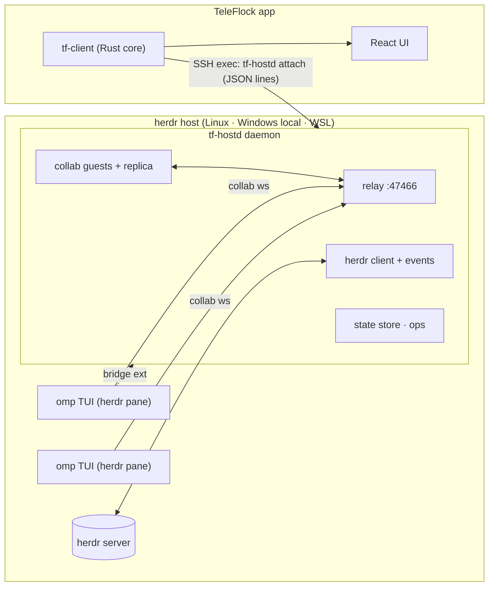

# TeleFlock architecture (v1)

Status: **decided** (phase B). Inputs:
- `docs/research/herdr.md`
- `docs/research/omp-collab.md`
- `docs/research/omp.md`
- `docs/research/platform.md`
- `docs/build.md`

The wire protocol lives in **`crates/tf-proto`**, the single source of truth. Its TypeScript bindings are generated into `src/core/gen/` by `scripts/gen-proto-ts.sh`.

## 1. Decision (ADR-001): how omp runs and how TeleFlock talks to it
**omp runs as the normal interactive TUI inside a herdr pane.**
- herdr keeps tracking its state through omp's own herdr integration (`working`/`blocked`/`idle`).
- The terminal in TeleFlock shows the real omp TUI.

**TeleFlock reaches omp through a host daemon, `tf-hostd`.** It runs on the herdr host, outlives app disconnects, and is shared by all clients (desktop and phone at once). It does four jobs:
1. **Relay.** It embeds an omp **collab relay** on `127.0.0.1:47466`, a private loopback port. omp sessions host collab rooms on it (the fallback data plane, below).
2. **Data plane.** One session replica per omp session (`tf-collab` `Replica`), fed by the first of:
   - **the companion extension's data plane** (bridge ≥ 2.0, `hello.caps.live`, `crate::feed`): its ordered live feed (collab-shaped `live` frames, a `resync` of everything in flight) plus omp's session `.jsonl`, read by hostd itself (`crate::journal`). No collab room is joined for these sessions: omp ends a room at 256 queued frames, which busy sessions with several streaming subagents hit. Prompts (images, delivery), aborts, dialog answers (`uiResponse`), subagent commands and transcripts (their files) go through the bridge;
   - **a full-control collab guest** in the session's room, for sessions without such a bridge (bridges < 2.0, no extension). That yields entries, live events, state, subagents, `ui-request`, prompt, abort, ui-response, agent-cmd and fetch-transcript.

   Either way hostd **compacts** omp's quadratic `message_update` stream into deltas; the keys never leave the host.
3. **Control plane.** It talks to the **TeleFlock companion extension** (`host/teleflock-bridge/teleflock-bridge.ts`) loaded in omp. The extension provides precise controls that a collab guest lacks: model, thinking, fast, plan-review answers, rename, compact, fork/branch/tree, follow-up queue, btw, export.
   - When the extension is absent, the fallback is herdr keystroke injection, following the safety rules in §5.4.
4. **herdr.** It drives herdr through the local API socket: one request per connection, plus one `events.subscribe` stream, coalesced. It bridges terminals through `herdr terminal session control`.

**How sessions get shared and bridged:**
- **Agents TeleFlock starts** are launched with:
  - `--config ~/.teleflock/omp-overlay.yml`, which sets `collab.autoStart: control` and `collab.relayUrl: ws://127.0.0.1:47466`;
  - `-e ~/.teleflock/ext/teleflock-bridge.ts`.

  No global config is touched.
- **Global opt-in (recommended).** Host setup can, with the user's consent:
  - write the two collab settings to omp's global config with `omp config set`;
  - copy the extension into `~/.omp/agent/extensions/`.

  This covers sessions the user starts by hand and sessions herdr restores (restore drops `--config`/`-e`). A TeleFlock-started omp then loads the extension twice (the global copy plus `-e`); the copies elect one bridge per process (§4), and hostd routes a pid's requests to its newest bridge when older copies that don't negotiate connect too.
- **Existing unshared sessions.** `agent.connect` submits `/collab ws://127.0.0.1:47466`, through the bridge's `slash` op when the global extension is connected, else by injection (§3.6). omp runs this builtin at once even while the agent streams, so Connect works while it is working. This creates a room but no bridge.

**Rejected alternatives:**
- **omp RPC mode in the pane.** It loses the real TUI and herdr's state target, and a second process cannot attach to a live session (it forks).
- **Guest inside the app over a `direct-tcpip` tunnel.** About 10× the bandwidth on mobile, and the room keys would travel to the device.
- **Slash injection only.** Fragile (see `omp.md` §1.2).



## 2. Repository layout and ownership

| Path | What |
|---|---|
| `crates/tf-proto` | Wire types and methods (orchestrator-owned contract). Run `scripts/gen-proto-ts.sh` after changes. |
| `crates/tf-herdr` | herdr API client: socket/pipe, typed calls, events, terminal sessions, server discovery, and the server's lifecycle as hostd drives it (`lifecycle.rs`, §3.29). |
| `crates/tf-collab` | omp collab: link, crypto, frames, relay server, guest, registry, **replica normalizer** (omp → tf-proto). |
| `crates/tf-hostd` | Host daemon binary: daemon/attach, client protocol, state store, agent ops, injection, bridge server, fs/git/gh/host ops, the 0.7.0 services (auto-resume, bring agents back, decide for me, notifications, host sync, moves, cleanup, search, herdr lifecycle; §3.16–§3.29), and since 0.8.0 the session settle watchdog (`settle.rs`, §3.4) and forwarding (`forward/`, `tf-forward`, §3.30). |
| `host/teleflock-bridge/` | omp companion extension (TypeScript, loaded by omp directly). |
| `host/teleflock-mcp/`, `host/teleflock-plugins/` | Helper extensions hostd runs in throwaway `omp --mode rpc` processes for omp's own code: MCP servers (§3.15) and skills and plugins (§3.26). |
| `crates/tf-transport` | App-side transports: Tailscale SSH (russh), Local, WSL. |
| `crates/tf-client` | App core: profiles, connections, deploy, protocol client, aggregation, app methods, tunnels, notification policy, device presence, forwarding rules and relay (`forward.rs`, §5.2), on-device dictation (`dictation/`, §6.16). |
| `crates/tf-dictation` | On-device speech recognition for the app core (desktops): model catalog and verified downloads, microphone capture, voice activity segmentation, sherpa-onnx recognizers (§6.16). |
| `crates/tf-devserver` | WebSocket bridge exposing tf-client to a browser (dev and verification) and serving `dist/`. |
| `src-tauri/` | Tauri app shell (Windows, macOS, Linux and Android) and Kotlin plugin under `src-tauri/plugins/` or `plugins/`; native notifications, system presence, quick capture and share. |
| `src/core/` | Frontend core: transports (tauri, ws, demo), typed client, zustand stores, rAF batching, **demo host**. |
| `src/features/*` | Feature UIs. |
| `src/capture/` | The quick capture window's page (§5.4, §6.4). |
| `src/design/` | Design system (done, see the DesignSystem inventory). |

Every Rust crate is a workspace member (`crates/*`). Each agent compiles with its own `CARGO_TARGET_DIR=target/<Agent>`.

## 3. Host daemon `tf-hostd`

### 3.1 Files and processes (Linux/macOS; Windows uses the same paths under `%USERPROFILE%`)

| Path | Purpose |
|---|---|
| `~/.teleflock/bin/tf-hostd` | Binary, uploaded by the app. Its version must equal the app's embedded version. |
| `~/.teleflock/run/hostd.sock` | Client socket (0600). On Windows: pipe `\\.\pipe\teleflock-hostd-<user>`; a home other than `~/.teleflock` (lab) adds `-<FNV-1a of the home>`. The suffix follows the home path, not whether `TF_HOSTD_HOME` is set: the app runs `attach` without it and `attach` starts the daemon with it, and both must name the same pipe. |
| `~/.teleflock/run/bridge.sock` | Companion-extension socket. On Windows: pipe `\\.\pipe\teleflock-bridge-<user>`. |
| `~/.teleflock/run/hostd.lock` | Single-instance lock (holds the pid). |
| `~/.teleflock/state.json` | Persistent per-herdr-session state: archived agents (by agent id and omp session), turn counters, first-seen times, activity ring, parked agents (`parked`: agent id → snapshot record, §3.5) and the prune list (`pruned`, ≤ 200, 30 days); plus the daily usage ledger and image-original links. Every field defaults when absent, so older files load unchanged. Compact JSON (older pretty files load the same), written within a second of a change, except usage-ledger-only changes (a working agent's cost moves with every reply): at most every 60 s, and at shutdown. |
| `~/.teleflock/hostd.log` | Rolling log. |
| `~/.teleflock/ext/teleflock-bridge.ts` | Companion extension, uploaded by the app. |
| `~/.omp/agent/extensions/teleflock-bridge.ts` (omp's agent dir: `PI_CODING_AGENT_DIR`, else `~/.omp/agent`) | Global copy of the extension, present only after the user applied the `install-global-bridge` fix. tf-hostd never creates it, but keeps it equal to the uploaded `ext/teleflock-bridge.ts` (at daemon start and on every host probe; only when it is a TeleFlock bridge), because omp loads it next to the `-e` copy in every session TeleFlock starts and a stale one breaks the bridge. Daemons on other homes (lab / dev) leave it alone unless `PI_CODING_AGENT_DIR` gives them their own. |
| `~/.teleflock/omp-overlay.yml` | Per-process collab overlay, uploaded by the app. |
| `~/.teleflock/agent-config/<id>.yml`, `agent-config/agents.json` | omp settings for one agent only (§3.7): each agent's own `--config` overlay (model roles, retry fallback chains) and the index (herdr session → agent id → overlay + settings) it is rendered from; 0600 in a 0700 folder. Removed with the agent (5 min after it left the board; files no record names after an hour). |
| `~/.teleflock/originals/<sha256>.<ext>` | Full-size originals of images TeleFlock sent while omp was working (omp saves only a downscaled copy then), served by `session.image {original}`; 0600, pruned after 30 days and above 1 GiB, oldest first. |
| `~/.teleflock/notes/<omp session id>.jsonl` | Row notes (`notes.rs`): what hostd saw of a session's transcript rows live that omp's session file does not keep (the TeleFlock device that sent a prompt, a steer, how long the model thought), one appended line per note; handed back to the replica before its next snapshot so rows rebuilt from the file (a resync, a hostd restart) equal the live ones field for field and keep their row hash. 0600 in a 0700 folder, pruned at start after 90 days and above 64 MiB, oldest first. |
| `~/.teleflock/rows/<omp session id>.jsonl` | Live rows (`live_rows.rs`): transcript rows hostd showed that omp's session file never gets: warning and error notices, and a run's terminal error row (omp never persists a provider refusal), each with the row it followed (`after`); one appended line per row (`Signal::RowKept`). Handed back to the replica (`Replica::keep_rows`) with the notes, so a rebuild (a resync, a hostd restart) puts them back where they were, same id and row hash. Never the text of a refused reply nor omp's fallback-credit token. The newest 500 per session (a file past 2 000 lines is rewritten to them at the next append; an append after a torn last write starts on a new line); 0600 in a 0700 folder, pruned at start after 90 days and above 16 MiB, oldest first. |
| `~/.teleflock/uploads/<yyyy-mm-dd>/<name>` | Files uploaded for prompts (`upload.*`, §3.13: videos from the composers, terminal pastes): 0600 in 0700 folders, outside every repo and worktree; `uploads/.partial/<uploadId>.part` while one runs. Pruned after 30 days and above 10 GiB, oldest first. |
| `~/.teleflock/moves/<move id>/` | Moves to and from other hosts (§3.28), 0700: the source's packed parts (`session.tar` from `omp session pack`, `changes.patch`) and `source.json` while a move runs (deleted when it finishes, rolls back, or the next daemon starts); the target's undo journal and status `target.json` (kept a day for `move.status`). |
| `~/.teleflock/chats/<name>-<id>/` | Chat tasks (§3.31): one folder per chat, made by hostd (the `chats/` root 0700), empty at the start and never a repository; omp keeps its `.omp/` there. Removed with its chat (`chat.delete`) while nothing else is in it. |
| `~/.teleflock/tools.json` | Tool updater status (§3.9): the per-host `auto` switch, last check/install per tool. |
| `~/.teleflock/herdr.json` | herdr lifecycle (§3.29): the per-host settings (`autoRestart`, `idleUpdate`, `idleMinutes`) and the herdr sessions TeleFlock serves (watched and started at daemon start). |
| `~/.teleflock/herdr-config.toml` | herdr's config for the servers TeleFlock starts (`HERDR_CONFIG_PATH`, §3.29): the user's `config.toml` with `session.resume_agents_on_restore = false`, re-rendered when the user's file changes. |
| `~/.cache/teleflock-tools.lock` | Per-user install lock of the tool updater (§3.9) and of Host setup installs (§3.12): held by whichever daemon (real or lab home) is installing. |
| `~/.teleflock/tmp/` | Scratch space of Host setup installs (§3.12): downloaded installer scripts and the gh archive, removed after each install. |
| `~/.teleflock/automations.json` | Automations (definitions per herdr session), their last ≤ 100 runs, per-automation schedule cursors, the pile-up guard's last started agent and skip streaks (§3.11); 0600, atomic writes. |
| `~/.teleflock/auto-answer.json` | Decide for me (§3.23), per herdr session: the host default, the agents' own policies and the running countdowns; 0600, atomic writes. |
| `~/.teleflock/ledger.json` | The agent ledger (§3.25), per herdr session: every live omp agent with what it takes to bring it back (card record, pane, process and command line, own settings and policy copies, what it was doing, boot and herdr server), and an ended agent's plan until it is back; 0600, atomic writes; an unreadable file is set aside as `.bad-<ms>`. |
| `~/.teleflock/ledger-images/<sha256>.img` | The images of a first prompt omp has not saved yet (§3.25), content-addressed, 0600 in a 0700 directory, at most 16 images / 16 MiB each / 64 MiB per prompt; removed with the ledger entry that names them (unreferenced files older than 10 minutes are swept at the next ledger write). |
| `~/.teleflock/autoresume.json` | Auto-resume (§3.22): the host's settings (`enabled`, `bringBack`) and one ticket per root omp session and herdr session (status, kind, reason, `resumeAt`, attempts, the stopped agents); owner-only, atomic writes; an unreadable file is set aside as `.bad-<ms>`. |
| `~/.teleflock/notify.json` | Notifications (§3.21): the host's routing policy (`route`, `escalateAfterS`, `escalateTo`) and up to 10 push channels (ntfy, Pushover, webhook) with their secrets; 0600, atomic writes. |
| `~/.teleflock/bin/tf-forward`, `~/.teleflock/forward/bin/` | Forwarding (§3.30): the `tf-forward` launcher (`tf-hostd forward`, with this home's `TF_HOSTD_HOME`), written at every daemon start in both places; `forward/bin/<tool>` are the tool shims of what connected apps relay (`.cmd` files on Windows). `~/.teleflock/run/forward/cli.sock`: `tf-forward`'s endpoint (0600 in a 0700 dir; Windows pipe `\\.\pipe\teleflock-forward-<user>[-<hash>]`, user-only). |
| `~/.teleflock/ext/teleflock-mcp.ts`, `ext/teleflock-plugins.ts` | The helper extensions of §3.15 and §3.26, embedded in tf-hostd and written next to the bridge. |
| `~/.teleflock/cache/` | Scratch of the helpers and the usage sync: `omp-stats` (cwd of `omp stats --summary`, §3.16), `plugins-user` (neutral cwd of user-scope plugin work, §3.26). |
| `/etc/systemd/system/teleflock-hostd-<hash>.{service,timer}` (root) or `~/.config/systemd/user/…` (lingering users) | Linux keepalive units, present only while an automation is enabled (§3.11) or the agent ledger holds agents to bring back after a reboot with auto-resume on (§3.25). `<hash>` = FNV-1a of the hostd home, so lab homes get their own pair. |
| `~/Library/LaunchAgents/dev.teleflock.hostd.<hash>.plist` (macOS) | The login item (§3.11): a launchd agent that runs `tf-hostd ensure` at login and every 10 minutes. Present only while an automation is enabled or the agent ledger holds agents to bring back after a reboot with auto-resume on (§3.25), and only for the real home; listed in System Settings → General → Login Items. `<hash>` as above. |
| Task Scheduler task `TeleFlock host service <hash>`, `~/.teleflock/login-task.xml`, `~/.teleflock/bin/tf-hostd-login.exe` (Windows) | The login task (§3.11): a logon trigger of the current user that repeats every 10 minutes and runs `tf-hostd-login.exe ensure` (a copy of `tf-hostd.exe` marked as a GUI program, so it runs without a console window), with the XML it was made from. Present on the same terms as the macOS agent, for the real home only; shown in Task Scheduler. |

**Processes outlive the login that started them.** On Linux with systemd, a process started from an SSH command lives in that login's `session-*.scope`, and systemd kills everything in the scope when logind tears the session down (logout with `KillUserProcesses=yes`, or a restarted logind cleaning up sessions that already ended). So the daemon (`attach`) and every herdr server it starts (`tf_herdr::durable`) each run in a fresh transient scope: `systemd-run --scope` of the system manager for root (`teleflock-hostd-*.scope`, `teleflock-herdr-<session>-*.scope` in `system.slice`), of the user manager for other users only when lingering is enabled (without it the user manager stops with the last session). herdr has its own scope, so replacing or stopping the daemon never touches herdr and its agents. When `systemd-run` is missing or cannot create the unit (no bus, no permission), and on macOS, Windows and Linux without systemd, both are started plainly (`setsid`, null stdio). A herdr server that already runs in a login-session scope is a setup issue (`move-herdr-out-of-login-session`, §3.4 `ops::scope`); for root, `host.setupApply` moves it and its live process tree into a new scope without stopping anything.

**WSL stops idle distros.** WSL shuts a distro down `instanceIdleTimeout` (15 s by default) after its last `wsl.exe` client exits, and the daemon, herdr and every agent stop with it, scopes or not. While a WSL host is wanted, the app holds one client open across reconnects and backoff (`WslKeepalive`, §5.1–5.2); after Disconnect or quitting the app, agents keep running only with `instanceIdleTimeout=-1` in the `[general]` section of `%UserProfile%\.wslconfig`.

### 3.2 Commands
- `tf-hostd daemon`: the long-running daemon.
  - Startup order: the instance lock (refuses to start if another instance holds it), the client socket (unix: bound before anything else runs, so `attach` connects at once and its hello waits in the backlog), the user's PATH (below), logging, then the runtime with the relay port and the other sockets.
  - **The user's PATH.** `attach` runs in a login shell, `ensure` from a systemd timer, a launchd agent (whose PATH is `/usr/bin:/bin:/usr/sbin:/sbin` unless the plist says more) or a Task Scheduler task: neither has what interactive rc files add (Ubuntu's `~/.bashrc` returns early unless interactive, and bun's and nvm's installers write there), so omp installed with bun (`#!/usr/bin/env bun`) failed with "/usr/bin/env: 'bun': No such file or directory". Before any thread exists, the daemon (`userenv.rs`) asks the user's shell (`$SHELL`, else the passwd entry) as an interactive login shell for its PATH: `$SHELL -i -l -c 'exec sh -c '\''eval "$TF_EXEC"'\'''` (csh/tcsh: `-i -c`, they take `-l` only alone) with the POSIX `printf … "$PATH"` in `TF_EXEC`, so the shell only reads a line that sh, bash, zsh, fish, nushell and tcsh read alike (§5.1), with stdin `/dev/null`, in its own session, stderr dropped, the PATH read between unique markers (rc-file noise around it is ignored), killed after 6 s. The app's connection test (`diag.rs`) asks the same way. PATH becomes that PATH, then entries only the inherited PATH has, then the well-known install dirs that exist (`~/.local/bin` and `~/.bun/bin` always: TeleFlock installs there), absolute entries only, each once. It is set for the whole process, so every child inherits it: omp and its interpreter, the herdr server and its panes, git, gh, installers. Any failure falls back to the inherited PATH plus the well-known dirs; the log says which (`user PATH source=… entries=… bytes=…`). `resolve_bin` still searches the well-known dirs after PATH, and `omp_bin` prefers an omp that can start (a script whose interpreter is missing loses to a later standalone binary). Windows: unchanged (a Task Scheduler task runs with the user's own environment).
  - Logs to `~/.teleflock/hostd.log`.
- `tf-hostd attach [--session <herdr-session>]`: connects stdio to `hostd.sock`, starting the daemon detached (`setsid`, `</dev/null`; in its own systemd scope where §3.1 applies) if needed, and waits up to 30 s for the socket (a daemon that exits is noticed at once; the full wait only runs while it is still starting, e.g. on a cold WSL VM). This is the **only** thing the app runs for the data channel.
- `tf-hostd stop [--force]`: graceful shutdown. A daemon that is replaced by a newer binary gets `stop` from `attach --replace`.
- `tf-hostd ensure`: starts the daemon detached (same scope path as `attach`) unless it is running, then exits. The boot service runs it (§3.11): a systemd timer, a launchd agent or a Task Scheduler task, with no terminal and a minimal environment (the unit and the plist carry `HOME`, `PATH`, `USER`, `LANG` of the daemon that installed them). The daemon it starts has null stdio and no controlling terminal, and finds the user's PATH itself (above). It also stands outside what the manager cleans up around `ensure`: launchd kills what is left of the job's process group when `ensure` exits, and the daemon is in a session of its own (`setsid`; the plist adds `AbandonProcessGroup`); a Task Scheduler task runs in a job object, which the daemon breaks away from (`CREATE_BREAKAWAY_FROM_JOB`, with `DETACHED_PROCESS | CREATE_NEW_PROCESS_GROUP`) where the job allows it, and where not stays in the task's run, which the task's settings never cut short.
- **Several devices, one daemon.** Every device of the user attaches to the same daemon, and their apps update at different times. A host therefore only moves forward (`tf_proto::version`: semver, then protocol):
  - `attach --replace` replaces an older daemon (its clients reconnect to the new one), never a newer one, and another build of the same version only when no client is connected.
  - While clients are connected, the daemon refuses `stop` from an older build, and from builds that predate this rule (they send no version with `stop`); that build's `attach` then connects to the running daemon. An idle daemon always stops.
  - Without these rules two apps of different versions restart the daemon under each other on every reconnect, and both devices drop every few seconds.
- `tf-hostd --version`: prints the version on one line (`tf-hostd 0.1.0 proto 1`).

### 3.3 Client protocol
`tf_proto::host::{ClientMsg, ServerMsg}` as JSON lines (`host.rs` documents the flow).

**Liveness.** The app pings every 15 s (§5.2). The daemon drops a client after 45 s without a line from it, counted in steps of at most 5 s of the daemon's own running time (`clients.rs` `read_or_silence`): after the daemon itself was suspended (system sleep, which Windows' clock counts; a stopped process, whose first wake-up on Linux fires overdue timers before it reads the socket), the overdue check counts one step and the ping the client queued meanwhile is read first. A client that really says nothing is dropped after 45 s as before.

**Revisions.** Revisions are per herdr session. Session subscriptions with `sessionSync` are numbered per subscription (`seq`, below).

**Coalescing.** The daemon coalesces before sending:
- state patches: at most 10 Hz
- pulses: at most 10 Hz
- session `append` deltas: one per 50 ms per item
- session `meta`: at most one per session per 500 ms, rebuilt from the latest state after the flush's other events (the ones in between fold into it); nothing is built for a session nobody has open. The session tree (`meta.tree`, 38–104 KB on long sessions) goes to apps ≥ 0.5.1 (hello `client.version`, pre-releases included) only when it changed, since their reducer keeps the previous tree when a `meta` comes without one; older apps get it in every `meta`, and `reset` snapshots always carry it.

A client sees one `snapshot` on hello, then patches.

**Features and zstd** (`clients.rs`). `hello.client.features` lists what the app speaks; hostd answers with the subset it accepts in `welcome.features` (an app that asks for nothing gets the welcome and messages it always got; an older hostd ignores the field). With `zstd`, everything after `welcome` is one zstd stream per direction (hostd → app with a 2 MiB window; app → hostd with 128 KiB, since requests and keystrokes are small and the window is what each side allocates per connection; inbound windows capped at 8 MiB); every batch of queued lines is written and flushed as one zstd block, so nothing waits for more input.

**Session sync** (`sessionSync`, `sync.rs`; the app side is §5.2). `omp.rs` hands each omp session's subscribers to a `sync::Fanout`. A plain subscription (old apps, `session.open` without `have`) gets exactly the stream above. With `have` (the omp session id, the client's newest rows with the hashes hostd gave them, its meta hash), `session.open` answers a delta: the window (newest `limit` rows of the replica's current path) minus the rows held with the same hash, `sync.order` listing the whole window, and a placeholder meta when the meta hash matches (`metaSame`). Row hashes are sha-256 of the row's JSON (first 8 bytes). Every later `session` message of the subscription carries `seq` (a re-open continues the numbering, so the client can drop the old subscription's messages); upserts carry their hash `h`, appends the UTF-8 length of the field before them (`at`), computed backwards from the replica in the flush (appends a later upsert/remove/reset of the row makes moot are dropped); `meta` becomes `metaPatch` (changed top-level fields, `null` clears) and `treePatch` (changed/removed nodes and the leaf; a reorder falls back to remove-all + upsert-all); live `reset`s (collab or bridge resyncs, rewritten files) become delta snapshots against what that subscriber holds (hostd tracks it: its snapshot window, then every upsert/append/remove it was sent). The session tree is hashed and copied once per tree revision (`OmpSession` bumps it when the tree changes) and shared by every subscriber's meta: a `meta` flush with the tree unchanged (`tps`, context and cost change twice a second while streaming) serializes the small fields only. `session.history` with a cursor the session does not have (a live-only notice a client kept from before tf-hostd restarted) answers `not_found`, never other rows; notice and retry row ids carry the replica's lifetime (`n<epoch>.<seq>`, `r<epoch>.<seq>`), so a later replica never reuses one a client keeps.

### 3.4 Internal modules (crate `tf-hostd`)

| Module | Owner | Responsibility |
|---|---|---|
| `main.rs`, `daemon.rs`, `attach.rs` | HostdCore | CLI, lock, sockets, detach/replace, logging |
| `userenv.rs` | HostdCore | The user's PATH for the daemon and every child (§3.2); `#!` interpreter detection |
| `clients.rs` | HostdCore | Per-client sessions: hello/welcome, rev, subscriptions, request dispatch, pulse fan-out |
| `state/` | HostdCore | `HostState` builder: herdr ↔ omp merge, columns, liveness, needs, archive persistence, activity, notifications |
| `omp.rs` | HostdSessions | One `Replica` per omp session and its transport (bridge feed or collab guest), registry polling, collab joins, link lifecycle and reasons, routing of prompt/abort/answer/agent-cmd/transcripts to the path serving the session |
| `feed.rs` | HostdSessions | Bridge data plane: per-session feed driver (`liveSubscribe`, resync, `seq`-ordered live frames, session-file tail interleaved before frames that start something, every file read on the blocking pool and outside the session lock), bridge loss and collab fallback, subagent transcripts from their files |
| `journal.rs` | HostdSessions | omp's session `.jsonl`: full read through the resync's `lastEntryId`, tail of complete lines (both blocking, run off the runtime); shrink, inode change or changed anchor bytes → rewrite, vanished → moved |
| `notes.rs` | HostdSessions | Row notes store (`<home>/notes/<session>.jsonl`): persists the replica's `Signal::Noted` and hands the notes back (`Replica::keep_notes`) before a session's first snapshot, so rows rebuilt from the session file equal the live ones |
| `live_rows.rs` | HostdSessions | Live rows store (`<home>/rows/<session>.jsonl`): persists the replica's `Signal::RowKept` (warnings, errors, unpersisted terminal errors such as refusals) and hands them back (`Replica::keep_rows`) with the notes; the replica restores each after the row it followed (`tf_collab` `replica/live_rows.rs`) |
| `ops/agent.rs`, `inject.rs` | HostdCore | All `agent.*` and `session.*` methods. Session data path first (bridge data plane, else collab), bridge control plane second, injection last. |
| `bridge.rs` | BridgeExt | Extension socket server, typed control calls, `hello.caps`, the lossless per-session live feed and the data-plane ops (`prompt`, `uiResponse`, `agentCmd`) |
| `ops/{fs,git,gh,workspace,worktree,host,term}.rs` | HostdOps | fs.*, git.*, gh.*, workspace.*, worktree.*, host.*, term.* |
| `ops/limits.rs` | HostdOps | `host.limits`: subscription limits from `omp usage --json` / `--history --json` (see below) |
| `ops/usage/` | HostdOps | `host.usage`: omp's stats index resolved like omp, kept current with `omp stats --summary` (on demand + warm-up), insights and freshness (see §3.16) |
| `ops/wrapped/` | HostdOps | `host.wrapped`: one host's share of the weekly Flock Wrapped card: usage-report figures, automation runs, commits and merged pull requests (see §3.19) |
| `ops/ai.rs` | HostdOps | `ai.complete`: one short completion from omp's `tiny` model role (see §3.8) |
| `ops/scope.rs` | HostdOps | Setup issue + fix `move-herdr-out-of-login-session`: a herdr server (`SO_PEERCRED` on its socket) in a `session-*.scope` is moved with its process tree into a new scope (`StartTransientUnit`, see §3.1) |
| `ops/tools.rs` | HostdOps | omp/herdr updater (one per daemon), `host.toolsUpdate`, `host.toolsConfig`, `HostInfo.tools` (see §3.9); its process runner and install lock also serve `ops/install.rs` |
| `herdr_health/` | HerdrGuard | herdr's server lifecycle (§3.29): per-session watch (`machine.rs`, pure), restarts with backoff, idle-time loads of a newer herdr (`idle.rs`), the managed herdr config (`managed.rs`), stale saved sessions (`saved.rs`); `subscribe` / `current` for agent recovery; `host.herdrRestart` / `host.herdrLoad` / `host.herdrConfig`, `HostInfo.herdrHealth` |
| `ops/install.rs` | HostdOps | Setup issues + fixes for missing omp (or its interpreter), herdr, gh, git, ffmpeg (see §3.12) |
| `ops/upload.rs` | HostdOps | Owner-only chunked uploads for prompts and pastes: names, offsets, caps, idle and age cleanup (see §3.13) |
| `ops/moves/` | Move | `move.*` (§3.28): preflights (`facts.rs`), the source job (`source.rs`: push, changes patch, close, `omp session pack`, read, finish, rollback), the target job with its undo journal (`target.rs`), omp's `session pack|unpack|moved` argv (`ompcli.rs`), remote URL matching (`url.rs`) |
| `ops/omp_config.rs` | OmpSettings | `omp.settings` / `omp.settingsSet` / `omp.settingValues`: omp's own settings schema + global config (see §3.10) |
| `ops/hostsync/`, `ops/mcp/sync.rs` | HostSync | `hostSync.*`: a host's exportable omp profile, the plan against this host (`plan.rs`, pure), one-time keys and sealing (`seal.rs`), sign-ins from `omp auth export` by identity (`signins.rs`), apply through the existing write paths (§3.24) |
| `agentcfg.rs`, `ops/roles.rs` | AgentRoles | One agent's own omp model roles and fallback chains: validation, per-agent `--config` overlay and its index, file lifetime; `agent.getRoleModels` / `agent.setRoleModels` through the bridge (§3.7) |
| `automations/`, `ops/automation.rs` | Automations | Store, cron/next-run, scheduler loop, run recipe, the boot service (`boot.rs`: a systemd timer, a launchd agent or a Task Scheduler task); `automation.*` (§3.11) |
| `restart/` | Lifeboat | Bring agents back (§3.25): the agent ledger (`ledger.rs`), how a session stood when its omp ended (`detect.rs`), the decision table and note (`decide.rs`), ended cards, relaunching and going on (`mod.rs`), start-timeout adoption and relaunch in place (`launch.rs`), the resume command reported to herdr (`herdr.rs`) |
| `autoanswer/` | AutoAnswer | Decide for me: policies and countdowns (`core.rs`, pure), `auto-answer.json` (`store.rs`), the per-session worker that answers what falls due, `agent.setAutoAnswer` / `agent.autoAnswerCancel` / `agent.autoAnswerPostpone` / `host.autoAnswerSet`, the daemon-start hook (§3.23) |
| `ops/cleanup/` | Janitor | `cleanup.*`: worktree report (discovery, git facts, sizes, pull requests, board and session facts), removal re-checked right before, omp's storage gc without sessions; idle shells (`shells/`: rules, process facts, settings, the per-session janitor that lists and closes them) (§3.17) |
| `ops/artifact_files.rs`, `ops/xray.rs` | Artifacts | `session.artifacts` / `session.artifact`: a session's artifacts dir, scoped; `session.writeLocal`: a pasted text saved as `local://paste-<n>.md`; `session.context`: the bridge's `context` breakdown, bounded (§3.20) |
| `recovery.rs`, `limit_resume.rs` | AutoResume | Auto-resume tickets (`<home>/autoresume.json`): one per root omp session, executors per kind (`usageLimit` / `rateLimit` → the bridge's `resumeTree`, `restart` → `restart/`), the worker that runs due tickets; `limit_resume.rs` opens them from the bridge's `turn_error` with `resumeAt` from the accounts' limit windows; `agent.retry`, `agent.autoResume*`, `host.autoResume*` (§3.22) |
| `notify/` | Notify | Notifications that find you: connected apps and their presence (`presence.rs`), routing and escalation (`route.rs`, pure), push channels ntfy / Pushover / webhook with write-only secrets (`push.rs`, `store.rs` → `notify.json`), `notify.*` (`ops.rs`) (§3.21) |
| `ops/jobs.rs`, `ops/services.rs` | Jobs | `jobs.list` / `jobs.cancel` through the bridge; `services.*` over `omp ps` (list, logs, stop, kill, restart) (§3.18) |
| `ops/plugins/`, `ops/mcp/helper.rs` | HostTools | `skills.*` / `plugins.*`: reads through the embedded helper extension, changes through omp's CLI, `/reload-plugins` in running sessions (§3.26) |
| `ops/gh_auth.rs`, `ops/gh_auth/` | HostTools | `gh.auth*`: GitHub CLI sign-in as an `AuthFlow` (§3.14) |
| `find/`, `ops/search.rs` | Search | `session.find` (literal matching over a transcript's rows, `text.rs`, `rows.rs`) and `search.*` over every omp session file on the host (§3.27) |
| `state/recaps.rs` | HostdCore | omp's idle recaps (`recap.idleSeconds`) for `OmpInfo.recap` on Review and Done cards (§3.5) |
| `artifacts.rs` | HostdSessions | Reads a session's artifacts dir for the spend collab never mirrors: subagent transcripts and the advisor's `__advisor*.jsonl` (§3.16) |
| `chats.rs`, `ops/chat.rs` | ChatTasks | Chat tasks (§3.31): chat folders (names, making, which paths are a chat's, what they hold, removal), the workspace for chats and the pane environment, the board marker; `chat.list` / `chat.delete` |
| `agent_chat.rs` | AgentChat | A session's agent chat log for the message board (§3.34): the bridge's IRC legs, the session's transcript files (`tf_collab` `IrcFileScan`) and the user's subagent messages merged into one message per send; `session.agentChat`, `SessionMeta.agentChat` |

**Link lifecycle (`omp.rs`, `feed.rs`, `tf_collab::{registry, guest, relay}`).** What a session's `omp.link`, `linkReason`, `linkVia`, `linkSince` and `linkError` say and when hostd retries. `linkReason` names the situation (`starting`, `syncing`, `joining`, `joinFailed`, `reconnecting`, `bridgeLost`, `roomClosed`, `noRoom`, `sharedElsewhere`, `viewOnly`, `relayDown`, `fallbackCollab`); `linkSince` is when the (state, reason, path) triple began (state store, per agent). Nothing gives up while the bridge or the room can come back; slow hosts (omp needs minutes to start and to serialize a large session on a starved WSL laptop) only make each step wait longer.
- **Bridge ≥ 2.0 (`caps.live`).** Its hello attaches the session (`syncing`, via `bridge`): `liveSubscribe`, then the `resync` → the session file through `lastEntryId` (or the resync's entries while omp has never written the file) → the in-flight frames (the resync's `streaming` flag, not the debounced `state` frame, says whether a turn runs; one that runs is a turn whose end counts) → `live` frames in `seq` order → `live` (via `bridge`). The file's tail is read after a frame that can start something arrives and applied before it, after a frame that settles something once the feed is idle, and every 250 ms; the read (a `stat` plus the appended bytes) runs on the blocking pool and only applying it takes the session lock. A `seq` gap, a rewritten or moved file (also a resync naming a file omp wrote that is gone: omp's `/move` renames it before the session points at the new path), a file that cannot be read, or `agent.connect` while the session loads subscribe again; live frames that arrive before the new resync belong to the subscription it replaced and are dropped. Restarts in a row (each subscription between them ending within 10 s) pause before subscribing again: not after the first, then 250 ms, doubling up to 30 s (`agent.connect` ends the pause), so neither omp's resyncs nor full reads of a large file run in a loop; a session that never loaded says why meanwhile (`syncing`: "TeleFlock could not load the session (…); retrying"). Rooms of such processes are never joined; a session a collab guest served is taken over at the first resync (the guest leaves). A session switch ends the old session; omp's `bye` ends it once the bridge does not return.
- **Stalled feed: the settle watchdog (`settle.rs`; `feed.rs` `supervise`, `restart_driver`; `journal.rs` `newest_entry`; `lossy_json.rs`).** Every session's copy, whatever feeds it (bridge feed or collab room), is held against omp's own word every 2 s: the newest transcript entry of omp's session file (one `stat`; the file's end is read only when it changed; a session no bridge names has its file looked up under omp's sessions dir), whether that entry ended the run (`stopReason` `stop`/`length`/`aborted`), the bridge's control state (`idle`, its own channel) and the collab registry's `busy` (omp's `isStreaming`, asked of the omp process on every poll; absent from older omps, which counts as unknown, never idle). A live copy is **behind** when the file holds an entry it lacks for 10 s, **stale** when it shows work in flight (a turn running, its own or by omp's `state`: `Replica::at_work`; rows alone never count: a turn's end settles every row it left in flight, so a row in flight outside a turn is one no run will finish, such as the call of an attempt that failed mid-reply and was retried, which a copy rebuilt from the file keeps queued for good and no repair could settle) while omp says its turn is over for 30 s (the bridge's word first, then the registry's; the file's alone only when omp says nothing else), **unseen** when omp says it works while the copy shows nothing for 30 s. A repair (one warning) first asks the live source for everything again: the bridge feed driver subscribes again (a fresh resync), the collab guest says hello again (a fresh snapshot). A copy still not settled 15 s later is rebuilt from the whole session file (`feed::rebuild`: every entry as omp wrote it, omp's last state and agents, nothing in flight), which subscribers get as a `reset`; a bridge feed driver that delivered no resync meanwhile is aborted and started over (it may hang where no ask reaches it), and with its bridge gone the session loses it there (`bridgeLost`, the file serving it), as that driver would have said; an entry omp's own fresh collab snapshot lacks too (a branch the session left) stops counting. The next repair waits 2 min, doubling while they keep coming, up to 15 min; 15 min without one start the count over. A bridge that leaves two `liveSubscribe`s in a row unanswered (its socket open, its writer stuck) gets its connection closed (`BridgeHandle::close_conn`): the extension redials and its hello brings the session back. Before (0.7.0), only bridge-served copies were checked, only on the turn flag, and only by an ask a hung driver never took: a copy frozen on a turn's first tool calls stayed so (the reported freeze: two `grep` cards "queued" while omp's TUI showed the final answer, and the app's mirror repair, which waits for hostd's copy to settle, never ran). Tests: `cargo test -p tf-hostd settle:: journal::tests::newest omp::session_tests` (a driver stuck mid-turn, a bridge that stops answering, a silent collab room; the freeze is armed through `lab.rs`, which labs get with `--features lab-faults` and `TF_HOSTD_LAB_FREEZE=<text>`: the first live frame containing `<text>` freezes its session's source). A panic in a feed driver is logged and the feed starts over, instead of leaving the driver slot taken and the link `live` with nothing feeding it. Bridge and session file lines carrying half a UTF-16 surrogate pair (omp cuts text by UTF-16 index; serde_json refuses `\udXXX` escapes alone) are decoded with U+FFFD in its place, not dropped. This was the 0.6.x freeze with many subagents and long `wait`s: a subagent's cut `stage` repeats in every `wait` update and every resync, so each frame and each resync carrying it was dropped while the link looked live. Lab (real omp 18.13.3, tf-devserver, a mock model whose completion-probe answer puts 🔍 at UTF-16 index 78 of a subagent's `stage`): v0.6.1 dropped 322 lines as `bad json` from the probe on, and its transcript stayed on the running `wait` after omp's TUI showed the final answer; the current tree showed the final answer with omp, with bridge 2.1.0 and with a 2.0.0 bridge (hostd's repair alone).
- **The session file serves what nothing live does (`settle.rs` `follow_file`; `journal.rs` `JournalTail::resume`; `omp.rs` `serve_from_file`).** While a session has no working live source (its collab guest reconnects after the room went, its room ended or could not be joined, its bridge is away), the settle watchdog keeps the copy current from omp's session file every 500 ms: the same tail the bridge feed reads (`feed::apply_appended`: the journal and the transcript entries, committed entries only, nothing streaming), continuing where the copy's journal left the file (a guest reads it through `fetch-transcript`), so subscribers get the rows as upserts, not a `reset`; only a copy that never read the file, or a file rewritten meanwhile, is rebuilt from it once. Repairs (above) do not run meanwhile. A room that ends (4004 for good, a fatal or refused join) no longer ends the session: it stays (`room_lost`; replica, subscribers, the link saying why) until a join takes it back (`joining omp's collab room again`; omp's snapshot then brings the same rows) or its omp process is gone (where hostd cannot tell, off Unix: 10 min after its room left); another session of the same omp joined later drops it. A room hostd cannot join at all has its session found by id under omp's sessions dir (the registry row has the session id; the discovery file only `instanceId`, `pid`, `endpoint`, `createdAt`) and served the same way, `connecting` (`joinFailed`) with the latest failure, so the agent shows its transcript instead of none. Tests: `cargo test -p tf-hostd omp::session_tests::a_room_` (a room that goes and comes back, a room that cannot be joined and then can).
- **Bridge lost, or its live feed does not start.** The replica and its subscribers stay (`connecting`: `bridgeLost`, "TeleFlock's bridge in omp disconnected; showing the session from its file until it reconnects", the same words on every poll, `linkSince` telling how long; or `syncing` while a connected bridge leaves `liveSubscribe` failing), and omp's session file serves the session (above). No collab room of an omp process whose bridge (≥ 2.0) was connected within the last 10 min is joined (`omp.rs` `BRIDGE_MEMORY`, by pid, so a `/new` meanwhile is covered too): a join makes omp serialize the whole session, which an omp that leaves its bridge unanswered can least afford, and it can feed what starved the bridge. The bridge takes the session back with its next resync. The session is dropped once its omp process is gone or said goodbye (Unix: `kill(pid, 0)`); after 10 min without a bridge a published room may take it over (`live`, via `collab`, `fallbackCollab`), else it is dropped. Before (0.7.0), a published room took over after 10 s. Tests: `cargo test -p tf-hostd omp::session_tests::a_bridge_that_stops_answering` (no join, rows from the file, the bridge's return taking over).
- **Join grace.** A room is joined only once it was listed for 8 s, unless its process's bridge is connected and lacks the data plane: after a hostd restart bridges reconnect within 5 s, and a join would make omp serialize a session its bridge serves. Meanwhile the session is `connecting` (`starting`: "waiting for TeleFlock's bridge in omp to connect before joining its collab room"), not `joining`.
- **Just started.** For 8 s after hostd starts (bridges reconnect within 5 s) and until its first registry poll, an omp session that has neither a room nor a bridge yet is `connecting` (`starting`: "TeleFlock just started; waiting for this omp's bridge or collab room"), whatever its pane runs, never `notShared`; the next poll after that announces the end of the grace so the boards read the link again.
- **No room yet.** An omp process started with TeleFlock's overlay (`--config …/omp-overlay.yml` in `/proc/<pid>/cmdline`), or any omp while omp's global config shares (`HostInfo.setup.globalSharing`), is `connecting` (`starting`: "omp is starting; waiting for its TeleFlock bridge or collab room") for up to 5 min after hostd first sees it, then `notShared` (`noRoom`). Other omp processes are `notShared` (`noRoom`) at once (Connect injects `/collab`). A room on another relay is `sharedElsewhere`, one without control access `viewOnly`; a relay that is not listening `relayDown`.
- **Registry polls** every 1.5 s, 2.5 s per host (omp's own lister: 1.5 s). A host that accepts but does not answer in time (busy event loop) keeps its last snapshot for 45 s instead of dropping out; `link` requests wait 10 s. A poll lists `collab-hosts` once and re-reads a publication only when its size or mtime changed; one that refuses the connection while its process is gone (Linux: no `/proc/<pid>`; killed omps leave their files behind) is not asked again until its file changes.
- **Joins.** Join timeouts start at omp's 30 s (welcome, then per snapshot chunk) and double after each join that timed out, up to 4 min. A failed join is retried after 2 s, doubling to 60 s (±25 %), while the room is published; failure records outlive a missed poll by 2 min, a new room generation starts over. Meanwhile the link stays `connecting` (`joinFailed`) with `linkError` "join attempt N failed: …; retrying". Only failures retrying cannot fix change it: another relay answering our port (identity proof) or an unusable link → `error`; a collab protocol mismatch → `unsupported`.
- **Room reset.** From the second join in a row that timed out on one room, hostd resets the room before the next try: the relay closes the host's connection with 1012, omp reconnects within ~1 s and the room starts over without per-guest state (observed: a resumed session's room that let every join time out for hours until a relay restart). The same applies to a joined guest whose reconnects time out twice in a row.
- **Joined.** The guest reconnects by itself (1 → 30 s backoff, `connecting`: `roomClosed` "omp closed its collab room; waiting for omp to reopen it" for 4001/4004, else `reconnecting` with the cause; its join timeouts double after a reconnect that timed out). A guest that ends (room gone, fatal) rejoins through the registry after the join backoff; a `bye` (rotation) at once.
- **Relay.** Drops a silent peer after 180 s (omp, which answers pings on its event loop, can block for over a minute serializing a large session; a dead loopback peer closes its socket anyway).
- **Retry now.** `agent.connect` on a `connecting` session calls `OmpHandle::retry_now`: the bridge feed subscribes again (unless the subscription that was loading has gone live meanwhile), or the join (or the guest's reconnect) runs now, after a room reset when its joins were timing out.

**Turn errors, refusals and notices (0.7.0; `tf_collab` `replica/failure.rs`, `replica/live_rows.rs`, `live_rows.rs`).** Every way an assistant message can fail shows exactly one error: on its last visible text row, else on its own error row `a<ts>.e` (omp's thrown-error message is `[{type:"text",text:""}]`, a refusal often `[]`, a failure after thinking or tool calls has no text either). What shows follows omp's TUI: a failed request's `errorMessage` (`provider error` without one) with `errorStatus` as the HTTP status, an abort's own reason (a stalled stream), never a user interrupt or a reasonless abort. A provider refusal (`stopDetails.type` `refusal` / `sensitive`) also carries `AssistantItem.refusal {kind, category, explanation}`; the app shows it as "Refused · cyber" with the explanation and a hint (rephrase or switch model), the board's activity and the notification use the same words (`Signal::TurnEnded.refusal`). Attempts omp's auto-retry superseded stay hidden: live, `auto_retry_start` drops the attempt's error row (a late copy of its entry does not bring it back); rebuilt, an attempt stamped `retryRecovery` or followed by another assistant message before the next prompt builds no error row. Rows omp's session file never gets are kept as **live rows** with the row each followed: warning and error notices (not collab presence, not retry streaks) and a run's terminal error row (omp never persists a refusal; it is kept without the refused text and without omp's fallback credit). hostd appends them to `<home>/rows/<session>.jsonl` (`Signal::RowKept`) and hands them back with the notes, so a resync or a hostd restart puts each back after its row (by time when that row is gone), same id and hash; a row the file has stays as the file has it. Bridges ≥ 2.1 (`caps.notices`) also forward what omp's TUI shows alone: extension `ui.notify`, retry fallbacks, config warnings (keyed: one row however often a resync repeats them). omp's `xd://` mount notices (`source: xdev`, info) are no rows. Info notices stay live-only.

**Dispatcher contract.** HostdCore owns it. `clients.rs` parses `HostMethod::parse(method, params)`. For each method family it calls an async handler fn:

```rust
pub async fn handle(ctx: &Ctx, req: HostMethod, client: &ClientHandle) -> Result<serde_json::Value, ApiError>
```

`Ctx` gives:
- `ctx.herdr: Arc<HerdrClient>`
- `ctx.state: StateHandle` (read snapshot, mutate, emit)
- `ctx.omp: OmpHandle` (guests by agent)
- `ctx.bridge: BridgeHandle`
- `ctx.terms: TermRegistry`
- `ctx.paths: Paths`

HostdOps implements `ops::{fs,git,gh,workspace,worktree,host,term,ai}::handle(ctx, req, client)` against that `Ctx`.

**Subscription limits (`host.limits`).** omp already knows each connected account's quota windows: it fetches per-account reports from the provider usage endpoints (Claude `api/oauth/usage`, ChatGPT/Codex `backend-api`, Copilot, Gemini, …), caches them ~5 min ±25 % per account in `~/.omp/agent/agent.db` (`cache` rows `usage_cache:report:…`), refreshes the window rows from live response headers at most once a minute, and appends hourly `usage_history` rows. `ops/limits.rs` never calls a provider and never sees a token: it runs `omp usage --json` (5 min hostd cache, matching omp's own; `refresh: true` → 10 s) and `omp usage --history --json --days 8` (10 min cache), keeps its own per-poll readings, and returns `AccountLimits { fetchedAt, accounts: LimitAccount[], sessions: LimitSession[], error? }`. Each `LimitAccount` (`key` = `provider|email:…|org:…`) carries `plan`, `fetchedAt`, `resetsAvailable`, `error`/`disabled` (omp's `accountsWithoutUsage` / `disabledCredentials`) and `LimitWindow`s (`used` fraction, `resetsAt`, `durationMs`, `tier`, `status`, ≤ 120 `samples` of the current window period). `sessions` maps each live omp session to the account omp pinned it to: `agent.db` `cache` row `session:sticky:<provider>:<sessionId>` → `credentialId` → `auth_credentials.identity_key` (read-only; the credential `data` column is never selected); a provider with one account needs no pin. The client (`src/core/limits.ts`) computes the pace (used-fraction change per hour over a fifth of the window, 30 min … 24 h) and projects "runs out in ~X" vs "resets first".

### 3.5 Board mapping and liveness (state store)

**Columns:**
- `needs` if herdr is `blocked` (unless omp's provider retry explains it: "Provider retry" below), or the replica has a pending `UiRequest`, or the bridge reports a plan review or a wait for the user no dialog covers (`state.userWait`, bridge ≥ 2.3.0), whatever herdr says (it reports `working` while omp's `cfg://` approval waits).
- Otherwise `running` if herdr is `working`.
- Otherwise `done` if archived.
- Otherwise `review`. This covers idle/done after work, and also fresh idle agents, which the UI labels "Ready".

**Archive state.** Archiving is persisted. An agent that starts working again is un-archived automatically (activity `unarchived`).

**Parked agents (Mark done closes the pane, `state/parked.rs`).** `agent.archive {archived:true, close:true}` archives as before and starts a 10 s undo window; un-archiving (Undo) or a newer Mark done cancels it. The pending window stays registered until the close is done, so an Undo that arrives just after the deadline, while the pane is being closed, still cancels it (the archive mark is re-checked right before closing). At the deadline the agent is parked only if it is still archived, idle (herdr `idle`/`done`, no needs), an omp agent, and its session file exists; otherwise its pane stays open. Parking snapshots a `ParkedRecord` into `state.json` (agent id, herdr name, kind, title, cwd, repo, branch, omp session id + file, model, thinking, started/archived/parked times, turns, diff, cost, last line, the linked worktree and the workspace it lived in), then closes: the whole herdr workspace when the agent's pane is its only pane (a Dispatch / worktree workspace), a shell tab first and then the pane when that sole pane belongs to a primary workspace grouping linked worktrees (never close a group), else just the pane. The board can lag herdr (panes opened seconds ago, a busy event stream), so the choice is verified against herdr right before closing (`parked::verify_close`): `pane.get` must still show the agent's terminal in that pane (else nothing is closed and the record is dropped), and a workspace is closed only when `workspace.get` reports exactly one tab with one pane; otherwise just the pane goes. Activity: `stopped` "Closed X (done)". Every rebuild adds a parked card per record: same agent id, `paneId/tabId/workspaceId` empty, `state idle`, column `done`, `archived`, `parked {at, sessionFile, worktree?}`, `omp.link notShared`, default liveness. `parked.worktree {path, repoRoot}` (hosts ≥ 0.5.2) is the linked worktree it ran in, because the workspace that named it is usually gone: `worktree.remove {workspaceId: "", path}` deletes that checkout (`ops/worktree.rs`: through herdr when a workspace holds the folder again, else `git worktree remove` run from the main worktree, only for a linked worktree, with `-c safe.directory=*` under `trust`; a folder already gone counts as removed, and only its own registration is dropped, never a repository-wide `git worktree prune` that would also drop other missing worktrees such as one on an unmounted disk) and then drops `worktree` from every parked record at that path; the card stays in Done with its transcript, and resuming it fails with `not_found` (its folder is gone). A record whose agent id is still live (pane closing) stays hidden; a record whose omp session (id or file) runs in another live agent is dropped together with its archive marks (it is live again). Per-agent controls on a parked card fail with code `parked` ("Resume it first"); `session.open` returns a read-only snapshot (meta from the record, caps all off but `prompt`; the last rows of the session file, ≤ 16 MiB tail, mapped by `tf_collab::replica::transcript_page`, no subscription or paging) because that parser already reads omp session files cheaply; `term.open` on it fails with `parked`. `host.sessions` lists a parked session with its `agentId` and `live: false`. Existing archived agents with open panes are left alone on upgrade.

**Pruning.** At start and every 60 s the store stats the session file of each parked record and of each archived, idle live omp agent. Only a definite deletion counts (`parked::check_file`): `NotFound` while the file's folder is a folder (or, that folder deleted too, the sessions root above it is a non-empty folder). Any other outcome (permission or I/O errors, a stale or unmounted file system, folders gone) skips every file under the same sessions root (`<sessions>/<slug>/<file>` → `<sessions>`; a file system that errs may err for all its files) for that pass: nothing under it is pruned or forgotten, while other roots are judged as usual (an archived agent whose session lived in a deleted lab folder no longer blocks pruning everywhere). Each skipped root is logged once, again when its reason changes or after an hour. A missing parked file removes the record, its archive marks, turns and activity and adds `PrunedAgent {agentId, sessionId, at}` to `HostInfo.pruned` (newest first, ≤ 200, 30 days). An archived live agent is pruned the same way (pane closed first, verified as above) once its file was seen on disk and then was missing on two passes in a row (omp writes the file lazily). `HostInfo.pruned` comes from `state.json` in every rebuild and survives info re-probes.

**Background work and its pace.** Repo facts (`RepoInfo` of agent cwds and workspace folders) come from one `git rev-parse` per folder and one `git status` per worktree top (folders in one worktree share it). They are refreshed at once on turn ends, cwd changes (new folders in a snapshot or `pane_updated`), TeleFlock's own git operations and a client connecting; while clients are connected, facts older than 5 min are refreshed (checked every 30 s); with no client nothing polls. Host facts (`probe_info`: versions, setup checklist, herdr sessions, global bridge refresh) are probed at context start, when a client connects, after setup fixes and tool installs, and every 10 min while clients are connected; `omp --version` is cached per binary (path, size, mtime) and omp's `collab.autoStart` / `collab.relayUrl` are read from its `config.yml` (cached by mtime; `omp config get` only for shapes the reader does not take on). A board rebuild reads the persisted maps without the activity ring and a slim omp view (summaries, no lists or tree); the 5 s clock rebuild runs only while an agent works.

**Liveness:**
- `lastEventAt` comes from any guest event; for non-omp agents it comes from herdr `pane_updated`.
- `streaming`/`thinking` reflect `message_update` deltas.
- `tool` is the open `tool_execution_*` call.
- `tps` sums every spender's output rate, split in `tpsSplit {main, subagents, advisor}`. The main agent's rate is a 3-second rolling count of its streamed deltas (chars / 4). Subagents and advisors stream nowhere a guest can see, so each of their finished replies (read from the session's artifacts dir, below) is replayed at its real decode rate, `usage.output / (duration − ttft)`, from the moment tf-hostd reads it: the sparkline's area is exact, its timing one reply late. Replies that ended over a minute ago are not replayed, and `tps` is absent when nothing produces output.
- `cost` (`OmpInfo.cost`, `SessionMeta.cost`) is omp's status-line total `$main (+subagents) + advisor`, split in `cost.split`. Main: the main agent's assistant `usage.cost.total` (collab entries) plus `model_usage` side calls (journal). Subagents: `max` of completed `task` results (`details.usage`), the artifact tree and the live `progress.cost` sum. Advisor: `__advisor*.jsonl` at the top of the artifacts dir. Collab mirrors neither advisor turns nor subagent transcripts, so tf-hostd tails `<session>/` (the dir next to `<session>.jsonl`, found under `<omp agent dir>/sessions/*/`) with `tf_collab::ArtifactLedger`: top-level `__advisor*.jsonl` bill the advisor, every other session transcript (subagents, nested subagents and their advisors) bills the subagent tree, counting only assistant turns and `model_usage` entries so nothing is counted twice. The host usage ledger (board "today") accounts the growth of this total with a high-water mark per session.
- `line` uses the active tool label, else the last assistant sentence fragment (≤ 80 chars).
- `OmpInfo.recap` is omp's idle recap (`state/recaps.rs`). After `recap.idleSeconds` (default 240) of an idle TUI, omp journals a short LLM recap to `<omp agent dir>/history.db`, table `session_recaps` (never in the session file). hostd reads the newest row of each board session read-only, only when `history.db` or its WAL changed (a `stat` every 5 s otherwise), and attaches it while it is current: no newer conversation row in the replica (`Replica::last_turn_row_at`; `created_at` has second precision), else, without a replica (parked agents), written after the turn end hostd saw; unknown → none. Review/Done cards show it instead of `line` (fallback `line`), phone rows and the session headers show it when present. There is none while a draft sits in omp's composer or with `recap.enabled: false`.
- `SessionMeta.subagents[].status` (`replica/subagents.rs`): `running`, `done`, `failed`, `aborted`. omp's roster says `parked` for an agent it parked after its idle TTL (minutes after it finished) and for every persisted subagent after a restart, so `parked` tells that it finished, never how. The replica keeps the outcome it knows (bus `lifecycle`/`progress`, a settled `task` result's `details.results[]`/`progress[]`, and `details.jobs[]` of the `async-result` messages omp delivers for background tasks (`{agentId, status, durationMs}`) and of `wait` results (`{id, agentUrlId, status, durationMs}`; job `WslFix-2` is the agent `WslFix`'s next run), all in the session file, so a rebuilt replica learns them again; the last record of an agent wins and a `running` job settles nothing) and shows `parked` with no known outcome as `done`, unless its own transcript was cut off (below). A nested subagent's end is recorded only by its parent's transcript: `ArtifactLedger` (§3.20) reads the same records from every transcript under the artifacts dir and `Replica::apply_artifacts` folds them in (the session file's own record first). The ledger also keeps where each transcript's last turn stands (`subagents::TailTurn`, a port of omp's `hasRestorableTurn`, as `restart/detect.rs` has it): the last message is a prompt, a tool result the model never answered (unless the reply before it ended in an error or abort) or an assistant message with tool calls, with no `session_exit` of kind `normal` after it, i.e. omp's process died under the agent (crash, herdr outage, reboot). Order: `failed`/`aborted` (live, or a tombstoned roster entry) → live `completed` → roster `running` (a revived agent) → recorded outcome → roster `idle`/`parked` with a cut-off transcript → `aborted` (the UI says "Stopped", grey, counted as "N stopped" in the group header) → roster `idle`/`parked` → `done`. A finished agent's run is `progress.durationMs`, else the recorded `durationMs`, else the roster's `lastActivity` (which only says when omp last wrote its transcript: 7 minutes after the run for an agent omp parked, the relaunch for one it restored). The wire's `SubagentStatus::Parked` is no longer produced (older hostds and session caches still carry it; the UI shows it as done). The Subagents panel keeps running and failed agents on top and collects the rest in a collapsed "N completed" group (open state kept per session while the app runs).
- `SessionMeta.subagents[].parentId` (`subagents::parent`): the subagent it runs under, at every depth: the roster entry's `parentId` (omp's agent registry: the agent whose session spawned it; for a persisted one its transcript's parent folder), else omp's naming (`A.B.C` runs under `A.B`: the bridge relays the bus frames of subagents at every depth, before omp's debounced roster lists them). Absent for the main agent's own subagents. Hosts before 0.9.0 sent the main agent's id (`Main`) for those, and the spawning tool call's id (`parentToolCallId`) for a subagent the roster did not list yet; the app falls back to the dotted id for both. The Subagents panel nests by it (§6.3).
- Pulses carry kind and intensity per agent at ≤ 10 Hz.

**Needs-you:**
- `ask` comes from select/editor ui-requests. Options use the **exact labels** as ids. "Other (type your own)" becomes `allowOther`; "Chat about this" becomes `allowChat`. The ★ `recommended` option comes from the ask call's `questions[].recommended` (omp's dialog only preselects it) or omp's ` (Recommended)` label mark, which the label then drops (§3.23).
  - **The explanation** (`context` on `UiRequest` and `NeedsYou`, hosts ≥ 0.8.0; `replica/ask_context.rs`). Every request of an ask (its selects and the "Other" editor) carries what the agent wrote before asking, read off the replica's transcript when the `ui-request` arrives, so both data planes fill it the same way: the text rows of the assistant message that carries the ask call, before the call; else the text of the agent's latest assistant message since the last prompt (a user row that is not synthetic, or a compaction); never thinking. Markdown, at most 4 KB: a longer text keeps its end, led by a `…` paragraph, from the first paragraph start that fits, unless that leaves more than half the room unused: then from the first line start that fits (one inside a code block reopens its fence). Empty when the agent wrote nothing; absent for other dialogs. Every ask surface shows it above the question (session ask card desktop and phone, Inbox, Answer-next HUD, board and Flock cards), collapsed to a few lines, without a trailing paragraph that only repeats the question; with an older host the session view falls back to the transcript rows it holds.
  - **Back** (bridge ≥ 2.2.0, docs/bridge-protocol.md "Bridge 2.2.0"). The bridge's ask flow sends each question of a multi-question ask with `nav {index, total, back?, answer?}`; the replica maps it to `step {index, total, canBack, choices?, text?}` on `UiRequest` and `NeedsYou`, and answers `Answer.back` with `nav.back` (`invalid_params` without one). A question Back reopens comes with the answer it had: `choices` (option ids, shown picked) and `text` (the "Other" text, prefilled). A multi-select's checkbox driver toggles from the ticks the question came with to the answer's choices; an answer with text toggles to its choices and then submits "Other", so text without choices unticks first (a typed answer replaces the ticks). omp's own collab mirroring has no `nav`: no step, no Back. An ask is one wait: each of its dialogs (every question, Back, "Other") keeps the time the first one came (`NeedsYou.since`; tf-hostd's state store takes the earlier of it and the request's own start), so the waiting timer and the oldest-first Inbox don't start over with each question. The TUI and the app still race per ask, each with its own place in it; decide for me answers the question shown and never goes back.
- `approval` comes from `Allow tool:` selects (`omp-collab.md` §7) and from omp's `cfg://` settings approval (its exact choices `Always for this session` / `Allow once` / `Deny`; title `Change <path>?` / `Save <path>?`, the headline as question, `<previous> → <value>` as detail). The primary (★) choice is the one omp's dialog highlights and that approves one call only: `Approve Once` beside grants, else `Approve`; `Allow once`. A needs notification of an approval carries that choice and Deny only, never a grant or "for this session". Notification bodies are plain text: omp's `` `inline code` `` marks are dropped there (the app's cards show them as code).
- `confirm` comes from plain `Yes` / `No` selects (omp's `showHookConfirm`, the bridge's `confirm`, the report_tool_issue consent). omp's selects titled `<headline>\n<message>` show the headline as the question and the rest as its detail. The cfg approval, confirmations and the bridge's `userWait` (below) carry an empty `context`: omp asks, not the agent, so no surface shows an "Agent said" (the app would otherwise fall back to the end of the last assistant message, possibly a turn old).
- `planReview` comes from the bridge.
- `blocked` without a visible request (`answerable:false`) means: open the terminal. From the bridge's `userWait` (bridge ≥ 2.3.0, `caps.userWaits`, docs/bridge-protocol.md "omp's own dialogs and waits"): omp waits for the user and nothing TeleFlock was offered covers it; the question is the first row of what omp's TUI shows where the user answers (its topmost overlay, e.g. the interactive console of a `bash` call with `pty`, else what replaced the composer), the detail the rows under it (generic text when it shows none, e.g. an MCP sign-in), `since` when the wait began; it beats a provider wait. Else from herdr's `blocked`, the last resort: herdr's omp integration also reports `blocked` while omp waits to retry a provider error and after a run ended in one (rate limit, usage limit, overload), and neither is a question (see "Provider retry" below).

**Provider retry (`OmpInfo.retry`, `state/build.rs` `provider_wait`, `replica/retry.rs`).** omp retries a provider error on its own (`auto_retry_start {attempt, maxAttempts, delayMs, errorMessage}` … `auto_retry_end`). The replica turns that into a `RetryWait {kind, attempt, maxAttempts, since, retryAt, error}`: `kind` is `rateLimit` / `usageLimit` / `overloaded` / `other` by omp's error text (a usage or quota word first, then overload words or HTTP 503/529, then rate-limit words or HTTP 429), `retryAt` is the host time of the event plus `delayMs` (a resync mid-wait restarts the count from the resync). It ends with `auto_retry_end`, with omp's delayed continue (an `agent_start` once the retry is due; a background turn that starts earlier does not end it), with an abort and with a new run. A wait still shown two minutes after it was due, with none of those, is no longer claimed (`STALE_AFTER_MS`; the board maps again then). The replica also remembers how the last run ended (`tail_error`, omp's error text, until a new run starts). A herdr `blocked` agent whose omp link is live, with no pending dialog and no plan review, maps by that:

| herdr `blocked`, no dialog / plan review | column | needs |
|---|---|---|
| live link, a retry wait is on (herdr `blocked`; also herdr `idle`/`done` while the replica's run is on: its omp integration is missing or behind) | `running` (omp waits on the provider; the card says "Rate limit · retrying in 4:54 (1/10)") | none |
| live link, the last run ended in a provider error (nothing runs), and the bridge's dialogs reach hostd | `review` (`done` when archived); the auto-resume ticket and its badge take over once the bridge reports the give-up (§3.22) | none |
| live link, the last run ended in a provider error but the bridge's dialogs do not reach hostd (`caps.dialogs` off while it serves the session): a terminal-only prompt is possible | `needs` | `blocked`, `answerable:false` (open the terminal) |
| live link, neither a retry wait nor a failed last run | `needs` | `blocked`, `answerable:false` |
| no live link (no replica, `notShared`, connecting) | `needs` | `blocked`, `answerable:false` |

A pending dialog or plan review always wins (`needs` with its question). `Agent.state` stays what herdr says (`blocked`), only the column and `needs` differ. While a retry wait is on, the quiet heuristics (the card's quiet chip, FlockHome's quiet count, the quiet notification) are off; once omp gives up, the auto-resume ticket (`Agent.autoResume`) wins over the wait in every UI.

**Notifications** fire on these transitions:
- → `needs`
- `running` → `review` (finished)
- an error notice
- quiet (> 120 s of no events while `working`), at most once per turn

Each notification carries actions for the first ≤ 3 options. A question with a decide-for-me countdown says in its notification when it will be answered (§3.23).

**Panes** (`Workspace.tabs[].panes[]`) list every herdr pane, agent or not, so clients can attach to panes opened anywhere (herdr's TUI or CLI included): `workspace.*`, `tab.*` and `pane.created/closed` events trigger a debounced re-snapshot (~120 ms), plus a 15 s healing snapshot. `PaneInfo.process` is the pane's foreground process (`state/procs.rs`). herdr has no batch process API, so hostd asks `pane.process_info` once per pane terminal (new pane or respawned terminal) for the shell pid; on Linux, rebuilds then read the terminal's foreground group from `/proc/<shell>/stat` (`tpgid`) and its `comm` (at most every 250 ms per pane, the same lookup herdr does). Without readable `/proc` (Windows, foreign pid namespace) the name comes from herdr and is refetched every 60 s at snapshot time. Older apps ignore the field.

### 3.6 Herdr injection safety (`inject.rs`), from `omp.md` §1.2

Only inject when all of these hold:
- the agent is idle, or the command is safe while streaming;
- the composer is visible at the bottom of the pane (read the pane's `detection` source, 12 lines);
- no overlay is visible.

`parse_composer` knows omp's 8 `composer.shape`s (default `band`) and its 3 symbol presets (`unicode` default, `nerd`, `ascii`); the locale changes nothing (lab: identical captures with `LANG`/`LC_*` unset). It skips up to 6 rows under the composer: extension statuses from `ui.setStatus` (the bridge's `⇄ teleflock`), the status bar and widgets of the non-box shapes. It refuses a box border at the bottom (ask, approval, selector, `/session` or `/model` panel), a box border directly above the composer (approvals and asks over a draft render above a still-mounted composer, and typing there would deny the tool and steer), and the autocomplete menu. Refusals are retryable `busy`: "a dialog or panel is open in the omp TUI", "omp's autocomplete menu is open", else "omp's composer isn't visible at the bottom of the pane". Fixtures: 94 omp 18.13.1 captures in `docs/research/omp-samples/composer/`.

Always use canonical full forms:
- `/switch <provider/id:level>`
- `/effort <level>`
- `/fast on|off`
- `/plan`
- `/goal …`
- `/compact`
- `/rename …`
- `/collab ws://127.0.0.1:<port>`

After submitting, re-read the pane. If the composer still holds the text, send one more `enter`. Never inject names that aren't in the catalog: unknown commands go to the model and cost tokens.

### 3.7 Launch recipe (`agent.start`, `worktree.create` + agent, `host.resume`)

```
herdr --session S agent start <name> --kind omp --pane <pane> -- \
  --config ~/.teleflock/omp-overlay.yml [--config ~/.teleflock/agent-config/<id>.yml] \
  -e ~/.teleflock/ext/teleflock-bridge.ts \
  [--model <provider/id>] [--thinking <level>] [--resume=<file>]
```

Once the agent is idle and `link=live`:
- `plan: true` → bridge `setPlan`, or inject `/plan`;
- an initial prompt and/or `images` (`AgentSpec.images`, image-only allowed) → collab `prompt` with the images as `ImageContent` (same mapping as `agent.prompt`). If the link never comes up (90 s; the omp registry is re-polled once per second meanwhile), the text goes in through herdr and the images, which herdr cannot type, are reported as an `error` activity ("Image not delivered") instead of being dropped silently.

**Slow shells.** herdr refuses `agent start` with `agent_pane_busy` while the pane's foreground job is not its bare shell, e.g. a fresh shell still running its startup files. In a pane hostd just created (`Workspace`/`Cwd` targets, a chat's tab, `worktree.create`, automations, a parked resume into a new tab or worktree) the start is retried for 45 s; in a pane the client picked (`StartTarget::Pane`) for 2 s. Then it fails as a retryable `busy`: "the new pane's shell never became ready (waited 45 s)" with a hint about slow shell startup files, or "the shell in pane <id> is not at an idle prompt". omp then gets 90 s to become interactive (herdr `timeout_ms`). Creating a workspace, tab or pane gets a 30 s herdr request timeout, starting a herdr server 45 s. A launch can therefore take ~140 s; the app's request timeout for launch methods is 180 s.

The new agent appears through herdr events. The response returns `Started{paneId, workspaceId, agentId?}`. A start herdr times out on (an omp busy at once, a slow host: herdr's managed launch drops the name at its deadline) counts as started when an omp runs in the pane within a minute; it gets its name back with `agent.rename` (`restart::launch::after_timeout`).

**Chats** (`StartTarget::Chat`, §3.31). The agent is named first (`spec.name`, else the prompt's first words, else `chat`), then its folder `<hostd home>/chats/<name>-<id>/` is made, then the recipe runs in a new tab of the herdr session's workspace for chats (labelled `Chats`) at that folder, with `GIT_CEILING_DIRECTORIES=<hostd home>/chats` in the pane's environment. A `Cwd` target in a chat folder (Past sessions, restarts) opens there the same way. A start that fails closes the pane hostd made and removes the folder it made while nothing is in it.

**The agent's own omp settings** (`AgentSpec.roleModels` / `fallbackChains`; `agentcfg.rs`, `ops/roles.rs`). Model roles (role → `provider/id[:thinking]`: `default`, `smol`, `slow`, `vision`, `plan`, `commit`, `tiny`, `memory`, `task`, `advisor`, `widget`, the model-kind roles and custom roles) and retry fallback chains (key → ordered selectors) for one agent only. New agent, New worktree, Dispatch, Fan-out and automations send them; the host's omp config is never written. A tf-hostd from before 0.7 ignores the fields (its `AgentSpec` has no `deny_unknown_fields`) and would start the agent on the host's models: the app therefore sends none to such a host (`hostTakesRoles`, hostd < 0.7) and its forms replace the roles section with a note to update the daemon.
- **Overlay.** hostd writes them to `~/.teleflock/agent-config/<random id>.yml` (0600 in a 0700 folder) and passes it as a second `--config` right after TeleFlock's overlay: omp merges it over its global and project config (`modelRoles` per role, `retry.fallbackChains` per key; the host's other retry settings stay). The YAML is block style with every key and value written as a JSON string, which YAML reads as a double-quoted scalar, so no value can break out of its place. Bad role names or selectors are refused before anything starts (`invalid_params`; the rules are in bridge-protocol "Session model roles").
- **Precedence.** omp applies `--model` (like `PI_SMOL_MODEL`, …) as a runtime override above every config file. `roleModels.default` is the agent's main model and wins: hostd then passes neither `--model` nor `--thinking`. Without it, `model` / `thinking` go out as before. The launch forms keep their Model and Thinking fields as the main model and never send `roleModels.default`.
- **Lifetime.** `agent-config/agents.json` (herdr session → agent id → overlay file + settings) is the truth; the YAML is rendered from it. omp refuses to start when a `--config` file is missing, and re-reads it when it changes, so the file lives as long as the agent: written right before `herdr agent start`, deleted when the launch fails, rewritten by `agent.setRoleModels`, kept while the agent is parked; resuming starts the new agent with the same settings in a new file and drops the parked agent's record. The prune pass (§3.5) drops the record and file of an agent that has been off the board for 5 minutes (only once herdr's view is loaded), and files no record names after an hour.
- **Running agents** (`agent.getRoleModels` / `agent.setRoleModels`, bridge ≥ 2.1.0 with `caps.roleModels`; bridge-protocol "Session model roles"). The result splits roles and chains into the agent's own (what TeleFlock set, plus omp's `--model` / `PI_*_MODEL` overrides) and the host's. `setRoleModels` takes the agent's complete maps (a role or key left out = host default again), saves them (rewriting the overlay its omp watches, so a resume reproduces them; an agent started without one gets a record without a file), then the bridge reloads that overlay and makes the maps omp's runtime overrides; a changed `default` switches the session to it (this session only). A change the bridge refuses restores the saved settings. They hold for the agent's omp process (also after `/new`) and for subagents it spawns later. Older bridges: `unsupported` with the hint to restart the agent (Mark done, then Resume).

**Resuming a parked agent** (`agent.resume`; also `agent.prompt` and `agent.archive {archived:false}` on a parked card, and `host.resume` of its session file). Live agents fail with `invalid_params`; a second concurrent resume of the same card fails with `busy`; a session file that is definitely deleted (as for pruning, §3.5) prunes the card and fails with `not_found`; one that cannot be read (permissions, I/O, unmounted) fails with a retryable `io_error` and the card stays. Target: for a chat, a new tab of the workspace for chats at its folder, made again if it went (§3.31); else a new tab in its old workspace when that is still open at the same folder; else, for a linked git worktree (from the record, else `git rev-parse --git-dir --git-common-dir`), herdr `worktree.open {cwd: <repo root>, path: <checkout>}` so the workspace is grouped under its repo again (falls back to a plain workspace when herdr refuses); else a new workspace at its folder (a missing folder fails with `not_found` and a hint). The launch above runs with the parked name (deduped against live names), model and thinking level, `--resume=<file>`, and, for a prompt, `spec.prompt`/`spec.images` delivered once linked. The archive marks are cleared, so the agent lands in Review; the parked card is dropped in the same patch that first shows the new agent (a start that never shows up gives the card back after 90 s). Activity: `unarchived` "Resumed X".

**Worktree base (`worktree.create`, `ops/worktree.rs`).** A new branch forks from the given `base`, else from `git.branches`' `defaultBase`: `origin/<default>` when that remote-tracking ref exists (else the local default's remote upstream, else the local default), never herdr's implicit HEAD, which is usually a local `main` that only moves when someone pulls. Before forking from a remote-tracking base hostd runs `git fetch <remote> refs/heads/<branch>` (no hooks, no prompts: `GIT_TERMINAL_PROMPT=0`, an empty `GIT_ASKPASS` so neither `core.askPass` nor `SSH_ASKPASS` dialogs open, `SSH_ASKPASS_REQUIRE=never`, and `-o BatchMode=yes -o ConnectTimeout=5` appended to the ssh command git would use (`GIT_SSH_COMMAND`, else `core.sshCommand`, else an OpenSSH `GIT_SSH` program); 8 s, so fetch + checkout + agent start fit the app's 180 s launch timeout even when the remote silently drops traffic on a slow host; single-flight per repo + branch with a 20 s answer cache for fan-outs); a failure is logged and creation continues from the ref it has, so offline hosts still create worktrees. herdr's `git worktree add -b B P origin/main` makes `B` track `origin/main`; hostd then removes that upstream (retrying while parallel creations hold `.git/config.lock`, then verifying), so ahead/behind and review don't compare against main. `git.push` never relies on it: a branch whose upstream is not its namesake on a remote (no upstream, a local one, or the base it forked from) pushes with `--set-upstream <the upstream's remote, else origin> HEAD`, so `B` is published under its own name and never pushed into main. Review's merge-base uses the default branch's local and remote refs together (`git merge-base HEAD main origin/main`), so it is the real fork point whichever one the branch came from. Clients send no `base` when the Base select is untouched (they show `defaultBase`); older hosts without `defaultBase` get the shown ref, as before.

### 3.8 AI through omp's tiny role (`ai.complete`, `ops/ai.rs`)

TeleFlock names dispatch branches, agents and titles and drafts commit messages, PR titles/bodies and template names with the user's own omp, on the host. There is no TeleFlock model key and no TeleFlock server.

**Flow.** UI → `src/core/ai.ts` (`suggestBranch`, `suggestCommitMessage`, …: per-task system prompt, input clipped to 2 000 chars of task text / 12 000 of patch, 10 min cache per host + task + input, shared in-flight calls) → `ai.complete { task, system, prompt, role?, timeoutMs?, cwd? }` → hostd runs the prompt on a warm omp worker (below), or, without one, a fresh

```
omp --mode json --no-session --no-tools --no-extensions --no-skills --no-rules --no-lsp --no-title \
    --model @tiny --system-prompt <system>      # prompt on stdin, NO_COLOR=1, cwd = given dir or home
```

without a shell, reads the JSONL events and answers with the last assistant text of `agent_end` (text parts only, thinking dropped; the assistant `message_end` if the stream ends first). The child is killed as soon as the answer is in: the reply takes ~4–8 s and omp would otherwise linger ~8 s more. The client sanitizes the text (first usable line, labels/quotes/prefixes stripped, kebab case or sentence case, word and length caps) and returns `null` for junk, so every caller keeps a deterministic fallback.

**Warm workers (`ops/ai_pool.rs`).** A fresh omp spends 1–2.5 s starting (modules, settings, auth, model resolution) before it asks the model; with `--mode json` it reads the piped prompt only after that, so starting early does not help. `--mode rpc` initializes first and then waits for commands, and takes a fresh context per `new_session`. hostd therefore uses `omp --mode rpc` workers with the same flags, one per (role, system prompt, cwd): a call takes the idle worker for its key (or waits for the one starting, or starts one for itself), sends the prompt as an RPC `prompt`, takes the answer from `agent_end` exactly as above and gives the worker back. A worker is *kept* after a call only for a key that was prewarmed (`ai.prewarm`) or called before within the 2 min idle window; a one-off call (a naming or drafting suggestion nobody repeats) runs on a worker that ends with it, so small hosts carry no idle omp for them, and the second call within the window starts keeping one. Right after a call a kept worker gets `new_session` in the background (up to ~0.2 s with a home-directory cwd), so no call ever sees an earlier call's text and the next one finds a clean worker. A worker that was cut short (timeout, cancelled call) is killed and replaced. `ai.prewarm { task, system, role?, cwd? }` (→ `{ready}`, answers at once) starts the worker for the same key without a call: the app sends it when dictation starts (`prewarmRamble`, §6.10), so even the first rewrite finds omp started (this is what keeps a Rambler worker); a host without the method answers `unknown_method`, which the app remembers and ignores. At most 2 workers are idle or starting per daemon (an idle omp holds ≈ 200 MB; the least recently used goes first), idle ones are killed after 2 min, and a worker is retired after 40 calls. Anything wrong with a worker (omp too old for RPC, exit, a rejected prompt, a prompt over 256 KiB) falls back to the fresh `--mode json` run above, which also yields omp's own error text; a role omp does not have is told from the worker's stderr. Measured in a lab against a mock model answering in 150 ms (omp 18.15.0, debug-build hostd, one host, loaded machine): median / p95 wall time of `ai.complete` seen by the client: before (a fresh omp per call) 1 415 / 1 662 ms cold and 1 387 / 1 539 ms for later calls (1 429 / 2 169 ms 1.5 s apart); after, a call without a worker 1 179 / 1 391 ms, later calls back to back 366 / 497 ms (they wait for the previous call's context reset), 1.5 s apart (Rambler's pace) **157 / 161 ms**, and the first call after `ai.prewarm` + 3 s of "speech" **176 / 185 ms**: the model's own 150 ms plus ~7–25 ms. `scripts/lab/ailatency/measure.ts` repeats the measurement.

**Naming prompts.** omp appends its own agent instructions ("each response MUST advance the task", verify before yielding) and, with `cwd` in a repo, that repo's context files to every system prompt, even a custom one, so a tiny model easily answers a long task as if it had to do it ("I need to inspect the repository" → `need-inspect-repository`). The naming prompts (`branch`, `agentName`, `title`, `templateName`) therefore put the user's text between tags (`<task>…</task>`, a closing tag inside it is dropped), state that it is text to label and not an instruction, ask for the overall goal of multi-point tasks, and end with "Branch slug for the task above:". The sanitizer rejects agent-speak (first person, "let me", apologies, refusals, requests for details) and slugs that start with `i`/`need`/`sure`/… or are about looking at the repository (unless the task is), so the caller falls back to `slugFromPrompt`, which names the lead sentence's goal ("Fix the following points and release 0.5.0 when you are done. - … - …" → `release-0-5-0-fixes`). A version (`0-5-0`) counts as one word.

**Name it again.** The ✨ "Name it again" item of every agent menu (sidebar, board card, session header, phone sheet, palette) sends the `agentRename` task (`suggestAgentRename`): the agent's current name and title, its latest task prompt, last reply (tail), last 8 tool calls, liveness line and idle recap, each bounded and tagged, answered as `Name:` / `Title:` lines (skipping the cache and the unavailable memo) and applied through `agent.renameHandle` then `agent.rename` (the title only where omp takes one now and the session has one: omp can't clear a title, so Undo couldn't take back a first one), with an Undo toast and the failure reason (AI naming off, no tiny role, host too old, timeout) shown. A name or title given while the model thought stays: the answer, made for the old names, is dropped with a toast that says so.

**Rambler (`ramble`).** Dictation turned into a prompt (§6.10) uses the same call with its own task: `suggestRamble` sends `ai.complete {task: "ramble", system, prompt, role, timeoutMs: 12000}` with `role` from Settings → Dictation (`tiny` by default, `smol`, or `default`: omp's main model; hostd accepts any role name and still retries a failed attempt with `smol`). The system prompt tells the model to rewrite everything said so far, in the speaker's voice and language, as one self-contained prompt for a coding agent: keep every concrete detail (names, paths, numbers, versions, commands, identifiers, quoted strings, each separate request), drop filler, false starts and repetitions, keep only the final version of a self-correction, fix a recognition slip only where the context makes the word certain, add nothing, reply with only the prompt. The user message holds up to three tagged parts: `<context>` (the repository and agent title, ≤ 400 chars, to spell names right), `<previous>` (the last rewrite, ≤ 6 000 chars: the model keeps its wording where the transcript did not change, so the live preview does not churn) and `<transcript>` (everything said so far, ≤ 12 000 chars; a longer transcript is never sent and stays as dictated), ending "Rewritten prompt for the whole transcript above:". The reply goes through `parseRamble`: a label, "Here is the prompt:" chatter, a wrapping code fence or quotes are stripped; agent-speak ("Let me look at…"), an answer more than three times the transcript's length, or one sharing under 35 % of its words with the transcript (the model did the task instead of rewriting it) is junk. Unlike the naming helpers the call is not cached or shared (every transcript is new), works with AI naming off (Rambler has its own switch), and never marks the host unavailable for naming. A rewrite is one omp process (~1.5–2.5 s of startup on a loaded host before the model's own time: the lab measurement is in `scripts/lab/rambler`), so the live calls run while the user still speaks and the final call after they stop only covers what the last live call had not seen.

**Limits.** Role default `tiny` (validated `^[a-z][a-z0-9-]{0,31}$`); a failed attempt (exit, error event, empty text) is retried once with `smol` while ≥ 1.5 s remain. Timeout default 20 s, clamped 2–60 s, queue time included → `timeout` (retryable). At most 3 calls run at once per daemon (semaphore). Errors: omp missing or no such role → `ai_unavailable`; anything else → `ai_failed` with ≤ 300 chars of stderr/error text. The client treats `ai_unavailable` and `unknown_method` (older hostd) as "skip this host for 10 min".

**Privacy.** Prompts (task text, file lists, patches) go only to omp on the host and from there to the model provider the user configured for omp's tiny role, like any other omp session. Nothing is stored: `--no-session` writes no session file, hostd neither logs nor returns prompt or system text (logs carry task, role, model, ms, outcome), and the client cache lives in memory only. Settings → AI naming turns it all off.

### 3.9 Keeping omp and herdr up to date (`ops/tools.rs`)

Every tf-hostd keeps the host's omp and herdr current, so all hosts run the versions TeleFlock is tested against without anyone logging in. On by default for the real home (`~/.teleflock`; `attach` starts every daemon with `TF_HOSTD_HOME` set, so the check compares the home itself); a daemon on any other home (lab / dev) starts with it off unless its `tools.json` says otherwise, so it never updates the machine's tools by itself. `host.toolsConfig {auto}` turns it on or off per host (persisted in `tools.json`).

**Cadence.** One updater per daemon. First run 2 min after the daemon starts (or 6 h after the last complete check when that is later, so restarts don't refetch), then every 6 h + up to 10 min jitter while `auto` is on. One tool at a time; every command runs without a shell, stdin closed, `NO_COLOR=1`, in its own process group, with a timeout; on timeout (or when the run is dropped) the whole group is killed, installers it started (`bun install -g`, `npm i -g`, …) included (Windows: `taskkill /T`, best effort). Runs that may install take an OS lock on `~/.cache/teleflock-tools.lock` first (per user, not per hostd home), so the real daemon and lab daemons never run installers at the same time; a run waits up to 12 min for it, then reports that another daemon is updating. Installed versions are probed at start (no network). `tools.json` saves are serialized (snapshot and write under one lock).

**omp.** `omp update --check` (60 s) → `Already up to date` / `New version available: X` / `… kept up to date by <manager>` (bun/npm global installs owned by Homebrew, mise, …: a note, nothing runs) / `Failed to check for updates: …`. When newer: `omp update` (5 min), then `omp --version`. Never `--force`, `--canary` or `--stable`: the channel stays whatever the user chose. Running agents keep the old omp until they restart (shown as a note).

**herdr.** `herdr --version`, `herdr status` (channel, server version, `server_binary_stale`), and on the stable channel the manifest `herdr update` itself reads (`curl https://herdr.dev/latest.json`). When newer (or the manifest is unreachable), plain `herdr update` (5 min) with `HERDR_ENV`/`HERDR_SOCKET_PATH`/`HERDR_CLIENT_SOCKET_PATH`/`HERDR_SESSION` removed so it plans against every session. It installs the new client and keeps running servers (and their agents) running; the status then notes "the herdr server keeps running X until it restarts" (apps that read `HostInfo.herdrHealth.update` show its plan instead). The updater never passes `--handoff`: it only installs, and the herdr lifecycle (§3.29) loads the installed herdr into each served session's server once that session has been idle long enough (live handoff, else stop + start), or on Load now. A release for another endpoint generation would need servers stopped: herdr declines that by itself when stdin is not a terminal ("Herdr was not updated"), and the updater doesn't even start it when the manifest's `endpoint_generation` differs from the running client's; the note asks the user to run `herdr update` when ready. Homebrew / mise / Nix installs refuse self-update; their command becomes the note.

**Status.** `ToolUpdates {auto, omp, herdr, nextCheckAt}` lives in a `watch` channel; every herdr session context publishes it as `HostInfo.tools` (an `info` patch on each change: `updating`, results, errors, notes) and re-probes `HostInfo.omp/herdr` after an install. `set_info` keeps `tools`, so the periodic host probe never drops it. Older apps ignore the field; older hostds don't send it, and the app hides the row.

**Methods.** `host.toolsUpdate {tool?, checkOnly}` starts a run now (manual runs work with `auto` off; `checkOnly` never installs). A request covered by the newest run (same or more tools, install ⊇ check) joins it; others queue behind it. The reply comes when the run is done or after 20 s (the app's request timeout is 30 s) with the current status; progress keeps arriving through `HostInfo.tools`. `host.toolsConfig {auto}` persists and reschedules.

The updater only updates what is installed; installing a missing omp or herdr is a Host setup fix (§3.12), which uses the same runner (`tools::run`) and the same install lock.

### 3.10 omp settings (`omp.settings`, `omp.settingsSet`, `ops/omp_config.rs`)

The app's omp settings page (`src/features/ompSettings`) edits everything `omp config` can, with omp's own labels, tabs, groups and choices.

**Schema.** `omp config list --json` only has key, type and description. The full registry (`@oh-my-pi/pi-coding-agent/config/all-settings` → `orderedSettings()`: type, default, enum values, item vocabularies, env override, credential flag, and `ui {tab, group, label, description, options | "runtime", condition, warning, editor}`) is only reachable from inside omp, so hostd starts a throwaway

```
omp --mode rpc --no-session --no-skills --no-rules --no-lsp --no-tools --no-extensions -e <home>/ext/teleflock-bridge.ts
    # env TF_OMP_SCHEMA_OUT=<home>/run/omp-schema-<pid>-<ns>.json, NO_COLOR=1, stdin /dev/null, cwd home
```

and the companion extension's schema-dump mode (§4) writes the definitions there and exits. hostd waits ≤ 20 s for the file, kills the child, deletes the file, and caches the schema per omp binary (canonical path + size + mtime) in memory and in `<home>/cache/omp-settings-schema.json` (≈ 2 s once per omp build; `refresh: true` reads again). A failed dump is remembered for that omp binary + extension file until either changes. An extension without the dump mode (bridge < 1.2.0, detected by the `TF_OMP_SCHEMA_OUT` marker in the file) is never started for a dump: it would run as a normal bridge.

**Values.** `omp config list --json` (omp's global config, else defaults; omp itself redacts credentials), cached 10 s, dropped after every write; a list that started before a write never fills the cache (generation counter), so a write's answer never shows the old value. Credentials (`credential`, `ui.secret`, or `redacted` in the list) never carry a value or default in the answer. Without a schema the answer is `source: "cli"` from the list alone (omp's order, no labels/tabs): every key stays editable.

`omp.settingValues {keys}` (≤ 64 keys, else `invalid_params`) answers `{values: {key: value}}` for just those keys from the same cached list (what the app needs to follow omp's own behaviour, e.g. `paste.largeMenuThreshold`): unknown keys, unset ones without a default and credentials (`redacted`) are absent.

**Writes.** `omp.settingsSet` checks every key against the current settings first (one unknown key → `invalid_params`, nothing written), then runs `omp config set -- <key> <text>` / `omp config reset -- <key>` one at a time without a shell (writes are serialized per daemon). Text per type: strings as-is unless omp's parser would alter them (surrounding whitespace, leading `"`, line breaks: then JSON-quoted, which omp unquotes exactly), numbers/booleans as text, arrays/records as compact JSON. omp validates (enum values, item vocabularies, shapes); its message (`Invalid value: x. Valid values: …`) comes back as `invalid_params`, earlier changes of the batch stay applied. A `modelRoles` write also drops the `host.models` cache. Logs carry keys and outcomes only, never values. The answer is the fresh `OmpSettings`.

**Fallback chains** (`retry.fallbackChains`). The page edits them with a guided editor instead of raw JSON (JSON stays as an advanced toggle): one card per chain key (a role, an exact `provider/model[:thinking]`, a provider wildcard `provider/*` or an id-prefixed wildcard `provider/prefix/*`), its fallbacks in order with a model picker and an optional thinking level each (wildcard fallbacks always inherit the failing turn's level), and the related switches read next to it (Retry Model Fallback, Fallback Trigger, Rate Limit Walks Chain, Usage-Aware Fallback, Fallback Revert Policy). It saves the whole record through `omp.settingsSet` like any record setting: host-global. One agent's own chains go through §3.7 instead.

**Credential writes never use argv** (`/proc/<pid>/cmdline` is readable by every local user). A batch that sets a credential (schema `credential`; with `source: "cli"` also keys named like secrets: `…token`, `…apiKey`, `…password`, `…secret`, `…credential`) goes whole through the companion extension's settings-write mode (bridge ≥ 1.3.0, §4): hostd writes `{changes: [{key, text}]}` (`text` exactly as for `config set`, `null` = reset) to an owner-only `<home>/run/omp-settings-in-<pid>-<ns>.json`, starts the same throwaway omp as for the schema with `TF_OMP_SETTINGS_IN=<that file>` and `TF_OMP_SETTINGS_OUT=<home>/run/omp-settings-out-….json` (paths only), and the extension reads and deletes the input at once, applies the changes in order through omp's Settings API exactly as `omp config set|reset` does (`setting.parse(text)` → `set`, or `unset`; `flush`), stops at the first failure and writes `{results: [{key, ok, error?}], error?}`. hostd waits ≤ 20 s, kills the child, removes both files and maps the results as above. An extension without the mode (no `TF_OMP_SETTINGS_IN` marker in the file) is never started for it: the write is refused with `unsupported`, nothing is saved, and the hint names the setting's environment override (`$OMP_…`) as the other way to set it. Resetting a credential carries no value and stays on the CLI.

### 3.11 Automations (`automations/`, `ops/automation.rs`)

Scheduled omp agents: at every tick of a 5-field cron schedule tf-hostd starts an agent with the configured prompt, whether or not an app is connected.

**Storage.** `~/.teleflock/automations.json` (0600, written atomically after every change, under the store lock): `automations` (the `Automation` wire type minus `nextRunAt`/`lastRun`, which `automation.list` computes), `runs` (newest first, ≤ 100 for the whole host), `scheduledThrough` (automation id → the latest schedule time already handled), `lastStarted` (automation id → `{runId, agentId, at}` of its latest started run, outside the capped history so the pile-up guard never forgets it; seeded from `runs` for older files) and `skipStreaks` (automation id → the history entry standing for its current run of identical skips). An unreadable file is renamed to `automations.json.bad-<ms>` and the daemon starts empty. An automation belongs to the herdr session of the client that created it (`herdrSession`); `automation.list|save|delete|run` only see the caller's session.

**Schedules** (`automations/cron.rs`, `jiff` for the zone). Fields `min hour dom month dow` with `*`, `a`, `a-b`, `*/n`, `a-b/n`, `a/n`, lists, month/day names, `0`/`7` = Sunday, macros `@hourly|@daily|@midnight|@weekly|@monthly|@yearly|@annually`; restricted dom and dow match with OR (classic cron). Times are the host's local zone (`AutomationScheduler.timezone`: IANA name, else `UTC±hh:mm`). DST as Vixie cron: a specific time inside the skipped spring hour runs once right after the jump; every-hour jobs simply skip the missing hour; in the repeated autumn hour specific times run once (the first), every-hour jobs run in both. `automation.preview` returns the next 5 times and a description (`At 09:00, Monday through Friday`); a schedule that never fires (`0 0 30 2 *`) is invalid.

**Scheduler** (one per daemon, started in `daemon::async_main`). It sleeps until the earliest next fire time (at most 60 s, so suspend and clock changes are noticed) or a change (save/delete). Per enabled automation it decides from its cursor (`automations::decide`):
- next time in the future → wait;
- due, and the latest due time is ≤ 2 min old → run (`trigger: schedule`);
- older (the daemon was down, the machine slept) → only the latest missed time counts: with `catchUp` it runs once (`trigger: catchUp`), otherwise it is passed over. Several missed times never run more than once.

The cursor moves before the run starts, so a crash never repeats a run; saving an automation sets it to now (edits and re-enabling never fire past times).

**Pile-up guard.** A scheduled or catch-up run is recorded as `skipped` when the agent of the automation's last started run (`lastStarted`) is still `working` or `blocked` (needs you), or when the previous launch is still in progress. `Run now` (`manual`) skips only the in-progress case. Consecutive skips for the same reason fold into one history entry (same run id, moved to the top with the latest time, `error` ending in "(skipped N times in a row since Fri 18:00)"); only the first one logs an activity event. So a blocked agent over a weekend costs one row of the shared 100-run history, not all of it.

**Run recipe** (`Automations::launch`). `daemon.ctx_for(herdrSession)` (creates the context and starts the herdr server when needed), then with `AgentSpec { kind: omp, model, thinking, plan, prompt, roleModels, fallbackChains }` (the automation's own model roles and fallback chains reach each run's agent through its per-agent overlay, §3.7):
- worktree mode: `ops::worktree::checkout` (the worktree part of `worktree.create`) with branch `automation/<slug>-<yyyymmdd-hhmm>` (host local time; `-2`…`-5` when it exists), `base: None` (the default base, §`worktree.create`), label = the automation's name, then the agent in the new workspace's root pane. Should the agent not start, the worktree stays and the failed run names it (`branch`, `path`, `workspaceId`, and "the worktree … was kept" in `error`);
- in place: a new workspace at `cwd` (`ops::agent::open_workspace`), then the agent in its root pane; should the agent not start, that workspace is closed again when herdr reports it holds nothing else.

Agent names are `auto-<slug>` made unique (`-2`, `-3`, …) against the board **and** the names other launches in flight in the same herdr session have claimed (automations that fire together, whose slugs share the 24-char prefix, never pick the same name); when herdr still answers `agent_name_taken` (a launch elsewhere won it), the next free name is tried, up to 4 times.

Both follow §3.7. The run (agent, workspace, branch, path, or the error) is stored, an activity event goes to the agent's feed, and the session's clients get a `Notification { kind: info, title: "Automation <name> started <agent>" }` (failures: `… failed` with the error; skips don't notify). Nothing else is published.

**Boot service (keepalive)** (`automations/boot.rs` picks the mechanism of the OS: `systemd.rs`, `launchd.rs`, `schtasks.rs`). Schedules only fire while the daemon runs, so while at least one automation is enabled, or the agent ledger holds agents to bring back after a reboot with auto-resume on and "Bring agents back after a reboot" on (the host setting, default on; §3.25), hostd installs one per-user item that runs `tf-hostd ensure` shortly after boot (Linux) or login (macOS, Windows) and every 10 minutes, and removes it when neither needs it. Only the real home (`~/.teleflock`) installs one (`boot::allowed`). Another home (labs, dev builds) leaves none behind: on Linux it can opt in with `TF_HOSTD_KEEPALIVE=1` (`scripts/lab/stop` removes the units), on macOS and Windows never (a launchd agent or a Task Scheduler task is the user's own login item that a lab could not tidy up, and a Windows task cannot carry `TF_HOSTD_HOME` to `ensure`). Such a home never reaches `launchctl` or `schtasks`, and the real home asks them only what it needs (`launchctl print`, `schtasks /Query`) when it has nothing to install. The tests of the macOS and Windows code render and plan, and drive the install and removal against a recording stand-in for the tool, so none of them touches anyone's real login items.

**Linux with systemd** (`automations/systemd.rs`). hostd installs `teleflock-hostd-<hash>.service` (`Type=oneshot`, `Environment=TF_HOSTD_HOME=…` plus the installing daemon's `HOME`, `PATH`, `USER`, `LANG`, `ExecStart=<this binary> ensure --relay-port <port>`) and `.timer` (`OnBootSec=1min`, `OnUnitActiveSec=10min`, `WantedBy=timers.target`), runs `daemon-reload` when they changed and `enable --now` the timer; it removes both (`disable --now`, delete the units and the `timers.target.wants` link, `daemon-reload`) when neither needs them. Root uses the system manager (`/etc/systemd/system`); other users their user manager (`~/.config/systemd/user`) only with lingering — without it the user manager neither starts at boot nor survives logout, so `scheduler.note` asks for `loginctl enable-linger <user>`. Units installed while lingering was on are still removed once none is enabled after lingering was turned off (the files always; `systemctl --user` too while a user manager runs). `ensure` starts the daemon in its own transient scope (§3.1), so the oneshot service's cgroup teardown does not kill it.

**macOS: a launchd login item** (`automations/launchd.rs`). `~/Library/LaunchAgents/dev.teleflock.hostd.<hash>.plist` (`<hash>` = FNV-1a of the hostd home): `Label` `dev.teleflock.hostd.<hash>`, `ProgramArguments` `<this binary> ensure --relay-port <port>`, `EnvironmentVariables` `TF_HOSTD_HOME=…` plus the installing daemon's `HOME`, `PATH` (as `userenv` built it), `USER`, `LANG`, `RunAtLoad`, `StartInterval` 600 and `AbandonProcessGroup`. It is written (mode 0644, only when it changed) and loaded into the user's GUI domain with `/bin/launchctl bootstrap gui/<uid> <plist>`, or, where launchd refuses that (a login over SSH with nobody at the screen has no GUI domain), with the older `launchctl load <plist>`; launchd loads the file at the next login anyway. A definition that changed is `bootout`ed (`gui/<uid>/<label>`) before it is loaded again, and the agent counts as active when `launchctl print gui/<uid>/<label>` (or `list <label>`) finds it. Removing it is `bootout` (else `unload`), then deleting the file; the file stays when launchd still has the agent (the note says so, and the next sync tries again). It appears in System Settings → General → Login Items. launchd starts it when the user logs in, so after a reboot nothing runs until then: starting before login is not offered. launchd kills what is left of a job's process group once `ensure` exits; the daemon is in a session of its own (`setsid`), and `AbandonProcessGroup` keeps launchd's hands off it as well.

**Windows: a Task Scheduler login task** (`automations/schtasks.rs`). `TeleFlock host service <hash>`, visible in Task Scheduler, made from XML (`<home>\login-task.xml`, UTF-16, rewritten only when it changed) with `schtasks /Create /TN <name> /XML <file> /F` and removed with `schtasks /Delete /TN <name> /F` (`%SystemRoot%\System32\schtasks.exe` by full path, `CREATE_NO_WINDOW`); it counts as active when `schtasks /Query /TN <name>` finds it. It is the current user's own: a logon trigger for their SID with a one-minute delay and a repetition every 10 minutes without end; principal that user, `InteractiveToken`, `LeastPrivilege`: their own token while they are logged on, so no administrator rights and no password (not S4U: such a run has no access to the user's DPAPI-protected credentials, which `gh` and git use). The action is `<home>\bin\tf-hostd-login.exe ensure --relay-port <port>`. `ensure` is a console program and Task Scheduler cannot start one without a console window (it has no `CREATE_NO_WINDOW`, which is how the app starts tf-hostd), so at every logon and every 10 minutes a window would flash and take the focus. The task therefore runs a copy of `tf-hostd.exe` whose PE header says "GUI program" instead of "console program" (one byte of the subsystem field, what `editbin /subsystem:windows` sets): Windows gives such a program no console, and the copy is otherwise the same file. Made with the task (refused when `tf-hostd.exe` is not a PE file), refreshed when `tf-hostd.exe` is newer or of another size, deleted with the task; the daemon its `ensure` starts runs from `tf-hostd.exe` (`schtasks::canonical`, so `attach --replace` sees the one binary), detached as `attach` starts it. Settings: `IgnoreNew`, no execution time limit, not withheld or stopped on battery power, `StartWhenAvailable`, normal priority 5 (the default, 7, is below normal, and the agents the daemon starts would inherit it). Task Scheduler runs a task in a job object: the daemon breaks away from it where that is allowed; where not, it belongs to the task's run, which therefore never ends by time or battery, and `IgnoreNew` makes the repetitions no-ops while it lives. The task starts when the user logs on: after a reboot nothing runs until then, and starting before logon is not offered (it would need an administrator).

Elsewhere (Linux without systemd, other OSes) `scheduler.kind` is `daemon`: automations run while tf-hostd runs, which starts when an app connects and keeps running after it disconnects, until the host restarts.

Reported `AutomationList.scheduler`: `systemd`, `launchd` or `taskScheduler` + `persistent` while the timer, agent or task is active; the same kind without `persistent` and without a note while nothing is enabled (nothing to install yet); with a note when lingering is missing (systemd) or installing or removing failed; `daemon` + note elsewhere (and where the binary's path or the Windows user cannot be determined). Reconciling runs at daemon start and inside `automation.save|delete` before they answer, so the next `automation.list` is current.

**Security.** Automations run only what the user configured through an authenticated client of this host (same trust as `agent.start`): a prompt, a folder, model/thinking/plan, model roles and fallback chains (validated like `agent.start`'s). hostd never runs commands from the store other than `herdr`/`git`/`omp` through the regular launch path; the store is owner-only. The boot service (units, agent, task) runs only `tf-hostd ensure` from the installing binary's path (on Windows its windowless copy in the home's `bin`), as the same user.

### 3.12 Installing what a host lacks (`ops/install.rs`, Host setup)

`host.setup` lists what is missing next to TeleFlock's own items, and `host.setupApply` installs it, only on an explicit request with the fix ids (the app asks for consent and says what runs and where it installs):

| Issue / fix id | When | What runs |
|---|---|---|
| `install-omp` | no omp; or omp is a script whose interpreter (node, …) is missing | omp's official installer in binary mode: `curl -fsSL https://omp.sh/install \| sh -s -- --binary` (Windows-local: `& ([scriptblock]::Create((irm https://omp.sh/install.ps1))) -Binary`) → `~/.local/bin/omp`. `omp_bin` then prefers it: a standalone binary needs no interpreter |
| `install-bun` | omp is a `#!/usr/bin/env bun` script and bun is not on the daemon's PATH | bun's installer `curl -fsSL https://bun.sh/install \| bash` → `~/.bun/bin/bun` (it also adds that dir to the user's shell rc file); needs unzip |
| `install-herdr` | the session's herdr binary does not exist | herdr's installer `curl -fsSL https://herdr.dev/install.sh \| sh` (Windows-local: `irm https://herdr.dev/install.ps1 \| iex`) → `~/.local/bin/herdr`, then `ensure_server` for the session |
| `install-gh` | no gh | the latest GitHub CLI release archive for the host's OS/arch (`api.github.com/repos/cli/cli/releases/latest`; Linux `.tar.gz`, macOS `.zip`), sha256-checked against the release's `checksums.txt`, `bin/gh` copied to `~/.local/bin/gh` (no root). Windows: not fixable, `winget install --id GitHub.cli -e` |
| `install-git`, `install-ffmpeg` | no git; no ffmpeg or ffprobe (omp reads video attachments with them) | the system package manager (apt-get, then dnf, pacman, zypper, apk; Fedora's package is `ffmpeg-free`) as root or through passwordless `sudo -n` (checked with `sudo -n true`, cached 10 min); else Homebrew as the user. Otherwise not fixable, and the detail names the command to run (`sudo apt-get install -y -q --no-install-recommends git`). apt: `DEBIAN_FRONTEND=noninteractive`, one `apt-get update` and retry when the install fails. Windows: `winget` hints |
| `sign-in-gh` | gh is installed and none of its accounts works (`gh auth status`, §3.14), unless `GH_TOKEN` / `GITHUB_TOKEN` is in tf-hostd's environment (signing in can't change what gh uses then) | not a `host.setupApply` fix: the app's "Sign in to GitHub" runs `gh.authStart` (§3.14). `SetupStatus.ghSignedIn` (absent without gh) |
| `set-git-identity` | git is installed and `git config --global user.name` or `user.email` is not set | not a `host.setupApply` fix: the app's inline form sends `git.setIdentity` (§3.14). `SetupStatus.gitIdentity` (absent without git) |

A host without herdr still serves its sessions: when herdr is not found, the session's client points at herdr's install path (`$HERDR_INSTALL_DIR`, else `~/.local/bin/herdr`; Windows `%LOCALAPPDATA%\Programs\Herdr\bin`), so the checklist can offer `install-herdr` and the server starts once it ran; the herdr integration item waits until herdr exists.

The two GitHub items come last, the sign-in first. Their details name the manual path (`gh auth login`, `git config --global user.name …`), so apps older than them still read well. `gh auth status` asks GitHub about every token, so its answer is cached for 60 s and the checklist waits at most 1.5 s for one that isn't (the first host probe of a session must fit in 3 s): it answers the previous look, or leaves `ghSignedIn` out, and republishes `HostInfo.setup` once the look lands.

**Running.** Installer scripts are downloaded into `~/.teleflock/tmp/<fix>-…` first (curl, else wget) and run from there with `sh`/`bash`, so a failed download never runs half a script. Every install runs through `tools::run` (no shell, no TTY, stdin closed, `NO_COLOR=1`, its own process group, killed with the group on timeout: 10 min per script, 15 min per package-manager run) under the user-wide install lock (`~/.cache/teleflock-tools.lock`, shared with §3.9). Then the tool must be found where hostd looks for it (the daemon's PATH already holds `~/.local/bin` and `~/.bun/bin`, §3.2; `git_bin` caches only a found git), else the fix fails with `install_failed` "the installer finished, but … is still not found". omp's, bun's and herdr's scripts download with curl themselves, so without curl only gh is fixable; the others say which package to install first. The log has one line per install (fix, seconds, outcome; never installer output beyond the error's last line).

**Independent fixes, progress.** One batch per daemon at a time, fixes in a fixed order (installs, then the herdr scope, integration, sharing, bridge, then git, gh, ffmpeg); each runs on its own and a failure never stops the next. `SetupStatus` carries `applying` (fixes queued or running, host-wide) and `failed` (`SetupFixError {id, error}`: open issues whose last attempt failed and that are not being retried). `host.setupApply` answers once the batch is done or after 20 s (the app's request timeout is 30 s) with the current status; a batch with installs republishes `HostInfo` (with `setup`) when it starts and after each fix, and every batch at its end. Older apps ignore the new fields; older hostds fail the whole call at the first failing fix, which the app still shows as one error.

**Lab hook.** `TF_HOSTD_TEST_INSTALLERS=<dir>`: a fix whose `<dir>/<fix id>.sh` exists runs that script (with `sh`) instead of its real procedure; lock, timeout, verification and publishing stay the same.

### 3.13 Uploads (`upload.*`, `ops/upload.rs`)

Videos reach an agent as files on the host, not inline like images (a prompt's images stay under the relay's 16 MiB message cap, and app requests time out after 30 s). The agent reads the file with its own tools: omp's `read` turns a video into a preview grid plus metadata, or one frame with a `:412` / `:1m30s` selector (needs ffmpeg and ffprobe on the host, a Host setup item). Prompts carry one line per video, `Attached video "clip.mp4" (12.3 MB): <absolute host path> (read it to see it)`; omp expands `@path` mentions only for prompts typed in its own editor, not for the collab frames hostd sends.

- `upload.begin {name, size, mime?}` → `{uploadId, path, maxChunk}`: 1 B to 2 GiB, at most 8 uploads at once (`busy`, retryable). The name is the client's last path component reduced to letters, digits, `-_.` (anything else becomes `-`), no leading or trailing dots and dashes, ≤ 64 characters before the extension, which is kept lowercased (omp tells videos by it) or taken from `mime`; Windows device names get `-file`; `-2`, `-3`, … when the day folder already has it or a running upload reserved it. Any mime is accepted (terminal pastes send images).
- `upload.chunk {uploadId, offset, data}` → `{received, size}`: base64, ≤ `maxChunk` (1 MiB) decoded. `offset` must equal the bytes received so far: a repeated or skipped chunk is `upload_offset` (message: where it stands), one past the size `invalid_params`; nothing is written then. Bytes go to `.partial/<uploadId>.part` and into a running SHA-256. A failed write ends the upload.
- `upload.status {uploadId}` → `{received, size}`: where to continue after a lost answer or a reconnect. `upload.finish {uploadId, sha256?}` → `{path, size, sha256}`: checks the size (and the digest when given; a mismatch is `checksum_mismatch` and drops the upload), renames the partial into place (another free name if one appeared meanwhile), prunes. A finished id answers `finish`/`status` again for a day. `upload.cancel {uploadId}` deletes the partial, or the finished file (its prompt was never sent); unknown ids are fine.
- One registry per daemon; per upload, chunk/status/finish/cancel run one at a time. Uploads without a chunk for an hour are dropped with their partial (swept every 5 min); partials no running upload owns (an earlier daemon run) are deleted when the first session context starts, which also prunes. `not_found` means the upload is gone: the client starts over.
- The app (`src/core/upload.ts`) sends one chunk at a time, about 3 s of data each at the measured rate (64 KiB to 1 MiB, halved after a timeout), retries transient errors (timeout, lost connection) with backoff for 10 minutes, asking `upload.status` before resending, and begins again on `not_found`. The composers (`src/core/draftVideos.ts`) upload a video as soon as its host is known, one per host at a time; Dispatch Auto uploads to the host each task goes to, and an entry waits in `uploading` before `worktree.create`.

### 3.14 Accounts and sign-in flows (`auth.*`, `accounts.*`, `gh.auth*`; `authflow.rs`, `ops/accounts.rs`, `ops/gh_auth.rs`)

Wire types `tf_proto::accounts`; research `docs/research/omp.md` §12. A **sign-in flow** runs on the host and is completed from the device: linking an omp account (`accounts.link`), MCP server OAuth (`mcp.authStart`, §3.15) and the GitHub CLI's sign-in (`gh.authStart`) share one `AuthFlow` type, one registry and one app component.

**Flow registry** (`authflow.rs`). `start(kind, title, subject, ttl)` registers a flow (`starting`) and returns its driver (`FlowCtl`): `publish_url` (`waiting`; an authorization URL whose `redirect_uri` is `http://localhost|127.0.0.1|[::1]:<port>/…` sets `callbackPort`, `redirectUri` and `paste: fallback`, and `expiresAt` to when omp's callback server gives up, 5 min on (`CALLBACK_WAIT`, the app's countdown; the TTL stays the hard stop, so omp's own message comes first)), `update`, `next_input`, `finish`; dropping the driver fails the flow, the TTL expires it, `auth.cancel` cancels it (its driver stops at once: the login process and its callback server die with it). Final flows stay readable 10 min. `auth.wait {flowId, afterRev, waitMs ≤ 20 000}` long-polls a `rev` change; `auth.submit {flowId, text}` hands a paste or an answer to the driver and returns **its verdict** (a wrong paste is `invalid_params` where it was made; an empty text only answers a prompt); `auth.list` lists running and recent flows. `replay_redirect` delivers a pasted address (or `code`, `code#state`) to the loopback callback server as the browser would have (`GET 127.0.0.1|::1:<port><path>?<query>`); `check_paste` refuses another sign-in's address (other port or path) or text with spaces before anything sees it.

**Accounts** (`ops/accounts.rs`). `accounts.list` = providers (`omp auth-broker list --json`, omp's `/login` order, cached per omp binary) + omp's credential rows in `<agent dir>/agent.db` (read-only; identity fields taken with `json_extract`, the tokens never leave SQLite; the MCP servers' OAuth sign-ins omp keeps in the same table, `mcp_oauth:…` / `mcp_oauth_…`, belong to §3.15 and are left out) merged with `omp usage --json` (plan, quota windows; `limits.rs`), live sessions per credential (omp's `session:sticky:<provider>:<sessionId>` pins), `auth.accountPolicies` preferences, the auth broker URL and running link flows. Tombstones omp removed on purpose (`replaced by…`, `deleted by user`, `logged out by user`, or an identity that is linked again) are hidden; others show as expired logins to re-link, the newest per identity (omp rewrites only active rows' causes, so an account that expired, was linked again and expired again leaves two). `accounts.link {provider}` runs `omp login <provider>` with piped stdio as a flow (`LINK_TTL` 15 min; one per provider, a second call returns the running one): its printed URL, instructions, device code (`Enter code: …`), questions (an unterminated line quiet for 150 ms; masked when it asks for a key/token/secret) and paste prompt become the flow; answers and pastes go to its stdin, and when omp shows no paste prompt a paste is replayed to its callback server (then `paste: none`, "Checking the code…"). An answer's verdict is what omp does next: the very question again (or the paste prompt again after a paste) refuses it, anything else takes it (omp's logins never ask a question twice, so a new one is the next question: Cloudflare's token → account ID → gateway ID); 3 s of silence takes it too. A no-op `xdg-open`/`open`/`wslview` first on its `PATH` stops omp opening a browser on the host. `Logged in to … as <who>` makes it `done` (`account`); `Login failed: …` or an exit without it `failed`. Before a link reports `done`, and after an unlink, the usage report and the `host.models` cache are dropped (a new login brings its provider's models). `accounts.unlink` is omp's RPC `logout` (one credential) in a throwaway headless omp; one that exits without answering (no model to start with, a broken config) is reported with what it printed on stderr (its `Error:` line, else its last line). `accounts.prefer` writes `auth.accountPolicies[]` priority 100 for the account's exact identity (omp has no default account; the priority ranks it first for new sessions after omp's hard checks) and answers with the accounts as cached (config only: the quota report isn't read again); API keys, expired logins, broker accounts and identities omp can't single out are `preferBlocked`. The app gives both changes 180 s (tf-client `timeout_for`, the devserver socket just above): an unlink may take omp's logout (90 s) plus a fresh `omp usage` (45 s) and omp's config.

**GitHub CLI** (`gh.authStatus`, `gh.authStart`, `git.identity`, `git.setIdentity`; `ops/gh_auth.rs`, wire types `tf_proto::github`). `gh.authStatus` = `gh --version`, `gh auth status --json hosts` (gh ≥ 2.81; it exits 0 whatever the accounts' state; older gh: its text, parsed per account), active accounts first, whether git's global `credential.*.helper` runs `gh auth git-credential`, and the running `gh` flows; no gh is `installed: false`. One look per gh binary at a time, kept 60 s; a sign-in replaces it. `gh.authStart {hostname?, setupGit?}` runs `gh auth login --hostname <h> --git-protocol https --web` (plus `--clipboard=false` from gh 2.79, which copies the code to the host's clipboard otherwise) with piped stdio in its own process group, `NO_COLOR`, `GH_PROMPT_DISABLED`, `GH_NO_UPDATE_NOTIFIER`, and `GH_BROWSER` / `BROWSER` / `PATH` on the no-op openers of `accounts.link`, as a flow (`kind: "gh"`, title `GitHub (<host>)`, subject the host, 15 min: a device code's lifetime; one per host, a second call returns the running one). gh's stderr `! First copy your one-time code: XXXX-XXXX` (or `One-time code (…) copied to clipboard`) and `Open this URL to continue in your web browser: https://github.com/login/device` become `userCode` and `url` (no callback, nothing to paste); its interactive wording (`Press Enter to open … in your browser...`) gets a newline. `✓ Authentication complete.` clears the code; `✓ Logged in as <login>` and exit 0 make it `done` (`account`) after `gh auth setup-git --hostname <h>` when `setupGit` (default; a failure is told in the done message, the sign-in stands) and a fresh status look, then `HostInfo.setup` is republished. Another exit is `failed` with gh's last line (a `GH_TOKEN` in tf-hostd's environment is named). Cancel and expiry kill gh's process group: nothing is stored. `git.identity` = `git config --global` `user.name` / `user.email`, the file it writes (`GIT_CONFIG_GLOBAL`, else `~/.gitconfig`, or the XDG `git/config` when only that exists) and suggestions from the working account (`gh api user`, cached 10 min: its name, else its login; its public email, else `<id>+<login>@users.noreply.<host>`). `git.setIdentity {name, email}` takes both trimmed, set, on one line without control characters, ≤ 200 characters, the email with an `@` and no spaces (else `invalid_params` `name: …` / `email: …`), writes them with `git config --global --replace-all` (no shell, the daemon's environment) and answers what git reads then; the checklist is republished. In the app (`src/features/hosts/GithubSetup.tsx`), Host setup's "Sign in to GitHub" opens a sheet that first asks whether git should use the sign-in ("Also use it for git over HTTPS", on), then runs the flow in `RemoteAuthPanel` (device code: copy, open github.com/login/device) and reloads the checklist when done; the identity item is an inline form prefilled with git's values, else the suggestions ("Use my GitHub identity"), field errors under their fields. An `unknown_method` answer (an older tf-hostd) hides both actions.

**Same-port tunnel** (`tf-client/tunnel.rs`). `tunnel.open {hostId, port, localPort}` listens on exactly that port of the device (`127.0.0.1`, plus `[::1]` when the device has IPv6) and pipes connections to the host's `127.0.0.1:<port>` over the host's transport: the provider's redirect to `http://localhost:<port>/…` in the device's browser reaches omp's callback server on the host. A port another program holds on either address is `port_in_use` (browsers may try `[::1]` first, so a program there would get the redirect; another TeleFlock tunnel that holds it is named), another bind failure `port_unavailable`; an existing tunnel to the same target on that port is returned. Such a sign-in tunnel lives only while its sign-in does, whoever opened it: tf-client asks the host every 5 s (`auth.list`) and closes it once no running flow there has that `callbackPort` (an answer from before a sign-in got the tunnel again doesn't count), and by itself 10 min after it was last opened when the host can't tell (offline, an older tf-hostd; `SIGN_IN_TUNNEL_TTL`, above omp's 5-min callback wait and the 6-min MCP sign-in limit); the app gets a `tunnels` event. So a window that went away mid sign-in (reload, crash, closed tab, an Android activity recreated) never leaves a port such as 3000 of the device forwarded to the host once its sign-in is over. A preview that reuses it keeps it open.

**Lab** (`scripts/lab-remote-auth.sh up|status|down`, root, Linux). The device and the host must not share a loopback, or a sign-in "works" without the tunnel. The script puts the host in a network namespace (veth `10.231.77.1` device ↔ `10.231.77.2` host, NAT for real provider logins) with its own sshd and a throwaway user (copies of omp and herdr, own `TF_HOSTD_HOME` and `PI_CODING_AGENT_DIR`), runs `ops/mcp/testdata/oauth_server.py` (OAuth authorization server + protected MCP endpoint, consent page) on `10.231.77.1:47681`, which browser and host both reach, and writes a devserver data dir with the host profile (key sign-in). Then `tf-devserver --data-dir <lab>/devserver --hostd-bin <tf-hostd>` and a browser on this machine drive the real UI: MCP sign-in through the tunnel, the paste path with the device port taken first (`python3 -m http.server <port> --bind 127.0.0.1`, or `--bind ::1`), account links up to the URL / device code. `down` removes the namespace, iptables rules, user and files.

**App** (`src/features/auth`). `useRemoteAuth({hostId, start | flowId, autoOpen, onDone, onFinal})` drives one flow (`RemoteAuthController`, tested against the demo engine in `remoteAuth.test.ts`): long-polls `auth.wait` (a host that drops off is followed again with backoff; the flow keeps running there), opens the same-port tunnel while the flow waits on `callbackPort` (none for `local` hosts; none from a plain browser that isn't on the devserver's machine) and closes it when the flow ends, also one that was open already (listening on the remote port's own number makes it a sign-in's: one left by a page that reloaded mid sign-in, or this flow followed again; a preview of the same remote port listens elsewhere and is left alone), raises `paste` to `primary` when the tunnel can't bind, opens the page, http(s) only through `safeHref` (`app.openExternal` in Tauri — desktop and Android — and for demo hosts; `window.open` inside the click in a plain browser; `autoOpen` only in Tauri and never for device codes or questions), submits pastes and answers, and on cancel, unmount (StrictMode-safe) or a final state closes its tunnel and cancels a running flow, reported to `onFinal` once the host answered the cancel (so the Accounts page reads its list after the sheet's cancel landed, and never offers the flows the sheet ran in its "still in progress" banner). `RemoteAuthPanel` renders every stage: starting, browser (tunnel chip, "the browser showed an error page?" paste), paste (busy-port explanation), device code (copy, "Copy code & open"), prompt (masked keys), working, done, failed/expired/cancelled with retry; its footer counts down `expiresAt` (omp's 5-min callback wait for a browser sign-in). The Accounts page (`src/features/accounts`, `#/accounts/<host>[/link[/<provider>]]`) and the MCP page use it; the link-account nudge (board notice box, host card) shows for an online host whose omp lists no model and stores no active credential.

### 3.15 MCP servers (`mcp.*`, `ops/mcp/`, helper `host/teleflock-mcp/teleflock-mcp.ts`)

The app's MCP page (`src/features/mcp`, route `#/mcp[/:hostId]`) manages the MCP servers omp sessions on a host load (wire types `tf_proto::mcp`, research `docs/research/omp.md` §11). omp has no MCP CLI, so hostd edits omp's files itself and asks omp (through a helper extension) for everything that needs omp's code.

**Config** (`files.rs`, `json.rs`, `model.rs`). User scope `<omp agent dir>/mcp.json`, project scope `<folder>/.omp/mcp.json` (their `.mcp.json` siblings are read and edited in place). Files are omp's format: `JSON.parse` on read (a file omp can't read is reported in `McpList.fileErrors` and never written), `JSON.stringify(…, null, 2)` with `$schema` first and no trailing newline on write, keys in file order (an order-preserving value type: the workspace's `serde_json` sorts keys), unknown fields and the `auth` block omp's sign-in writes kept in place, 0600 temp file + rename, 0700 folders. Every read-modify-write holds **omp's own lock** for that file: pi-natives `FileLock` on `<path.resolve(file)>.lock`, an abstract Unix datagram socket `omp-file-lock-<xxh64(lockPath, 0x4f4d502d4c4f434b)><xxh64(lockPath, 0x50492d46494c454c)>` on Linux (verified against omp 18.13.2: omp sees hostd's lock held), a named mutex `Global\…` on Windows, `flock(2)` on the sidecar elsewhere; 50 tries × 100 ms like omp. Enable/disable is omp's `setMcpServerEnabled`: `enabled` on the first writable definition (the row's own file, then project, then user), else the user-level `disabledServers` (denylist, wins) / `enabledServers` (overrides another tool's `enabled: false`), sorted, dropped when empty, stale entries cleaned. A rename moves list entries along. Names follow omp's `validateServerName`.

**Secrets** (`secrets.rs`). Answers mask with `SECRET_MASK` (`••••••••`): env and header values named like credentials (word match on `token`, `key`, `secret`, `password`, `auth`, `cookie`, `session`, …; camelCase split) or holding a URL password, secret URL query values and URL passwords, `--token=…` / `--api-key …` argument values, credential keys in a JSON object argument (Smithery's `--config {…}`), the OAuth client secret. `${VAR}` references and `!command` values are not secrets and stay visible. `Authorization` and `Proxy-Authorization` values keep their auth scheme readable (`Bearer ••••••••`, also `Basic`, `Token`, any case; other secret values, env included, are the bare mask); the host's hostSync export (§3.24) lists them as the bare mask. A draft that sends the mask back keeps the stored value (env/headers by key; `Bearer ••••••••` in a header keeps the stored credential when it was saved with that scheme, any case; another scheme over it (`Basic ••••••••` over `Bearer abc`: a bearer token is no Basic credential) or over a credential saved without one, and a header value with the mask anywhere else (`Bearer  ••••••••`, the mask inside typed text) unless it is the stored value itself, are `invalid_params`, so the mask is never stored as text; URL by parameter name, arguments by position or flag, JSON arguments by key path); a mask with nothing to restore is `invalid_params` naming the field.

**Helper** (`helper.rs`). Everything that needs omp's code runs in a throwaway `omp --mode rpc --no-session --no-skills --no-rules --no-lsp --no-tools --no-extensions -e <home>/ext/teleflock-mcp.ts` (cwd = the project folder, or the empty `<home>/cache/mcp-user` for user-level answers, so no project config leaks in). The helper is embedded in tf-hostd and written there when it differs. Request: owner-only `TF_MCP_IN` file (deleted on read; a draft may hold secrets), answer: JSON lines appended to `TF_MCP_OUT` (`hello` with omp's version, events, then one `result` or `error`), pasted sign-in input: `TF_MCP_INPUT`. It works inside the extension factory (omp waits for it, so no model or session is needed), imports omp internals dynamically (`mcp/manager`, `mcp/config`, `mcp/config-writer`, `mcp/oauth-reauth`, `mcp/oauth-credentials`, `mcp/smithery-registry`, `discovery`, `capability/mcp`; a missing one → `unsupported`, hint: update omp) and gets auth storage from `pi.discoverAuthStorage()`. Ops: `probe` (inventory of every source via `loadCapability(mcp).all`, user lists, `mcp.enableProjectConfig`, omp's Exa/browser filters, then an `MCPManager` of its own connects what sessions would, `waitForStartup(20 s)`; failures classified by omp's `analyzeAuthError` → `needsAuth` (`authType` oauth/apikey; it calls every 401 that names a bearer token `apikey`, which is what spec-compliant OAuth servers answer, so such a failure is `oauth` when omp's `discoverOAuthEndpoints` finds OAuth metadata within 5 s, as omp's own `/mcp add` decides)), `test` (one saved server through omp's loader, or a draft after `expandEnvVarsDeep`), `auth`, `unauth`, `search`. ≤ 4 helpers at once. **Deadlines and stopping:** every request has a deadline (check 60 s, test/sign-out/search 26 s, sign-in 6 min) that includes waiting for a helper slot (4 shared by checks, tests, sign-outs and searches, 2 for sign-ins; `busy` when none frees up in time). The helper gets it as `deadlineAt` and fits its work into it: omp's discovery window is kept at 1 ms (`OMP_MCP_STARTUP_TIMEOUT_MS=1`, which overrides what the helper asks; `0` would wait for every server's first connection, without a limit for `timeout: 0`), the helper waits for the servers itself (`waitForStartup` with a positive window), an unanswered server is `pending`, then every server is disconnected and what still runs of the processes it started is killed. The helper leads its own process group; on Linux omp starts stdio servers in sessions of their own, so tf-hostd also finds them under the helper through `/proc` and stops a helper that overran with them: SIGTERM, 1 s, SIGKILL (omp's `__omp_worker_*` daemons are left alone). Windows: `taskkill /T`.

**Checks.** `mcp.list` answers from the files at once and merges the last check per folder: results are kept per (name, file) with a fingerprint of the definition and its enabled state; a changed server shows `checking` and only it is checked again (`only`), a server marked dirty (signed in/out, switched) too; everything again after 10 min or with `refresh`. One check per folder at a time; `waitMs` (≤ 25 s) long-polls a running one. A failing helper is retried at most every 30 s unless refreshed (`check.error`). Other tools' servers (Claude Code, Cursor, Codex, plugins, project `mcp.json`, …) are listed from the check, read-only (masked), with omp's provider name; `shadowed` marks a definition a higher-precedence one of the same name hides. The fingerprint also covers whether another definition hides the server; removing or renaming one marks its name for checking again in the lists it shows in. Other tools' servers are on or off as the user-level lists say when the list is built (switched in another folder's list shows everywhere); a result taken while it was switched the other way is not shown.

**Running sessions** (`reload.rs`). omp has no MCP config watcher, so every change (save, remove, switch, sign-in, sign-out) runs omp's `/mcp reload` through the companion extension's `slash` op in the interactive sessions it concerns (all for user scope, those whose cwd is the folder for project scope): idle ones at once, busy ones when their turn ends (one waiter per session, ≤ 2 h), answered as `McpReload {reloaded, queued, restartNeeded, errors}`. Sessions without a bridge or not interactive, and omp agents on the board whose session has no bridge, count as `restartNeeded`. "Idle" means the turn is over and none of the session's subagents runs (they share its MCP manager; hostd's replica knows them); a change asked for while a queued reload runs gets a reload of its own.

**Sign-in** (`auth.rs`, shared flow §3.14). `mcp.authStart` checks the server (native, http/sse, on), starts the helper's `auth` op (omp's `/mcp reauth` engine `reauthorizeMcpServer`: protected-resource and authorization-server discovery, dynamic client registration, PKCE, omp's loopback callback server on `oauth.callbackPort` or 3000 (random only when omp falls back), credential in omp's auth storage, `auth` block written under omp's lock) and returns an `AuthFlow` (`kind: "mcp"`, `ttl` 6 min; omp gives up after 5). The flow's `url` is omp's authorization URL; its loopback `redirect_uri` gives `callbackPort`, so the app's same-port tunnel delivers the browser's redirect to omp's callback server. A pasted address is checked (`check_paste`) and replayed to that server (`replay_redirect`; non-2xx → `invalid_params` shown at the paste field); without a loopback redirect it goes to omp's manual-code input. Cancelling or expiry kills the helper (and its callback server). On success the server is checked again and its sessions reload. `mcp.signOut` runs omp's `/mcp unauth` steps (credential rows of the auth block and the server URL, `auth` block stripped). Sign-in and sign-out work on the row's own file: omp looks the server up from the project folder for a project server and from the neutral folder for a user one, and the helper refuses when omp's lookup lands on another file (a hidden user server is never taken for the project server of its name). `.mcp.json` siblings are refused (omp's `/mcp reauth` reads `mcp.json` only). The flow is done as soon as omp stored the credential; the lists and running sessions catch up after.

**Search.** `mcp.search` runs omp's Smithery registry client (`registry.smithery.ai`, no key needed; a stored Smithery key is used when present) and answers ready drafts (`http` for hosted servers without settings, else `bunx @smithery/cli run … --config {}`) with their settings to fill.

**Tests.** `cargo test -p tf-hostd ops::mcp` (format round trips byte-identical to omp's writer, key order, unknown fields, masks and restores, omp's enable/disable semantics, lock exclusion, check lifecycle against a scripted omp, helper protocol, errors, timeouts). `cargo test -p tf-hostd mcp_real -- --ignored --nocapture` uses the real omp with a temp agent dir: lock interop, a Python stdio test server (`ops/mcp/testdata/stdio_server.py`) connected with its tools, `mcp.test`, a registry search. `ops/mcp/testdata/oauth_server.py` is a standard-library OAuth 2.1 server (discovery, DCR, PKCE, consent page) in front of an OAuth-protected MCP endpoint for sign-in labs.

### 3.16 Usage history (`host.usage`, `ops/usage/`)

Spend, tokens and request facts come from omp's own stats index (`stats.db`, omp-stats: a durable incremental index of every session file, forks deduplicated, subagents and advisors classified, tool calls, latency, stop reasons, tiers). omp only updates it inside `omp stats` and its welcome activity worker, so hostd keeps it current itself; it never writes the database.

- **Path** (`dbpath.rs`): resolved the way omp 18.13.3 resolves `getStatsDbPath()`: `$HOME/<PI_CONFIG_DIR or .omp>[/profiles/<OMP_PROFILE or PI_PROFILE>]`, `PI_CODING_AGENT_DIR` (turns XDG off unless it is the profile's own agent dir), `$XDG_DATA_HOME/omp[/profiles/<p>]` once that directory exists (Linux, macOS), and the dotenv files omp overlays (`~/.env`, `<config root>/.env`, `<agent dir>/.env`; set variables win, `OMP_X` also sets `PI_X`). The sync runs in hostd's empty `<home>/cache/omp-stats`, so no project `.env` applies to either.
- **Sync** (`sync.rs`): `omp stats --summary` (stdout discarded, the stderr tail kept for `Synced N new entries…` and errors), one at a time, in the background, nice 10 and the lowest best-effort I/O class (Windows: below normal), its own process group (killed whole after 10 min *without progress*: while `stats.db` or its WAL keeps changing the sync runs on, up to 3 h; omp-stats commits rows and file cursors in batches of 512 files / 8192 rows, never one transaction across file I/O, so what a killed sync did stays and the next one carries on; omp itself waits up to an hour for another sync's lock). A request starts one when this daemon's last success is older than 10 min (`refresh: true`: unless one finished within 30 s); failures back off 1, 2, 4 … 30 min. The real daemon also warms the index every 30 min (first after 90 s; lab homes only with `TF_HOSTD_USAGE_WARMUP=1`; not on Windows, and skipped while a Linux host runs on battery), so the first view of the page is quick. Answers never wait for a sync: they say `index.syncing` and the app asks again within seconds.
- **Report** (`report.rs`, apps ≥ 0.7.0 send `view`): bounded queries over `messages`, `tool_calls` and `user_messages` (older schemas tolerated column by column) within `since`..`until`: hour buckets aligned to the app's local hours (`hourOffset` = its UTC offset mod 60), so the app groups them into its own days (DST-safe, any number of hosts in any zones); totals and per model, provider, project folder, agent type, subagent name and service tier as additive sums (requests, errors, API-equivalent cost, unpriced requests, token buckets, premium requests, cache economics, duration/TTFT/throughput sums and counts); top tools with their cost share; top sessions (subagent and advisor transcripts folded into their session); records; all-time activity (3 years) for streaks; agent work time (per session, request spans joined across pauses ≤ 10 min unless the human wrote in between). Definitions follow omp-stats, so totals equal `omp stats` for the same window. `summary` (the board) has the hours and totals only.
- **Freshness and caching**: `index {path, ready, syncing, syncedAt, added, error, newest}`; `ready: false` means nothing is indexed yet, never zero usage. Reports are cached per (index file + WAL size and mtime, view, window) and versioned: a client that sends the version it holds (`have`) gets `unchanged`. `live` is what the state.json ledger saw since the last sync (marked when it finishes) plus `ledgerToday`, so today keeps ticking between syncs without counting anything twice.
- **Older apps** (no `view`): the legacy `today` / host-local `days` / `models` answer from the same synced index.
- **Tests**: `cargo test -p tf-hostd ops::usage` against `testdata/omp-18.13.3.sql`, which omp 18.13.3 itself wrote (`testdata/make-fixture.ts`), checked against omp's own dashboard figures (`testdata/omp-18.13.3.json`); path resolution, sync single-flight / staleness / backoff / timeout with a scripted omp, versions, live marks.

### 3.17 Cleanup: worktree and storage janitor (`cleanup.*`, `ops/cleanup/`; app `src/features/cleanup`)

One page per host lists every linked git worktree TeleFlock knows there, with what deciding whether to delete it takes; bulk "Delete merged/closed" and "Prune stale" remove them with the existing safety checks; omp's own storage cleanup runs as a dry run plus Apply, limited to what is not a session. TeleFlock prefers removing worktrees to removing sessions: nothing here archives or deletes a session. Wire types `tf_proto::cleanup`.

- **Which worktrees** (`scan.rs`): the repositories of the herdr session's workspaces (`RepoInfo.root`), its parked agents (their worktree's repository, else `git rev-parse` of their folder) and its automations (worktree mode, and the paths their runs made); per repository `git worktree list --porcelain`, main checkouts and bare entries left out. Per worktree: `missing` (git's `prunable`, or no folder), `locked` (with its reason), `dirty` and `unpushed` (one `git status --porcelain=v2 --branch`, 5 s), `orphanCommits` (detached HEAD that `git for-each-ref --contains` finds in no branch, tag or remote branch; git failing counts as orphan), `createdAt` (mtime of the admin dir's `commondir`, written once by `git worktree add`), `activeAt` (below), the herdr workspace showing it, the board's agents in it (live by workspace or folder, parked by the worktree they remember or their folder; `busy` = one is working or needs you), `lastAgent` (newest on the board, else its owner), `owner` (below), the automation whose run made it, its size and its pull request.
- **Last use** (`activeAt`, `activeBy`, hosts ≥ 0.9.0): the newest real use, never a read: the last entry of an omp session or subagent transcript that worked in it (below), the newest entry of its HEAD reflog (a commit, checkout, merge or reset made in it, at the time git wrote into the entry; without a reflog, the HEAD file's time), the newest file time among what `git status` lists as changed (≤ 200 files, never a tree walk), and a live agent's last event. Until 0.8.1 it was the newest file time of the admin dir's `logs/HEAD`, `index` and `HEAD`: `git gc` (git runs it by itself after commits and fetches, so does `git maintenance`) rewrites every worktree's reflog at once (`git reflog expire --all`), and a `git status` with optional locks (editors, prompts) rewrites the index, so every worktree of a busy repository said "used 53 minutes ago" (on the reporting host 145 of 168 admin dirs had a `logs/HEAD` written in the same second, at a `gc` that also rewrote all 368 branch reflogs; the entries inside kept their real times). hostd's own git runs take no optional locks and gh only reads, so no scan moves it.
- **Owner** (`owner {key, subagents}`, the report's `owners`, hosts ≥ 0.9.0): the main agent a worktree belongs to. An agent on the board in it, or a top-level session whose own folder is in it (one working or needing you first, then a live one, then the latest); else the main agent whose session or subagents worked there first since it was created (work that ended a minute or more before `git worktree add` was in an earlier checkout at that path). omp keeps a session's subagent transcripts in its artifacts dir (`<stamp>_<id>/<Name>.jsonl`, nested ones in `<Name>/<Name>.<Sub>.jsonl`; headers name `parentSession`), so every transcript under it belongs to that top-level session; `__advisor.*` transcripts count without a name. `CleanupOwner` names it as the board does (the card's name and title; else omp's session title from `history.db`, else the file's) with its state `live`, `parked`, `ended`, or `gone` (only the session file is left), keyed by its session file (a card by its own `sessionFile`, matched by session id when the paths differ).
- **Session index** (`sessions.rs`): what each omp transcript worked in, kept in memory per daemon and read incrementally: a file is read once to the end of its last complete line, then from there on as it grows (one that shrank, was replaced or whose 64 bytes before that point changed is read again). Evidence is structural only: the header's `cwd` (every entry), a tool call's `cwd` and `path` arguments, the folder a shell command enters (`cd <dir>`, `pushd`, `git -C <dir>`), a tool result's `cwd` and `path`; prompts, replies and tool output never count (a session that lists 200 worktrees has not worked in them). Lines over 32 MiB count for their time only. A refresh reads within 15 s per scan, the board's sessions first, then the newest; the rest waits for the next scan (`sessionsPending`). On the reporting host (3.5 GB, 1 682 transcripts, 168 worktrees) the first read took 14 s (release build), later ones 0.06 s, attribution 0.05 s; 160 of 168 worktrees found their agent.
- **Size** (`size.rs`): a walk that never follows symlinks, stays on the worktree's file system and counts each inode once (hard links: bun and pnpm `node_modules`); allocated blocks on Unix (what deleting frees), lengths on Windows; budget 3 M entries / 20 s per worktree (then `sizePartial`, a lower bound); 2 walks at a time on the blocking pool, kept 10 min.
- **Pull request** (`prs.rs`): `gh pr view --json number,url,title,state,isDraft,mergedAt,closedAt` in the checkout (as the cards' `gh.prStatus`), by branch name from the main worktree when the folder is gone; 3 at a time; answers held like the cards' (merged/closed 30 min, open 5 min, none 10 min, failures 2 min). gh missing or signed out stops lookups host-wide for 10 min (`ghError`); a repository without a GitHub remote is not asked again for 30 min (`prError`; gh's message for it also names `gh auth login`, so it is told apart first).
- **Scanning**: one scan per herdr session at a time, in the background. `cleanup.worktrees {refresh, waitMs ≤ 20 000}` starts one when the last report is over a minute old (or with `refresh`, which also asks for sizes and pull requests again) and waits for it up to `waitMs`. The git facts and the board are published first, sizes and pull requests fill in as they arrive (earlier values stay shown until replaced); `scanning` says one runs. The app follows a scan with 15 s waits.
- **Removal** (`remove.rs`, `cleanup.remove {path, force, trust}`): checked again right before, since the page's report may be minutes old: an agent on the board working or needing you in it → `busy` (retryable); git's record locked → `worktree_locked`, also with `force`; a detached HEAD's unsaved commit → `orphan_commits` unless `force`; a folder that exists but is no linked worktree, or the main checkout → `not_git_repo`. Then exactly `worktree.remove {path}` (`ops::worktree::remove_path`, given the repository root so a folder already gone drops only its own registration): through herdr when a workspace shows it (which closes that workspace), else `git worktree remove [--force]` from the main worktree; uncommitted changes need `force` (`dirty_worktree`, or herdr's `dirty_worktree_requires_force`), another user's repository `trust`. The branch is always kept. The removed worktree leaves the cached report at once.
- **Safety notes.** Busy and removal checks match paths lexically and canonically (symlinked homes, macOS `/tmp`), as `remove_path` matches the herdr workspace. A `missing` folder (it may only be on an unmounted disk) is never part of a bulk action: the row's "Forget" drops its registration, one confirmed row at a time. Deleting a worktree deletes the files git ignores too (`.env.local`, local databases); the confirms say so. A merged or closed pull request counts only when its `headRefOid` is the worktree's HEAD (a reused branch name does not inherit an old PR), and a purely numeric branch is not looked up by name (gh reads it as a PR number). `cleanup.storageRun {apply: true}` is refused (`busy`, retryable) while a move is running: unpacking writes blobs before its session file lands.
- **Idle shells** (`shells/`; `HostInfo.idleShells`, `cleanup.idleShellsSet`, `cleanup.idleShellsClose`): shells left in workspaces nobody works in (a terminal opened once, a worktree whose agent left). A herdr pane is an idle shell when, checked in this order (`rules.rs`): no board agent of any kind runs in it; none runs in its workspace and no parked or ended card belongs there (the workspace it was parked from, its linked worktree's folder, or, for records without a workspace id, its folder); no TeleFlock terminal shows it (`term.*`, either mode), and it is not in herdr's focused workspace while a herdr window may show the session (Linux counts herdr TUIs attached to it and the `herdr [--session <name>] remote-api-bridge` processes through which herdr windows on other computers show it, `herdr --remote` and saved machines, not their `--check` probe; elsewhere one counts as open: herdr's API does not say which workspace each window shows); its own process is a shell (`herdr_health::idle::is_shell`) holding its terminal's foreground, with no children (gitstatusd excepted) and no other process on its terminal, and not one that runs background jobs inside its own process (`herdr_health::idle::runs_jobs_inside`: nu, elvish, xonsh, pwsh and PowerShell, whose `job spawn`, `Start-ThreadJob` and background functions run on the shell's threads, which no process fact shows; herdr's restart check still counts them as shells); and it had no input or output for the threshold, counting only time the host was awake. What can't be told keeps it.
- **Idle shells: process facts** (`probe.rs`). Linux reads `/proc`: the shell's `stat` (its name, controlling terminal and that terminal's foreground group, which is the shell's own pid at its prompt), its children (a child whose `stat` can't be read, such as another user's `sudo … &` under `/proc` mounted `hidepid=2`, counts as running, for herdr's restart check too), every process on its terminal (one pass over `/proc` per check), and the terminal's own times through whichever of the shell's stdin, stdout or stderr is its controlling terminal. The kernel stamps a terminal's access time when a process reads input from it and its modification time when one writes output (in 8-second steps; herdr's reads of the screen don't count), so the last input or output is known even right after hostd starts. Elsewhere, and for a shell hostd can't read, herdr's `pane.process_info` says what holds the foreground, `ps -A -o pid=,ppid=,tty=,comm=` lists its children and every other process on its terminal, as `/proc` does on Linux (a server started with `(npm run dev &)` leaves the shell for launchd but keeps writing to the terminal; without the shell's own row or terminal in the list, only a child can tell, else jobs stay unknown; on Windows they always do, so no shell there is idle), and every check hashes the pane's last 200 lines (`pane.read`): a screen seen for the first time or changed counts from then, so unknown activity counts as recent until watched for the threshold. The last command is the newest job seen in front of the shell since hostd started (`state/procs.rs`, read on board rebuilds, ≤ 200 characters).
- **Idle shells: the janitor** (`mod.rs`, one per herdr session): the first check 2 minutes after the daemon started (apps re-attach their terminals meanwhile), then every minute and at once when the settings change; it publishes the idle shells, longest idle first, with the settings (`HostInfo.idleShells`). Sleep (`Sleeps`): when between two looks the wall clock ran more than a minute ahead of the monotonic clock (which stands still while Linux and macOS sleep), the host slept; the next check waits 2 minutes again (apps' links dropped meanwhile), and slept time is no idle time: a shell's quiet time (`idleSince`) moves past the sleeps the janitor saw since, each counted at the end of its gap (which keeps shells longer). A sleep before the daemon started can't be seen. Settings per host (`store.rs`, `<home>/idle-shells.json` `{auto, minutes, notice?}`, on after 1440 minutes by default, 1 to 43 200), shared by the daemon's sessions; changes run one at a time (read, save and publish under one lock, so two at once can't undo each other). A file that exists but can't be read or parsed fails closed like `autoresume.json`: its bytes are kept as `idle-shells.json.bad-<ms>` (when they can be), `auto` is off with `IdleShells.notice` saying why (on the Cleanup page and in Settings) until the settings are saved again, and that closed state replaces the file at once. While `auto` is on it closes every shell it finds, whether or not an app is connected: one `shellClosed` Activity entry per shell (no agent; its workspace's label as the name), one info notification per check ("Closed 3 idle shells"), `lastClosed`.
- **Idle shells: closing** (the janitor, and `cleanup.idleShellsClose {shells: [{paneId, terminalId}]}` for the ones someone picked): one batch per session at a time; each shell checked again right before against the board, herdr's own `pane.get` (still that terminal, no agent) and `pane.list` of its workspace (no agent), and fresh process facts; then `pane.close`, which closes the workspace with its last pane (a linked worktree's workspace alone: the checkout stays). herdr closes a primary checkout's workspace together with every linked worktree workspace grouped under it (`confirmation_required` when its confirm-close setting is on), so such a workspace keeps its last pane: of its idle shells one is never listed and the last is never closed. What stays open comes back in `kept`: `busy` with why, `conflict` when the pane shows another terminal by now, `not_found` when it is gone.
- **Idle shells: tests**: `cargo test -p tf-hostd ops::cleanup::shells` (threshold edges, unknown activity counts as recent; never an agent of any kind or its workspace, a parked or ended card's workspace, a pane a TeleFlock terminal or herdr window may show, a command in front, background jobs, a program that is not a shell, a shell that runs jobs inside its own process, the last pane of a primary workspace with linked worktrees; herdr's and `ps`'s facts, other processes on the shell's terminal from `ps`, device numbers; a real `sh -i` on a pseudo-terminal: at its prompt, `sleep` in front, `sleep &` behind; time asleep; settings: a damaged file fails closed and is kept, two changes at once), `cargo test -p tf-hostd herdr_health::idle` (remote windows' bridges, a child that can't be read), `cargo test -p tf-hostd state::procs` (the last job).
- **omp storage** (`storage.rs`): `omp gc` without a category flag runs omp's configured categories, and omp's defaults archive cold sessions (`gc.archive`: moved to `archive/`, history rows deleted), so every run names its categories and only three exist (`GcCategory`): `--blobs` (unreferenced blobs past omp's 5 min write grace), `--wal` (`wal_checkpoint(TRUNCATE)` of `history.db` and `models.db`), `--compress` (idle session files stored with APFS/NTFS compression in place: same paths and bytes, still resumable; omp reports it unsupported elsewhere). Never `--archive`, never `--stale` (it deletes collab guest replicas, which are sessions, and debug reports). `cleanup.storageRun {apply: false}` is one dry run `omp gc --json --blobs --compress --wal` plus the size of `<agent dir>/sessions` (shown as kept); `{apply: true, categories}` runs `omp gc --json --apply --<category>` once per category, so a WAL checkpoint omp reports busy neither hides nor stops the others. One run per daemon (omp's `gc.lock` guards the agent dir too); the same request joins it, another is `busy`. Both answer when the run ends or after 20 s with `running`; `cleanup.storage {waitMs}` follows it. Runs go through `tools::run` (no shell, stdin closed, own process group, killed after 15 min).
- **Low disk** (app): `HostHealth.diskFree/diskTotal` of the home file system; critical under 2 GiB, low under 10 GiB that is also under 15 % of the disk; the board's notice (kind `disk`, after accounts, before setup gaps) links to the page and hides for a day unless it gets worse.
- **Tests**: `cargo test -p tf-hostd ops::cleanup` (size walk: hard links once, symlinks not followed, budget; real worktrees: locked with reason, prunable, dirty, detached reachable vs orphan, admin dir times after the folder is gone; last use survives `git gc` and an optional-locks `git status`, and a scan writes nothing (regression: the reflog and index file times move, the result does not), a change to a file is use; board facts: busy by workspace or subfolder, parked last agent; owners: the board's card (matched by session id), a session started there, subagents' first work, an earlier checkout's agent ignored, gone sessions titled from `history.db`; session index: subagent and nested transcripts belong to their top-level session, advisors unnamed, text mentions and non-transcript artifacts never count, appended lines read incrementally, a partial last line waits, a rewritten file read again, deleted ones forgotten, the board's sessions first within the budget; discovery dedupe; removal safety: locked refused with force, orphan needs force, dirty refused by git, branch kept, registration of a gone folder dropped, main checkout refused; gh failure kinds and TTLs; gc arguments never without a category and never `--archive`/`--stale`, dry-run and error parsing), `cargo test -p tf-hostd ops::git::tests::worktree_porcelain`, `cargo test -p tf-proto cleanup` (an older host's report parses without owners); `bun test src/features/cleanup src/core/demo/cleanup.test.ts` (agent groups, a group's Delete with the bulk holds, demo owners).

### 3.18 Background jobs and services (`jobs.*`, `services.*`; `ops/jobs.rs`, `ops/services.rs`)

Wire types `tf_proto::jobs`. A turn can end while its background work runs; omp's TUI then says "Waiting for background jobs" and herdr keeps the agent `working` (omp's `agent_end` carries `willContinue`).

**A cancelled wait settles.** herdr ignores that `agent_end`, so a job that is cancelled (Kill, or omp's own sheet) instead of delivering a result leaves herdr `working` for good: nothing continues and omp's own screen is idle. The state store tells the two apart (`state::build::JobsWait`): once the card's `waiting` was true and has been false for 5 s while herdr still says `working`, the link is live and the replica's turn is over, the agent counts as idle (Review, and the turn-ended notification) until a new turn starts. A result that wakes the agent starts its turn within that grace, so a finishing job never settles early; a hostd restart forgets the wait. Without herdr's omp integration herdr says `idle` while jobs run, so the card sits in Review with its `jobs` meter.

**Jobs (per omp session, bridge ≥ 2.1.0 with `caps.jobs`, `docs/bridge-protocol.md` "Background jobs").** The async jobs of the session and of every subagent below it: background `bash` / `eval` commands and subagents running as `task` jobs. `jobs.list` carries both kinds; the card summary (`OmpInfo.jobs`, from the bridge's 0.9.0 `jobs` event) and the app's Jobs panel count commands only (subagents have their own panel and meter; `waiting` still covers them).
- *Board.* The bridge's `jobs` event (checked every second, sent on change) lands on `BridgeSession.jobs`; `OmpInfo.jobs` (`JobsSummary {running, recent, waiting, glance?, glanceJob?}`) carries it to the card, absent while there are no jobs. `glance` is omp's widget glance of the freshest live job widget (`140/190 tests`). While `waiting` (not streaming, and only a background result can resume the agent) the state store sends no "has been quiet" notification (`ops::jobs::waiting`).
- *`jobs.list {agentId, inspect?, inspectAll?}`* asks the bridge (`jobs`, 10 s): running jobs oldest first, then the ≤ 10 settled ones omp keeps; the inspected ones with their output tail (≤ 16 KiB, ANSI removed), pids, exit code, folder and artifact. A parked agent has none (empty answer); a bridge without the flag is `unsupported` with the restart hint.
- *`jobs.cancel {agentId, jobId}`* cancels through omp's own session API (its process is killed, a subagent aborted) and answers with the jobs after it; a job that settled meanwhile is `not_found`.

**Services (per host).** The processes omp's daemon broker supervises (`omp ps`): dev servers and other named `bash` services, the shared browser, omp's global services, in every project scope.
- *`services.list {refresh?}`*: `omp ps --all --json` (one run per 2 s at most, shared by all callers): scopes (project folder or global service, broker pid) with their processes, live ones first, ≤ 20 ended ones per scope; each with the board agent whose omp session started it (`owner` → `agentId`) and the TCP ports its process tree listens on at a loopback or any address (Linux: `/proc/net/tcp{,6}` `LISTEN` inodes matched against `/proc/<pid>/fd` of the process and its descendants; elsewhere the port of a loopback URL in its ready line), which the app's Preview tunnels to.
- *`services.logs {dir | global, name, lines?}`*: `omp ps logs <name> -n <lines>` (1–1000, default 200; terminal rows for pty services), the `[name: state]` trailer as `state`, ≤ 256 KiB.
- *`services.stop | kill | restart {dir | global, name}`*: `omp ps <verb> <name> --json` → the process as omp left it (omp's `stop` waits 5 s before SIGKILL, `kill` 100 ms; `restart` of the shared browser goes through its profile claim). An action on a scope whose broker died starts its broker (omp's client does that to re-adopt detached processes).
- Every command: no shell, `NO_COLOR=1`, temp dir as cwd, 15 s (list) / 25 s timeout; names checked against omp's own rules first (`^[A-Za-z0-9][A-Za-z0-9._-]{0,47}$`; `dir` absolute; `global` a scope name), so nothing reaches omp as a flag. omp's "Unknown daemon" is `not_found`.
- Tests: `cargo test -p tf-hostd ops::jobs ops::services` (bridge round trip, event summary, `omp ps` JSON from omp 18.13.3, `/proc/net` parsing, a real listener found through `/proc`, argument checks, log trailers); `bun test host/teleflock-bridge/jobs.test.ts`.

### 3.19 Flock Wrapped (`host.wrapped`, `ops/wrapped/`; app `src/features/wrapped`)

The weekly card: agents run, hours of unattended work, lines changed, pull requests merged, the longest overnight streak, the fastest model and the busiest subagent, shared as an image. Wire types `tf_proto::wrapped`. The app asks every online host in view about one window, its local week (Monday 00:00 to the next Monday; no `until` for the week so far), and adds the answers up: hosts send additive facts and never need the reader's clock, so the app picks the awards.

- **From the usage report** (§3.16, `usage_report` with `view: insights`, `since`, `until`): `agents` = `sessionCount`, `subagents` = `subagentCount`, `workMs` = `work.agentMs`, `busy` = `work.stretches`, `models` (those with timed requests, `tps` / `tpsN` sums), `crew` (subagents by name, most requests first; the folded rest is no subagent), `index` (ready, syncing). A failed report leaves them at zero; git and GitHub still count.
- **Automation runs**: runs that started an agent in the window, from the scheduler's history (its last 100 runs).
- **Code** (`code.rs`): the folders the agents worked in (the report's projects and sessions, the board's agents, the automations) → one git repository per main worktree (`rev-parse --git-common-dir`; linked worktrees fold in, `--all` sees their branches), at most 16, 4 at a time. Commits: `git log --all --no-merges --since=@s --until=@u` (commit time) authored with the repository's `user.email` (agents commit as you), not committed by `noreply@github.com` (GitHub's merges and squashes repeat the branch's lines), lock files' lines left out, binary files 0 lines; sent with 12-hex hashes so a commit two hosts both have counts once. Pull requests: `gh pr list --state merged --author @me --search merged:>=<since − 1 day> --json number,title,url,mergedAt` in each repository, kept when merged within the window; a repository without a GitHub remote is skipped; gh missing, signed out or failing for a repository fills `prsNote` (`prs` is absent when no repository answered: unknown, not zero).
- **Caching**: gathering runs in the background, one per (herdr session, `since`, `until`), and is reused for 5 min (`refresh: true`: unless under 30 s old); a request waits at most 6 s for it, else answers `pending: true` without code and pull requests, and the app asks again every 3 s.
- **App** (`#/wrapped`, sidebar, More, palette). `model.ts` merges (counts sum; commits by hash, pull requests by URL, models and subagents by key; busy stretches unioned with pauses ≤ 10 min bridged) and decides: longest overnight streak = the longest busy stretch that overlaps a local 00:00–06:00; fastest model = the highest `tps / tpsN` among models with ≥ 5 timed requests; busiest subagent = the most requests (its steps), then output. `paint.ts` draws the card as a 1080×1350 poster on a canvas, with the app's fonts (loaded first: canvas text never waits for a web font), colors and mark; the page shows that canvas (painted again only when the card changes, nothing animates) and every export is made by the same painter: **Copy image** (`ClipboardItem`, started inside the click), **Save PNG** (a download: browsers, WebView2 and WebKitGTK save it to Downloads), **Share…** (the Android app: the system share sheet through the plugin's `share_image`, §5.4, since its WebView has neither downloads nor Web Share, so Save PNG is not offered there; elsewhere where `navigator.canShare({files})`). Follow-up asks (pending, syncing index) wait for an active window. The week defaults to last week; the arrows go back a year.
- Older hosts answer `unknown_method` (the page says to update them); hosts not connected are named as not counted.
- **Tests**: `cargo test -p tf-hostd ops::wrapped` (log parsing, lock files, the pull request window and repository, gh failure kinds and notes, a real repository with a linked worktree and a teammate's commit); `bun test src/features/wrapped src/core/demo/wrapped.test.ts` (weeks and labels, union of stretches, nights, awards, merging across hosts, the card, the demo hosts).

### 3.20 Session artifacts and context X-ray (`session.artifacts`, `session.artifact`, `session.context`; `ops/artifact_files.rs`, `ops/xray.rs`; app `src/features/session/{artifacts,xray}`)

**Artifacts.** omp keeps a session's files in its artifacts dir (`<session>.jsonl` → `<session>/`). `session.artifacts {agentId}` lists them newest first (≤ 500, `truncated` beyond; ≤ 20 000 directory entries looked at):
- `local`: every regular file under the session's `local://` root (`<artifacts>/local`, ≤ 16 levels; on Windows a root of 180+ UTF-16 units is `%TEMP%/omp-local/<session id>`, omp's `resolveLocalRoot`): plans (`<slug>-plan.md`), reports, handoffs between agents. URL `local://<name>`.
- `agent`: subagent outputs, `<id>.md` beside the subagent's `<id>.jsonl` transcript (nested subagents in their parent's dir, `<A>/<A>.<B>.md`, ≤ 6 levels). URL `agent://<id>`.
- `handoff`: the `handoff-<time>.md` documents omp saved at the top of the dir.

`.md` files carry their first heading (`#`–`###`, first 4 KiB, outside code fences) as `title`, `.html`/`.htm` files their first `<title>` (since 0.9.0). hostd reads the dir itself (no bridge op), so parked agents and sessions on 2.0.0 bridges work; non-omp agents are `unsupported`; a session without a session file lists nothing. `session.artifact {agentId, kind, name, maxBytes?, base64?}` answers the text (1 MiB by default, 4 MiB at most, cut on a character boundary, `truncated`), the host path, or `binary: true` (omp's binary extensions, NUL bytes or invalid UTF-8 in the first 8 KiB); with `base64: true` (since 0.9.0; older hosts ignore it) it answers the bytes as base64 `data` instead, binary files too (8 MiB at most), for images and the files a presented page references (§3.32). **Scoping:** `name` is relative and `/`-separated, without `.`, `..`, empty segments, backslashes or NUL; an `agent` name ends in `.md`, is not under `local/` and needs its transcript; a `handoff` name is one top-level `handoff-*.md`; the real path (symlinks resolved) must stay inside its kind's real root. Listing never follows symlinks (omp's own `/local` listing skips them too).

**Saving a paste.** `session.writeLocal {agentId, text}` (1 B to 4 MiB of UTF-8, else `invalid_params`, checked before any disk access) mirrors omp's "attach large paste as file" (`#attachPasteAsFile`): the text becomes `paste-<n>.md` in the session's `local://` root, `n` one past the highest top-level `paste-<n>.md` there (gaps are not refilled; the client never names the file), and the answer is `{name, url: "local://paste-<n>.md", path, size}`; the app puts the url in the prompt. A missing root is created 0700, an existing one is left as omp made it; the file is created 0600 with `O_EXCL` (a name taken meanwhile, e.g. by omp's own TUI, moves on to the next; nothing existing is ever overwritten or followed through a symlink). Same agents as above (omp, live or parked; a session without a session file → `not_found`, hint: send a message first or attach the paste as a block). The text is never logged.

**Context X-ray.** `session.context {agentId}` asks the session's bridge (≥ 2.1.0 with `caps.context`; otherwise `unsupported` with the hint to restart the agent) for omp's own `/context` data (bridge protocol "Context breakdown"): window, used, auto-compaction buffer, free space and threshold; omp's categories (system prompt, skills, built-in and custom tools, user, assistant, thinking, tool calls, tool output) with the share of `used` omp's overview attributes to each (what omp's `/context` lists), their weights, tool output per tool and their biggest entries (one-line previews, tool call ids); the image blocks in the context and whether omp can drop them. Timeout 30 s (omp tokenizes the whole history for it, as its own `/context` does). hostd bounds the answer: 16 categories, 64 children, 10 entries, capped strings, whole non-negative tokens.

**Changed files.** `SessionMeta.files` folds the session's successful edit/write diffs by repository path; omp's own files (`local://…`, `artifact://…`, omp's session folder) are artifacts and are not recorded (`replica/util.rs` `is_session_internal`; the app's `repoFiles` also drops them from hosts before 0.9.0).

**App.** The inspector's Artifacts panel (desktop rail; phone tab "Docs") lists a pending plan review first (its plan text comes with the review), then presented documents (§3.32), plans, reports & notes, subagent outputs and handoffs, and lists again when a turn ends, a subagent settles or a review opens (at most every 3 s). A row opens the document viewer of §3.32 (the split panel beside the session, full screen on phones and in focus mode): rendered by kind (Markdown, pages in the sandbox, images, code, tables, JSON, text) with Copy, Save, Open in browser, Copy path and Mention (adds the `local://…` / `agent://…` reference to the composer). `/context` (native in the palette) and the inspector's context meter open the X-ray (desktop dialog, phone sheet): used of the window, the room before auto-compaction, a stacked bar with the threshold mark, omp's categories with shares and biggest entries (tool entries jump to their transcript row), the biggest tool outputs, then **Compact with focus** (`agent.compact`; the focus is prefilled with the goal, else the task in progress, else the latest prompt) and **Drop N images** (`agent.slash /shake images`, omp's `AgentSession.dropImages`; offered only when the answer counts images and omp can drop them). It reads again once the agent's context count moves. Without a breakdown (older bridge, parked agent, older host) it shows the status line's totals, the hint and "Show omp's /context in the terminal". The demo host answers all three methods (`src/core/demo/insight.ts`).

### 3.21 Notifications that find you (`notify.*`, `notify/`; app `src/features/notify`)

**Presence.** Apps that negotiate the `presence` wire feature (`tf_proto::host`, point 7; app and hosts ≥ 0.7.0) send `presence {state, device, inputAt?, osNotifications}` after the welcome and whenever state, device kind or notification support changes. The app core computes it (`tf-client/src/presence.rs`) from what the UI reports (`app.presence {visible, focused, inputAt}`: window/tab shown, focus, last input, throttled to one call per 20 s while typing), the system's idle time and screen lock (`Platform::system_presence`: Windows `GetLastInputInfo`, macOS `CGEventSourceSecondsSinceLastEventType`, Linux the desktop's D-Bus idle monitor), re-read every 15 s, and the device settings: `active` = input within `idleAfterMin` (default 3) anywhere on the system, or in a shown TeleFlock window when the system cannot tell; `away` = screen locked; else `idle`. Device kind: `deviceKind`, else Android → phone, desktop → desktop, browser → web. `sharePresence: false` reports `idle` forever and ignores routing (the device alerts for everything, like an older app). hostd keeps every app past its hello in a registry (`notify/presence.rs`); `Notifier::presence(session)` / `any_app_connected(session)` serve features that act when nobody is around (decide-for-me).

**Routing** (`notify/route.rs`, per host policy `notify.json`: `route` on, `escalateAfterS` 300, `escalateTo: phones`). The state store hands every notification to `Notifier::post` instead of broadcasting it. Every app still gets it (the in-app list stays complete); presence apps get `notify.alert`: `true` for the devices in use (`active`), `false` for the rest, which list it without a system notification, toast, sound or haptic. With no device in use it alerts the phones at once (every presence app when no phone is connected, or with `escalateTo: all`). Older apps get the plain `notify` and alert for everything, as before; `route: false` alerts every device.

**Escalation.** Every needs-you, error or stall notification arms a timer (`escalateAfterS`; 0 = never), whoever alerted first: the device in use, the phones when nobody was at a device, every device with `route: false`. When it fires and nobody marked it read, no newer notification of the agent replaced it, and its cause still holds (`still_relevant`: the same request pending; the errored agent not working again; the quiet agent still working; host-level ones always), the escalation devices that have not alerted yet get `notifyAlert {id}` and post it then (none when the phones alerted already: no desktop pile-on); push channels set to `unseen` (or `offline` when no app is connected any more) deliver it, so ntfy on an iPhone hears about a question an idle desktop showed to nobody. Each notification escalates at most once.

**Retraction.** An app that marks notifications read (opened the agent with the app in front, tapped, dismissed in the OS, read the list) tells hostd (`notifyRead {ids}`); hostd stops their escalation and sends `notifyDone {ids, by}` to the other presence apps, which mark them read and retract their system notifications (pending needs-you ones stay posted until answered, as for a local read). Answered requests leave host state, which every app already follows (§5.2).

**Push channels** (`notify/push.rs`, `notify/store.rs`). Up to 10 per host in `<home>/notify.json` (0600, atomic writes): ntfy (topic URL + optional access token; JSON publishing to the server root, priority and tags per kind, the host name as a tag, one `sequence_id` per agent so a newer notification replaces the older one), Pushover (user key + application token; its JSON messages API) and a webhook (URL + optional HMAC secret; `POST` JSON `{event: notification|done|batch, id, at, host, session, kind, agentId, title, body, requestId?, actions?, reason}` with `X-TeleFlock-Event`, `-Delivery`, `-Timestamp` and, with a secret, `X-TeleFlock-Signature: sha256=<hex HMAC-SHA256(secret, "<timestamp>.<body>")>`). `when`: `offline` (no app connected to the session), `unseen` (also escalations), `always`; `kinds` filter; `private` sends only "<agent> needs you" / "finished" / "hit an error" without the question, text or answer labels. Rate limit per channel: a burst of 5, then one per 20 s; the rest waits and leaves as one summary ("3 TeleFlock notifications", webhook `batch`). A notification is pushed at most once per channel. Retraction: a read on a device or the cause gone (pushed notifications of an agent are re-checked every 5 s for up to 24 h, also after a newer notification of the agent replaced them in the apps: an `unseen` channel never got that one while an app was connected) clears the ntfy notification when its sequence still shows it (`PUT /<topic>/<seq>/clear`, ntfy ≥ 2.15; older servers keep it) and sends the webhook a `done` event (`reason: read|answered`); Pushover cannot retract. Boards exist only for herdr sessions some app or service opened since the daemon started; with a channel enabled, a starting daemon opens the sessions it knows whose herdr server runs (`notify::start`), so after a reboot or an update it pushes before any app connects.

**Secrets.** Topic URLs, tokens, keys, webhook URLs and signing secrets are write-only: `notify.config` lists each channel's masked `target` and which secret fields are stored (`saved`), `notify.saveChannel` keeps an absent field and deletes an empty one, secrets of another kind never carry over. Plain `http://` is accepted only for loopback, private, link-local, tailnet (100.64/10) and `.local`/single-label hosts. Deliveries run the host's `curl -q -K -` (system trust store and proxy; `~/.curlrc` ignored; no redirects; 20 s) with URL, headers and body on stdin, never on the command line; logs name the channel and the HTTP status only, and server answers are clipped and scrubbed of the channel's secrets before they become `last.error`. `notify.test {channelId}` sends a test push (once per 3 s per channel) and stores the result as the channel's `last`; `notify.test {escalate}` without a channel routes a test notification like a real one and returns the devices that alerted at once.

### 3.22 Resume and auto-resume (`agent.retry`, `agent.autoResume*`, `host.autoResume*`)

Wire types `tf_proto::autoresume`; bridge half in `docs/bridge-protocol.md` "Resume" (bridge 2.1.0 caps `retry`, `resumeTree`, `turnError`, `limitGuard`). One control and ticket family for every "go on without a new prompt": omp's F5 after a stopped or failed turn, auto-resume after provider limits (`usageLimit`, `rateLimit`), and bringing agents back whose omp ended without anyone closing it: herdr stopped or crashed, a reboot, omp crashed (`restart`, §3.25).

- **F5 (`agent.retry {agentId, subagentId?}` → `RetryResult {started, via}`).** Always omp's own `AgentSession.retry()`: the failed or aborted assistant tail and its synthetic tool results leave the live context, the retry budget resets, the turn continues; no user message. Bridge 2.1.0 runs it in-process (`via: retry`, `started` is omp's answer). A subagent is resumed as `omp --restore` resumes one: a background job of its parent runs omp's follow-up turn, whose `restoreInterruptedTurn()` is armed to be `retry()` for that run, and the parent gets the ordinary `async-result` under the subagent's id, once: when omp's own monitor of the kept-alive subagent (`attachIrcWakeTurnMonitor`) already handed the retried turn's result to the parent as a job of its own, the bridge's job stays silent (`acknowledgeDeliveries`). Older bridges (`limit_resume::f5`): `slash "/retry"` in the TUI, else `/retry` injected while idle (`inject.rs` allows it; `via: command`); subagents need 2.1.0 (`unsupported`, with a hint to restart the agent). `Capabilities.retry` / `subagentRetry` say what works. While an agent has an auto-resume ticket, `agent.retry` without `subagentId` resumes the whole ticket (= `agent.autoResumeNow`).
- **What the agents see.** While the host's auto-resume is on (`host.autoResume` / `host.autoResumeSet {enabled?, bringBack?}`, `enabled` default on; hostd tells each 2.1.0 bridge with `setAutoResume`; `bringBack` is the boot-service consent of §3.25), the bridge's `context` guard removes usage/rate-limit error turns (with their paired tool results) from every model request of the main session and every subagent, and a subagent's limit failure inside a task result or `async-result` reads one neutral line ("interrupted by a temporary provider limit and is resumed automatically"). Only the request copy changes: omp's session and its file never do.
- **Terminal limit stops.** omp retries limits itself (`retry.maxRetries`, `retry.maxDelayMs`, credential rotation, fallback chains); a turn counts as stopped only once omp settled it: the bridge waits for `waitForIdle()` after `agent_end` and sends `turn_error` with omp's own classification (pi-ai `classifyMessage`: `usageLimit` / `rateLimit` / `other`), provider, model, status and omp's parsed retry-after (`retryAt`), for the main session and for subagents (relayed by their bridge copies). `failedTails` lists what failed while hostd was away.
- **Tickets (`crate::recovery`, `recovery.rs`).** One ticket per root omp session and herdr session in `<home>/autoresume.json` (owner-only, atomic, with the host setting), shown as `Agent.autoResume {status: waiting|checking|resuming|manual, kind, reason, resumeAt?, basis?, since, attempts, root, subagentIds}` on every card whose omp session (id, else file) has one, parked cards included (`recovery::attach` in the board rebuild). Status: `resuming` while its executor runs; `manual` after Don't, after failed tries (`reason` says why) or while the host setting is off; else `waiting` until `resumeAt`. A worker per daemon runs due tickets through the executor of their kind (`restart` → §3.25; `usageLimit` / `rateLimit` → the bridge's `resumeTree`, else omp's F5 for the agent (`limit_resume::f5`); an executor that finds it too early moves `resumeAt` and answers `rescheduled`, which counts nothing). Success closes the ticket, a retryable failure is tried again 30 s × n later (3 tries), others make it `manual` (`gone`: the agent's omp went away, said as the reason, no tries). A ticket also closes when its card works again for ≥ 3 s by other means (a prompt, the TUI, herdr's restore; a limit ticket whose subagents stopped too only drops `root` then, its subagents still resume at their time), when the card is marked done or moved to another host (`Parked.moved`: never resumed here), and after 10 min without a card showing its session; a limit ticket whose card's omp is gone (pane closed, process exited) turns `manual` ("omp exited while it waited"). `agent.autoResumeNow` runs it now (180 s app timeout: a restart may relaunch omp); `agent.autoResumeCancel` makes a waiting ticket `manual` (Don't) and drops a manual one (Dismiss). At daemon start the contexts of herdr sessions with tickets that resume by themselves are created, so they resume with no app connected. When usage is back (limit tickets): below.
- **Limit stops (`crate::limit_resume`, `limit_resume.rs`).** A `turn_error` that omp classified as a usage or rate limit, whose session a board shows, opens or extends the root session's ticket: the stopped agents (`root`, `subagentIds` merged), provider and model, and `resumeAt` from omp's usage report (`ops::limits::limits_for`, no `Ctx`) on every enabled account of the provider for the windows that meter the model (omp rotates its credentials among them; the session's own account is omp's sticky pin, else the provider's only account): another account has room now → in 1 min (`window`; omp rotates to it, not the failed account's own reset, e.g. a 91 h 7-day window); every reported account out → the earliest of their resets + 2 min (`window`); else omp's parsed retry-after + 30 s (`hint`); else 15, 30, then 60 min (`backoff`). A rate limit on an account that is out of usage is a usage limit (Anthropic answers an exhausted subscription window with `rate_limit_error`, which omp classifies as a transient rate limit and gives up on when its retry-after exceeds `retry.maxDelayMs`). A "rate limit" that was the provider failing is no limit: HTTP 529 / 503 or an "overloaded" message → `overloaded`, another 5xx → `providerError`; those tickets get plain backoff (15 → 30 → 60 min), no usage check, and their own words ("Overloaded", "Provider error"). A ticket names the longest-lasting cause of its agents (usage limit, rate limit, overloaded, provider error). A stop within 30 min of an automatic resume of that session (a resume that ran straight into it again) waits at least 15 → 30 → 60 min; after 8 such resumes in a row the ticket waits for Resume. When a limit ticket is due (not on Resume now), usage is read afresh (`refresh`); every account still out → `rescheduled` for the earliest reset, else checked again 15, 30, then 60 min apart (by how long the ticket has waited). Every 2.1.0 bridge gets `setAutoResume` at its hello and on every setting change (no board needed). After a hostd restart each session is reconciled once from `failedTails` as soon as a board shows it, conservatively, since these stops were found after the fact (`reconcilable`): limit stops ≤ 12 h old, none from before the user dismissed that session's ticket (`autoresume.json` `dismissed`, kept a day), and a subagent's only while its parent and the root still wait for it, each having stopped on a limit itself or done nothing since the failure but take it in (no prompt, IRC message or tool call in its transcript, `<parent>.jsonl` next to `<parent>/<child>.jsonl`, last 1 MiB read); the rest is left for Resume by hand (the session's Resume, the subagent viewer's Retry). A limit stop reported before any board exists brings up the contexts of the herdr sessions `state.json` knows. `agent.prompt`, `agent.abort`, `agent.stop`, `agent.setModel`, `agent.newSession` and Mark done close the agent's ticket at once (`intervened`). `agent.retry` (`limit_resume::retry`) is the F5 described above. While omp still retries, the card says so (`OmpInfo.retry`); once a ticket exists, the ticket's strip and badge win. Tests: `cargo test -p tf-hostd limit_resume recovery` (regressions on trimmed real transcripts in `src/testdata/resume/`); lab `resume` (mock provider with a usage-limit 429 phase).
- **App.** Resume button (desktop header next to Stop, phone top bar) and F5 / Alt+R while the session view has focus (the webview never reloads); `/retry` in the composer; Retry on failed or aborted subagents in the subagent viewer; the auto-resume strip under the session header and a badge on board cards with Resume now / Don't auto-resume; the per-host switch in Settings. Demo states in `src/core/demo/resume.ts`.
- **A damaged settings file fails closed.** `autoresume.json` that exists but cannot be read or parsed has its bytes copied to `.bad-<ms>` (when they can be; a failure is logged) and the host starts with auto-resume **and** "Bring agents back after a reboot" **off**, not on: the file held the user's opt-outs and Don'ts, and without them nothing may run unattended or start a boot service. The closed state (with `AutoResumeConfig.notice`) replaces the damaged file at once in one atomic replace (`write_atomic`): the primary is never renamed away, so there is no moment without a file (a crash in between would otherwise load as "no file": defaults on), and every later start loads the closed state and stays closed until the user sets either switch (the notice is also the reason on cards that wait for Continue, and the Settings row shows it). A missing file is a new host: the defaults (both on).
- **Refusal fallback** (`crate::refusal`, `refusal.rs`; `host.refusalFallback`, `host.refusalFallbackSet`, `agent.refusalRetry`; bridge 2.3.0 `caps.refusals` and `retryRefused`, `docs/bridge-protocol.md` "Refusal fallback"). "If Opus refuses a cyber request, go on with Sonnet" (Sonnet's classifier is the newer and more accurate one): a turn the provider refused (Anthropic's classifiers: `stopDetails.type` `refusal` or `sensitive`) goes on by itself on another model, with or without an app connected.
  - *Why a bridge op.* omp drops a refused turn from its context when it settles it and never writes it, so its own retry (F5, `agent.retry`, Resume) finds nothing to retry. The bridge reports a refusal as `turn_error` (`refusal {kind, category, explanation}`, `modelName`, `promptAt` = when the refused turn began) once omp settled the turn (its own retry fallback chains walked, nothing streaming or retrying), and `retryRefused {model, thinking?, agentId?, notice?}` switches the session (`pi.setModel`: a `model_change` entry in the session, omp's role settings untouched), keeps the refused turn's thinking level unless one is given, posts the notice to the live feed and goes on with omp's bare continuation of the context, with no new prompt (a subagent resumes as a job of its parent, as `retry {agentId}` does). hostd acts on that settled `turn_error` only: the transcript's refusal signal also fires at the intermediate `agent_end`s while omp walks its own chain, so for sessions whose bridge has `refusals` `state::on_signals` posts no Activity entry and no notification for it (older bridges keep today's behaviour) and `crate::refusal` posts exactly one of each.
  - *Rules* (`host.refusalFallback` → `RefusalFallback {rules, notice?}`, `host.refusalFallbackSet {rules}`, at most 32, in `<home>/refusalfallback.json`: 0600, atomic writes). `RefusalRule {category?, from?, to, thinking?, after}`: `category` case-insensitive (absent or `any`: every refusal, safety-filter flags (`sensitive`, which carry no category) included); `from` the refused model as omp's failed message names it: `provider/id`, a bare id (on every provider), `provider/*`, a trailing `*` for a family of ids (`claude-opus-*`, `anthropic/claude-opus-*`; the part before `/` is always the provider and the rest is matched against the id alone, so a bare `anthropic*` names no Anthropic model), a `:thinking` suffix dropped only when it is a real level (`llama3:8b` is an id), absent: any model; `to` a concrete `provider/id`; `thinking` absent: the refused turn's level; `after` `stay` | `back`. The first rule that applies decides; one whose `to` is the model that refused is skipped (never the same model). Saving normalises (category trimmed and lowercased, `from`/`to` without a thinking suffix, which on `to` fills an unset `thinking`) and refuses a bad list with `rule <n>: …`, changing nothing. A file that cannot be read, parsed or validated fails closed like `autoresume.json`: no rules, `RefusalFallback.notice` saying why, the bytes copied to `.bad-<ms>`, the closed state replacing the file until rules are saved.
  - *Loop guard.* At most one fallback per (root session, agent, `promptAt`): a refusal of the fallback model on the same turn, whichever rule would apply (two rules pointing at each other included), stops there; a refusal the bridge could not date falls back nowhere. The guard lives in memory (the bridge reports a refusal once per message, so a restarted daemon is not offered the same one again).
  - *What runs* (`refusal::start`, a daemon-level task like `limit_resume::start`). Every refusal `turn_error` of a session whose bridge says `refusals` is looked up on the boards of the herdr sessions (contexts that are not up come up for the sessions this host knows whose herdr server runs, so it works with no app connected); the 2.3.0 bridge fills `refusal` in any omp but sets the flag only where omp can go on with the turn, and a refusal without it is posted from the transcript's signal by `state::on_signals` alone, as for older bridges, and falls back nowhere. Then: no rule → the Activity entry (`error`, "Refused · cyber") and `error` notification refusals always had; a rule → `retryRefused` with the notice "<From> refused (<category>); switched to <To> and continued" (omp's names without the vendor word: "Opus 5.5", "Sonnet 5.5"; a safety-filter flag: "… was flagged by safety filters; …"; a subagent's behind "Subagent <id>: "), which becomes a warning notice row in the transcript, one Activity entry (`modelChanged`, the notice as title, the provider's explanation and what happens next as detail; the board's own "Model → …" entry follows) and one `info` notification ("<agent> · continued on <To>"). A fallback that did not happen (`started: false` with nothing switched, a bridge error such as no credentials for `to`, a second refusal of the turn) posts the refusal with the reason instead. A subagent whose registry status still reads `running` right after it settled answers `started: false`: asked again up to twice, 2 s apart.
  - *After.* `stay`: the agent keeps the fallback model. `back` (the main agent; a subagent finishes its run on the fallback model): once the continued turn ended (the replica's `TurnStarted` / `TurnEnded`; omp's own retry of it starts the wait over) and the board has shown the agent idle (no retry omp scheduled, no jobs it awaits, no question) for 2 s without a break, the session switches back to the model and thinking level the refused turn ran, unless the user chose another model meanwhile. herdr's state trails the replica's by a moment, so the board's `working` only delays that. A pending switch back does not survive a daemon restart (the agent stays on the fallback model).
  - *One-off* `agent.refusalRetry {agentId, subagentId?, model, thinking?}` → `RetryResult`: "Retry with <model>" on a refusal row: the same `retryRefused` with the notice "Switched to <To> and continued", no rule saved, no switch back. `started: false`: the last turn is not a refusal any more, or the agent runs. `unsupported` (hint: restart the agent) when the session's bridge lacks `refusals`; `Capabilities.refusalRetry` tells which sessions can.
  - *Tests and lab.* `cargo test -p tf-hostd refusal` (rules file and fail-closed, normalising, selectors and categories, loop guard, the notice's words, the fallback against a scripted bridge: stay / back / the user's own model change / a board that settles after the end signal / subagent retries / refusals that stand, only bridges with `refusals` trigger it, and the `on_signals` de-duplication in `state`). `scripts/lab/refusal/` (`setup.sh`, `drive.ts`, `mock.ts`; real omp, herdr, tf-hostd and the working tree's bridge, a mock Anthropic Messages provider whose Opus answers with `stop_reason: "refusal"` and `stop_details {type: "refusal", category: "cyber"}` and whose Sonnet answers; the driver speaks the client protocol through `tf-hostd attach` and does nothing after its prompt): no rule and a rule for another category change nothing, a rule continues the turn on Sonnet by itself with no new prompt (notice row, one Activity entry, one notification), `after: back` returns to Opus, the one-off Retry, two rules that point at each other stop after Haiku's refusal, and omp's own fallback chain recovering the turn leaves hostd out of it.

### 3.23 Decide for me (`agent.setAutoAnswer`, `agent.autoAnswer*`, `host.autoAnswerSet`, `host.autoAnswerReview`; `autoanswer/`; app `src/features/autoAnswer`)

A question asked while nobody is around stalls a run (the ask at 01:00). With decide for me, tf-hostd answers a question that waited long enough with its ★ recommended option(s), whether or not an app is connected. Wire types `tf_proto::autoanswer`.

- **Policies.** `AutoAnswer {enabled, afterSecs (60 s – 24 h), onlyWhenNoApp}`. Per agent: `AgentSpec.autoAnswer` (New agent, New worktree, Fan out, each Dispatch message), `Automation.autoAnswer` (each run's agent), `agent.setAutoAnswer {agentId, policy?}` for a running or parked agent (absent = the host default again; a parked agent's policy carries over to the agent that resumes it). Per host (herdr session): the default, `host.autoAnswerSet`, published as `HostInfo.autoAnswer` (off until set; absent from older daemons, so apps hide every control for them and never send `autoAnswer` there). An agent's own policy wins over the default, also an own `enabled: false`. Non-omp agents never take part.
- **What qualifies.** Only an answerable omp `ask` question with a ★ recommended option: never approvals, plan reviews, confirmations, free-text input, terminal-only prompts or questions without a recommendation. A single choice gets the first recommended option, a multi-select every recommended one (the replica's checkbox driver submits them). A question that already has the user's answer (`NeedsYou.step` with `choices` or `text`: Back reopened it, or it came up again, bridge ≥ 2.2.0) gets that answer instead, its options and its typed text, never ★: the countdown carries `earlier` and says "your earlier answer (…)", Activity "Auto-sent your earlier answer (…)". omp's ask dialog shows its recommendation only as the preselected row (`initialIndex`, also 0 without one), so the replica (`tf_collab::replica`, `call_for_request`) takes it from the ask call's `questions[].recommended` of the question the dialog belongs to (matched by its text, like the call itself), and from omp's ` (Recommended)` mark on the labels of a plain select; the label then reads without the mark, the option id stays omp's exact label. This is also what shows ★ on every ask card.
- **Countdown** (`autoanswer/core.rs`, pure, one per agent). Starts when the board first shows the question under an enabled policy (or when a policy starts applying to a pending question). It counts while it runs: with `onlyWhenNoApp` the clock stands still while an app is connected to the agent's herdr session (any client past its hello: desktop, Android, devserver; one connected to another herdr session cannot see the question and does not count) and goes on from where it stood once the last one disconnected. For 60 s after a session's context starts (a tf-hostd restart) an app counts as connected, so apps that were connected can reconnect first. A changed policy keeps the time counted (a shorter wait can make it due at once); off drops the countdown, on starts a new one. `agent.autoAnswerCancel {agentId, requestId}` stops it for that question (it waits for a person; `busy` once it is answering); `agent.autoAnswerPostpone {agentId, requestId, secs}` adds time (capped at 24 h left) or starts a cancelled one again with `secs` left. `Agent.autoAnswer {policy, source: host|agent, countdown?}` shows it: `counting` (`deadline`), `waitingForNoApp` and `cancelled` (`remainingMs`), `answering`; a running clock publishes its deadline and a standing one what is left, so board rebuilds patch nothing in between. The board's rebuild hands every built agent to `AutoAnswers::observe` (store lock, then the decide-for-me lock; nothing takes them the other way round).
- **Answering** (`autoanswer/mod.rs`, one worker per herdr session context). It wakes at the earliest deadline, when an app connects or disconnects (`clients.rs`), on policy changes and every 30 s. At the deadline it sends the answer through the session's data path exactly as `agent.answer` does (bridge `uiResponse`, else the collab guest), only while the board still shows that very question: a link that is down is retried every 5 s (`answering`), a question that went away drops the countdown, one omp refuses waits for a person (activity `error` "Decide for me could not answer", an `error` notification). An answer records activity `answered` "Auto-answered ★ Use SQLite" (detail: the question and the wait that ran out), becomes a review item (below) and sends an `info` notification "<agent> · decided for you" with a "Review" action (`open:decisions`). The needs notification of a question with a countdown already says when: "Decide for me picks ★ Use SQLite in 20 min unless you answer." / "… after 20 min with no app connected."
- **Review** (`core::Decided`, `host.autoAnswerReview`; hosts ≥ 0.9.0). Every answer sent becomes a review item of its herdr session until someone marks it reviewed on any device: `AutoDecision {id, agentId, agentName (kept after the agent ended), requestId, title, question, options (every option in order, `recommended`, `picked`), multi, text?, earlier, at, waitedMs, source (`agent` | `host`), sessionId?, sessionFile?, cwd? (to open its Past session once the agent ended), notificationId?}`, built from the board's question as `deliver` saw it right before sending and recorded with the countdown's outcome under one lock. It is saved with the session's data in `auto-answer.json` (the same atomic write), kept 30 days and the newest 200 per session (past the cap reviewed items go first, then the oldest), so it survives restarts. `HostInfo.decisions` publishes the unreviewed ones, oldest first, in the snapshot every app gets on connect (the context publishes them before its first build, also after a restart) and in an `info` patch on every change; an answer's item is published before its notification goes out, so opening the notification finds it (`StateHandle::decisions_changed` reads them under the store's lock, so concurrent changes publish in order). `host.autoAnswerReview {ids? | all}` → `{reviewed}` marks items reviewed (time and device kept) for every device: they leave `HostInfo.decisions` at once, and their notifications are read on every presence app (`notifyDone {ids, by}`, the reviewing app included, also for ids the notification ledger lost in a restart), stop escalating and are taken back from push channels that can (`Notifier::read_everywhere`); ids already reviewed are skipped. Opening the notification (OS, toast, Updates) or its Review action opens the Inbox at its item (`HostPage::Decisions`, `AppEvent::OpenPage.notificationId`). Older daemons send no `decisions` (apps show no "Decided for you") and answer the method `unknown_method`; older apps ignore the field and open the agent from the notification.
- **Persistence and restarts.** `~/.teleflock/auto-answer.json` (per herdr session: the default, the agents' own policies, the countdowns, the review items; 0600, atomic, written within a second of a change and when the context closes; an unreadable file is set aside as `.bad-<ms>`). Deadlines are host-clock times: a countdown that fell due while tf-hostd was down answers once its question is on the board again, never before; a restored countdown adopts its question by text and picks when the session renumbered the request. At daemon start tf-hostd opens the context of every herdr session with an enabled policy or a countdown whose herdr server runs (it never starts a server for this), so a restarted daemon answers with no app connected. Countdowns of agents gone from the board for 10 min and own policies of agents gone (5 min after they were set) are swept each minute once the board is built from a loaded herdr snapshot; review items past 30 days each minute and when the file is loaded.
- **App** (`src/features/autoAnswer`, README there). Countdowns: a chip on needs-you cards (board card above the quick answers, also on the sunset hero card; phone Flock card): "auto-picks in 12:40", "when no app · 25:00 left", "auto-picking…"; and a strip on the ask card (desktop and phone): "auto-picks ★ Use SQLite in 12:40" with Cancel, +10 min, +1 h (`agent.autoAnswerCancel` / `agent.autoAnswerPostpone`), once cancelled "Won't auto-pick this question" with Restart (the policy's whole wait). Only the countdown whose `requestId` is the question shown counts; the per-second clock runs only while one counts to a deadline (one that stands still or is being answered doesn't tick). Policies: a "Decide for me" section in the Agent options of New agent, New worktree, each Fan out variant, the automation editor and Dispatch's "More agent options" (Host default · Off · On, the wait, only while no app is connected; a header chip while set), sent only to a host that publishes `HostInfo.autoAnswer` (Dispatch Auto checks the host each task goes to); "Decide for me…" in the board card's and the session's ⋯ menus opens a dialog (a sheet on phones) for a running or parked agent's own policy (`agent.setAutoAnswer`); Settings → Decide for me edits each host's default with Save / Undo (`host.autoAnswerSet`). Demo states in `src/core/demo/autoAnswer.ts` (`autoAnswer.test.ts`).
  The Inbox lists every host's `HostInfo.decisions` as "Decided for you" (`DecidedForYou.tsx`, `review.ts`), after Needs you and before Updates on desktop and phone, oldest first, only while there are any (hosts older than 0.9.0 send none, so it never shows for them): each row says the agent and host, the question, what was picked ("★ …" or "your earlier answer (…)") and not picked, when, the wait and whose setting; **Looks good** and **Mark all reviewed** send `host.autoAnswerReview` with the ids shown (one call per host), **Open** shows the agent's session (matched by id while that pane still runs the omp session that was asked, not one it went on to with `/new`; else by its omp session after a resume) or, once that session ended, its Past session, and **Change answer** (a live agent on an online host that waits on no other question; else disabled with the reason) sends `agent.prompt` "Your question “…” was answered automatically while I was away (decide for me picked “…”). Please go with “…” instead." and marks it reviewed. The Inbox nav badge and subtitle and the "While you were away" toast ("decided N questions for you") count unreviewed decisions; opening a "decided for you" notification (`open:decisions`) brings its row into view.
- **Lab.** `crates/tf-hostd/examples/e2e_autoanswer.rs` inside `scripts/lab/run autoanswer` (real omp 18.13.3 and herdr 0.9.5 in a lab session, a mock model that asks with a recommendation; see its header): a 1-min policy answers at its deadline with an app connected; an only-when-no-app one stands still with an app connected (70 s past its wait), counts while none is, stops again for an app that drops by, and is answered with none; a cancelled one never is; a host-default countdown keeps its deadline across `tf-hostd stop` and a restart and answers on it. Review: the first answer is a review item at once (its options, wait, source, notification with `open:decisions`); the answer made with no app connected is in the snapshot of the app that connects afterwards, and reviewing it there drops it for a second app, which gets `notifyDone` for its notification; the unreviewed one is still there after the restart; Mark all reviewed empties the list.
- **Every attempt asks again.** A countdown that fell due is no standing permission. `Core::due` and `deliver` check the policy at every delivery, retries included: with `onlyWhenNoApp`, an app that connects after the countdown fell due (before a retry, or while the answer was handed out) makes the countdown stand again (`WaitingForNoApp`, the full wait counted) and nothing is sent; it is due again the moment no app is connected (`Core::permitted`, `Outcome::Hold`). The question is checked the same way.

### 3.24 Make this host like another (`hostSync.*`, `ops/hostsync/`; app `src/features/hostSync`)

Copies omp's global settings, model roles and user-level MCP servers from a source host to a target host, after a diff the user picks from item by item, and on request sign-ins and other secrets, sealed end to end between the two hosts: the app relays ciphertext only. Wire types `tf_proto::hostsync`.

- **Profile** (`hostSync.export`, on the source; nothing secret). omp's global config layer as written (`omp config list --scope global --json`, omp ≥ 18.13.3, else `unsupported` with an update hint; path-scoped `enabledModels` / `enabledProviders` / `disabledProviders` entries stay `{path, …}`), each key with its schema label, tab and group (§3.10). omp redacts a credential that holds a value (`secret`, no value); an empty one is just empty. The servers of `<agent dir>/mcp.json` (then `.mcp.json`; a definition the other file hides is left out) as `mcp.list` shows them, secrets masked (§3.15, `secrets` says some are), `enabled` as omp's lists make it, `signedIn` from the entry's `auth` block or an `mcp_oauth…` credential for its URL. The sign-ins `omp auth export` carries, by identity only: `id` = `<provider>|<12 hex digits of SHA-256 of type, lower-cased email, account, project, org id, enterprise URL>` (an API key: `apiKey`; repeats get `#2`, …), the same on every host for the same account. hostd reads the export with a parser that skips the other fields (the tokens) unread, in a buffer wiped on drop, and leaves out credential types omp can't import. Behind an auth broker omp refuses the export: `signIns` stays empty and `signInsNote` gives omp's message.
- **Plan** (`hostSync.plan {source}` on the target; pure `plan.rs`). One `SyncItem` per setting, role, server and sign-in of either side: settings in omp's order (the role records excluded), then roles, MCP servers, sign-ins. `change`: `add`, `change`, `remove` (only the target has it: reset to omp's default, or delete), `same`, `unknown` (both have a value that is secret on the source: copying replaces the target's), `unsupported` (a key the target's omp lacks; sign-ins for a target behind a broker). `suggested` preselects the safe differences, never a removal or a secret. A role is the entry of `modelRoles` and of `retry.fallbackChains` (`{model?, fallbacks?}`); a model the target's catalog (`host.models`, a `:<thinking>` suffix dropped) lacks gets a note. Notes also flag absolute paths and path-scoped entries of the source, and a target value that is secret. A server with masked values gets an item of its own, `mcpSecrets:<name>`; its definition `needs` it when the target can't fill a masked value from its own definition of that name (copied without it, those values stay empty and are named). OAuth sign-ins carry omp's warning: providers that rotate refresh tokens may sign the source out of the account once the target refreshes it.
- **Sealing** (`seal.rs`, suite `x25519-hkdf-sha256-aes256gcm/1`). `hostSync.keyBegin` (target) makes a one-time X25519 key pair whose private half stays in the daemon's memory (10 min, ≤ 8 waiting, wiped on drop). `hostSync.seal {transferId, publicKey, items}` (source) collects the chosen secrets: the chosen entries of `omp auth export`, each chosen server's stored entry without its `auth` block, each chosen credential setting's value (`omp config get`); then an ephemeral X25519 key pair of its own, shared secret → HKDF-SHA256 (salt: the suite; info: the transfer id and both public keys) → AES-256-GCM with a random nonce and the suite, transfer id, both public keys and the item ids as associated data; an all-zero shared secret (a low-order key) is refused; ≤ 1 MiB. `hostSync.apply` takes the key out (one box per key, whatever happens next), checks that the sealed items are among the chosen ones and cover every chosen secret, and opens it: a changed byte, item list, transfer id, nonce or sender key → `sealed_invalid`, a used or expired key → `expired`, and nothing is applied. Crates TeleFlock already built: `curve25519-dalek` (X25519 is `MontgomeryPoint::mul_clamped`; RFC 7748 vectors in the tests), `hkdf` + `sha2`, `aes-gcm` (tf-collab's room cipher). The app is trusted to route the public key (it drives both hosts anyway); the sealing keeps the secrets out of the app, the devserver, the transports, logs and caches.
- **Apply** (`hostSync.apply {source, items, sealed?}` on the target). The plan again first, so nothing stale is applied (an item now `same` answers "Already the same.", one that is gone fails), then in order: sign-ins (`omp auth import -`, the document on stdin; omp merges: a login replaces the same account's, a key the provider's key); settings, one `omp config set|reset` each, credentials through the companion extension's settings-write mode (§3.10), a failure stops only its own item; roles (the target's own `modelRoles` / `retry.fallbackChains` with the chosen roles replaced or removed: two record writes); MCP servers (`mcp/sync.rs`: the source's draft over the target's definition, whose other fields and sign-in stay, through `model::apply_draft` under omp's lock; masked values from the sealed entry, else from the target's definition, else left empty and named; switched on or off like the source; removals as `mcp.remove`); then `/mcp reload` in every running session and the `host.models` / limits caches dropped after new sign-ins. Answers one result per requested id, the plan again and the reload.
- **What is logged.** Item ids (setting keys, role and server names, providers with identity hashes), counts, outcomes; a refused box as a warning with its error code, item count and the first 8 characters of its transfer id. The tests (`cargo test -p tf-hostd hostsync ops::mcp::sync`) run two hosts in memory (a fake omp CLI, omp's real MCP files, the real crypto) and check every answer, the sealed box and the captured log lines for each secret; tampered, mismatched and replayed boxes; the X25519 vectors.
- **App** (`src/features/hostSync`): "Copy from host…" in the omp area strip and "Make like another host…" in a host's menu open a dialog for the target: pick the source, review the plan by section, tick items (secrets unticked by default, a confirm step lists them), apply, read the results and the plan again.
- **Lab.** `crates/tf-hostd/examples/e2e_hostsync.rs` drives two isolated labs (`scripts/lab/run hostsync-a|hostsync-b`: each its own HOME, hostd home, omp agent dir, herdr session and relay port) over the client protocol, with the real omp and a mock model provider (`e2e_hostsync_mock.ts`, provider `labmock`, whose key is the lab's stored sign-in; made-up tokens, no real provider): export on A → plan, key on B → seal on A → apply on B; then B as omp's own CLI reports it, B's omp answering the mock with A's copied key, a replayed and a tampered box refused (nothing applied), and no secret in any line either way or in either `hostd.log` (see its header). The UI lab prepares both labs (`--prepare-only`) and runs the devserver in lab A with two hosts: lab A local, lab B over SSH through an sshd started in lab B whose `SetEnv` is `scripts/lab/run hostsync-b --print-env`, so every SSH session runs in lab B. `scripts/lab/stop` can't see that sshd listener (its process title overwrites its environment); stop it by its PID after checking its command line.

### 3.25 Bring agents back (`restart/`; tickets of kind `restart`)

No work is lost to a crash. When herdr stops or crashes every pane process of its session gets SIGHUP; a reboot, a killed or crashed omp, a pane that dies end agents the same way. Before 0.7.0 such agents simply vanished once herdr was back, and the board could keep showing dead agents as running until then. Since 0.7.0 every agent whose omp ends without anyone closing it stays as an ended card and comes back by itself, under its name, with TeleFlock's launch, and goes on without repeating anything that changes things. omp 18.13.3's own paths are not enough on their own: `--resume` continues nothing (no interrupted turn, no subagents); `--restore` (`restoreSession`: subagents first, then `restoreInterruptedTurn` → `retry()`) re-executes the last tool batch verbatim when none of its calls returned (`toolReplayStart`), so a cut-off `herdr server stop` would run again; a reply streaming at SIGHUP is saved `stopReason: aborted` and `--restore` leaves it; handles of background jobs die with the process although their OS processes may live on.

- **The ledger** (`restart/ledger.rs`, `<home>/ledger.json`; per herdr session: agent id → entry; 0600, atomic; written when something that matters changes, last-seen times at most every minute; replaces 0.7.0-pre `restart.json`). Every omp agent the board shows live (one worker per herdr session context, every 2 s): the card it would become (the parked record: name, title, folder, repo, branch, omp session id and file, model, thinking level, worktree, workspace and its folder), pane and tab, archived, its omp pid and command line (Linux `/proc`; `ours` when it names this home's overlay or bridge), copies of its own omp settings (`agentcfg`) and decide-for-me policy, what it was doing (`busy`, its tool call, a reply being written, subagents, running bash/eval jobs from the bridge's `jobs.list` when their count changes; the bridge's facts stay as last seen live for 30 s after its link drops, which happens before herdr's state changes when omp ends), boot id (`/proc/sys/kernel/random/boot_id`) and herdr server pid (`HerdrHealth.pid`). An entry that shows up under another agent id with the same omp session (a live handoff gives new terminal ids, a relaunch new panes) moves there with its plan, its own omp settings (`Store::rebind`) and policy. Parked agents keep their record in `state.json` (§3.5).
- **Durable stores.** Every store file is written through `paths::write_atomic`: the temp file is flushed (`sync_all`) before the rename and the directory after it (unix; best effort elsewhere), so a power loss leaves the old file or the new one, never an empty file under the final name. Temp files a crash left (`.<name>.<pid>.<n>.tmp`, untouched for a minute) are removed at daemon start (`paths::sweep_stale_tmp`, in `Persist::load`, in the home and its direct subdirectories). `state.json`, `ledger.json` and `autoresume.json` that cannot be read or parsed are renamed to `<name>.bad-<ms>` before the daemon starts with an empty one (`paths::load_json`, like `agentcfg`, `auto-answer.json` and `automations.json`), logged at `error`; nothing in the app shows it (there is no host-level notice channel yet). A ledger save whose read of the file failed for any reason but "no file" is skipped and retried (it would drop the other herdr sessions' entries). The worker saves `state.json` before the ledger whenever the ledger changed (`StateHandle::persist_now`), so an ended entry never reaches the disk before its card; and at shutdown the daemon awaits (3 s at most) one final save of every loaded book (`restart::flush_ledger`), after the cards are saved.
- **Never vanish** (`Worker::ends`). An entry not on the board whose omp is gone (`/proc/<pid>/cmdline` no longer the recorded one; elsewhere after 4 s off the board) ends, with a cause (`AgentEnded.cause`) and a time: herdr down (`crate::herdr_health`, `panes_lost`; `reason()` "herdr stopped" / "herdr crashed" / …, at `downAt`), another boot ("the host restarted"), another herdr server pid ("herdr was restarted"), herdr unreachable for 15 s without health ("herdr stopped"), its pane gone after herdr's `pane.exited` ("its herdr pane died"; the event is remembered until the verdict is made, however late it comes), omp gone from a pane that is still there: its session's exit record says why ("omp was stopped (SIGHUP)", "omp crashed", "omp exited unexpectedly", none: "omp ended without a word (killed or crashed)"). A clean exit (`/exit`), a pane closed under the same herdr while hostd watched it (no `pane.exited`), Mark done (parked), a move, a session file that is certainly gone (`state::parked::check_file`: its folder is there; a missing or empty sessions root, an unmounted home, is no verdict and keeps the entry): on purpose, the entry goes and nothing changes. A pane that left the board while hostd was not watching (its entry was last seen live more than 15 s before this process first missed it: hostd was down, the board was away, an event was missed) cannot be told from a lost one: it ends as a card ("its herdr pane is gone") whose ticket waits for Continue, so the agent is never lost and never relaunched on a guess. An omp stopped by SIGTERM or SIGINT (`kill`, `pkill omp`) while herdr and the host stayed up ends as a card too ("omp was stopped (SIGTERM)") with Continue, but is **not relaunched automatically**: killing a hung omp is the only way to stop it, so what comes next is the user's decision; SIGHUP (the terminal went away), SIGKILL (out of memory) and crashes come back by themselves. Not while TeleFlock itself restarts that omp, nor for 60 s after a live handoff (`keptPanes`). Ending parks the record with `ParkedRecord.ended` (`Parked.ended {at, cause, reason, turn, lastAction?}`: column Review, not archived, same agent id, read-only transcript from its file), an activity row ("fixer ended (herdr stopped)", what it was doing) and, for one agent's own end, an `info` notification (herdr's outage has its own, §3.29). An agent that was archived but still had its pane goes to Done as an ordinary parked card instead.
- **Crash loops** (`Entry.ends`, `ledger::CRASH_ENDS`). An entry remembers when its omp ended in the last 10 minutes (every end: omp, pane, herdr going down). An agent that ended more than three times in them gets its `restart` ticket as `manual` — "keeps crashing — continue when ready" — so a bad managed config, a crash while restoring, or an omp that dies right after `--resume` never repeats prompts and burns quota in a loop; Continue still brings it back, and the count ages out by itself.
- **A card is never pruned for lack of a file.** An ended card's session file may not exist (a first turn cut off): `session.open` answers an empty transcript built from the ledger's prompts, Continue starts it as a new session with its kept prompt (below; a prompt typed on it is refused, so the client keeps the draft), and nothing prunes the card (`parked_snapshot`, `resume_parked`; the background prune skips ended cards). A card missing from `state.json` while its ended entry is in the ledger (a lost or truncated store, a prune) is made again from the entry's record (`Worker::stale`), unless omp had written the session and that file is certainly gone, or the card already went to Done; one that is being resumed is left alone.
- **herdr going down.** Right before the board drops its herdr view (§3.29, `StateHandle::herdr_gone`), `herdr_health` calls `restart::herdr_down`: every live agent the ledger holds becomes its ended card in that same board update (cause and reason from `HerdrHealth`, what it was doing as last seen), so no card disappears in between, not even for one tick. The worker then reads each session for its plan (`plan_ended`: what it was doing, its last action, how it goes on) and updates the card; its `restart` ticket opens once the plan is there.
- **herdr reuses agent ids at once.** A new agent in the pane of an ended card gets the card's agent id (a Continue's successor always does). One id can then name an ended card and a different live agent. When a live agent shows up under the id of an ended ledger entry and is not that entry's own omp (`is_collision`: another session id and file), or when hostd itself starts an agent under such an id (`record_first_prompt`, `start_fresh`), the card moves to a key of its own, `<id>~<8 hex of its identity>` (`rekey_name`: a hash of its omp session id, else of its session file, name and end time; deterministic, so repeating a re-key after a crash lands on the same key), in two ordered steps: its ledger entry (kept prompt, images, launch state, plan) first (`rekey_in_book`, saved), then its card in `state.json` (`StateHandle::rekey_parked`, with its archive mark; one already under the new key wins) — and only when the ledger save succeeded: a failed save puts everything back (`undo_rekey`, `record_into` too) and the next tick tries again. A crash between the two steps is repaired by `Worker::stale`: a parked card under the old id whose ledger entry lives under `<id>~…` (`same_card`: same omp session) moves there, never a second card; `stale` makes a card from an entry only when no such card exists. Its restart ticket is keyed by omp session and follows by itself; its own settings and policy come from the ledger's copies. The live agent gets an entry of its own (its own recorded first prompt, images included) and is tracked like any live agent, crash recovery included; nothing plans or drops the old entry in a loop any more. A request still addressed to the old id (`agent.autoResumeNow`; the client may hold it for a moment) now names the live successor: when it is the successor of a pending launch (`launch_of_successor`) the answer is retryable `busy` "It is starting again as <name>", or, when that launch is unconfirmed, the kept prompt is sent again (`starting_again`, `continue_route`). Clients see the key change as the old key now naming the live agent and a new card appearing (the card's view closes or shows the live agent). The agent's own omp coming back (same session file or id) is still "back without a relaunch".
- **A first turn is never restarted by itself.** omp writes a session's file with the first reply (and at its SIGHUP exit), so an agent that ends in its first turn may have none. **Fileless means no session file exists when the end is planned** (`ends`, `plan_ended`): a file found then marks the entry `fileSeen`, whatever the last sighting said, and the agent comes back by `--resume` as ever (the first 0.7.0 builds treated agents whose file omp wrote at SIGHUP as fileless). **The first prompt is recorded by hostd itself when it starts the agent** (`start_agent`: `keep_first_prompt` keeps the images as files before the launch, `record_first_prompt` writes the prompt, the images and `recorded` into the agent's ledger entry and saves it before the first turn can run and before `after_launch` delivers it); the replica's user rows only fill in prompts typed in the omp TUI (an entry with `recorded` is never replaced by them, and an empty replica never clears anything; only a session file that exists clears them). Images live in `<home>/ledger-images/<sha256>.img` (0600, content-addressed, the MIME type the bytes themselves say, at most 16 images / 16 MiB each / 64 MiB; swept when no entry names them; `restart/images.rs`; images that cannot be kept in full set `imagesLost`, and the card says so). Such an ended card gets a **manual** ticket (`restart_hold`): "it ended before its first reply (omp had not saved its session); its prompt is kept, continue it to start it again" — or, when nothing was recorded, "no prompt was recorded, so Continue starts it again empty" (a card never claims a prompt is kept when none is). Nothing that might already have been taken is repeated unattended. **Continue** starts a **new agent through the normal start path** (`start_fresh` → `start_agent`) under its name, folder (its workspace while that is still open there, else a new one), model, thinking level, own settings and policy, **without a prompt**; text or images typed on the card are not taken (`busy` "Press Continue first — this card starts its kept prompt; send this to the new agent once it is back", so the client keeps its draft). The launch is written to the card's entry first (`Entry.launching {at, name, sentAt, unconfirmed, settled}`) and stays on that entry (which moves to its own key when the successor takes the card's id, see above). The kept prompt then reaches the new agent from `Worker::launched`, from the ledger, so no task that dies with hostd can lose it: **at most one automatic send**, through the agent's link only (never typed into a pane), only to a live, idle, linked agent of that name whose session file does not exist; `sentAt` is saved BEFORE the send and the send is never repeated by itself, whatever restarts. If the file still does not exist 2 minutes after the send while the agent is idle, the card is held for Continue ("couldn't confirm its first prompt was taken"), and Continue sends the kept prompt again to that same agent (no second agent). The old card and its entry go when the new agent's session file exists and the kept prompt is text-only and equals the file's first user message exactly after trim (`may_retire`), or nothing was kept; on any other first message, and always when the kept prompt has images, the launch is `settled`: the card stays, marked "started again as <name>" with a manual hold (Dismiss / Mark done, or Continue again), and the kept prompt and images are never deleted automatically. No double starts (`continue_route`): while an agent of that name lives, or was started under a minute ago and is not on the board yet, another Continue on the card fails retryably with `busy` "It is starting again as <name>"; when unconfirmed it resends instead. Ordinary launches (New agent, Dispatch, automations) keep the 0.6.1 delivery (`after_launch`: plain text is typed into the pane when the link never comes up, images are reported as not delivered). A file that is gone after it had been seen means the session was deleted: when certainly gone (above) on purpose, forgotten; otherwise the card stays.
- **Bring back** (`continue_session`, the `restart` executor of `crate::recovery`). While herdr is up, every ended card has a `restart` ticket (reason: its ended reason; `waiting` → `resuming`, `manual` while the host's auto-resume is off or after Don't: Continue). It is due at once on servers TeleFlock starts (`herdrResumes: false`: herdr restores panes as shells), 30 s after the server came up on one that relaunches agents itself; while herdr is down the executor reschedules without counting a try. Never twice: an omp naming the session in `/proc` makes it `busy` (retried; the agent shows up and is taken over), and a live agent running the session is taken over instead of launched. The relaunch is `agent.resume`'s (§3.7, `resume_parked`): `--resume=<file>` (never `--restore`), TeleFlock's overlay, its own `--config`, the bridge, `--model` / `--thinking` as last seen, its decide-for-me policy, its name (or `<name>-2` when taken); in its own pane when herdr restored that as a shell (retried for 45 s while the shell starts), else a new tab in its workspace at the same folder, its worktree, or a new workspace there. A taken-over omp that runs without TeleFlock's launch although TeleFlock had launched it (herdr typed its plain `omp --resume`) is stopped (SIGTERM) and started again in its pane with it (`launch::restart_in_place`). A start herdr times out on (an omp busy at once, slow hosts: herdr drops the name at its deadline) counts as started once an omp runs in the pane, renamed back (`launch::after_timeout`, for every launch).
- **Before it runs.** A due ticket waits for the board: while no board is built from a loaded herdr snapshot (a slow herdr after a reboot) `continue_session` opens the ticket again 15 s later without counting a try (`rescheduled`, "not_connected: the board is not built yet"), so an empty board never ends it with "no agent here ran this session". Never twice, from both doors (`continue_session` and `resume_parked`: a prompt on an ended card, un-archive, `host.resume` of a parked agent): `busy`, retried, while an omp names the session in `/proc` **or** the entry's recorded omp still lives (`ledger::alive`: the pid with the same command line; unknown without a pid or without `/proc`). A fresh start has no `--resume` argument to find, and herdr's stop-and-start marks cards ended before the stop has succeeded. `restart_in_place` rechecks `/proc/<pid>/cmdline` against the command line it saw right before it sends SIGTERM (PIDs get reused).
- **A limit ticket does not hide the restart.** An ended card always ends up with a `restart` ticket. One a usage or rate limit opened earlier is replaced (`Recovery::open_restart`): the restart is due at the later of the limit's `resumeAt` and the grace, keeps a Don't the user said, and the limit comes back with the relaunched agent if it still holds. (A card cannot resume a limit while its omp is gone, so the "omp exited while it waited" hold applies to Done cards only.)
- **Going on** (`decide.rs`, once the agent is live on its bridge and idle; the plan was decided when it ended and is decided again from the session as `--resume` left it and the bridge's caps). Idle: nothing. Mid-turn (`hasRestorableTurn`) and every call omp would repeat (`toolReplayStart`: the last batch when none of its calls succeeded) is read-only (`read`, `grep`, `glob`, `find`, `ls`, `ast_grep`, `web_search`, `fetch`, `wait`, `think`, `recall`, `lsp` queries): omp's restore (`restore {turn: true, subagentIds}` with `caps.restoreSelect`, else `restore {}` when it would restore nothing unsafe). A reply cut off while it was written (an aborted assistant tail without calls, and busy when last seen, so not a reply the user had stopped; omp records no exit for a first reply cut off, its file is written with that reply): omp's retry (`retry`, else `/retry`). Otherwise (bash, eval, edit, write, ast_edit, task, browser, MCP and unknown tools): `--resume` only, then one note as the next prompt: "Your previous process ended unexpectedly at 13:58 (herdr stopped). Its last action (bash: sleep 30; echo done >> c.out) may or may not have run, and handles of background jobs started before are gone; their processes may still be running or may have finished — check processes and output files before re-running anything." (also when that call returned an error as it was killed: SIGHUP reaches the pane's command first). Subagents cut off and revivable by omp's rules are restored when their own calls are safe; a subagent cut off in its reply while the agent was busy (saved `aborted` with no exit record of its own, which omp's restore skips) comes back through omp's retry (`restore {subagentIds}` on a `restoreSelect` bridge, before the turn, so a restored `wait` finds its job); the others are named in the note ("Subagents it was running were not restored: …"), and the turn then does not go on by itself; lost bash/eval jobs too. A note after a turn that goes on by itself is queued as a follow-up. At most once: the plan leaves the ledger before anything is sent (put back only when nothing reached omp). A prompt to the agent first drops it (`intervened`).
- **Never repeated.** A bridge call of the plan (`restore`, `retry`, `/retry`) or the note whose failure cannot prove it never reached omp (a timeout, a dropped link, omp's own error) leaves the plan spent: the next ticket finds nothing to do and closes. The plan is put back only when the error proves omp never got the request (no bridge, a request omp refused: `never_reached`). A plan of a live agent is dropped when its session file was written more than 5 s after the end and more than 30 s after its omp process started (`session_moved_on`: somebody resumed it by hand and it worked since; a resume writes a little at its start), as it is when the agent is seen working.
- **Someone else brought it back.** herdr's own restore (`herdrResumes`) or `omp --resume` by hand: the ledger entry moves to the new agent, which goes on by the plan the end decided; a successor of an entry that never ended here (TeleFlock was down) has its session read for one (a process started with `--restore` continues by itself).
- **Reboots.** The boot service (§3.11: a systemd timer, a launchd agent or a Task Scheduler task, `automations/boot.rs`) stays installed while an automation is enabled, or the ledger holds agents, auto-resume is on and the host setting "Bring agents back after a reboot" is on (`AutoResumeConfig.bringBack`, default on, kept in `autoresume.json`; Settings → Auto-resume, which says what it installs on this host; `restart::wants_keepalive`), for the real home (`~/.teleflock`) only: another home (labs, dev builds) leaves no boot-time item behind (`boot::allowed`; only the Linux timer takes `TF_HOSTD_KEEPALIVE=1`). Turning the setting off removes the item the ledger asked for (`Recovery::set_bring_back` reconciles at once); one an enabled automation needs stays. `tf-hostd ensure` then starts the daemon a minute after boot on Linux, and when the user logs in on macOS (`RunAtLoad`) and Windows (a minute after logon): it opens the contexts of the ledger's herdr sessions (`restart::start`, next to §3.29's served sessions), starts herdr (`ensure_server` with the managed config) and brings the agents back with no app connected. On a Mac or a Windows PC that is after the user logs in again, not at boot: starting before login is not offered. Where there is no boot service (Linux without systemd) the daemon starts when an app connects (`attach`), then recovers the same way. Off Linux there is no `/proc`: an agent counts as gone once off the board for 4 s and the boot is not told apart (on Windows the ledger lives under `%USERPROFILE%\.teleflock`). WSL: nothing starts the distro at boot; when the app (or anything) starts it, `attach` starts the daemon (and systemd's timer runs `ensure` where the distro has systemd); recovery runs then.
- **herdr's restore** (`restart/herdr.rs`). For every live omp agent TeleFlock launched (Linux `/proc`), hostd reports `pane.report_agent_session {source: "teleflock", agent: "omp", resume_argv}` (herdr ≥ 0.9.4 saves it with the layout and types it into the restored pane's shell instead of its built-in plan): `omp --config <home>/omp-overlay.yml [--config <home>/agent-config/<file>.yml] -e <home>/ext/teleflock-bridge.ts --resume=<file>`, always `--resume` (only the decision table may let a turn go on), only flags whose files exist, no `--model`/`--thinking`; again when the command, pane or process changes. herdr's rules (`check_argv`): a plain command name first, ≤ 64 arguments, ≤ 8192 bytes, no control characters, no apostrophes (such a path is not reported). herdr takes it only from the reporter holding the pane: with herdr's own omp integration installed (`herdr:omp` holds omp panes), herdr answers `resume_not_accepted` and keeps its built-in restore, and TeleFlock takes the agent over afterwards. Servers TeleFlock starts restore no agents themselves (§3.29). The same pass rebinds an agent's own omp settings to the new agent id of a pane herdr restored with that command.
- **What the boot-service setting can do.** `AutoResumeConfig.bootService {available, installed, note, kind}` comes from the scheduler's real status (`Automations::boot_service`, `boot::service`: `systemd::boot_service`, `launchd::boot_service`, `schtasks::boot_service`): available with systemd as root or as a user with lingering, on macOS (a launchd agent) and on Windows (a Task Scheduler task), for the default home (on Linux also for another home with `TF_HOSTD_KEEPALIVE=1`); installed when the timer, agent or task is active. `kind` (`systemd`, `launchd` or `taskScheduler`; absent from older daemons, which only knew systemd, and on hosts with no mechanism) lets the Settings text name it and say when it brings agents back (`src/features/settings/autoResumeText.ts`: "a boot service (a systemd timer)" after a reboot; "a login item (a launchd agent)" and "a login task (a Task Scheduler task)" once you log in again after a reboot). On macOS and Windows `note` always says when it runs ("Starts when you log in to this Mac, then every 10 minutes; starting before login is not offered."), and when it is not active, why (`The launchd agent is not active (…)`, `The Task Scheduler task is not active (…)`). Linux without systemd, a user without lingering and development homes get the reason in `note`, and the switch is disabled there: agents then come back after a reboot once TeleFlock or tf-hostd runs again.
- **`host.resume`** keeps the name: the one the ledger has for the session, else one from omp's title of it (`history.db`, else the file's title), made unique; and refuses (`busy`) while some omp runs that session.
- **App.** Ended cards in Review ("Ended" pill, calm) with one chip, "ended HH:MM" (reason, what it was doing, its last action), that also carries the `restart` ticket ("coming back", "coming back…", a Hand while it waits for Continue); Continue on the card and Continue / Dismiss in its menu; the auto-resume strip in the session ("Bringing it back in 0:05", "Ended: herdr stopped · Auto-resume is off on this host", Continue / Dismiss); while herdr is down, "Ended at 13:58 (herdr stopped) · comes back when herdr runs again". Demo states in `src/core/demo/parking.ts`.
- **Tests.** `cargo test -p tf-hostd restart` (detect: cut-off calls, replay sets, exit records, aborted replies, subagent transcripts incl. a subagent cut off in its reply; decide: the classifier and the decision table: idle / safe / unsafe / aborted reply / subagents (mid-turn and cut off in a reply) / lost jobs, the note's exact text, caps; ledger: persistence per session, owner-only, write pacing, process identity; never-double-launch against a process naming the session; names coming back unique; a start that timed out renamed back, against a fake herdr), `cargo test -p tf-hostd recovery`, `bun test host/teleflock-bridge` (selective restore, the cut-off reply of a subagent through omp's retry). Lab: `crates/tf-hostd/examples/e2e_lifeboat.rs` (lab `lifeboat`, see its header).
- **Same agent? Compare omp sessions, never ids, and decide on proof.** A reused id proves nothing, so every decision about an entry and the live agent under its id compares the omp session (`entry_vs_agent`: the session id or the session file path omp chose, known from the bridge hello before the file exists; files need not exist): another session, ended or just dead (not yet ended: its entry moves too, and `ends` then ends it under its own key with its card and kept prompt), is a collision and re-keys at once; an ended entry that never learned its session (the agent died before the hello) is never returned to, so any agent under its id is another one; the same process after a session switch is not a collision. "Back without a relaunch" needs the SAME session and positive proof that omp is alive (`proves_live`): with a pid on Linux its process exists and its command line names the session file (`--resume=<file>`) — a process confirmed gone is a no and never falls back to the link — and without a pid (or off Linux) a live bridge link for that session id. Unknown liveness is `Stale`: the observer skips the agent, nothing is unparked, no launch is cleared, no entry is touched. Off Linux this means an ended card stays until the agent's bridge link is live; a ticket still never relaunches while the board shows that session live (`continue_session` takes the live agent over instead of launching), and TeleFlock-started herdr servers restore no agents themselves. Every omp launch by hostd records an entry at once (`keep_first_prompt` / `record_first_prompt`, with or without a prompt). Ownership is settled by a **launch gate**, not by timestamps or the board (whose cached row may still show the earlier agent): `keep_first_prompt` opens the gate (a process-wide counter held by an RAII `LaunchGuard` inside the `FirstPrompt` it returns, so a failed `agent start`, an early return or the finished record all release it); while it is open the observer may update the entries it has with a known session but creates no entry and leaves session-less stubs alone (it looks at that agent again on a later tick; `observer_waits`). So every entry under the new agent's id when `record_into` runs predates the launch: it always moves aside to a key of its own with everything it holds (prompt, images, launch state, session, pid, end state), or is dropped when it is a completely empty stub (`is_empty_stub`), and this launch's entry is always new — so two agents that share an id with no session file at all keep both prompts.
- **Only new sessions record, gate and move entries aside.** `start_agent` records the first prompt (`keep_first_prompt` / `record_first_prompt`), opens the launch gate and moves an earlier entry under the new id aside only for a launch that opens a NEW omp session (`records_first_prompt`: no `--resume`): New agent, Dispatch, automations, a fileless card's Continue. A `--resume` of an existing session (TeleFlock's or herdr's relaunch of an ended agent, `host.resume`, a move's receive, `resume_parked`) records nothing, gates nothing and never touches the entry of that session: the ledger's own session-follow carries the entry to the new agent id with its `ends` (so the "keeps crashing" hold counts across relaunches), its end record (the continuation note keeps its reason) and its plan. If the resumed agent's id collides with a DIFFERENT session's entry, the observer's `Other` verdict moves that one aside as before.
- **The observer never merges a stale look.** An observation that awaited (image capture, job labels) and finds its agent's entry changed under it since the tick's snapshot is discarded whole — no entry is merged, replaced or cleared, its image/job/settings bookkeeping is reset — and the agent is observed afresh on the next tick (see "Per-entry versions"). So a snapshot taken before a launch recorded its entry can never overwrite that entry or clear its prompt and images.
- **A launch's entry is a complete card from the start.** The observer is the only other source of `Entry.record`, and the launch gate keeps it from filling an entry while a launch is in flight, so `record_into` makes the entry from what the launch knows (`launch_card`, built in `keep_first_prompt` from the launch's name, pane, workspace, folder, model, thinking level and its workspace on the board: name, title, kind, folder, repo, branch, worktree, workspace and its folder, start time, pane; its own omp settings and decide-for-me policy are copied in `record_first_prompt` once bound). An agent that ends before the observer ever saw it (a start that dies in seconds) therefore still leaves a usable ended card (name, folder, kept prompt) and a plan with its name. While a launch is gated the observer still observes and refines an entry a launch made for the very agent it is looking at (same name and pane) — it adds the session, pid, title and what the agent does — and only leaves alone an agent with no entry or with an entry that is someone else's (no session and another name or pane). An entry that carries a name is never an "empty stub": it moves aside with its prompt, never dropped.
- **Per-entry versions, one snapshot per tick.** The worker copies the ledger's entries once per tick, BEFORE it takes the board snapshot. A commit for agent X (the observer's merge, its re-key of an ended card `rekey_ledger`) is discarded — nothing written, observed afresh next tick — only when X's entry, or an entry of X's own session under another id that the commit would take over, is not what the tick saw: changed by anyone else (a launch recorded under X's reused id, Continue, Dismiss, a move), removed, or appeared where there was none (`changed_since`). Changes to other agents' entries never discard X's commit, so unrelated launches cannot starve an agent's refinement; the tick's own re-key takes the moved entry out of its copy. An old board row can therefore never merge over an entry that is newer than the snapshot.
- **The entry a launch made is its agent's own, and a session is learned only on launch evidence.** An entry made by a launch (not ended, no session, the launch's name and pane) is the agent's own whenever that agent is observed — gated or not, with or without a pid (`own_launch`, `Rel::Same`): it adopts the agent's session id, file and pid and is never moved aside. The worker also remembers the board's row of every omp agent (`rows`: session id and file, and the start time of the omp process behind it, read from `/proc` once when the session is first seen so it holds after the process is gone; another session under the id replaces the row, `note_row`). When an entry ends (`ends`) or is planned (`plan_ended`, which also finishes what `herdr_down` left) without a session of its own, it takes the session from its row (`learn_session`) only if that process started at or after the entry's launch. A cached board still publishing a predecessor's session under a reused id — even if first observed after the launch, e.g. after a hostd restart emptied the rows — fails that test; so does no evidence at all (another OS, no pid, an unreadable process). Then the card stays fileless (`fileless_key`) with its kept prompt and Continue is manual, which is safe.
- **An ended card that never told its session still has a key.** An agent that ends before omp's hello leaves a launch-made entry with no session id and no file. When it ends, its card gets the key `fresh:<agent id>:<start time>` as its omp session id (`fileless_key`: not an omp id, matches no live agent, distinct per launch), which the restart ticket, the ledger lookup and `ended` cards go by. The ticket is manual ("it ended before its first reply … its prompt is kept, continue it"); Continue (`agent.autoResumeNow`) and `agent.resume` both take the fileless path (`is_fileless` → `resume_without_file` → `start_fresh`, the kept prompt sent once through the link); typed input is refused with "Press Continue first". There is no session-file check and no `io_error`.
- **Continue's successor is never moved again.** `start_fresh` starts the new agent with `start_agent`, whose `record_into` already moved the ended card's entry (with the launch marker and the kept prompt) to its `<id>~…` key and installed the successor's own launch entry under the live id; nothing re-keys that id afterwards, so the successor's entry is never taken for a predecessor and never ends as a ghost card. Continue from the UI (`agent.autoResumeNow` → `continue_session`) and `agent.resume` both treat a card with no session file (empty file, or the `fresh:` key) as `Missing` without asking the file system (`check_session_file`) and start its kept prompt (`start_fresh`).
- **An empty session file identifies nothing.** Every `fresh:` card has `session_file = ""`, so a session is matched by its id (the `fresh:` key for a fileless card) and by file only when the file is non-empty: the ticket lookups (`recovery::names_session`, `shows_ticket`, `attach_to`, the file-keyed ticket map, `agent.autoResumeNow` for a card with no session id), `continue_session`, `omp_running`, `parked::same_session` and `Entry::runs` all follow it (tickets are opened with no file for such a card). Continue on one fileless card can never pick another's ticket, card or prompt.
- **Adopting or re-keying a launch's entry needs launch evidence.** A session-less entry a launch made (not ended, the launch's name and pane: `launch_made`) is judged only on a row shown to be NEWER than the launch (`launch_proof`): on Linux with a pid and a launch stamp, that omp process started at or after the launch; with no pid, off Linux, or an entry from before the stamp existed, the board's herdr view was pulled (asked for) at or after the launch (`StateHandle::snapshot_at`, from `Mirror::pulled_at` at the last full pull, carried into the tick as `published_at`) — so a long-running agent on another OS is learned as soon as a post-launch snapshot shows it. A row without that evidence — a cached board still publishing a predecessor under the reused id, an unreadable process, an entry with no launch time — is `Stale` WHATEVER its name or pane: the agent is skipped, nothing is adopted, cleared or moved, and the next tick tries again; so a stale row of another agent never re-keys the live launch entry aside (no orphaned task, no ghost card). On a row with post-launch evidence the entry is `Same` when name and pane match, else `Other` (the row is another agent's; the entry moves aside with what it holds). A session-less entry no launch made (an older entry) is never `Same`: `Other`; only an empty stub, which holds nothing, is taken over.
- **Process start and launch are compared on the boot's own clock.** Every launch is stamped twice: wall time (`started_at`) and a boot-relative stamp (`Entry.launch_boot`: `CLOCK_BOOTTIME` ms plus the boot id, `ledger::boot_stamp`). A process's start is read the same way, as `starttime` ticks since boot × 1000 / `CLK_TCK` (`process_boot_started`) — never `btime` + ticks: `/proc/stat`'s `btime` is cut to whole seconds, so a process that started 200 ms after the launch could compute up to a second BEFORE a wall-clock stamp and be refused as a predecessor's. `started_with_launch` accepts a start at or after the stamp on the same boot, with 50 ms of slack for the 10 ms ticks; another boot, no stamp or no readable start is no evidence (`learn_session` then leaves the card fileless with its kept prompt; `launch_proof` falls back to the snapshot's time). `process_started` (wall clock) remains only for "did the session file move on after the process started".

### 3.26 Skills and plugins (`skills.*`, `plugins.*`, `ops/plugins/`, helper `host/teleflock-plugins/teleflock-plugins.ts`; app `src/features/plugins`)

The app's Skills & plugins page (`#/plugins[/:hostId]`, next to MCP servers in the omp area) lists the skills and plugins omp sessions on a host load, installs and updates them, and switches them on and off. Wire types `tf_proto::plugins`.

- **Reads run omp's code.** A second embedded helper extension runs like the MCP helper (§3.15 "Helper": throwaway `omp --mode rpc … --no-extensions -e <home>/ext/teleflock-plugins.ts`, owner-only `TF_PLUGINS_IN` request deleted on read, JSON lines in `TF_PLUGINS_OUT`, deadline, process group stopped; `ops/mcp/helper.rs` runs both through a `HelperSpec`, with its own 3 slots), cwd = the project folder or the empty `<home>/cache/plugins-user`. Ops: `skills` (omp's `loadSkills` exactly as a session calls it, with `disabledExtensions` left empty so switched-off skills are listed too and marked `enabled: false` by their `skill:<name>` entries; the registry installs of the user's `<agent dir>/skills.{json,lock.json}` and the project's `.omp/`, `stored` when omp's store (`<config root>/skillshare/@scope/name/<version>/.skillshare-integrity`) holds the locked bytes; with `updates`, every install's packument from `skills.registryUrl` — omp's `SkillshareClient` routes, ≤ 6 at once, 8 s each — resolved like omp's `resolveSkillVersion` (exact, dist-tag, else the highest non-yanked version in the range) into `update` / `latest` / deprecation / yanked), `search` (the registry's `/api/v1/search`, hits marked when installed), `plugins` (`PluginManager.list()` with the package.json `description` when the `omp` manifest has none, as `omp plugin list` shows it; `MarketplaceManager` installs, marketplaces with their cached catalogs and `checkForUpdates()`), `catalog` (the cached catalogs, no network). omp's skillshare modules are not importable by extensions, so the helper reads the two JSON files and talks HTTP itself; everything else is omp's own modules (feature-checked: an omp without one answers `unsupported`). hostd keeps the last update check per list folder and merges it into plain lists: its time always (`updatesCheckedAt`, also when nothing is installed), its findings for installs whose version is unchanged.
- **Changes run omp's CLI** (`cli.rs`), one at a time, no shell, no TTY (stdin closed, `NO_COLOR=1`, own process group, killed on timeout: 240 s for installs, upgrades and marketplace fetches, 60–120 s for the rest; the app waits 300 s, tf-client `PLUGINS_CHANGE_TIMEOUT`, devserver `ws.ts` likewise): `omp skill install|update|uninstall … [-g]` (user scope: `-g` in the neutral folder; project scope in the project folder, omp's own project-root rules), `omp plugin install|uninstall|enable|disable|upgrade [--scope user|project] [--force]`, `omp plugin marketplace add|remove|update`. App input reaches omp's argv only as a trimmed single-line argument that can't start with `-`; registry ids must match omp's `@scope/name[@range]`. A version that ships scripts makes omp refuse without a TTY: hostd answers `scripts_need_consent` with omp's listing of the files, and the app asks before sending `allowScripts` (`--yes`). omp's stdout lines (`+ @a/b@1.0.0`, `@a/b 1.0.0 → 1.1.0`, `✓ Installed …`) are the change's `changes`; its error line is the message (`not_found`, `invalid_params`, `omp_error`, network errors retryable).
- **Skill switches** write omp's `disabledExtensions` (`skill:<name>`; switching on also drops the bare name of a namespaced skill) through `omp config set` (§3.10's serialized writes). omp's settings watcher applies it to running sessions (live `extensions` / `disabledExtensions` reconcile, skills rediscovered), so the answer's reload is empty and `note` says so.
- **Running sessions.** Every install, update, removal, plugin switch and upgrade that changed something runs omp's `/reload-plugins` (plugin roots, skills, slash commands, task agents, capabilities, MCP servers) through the companion extension's `slash` op in the interactive sessions it concerns (`ops/mcp/reload.rs` `Reload::Plugins`: user scope all of them, project scope those started in or under the project), idle ones at once, busy ones when their turn and subagents end; a waiter asked for both an MCP reload and a plugins reload runs `/reload-plugins` once. A package plugin's code (extensions, tools, hooks) loads only when a session starts: `note` says those sessions need a restart. `plugins.reload` reloads on request (config edited by hand).
- **Tests.** `cargo test -p tf-hostd ops::plugins ops::mcp::reload` (helper protocol with a scripted omp, update-check cache, CLI argv/cwd and omp's error and script-consent texts, `disabledExtensions` edits, reload kinds and project reach); `bun test host/teleflock-plugins` (the helper's pure parts: registry files, version resolution, rows); `bun test src/features/plugins src/core/demo/plugins.test.ts`. Lab (`scripts/lab/run hosttools`: tf-devserver + lab tf-hostd + lab herdr session, omp with an isolated agent dir and HOME and a mock model provider): the real page lists omp's skills exactly as `omp skill list`, adds a local marketplace, installs a plugin from its catalog and a local folder as a linked package, switches a skill (omp's `disabledExtensions`) and a plugin off, runs `/reload-plugins` in a live omp session ("Plugins reloaded." in its TUI, `reloaded=1`), searches the real skills.omp.sh (empty today) and maps install errors (`not_found`, `invalid_params`).

### 3.27 Find in a session and search every session (`session.find`, `search.*`; `find/`, `ops/search.rs`; app `src/features/session/find`, `src/features/history`)
- **Matching** (`find/text.rs`, mirrored by the app's `find/match.ts`). Literal text, never a pattern; case-insensitive unless `caseSensitive`: each code point's simple lowercase, one for one (`İ` stays), so a match's offsets in the folded text are offsets in the original; counts are non-overlapping. A query of only whitespace is `invalid_params`. A row's searchable text is what its card shows (`find/rows.rs`, `find/rowText.ts`, the same field list): prompt and reply text, thinking (not redacted), tool titles (bash: the command; task cards: none), intents, arguments (generic card: pretty-printed JSON), outputs with ANSI escapes removed the way `lib/ansi.ts` renders them, rich-view fields (diff paths and patches, read previews, search hits, todo tasks, web sources, ask questions and answers), errors, refusal category and explanation, notice text and source, compaction summaries, IRC peers and messages. Never the tool's name, authors, times, models or statuses.
- **`session.find`** (`agentId`, `query`, `caseSensitive?`, `before?`, `limit?` ≤ 10 000): the matching rows (`{id, index, count}`, oldest first, the newest `limit` kept, `truncated`) of the session's replica older than `before` (the client's oldest loaded row; it counts the rows it holds itself), walked newest first in chunks of 256 cloned per lock on the blocking pool, so the live feed never waits on a search. A parked agent's session is searched in the rows of its session file (`find/files.rs`: the last 64 MiB mapped like a replica, the last 3 files cached while unchanged), which now also pages: its read-only `session.open` sets `hasMore`/`cursor` and `session.history` reads older rows from the same file.
- **`search.*`** (`find/search.rs`, `find/scan.rs`). `search.start {query, caseSensitive?, cwd?, limit? ≤ 500, waitMs? ≤ 10 s}` lists the top-level session files of omp's sessions folder (newest first; `cwd` keeps one folder's; the same `PastSession` facts as `host.sessions`) and searches them one after another on the blocking pool, answering with the first page after up to `waitMs`. Each line's type is read from its first bytes; only `message`, `custom_message`, `compaction` and `branch_summary` entries count, and a raw-byte prefilter (the query as JSON escapes it, ASCII case folded; non-ASCII queries fold the line) skips lines that cannot match before any JSON is parsed. A matching session gets its match count (≤ 1000) and its first 3 snippets (kind, ≤ 56 characters before and ≤ 96 after, whitespace collapsed, `…` at word boundaries, tool name, the transcript row id a replica builds for it: `u<ts>`, `a<ts>.<block>`, `a<ts>.e`, `t:<callId>`, `c<entryId>`, and the time). `search.poll {searchId, after, waitMs?}` long-polls the hits after `after`; `search.cancel` stops it. **Caps:** 20 s, 2 GiB read, `limit` sessions (`stopped`: `time` / `bytes` / `hits`); lines over 64 MiB (inline media) are skipped. **Cancellation:** `search.cancel`, the client's next `search.start`, the client disconnecting, or 30 s without a poll stop it within 256 lines; at most 4 searches run per daemon (the oldest gives way); ended ones are forgotten 60 s after their last poll. Requests only read a search's state: nothing waits on a file.
- **`search.read {file, around?, aroundAt?, before?, after?, limit? ≤ 1000}`**: read-only rows of a session file (canonical path inside omp's sessions folder, else `invalid_params`): centred on `around` (a snippet's row id), else on the first row at or after `aroundAt`, else the newest; `before`/`after` page. `{items, start, rows}`.
- **App.** Ctrl+F / Cmd+F in a session (and "Find in transcript" in its menu, the phone's bottom sheet included) opens the find bar over the transcript (`find/FindBar.tsx`): loaded rows are counted on the device, the rows the host has not sent through `session.find` (once per query, debounced; a host answering `unknown_method` is not asked again while the bar stays open); Enter walks up to older matches, Shift+Enter (and Ctrl+G / Shift+Ctrl+G, F3) down, wrapping; the count starts at the newest. A current match in a row not loaded pages older rows in (`loadOlder` sized from the hit's index) before the transcript scrolls to it; the "jump to latest" pill does not count rows paged in that way as new. Highlights are painted with the CSS Custom Highlight API (`find/painter.ts`, `::highlight(tf-find)` and `tf-find-current`) over the rendered rows only (Range objects over text nodes, no DOM changes, no React re-render), repainted at most every 90 ms while rows stream or scroll; card chrome is marked `data-find-skip`. The virtualizer scrolls to the row, collapsed parts open for the current match (`useOpenOnFind`: tool cards, diff files, thinking, summaries, system turns), then the exact occurrence is centred, inner scrollers included; a one-line text cut off with an ellipsis (a long command in a tool card's header) scrolls sideways to it, clipped instead of ellipsized until the next jump. A jump keeps its occurrence in view for 1.5 s while rows measure in, a page of older rows lands or the list ends its own scroll; wheel, touch, pointer or key input on the list ends it at once. Without the Highlight API (WebKitGTK < 2.44) the current row gets a ring. Past sessions (`src/features/history`) searches titles, folders and ids at once and messages through `search.*`, shows snippets, and opens at the match: a live or parked agent's session with Find on the match, else a read-only preview (`search.read`) with its own find bar.
- **Older hosts** answer `unknown_method`: the find bar counts the loaded rows only and says so; Past sessions keeps its title filter.
- **Tests.** `cargo test -p tf-hostd -- find:: ops::search` (folding, prefilter, ANSI, snippets, row fields, a session file by kind with row ids, caps, cancellation, supersede, the per-daemon bound, windows, path checks, file cache); `cargo test -p tf-proto find`; `bun test src/features/session/find src/features/history src/core/demo/search.test.ts` (matching, row texts, the match model, the find store, the preview window, the search model, the demo host). Lab: copies of real session files in the lab's omp agent dir, one of them resumed through Past sessions against a mock provider; the find bar's totals are compared with `session.find` answers, Past sessions' snippets and preview with `search.*`, through the devserver UI.

### 3.28 Move an agent to another host (`move.*`, `ops/moves/`; wire types `tf_proto::moves`; app `src/core/move.ts`, `src/features/move`)
"My laptop is going to sleep: move this agent to the build server." Hosts never talk to each other: the app relays (`src/core/move.ts`). The agent's code travels through its git remote, its uncommitted changes as a binary patch, its omp session through omp's own transfer commands (omp ≥ 18.10: `omp session pack <session> <out.tar>` with every artifact (subagent transcripts, `local://` files) and referenced blob, `omp session unpack <archive> --cwd=<dir>`, `omp session moved <session> --to=<label>`; argv in `ompcli.rs`, values as `--flag=value`).
- **Preflight.** `move.check {agentId}` on the source (network included: `git fetch` of the branch, `git push --dry-run`) → `MoveCheck`: the agent (name, model, own roles, fallback chains and decide-for-me policy), its git facts (`MoveGit`: repo root and name, top, subfolder, branch, full head sha, remote + URL, commits to push (absent: the remote lacks the branch), dirty files, linked), session bytes with artifact files and subagent transcripts, change bytes, `issues`. `move.probe {source, repoPath?}` on the target → `MoveProbe`: clones of the repository found on the board, at the source's path and under `~/{,src,code,projects,…}/<name>` whose remote URL names the same repository (`url.rs`: scp-like, ssh, https, user, `.git`, port 22 and case folded; local paths canonicalized), ranked (no blockers, the checkout already holding the branch, the source's path); per clone: `existing` (that checkout, fast-forwarded) or `newWorktree`; `clonePath` when none fits and `git ls-remote` works; free disk; issues. Issue codes: blockers `notOmp`, `noSession`, `notIdle`, `needsYou`, `subagentsRunning`, `queued`, `moving`, `alreadyMoved`, `ompTooOld`, `ompMissing`, `tooLarge` (> 2 GiB, omp's archive limit), `noFolder`, `detached`, `noCommits`, `noRemote`, `remoteUnreachable`, `diverged`, `pushRejected`, `changesTooLarge` (> 256 MiB of changed files), `diskSpace`, `noRepo`, `otherRepo`, `dirtyCheckout`, `branchDiverged`; warnings `interrupted`, `pushDefault` (pushing the default branch), `noGit` (only the conversation moves; the user names a folder), `modelMissing` (resumes with the target's default model), `staleChanges`.
- **Source job** (`move.start {agentId, to: {label, hostId?}}`, one active move per agent): checks again with the network; pushes the branch under its own name (`--set-upstream` when it tracked nothing; hooks run; never prompts: `git_remote`); writes the uncommitted changes (staged, unstaged, untracked minus ignored) as one `git diff --binary` of a temporary index (`GIT_INDEX_FILE`: `read-tree HEAD`, `add -A`, `write-tree`; the checkout and its index are untouched); parks a live agent at once (no undo window; the card marked `Parked.moved {state: moving}`) and waits for its omp to exit (the session lease); `omp session pack` (retried while the exiting omp still holds the session). Then `ready` with `parts` (`session`, `changes`: size + sha-256) and the final `source`. `move.read {moveId, part, offset, length ≤ 1 MiB}` serves base64 slices; the app uploads them to the target (`upload.*`, §3.13, `upload.finish {sha256}` checks each part).
- **Target job** (`move.receive {moveId, source, from, sessionUpload, changesUpload?, repoPath | cloneTo | cwd}`): clone (when asked) → `git fetch <remote> refs/heads/<branch>` (the source's head must be there: `head_missing`) → check out: the checkout holding the branch must be clean (changes left by an agent that moved away from it, a parked `moved` card's folder, are stashed) and fast-forwards (`reset --keep`), else a local branch is created (tracking its namesake) or fast-forwarded and opened as a linked worktree (`worktree::checkout`, herdr) → `git apply --binary` of the changes → `omp session unpack --cwd=<checkout>/<subfolder>` (omp appends its `arrived` notice; a diverged local copy makes a fork, noted) → `start_agent --resume=<file>` with the agent's name (unless taken), model (when the target has it), roles, chains and policy, in the new worktree's shell, a tab of a workspace at that folder, or a new workspace. Each step journals its undo (`Undo`, `<home>/moves/<id>/target.json`) before the next runs: a failure or `move.abort` (checked between steps) undoes newest first (session removed, patch reverted, stash popped, checkout/branch set back only while still where the move left it, worktree removed, created branch deleted, clone deleted); a step whose journal write fails stops the move (and rolls back what it did): nothing runs that a crash could not undo. **Launch boundary:** the journal gets a `launching` record (name, session file and its size, folder, time) on disk before `start_agent` is called; the finished result (`done`, agent, no undo) is saved before the job reports `done` (retried until it is, never reported from memory alone), then the uploads are deleted. A `start_agent` error that is not a plain refusal (timeout, lost connection, herdr down) is reconciled like a restart, never rolled back blindly. A daemon that restarts mid-receive rolls a journal without `launching` back at context start; with `launching` it never rolls back before the board answers (`target::resolve`, started by the receive itself and by `recover`; one look = `reconcile`): an agent running that session or holding the name on the board (parked cards count), or the session file grown since the launch began → the move finishes `done` (agent id when the board shows it), nothing removed; a built board with no sign of the agent 60 s after the launch began → the rollback (`failed`); anything else (herdr/the board unreadable for two minutes, a stranger agent in the folder) → the target status is **`confirming`** (`MovePhase::Confirming`: neither done nor failed; the journal keeps `launching`, undo list and uploads, a note says so) and the look repeats every 30 s and at every start until it is definite. An unresolved journal is never deleted. Clients treat `confirming` as in progress: `runMove` keeps polling (stage `confirming`), a cancel then aborts nothing and leaves the move `unsettled` (record kept, source stays parked); `reconcileMoves` leaves the record `unsettled` and asks again. Only a `failed` target (everything rolled back) lets a client abort the source. The uploads are deleted when the move ends.
- **Target and preflight safety (`move.check`, `move.probe`, `move.receive`).** The agent itself is blocked while it has background jobs running (`jobsRunning`: closing its pane would end them; also when omp only waits for a job's result) and warned when it waits to retry or has a host auto-resume ticket (`retryPending`: the moved agent starts idle). A checkout that already holds the branch is blocked (`agentInCheckout`, probe and receive) when another live agent on that host works in it (or below) and the move would change files under it (a fast-forward or a stash); when nothing would change it is a warning. Only a checkout that is itself a parked `moved` card's worktree or folder counts as stale (its changes are stashed, `staleChanges`); a moved agent's folder *inside* a checkout no longer makes the whole checkout stale, so your own changes there block the move (`dirtyCheckout`). A clone's destination is created by the receive itself (`create_dir`: `already_exists` if anything is there by then) and journaled (`RemoveClone`) before `git clone` runs, so a restart mid-clone rolls back exactly what this move made, and a failed clone only removes that folder. Remote addresses beginning with `-` are refused and passed to git after `--`. When the receive finishes, the journal is saved with an empty undo list before the uploads are discarded, so a restart in between never rolls back a started agent.
- **Finish and rollback on the source.** `move.finish {moveId, agentId?}` (idempotent, also after a restart: found by the parked card's move id): `omp session moved --to=<label>` (resuming that copy later forks it), the card becomes `moved {to, hostId, agentId, at}`, staging deleted, activity "Moved X to Y". `move.abort` before that: a source still preparing stops at its next step; a packed one rolls back now. Rollback resumes the agent where it was when the move closed it (`resume_parked`, re-archived if it was in Done), restores the card's previous mark, deletes staging; a pushed branch stays pushed. A packed move the app stopped asking about for 30 min, and every `moving` card a restarted daemon finds, becomes `interrupted` and is never resumed automatically: the target may run the agent. `resume_parked` refuses `moving` (`busy`); the app asks before resuming a `moved` or `interrupted` copy.
- **App** (`runMove`): `move.start` → poll `move.status` (700 ms) → relay every part (adaptive chunks, retries, offset resync as `uploadVia`) → `move.receive` → poll → `move.finish`. Any failure before finish aborts the source (cancel during the receive aborts the target first; a target that finished first wins); an unreachable host leaves the move `unsettled` in `localStorage` (`tf.moves`) and `reconcileMoves` settles it when the host is back (target done → finish the source, else abort it).
- **Tests.** `cargo test -p tf-hostd -- ops::moves` (preflight verdicts, session sizes, URL matching, clone ranking and paths, stale checkouts, omp argv and output parsing, job registry; with real repositories: source facts incl. push dry-run and divergence, the changes patch recreating the working tree on the target and its rollback, existing-checkout fast-forward / stash / refusal and rollback, local-branch fast-forward / refusal, `head_missing`, session and clone removal); `bun test src/core/move.test.ts`.

### 3.29 herdr's server lifecycle (`herdr_health/`; wire types `tf_proto::herdr`; `host.herdrRestart`, `host.herdrLoad`, `host.herdrConfig`)

When a herdr server stops, every pane process of its session ends with it (SIGHUP): agents, shells, dev servers. Before 0.7.0 tf-hostd never noticed (it logged a failed snapshot every 15 s and kept the last board, agents RUNNING) and never started the server again; a newer herdr that `herdr update` installed stayed unused until someone restarted the server by hand.

- **Watch** (one worker per herdr session context, started in `Ctx::create`, with or without apps). Every 1.5 s it pings the server on a connection whose peer it identifies first (`tf_herdr` `HerdrClient::probe`: `SO_PEERCRED` on Linux, `LOCAL_PEERPID` on macOS; herdr answers `ping` on its API thread, so a busy app loop still answers). A server instance is its pid plus its start time (`/proc/<pid>/stat`; a zombie counts as gone). Outcomes (`machine.rs`, pure): an answer from a new instance bumps `epoch` (only once it answers); a missing socket or a refused connection while that process is gone is an outage at once (`stopped`: herdr removes its socket when it shuts down; `crashed`: it left the socket behind); while the process still runs (a live handoff swapping sockets, a deleted socket) it counts as silence; without a pid (Windows) a missing socket must last 800 ms. 15 s of silence is `unresponsive`: its panes still run, nothing is restarted by itself. An outage is seen within ~1.5–3 s.
- **Going down.** The board drops its herdr view at once (`StateHandle::herdr_gone`: workspaces, panes, live agents; no snapshot is attempted until a server answers, so the log says it once): nothing shows a dead agent running. Parked and ended cards stay (agent recovery turns the live omp agents of the lost epoch into ended cards and relaunches them, keyed off `subscribe(session)` / `current(session)` and the epoch). Notification (`error`, no agent): "herdr stopped at 13:58 · 9 agents ended" ("herdr crashed …"), saying TeleFlock starts it again, or that automatic restart is off.
- **Starting again.** With `autoRestart` (per host, default on) the worker starts the server like `ensure_server` (own systemd scope where §3.1 applies, `setsid`, null stdio, explicit `--session`; every inherited `HERDR_*` variable is removed and `HERDR_CONFIG_PATH` set, below) after 2 s, then 5 s, 15 s and every 60 s while it fails (`attempt`, `retryAt`, `error`). The backoff starts over only once a started server has stayed up for 60 s (`STABLE_MS`), not when it first answers: a herdr that answers and dies again within that minute is a quick death, keeps the attempt count (so it backs off 5 s, 15 s, 60 s) and, after three of them in a row (`MAX_QUICK_DEATHS`), automatic restarts stop (`HerdrHealth.restartHeld`; notification "It kept stopping soon after each start, so TeleFlock stopped restarting it by itself"; the board notice says Restart herdr starts it). Restart herdr forgives the history, and so does a run that stays up. Without `autoRestart` only Restart herdr starts it; after a stop TeleFlock made itself it keeps trying either way. `Ctx::create` does not start herdr itself: it builds the session's worker (`herdr_health::begin`), which starts a missing server through this same path (attempt count, quick-death tracking, managed config, `started`) before the context's other tasks start, and runs once the context is up (`Watch::spawn`). A new instance after an outage notifies "herdr is running again" and re-snapshots the board. herdr not installed: no start is tried (`error` says so) until it is. At daemon start, `herdr_health::start` opens the context of every herdr session TeleFlock served before (`<home>/herdr.json` `sessions`), so a daemon started by the keepalive timer or after a reboot watches and starts them with no app connected. `Daemon::ctx_for` creates a session's context single-flight (`Flights`): callers for the same session wait for the one creation, which runs in a task of its own, and no lock is held across it, so a slow herdr start delays only that session's clients.
- **Who relaunches agents.** herdr ≥ 0.9.5 relaunches each pane's saved agent session after a restart by itself (`session.resume_agents_on_restore`, default on) with a plain `omp --resume=<file>`: no TeleFlock overlay, per-agent settings or name, racing TeleFlock's recovery, and for omp panes held by herdr's own omp integration TeleFlock's reported resume command is refused (§3.25). So every server TeleFlock starts (context start, automatic restarts, Restart herdr, loads without handoff, Host setup's `install-herdr`) gets `HERDR_CONFIG_PATH=<home>/herdr-config.toml` (`managed.rs`): the user's own `config.toml` (herdr's config dir, or the daemon's own `HERDR_CONFIG_PATH`) with `[session] resume_agents_on_restore = false`, comments kept, relative sound paths made absolute; the user's file is never written. herdr then restores every pane as a shell with its scrollback and TeleFlock relaunches the agents (§3.25, agent recovery). The worker re-renders the file when the user's config changes (a `stat` per probe) and, for a server that reads it, runs `server.reload_config`, so a setting changed in herdr's own UI applies within seconds. `HerdrHealth.herdrResumes` says which kind of server runs: false for one whose config (the managed copy included, read for its actual value) says so, from its `/proc/<pid>/environ`, else whether TeleFlock started it. Pane processes inherit `HERDR_CONFIG_PATH`; herdr CLI calls inside panes then read the same settings. **Does herdr write its config?** In 0.9.5 only client-side processes do (the settings screen: theme, status indicators, sound, toast delivery, onboarding; `herdr channel set`), to the config of the process that runs them (`config_path()`: its `$HERDR_CONFIG_PATH`, else `~/.config/herdr/config.toml`); the server only reads it. A herdr run in a pane of a managed server inherits the managed path, so its writes land in the managed copy. The copy therefore carries `# teleflock-sum: <hash of its body>`: when the file no longer matches (edited, not UTF-8, or a non-empty file without a TeleFlock header), TeleFlock keeps it as it is, stops copying the user's config into it and says so (`HerdrHealth.configEdited`, one notification, a line under the herdr settings in Hosts → herdr); deleting the file starts copying again. A file from before the checksum that begins with TeleFlock's header, and an empty one, count as TeleFlock's own.
- **Saved sessions whose files are gone.** herdr keeps each pane's agent session with its layout; for a file that is gone, a restore would type `omp --resume=<missing file>`. After each new server (10 s) and every 10 min, panes without a running agent whose saved session file is gone for certain (`saved.rs`: missing, and the nearest existing folder above it is a readable folder that holds something, so an unmounted mount point is not "gone") are cleared with `pane.release_agent {pane_id, source, agent}`, but only once the same pane and file have been seen that way for 2 minutes (`saved::Pending`, `GRACE_MS`; looked at again 2 minutes later): an agent that just started has no session file until omp's first reply, and herdr's pane list may show no agent in its pane for a moment.
- **Loading a newer herdr** (`idle.rs`, the worker's `evaluate_update` / `load`). The installed binary (`herdr --version`, re-read when its size or mtime changes, checked every 30 s) against the running server's `ping` version: a higher version, or the same version further along (`0.9.6-preview.12` → `…13` → `0.9.6`), never a downgrade. Then `HerdrHealth.update` (`HerdrUpdate {state, from, to, mode, idleSince, dueAt, blockers, at, error}`) says the plan: `mode` is `handoff` when the server announces `capabilities.live_handoff` (herdr ≥ 0.9.4, Unix): `server.live_handoff {import_exe: <installed binary>, expected_version}` moves every pane (PTY and processes) to a server of the installed binary, agents and terminals keep running, attached clients reconnect; else `restart`: `server.stop`, then a start as above (this session only; agents end and are relaunched). **Only a live handoff loads by itself.** With `mode` `restart` the state is `ready` ("herdr update ready · Restart herdr", the tools card's button reads Restart herdr) and nothing happens until the user asks (Restart herdr / Load now, after the consent dialog), however idle the session is (`idle::update_state`; `load(false)` refuses). For a handoff, every 5 s the board is read for what keeps the session busy (`blockers`, shown on the tools card): agents working, waiting on the user, with background jobs (`OmpInfo.jobs` running or waiting), with live subagents, being resumed; any pane whose foreground program is not an idle shell (`PaneInfo.process`; panes whose program is unknown count too); TeleFlock terminals attached in control mode; a herdr TUI window open on the session (Linux: a `herdr`, `herdr client` or `herdr session attach` process whose `--session`, else `HERDR_SOCKET_PATH`, else `HERDR_SESSION` is this session, found in `/proc` by `idle::tui_clients`; not detectable on other systems, where it blocks nothing). Once nothing blocks, `idleSince` starts; at `idleSince` + `idleMinutes` (per host, default 20, 1–1440) with `idleUpdate` on (default) it loads, after a fresh probe and a fresh look at the board right before (anything busy, or another server instance, resets the window). `state`: `waiting` (a handoff will load by itself), `ready` (needs a restart: the user decides), `manual` (`idleUpdate` off: Load now only), `running`, `done` (kept a day), `failed` (`error`; a handoff is tried again after the next idle window, a restart-only load only when the user asks). `host.herdrLoad` (the app's Load now, after a consent dialog that says what happens per mode) loads at once, whatever blocks. A refused handoff leaves the old server running its panes (herdr rolls back); a replacement that does not answer within 30 s is handled as an outage. Notifications: "herdr 0.9.6 is running" / "Couldn't load herdr 0.9.6". `keptPanes` marks an epoch that began with TeleFlock's own handoff (agent recovery relaunches nothing then).
- **Requests while herdr is down.** `term.open` answers `herdr_down` ("herdr stopped: its panes and terminals are not available", hint: it comes back by itself / Restart herdr) instead of herdr's socket error; `herdr_health::down_error(session)` serves any other request that needs the server.
- **Methods.** `host.herdrRestart {force?}`: a down server starts now (skipping the backoff); `force` replaces a running one (`server.stop`) or an unresponsive one (SIGTERM, SIGKILL after 10 s, only to the process listening on the session's socket and only when it still is that herdr), then starts it. `host.herdrLoad {}`. `host.herdrConfig {autoRestart?, idleUpdate?, idleMinutes?}` (persisted in `<home>/herdr.json`). Each answers once done or after 20 s with the current `HerdrHealth`; progress follows in `HostInfo.herdrHealth`.
- **Tests.** `cargo test -p tf-hostd herdr_health` (state machine: first answer, confirmation, stopped vs crashed, epochs with and without pids, unresponsive and back, backoff and retries, a herdr that dies young backing off and then being held, a stable run resetting it, restart/update bookkeeping; idle gating per blocker; handoff vs restart and `ready`; herdr TUI window detection from command lines; version order; managed config rendering and sync, an edited copy kept, a foreign file never overwritten; certain absence of saved session files and the grace period), `cargo test -p tf-hostd daemon::tests` (single-flight context creation: one creation per session, other sessions not held up, a failed creation retried, a caller that leaves does not cancel it), `cargo test -p tf-herdr lifecycle` (probe: missing vs refused vs silent, peer pid; `/proc` stat parsing). Lab: see the HerdrGuard report (lab `herdrguard`: herdr 0.9.4 → 0.9.5 live handoff with agents' omp pids unchanged, stop + restart with backoff, idle gating).

### 3.30 Forwarding between hosts (`forward/`; wire types `tf_proto::forward`; app side §5.2)

Processes on one host (the **from** host) run commands, open shells, call tools and reach loopback ports on another (the **to** host). Hosts never talk to each other: an app connected to both relays every stream, for the rules saved on that device. Wire feature `forward` (`host.rs`, point 7); without it neither side sends any forwarding message and the app shows the rules as `unsupported`.
- **Offers.** The app sends each from-host the rules it relays for it (`fwdOffer`: name, the to-host's display name, shell, tools, ports, whether the to-host is ready and, when not, why: not connected, or a tf-hostd older than 0.8.0) after the welcome and on every change; each replaces the app's previous list and all of it goes with the connection. Several apps may offer one name: the newest offer (new or changed) wins (`forward/offers.rs`). hostd answers every offer with `fwdOffered` per name (`active`, why not, ports it could not bind). Malformed offers (a name or tool that is not plain, a tool that is a Windows device name such as `con` or `com1.cmd`) are ignored: tools become file names.
- **`tf-forward <name> [-t|-T] [--cwd DIR] [--] [command…]`, `tf-forward --list`** (`forward/cli.rs`, `tf-hostd forward`, dispatched before clap so remote options pass through). ssh semantics: the words are joined with spaces for the other host's shell, no command opens a login shell there; a terminal there when stdin and stdout are terminals here (Unix callers) or with `-t`, never with `-T`; stdin/stdout/stderr stream binary-safe; the exit status is the remote command's (128 + n for a signal), 255 with one stderr line for anything that kept it from running ("no TeleFlock app is connected to relay to \"mac\"", "Studio Mac is not connected to TeleFlock on <device>", "TeleFlock lost the connection to Studio Mac", "the TeleFlock app relaying it disconnected (<device>)", "stopped from TeleFlock on <device>"). `tf-forward` ends when the remote command does, whatever its stdin is (a terminal nobody types into, an open pipe), like ssh. With a terminal granted it puts the caller's terminal in raw mode (restored on every exit, SIGTERM/SIGHUP/SIGINT included) and sends SIGWINCH sizes; Windows callers get a terminal only with `-t` and keep their console in line mode. It talks to the endpoint in `FwdEv` JSON lines after one request line (`open` or `list`); hostd checks the open against the winning offer (shell, tool) and passes events through both ways, acks included.
- **Tool shims** (`forward/shims.rs`): `forward/bin/<tool>` runs `tf-forward --tool <tool> <name> -- "$@"` (the arguments exactly), written and removed as the winning offers change (a tool two names relay goes to the first name), all removed when the daemon stops and, at start, those a crashed one left; files without the shim marker are the user's and are never touched. Windows `.cmd` files double `%` in paths and keep the comment after `exit /b` (cmd re-reads a running batch file by offset). `forward/bin/tf-forward` sits next to them, so one PATH entry covers both: hand-started shells add `export PATH="$HOME/.teleflock/forward/bin:$PATH"`, and omp agents get it first on PATH from the bridge (§4: every copy prepends `<home>/forward/bin` to its process's PATH when it loads, so every TeleFlock-launched agent has it, §3.7). omp's bash tool does not keep that PATH as is: with a bash `$SHELL` (Unix) omp sources `~/.bashrc` once per omp process, non-interactively, with the process's environment, and every command gets the PATH the rc ends with (omp's shell snapshot; zsh and Windows have none). Directories the rc prepends come before the shims; an rc that sets PATH outright (without `$PATH`) drops them, so the tools and `tf-forward` are not found by name (`command not found: agent-browser`), unless the rc returns for non-interactive shells before that line (Ubuntu's does). Hence the Forwarding page's note to put the PATH line right after the rc's own assignment (at the very end it is too late when an interactive guard comes between) and the agent instruction's `~/.teleflock/forward/bin/tf-forward` and `~/.teleflock/forward/bin/<tool>` on Unix from-hosts, which hold whatever PATH says (§6.8). tf-hostd's own PATH never has that directory (`userenv::prepare` drops it), so its git, gh, omp and installers run the real programs. `tf-forward` waits at most 20 s for a stream to open; an argument that is not UTF-8 is refused (255).
- **Ports.** While a name's winning offer has a port, hostd listens on 127.0.0.1:<listen>; each connection opens a stream to the relaying app, which connects 127.0.0.1:<target> on the to-host, else [::1]:<target> (a server listening on `localhost` may have IPv6 only, Vite on macOS). A port that cannot be bound (in use, privileged, taken by another name) comes back in `fwdOffered.portErrors`. Linux from-hosts accept connections only from this user's processes: the connecting socket's owner comes from `/proc/net/tcp` (`forward/peer.rs`); others are closed at once and logged at most once a minute. On macOS and Windows every account on the from-host can connect while the forward is on, as with `ssh -L`.
- **Streams** (`fwd { sid, ev }`, `FwdEv`): `open`, `opened {pty}`, `data` (base64, ≤ 32 KiB, `fd` 0 towards the to-host, 1 stdout / the connection back, 2 stderr), `eof`, `ack {n}`, `resize`, `exit {code, signal}`, `close {error}`. Ids belong to their opener: hostd opens even ids (the from-host side), the app odd ones (towards the to-host), so a host that is from-host and to-host on one link never confuses them. Flow control per stream and direction (`forward/flow.rs`): at most 256 KiB unacknowledged; the receiver acks what it consumed (written to the program or socket, the caller's stdout); the app passes acks through, so the bound holds end to end and no stream grows a link's queue or starves its state and session traffic. A side past its window or sending a data frame over 32 KiB is cut off with an error, and so is a receiver that acknowledges more than was passed towards it (that would open the other side's window for data nobody consumed): the app checks both directions of every relay, the from-host's tf-hostd a `tf-forward` caller's data and acks (and its lines, 1 MiB at most). Once a side is cut off nothing of its stream follows the close. At most `FWD_STREAMS` (64) streams per rule are open at once: the app refuses more, the from-host's tf-hostd per name too (a port connection past it is closed), and a to-host runs at most 256 per app. Port streams end once both directions saw `eof`; command streams with `exit`. At daemon shutdown the kills are awaited (3 s at most) before the runtime stops.
- **The to-host runs it** (`forward/exec.rs`) with the daemon's environment (the user's PATH, §3.2; on Linux with the variables of the user's current graphical session, next point) in the user's home unless `--cwd` names an existing directory (on Windows a drive path only: a UNC path would contact its server before anything runs; the app passes a tool its cwd only when the rule allows the shell, and each kind only its own fields). Unix: a command is `$SHELL -c <line>`, a shell `$SHELL -l`, a tool its argv, the program found on the daemon's PATH skipping this host's own `forward/bin` (a profile may put it on PATH; a tool forwarded both ways would otherwise bounce between the hosts) (no shell); each in its own session (`setsid`), with a terminal (`openpty`, the terminal as its controlling one, `TERM` from the caller, resizes applied, end of input = ^D) or pipes (no `TERM`). Windows: `cmd.exe /d /s /c <line>`, an interactive `cmd.exe`, tools found on PATH with PATHEXT, each in a job object of its own; always pipes (no terminal). After the program exits, its output is read until it pauses 200 ms (a background job holding stdout does not hold the stream). A stream that closes early (the caller went away, the app disconnected or relayed a close, `forward.stop`, daemon shutdown) ends everything the program started, also jobs it left running after it exited (whose output may wait for credit nobody gives any more): its process group, SIGHUP, SIGKILL once the group had a second (Windows: the job object, else `taskkill /T /F`). Ports connect to 127.0.0.1 only.
- **Windows on the to-host's screen** (`forward/desktop.rs`, Linux). A forwarded command, shell or tool gets the user's current graphical session whatever started the daemon: the keepalive timer (its unit sets only HOME, PATH, USER and LANG), an `attach` over SSH from another device, or a login whose `XAUTHORITY` is gone since. Before each start hostd reads the systemd user manager's environment (`systemctl --user show-environment`, the `systemctl` on the daemon's PATH, with `XDG_RUNTIME_DIR=/run/user/<uid>` when the daemon has none; 2 s timeout, an answer used for 5 s, one query at a time; read only, hostd never sets anything there) and parses systemd's quoting (plain, or `$'…'` with C escapes). When it names a session (`DISPLAY` or `WAYLAND_DISPLAY` set), the program gets exactly its `DISPLAY`, `WAYLAND_DISPLAY`, `XAUTHORITY`, `XDG_RUNTIME_DIR`, `DBUS_SESSION_BUS_ADDRESS`, `XDG_SESSION_TYPE`, `XDG_CURRENT_DESKTOP`, `XDG_SESSION_DESKTOP` and `DESKTOP_SESSION`: those the manager lacks are removed, so a stale inherited value never wins; every other variable stays the daemon's. Desktops put these there when they start (GNOME, Plasma, sway's systemd snippet, Xsession's `dbus-update-activation-environment --systemd`). Without a session there (a headless server, no user manager, no systemd) the program keeps the daemon's environment, as before 0.8.1. hostd logs each change of what it finds. Until 0.8.1 a forwarded headed browser of a daemon without a display failed (Chromium: missing X server or `$DISPLAY`), or, with Xvfb installed, agent-browser opened it on a private virtual display nobody sees. macOS and Windows keep the daemon's environment: a daemon the desktop app started runs in the user's session, so its programs open windows on that screen; one started by an `attach` over SSH runs outside it (macOS: no connection to the window server; Windows: sshd's session 0, whose windows no one sees), so a headed browser there needs tf-hostd started by the app on that computer.
- **Tests.** `cargo test -p tf-hostd forward` (flow-control window, offers and the newest app winning, shims synced and user files kept, the endpoint's 0600/0700 modes, CLI parsing and `--list`, commands with stdout/stderr/exit, 1 MB stdin with acks, exact tool argv, a terminal's size and resize, early close and dropped app killing the process group, a close after the program exited still killing the job it left writing, a sender past its window cut off by the frame that passed it, a `tf-forward` caller acknowledging more than it got or sending past its window cut off, a tool resolved past this host's own shims, port streams, offers driving shims and listeners, the endpoint relaying to the app both ways, the user manager's environment read as systemd quotes it, the session it names replacing what the daemon inherited (set and removed exactly, other variables kept) and only a display making one); `cargo test -p tf-client --test forward` (end to end: an app core and two real daemons behind tf-transport's in-process SSH server; a caller whose stdin stays open ends with its command); `cargo test -p tf-client forward` (validation, the relay cutting a sender past the window and a receiver acknowledging what it never got).

### 3.31 Chat tasks (`StartTarget::Chat`, `chat.*`; `chats.rs`, `ops/chat.rs`)

An agent with no repository or folder of the user's, like a chat app with omp's tools: tf-hostd makes and owns a folder for it; otherwise it is an omp agent like any other (the §3.7 recipe and the agent's settings, the board, Mark done, resume). Wire types `tf_proto::chats`, `Agent.chat`, `HostInfo.chats`.
- **Folders.** `<hostd home>/chats/<name>-<id>/` (`Paths::chats`): `<name>` the agent's herdr name, `<id>` 6 random `[a-z0-9]`; a name that exists gets a new id (8 tries, then `io_error`). The `chats/` root is made owner-only (0700) when the first chat starts; a chat's folder starts empty and is never a repository. TeleFlock writes nothing in it; omp keeps its own `.omp/` there (autosaved plans in `.omp/plans/`, project roles in `.omp/config.yml`). `HostInfo.chats` is the absolute `<hostd home>/chats` (kept through every host probe); its presence tells apps that the host starts chats.
- **Which paths are a chat's.** A path is in a chat when it is a direct child of the chats folder or lies below one, compared as given and against the chats folder as the file system resolved it once at start (herdr reports real cwds, and the home may sit behind a symlink, `/tmp` on macOS); no comparison touches the file system. The chats folder itself, siblings such as `chats-old`, relative paths and paths through `..` are not.
- **Start** (`agent.start {target: {kind: "chat"}, spec}`). An invalid `spec.name` is refused as for any start (`invalid_params`). The name comes first: `spec.name` while no agent on the board has it (else `-2`, `-3`, …), else the prompt's first words (whole words within 28 characters, lowercase, joined by `-`; a prompt without a Latin letter or digit gives none), else `chat`, unique on the board. Then the folder is made, then the §3.7 launch runs in a new unfocused tab, labelled with the name, of the herdr session's **workspace for chats**: the workspace labelled `Chats` that has a pane in the chats folder (the first in herdr's order), as herdr itself lists them (`workspace.list` and `pane.list`; the board lags right after a create); with none, `workspace.create` at the folder (label `Chats`, unfocused), its first tab relabelled with the name, and its root pane. Finding or making that workspace and opening the tab run under one daemon-wide lock, so chats started together share one workspace. Every chat pane gets `GIT_CEILING_DIRECTORIES=<chats folder>` (herdr `env`): git that omp runs there never finds a repository above the folder (a home folder that is one). The shell gets the 45 s of a pane hostd made (§3.7).
- **A start that fails leaves nothing.** Opening the tab fails: a new chat's folder goes again. The agent's own omp settings cannot be written, or herdr's `agent start` fails (`agent_pane_busy` after 45 s, the agent exited, any other herdr error): the pane hostd made closes (its tab with it; the workspace for chats when it holds nothing else), then a folder this start made goes while nothing is in it (as for a delete); an existing chat's folder (a resume) stays. A start herdr timed out on is cleaned up the same way when no agent runs in the pane; with one there both stay (one that comes up within a minute counts as started, §3.7). When herdr cannot say what runs in the pane, both stay.
- **Starting again in a chat folder.** A `StartTarget::Cwd` in a chat folder (Past sessions and `host.resume`, restarts) opens the same way: a tab of the workspace for chats at that folder, named `spec.name`, else after the folder. A parked or ended chat resumes there (`reopen_target`), never in a tab of its old workspace (which would open without the folder) nor in a workspace of its own, and `crate::restart` starts an ended chat that never saved its session there too (`start_fresh`). A chat folder that went (its chat was deleted and its session is resumed from Past sessions) is made again, empty; a missing folder deeper in one fails with `not_found`.
- **Board.** The state store learns the chats folder from the session's context (`set_chats`). Every agent in a chat folder (live: where its process runs; parked or ended: its record's folder) is marked `chat: true` and has no `repo` / `branch`, also when the folder lies in a repository; a workspace whose folder is in the chats folder, or all of whose panes are (herdr names the checkout of a repository above as a workspace's folder), has no `repo` / `worktree`. No git runs for folders in the chats folder: the repo facts skip them. Mark done (§3.5) and resume work as for any agent.
- **`chat.list`** → `ChatFolders {dir, chats}`, newest first: every direct child of the chats folder that is a folder (symlinks are not listed), with the agent on the board whose folder it is (a live one first, else its Done or ended card) and its title (else the folder's name), `kept` / `keptCount`, `bytes` (regular files) and `modifiedAt` (the newest of the folder and what is in it). One chats folder serves every herdr session of the daemon, but a board is one session's: a folder no card on this board uses but a card of another herdr session does (on the board of a session whose context is up, or that session's Done or ended card in `state.json`) is that session's chat and is not listed. Bytes and times come from a walk that never follows a symlink and stops after 20 000 entries per folder; the top level, which decides what is kept, is always read whole. A folder that cannot be read is listed as holding nothing.
- **What keeps a folder.** Every top-level entry other than omp's `.omp/` (a real folder; a `.omp` symlink or file is kept): files the agent or someone made, symlinks. `kept` names the first 20, sorted; `keptCount` counts them all.
- **`chat.delete {agentId | folder, dryRun?}`** → `ChatDeletion {folder, kept, keptCount, removed, working, sharedWith?}`. By `agentId`: that agent, live, in Done or ended (`not_found` when there is none), which must be in a chat folder (`invalid_params`); a `folder` given with it must be the same chat's. By `folder`: a chat folder itself (`invalid_params` for anything else) and the agent on the board in it, if any (a live one first). `working`: that agent is live and in a turn (herdr `working`, or `blocked` on a question), which deleting stops. `sharedWith`: the title of another card in the same folder, on the board (an agent started in a chat's folder, for example from a tab of the workspace for chats, whose new tabs open at the focused pane's folder), else of another herdr session (as for `chat.list`; a Done or ended card without a title: its name); the folder stays with it, whatever it holds. With `dryRun` nothing changes: `removed: false`, and `keptCount` 0 without `sharedWith` says the folder would go.
- **Deleting.** A card being resumed refuses (`busy`, retryable). A live agent's pending Mark done close is cancelled, then its pane closes as Mark done closes it (`parked::close_pane`, checked against herdr: its workspace when it is alone there), also in a turn; a pane that is gone, or another agent's now, has nothing to close; herdr unreachable or refusing fails the delete with nothing forgotten. hostd waits up to 5 s for the agent to leave the board (and goes on after that), then forgets it everywhere: its agent ledger entry (§3.25), the auto-resume tickets of its omp session (§3.22), its own omp settings (§3.7), its decide-for-me policy (§3.23), its card, archive marks, counters and activity; `HostInfo.pruned` lists it, so apps drop its dispatch entries, notifications and drafts. omp's session file stays: the conversation remains in Past sessions and Search. Then the folder is read again and removed (`remove_dir_all`) when nothing in it is kept and no other card uses it, on the board or another herdr session's (another agent working there, or a Done or ended card that would resume there): only a direct child of the chats folder as the file system resolves it at that moment and a real folder, never a symlink, the chats folder itself or anything outside it. A missing folder is fine (`removed: false`, nothing kept). A folder that cannot be removed answers `io_error` after the chat was forgotten; `chat.list` still lists it, and `chat.delete {folder}` tries again.
- **Compatibility.** Hosts without chats (no `HostInfo.chats`) refuse `{kind: "chat"}` with `invalid_params` and answer `chat.*` with `unknown_method`; apps offer chats only to hosts that name the folder. Apps from before chats show a chat as a folder agent without a repo (its cwd under `~/.teleflock/chats`); Mark done and resume work there as for any agent.
- **Tests.** `cargo test -p tf-hostd chat`: names and seeds, ids, taken folder names, path matching (deeper paths, the chats folder, a sibling, `..`, a root behind a symlink), what keeps a folder (empty, `.omp/plans`, a file, a `.omp` symlink or file, more than 20 entries), removal safety (outside the root, the root, a deeper path, a symlinked child, kept files), the list, the workspace for chats, the launch mapping (a new chat, a `Cwd` in a chat folder, a parked chat's reopen), `chat.delete`'s target, chats of other herdr sessions (live or parked, of a session whose context is up or not: not listed, kept on delete; the session's own Done chat still goes), and the store's marker (live and parked chats, a home folder that is a repository, no git for chat folders).

### 3.32 Presented artifacts (`present`, bridge 2.3.0; `ToolItem.artifact`; app `src/features/session/artifacts`, src-tauri `docs.rs`, `frames.rs`)

The agent shows the user a document the way a chat app shows an artifact: an HTML report it built, a Markdown write-up, an SVG, an image, code, a CSV table, JSON, text. It opens beside the session and keeps every version.
- **Tool** (bridge `present`, `docs/bridge-protocol.md` "Presented artifacts"). `{title, path | content, kind?, language?}`; the bridge snapshots the document into the session's `local://` root as `presented/<slug>-v<n>.<ext>` (0600, `O_EXCL`; presenting the same title again is the next version) and copies the files it references by relative path (stylesheets, scripts, images; inside its folder only, 64 files, 4 MiB each, 16 MiB together) to `presented/<slug>-v<n>.files/`. The snapshots live and move with the session (`omp session pack` takes `local://`), so the transcript shows each version as it was, whatever happens to the source. Nothing crosses the bridge socket for it.
- **Typing** (`tf-collab` `replica/tools.rs` `presented`). A finished, successful `present` row carries `ToolItem.artifact: PresentedArtifact {title, kind, name, url, slug, version, size, language?, source?, assets}` from the result's `details`, only when `name` is a snapshot name whose slug and version agree with the details. Live (collab and bridge data planes) and rebuilt rows (parked sessions, subagent transcripts, `transcript_page`) get it from the same code. Apps before 0.9.0 ignore the field and show a generic tool row.
- **Reading** (`session.artifact`, §3.20). `base64: true` answers any file's bytes as `data` (8 MiB at most; hosts before 0.9.0 ignore the flag and answer text or `binary`, so images say "Update this host"). `.html` files list their `<title>`.
- **App.** A `present` row is a card in the transcript (kind icon, title, version, size, Open). Open shows the document in the split panel beside the session (`SplitState` kind `artifact`; the panel mechanism every side panel uses: `SplitFrame` with `SplitHeaderRow`, the browser's panel too), with Full screen (`FullscreenFrame`); on phones and in focus mode it opens full screen. The inspector's Artifacts list (rail and phone tab) groups presented documents under "Presented" (one row per title, its newest version; the `.files/` copies are not listed) and opens every file in the same viewer. The viewer has a version switcher (every `presented/<slug>-v<n>.*` of the listing; what the agent said a version is carries over to another only when both have the same extension, so v1 a page and v2 Markdown shows v2 as Markdown), Copy, Save (not on Android), Open in browser (desktop: `doc_open` writes a temporary file under `<temp>/teleflock-docs-<uid>/<random>/` on Linux and macOS, `%TEMP%\teleflock-docs\<random>\` on Windows (0700/0600; one folder per account, as `/tmp` is shared on Linux; a folder that is a symlink or another user's is refused; folders older than 24 h are deleted) and opens it with the system's handler), Copy path and Mention. Save and Open in browser name the file by what the viewer shows (`docFileName`), never with an extension a default app would run or render outside the sandbox: a page `.html`, written as its copy with the policy first (below); a drawing `.svg`, and for Open in browser `.html`, a page under the policy that shows the drawing as an ``; Markdown `.md`, JSON `.json`, text `.txt`, an image its own type; code its source extension when a default app shows it as text, else `.txt` appended (`report.html` presented as code is `report.html.txt`); a table `.csv`/`.tsv`, for Open in browser with `.txt` appended (a spreadsheet app would evaluate its formulas). `doc_open` keeps only those extensions and appends `.txt` to anything else (`.svg`, `.xml`, `.csv`, `.bat`, `.js`, `.py`, `.command`, `.desktop` …), so the handler never runs a program or a script the agent presented. Renderers: HTML in the sandbox below; Markdown with the transcript's renderer (diagrams and math, §6.11; images it references inlined); SVG and images as `` (zoom in the lightbox); code highlighted; CSV/TSV as a table (2,000 rows, 100 columns; a note says how many columns there are); JSON pretty-printed; text.
- **Sandbox** (`artifacts/sandbox.ts`). A page runs in two nested frames, both `sandbox="allow-scripts"` and never `allow-same-origin`, so its scripts run in an opaque origin: no access to the app's DOM, storage, cookies or IPC, no popups, forms, downloads, modals or top navigation. The outer frame is a wrapper document whose Content-Security-Policy allows no network loads (`default-src 'none'`; scripts, styles, images, fonts and media only inline or from `data:`/`blob:`; `connect-src`, `frame-src`, `form-action`, `base-uri` `'none'`); the page is the wrapper's `srcdoc` frame, inherits that policy and repeats it ahead of all of its own markup (right after its doctype when that comes first, else at the very start; comments ended where the HTML tokenizer ends them, so neither a `<head>` inside a comment or a script nor a script before the page's head comes first), with a prelude that runs before any of the page's scripts: it removes WebRTC and drops the resource hints the page's scripts add through the DOM (below), and turns link clicks into a message to the app. In a browser the wrapper is itself an `srcdoc` frame; in the desktop app it is served from the `tfdoc:` scheme (src-tauri `docs.rs`: `tfdoc://localhost/<token>`, on Windows `http://tfdoc.localhost/<token>`; in memory, at most 12 documents and 96 MiB, 128-bit token, response headers with the same policy plus `sandbox allow-scripts`), because an `srcdoc` frame there would inherit the app's own CSP, which blocks inline scripts. On Windows wry also puts Tauri's scripts into frames; `connect-src 'none'` in both frames and Tauri refusing IPC from a `null` origin keep the page away from the app's commands. **Android** shows pages without scripts (both frames `sandbox=""`, plain `srcdoc`, a note says so): its WebView injects Tauri's IPC scripts into every frame (wry adds them for all frames on Android, and Tauri attributes IPC to the top-level page), so a page whose scripts run could reach the app's commands there (read from the wry and Tauri sources, not run on a device). Files the page references are read with `session.artifact {base64}` from its `.files/` folder and inlined as `data:` URLs (the bridge's limits; stylesheets' own `url()`/`@import` two levels deep); anything else it references (CDNs, remote images, fetch) does not load. Every scan of the page's markup (references, hints, the place for the policy), of its stylesheets and of Markdown is linear in its length; a tag the markup never ends ends the scan.
- **What CSP doesn't cover.** WebRTC (STUN over UDP, TURN over TCP to a host the page names) and resource hints: under `default-src 'none'` Chromium 150 and WebKitGTK 2.54 open a `<link rel=preconnect>`'s connection (a DNS lookup, the TCP and TLS handshakes; no request) and Chromium sends a `<link rel=prerender>`'s request in full (observed with `scripts/lab/artifacts` and stand-alone probes; WebView2 and WKWebView, the same engines, not run). So: the page's markup loses the `rel` tokens `preconnect`, `dns-prefetch`, `prefetch`, `prerender` and `modulepreload` of its `<link>`s before it is shown or saved (and any token a character reference the viewer doesn't decode leaves with a `&`); the prelude drops the same tokens when the page's scripts set them through the DOM (`rel`, `relList`, `setAttribute(NS)`, attribute nodes and `setNamedItem`) and removes `RTCPeerConnection` and its kin from the page's window; the desktop apps run a script in every frame of an opaque origin before its own scripts (src-tauri `frames.rs`, all frames: WebView2's document-created scripts, WebKit user scripts), which removes WebRTC from the frames a page makes itself too (an `srcdoc` frame runs its own scripts in a fresh window; an empty frame of a sandboxed page is cross-origin to it; observed in Chromium with a script on every new document and in WebKitGTK with an all-frames user script); on Linux WebKitGTK's WebRTC (off by default) and its `LinkPreconnect` feature are switched off. **What a page written to get out still reaches:** resource hints in markup its scripts parse from a string (`innerHTML`, `insertAdjacentHTML`, `document.write`, a `DOMParser` document) or put into a frame they make (`srcdoc`) stay, so on Windows, on macOS and in a browser a preconnect reaches a host the page names (a DNS lookup and a TCP/TLS handshake, its server name included), and in Chromium browsers (and on Windows, unless WebView2 lacks Chromium's prerender: not checked) a prerender sends a GET to it; in a browser (the tf-devserver page) a frame the page makes runs its own scripts with WebRTC. Linux closes both (no preconnect: the engine's switch, observed; no WebRTC; WebKitGTK prefetches no DNS by default, its setting read, not observed on the wire). Nothing the page loads, fetches, sends over a socket or submits gets out, and it never reads or changes TeleFlock's data.
- **Links, Save and Open in browser.** A page's link message asks "Open this link in your browser?" only while the user is using the page: their activation (`navigator.userActivation`) and the focus in the page's frame (a click in the page puts it there; typing in the composer activates the app's window too but leaves the focus outside), and opens only http(s) URLs (`openLink`). When the prompt closes the focus does not go back to the frame and link messages are ignored for 1.5 s, so a page can't keep asking. Save and Open in browser write the page with its files inlined, its resource hints dropped, and the encoding, the policy and the prelude's WebRTC and hint guard first, without the link prelude (its links work as links there); in the system browser the page is not in a sandboxed frame, so a frame it makes there can use WebRTC.
- **Compatibility.** Sessions on bridges before 2.3.0 have no `present` tool (the agent cannot present until it restarts with the new bridge). A host before 0.9.0 serves the rows untyped (generic tool rows) and the files as text only.
- **Tests.** `bun test host/teleflock-bridge/present.test.ts` (slugs, kinds, versions, references a page loads, copies inside the folder and within the limits, symlinks out, argument errors, the session's `local://` root, the registration omp sees); `cargo test -p tf-collab present` (typing, live and from the session file, failed calls); `cargo test -p tf-hostd artifact_files` (base64 reads, page titles); `bun test src/features/session/artifacts` (the policy and sandbox attributes, the Android wrapper without scripts, the escaping of the page into the wrapper, the policy and prelude ahead of all of the page's markup (heads in comments and scripts, comments ended as browsers end them), resource hints dropped from the markup and refused by the prelude on a stand-in DOM, WebRTC removed, the link prompt's conditions, the page Open in browser writes for a drawing, link messages, references and inlining with stylesheets, tags where a browser finds them, linear time on markup that never ends, renderer selection, file names for Save and Open in browser, versions, CSV and its column cap); `bun test src/features/session/markdown` (`prepareSvg` in linear time, too large refused first); `cargo test -p teleflock --lib docs` (src-tauri: URLs per platform, tokens, eviction, names (`.svg`, `.xml`, `.csv` get `.txt`), headers, `doc_open`'s limits, modes, refusals and per-account folder); `cargo test -p teleflock --lib frames` (WebKitGTK's `LinkPreconnect` switch; under a display, e.g. `xvfb-run`, that it turns off); `bun test src/core/demo/present.test.ts` (the demo host's presented documents: rows and listing agree, every referenced file listed, base64 reads, versions 1 and 2 of both titles). Lab: `scripts/lab/artifacts/setup.sh --fresh art-lab` then `bun scripts/lab/artifacts/drive.ts art-lab` (real omp, herdr, hostd and a mock provider: an HTML report twice, Markdown, and a page that tries every way out of the sandbox, WebRTC from the page, an empty frame and a frame it makes and resource hints in its markup and added at runtime included, against a sink that logs what reaches it over HTTP, raw TCP and UDP; in a browser the expected lines are a TLS ClientHello for `html-string.localhost` and UDP/TCP from the frame the page made).

### 3.33 TeleFlock Browser, the host side (`browser.rs`; `agent.browserAttach`, `agent.browserDetach`, `agent.browserAnswer`; wire types `tf_proto::browser`; app core §5.2, UI §6.13)

An app with the TeleFlock Browser (wire feature `browser`: the desktop apps and tf-devserver from 0.9.0) lends it to an omp agent of this herdr session. omp's own `browser` tool drives it: the bridge points the agent's omp at a loopback port hostd listens on (`browser.cdpUrl`, a runtime override), and every connection to that port is a stream to the lending app, whose DevTools proxy shows the agent only its own tabs (§5.2). The agent never reaches the browser's own DevTools port, and the app never reaches the host's network: hostd listens, the app connects to its browser locally.
- **Attach** (`agent.browserAttach {agentId, port?, scope?}` → `{port, cdpUrl}`). Refused for an app without the feature (`unsupported`, "Update TeleFlock on this device"), an agent not on the board (`not_found`) or parked, an omp without a bridge (`not_connected`, "Start the agent from TeleFlock") and a bridge without `caps.browser` (`unsupported`: older than 2.3.0, "Restart the agent to update its bridge"). hostd listens on `127.0.0.1:<port>` (the port asked for; absent, 0 or taken: a free one), sends the bridge `browserOverride {cdpUrl: "http://127.0.0.1:<port>", scope}` (`scope` default `session`; `turn` is "Allow once") and only then records the attachment: one per agent, with the app, port, scope, `since` and the omp session whose bridge holds the override. When the override fails, the listener goes and the error is the answer. The same app attaching again keeps its listener and port (the scope follows the new call); another app's attach replaces it with a new listener, and the previous app hears `browserDetached {agentId, reason: "TeleFlock on <device> took it over"}` and loses its streams. The card carries `Agent.browser.attached {device, since, scope}`.
- **Streams.** Each accepted connection is a forwarding stream (§3.30's ids, flow control and per-name cap of `FWD_STREAMS` = 64 per agent) of kind `browser` towards the lending app: `fwd {sid, ev: open {kind: "browser", name: <agentId>, port}}`; bytes flow once the app answers `opened`, so the agent's HTTP (`/json/version`, `/json/list`, …) and its DevTools WebSocket pass through byte for byte. On Linux only this user's processes may connect (the connecting socket's owner in `/proc/net/tcp`, as for forwarded ports); others are closed at once, never reach the app, and are logged at most once a minute. Browser streams run with the `browser` feature alone (no `forward` needed), always from a host to the app: a host refuses an app's `open` of kind `browser`.
- **Ends.** `agent.browserDetach {agentId}` from any app (the lending app hears "detached in TeleFlock on <device>" unless it asked itself); the lending app disconnecting; the bridge ending a turn's override at the turn's end (`browser_released`: "the agent's turn ended (allowed once)"); the agent's omp session ending (bridge `Disconnected`: "the agent's omp session ended"). Each sends the bridge `browserOverride {cdpUrl: null}` where the bridge is still there, stops the listener, closes the agent's connections (the app's streams get `close` with the reason) and clears the card; the activity log says "Browser detached" for a detach. A session switch in the same omp process (`/new`, `/resume`) keeps it: the override lives in the process.
- **Requests** (`use_user_browser`, docs/bridge-protocol.md "TeleFlock Browser"). The bridge's `browser_request {id, reason, at}` sits on the agent's bridge session until `browser_request_end`, so it reaches the card as `Agent.browser.request {id, reason, at}` and as a needs-you question: `confirm` with `browser: true`, title "Use your browser?", the reason as the question, options `session` "Allow for this session" (primary), `turn` "Allow once", `deny` "Deny" (danger), nothing recommended (decide for me never answers it), and the notification "<agent> wants to use your browser". With no connected app of the session that has the `browser` feature, hostd answers at once with `browserAnswer {allow: false, unavailable: true, message: "No TeleFlock app with a browser is connected to this host right now."}`. **Allow** takes an app with the browser: it attaches with the chosen scope, and the attach answers the request (`browserAnswer {allow: true, scope, cdpUrl}`, activity "Browser allowed for this session" / "… for this turn"); `agent.browserAnswer {requestId, allow: true}` answers it with an attachment that app already made (else `invalid_params`). **Deny** works from any app: `agent.browserAnswer {allow: false}`, or `agent.answer` with choice `deny` or a dismissal (the board, the inbox, Answer next, notification actions, phones); `agent.answer` with an allow choice is `unsupported` ("Allow it in TeleFlock on the computer whose browser the agent should use"). Answers to a request that is over are `not_found`.
- **Compatibility.** Hosts before 0.9.0 answer `agent.browser*` with `unknown_method` and never show a request; apps without the feature get no browser streams and can only deny; an agent whose omp loaded a bridge before 2.3.0 has no `use_user_browser` tool and is refused at attach until it restarts.
- **Tests.** `cargo test -p tf-hostd browser::tests` against a scripted bridge (`bridge::fake`): the listener's lifecycle (refusals, a taken port, a stream to the lending app with bytes both ways, the same app keeping its port, another app taking over, a detach from another app, the lending app detaching its own attachment without being told of it, the card); an attach whose override the bridge refuses (no listener, no attachment) and a bridge without `caps.browser` refused; only this user's processes (as root a forked process of another uid is closed without reaching the app); the ends (the app gone, a turn's release, a session switch kept, the omp session ended); requests (unavailable without a browser app, a phone not counting as one, the card's question and options, an attach allowing once, `agent.browserAnswer` allow and deny, `agent.answer` deny-only, an answer after the end); who answers (any app can deny: one that never lent the browser, one other than the lender, the lender, a dismissal on the board; an allow from anyone but the lending app is refused). The bridge half: `bun test host/teleflock-bridge/browser.test.ts` (the override, Allow once ending after omp settled the turn with the model's note for its next turn, the tool, a fake hostd). End to end, `scripts/lab/browser` (§5.2) with herdr, this host's tf-hostd, tf-devserver, Chrome for Testing and real omp 18.15.0 agents whose own `browser` drives the user's browser through the listener: attach and detach, the card (published a moment after `agent.browserAttach` answers), the request as card, notification and status, Allow for this session, Deny, Allow once ending with the turn (omp's `browser.cdpUrl` override set during it and gone after it, the port closed), two agents at once, take over and hand back.

### 3.34 Agent chat (`agent_chat.rs`; `session.agentChat`, `SessionMeta.agentChat`; bridge 2.3.0 `caps.agentChat`; app `src/features/session/irc`)

The message board shows every message exchanged inside a session's agent tree: omp IRC (`write agent://<id>`, `agent://all`, omp's wake relays and `?progress` notes) between the main agent and its subagents at any depth, and what the user sent a subagent. Before 0.9.0 the session's IRC card read the main transcript only, which holds the main agent's own sends and what reached it; omp's IRC bus is one per process and nothing watched it. Wire types `tf_proto::session::{AgentChatInfo, AgentChatLog, AgentChatMessage}`, `methods::AgentChatParams`, `SubagentCmdParams.broadcast`.
- **Sources.** (1) The bridge's tap (`caps.agentChat`, docs/bridge-protocol.md "Agent chat"): each delivery leg as an `irc` event when it starts and again once omp settled it, with omp's receipt. (2) The session's transcript files, read incrementally on the blocking pool (from the offset read so far, 1 MiB at a time; an unfinished last line waits, a line over 16 MiB is skipped to its newline; a file that shrank is read again, sightings already in the log merge by their keys): the main session file and every subagent transcript under its artifacts dir (`<Id>.jsonl`, regular files; nested ones in the folder of the subagent that started them, beside its transcript, `<Id>/<Id>.<Child>.jsonl`, 6 levels; advisors' `__…` skipped). No other folder is read, not the session's `local://` root (`local/`) nor omp's other artifact folders, and one read looks at 20 000 folder entries at most. Each goes through `tf_collab` `IrcFileScan`: a sender's `write agent://…` call paired with its result (receipts; a send omp refused before delivery is `failed` with omp's text), a recipient's `irc:incoming`, a parent's steer, a `wait` that consumed a message, and in a subagent's transcript a prompt attributed to the user (`attribution: "user"`, stamped by omp with when it was sent). (3) What the app sent a subagent (`agent.subagent` chat), sender `user`, stamped when the request went out, receipt `injected` or `failed` with the error.
- **One message per send.** A sighting merges by its own key (a tap leg's id, a file's entry or tool call: the same sighting read again), by omp's message id, else into the closest message from the same sender with the same text, broadcast flag and recipient within 3 s (30 s for broadcast legs and the user's messages; a recipient's row stamped before omp 18.14 may come up to 10 min late) whose leg for that recipient was not seen from that side yet. Each side (tap, sender's file, recipient's file, the user's request) counts once per recipient, so the same text sent twice stays two messages. omp sends a broadcast as one leg per peer (every running or idle agent of the process but the sender and advisors); the legs are one message listing them. A subagent's prompt cannot tell a message the user sent it alone from one the board sent every running subagent at once: it joins either (the request tells), and rebuilt from the transcripts alone the same text from the user to several subagents within 30 s is one broadcast.
- **Receipts and replies.** Per recipient: `pending` while a tapped leg is in flight, omp's outcome (`injected`, `woken`, `revived`, `failed` with omp's error), else `received` when only the recipient's transcript has it. A wake relay names the message that woke its sender by omp id; `replyTo` is that message's id in the log once its omp id is known (from the recipient's row; learning it changes the relay: its `rev` moves and the change is announced), else the latest message from the relay's recipient to its sender before it. `at` is when the message was sent, as near as the sightings agree (the tap's start, else the narrowest window of the files).
- **The log** (`Log`, one per omp session id). At most 2 000 messages and 16 MiB of text (a body over 256 KiB is cut; the oldest messages go first and the page says `truncated`); 64 logs in memory, least recently used dropped (rebuilt from the files when asked again). `rev` counts changes and each message carries the `rev` of its last change; `epoch` names one log instance (a new one after a tf-hostd restart or eviction). `session.agentChat {agentId, epoch?, after?}` → `AgentChatLog {epoch, rev, messages, reset, truncated, live}`: oldest first, the messages changed after `after` when `epoch` is the log's, else the whole log (`reset`). A fetch reads the files again when the last read is 750 ms old; a parked agent's log comes from its files. `session.open` starts the first read in the background.
- **Meta.** `SessionMeta.agentChat {epoch, rev, count, live}` in every snapshot and `meta` event (coalesced like every meta, at most one per 500 ms), parked agents' too. `live`: the session's bridge taps the bus, so `rev` moves by itself; otherwise the log changes only when fetched and the app fetches again while the board shows.
- **What the files cannot tell** (after a tf-hostd restart, an older bridge, a collab-served session): no `pending`; a wake relay has no sender record (omp sends it, not a `write` call), so it reads `received`, and when the recipient's row lacks omp's `wakeRelay` flag (omp 18.15's `wait` result sometimes does) it shows as a plain reply, still linked by `replyTo`; a user's message reads `received` (the subagent's prompt) and a broadcast of the user is rebuilt as above. Legs sent while no hostd was connected come back from the files the same way.
- **App.** The inspector card and the message board (side panel, full screen on phones), their store, unread and composer: §6.17. The composer sends `agent.subagent` chat to one subagent, or one request per running subagent with `broadcast: true`.
- **Compatibility.** Hosts before 0.9.0 send no `meta.agentChat` and answer `session.agentChat` with `unknown_method`: the board shows the main transcript's IRC rows and says so. Sessions on bridges before 2.3.0 (and collab-served ones) have `live: false` and a log from the files alone. Older apps ignore the field; older hosts ignore `broadcast`.
- **Tests.** `cargo test -p tf-hostd --lib agent_chat` (one message from every side, repeated texts, broadcast legs, a rebuild from files with reply links, the user's messages back from the subagents' prompts live and rebuilt, incremental reads of a growing nested tree with a half-written line, a rewritten file and advisors, epochs, the bounds), `cargo test -p tf-collab irc` (`IrcFileScan` on omp 18.14/18.15 shapes, the user's prompts in subagent transcripts only), `bun test host/teleflock-bridge/teleflock-bridge.test.ts -t "agent chat"` (the tap's legs, flags, failures, ids, one wrapper per process, the `irc` events and `caps.agentChat` against a fake hostd). End to end with real omp 18.15.0: `scripts/lab/agentchat/` (setup.sh, then drive.ts: a mock provider plays Main → Orchestrator → WorkerA, WorkerB with a broadcast, a progress note, a question that wakes a finished worker and omp's wake relay back, a send to an unknown agent, a send to itself, the user's messages from the board; every message once, in order, with sender, recipients, flags, reply link and receipts, live, after `tf-hostd stop` and for an agent on the last release's bridge).

## 4. Companion extension `teleflock-bridge.ts` (owner: BridgeExt)

**Connection.** At load it connects to `bridge.sock` and retries every 5 s while hostd is absent. It never throws into omp: every timer goes through `ctx.setInterval`, and every handler is wrapped in try/catch.

**One bridge per process** (bridge ≥ 1.4.0). The global install and the `-e` copy (possibly different versions) meet in a process-wide slot `globalThis[Symbol.for("teleflock.bridge")]` `{owners: {[endpoint]: {version, stop()}}, cmdCtx?, attachWaiters}`. Per hostd endpoint the highest version owns it (equal versions: the first claimant, i.e. the global copy); only the owner connects, ticks and shows `⇄ teleflock`, and a newer copy that loads later takes over through the old owner's `stop()`. The command context is captured through `/teleflock-control`, a name only 1.4.0+ copies register (older copies keep `/teleflock-attach`, and omp 18.13.1 dispatched that shared name to the legacy global copy in some processes); whichever 1.4.0+ copy omp runs it in stores the context in the slot and the owner reads it from there. While omp compacts, the queued command makes tree/branch/new-session fail fast with a retryable `busy`. hostd covers copies older than 1.4.0, which never negotiate: per pid only the connection with the highest `bridgeVersion` is routed (`bridge.rs` `on_hello`; equal versions: latest `hello`; another pid always takes a session over), and when the board still maps an agent to its previous session right after a switch, `bridge_sid` falls back to the bridge session of the agent's omp pid. Details: `docs/bridge-protocol.md` "One bridge per omp process".

**Protocol** (JSON lines, documented in `docs/bridge-protocol.md`):
- On connect, the extension sends `hello {pid, sessionId, sessionFile, cwd, ompVersion, bridgeVersion, caps?}`. Bridge ≥ 2.0 adds `caps {live, dialogs, subagentCtl, prompt}`; with `caps.live ≥ 1` hostd serves the session from the bridge (§3.4 link lifecycle) and never joins its collab room. Bridge 2.3.0 adds `ompDialogs` (omp's own dialogs, wrapped on its `ExtensionUiController.prototype`: the `cfg://` approvals, the report_tool_issue consent, hook confirmations while omp waits for the user or a TeleFlock command runs, race the TUI like the UI context's) and `userWaits` (`AgentSession.waitForUser` counted; an uncovered wait is `state.userWait`, §3.5).
- **Events** (extension → hostd):
  - `session_switch`
  - `plan_review_requested` / `plan_review_resolved`
  - `model` / `thinking` changes
  - `queue_update`
  - `btw_delta` (per conversation turn; also for `/btw` typed in omp's TUI)
- **Requests** (hostd → extension), answered with `res`:
  - `setModel`, `setThinking`, `setFast`, `setPlan`
  - `getRoleModels`, `setRoleModels` (2.1.0, `caps.roleModels`: the session's own model roles and fallback chains as omp runtime overrides, §3.7)
  - `goal`, `compact`, `rename`
  - `followUp`, `navigateTree`, `branch`, `fork`, `newSession`
  - `resolvePlanReview`, `export`, `handoff`
  - `btw` (omp's own `/btw`, shown in the TUI and its BTW history; `btwId` follows up), `btwCancel`, `getBtwHistory`
  - `getTree`, `getQueue`
- **Data plane** (bridge ≥ 2.0; frames and flow control in `docs/bridge-protocol.md`): `liveSubscribe` answers with a `resync` (everything in flight, `lastEntryId` of the session file) before its `res`, then ordered `live` frames shaped exactly like omp collab host → guest frames (`event`, `bus`, `agents`, `state`, `ui-request`, `ui-request-end`), `seq` +1 per frame per connection; a session switch (`hello {reason: "switch"}`) ends the feed and hostd subscribes again. Requests: `prompt {text, images, delivery}`, `uiResponse {reqId, value}` (collab's exact values; `null` cancels), `agentCmd {cmd, agentId, text?}`. Roster entries carry `sessionFile`, so hostd reads subagent transcripts from disk. Bridge ≥ 2.2.0 adds `nav` to the requests of a multi-question ask: the ask dialog goes back a question when hostd answers `nav.back` (§3.5 "Back").

**Schema dump mode** (bridge ≥ 1.2.0). With `TF_OMP_SCHEMA_OUT=<file>` in its environment at load, the extension does nothing else: it imports `@oh-my-pi/pi-coding-agent/config/all-settings` (literal specifier; older omp builds without it report `error`), writes `{bridgeVersion, ompVersion, settings: <definition>[] | null, error?}` atomically to the file (functions dropped by JSON) and exits right after loading. Only tf-hostd's throwaway omp (§3.10) sets the variable.

**Settings-write mode** (bridge ≥ 1.3.0). With `TF_OMP_SETTINGS_IN=<file>` and `TF_OMP_SETTINGS_OUT=<file>` at load, the extension likewise does nothing else: it reads `{changes: [{key, text | null}]}` from the owner-only input file and deletes it at once, applies the changes in order through omp's Settings API (`config/settings` → `Settings.instance`, `config/all-settings` → `orderedSettings()`: `parse(text)` → `set`, or `unset`; then `flush`), exactly what `omp config set|reset` does, stops at the first failure, writes `{bridgeVersion, results: [{key, ok, error?}], error?}` atomically to the output file and exits. Values are never echoed. Only tf-hostd's throwaway omp sets the variables, for credential writes (§3.10).

## 5. App side

### 5.1 `tf-transport` (owner: AppTransport)

```rust
#[async_trait] pub trait Transport: Send + Sync {
    async fn exec(&self, cmd: &Cmd) -> Result<Output, TransportError>;       // one-shot (stdin optional, timeout)
    async fn spawn(&self, cmd: &Cmd) -> Result<Child, TransportError>;       // long-lived stdio (attach, uploads)
    async fn forward_tcp(&self, host: &str, port: u16) -> Result<BoxedStream, TransportError>; // previews
    fn kind(&self) -> HostKind;
    async fn close(&self);
}
pub struct Cmd { pub argv: Vec<String>, pub env: Vec<(String, String)>, pub cwd: Option<String>, pub stdin: Option<Vec<u8>>, pub timeout: Option<Duration> }
pub async fn connect(profile: &HostProfile, opts: &ConnectOptions, ev: mpsc::Sender<TransportEvent>) -> Result<Arc<dyn Transport>, TransportError>; // opts: known_hosts path (TOFU), timeouts
pub enum TransportEvent { Phase(ConnPhase, Option<String>), AuthUrl(String), Latency(u32), Closed(Option<String>) }
```

**SSH:**
- russh with the `ring` backend.
- Sign-in per `HostProfile.auth` (`ssh/auth.rs`):
  - `tailscale` (default, recommended): `none` auth. A banner containing a `login.tailscale.com` URL becomes `AuthUrl` and the `authRequired` phase; keep waiting up to 30 min. Other methods offered instead → `NotTailscaleSsh`.
  - `key` / `password` (Advanced: authentication in the host editor): the credential is loaded first (key from `keyPath` on this device or the key saved in the app, decrypted with the saved passphrase; OpenSSH, PEM PKCS#1/PKCS#8/SEC1, PuTTY), then `none` learns what the host offers, then the configured credential is tried once (a password also answers a `keyboard-interactive` password prompt). No agent, default key files or other secrets are ever tried. Failures name the method and cause and are not retryable: `passwordRejected`, `keyRejected` (fingerprint), `authMethodNotAllowed`, `keyPassphraseNeeded`, `keyPassphraseWrong`, `keyUnreadable`, `credentialMissing`, `authIncomplete`, `signInClosed`.
  - Host key checks (TOFU via `hosts.trustKey` outside the tailnet) run in the handshake, before any credential is sent, for every method.
- Secrets (`HostSecrets`: password, imported key, passphrase) are write-only: `hosts.save` / `hosts.test` take them beside the profile (`HostSaveParams.secrets`; absent = keep, empty = delete), the app core keeps them in `data_dir/secrets.json` (0600, keyed by host id; only what the method uses), `hosts.secretStatus` reports which exist, `hosts.remove` deletes them. They never appear in `hosts.json`, results, events, logs or the state cache.
- Our own keepalive runs after login (avoid the russh `keepalive_interval` bug).
- Commands run in the user's login shell (PATH includes `~/.local/bin`) without that shell ever parsing them (`quote.rs`). The exec request is `exec sh -c '<bootstrap>' sh <base64>`: the fixed bootstrap decodes the script (`base64 -d`, then `base64 -D`, `openssl`, `python3`, `perl`; the usual directories are appended to PATH only while decoding) and runs it in `sh`; the script exports the POSIX-quoted command as `TF_EXEC` and starts `$SHELL -lc 'exec sh -c '\''eval "$TF_EXEC"'\'''` (that one line reads the same in sh, bash, zsh, ksh, fish and nushell; any other `$SHELL`, e.g. csh, tcsh, elvish, xonsh or pwsh, is replaced by `sh -l`), and that `sh` runs the command. Every level `exec`s the next. Before 0.7.0 the POSIX-quoted command itself went to `$SHELL -lc`: nushell split the deploy script at `'\''`, and every deploy to such a host failed with `sha256sum: 4: Syntax error: Unterminated quoted string`.

**Local:** `tokio::process`, no shell.

**WSL:**
- Commands run as `wsl.exe -d <distro> --exec sh -c <bootstrap> sh <base64>`, the SSH words above as argv (`--exec`: no Linux-side `$SHELL -c` layer). Every argument is plain (`quote::is_plain`: printable ASCII and spaces, no quotes or backslashes), because wsl.exe gets one Windows command line: WSL from the Store splits it with `CommandLineToArgvW`, which reverses Rust's quoting, but other builds may not, and plain words split the same under every rule set (the unit tests simulate five). A distro name wsl.exe would read back differently fails with a `Config` error. The warm-up in `connect` runs `wsl.exe -d <distro> --exec true` itself, without the login shell, whose profile files can cost seconds on a slow laptop.
- `wsl.exe -l -v` and `wsl.exe -l --running -q` (run at once) list distros. Previews use plain localhost (WSL2 forwards it).
- **Keepalive.** WSL stops a distro `instanceIdleTimeout` (default 15 s) after its last `wsl.exe` client exits, and tf-hostd, herdr and every agent in it with it; `attach`, the app's only long-lived client, ends with every reconnect. `WslKeepalive` holds one client, `wsl.exe -d <distro> --exec sleep 2147483647` (no shell; 68 years instead of `sleep infinity`, which old busybox lacks, so nothing needs a fallback), and kills it on drop. tf-client keeps one per wanted WSL host (§5.2). Agents that must outlive the app (Disconnect, quit) need this in `%UserProfile%\.wslconfig`, applied after `wsl --shutdown`:
  ```ini
  [general]
  instanceIdleTimeout=-1
  ```

### 5.2 `tf-client` (owner: AppCore)
- **Engine API:**
  ```rust
  Engine::start(cfg: EngineConfig, platform: Arc<dyn Platform>) -> (Engine, broadcast::Receiver<AppEvent>)
  engine.call(host_id: Option<String>, method: &str, params: Value) -> Result<Value, ApiError>
  ```
  - Host methods require `host_id` and are forwarded to that host's hostd.
  - App methods are handled locally.
- **`Platform` trait:**
  - `notify(host, &Notification, style)` (one live OS notification per agent; a newer one replaces it)
  - `retract(host_id, &Notification)` (remove it unless a newer one of the agent replaced it)
  - `open_external(url)`
  - `set_keep_alive(bool)`
  - `device_name()`
  - `set_badge(BadgeState)`
- **Notification sync** ("handled in one place = done everywhere"). The engine remembers the last 100 notifications per host with their state (posted to the OS, read, resolved) and reports changes as `AppEvent::NotifyDone { hostId, ids, resolved }`:
  - **Needs-you, from host state.** After every snapshot/patch, a needs-you notification whose request left the state (the agent's `needs.requestId` went away or changed, or the agent is gone or archived) is resolved, whoever handled it: inline card, toast, board quick answer, Answer-next HUD, OS action or reply, another device, the omp TUI, cancel/stop. Resolution needs the request to have been seen pending first (hostd publishes the state before the notification). Its OS notification is retracted and the UI dismisses the toast and shows the list item as resolved.
  - **Read.** `app.notifyRead { hostId, agentId? }` (the UI calls it when an agent's session is viewed with the app in front, when one of the host's own notifications (no agent, such as "Closed 3 idle shells") is opened from its toast or the bell, with `agentId: ""`, which reads every host-level one of that host since no session view ever would, on "mark all read" and on "clear"), an OS body tap (`notification_action` without action) and an OS dismissal (`notification_dismissed`) mark notifications read; read ones are retracted from the OS, except needs-you ones whose request is still pending. The UI dismisses read toasts except pending needs-you ones.
  - **Fail safe.** OS answers (`notification_action` with an action or reply) to a needs-you notification whose request is resolved or no longer the pending one fail with `stale` instead of reaching the next request.
  - Removing a host retracts all its notifications. Cross-device sync is what host state carries: needs-you resolution; read state is per device. The ring lives in memory, so OS notifications left by a previous process (Android) are not retracted.
- **Per-host connection state machine.** Phases: connecting → authenticating → (authRequired) → deploying → starting → online. On failure: reconnecting with backoff 1, 2, 4 … 30 s plus jitter, reset after 60 s online. It retries immediately on `hosts.connect`, window focus, network changes and foreground. Only non-retryable errors stop it (`error` phase); a WSL start failure is retryable unless WSL or the distro is missing (a cold or busy VM fails `wsl.exe` now and then). A deploy step the host can never run stops it too (`deploy_failed`: its shell rejects the script, or a program the setup needs is missing or not executable; only exit 2, 3, 126 or 127 with the matching message in the last three lines of stderr, so profile noise at the top never turns a transient failure fatal; `deploy.rs` `deterministic`), as does a deployed tf-hostd that reports another version (`version_mismatch`), while timeouts, wsl.exe's own errors, checksum mismatches and a full disk keep retrying. The `error` card offers **Copy diagnostics** (app version and platform, host kind and address, phase, attempt, the error code, message and hint).
- **WSL keepalive.** From a WSL host's first connect attempt until it is no longer wanted (Disconnect, a permanent error, removal, quit), its host task holds one `WslKeepalive` for the distro (§5.1), restarted at the next attempt if it ended and moved when the distro changes; reconnects and backoff therefore never leave WSL without a client long enough to stop the distro.
- **Deploy:**
  1. Run `uname -sm` to pick the embedded hostd for that arch.
  2. Compare `~/.teleflock/bin/tf-hostd --version`. If the host's tf-hostd is **newer** than this build (another device runs a newer app), stop here: upload nothing, attach to it as is. A protocol this app doesn't speak fails with `version_mismatch` and an "update TeleFlock on this device" hint. Every remote step runs through a login shell (WSL: a `wsl.exe` start each); the probe may take 60 s.
  3. If it differs, upload through `exec` with stdin: a temp file whose sha256 must match, `chmod +x`, then its `--version` must print the expected line before `mv` replaces the installed binary (else `version_mismatch`, and the old binary stays). Local hosts are written directly and run `--version` afterwards (30 s; a run that cannot finish in time is retryable, not `version_mismatch`).
  4. Upload the extension and the overlay (with the relay port) when they differ, in one `exec` (the extension on stdin, the few lines of overlay inline in the script).
  5. Then `spawn tf-hostd attach --session S` (`--replace` after an upload, §3.2).

  A steady WSL connect is 3 `wsl.exe` starts (warm-up without a login shell, probe, attach); after an app update 5: those plus the hostd upload (which checks its own `--version`) and one for the extension and the overlay (7 before 0.5.1).
- **Protocol client.**
  - Hello (asking for the `zstd` and `sessionSync` features) and welcome; with `zstd` accepted, both directions switch to zstd streams right after the welcome (`link.rs`; an older hostd answers without features and everything stays plain). The link counts bytes on the wire and as JSON (`Link::totals`, logged when it closes).
  - Relays snapshot/patch, session, term, pulse and notify messages as `AppEvent`s.
  - Correlates requests (30 s default timeout; `term.open` 15 s; 180 s for methods that may launch an omp agent: `agent.start`, `agent.resume`, `agent.archive`, `agent.prompt`, `host.resume`, `worktree.create`, `automation.run`). The welcome may take 60 s (attach's 30 s daemon start plus the herdr session context).
  - Pings every 15 s (latency). **Liveness by unanswered pings:** the link closes once nothing at all arrived since a ping sent 30 s ago, i.e. at most 45 s after the host went silent. The tick pings before it judges anything, and a tick that comes a whole period late (system sleep, which Windows' monotonic clock counts; a stopped or starved app) judges nothing sent before it, so waking from sleep keeps a healthy link instead of reconnecting. The timestamps are tokio's monotonic clock, never the wall clock.
  - **Resume checks** (`Engine::resume(Resume)`): window focus (desktop, every alt-tab) pings only links the host has been quiet on for 20 s and gives them 15 s (a busy WSL VM is slow, not gone); Android resume and network changes ping every live link with 5 s. A link that misses its deadline reconnects.
- **Cache.** The last `HostState` per host is stored in `data_dir/cache/<hostId>.json` and emitted as `HostSnapshot` with `status.phase` ≠ online before the live connection is up (the UI marks it stale). Compact JSON, serialized from the live state under its lock; written only when something besides a health sample changed, at most every 60 s, and on every disconnect and at shutdown.
- **Session mirrors** (`sessions.rs`, with a hostd that speaks `sessionSync`, §3.3). Every session the UI opens goes through a per-host mirror: `session.open` sends what the mirror holds (`have`: the agent's omp session id from host state, its newest `limit` rows with hashes, the meta hash) and merges the delta; the mirror applies the live stream, verifying `seq` and append offsets (a gap, a wrong offset or a delta naming a row it lacks re-opens with `have`, silently; more than 3 re-opens a minute fall back to a plain subscription), and hands the UI the plain events it always got (`reset`, `upsert`, `append`, `remove`, `meta` — a `metaPatch` becomes a `meta` without the tree, which the UI keeps; a `treePatch` a `meta` with it). The mirror keeps the session tree apart from the meta and shared, so a `metaPatch` never copies or re-serializes it. Session messages that arrive while an open is in flight wait in the mirror until its snapshot says where they start. Opens are serialized per agent (the UI's, the re-open after a reconnect, a repair); an open of a session already live on the link is answered from the mirror (another devserver tab, the UI re-opening after the reconnect re-open). An open the UI or a page close abandons while it waits for hostd releases the subscription hostd made for it (`session.close`). A re-open that finds no answer or no session while the link stays up (the bridge reconnecting) is tried again after 1 s, twice as long each time up to 30 s, as long as the UI has the session open; one that cannot work, or a session that ended while it re-opened, reaches the UI as `ended` with the reason. Rows older than the synced window stay while the window's first row is held unchanged (the same entry has the same past), so `session.history` pages fetched once are served from the mirror (a partial page is completed from hostd); an oldest row hostd answers `not_found` for (a live-only notice of an earlier tf-hostd) is dropped and paging goes on from the next. Closed mirrors stay in memory up to a size budget per host (their JSON: 32 MiB, 8 MiB on Android), least recently used leaving first; a mirror an open, a re-open, a cache write or a history page is working on never leaves. With an older hostd, opens and events pass through and the mirror only remembers what to re-open.
- **Session cache** (`session_cache.rs`). Mirrors are written per host and omp session to `data_dir/sessions/<hostId>/<sessionId>.json.zst` (zstd JSON, at most 3000 rows; the directories 0700 and the files 0600 on Unix: tool output can hold secrets) when the UI closes them, at a disconnect, at a page close and at shutdown, and while open on a 15 s tick when they changed (rows, meta, tree; not a dialog, a side answer or a re-open that brought nothing new), a big one at most once per 15 s per MiB (up to 2 min); files beyond the budget (64 MiB on Android, 256 MiB elsewhere) are evicted least recently used first (reads count as use, file times carry it across restarts); `hosts.remove` deletes the host's dir. A file carries its format and the app version that wrote it: rows and meta keep hostd's hashes, and another app version may keep other fields of them, so another version's file is a miss. After an app restart, opening a cached session emits its cached rows as a `reset` at once (when host state says hostd has it live), then the delta lands as the open's result. **Offline opens** (`engine.rs` `session_open`, `sessions.rs` `open_offline`/`history_offline`): while the host's link is not up (connecting, deploying tf-hostd, offline), `session.open` is answered from the mirror or the cache at once, with every control off and no dialog (`offline_caps`; the UI shows the copy under LinkGate's "Showing the copy saved on this device" strip with the composer disabled), `session.history` from the rows the mirror holds, and `session.close` closes the mirror locally; once the link is up the mirror re-opens with `have` and the delta arrives as a `reset` with the real controls; a session nothing is held of waits for the link (up to 15 s while tf-hostd deploys or starts). A close (the UI's or a page close) that lands while an open waits (for the link, its turn or the cache) wins: the engine takes the open's ticket as the request arrives (`OpenTicket`: the mirror, held, and the closes it had seen), so the open answers `not_connected`, is not open and sends hostd nothing, and no later link subscribes it (a subscription hostd made while the open waited for its answer is released, here and at hostd). Re-opens after a reconnect and repairs carry the count they chose to open with; every open checks it under the lock that marks it in flight, on each of its passes (`sync_open`: a re-open after a gap or a failed merge is a pass of its own; the plain re-open of an older hostd checks it before it counts as live), and a cancelled open releases what hostd subscribed on any pass, so a close never leaves a subscription behind, nor a mirror the next open would take for live without one. In the UI only the latest open of a session sets its state (`client.ts` `loadSession`), so an earlier one failing late changes nothing. Lab (`sessions.rs` `lab_wire_bytes`, a real 1190-entry session): first open 428 KB → 78 KB, re-open from the cache 477 KB → 3 KB, reconnect mid-stream 475 KB → 3 KB.
- **Mirror self-heal** (`sessions.rs` `heal_due`, on the 15 s session tick; `engine.rs` `turn_ended`). An open mirror that shows a turn at work (a running tool, a streaming reply among its newest 64 rows, after the last row that ended a run: what a run left in flight before it ended never finishes) for 30 s while host state says the turn ended (the card in review or done, and hostd's own copy with no tool open and nothing streaming; a card that sits in review while omp works, under a herdr without omp's integration, does not count), and that heard nothing from hostd for 30 s, missed the messages that settled it, whatever lost them (a subscription hostd no longer had, as in the 0.6.1 open/close race). It is re-opened with what it holds (`session.open {have}`: hostd subscribes it again and the UI gets the delta as a `reset`), with a warning in the log. The next one waits 60 s, then 120 s, doubling up to 15 min while it keeps finding the same (15 min without one start the count over); a copy that hears from hostd is left alone. hostd's own feed watchdog (§3.4 "Stalled feed") repairs hostd's copy. Lab check (real omp, tf-devserver, every `session` message from hostd dropped from mid-turn on): the transcript stayed on the running `wait` until one re-open, 47 s after omp's TUI showed the final answer, brought it.
- **A UI that lagged** (`engine.rs` `resend_sessions`, `sessions.rs` `resend`; called by `src-tauri/src/core.rs` and `tf-devserver` on `RecvError::Lagged`). An event subscriber that fell 8192 events behind (the terminal of a redrawing TUI shares the stream) gets host state replayed, which covers the board but not the transcripts it lost events of: every mirror the UI has open on a `sessionSync` subscription is emitted again as a `reset` of its window, under the mirror's lock (in order with its other events); a plain subscription's events go straight to the UI, so what its mirror holds is older than the UI's and is not sent. Before (0.7.0), the board went on after such a lag while the open transcript stayed where the lag hit, and no repair upstream could see it: the mirror itself was complete.
- **Tunnels.** `tunnel.open` binds `127.0.0.1:0` (or exactly `localPort` for sign-ins, §3.14) and pipes each accepted connection over `transport.forward_tcp`.
- **Forwarding** (`forward.rs`, hostd side §3.30). Rules live in `data_dir/forwards.json` (never in `hosts.json`); `forward.save` validates them (the messages `src/core/forward.ts` shares with the editor and the demo), `hosts.remove` drops the rules that name the host. On every link up or down, rule change and host rename, each from-host with the `forward` feature gets the offers of its enabled rules (only when they changed); `fwdOffered` feeds the status. An `open` from a from-host is checked against the saved rule (enabled, shell / tool / port allowed, at most `FWD_STREAMS` open, its id not in use) and the to-host's link (connected, speaking `forward`), then opened on the to-host under a new odd id with the rule's target port, all under one lock, so a rule turned off, removed or stopped meanwhile either refuses the open or ends the stream after it; refusals go back as `close` with the reason. A to-host stream the app does not relay (any event but an ack or its end) gets a `close`. The relay holds no payload: each event goes to the other link as it arrives, counting bytes (`bytes_up` / `bytes_down`) and what each side has unacknowledged (past the window, or an ack of more than was passed: both ends are closed). A link that drops ends its streams (the caller learns "TeleFlock lost the connection to <to-host>"; the to-host gets a close and stops the program); a rule turned off, removed or changed so it no longer allows a stream ends that stream; `forward.stop` ends one. Status per rule: `disabled`, `waiting` (a host not connected), `unsupported` (a tf-hostd without `forward`), `error` (another app relays the name), else `ready` with port errors. `AppEvent::Forwards` after every change; byte counters at most every 2 s.
- **TeleFlock Browser** (`browser/`; host side §3.33, UI §6.13; wire `tf_proto::browser`). One Chromium-family browser per desktop app core (Windows, macOS, Linux, tf-devserver); an Android core answers `browser.status` with `unavailable` and every other `browser.*` with `unsupported`, and its hello does not ask for the `browser` feature (hosts then tell an asking agent at once that no browser is available).
  - **Engine** (`discover.rs`, `install.rs`). `browser.configSet {enginePath}` wins; else the first found of Google Chrome, Chromium, Microsoft Edge, Brave (Linux: PATH names, then `/opt/…`, `/usr/lib/…`; snap packages and Ubuntu's snap wrapper skipped, their confinement keeps them out of the hidden data dir; macOS: `/Applications` and `~/Applications`; Windows: `Program Files`, `Program Files (x86)`, `LOCALAPPDATA`), then a downloaded Chrome for Testing. Versions come from `--version` (Windows: the install's newest `x.y.z.w` directory), cached per path and modification time; a configured path is named by the product it reports. `browser.installEngine` downloads the pinned Chrome for Testing 156.0.8078.80 for the device's OS and CPU (linux64, linux-arm64, mac-arm64, mac-x64, win64) from `storage.googleapis.com/chrome-for-testing-public` (rustls with the webpki roots), refuses it unless size and SHA-256 match the pins, unpacks it to `<data_dir>/browser/engine/<version>/` and removes older versions; progress (0–95 downloading, then unpacking) and a failure are `BrowserStatus.install`. With no engine the status is `unavailable` with what to do.
  - **Process** (`run.rs`, `launch.rs`). One supervisor task owns it. Start: `<data_dir>/browser/profile.lock` (a file lock: one app core per profile; a second one answers "another TeleFlock on this device runs the browser with this profile"), staged files removed, the downloads folder created, a browser an earlier run left on the profile asked to quit (`Browser.close` on the port its `DevToolsActivePort` names) or, on Unix, ended by signal when its command line names the profile (Chromium would hand a new launch to it). Flags: `--user-data-dir=<profile>`, `--remote-debugging-port=0`, `--remote-debugging-address=127.0.0.1`, `--remote-allow-origins=` the app's origins (`tauri://localhost`, `http://tauri.localhost`, `https://tauri.localhost`) plus the embedder's (`Engine::allow_browser_origins`: tf-devserver's served origin and every `--allow-origin`; a debug Tauri build's `devUrl`), `--no-first-run`, `--no-default-browser-check`, `--disable-search-engine-choice-screen`, `--hide-crash-restore-bubble`, no background throttling (agents' tabs are never in front), the same secrets store in both modes (Linux `--password-store=basic`, macOS `--use-mock-keychain`, what headless picks by itself, so cookies stay readable across modes), `--no-sandbox` only when the app runs as root, and `--headless=new --window-size=1280,800` unless headed. The DevTools port and the browser target's path are read from `DevToolsActivePort` (30 s); `BrowserStatus.wsUrl` is `ws://127.0.0.1:<port>/devtools/browser/<id>` (the webview cannot read `/json/version`). Its own process group (Linux: SIGTERM when the app core's thread that started it dies). `browser.start {headed}` relaunches it in the other mode (same profile); a headed browser whose window the user closed (exit 0) comes back headless. A crash or any other exit restarts it after 1, 2, 4, 8, 16 s (a run of 60 s starts the count again); the sixth consecutive one leaves it in `error` until a start. Stop (`browser.stop`, `clearData everything`, `Engine::shutdown`): `Browser.close` (a clean exit, nothing to restore next time), SIGTERM after 5 s, a kill after 3 more, then the rest of its process group; `browser.stop` first detaches every agent (their hosts are told) and puts waiting requests back to pending.
  - **Attachments** (`agents.rs`, `streams.rs`, `mod.rs`). `browser.attach {hostId, agentId, overCap?}` (scope `session`) and an allowed request (scope as answered, `turn` for Allow once) claim a slot (at most `cap` agents attached or being attached, `browser.configSet {cap}` 1–16, default 4; else `browser_busy` "4 agents use the browser"), start the browser when needed, register the agent with the proxy, then call the host's `agent.browserAttach {agentId, port, scope}` (`port`: the one it had, so the agent's `browser.cdpUrl` stays the same). Each connection the agent opens on that port arrives as `fwd open {kind: browser, name: <agentId>}` (even sid); one from an agent not attached from this app (or being attached: hostd may hand it over before this app read its answer) is closed with the reason. Accepted ones answer `opened` and run through an in-memory pipe into `CdpProxy::serve` (`browser/proxy/`): bytes towards the agent within the credit hostd acknowledges (`FWD_WINDOW`, frames of at most `FWD_CHUNK`), the agent's bytes acknowledged once the proxy took them; a peer past the window, an over-acknowledgement or bad base64 cuts the stream. It ends when both directions ended, on `close`, with its link or when the proxy closes it. `browser.detach`, `browserDetached` from the host (turn ended, omp session ended, another device took it) and a lost link end attachments here (the proxy closes the agent's connections; its tabs stay as detached); a lost link ends only the turn-scoped ones made on it: session-scoped ones attach again on the next link with the same port, turn-scoped ones the old link's end missed end there. `BrowserAttachment.connections` counts the open streams, `activeAt` and `tabs` come from the proxy (names filled in here, kept for detached agents).
  - **DevTools proxy** (`proxy/`: `registry.rs` owners, `monitor.rs`, `filter.rs`, `http.rs`, `session.rs`). Every connection an attached agent opens is served by `CdpProxy::serve`, never by the browser's port; an agent that is not attached gets 403. HTTP as Chrome answers it: `/json/version` (its `webSocketDebuggerUrl` is `ws://<the request's Host>/devtools/browser/<id>`, so Puppeteer's `browserURL` works through hostd's port), `/json/list` (= `/json`) with only the agent's pages, `PUT /json/new?<url>` (a tab of its own), `/json/close/<id>` and `/json/activate/<id>` on its pages only (else 404 `No such target id`), `/json/protocol`; a `Host` that is neither an IP address nor `localhost` (DNS rebinding) and a WebSocket upgrade carrying an `Origin` are refused, as Chrome does. A WebSocket upgrade to `/devtools/browser/…` gets one WebSocket of its own to the browser target (`/devtools/page/<id>`: to one of its pages), and every JSON-RPC message both ways passes the connection's filter:
    - **Owners** (`registry.rs`). Ownership is per page (the target id `BrowserTabOwner.targetId` names): a page is an agent's when it opened it (`Target.createTarget`, `/json/new`; always `newWindow: true`, so agents' tabs paint headless and never fight over the user's active tab), when one of its pages opened it (`openerId`: popups, `window.open`, links with `target=_blank`), or when the user lent it (`browser.lendTab`); everything else is the user's. Chrome's `tab` targets (the parents of pages) belong to the owner of the page they show; a page a tab holds without showing it (`subtype`: prerendered by speculation rules) is that tab owner's, and once activated it is the tab's page and keeps the owner (a cancelled one takes nothing with it). The proxy's own connection (`monitor.rs`) discovers every target and auto-attaches tabs, then each tab's page, without `waitForDebuggerOnStart`, detaching the page at once: it learns which page each tab shows and pauses nothing. When it connects again to the same browser it reports every target afresh; owners of pages that closed meanwhile go, and nobody's sessions are judged until it has reported them all.
    - **Visibility.** `Target.getTargets`, `targetCreated`/`targetInfoChanged`/`targetDestroyed`, `attachedToTarget`/`detachedFromTarget` list only the agent's tabs and pages, the frames and dedicated workers it attached under them, and its connection's own browser target (attachable, as Puppeteer's `browser.target().createCDPSession()` needs; not closable). Service and shared workers are not its. `attachToTarget`, `activateTarget`, `closeTarget`, `getTargetInfo`, `Browser.getWindowForTarget` naming any other target answer Chrome's `No target with given id found` (-32602), so the user's and other agents' tabs simply do not exist for it; messages tagged with a session it does not hold are dropped, commands on one answer `Session with given id not found.` (-32001). Browser contexts and windows: only the ones it created or that hold its tabs.
    - **Auto-attach.** A target Chrome attaches for the agent's auto-attach that is not its own is released by the proxy at once (`Runtime.runIfWaitingForDebugger` when it waits, then `Target.detachFromTarget`), so `waitForDebuggerOnStart` never pauses the user's or another agent's new tab. A target that cannot be decided yet (a tab whose page the monitor has not reported, a page that may be the answer of a `Target.createTarget` on its way, a popup of the agent's page not adopted yet) is held back, still paused, with its events in order, until it is decided, at most 3 s: then it is released (and dropped from discovery); should it turn out to be the agent's within 30 s, the proxy attaches it for the agent (or announces it) then.
    - **Refused** (`{code: -32000, message: "TeleFlock refused `<method>`: <why>"}`): `Browser.*` except versions, the command line, histograms and windows of its own tabs (`Browser.close`, `crash`, `crashGpuProcess`, …), `Browser.setDownloadBehavior` and permissions outside a context the agent created, `Page.setDownloadBehavior`, `Target.disposeBrowserContext` of a context it did not create, `Target.exposeDevToolsProtocol`, non-flat sessions (`sendMessageToTarget`, `flatten` false), `Storage.clearCookies`/`clearDataForOrigin`/`clearDataForStorageKey` and the other wipes, `Network.clearBrowserCookies`/`clearBrowserCache`/`setCookieControls`, `CacheStorage.deleteCache`, `IndexedDB.deleteDatabase`, `DOMStorage.clear`, `ServiceWorker.*` (but enable/disable), `Tethering`, `Tracing`, `Extensions`, `PWA`, `Cast`; files of the device (`DOM.setFileInputFiles`, `Network.loadNetworkResource`, `Input.dispatchDragEvent` with files); `Target.createTarget`/`Page.navigate` to anything but web pages (`http`, `https`, `data`, `javascript`, `blob:` of a web origin, `about:blank`: no `chrome:`, `file:`, `devtools:`, extensions, other browsers' schemes); and on the browser target any per-page domain (`Fetch`, `Network`, `Security`, `Emulation`, …: agents send those to their own tabs). Everything else on its own tabs passes untouched.
    - **The user in charge.** `browser.takeOver` freezes the agent's sessions on that tab: each command there answers `the user took over this tab` (-32000), their events stay with the proxy, the tab leaves its lists, and a page connection to it closes with that reason. The tab's own session (the one Puppeteer auto-attaches tabs with) stays attached in the browser, since Puppeteer closes its page object for good when that session ends; the page sessions under it, and any other session on the tab, are detached in the browser, and whatever the browser auto-attaches under the kept tab session meanwhile (a page the user's browsing prerenders) is run and detached unseen. `browser.handBack` attaches the tab's current page again under the kept tab session, then tells the agent its old sessions under the tab ended (`detachedFromTarget`, innermost first, each on its parent) and delivers the new page session the way Chrome activates a prerendered page, the one way Puppeteer moves a live page to another session: `attachedToTarget` under the tab session with `subtype: "prerender"`, then `targetInfoChanged` of the page without the subtype (a `targetCreated` first when the tab's page changed meanwhile; a client without discovery gets a plain attach). The agent's page object, frames and handles carry on. Without a kept tab session (pages attached directly), or when the browser refuses the attach, the sessions end and the tab is attached again where the agent's auto-attach would have. A tab closed while the user has it ends the agent's sessions there (it hears them end). `browser.lendTab` makes a user's tab the agent's (its auto-attach attaches it, its discovery announces it); taking a lent tab over gives it back to the user for good: the agent's sessions there end, in the browser too, and lending it again attaches it again on the same connection; a detach gives back every tab lent to that agent. `CdpProxy::detach` closes the agent's connections; the tabs it opened stay open, `detached`, until closed (an agent attached again gets them back). `set_upstream` (a restarted browser) and `close_all` (stopped) end every agent connection and forget the targets; attachments stay.
    - **First tab and activity.** An agent's first browser connection while it owns no live tab opens a blank one for it: omp's `browser.cdpUrl` mode drives a tab the browser already has and gives up after 10 s when it sees none. Commands mark the agent and its tab active (`BrowserAttachment.activeAt`, `BrowserTabOwner.activeAt`, at most every 2 s); `CdpProxy::changes` ticks on every owner change and on activity.
  - **Requests.** Pending `use_user_browser` requests are read from every live board (`Agent.browser.request`; a cached state has none) after each snapshot and each patch that is not only health. `browser.answer {requestId, allow: false}` → the host's `agent.browserAnswer {allow: false}`; `allow` attaches with `scope` (default `session`), which answers the request on the host; at the cap the request waits (`BrowserRequest.waiting` and its scope) and attaches oldest first when a slot frees (a detach, a lost link, a raised cap), or at once with `overCap`; a request answered elsewhere or withdrawn leaves the queue. `agent.answer` of a browser needs-you question (`NeedsYou.browser`: choice `session` / `turn` / `deny`, or a dismissal) is routed to `browser.answer` by a core with the browser (so OS notification actions and the board's quick answer work); a core without it forwards it to the host, which takes only a deny.
  - **Files** (`files.rs`). Downloads go to the user's downloads folder (`~/Downloads` when the system names none; `BrowserStatus.downloadDir`); `browser.revealDownload {path}` shows a file under it in the file manager (`open -R`, `explorer /select,`, `xdg-open` of its folder) and refuses any other path; `browser.revealProfile {}` shows the profile folder the same way (created first when the browser never ran). `browser.stageFile {name, data}` writes a picked file (≤ 32 MiB, base64) to `<data_dir>/browser/staged/<random>/<name>` (name reduced to its last component, no reserved characters) for `DOM.setFileInputFiles`; staged files go at every start and stop. `browser.clearData`: `cookies` (`Storage.clearCookies`) and `cache` (`Network.clearBrowserCache` on a page) over DevTools while it runs, else their files in the profile; `everything` stops it, deletes the profile and starts it again in the same mode.
  - **Config and events.** `<data_dir>/browser/config.json` (`enginePath`, `headed`: the mode the app starts it in, `cap`); `browser.config` probes the engines again. `AppEvent::Browser {status}` goes out when the status changed (process, engine, install progress, attachments, requests, connections; the proxy's tab owners and activity at most every 250 ms) and is part of every replay.
  - **Tests.** `cargo test -p tf-client browser`: discovery order per OS, flags, `DevToolsActivePort`, the restart schedule, the cap, queue and scopes over links, flow control of streams, staging and downloads paths, the profile lock, and with a real Chromium (`TF_TEST_CHROME`, else one installed, else Playwright's or Puppeteer's cache; skipped without one; `-- --skip live:: --skip real_browser_lifecycle --skip one_core_per_profile` leaves out the three tests that start one) start, the origins DevTools accept, a cookie through a restart, a crash restarted, nothing left after shutdown, one core per profile. `browser::proxy`: every rule above on DevTools traffic recorded from Chrome for Testing 156 with Puppeteer's auto-attach (lists, discovery, releasing the user's paused tab, holding an agent's new tab until its page is known and attaching it late when that took too long, a user's tab opened during an agent's `createTarget`, popups (of popups too, none for a page the user took over), prerendered pages, browser-target sessions, refusals, windows of an agent's own tabs only, contexts, take over and the hand back swap (with and without discovery, a page replaced meanwhile, a refused attach, again and again), targets let go under a taken-over tab, a tab closed while taken over or by the user, a lent tab taken back and lent again, lend (before the agent connects, listed, attached and driven), the same agent id on another host being another attachment, dialogs and file choosers of an agent's tab reaching it, an agent's activity noted at most every 2 s, page connections, the monitor's tab map and its reconnecting, HTTP heads, hosts and lists), served against a stand-in browser (`proxy/served.rs`: loopback `/json/*` and DevTools WebSockets that answer like Chrome's and record what they were asked; no browser runs): `/json/version` through the address the agent used and never the browser's, `/json/list` of its own pages only, `/json/new` (PUT only, web pages only, a window of its own, the agent's alone), `/json/close` and `/json/activate` on its own tabs only (a taken-over one answers with the reason), page connections (not for another's page, not for a web page's `Origin`, closed with the take-over reason), an agent's first tab (one per agent, not per connection), a detach ending its WebSockets and idle HTTP connections with its tabs kept, detached, and the agent refused until it attaches again, and against a real Chromium two agents through their own proxied connections: each opens and drives its tabs, sees only those (`Target.getTargets`, `/json/list`), cannot attach, activate or close the other's or the user's tab, `Browser.close` and `Storage.clearCookies` are refused, a tab the user opens while both auto-attach with `waitForDebuggerOnStart` loads, a popup is its opener's, take over fails the agent's next command on the page and on its tab session, hand back delivers the page on a new session under the same tab session as an activated prerender and it evaluates there, a lent tab is driven by its borrower only, a detach closes the connection and keeps the tabs. Lab: `scripts/lab/browser/` (`setup.sh --chrome <Chrome for Testing> --ui`, then `drive.ts`; 57 checks): tf-devserver with a real Chromium (else the pinned Chrome for Testing downloaded into the lab), a lab tf-hostd and real omp 18.15.0 agents (pinned into the lab, mock model) that drive the browser with omp's own `browser` (eval `browser.open`, `tab.text`, `tab.run` with Puppeteer) through tf-hostd's port and the proxy: (a) attach on purpose (the card follows once hostd published the board), the agent opens a page that sets a cookie and reads it, its DevTools and `/json/list` never show the user's own tab; (c) that cookie survives `browser.stop`/`start` (read again by the agent, sent to the site), detach keeps its tab detached and closes its port; (b) `use_user_browser`: the request in `browser.status`, the needs-you card and the notification, Allow for this session (the agent reads the cookie the other agent set), Deny (the declined text, no browser call), Allow once (omp's `browser.cdpUrl` is a session override during the turn, the attachment, card and port end with the turn, next turn the setting is back, the model read the bridge's note and its old tab fails at once); (d) two agents driving at once see only their own pages, `Browser.close` refused, a popup is its opener's and invisible to the other, take over fails the agent's next call with "the user took over this tab", hand back lets the same omp tab drive the page again, a detach keeps its tabs detached while the other agent goes on; the cap and its queue; SIGTERM to the devserver leaving no browser process. With `--ui` it screenshots the request card, the board and the tab strip grouped by owner (live dots while both drive, after a detach) at 1440×900 into the lab's `shots/`.
- **Dictation** (`dictation/`, feature `voice`; engine, models and UI §6.16; wire `tf_proto::dictation`). The desktop app (tf-client with `voice` on Windows, macOS and Linux) and devservers built with `--features voice` serve `dictation.*` on tf-dictation; every other core answers each method `unsupported` (the Android app, which keeps its system speech recognizer, and builds without the feature), and cores before 0.9.0 `unknown_method`. Calls run on the blocking pool (opening the microphone and listing devices block). `AppEvent::Dictation {state}` goes out on every change (download progress at most every 250 ms) and is part of every replay; a session's events go out as `AppEvent::DictationSession {session, event}` under the id the page chose. `Engine::page_closed` (a reload) cancels every session; `shutdown` cancels sessions and downloads (a download resumes later from its `.part` files).
- **Embedded artifacts.** `build.rs` embeds the binaries found under `$TF_HOSTD_DIST` (default `target/hostd-dist/<triple>/tf-hostd[.exe]`) plus `host/teleflock-bridge/teleflock-bridge.ts`. The devserver may override this with `--hostd-bin`.

### 5.3 `tf-devserver` (owner: AppCore)
`tf-devserver --bind 127.0.0.1:7420 --data-dir <dir> [--static dist] [--hostd-bin <path>] [--token <t>] [--allow-host <name[:port]>]… [--allow-origin <origin>]… [--allow-remote]`.

**Access control.** `/ws` drives every host, so it is gated against other web origins (CSWSH), DNS rebinding and other machines:
- **Token.** A random 256-bit token is generated per launch (`--token` overrides it; at least 22 chars of `[A-Za-z0-9_-]`). Startup prints `http://<bind>/?token=<t>`. `/ws` requires it as `?token=<t>` or as the subprotocol `teleflock.<t>` (echoed back); otherwise it answers 401.
- **Origin.** If present, `Origin` must be the served origin (`http[s]://<Host>`) or an `--allow-origin` (e.g. `http://localhost:5173` for a `vite dev` UI using `?core=`); otherwise 403. Non-browser clients without `Origin` need only the token.
- **Host.** Every route rejects (421) a `Host` other than the bind IP, `localhost` or a loopback IP on the bound port (any IP literal when bound to `0.0.0.0`/`::`), or an `--allow-host` name (`name` matches any port).
- **Remote.** A non-loopback `--bind` is refused unless `--allow-remote` is passed.
- **Index.** The served `index.html` (also for `/` and SPA routes, `Cache-Control: no-store`) gets `<meta name="tf-token" content="<t>">` after `<head>` when a loopback client addresses a loopback name, or when the page URL has the right `?token=`.

**WebSocket `/ws`:**
- **Client → server:** `{id, hostId?, method, params}`.
- **Server → client:**
  - `{id, result}` or `{id, error}`
  - `{event: AppEvent}`
  - a terminal input fast path: `{termIn: {hostId, termId, data}}`

**Static.** It serves the built UI, so a browser on the tailnet (with `--allow-remote`, `--allow-host` and the token URL) can run the full app against real hosts. This is used for verification.

**TeleFlock Browser.** The devserver runs the app core's browser (§5.2) on its own machine: the served origin (for a loopback bind also `http://localhost:<port>`, `http://127.0.0.1:<port>`, `http://[::1]:<port>`) and every `--allow-origin` may open the browser's DevTools, so the page (or a `vite dev` UI) shows it. SIGTERM shuts it down like Ctrl+C, which stops the browser with it.

**Dictation.** Built with `--features voice` (labs), the devserver runs the app core's dictation on its own machine (§6.16) and remembers the sessions each tab starts (`dictation.start`): they are cancelled when the tab goes. Debug builds play WAV files as the microphone (`TF_DICTATION_FAKE_MIC`: one file per capture in turn, joined like `PATH`) and can download models from a local mirror (`TF_DICTATION_MIRROR`), so the dictation lab (`scripts/lab/dictation/`) needs no sound card, and with `--models` no network either.

### 5.4 `src-tauri` (owner: TauriShell)
- **Core bridge.** Commands are `core_call(hostId?, method, params)` and `core_term_input(hostId, termId, data)`. `core_events(channel: Channel<AppEvent[]>)` subscribes the webview: the replay (with held UI intents), then the live events in order, in batches. Every channel send is a script evaluation in the webview (plus a fetch from 8 KB up), so each live event goes out with whatever queued behind it meanwhile; nothing waits for company (1,000 events in bursts of 50: 37 sends instead of 1,000). `src/core/transport/tauri.ts` hands each batch's events to its listeners one by one.
- **Drafts at the end of the process** (`drafts.rs`; app `src/core/{draftFlush,mirrored,drafts,draftSlots,draftVideos}.ts`). Pages keep unsent drafts in browser storage, but no page code runs when the shell ends the process itself: an update's restart, the Windows installer (exits the process), Quit from the tray (the AppImage installs a waiting update then), the Android installer (the system kills the app). Before each, the shell emits `tf-drafts://flush {id}` to every page that registered (`drafts_listen`; a page that starts loading is dropped) and waits for each `drafts_flushed {id}`, at most 3 s (`update::apply::install_and_restart`: before the Windows installer, after a Linux install right before `request_restart`; `drafts::quit`; Android `launch_apk`). A page answers once `flushAll` resolved: every draft store written and its IndexedDB transactions complete, after waiting up to 1.5 s for draft work in flight (an image being read, a paste waiting for its stored list: `trackDraftWork`). Text drafts and Quick capture's text are localStorage items mirrored to IndexedDB (`mirroredItem`: both copies carry a revision, the newer wins at start; deletions are recorded) because Chromium (WebView2, Android WebView) commits localStorage 1–5 s or, rate-limited, minutes after a write and drops what is pending when killed, and WebKitGTK commits after 500 ms; a completed IndexedDB transaction survives a kill. Only the main page writes `tf.drafts` (`startDrafts`). Images, large pastes and uploaded videos' references are IndexedDB slots; a video cut off mid-upload comes back failed ("attach it again"). A page with an upload in flight reports it (`drafts_busy`): an automatic update waits as if the user were in front.
- **Drag and drop.** The main window has `dragDropEnabled: false` (base, Linux and macOS configs; the platform files replace the `windows` array): Tauri's native drag-drop handler would block every HTML5 file drop, so the session composer, Dispatch and the terminal (paste-by-path uploads) get dropped files from the webview. A file dropped outside a drop zone is refused app-wide (`src/features/shell/fileDrops.ts`, installed in `main.tsx`: `dropEffect` "none") so the webview never opens it in place of the app. Nothing uses `tauri://drag-drop`.
- **Windows:**
  - Custom chrome via `TitleBar`; Snap Layouts via `tauri-plugin-snap-layout`.
  - Tray icon with the needs-you count, taskbar overlay badge and progress bar (only Lively animates the tray comet and the progress marquee, §6.3), single instance, deep link `teleflock://`.
  - Toast notifications with actions; retracted from Action Center (tag + group) when handled elsewhere, user dismissal reported to the engine.
- **Linux.**
  - Notifications go over D-Bus to `org.freedesktop.Notifications` (zbus, already in the build; no libdbus, no new package dependency): buttons, KDE inline reply and the body click (`default`) per the server's capabilities, replaced per agent via `replaces_id`, closed on `retract` while the tag still shows them, user dismissal (`NotificationClosed` reason 2) reported to the engine.
  - `supports_notifications()` is true once a server answered the startup probe (on a thread of its own).
  - Editing keys a virtual keyboard sends (`edit_keys.rs`, main and Quick capture webviews). WebKitGTK turns Ctrl+V, Shift+Insert, Backspace … into editing commands through GTK key bindings, which look a key up by keycode; GTK 3's Wayland keymap never lists the keymap's highest keycode (`gdk_wayland_keymap_get_entries_for_keyval` stops one short), and wtype-style virtual keyboards (the virtual-keyboard protocol dictation tools use on wlroots desktops) put the last key they send there. A lone paste chord or Backspace from such a tool therefore bound to nothing: the paste after a dictation tool copied its text, or its corrections, never happened (typed text was unaffected). WebKit hands a key event nothing handled back to GTK; a key-press after-handler on the webview then runs the command itself: Ctrl+V, Ctrl+Shift+V, Shift+Insert → `Paste`; Backspace → `DeleteBackward`; Delete → `DeleteForward`. Keys the page prevented or whose binding ran never come back, so nothing runs twice.
- **macOS.**
  - Notifications use `UNUserNotificationCenter` (`objc2-user-notifications`) in bundled builds only (an unbundled binary has no bundle id and the API would raise). They ask for the permission once at startup, replace in place per agent (request id = tag), carry their buttons in per-action-set categories with a custom dismiss action, and are cleared on quit.
  - `supports_notifications()` is true when bundled and not denied.
  - Microphone: `Info.plist` (merged into the bundle's by the bundler) carries `NSMicrophoneUsageDescription` (dictation and browser recordings; macOS refuses the microphone to an app without it) and `NSSpeechRecognitionUsageDescription` (the webview's speech recognition); `Entitlements.plist` (`bundle.macOS.entitlements`) grants `com.apple.security.device.audio-input`, without which the hardened runtime withholds the microphone without asking.
- **System presence (desktop).** `Platform::system_presence()` supplies the OS-wide idle time and screen lock the engine merges with `app.presence` (`idle.rs`): `GetLastInputInfo` + desktop-switch probe on Windows, `CGEventSourceSecondsSinceLastEventType` on macOS, GNOME Mutter's `IdleMonitor` / KDE's `ScreenSaver` (+ `GetActive` for the lock) over D-Bus on Linux; unknown where a desktop offers none.
- **Android.** A Kotlin plugin provides:
  - a foreground service (`remoteMessaging`) holding the core alive while `keepAlive`, also after the activity is gone (closed from recents). `MainActivity` reports its lifecycle over JNI: without an activity, Kotlin commands (notifications included) are skipped, and the next activity gets the main window rebuilt, since Tauri creates windows once per process (`src-tauri/README.md`, "App closed from recents");
  - notifications with action buttons (≤ 3) and inline reply, routed back to `agent.answer` / `agent.prompt`; cancelled by tag + id when handled elsewhere (group summary follows), swipe-away reported over JNI;
  - `POST_NOTIFICATIONS` permission flow and haptics;
  - dictation for the composer's mic: the `RECORD_AUDIO` permission flow (asked on the first tap, explained after a denial, **Open settings** once Android blocks the prompt) and `android.speech.SpeechRecognizer`, its partial and final phrases streamed to the webview over a channel, since Android's WebView has no working Web Speech API (`src-tauri/README.md`). The Android app has no on-device engine (tf-dictation is not in its build); the desktop apps dictate on the device once a speech model is chosen (§6.16), else with the webview's Web Speech API where it has one.
  - the system share sheet for an image the webview drew (`share_image`: Flock Wrapped's poster, §3.19), since Android's WebView has neither downloads nor Web Share;
  - **Share to TeleFlock**: the app manifest takes `ACTION_SEND` (`text/plain`, `image/*`) and `ACTION_SEND_MULTIPLE` (`image/*`); the plugin's `Share.kt` reads text, subject and up to 8 images while the sender's URI grant lasts, keeps them until the page takes them (`take_shares`, announced by a `share` plugin event, also read at start for a cold launch), and Dispatch opens prefilled (§6.4);
  - the **preview window** (`open_preview`, `PreviewActivity.kt`): a preview tunnel's page (`http://127.0.0.1:<port>/`, loopback only) in an activity of its own whose WebView is a plain one (no `ipc` bridge object, no document-start scripts, no request interception), with Close, Reload and Open in browser. Loopback pages stay in it; other http(s) links open in the browser on a tap (a page redirecting by itself stays put); other schemes go nowhere (`PreviewLinks.kt`); downloads go to the browser; camera, microphone and location requests are denied; an upload field opens the system file picker. The app's page never frames a tunnel (§8, "Framed content").
- **Quick capture (desktop, `src/capture.rs`).** A second webview window (label `capture`, `capture.html`): small, undecorated, always on top, on every workspace, out of the taskbar, created on first use. A system-wide shortcut (`tauri-plugin-global-shortcut`; `Settings.captureShortcut`, absent or empty = off until the user sets one in Settings, which suggests `Ctrl+Alt+Space` / macOS `Cmd+Shift+Space`; the tray item and `teleflock://capture` need no shortcut), the tray's **Quick capture…** and `teleflock://capture` open it. Its page never starts the core: it exchanges webview events with the main window, which owns the engine subscription and the stores and does the work (§6.4). `on_page_load` resets the engine's page state (terminals, sessions) for the `main` webview only. Linux registers on X11 only: under Wayland no app can grab keys system-wide, so Settings says so and offers `<exe> teleflock://capture` for the desktop's own shortcut settings; the tray item works everywhere. Registration failures are reported, not retried (`capture_status`: taken / invalid / failed).
- **Builds.** Windows NSIS via cargo-xwin; signed APK (`docs/build.md`). `scripts/build-hostd.sh` builds tf-hostd for `x86_64/aarch64-unknown-linux-musl` (zigbuild) and `x86_64-pc-windows-msvc` before the app.

## 6. Frontend

### 6.1 Core (`src/core`, owner: FrontCore)
**Transports** (`CoreTransport`):
```ts
interface CoreTransport {
  call(hostId: string | null, method: string, params: unknown): Promise<unknown>;
  termInput(hostId: string, termId: string, data: string): void;
  subscribe(onEvent: (e: AppEvent) => void): () => void;
}
```
- `tauri`: invoke + Channel.
- `ws`: devserver. Its URL comes from `?core=ws://…` or the same origin `/ws` when served by the devserver.
- `demo`: in-process TS simulator, `src/core/demo/`.
- Selection:
  - Inside Tauri, use tauri.
  - When served by the devserver, use ws.
  - With `?demo` or when no backend is reachable, use demo.
  - The demo host is also a selectable host kind (`demo`) inside the real app: demo profiles are routed to the demo engine.

**Typed client:**
```ts
core.app<M extends keyof AppMethods>(method: M, params: AppMethods[M]['params']): Promise<AppMethods[M]['result']>
core.host(hostId)<M extends keyof HostMethods>(method: M, params: HostMethods[M]['params']): Promise<HostMethods[M]['result']>
```
Errors reject with `ApiError`.

**Event pipeline.**
- Events are queued and flushed once per animation frame into zustand (`unstable_batchedUpdates` is not needed with React 19).
- Pulses and terminal frames bypass React: they go to imperative subscriber registries (`pulseBus`, `termBus`).

**Stores and hooks.** Fine-grained selectors only. Agent keys are `${hostId}::${agentId}`.
- `useHosts()`: profiles, statuses, active filter.
- `useHostState(hostId)`.
- `useAgent(key)`.
- `useAgentKeys(filter)`.
- `useColumnKeys(column, filter)`.
- `useWorkspaces(hostId)`.
- `useSession(key)`:
  - meta, `ui`, ordered item ids;
  - `useSessionItem(key, itemId)`: per-row subscription;
  - `openSession(key)` and `closeSession(key)` are ref-counted.
- `useInbox()`: needs items across hosts, oldest first.
- `useNotifications()`, `useActivity(hostId)`, `useSettings()`, `useTunnels()`, `useForwards()` (forwarding rules, status and streams; `null` until `forward.list` answers).
- `useAccountLimits(hostIds, everyMs)` (`limits.ts`): one shared `host.limits` poller per host; the shortest cadence among its subscribers wins and `null` subscribes without polling. The board headline and a session's inspector ask every 5 min (`LIMITS_EVERY_MS`, omp's own cache), the Usage page every minute (`LIMITS_USAGE_EVERY_MS`) plus its refresh button; all pass `null` while the window is inactive. A host whose last answer is older than the cadence is asked as soon as a subscriber polls again (window back in front, Usage opened, host back online); a remount within the cadence reuses the cached answer instead of running `omp usage` again.
- `pulseBus.subscribe(key, cb)`.
- `termBus.subscribe(hostId, termId, cb)`.
- `useUi()`: navigation (view, selected agent, split, palette, sheets, mobile tab, pager).
- `@/core/clipboardImages`: `imageFiles(clipboardData | dataTransfer)` reads the files of `items` (WebKitGTK puts pasted screenshots only there), or of `files` when `items` lists none, never both (Chromium lists a pasted image in both as two File objects with different `lastModified`, so merging attached it twice); `attachImages(draftKey, files)` scales images over 3 MB down to ≤ 2560 px (`shrinkImage`) and adds them to the draft within one prompt's caps (`fitImages`: 8 images, `MAX_PROMPT_IMAGE_CHARS` = 12 MiB of base64 under the relay's 16 MiB message cap, checked against the images attached by then). Used by the session composer and Dispatch, which also refuse a send above the cap.
- `@/core/workload`: per-host load for Dispatch Auto (`hostLoad`, `rankHosts`, `pickHost`, `describeLoad`, `explainPick`): running agents and dispatches on their way, needs-you agents, CPU pressure (max of CPU% and load/cores), memory above 85 %, and the chosen model's quota on that host (`providerQuota`: from its `host.limits`, the binding window of the provider's account with the most room; used share ×3, unknown half, exhausted +50); offline hosts never picked. The entry's `placed` says why ("most Claude 5 Hour left of 2: …" when the quota changed the pick).

**Parked and pruned agents** (`store/lifecycle.ts` pure, `agentLifecycle.ts` effects):
- Mark done sends `agent.archive {archived: true, close: Settings.closeDone}`; the Undo toast unarchives (inside the host's 10 s window that just cancels the close, after it the host resumes the parked agent). Older hosts ignore `close`.
- A parked agent (`Agent.parked`: column done, no pane/tab/workspace, same id) shows a quiet "closed" chip on the board and in Dispatch, and has no workspace in the sidebar tree. Resume (`resumeAgent(key)` → `agent.resume`), Reopen (unarchive) and a prompt (`agent.prompt`) all resume it; Terminal resumes first, then opens the new pane. While it resumes, `useResuming(key)` says "Resuming…". With `parked.worktree` (hosts ≥ 0.5.2) its card checks that worktree's pull request and, once it is merged or closed, offers Delete worktree by path (`worktree.remove {workspaceId: "", path}`); the card stays.
- Following a resume: the resumed agent has a new id and the same omp session. The reducer links old key → new key in `CoreState.successors`, from `Started.agentId` (`$successor`) or by matching `omp.sessionId`/`sessionFile` against a parked agent that left the list within 30 s (either patch order, or the new agent first). Once the new agent is in host state the core redirects the route (agent and terminal, `replace`), the split and the board cursor; `onAgentMoved` listeners move the unsent drafts (text and images) and the Terminal tab's memory. `useSuccessor(key)` resolves the chain for anything else.
- Session view on a parked agent: `session.open` may return a read-only snapshot (caps all false except `prompt`): the transcript shows under a "Done and closed" strip with Resume; if it fails (`parked`), a notice with Resume replaces the transcript. The composer stays usable either way: sending resumes the agent with the prompt. The terminal view of a parked agent shows the same notice.
- Pruned (`HostInfo.pruned` gained entries, earlier ids before resumes included): the reducer drops the agents' notifications and session caches and ignores late `notify`s about them; `onAgentsPruned` listeners (replayed to late registrants, idempotent) drop drafts and draft images, the mute entry, toasts, Dispatch entries (`pruneAgents`, by agent id or the `sessionId` captured while live) and the Terminal tab's memory; a route, split or board cursor on the agent goes back to the board.
- Older hosts: no `parked`, `agent.resume` → `unknown_method` (Resume is only offered on parked agents; the toast says to update the host).

**Demo host.** A rich live simulation of the draft data:
- 10 agents across 4 repos, every column populated;
- streaming tokens around 40 tok/s with thinking;
- tool calls including diffs and bash output;
- asks and approvals that can be answered;
- todos progressing, subagents, a cost ticker, health jitter;
- fake terminal frames (ANSI);
- done agents' lifecycle (`demo/parking.ts`): Mark done with close parks an idle agent after 10 s (a worktree agent keeps `parked.worktree`, and its PR stays known by path), resume/prompt/unarchive brings it back under a new id with the same session, `tokens` and `gobump` (merged PR, Delete worktree by path) are seeded parked, and `spike` (seeded parked) is pruned 60 s after start; ended cards (§3.25): `soak` (herdr stopped mid-turn, no ticket until herdr runs again), `a11y` (a countdown that brings it back by itself), `invoices` (a cut-off reply, manual: auto-resume off).

**Delivery that cannot freeze a transcript** (`buses.ts`, `client.ts` `ingest`, `transport/{tauri,ws}.ts`, `store/reduceSafely.ts`, `failures.ts`, `sessionHeal.ts`). A listener that throws (a terminal, pulse or raw `onAppEvent` callback, a transport listener) costs nothing else: each call is isolated, the event still reaches every other listener and the store, and the rest of a Tauri batch is delivered. A frame whose one-pass reduction throws is reduced again event by event, skipping only the events that throw. Both log at most once per call site per 10 s with a count. An open transcript that disagrees with host state (the agent's card in review or done, `omp.link` live, no tool, stream or thought live, nothing needing the user, the host online) while its newest 64 rows, after the last one that ended a run (`stopReason` stop, length, aborted or error), show a pending or running tool or a streaming reply or thought, for 30 s, and that heard no `session` event for 30 s, is re-opened (`session.open`, answered from the app core's mirror; a failed re-open keeps the rows), with a warning; the next waits 30 s, doubling up to 15 min (`bun test src/core/sessionHeal.test.ts src/core/client.test.ts`).

It must exercise every UI state, including disconnected, stale and auth-required on a second demo host.

### 6.2 Feature ownership

| Agent | Owns | Scope |
|---|---|---|
| FrontShell | `src/app/**`, `src/features/{shell,hosts,settings,palette,notify}/**` | Desktop chrome and layout (title bar with host pill and global heartbeat, sidebar tree, view routing, split view frame, ambient glow), command palette, notification center and toasts, hosts manager and connect flow (Tailscale auth-required card, diagnostics), host setup checklist, settings, keyboard map and shortcuts sheet, mobile shell (bottom nav, sheets host, gestures) |
| FrontBoard | `src/features/{board,inbox,activity,usage}/**` | Bento summary row, kanban (dnd-kit, card flights, liveness cards, quick answers, filters, J/K), mobile Flock home, inbox and answer-next HUD (Ctrl+J), activity feed with "while you were away", usage dashboard |
| FrontSession | `src/features/session/**` | Session view on desktop and mobile: virtualized transcript, streaming markdown with highlighting, tool cards, ask/approval/plan-review cards, composer (slash palette, @files, images, steer/follow-up queue), model/thinking/plan/goal/fast controls, inspector (context, cost, tps, todos, subagents, files, tree, actions), btw, non-omp terminal-first view, mobile agent pager |
| FrontTerminal | `src/features/terminal/**` | xterm.js WebGL terminal (frames, input, resize, scroll), tabs, send-keys bar, mobile extra keys (sticky Ctrl/Alt), images/videos pasted, dropped or picked → uploaded (`upload.*`) and their host paths pasted as one bracketed paste (omp attaches them; `src/features/terminal/README.md`), embeddable `<TerminalPane>` for split view and session |
| FrontOps | `src/features/{worktree,workspace,review,preview,history}/**` | New worktree/agent wizard with remote folder browser, workspace ops, review and ship (git diff viewer, commit/push/PR/merge), preview tunnels, past sessions and resume |
| Dispatch | `src/features/dispatch/**` | Dispatch screen: per-repo chat thread where each message creates a worktree + omp agent, with live reply cards; images; Auto mode over a host group |
| Capture | `src/features/capture/**`, `src/capture/**`, `capture.html` | Prefilled tasks from outside the composers: the Quick capture window (desktop) and its main-window bridge, Android share intake, the Dispatch prefill banner with Send to agent…, Settings → Quick capture (§6.4) |
| Rambler | `src/core/rambler.ts`, `src/features/dictation/{useRamblerDictation.tsx,RamblerCard.tsx,edit.ts}`, `src/features/settings/RamblerSettings.tsx` | Dictation tidied into a prompt by a model on the host: the controller, the card and strip above the composers, the Settings rows (§3.8, §6.10) |
| Dictation | `src/features/dictation/{DictationSettings.tsx,deviceSession.ts,models.ts,store.ts}`, `src/core/demo/dictation.ts` | On-device dictation in the app: Settings → Dictation (models, downloads, language, microphone), the app core's engine as the composers' mic (`useDictation`), the demo's engine (§6.16) |
| OmpSettings | `src/features/ompSettings/**` | Per-host omp settings page: omp's tabs/groups/labels, search, per-type controls, model-roles editor, Other tab for keys omp's panel lacks (§3.10) |
| AgentRoles | `src/features/agentRoles/**` | One agent's own model roles and fallback chains: the editor in New agent / New worktree / Dispatch / Fan-out / Automations (shared Agent options area) and the running session's "Roles (this session)" dialog; the fallback-chain editor shared with the omp settings page (§3.7, §3.10) |
| RefusalUI | `src/features/refusal/**`, `src/core/refusal.ts`, `src/features/session/transcript/RefusalActions.tsx` | Refusal fallback in the app: Settings → Refusal fallback (per-host rules, the form, the Opus → Sonnet suggestion), "Retry with" and "Always do this" on the refusal row, the link under omp's fallback chains, the shared matching and normalising of tf-hostd's rules (§3.22) |
| Automations | `src/features/automations/**` | Per-host Automations page: list with next/last run, editor with schedule builder and live preview, run history, scheduler status (§3.11) |
| HostSync | `src/features/hostSync/**` | "Make this host like another": the dialog (source pick, plan by section with per-item choice, secrets confirm step, apply, results), its entry points (omp area strip, host menu, palette) and the pure model + call sequence (§3.24) |
| Janitor | `src/features/cleanup/**` | Per-host Cleanup page: worktrees by pull request, age, changes, size and last agent; Delete merged/closed, Prune stale; omp storage check/apply; the board's low-disk notice (§3.17) |
| Forwarding | `src/features/forward/**` | The Forwarding page: rules with status, active streams with Stop, the rule editor, the commands and agent instruction to copy for each rule (§6.8) |
| Wall | `src/features/{wall,ambient}/**` | Wall: 2×2 / 3×3 grid of live session tiles with auto-fill, pins, drag-to-swap, in-tile answers and one composer on the active tile; Ambient mode: one orb per agent for a tablet or second screen, tap to answer, optional per-state chimes, wake lock (§6.3) |
| FrontCore | `src/core/**` (except `gen/`) | §6.1 |

Shared UI building blocks come from `@/design` only. A feature that needs a cross-cutting primitive asks FrontShell (for layout) or adds it in its own folder.

Routes (hash router, `src/app/router.ts`):
- `#/board` and `#/` (home)
- `#/dispatch`
- `#/agent/:hostId/:agentId` (session)
- `#/terminal/:hostId[/:termTarget]`
- `#/review/:hostId/:workspaceId`
- `#/activity`
- `#/usage`
- `#/wrapped` (Flock Wrapped: the week's card, §3.19)
- `#/hosts`
- `#/settings`
- `#/omp[/:hostId]` (omp settings of a host)
- `#/automations[/:hostId]` (automations of a host)
- `#/cleanup[/:hostId]` (worktrees and omp storage of a host)
- `#/forward` (host-to-host forwarding, a device-level page: no host in the route, §6.8)
- `#/wall` (desktop; phones get a pointer to ambient mode)
- `#/ambient` (bare: the shell hides the sidebar, split and bottom nav, `isBare` in `src/app/routes.tsx`)
- `#/design`

On mobile, the same routes render mobile layouts (`useIsMobile`).

### 6.3 Rendering budget (design system, `src/design`)
An open, idle window must cost next to nothing: WebView2 on iGPU laptops and WebKitGTK at fractional scale pay for every composited frame and every translucent pixel.
- **Motion levels** (`html[data-motion]`, `MotionProvider`, `motion.css`). Calm (default) holds the screen still: no drifting ambient glow, no running-state loops, shimmer text ("Thinking…", "reconnecting") stands still; attention loops (needs-you breath/ping/sunset pulse/glow border, tool ring) play three cycles when they appear and end on the element's base style, so no finished animation keeps a compositor layer. Values that change jump in Calm and glide only in Lively with the window active: sparkline paths (`.tf-spark-path`, a main-thread CSS `d` transition), proportional bars (`.tf-glide-width`/`.tf-glide-grow`: lane bar, RAM bars; CSS transitions, no JS springs) and the todo ring's glow filter (`.tf-ring__arc`). Lively loops everything and drifts the ambient blooms; Reduced animates nothing. `useMotionLevel()` returns the level; `useCalmMotion()` means *reduced*.
- **Inactive window** (`lib/windowActive.ts`: window blurred or Tauri `onFocusChanged` false, or hidden): `html[data-active="false"]` pauses every loop in place (`tf-keep` spinners excepted), motion's transform and layout animations jump to their end (`MotionConfig reducedMotion="always"`), heartbeats stop scrolling and limits polling pauses (§6.1). **Hidden window** (document hidden, or in the desktop app the native window minimized or hidden to the tray: WebView2 keeps a visible document then, so `isVisible`/`isMinimized` are asked every 2 s while the window has no focus): additionally the shared clocks hold still (time texts, `TpsSparkline` and inspector throughput sampling freeze; every clock ticks once when the window is shown again) and the board's live terminal tile detaches (no attach, no xterm work). Clocks and the tile keep running while merely unfocused, so a board watched on a second monitor stays truthful.
- **Surfaces.** `glass` is a translucent tint without `backdrop-filter` (sidebar, session, inspector, composer, split view; mobile header/nav are dense tints): over the soft ambient glow a blur is invisible but re-blurs its backdrop whenever anything inside or behind changes. `glass-blur` keeps the blur for small transient overlays above sharp content (selection bar, jump-to-latest pill); tooltips, popovers, toasts and dialog scrims keep theirs.
- **Layers.** No permanent `will-change`; `TiltCard` carries a transform only while hovered. An idle Calm board is ~17 compositor layers (75 before 0.5.0).
- **Layout measurement.** Every motion `layout` element names what moves it in `layoutDependency`, so a re-render for data reads no layout (without it motion snapshots on every render and the root re-measures scroll inside the commit): sidebar agent rows their index, Activity rows their index in the day, Dispatch items their index, notifications their index and resolved/answered state, the session view's columns focus mode and the inspector rail. Board cards (`CardFlight`) sit in a `FlightGroup` whose `arrangement` is every lane's keys in order: any change re-measures the whole group at once, which is what lets a card fly between lanes and its neighbours slide.
- **Per-second work.** One shared clock per period (`useNow`, `null` = not subscribed); components needing it are leaves (`Elapsed`, heartbeat age, `QuietChip`); `useQuiet` is a threshold timer; `useActivity` ticks only while it has recent beats; `TpsSparkline` stops on a flat zero line. Heartbeats scroll at frame rate only in Lively; Calm, Reduced, an inactive window or an off-screen trace step the trace once per beat (≤ 2.8 Hz per agent) and flatline in one step ~5 s after the last one. In Calm the title bar's flock heartbeat takes at most one beat per second (`liveness.ts`). A trace narrower than 40 px (a squeezed board card) has no canvas.
- **React Compiler.** Components are compiled (`babel-plugin-react-compiler` through `@rolldown/plugin-babel`), which requires `@babel/core` 7: under Babel 8 every destructuring default bailed out silently (86 functions in 0.5.0). `vite build` compiles a canary of everyday component syntax first and fails when the compiler skips any of it; components that bail out for reasons of their own (try/finally, refs read in render, eslint suppressions; 45 functions) still build, and the build log counts them (`react-compiler: N functions compiled, M skipped`; `TF_COMPILER_REPORT=1` lists them).
- **Inspector cards.** Every inspector card collapses (chevron or title click; remembered per card in `tf.inspector`, with the side questions the user dismissed or collapsed per session) and a collapsed card unmounts its body for a one-line summary, so a collapsed tree or throughput chart costs nothing; the rail is its own scroller, so the virtualized transcript's width and height do not change. The Subagents card (desktop rail and the phone's Agents tab) is a tree (`subagents/grouping.ts` `groupSubagents`): each subagent's own subagents hang under it at any depth (`Subagent.parentId`, else omp's dotted id, `A.B.C` under `A.B`; one whose parent the roster lacks stays at the top with "from <id>"), on a rail behind a roll-up line ("3 subagents · 2 running · 1 failed") that folds them. A branch is open while anything below it runs or failed; the user's choice sticks per session on this device (`tf.inspector` `subs`, the newest 300 ids of the newest 40 sessions). Each level orders running, then failed (a branch counts as either when anything in it does), then finished (latest end first); a finished parent with a running or failed descendant stays out of the collapsed "N completed" group, and the header counts are totals at every depth. Folded branches and the completed group render no rows; building the tree is linear plus a sort per level (0.9 ms for 680 subagents). The subagent viewer steps `[` / `]` through the same order and names a nested subagent's parents. See `src/features/session/README.md`.
- **Review Markdown.** Rendered view of a Markdown file shows the document in chunks of whole blocks inside the viewer's virtualizer (measured rows, only chunks in view render); files over 400 KB stay a diff.
- **Session tree.** The inspector's tree renders only the rows in view (fixed 24 px rows, 30 px on touch) and lays the tree out again only when its leaf or node count changes: hostd re-sends the whole tree with every session meta.
- **Wall and ambient mode** (`src/features/{wall,ambient}`). A wall tile is a compact `SessionPane` with the composer only on the active tile and no blurred sunset bloom behind ask cards (`bloom={false}`); non-omp agents get the board tile's observe-mode DOM terminal (no PTY resize, no WebGL context); tiles re-render on lane changes, not per token; while the window is hidden the tiles unmount their transcripts, releasing the nine sessions. Ambient mode opens no session: static radial-gradient glows (no blur), attention layers as `tf-loop` classes (three cycles in Calm, again on the 20 s nudge), the working sheen and thinking pulse only in Lively, times every 15 s. Measured in headless Chromium (production build, `?demo`, Calm, focused, 1920×1080, 20 s after 8 s of settling, on a loaded 2026 build machine; the demo's simulated hosts stream tokens the whole time, so nothing is idle): wall 3×3 74% main-thread task time (61 long tasks), board 42% (67), ambient 6% (9, 0.5 s in total).
- **Terminal.** WebGL for full panes (board tiles stay on DOM), context released explicitly on dispose (`WEBGL_lose_context`); xterm pauses cursor blink while unfocused.
- **Windows/Linux windows.** The Windows window is opaque (`transparent: false`; nothing uses Mica, and a transparent WebView2 window is alpha-composited every frame). On Linux no WebKitGTK env var is set by default; `WEBKIT_DISABLE_DMABUF_RENDERER=1` (blank or flickering window on some NVIDIA/Wayland stacks) and `WEBKIT_DISABLE_COMPOSITING_MODE=1` are user opt-ins, see `docs/build.md`.
- **Tray and taskbar (shell).** While agents run, only Lively orbits the tray comet (an icon swap every 110 ms: rasterize, `CreateIcon`, `Shell_NotifyIconW`, an explorer redraw, ~9 per second for as long as anything runs) and shows the taskbar's indeterminate marquee. Calm and Reduced keep a still comet and a still full progress bar (paused yellow while something needs you, in every level); Linux never animates the tray (`src-tauri/src/tray.rs`).

### 6.4 Prefilled tasks: Quick capture and Share to TeleFlock (`src/features/capture`)
One entry point, `openPrefilledTask(task, place?)`, puts a task that started outside the app's composers into Dispatch: it picks the thread (`prefillPlace`: a shared GitHub issue or pull request link prefers a host with a clone of that repository, matched like Auto by canonical remote; otherwise Dispatch's current target and last repo; with no repo picked the task waits for the first pick), appends the text to that thread's composer draft and attaches the images through `attachImages` (scaled and capped like a paste), then shows Dispatch with a banner whose **Send to agent…** moves exactly what the task added into an existing agent's composer instead.
- **Android share** (`androidShare.ts`): each share the plugin read (§5.4) becomes `composeShared({text, subject})` (the page title leads, a bare issue link gets a "GitHub issue o/r#12" line) plus its images.
- **Quick capture** (desktop): the capture page (`CaptureWindow`) holds the typed task and pasted screenshots and asks the main window over webview events (`link.ts`; a same-origin BroadcastChannel outside Tauri, which is how the headless checks drive it): `send` (Dispatch it now through `features/dispatch/send.ts`, the same placement and checks as the Dispatch composer: Auto, hostd 0.5 for images, base and name resolved on the host), `edit` (`openPrefilledTask`, main window to the front), `answer` (`agent.answer` with one option of the oldest needs-you request; number keys, single choice only) and `open` (the Answer-next HUD). `QuickCaptureBridge` (mounted once in `App`) answers each with `done` and, only while the window shows (hello / bye), posts a `CaptureSnapshot` (target, recent threads, up to 9 questions) whenever it changes; an idle hidden capture window costs nothing.

### 6.5 Large pastes as attachments (`src/core/pastes.ts`, `src/core/draftPastes.ts`, `features/session/composer/usePasteAttach.ts`)
The session and Dispatch composers take a large text paste the way omp's own editor does (omp 18.13.3 pi-tui `editor.ts` #handlePaste, coding-agent `input-controller.ts` handleLargePaste / presentLargePasteMenu). A paste of more than 10 lines or 1000 characters (CRLF → LF first; up to 4 MiB of UTF-8, else refused with a toast) goes in as omp's marker `[Paste #N, +L lines]` / `[Paste #N, C chars]` plus a space, as one undoable textarea edit, and shows as a chip above the text (first line, `#N`, size, how it goes). From the host's `paste.largeMenuThreshold` lines on (read with `omp.settingValues`, §3.10, per host for 2 min; older hosts and failures: omp's default 100; `0` never) omp's menu opens with omp's three choices and words: **Attach as a wrapped block** (the paste is sent as `<attachment>\n…\n</attachment>`), **Attach as local file** (`session.writeLocal`, §3.20: the marker becomes `local://paste-N.md`; failures leave the paste in place with a toast) and **Paste inline**; Esc, typing on or clicking away keeps it inline, like omp's cancel. A chip opens the same menu with the current choice checked plus **Edit as text** (the marker becomes its text) and **Remove**. Markers edit as one unit: Backspace/Delete take a whole marker, the caret steps over one, copy and cut carry the text a marker stands for, and any other edit that cuts into one (word deletion, typing over a selection, IME and phone keyboard corrections) takes all of it (`reconcileTokens`). Sending expands every marker in one pass and trims, as omp does on submit (`expandPastes`; a pasted text holding another marker stays verbatim), so the agent gets exactly what omp's TUI sends; a send waits while a paste is being saved, and refuses a marker whose paste this device lost (a warning chip removes it). Pastes persist with the draft like its images (IndexedDB `tf.draftPastes`, `draftSlots.ts` shared with the images; ≤ 16 per draft, the 3 newest deleted ones kept for undo), follow a resumed agent and go with a pruned one (`draftSweep.ts`). Dispatch has no "local file" (shown off with the reason): its agent's session, where `local://` lives, only exists once the task started it.

### 6.6 herdr health in the app (`HostInfo.herdrHealth`; `src/features/hosts/{herdrHealth.ts,HerdrControls.tsx,HerdrNotice.tsx,HerdrPlan.tsx}`)
`herdrHealth` (§3.29; absent from hosts older than 0.7.0, which hide every control) is the app's one source for "is this host's herdr running": `herdrHealth.ts` turns it into words (headline "herdr stopped at 13:58 · 9 agents ended", status "Starting it again in 12s", or, with `restartHeld`, "herdr kept stopping soon after each start, so TeleFlock stopped restarting it by itself. Restart herdr starts it."; update plan and outcome), `useHerdrDown(hostId)` is the hook everything that shows agents of that host reads. While the server is `down`, `starting`, `restarting` or `unresponsive`: the board tray has a `herdr` notice per host (Restart herdr; forced with a confirm when `unresponsive`), agent cards, the session header and phone pager stop saying Running and stop their timers, `LinkGate` says the herdr reason instead of the collab-room wording, the composer says "herdr isn't running on forge", and the terminal shows a friendly state instead of the raw socket error and reattaches by itself when `epoch` changes. The Hosts card and Tools card show the state line, the update plan (`update`: blockers, countdown to `dueAt`, outcome; state `ready`, for a herdr that can only be loaded by a restart: "herdr update ready · Restart herdr to load 0.9.6", and the button reads Restart herdr), **Load now** behind a confirm that says per `mode` whether panes keep running, and the per-host settings (`host.herdrConfig`: restart when it stops, load updates when idle after N minutes; under them a warning line when `configEdited` says TeleFlock keeps an edited managed herdr config and no longer copies the user's into it).

### 6.7 Which host a session is on (`src/features/hosts/HostBadge.tsx`)
`HostBadge` is the one chip that names the host of an agent or session: the host's `hostAccent` swatch and name, plus a status orb while the host is not online. It renders only with more than one saved host (`useMultiHost`), like the board's cards and Wall tiles; a lone host is the whole app, so its name is not repeated. It appears in the desktop session header (the repo/title line, shrinking with the title beside it, 9rem at most, dropped in a very narrow identity column), the Focus header, the non-omp session view, the split pane's header (terminal and second session; the terminal-without-agent title drops its `· host` suffix while the chip is there), the full Terminal screen's heading, the phone top bar's subtitle (capped at 45% of the width, the repo and branch take the rest) and the subagent viewer's meta row. Hovering with a mouse (after 280 ms) or clicking/tapping opens a popover: connection state with latency, connection kind (Tailscale, SSH, Local, WSL, Demo) and address (`profileAddress`), hostname and OS from `HostInfo`, and **Open hosts** / **Edit** (`hostEditor` dialog). Opened by hover or pointer it leaves focus where it was (a composer keeps it), and a click on a chip the hover opened keeps it open; opened with Enter or Space it moves focus to its first button (Tab cycles its buttons, Esc closes it and focus returns to the chip). The phone pager list and the "Next:" chip over the composer, and in-app needs-you/finished toasts, put the host name in their text while there are several hosts; where that text is cut short (one row in the pager list, two lines in a phone toast, whose title and text each wrap to two lines at most), a long user-chosen name never hides the rest: in the pager list and phone toasts the name takes at most 40% of the row with its own ellipsis (`HostName`), and "Next:" names the ask and how many more wait first and gives the host the room left; OS toasts (`present.rs`), the bell list, inbox rows and the answer HUD (`NeedsHeader`) already carried it.

### 6.8 Forwarding (`forward.*`, `AppEvent::Forwards`; `src/features/forward`, `src/core/forward.ts`, `src/core/demo/forward.ts`)
`#/forward` is the page for host-to-host forwarding (the core is a device-level feature: rules live on this device, so the route has no host). Reached from Hosts (a Forwarding button beside Add host once two hosts exist), Settings → Forwarding, phone More, and the palette.
- **Page** (`ForwardView`): one `RuleCard` per rule, then **In use now** (`Streams`). A card shows `from → to` with connection dots, the `tf-forward <name>` chip, the status chip (`statusLook`: Ready, Waiting, Update needed, Off, Error) and the core's message, what the rule offers (Shell, tools, `:listen → :target`), each `portErrors` row, an on/off switch (saves the rule again with `enabled` flipped) and Edit/Delete (Delete toasts with Undo, which saves the rule again as a new one). *Waiting* offers Open Hosts; *Update needed* offers Reconnect for each host whose `HostInfo.hostdVersion` is older than 0.8.0 (it redeploys when the app reconnects). A stream row shows its kind, label, duration, bytes each way and Stop (`forward.stop`; the rule stays). With fewer than two hosts the page explains that forwarding needs two and offers Add host. Android adds a note that forwards only work while the app runs connected to both hosts (Stay connected in the background).
- **Use it** (`Commands`, `model.ts`): per card, exactly what to copy for the from-host: `tf-forward <name> -- <command>`, `tf-forward <name>`, the PATH line for shells started by hand whenever the rule has a shell or tools (`tf-forward` sits with the shims; `export PATH="$HOME/.teleflock/forward/bin:$PATH"`; `set "PATH=%USERPROFILE%\.teleflock\forward\bin;%PATH%"` for a Windows from-host; with a shell its note offers `tf-forward`'s full path `~/.teleflock/forward/bin/tf-forward` instead on a Unix from-host; with tools it adds that a `~/.bashrc` setting PATH outright hides them from omp's bash tool on a Unix from-host unless the line comes right after that assignment, and where a window a tool opens appears: on Linux in the desktop session the user is logged in to, on macOS and Windows only with a tf-hostd the app on that computer started, §3.30), per port what `127.0.0.1:<listen>` reaches with an example (`agent-browser --cdp 9222`, else `curl`), and a one-paragraph instruction to hand to an agent that names only what the rule offers. On a Unix from-host the instruction names `tf-forward` by its path (`~/.teleflock/forward/bin/tf-forward <name> -- <command>`) and gives each tool's path next to its plain name, so it holds whatever PATH the agent's shell ends up with; a Windows from-host keeps the plain names (omp reads no rc there).
- **Editor** (`RuleEditor`, a dialog on desktop and a sheet on phones): from and to host, name (follows the to-host's label as `slugify(label)`, numbered when taken on the from-host, until typed over), Shell access, tool chips (suggests `agent-browser`), port pairs (a new first pair suggests the first free listen port from 9222), On. The security warning (everything on the from host, its agents included, can then act as you on the to host) sits at the top of every editor, so it is read before the first save. `ruleErrors` (`src/core/forward.ts`) shows every problem at once with the core's messages; an `invalid_params` from `forward.save` is mapped by its `fromHost:|toHost:|name:|shell:|tools:|ports:` prefix to the same field (`parseFieldError`).
- **Store**: `forwards: ForwardList | null` in the core state, read with `useForwards()`; `forward.list` is asked at bootstrap, `AppEvent::Forwards` replaces the whole list. Demo-kind hosts inside a real app are not offered (the real core does not know them).
- **Demo host** (`DemoForwards`): answers `forward.*` with the same validation messages over the demo hosts: two seeded rules (`forge → studio-pc` with a shell, `agent-browser` and port 9222; `studio-pc → forge` with port 5432, which the demo says is taken), status from the hosts' connections (Waiting while one is not online; studio-pc connects only when asked, so Connect it on Hosts), three fake streams that open when the first rule turns ready (counters move every 2 s) and end when it stops being ready, a rule's streams ending when saving it removes what they used, and rules dropped with their host.

### 6.9 Themes (design system, `src/design/theme`; Settings → Appearance in `src/features/settings/{Appearance,ThemeEditor,ThemePreview}.tsx`)
`src/design/styles/tokens.css` is the default theme and the only place colours are defined. A theme is plain CSS that overrides those variables on `:root`; it never adds a second token system. TeleFlock puts the applied theme in its own unlayered `<style id="tf-theme">`, always the last element of `<head>`: Tailwind emits the defaults in `@layer theme`/`base`, so the theme wins whatever order styles load in. `html[data-theme]` names it.
- **Variables a theme may set** (`vars.ts` `THEME_VAR_GROUPS`, the editor's reference and every template list them with a hint; `@theme static` emits all of them, used or not). Plus `color-scheme: light|dark` on `:root`.
  - Surfaces: `--color-bg`, `-bg-deep`, `-chrome`, `-tile-1`…`-tile-5`, `-well`, `-well-2`, `-glass` (translucent panels at 72 %), `-pop-1`/`-pop-2` (menus, popovers, selects, command palette), `-sheet-1`/`-sheet-2` (dialogs, bottom sheets), `-float` (tooltips, toasts at 94–98 %), `-scrim`.
  - Text and lines: `--color-ink` (also the base of every neutral wash), `-ink-2`, `-mute`, `-mute-2`, `-line`, `-line-2`, `-line-3`.
  - Accent: `--color-accent`, `-accent-hi`, `-accent-lo`, `-accent-ink` (text on accent tints), `-on-accent` (text on accent fills), `-omp-pink`/`-omp-purple`/`-omp-blue` (the omp gradient).
  - Status: `--color-run-1`/`-run-2`/`-run-solid`/`-on-run`, `-sun-1`/`-sun-2`/`-on-sun`/`-sun-ink` (needs you), `-review`/`-review-2`/`-on-review`, `-done`/`-done-2`/`-on-done`, `-idle`/`-idle-1`/`-idle-2`/`-on-idle`, `-error`/`-error-2`/`-on-error`/`-error-ink`, `-warn`/`-warn-ink`. `[data-status]` derives `--st-1`, `--st-2`, `--st-solid`, `--st-ink`, `--st-grad`, `--st-glow` from them (`--st-rgb` is gone: alpha is `color-mix(in srgb, var(--st-solid) N%, transparent)` / `bg-(--st-solid)/N`).
  - Diffs: `--color-add`, `-del`, `-tool`. Depth and texture: `--shadow-d1|d2|d3|key|hairline|glow-*`, `--tf-grad-omp|sun|run` (derived from the colours), `--tf-noise` (`none` turns the grain off).
  - Terminal: `--term-bg`, `-fg`, `-cursor`, `-cursor-ink`, `-selection` and the 16 ANSI colours `--term-black` … `--term-bright-white`; xterm (`features/terminal/theme.ts` `termTheme()`, re-read on every theme change) and ANSI output in tool cards (`lib/ansi.ts`, painted on `--term-bg`) use them.
  - Syntax: `--syntax-keyword|string|number|comment|function|type|operator|punctuation|property|attribute|variable|tag|literal`, shared by transcript code blocks, tool-card diffs and the review diff viewer.
- **Components** use the tokens, never dark-only literals: neutral washes are `bg-ink/N` (a tint of the text colour: lighter on dark themes, darker on light ones); text on fills is `text-on-accent|on-sun|on-error`; `white` is literal (switch knobs, the sunset's own decorations, photos). `card-sunset` / `card-omp` re-map `ink`/`mute`/`line` to the fill's `on-*` colour inside. Canvas, SVG and xterm read variables at runtime (`readThemeVar`, `readThemeColor` / `resolveColor` → `rgba()`, which also resolve `oklch()`, `hsl()` and named colours a theme may use for status tokens, `useThemeVersion`/`onThemeChange`); the Lightbox stays dark in every theme.
- **Premade themes** (`presets.ts`, the same CSS format): TeleFlock (the default, empty CSS), Daylight (light surfaces, deep violet; the terminal and tool output stay dark because omp and most TUIs draw for a dark background), High contrast (black, white outlines, every text ≥ 7:1, the sunset with black text), Nord, Dracula, Catppuccin Mocha, Gruvbox. The sunset keeps white text in the others, so its colours stay saturated. `presets.test.ts` checks each against tokens.css: valid CSS with known variables only, and WCAG contrast of text on the surfaces it sits on (ink ≥ 7:1, body/mute ≥ 4.5:1, status and `*-ink` colours, `on-*` on their fills, terminal and syntax colours on theirs).
- **Custom themes** (Settings → Appearance): **New theme** from any premade theme writes the full template (`themeTemplate`: header `TeleFlock theme: <name>` / `Starts from:`, `color-scheme`, every variable with that theme's value, read from the stylesheet with derivations kept, `readThemeDefaults`); from a custom theme it copies its CSS. The editor checks as you type (`inspectThemeCss`: errors with line numbers, typo suggestions for unknown TeleFlock variables, non-colour values) and previews live in a scoped box (`previewCss`: every variable reset to the default, then the theme's rules rewritten under `[data-theme-preview]` by `scopeThemeCss`, so a broken theme can't reach the page). Import from a `.css` file or pasted text (name from the header, else the file name); export as a `.css` download (not in the Android app, whose WebView has no downloads) or Copy CSS; duplicate; delete with Undo. At most 30 custom themes of 64 KB each.
- **Network and disk**: nothing. `@import` is refused and `url()` (also `image-set()`, `-webkit-image-set()`, `src()`, `image()`) takes `data:` URIs only; a URL function may not take `var()`, `env()`, `attr()`, `if()`, `inherit()` or a custom function (they could hand it an address), a malformed `url()` and a parenthesis left open are errors, and a theme with errors is never saved, previewed or applied. The checks run on the tokens a browser's tokenizer sees (`lexer.ts`, CSS Syntax §4: escapes decoded, so `\75rl(` is `url(` and `@\69mport` is `@import`; `/*` inside a string or an unquoted `url()` is no comment). The desktop CSP would block remote loads anyway (`style-src 'self' 'unsafe-inline'`, `img-src … data: blob:`, `font-src 'self' data:`); the check makes a plain browser and the devserver behave the same. A theme may use the bundled fonts by family name.
- **Persistence**: per device in localStorage `tf.theme` (`store.ts`: `active`, `activeCss`, `custom`), like `tf.motion`/`tf.prefs`, not app Settings: the theme must apply before the first paint (Settings arrive from the core asynchronously), the Quick capture window reads it without starting the core and follows changes through `storage` events (it never writes), and a devserver shared by several browsers keeps one theme per browser. `main.tsx` and `capture/main.tsx` call `startTheme` before rendering, which also sets `<meta name="theme-color">` and `color-scheme`, and in the desktop app the native window and webview background (`WebviewWindow.setBackgroundColor` with the theme's `--color-bg`; capabilities `core:window:allow-set-background-color` and `core:webview:allow-set-webview-background-color` for `main` and `capture`), so reloads and resizes don't flash the default colour. A window still opens with tauri.conf.json's `backgroundColor` until its page runs; the Android system bars stay dark.
- **Recovery**: a custom theme applied from Appearance runs on trial (`model.ts`): it shows at once with a Keep toast and banner and goes back by itself after 15 s unless kept; trials are never persisted, so a restart during one starts with the theme confirmed before, and what a launch applies is the CSS confirmed with Keep (`activeCss`), not the theme's latest text. Saving the theme that is on screen starts a new trial. Escapes: Settings → Appearance → Reset; Ctrl+Alt+Shift+T (⌘⌥⇧T) anywhere in the main window; `?theme=default` in the address (browser, devserver) resets to the default at start. Custom themes are kept in every case.
- **Rendering budget** (§6.3): a theme adds no animation or blur; changing it is one style recalculation and an xterm palette update. The picker's previews are static.

### 6.10 Rambler: dictation tidied into a prompt (`src/core/rambler.ts`, `src/features/dictation`, `src/features/settings/RamblerSettings.tsx`)

Optional (Settings → Dictation → "Rambler: turn rambling into a prompt", `usePrefs.rambler`, off by default; `ramblerRole`: `tiny` default, `smol`, `default`; device-local). It sits on top of whatever dictation source `useDictation(onFinal, onEnd?)` wraps (Web Speech in browsers and the devserver page, Android's system recognizer, the on-device engine): any source calls `onFinal(text)` once per finished utterance, in order, and `onEnd()` once per listening session after its last `onFinal` (stopped, error or engine gone).

**Controller (`createRambler`).** One per dictation session of one text box: `push(segment)` for each utterance, `finish()` once the source ended, `cancel()`, `state()` / `subscribe()` (`raw`, `clean`, `upToDate`, `thinking`, `error`). It keeps "the rewrite of everything said so far" fresh with incremental, coalesced calls: at most one call in flight; utterances that arrive meanwhile only extend the transcript, and the next call (newest transcript, the previous rewrite attached) starts when the running one returns, at least 1.2 s after the previous live call started and for at most 24 live calls per session (so a long ramble costs a bounded number of model calls). `finish()` ignores the pacing and the cap, makes one final call if the last rewrite does not cover the transcript, and resolves with the rewrite, or with the raw transcript after a failed final call or after 15 s. Only a call started after `finish()` is a final one: a live call still running at the stop that fails counts as a failure like any other, and the final call still runs. An `unavailable` / `unsupported` host stops the session's calls at once, a second failure in a row too; the words are never lost: the result is then the raw transcript with the reason.

**Surfaces (`useRamblerDictation`).** The session composer, Dispatch's composer, the ask card's Other field (session card, Inbox / HUD / board quick answers) and the phone's versions of them; the mic shows on desktop too wherever `dictation.supported`. The host is the composer's agent's (Dispatch: its target host; a surface without one: the first online host); the context is the agent's repository and title (Dispatch: the thread's repository, none for a chat). With Rambler on and a host to ask, a recognised utterance goes to the controller instead of the box and the Rambler card above the box shows the live cleaned prompt (the raw words until the first rewrite, what is being heard in italics, "Tidying…" while a call runs, the raw transcript behind a disclosure); on stop the final text is appended to the box as one edit (`insertText` on a focused box, so Ctrl+Z undoes it; on a phone the box is not focused for it, so the draft is written and the strip's Undo reverts it), and a strip stays with **Use raw transcript** (and back to the tidied one) and **Undo**. A failed or slow rewrite fills the raw transcript and the strip says why. Rambler off, or no host: each phrase is appended as it is recognised, as before. A board or Inbox quick answer's Other field that closes (Esc, an answer, the question going) stops its mic as Stop would, so what was said lands in that field's draft. Quick capture has no dictation and so no Rambler.

**Warm start.** When a session starts (the mic is tapped with Rambler on and a host to ask), the surface sends `ai.prewarm` for the Rambler system prompt and role (`prewarmRamble`, `src/core/ai.ts`; fire and forget, errors ignored, a host answering `unknown_method` is not asked again) so the host's omp is already started and kept while the person speaks (Rambler's second rewrite then qualifies anyway) and the first rewrite costs the model's time only (§3.8 "Warm workers").

**Demo host.** `ai.complete` task `ramble` answers deterministically (`src/core/demo/ai.ts`: fillers dropped, one-word self-corrections applied, spoken paths ("src slash net slash upload dot ts") written out, sentences split where a new request starts) after 400–700 ms (`tiny`), 800–1300 (`smol`) or 1500–2300 (`default`).

### 6.11 Diagrams, math and SVG in Markdown (`src/features/session/markdown`, `tools/{preview.ts,FilePreview.tsx}`)
The transcript's one Markdown renderer (`Markdown`, also used by plan reviews, the artifacts viewer, tool cards, IRC and ask cards) draws four more things. All of it runs on the device; nothing is sent anywhere.
- **Parsing** (`parse.ts`, tested in `parse.test.ts`). Display math is a block: `$$…$$` / `\[…\]` on one line, or a delimiter line, the formula and a closing delimiter, which must come before the next blank line (else the lines stay prose: `$$` is also a shell's PID); a delimiter line still waiting for its formula while the message streams is an open block, shown as code with "writing…". Inline math (`$x$`, `\(x\)`, `$$x$$` mid-line) follows pandoc's rules so money and shell variables stay text: the opening `$` has a non-space after it and no letter or digit before it, the closing one a non-space before it and no digit after it (`$5 and $10`, `$5-$10`), a candidate with prose between the dollars (`$5 and got 5$`) or the shape `$HOME/$USER` is refused, `\$` is a dollar sign, and code spans and fences are never scanned. `` is an inline image node; only `data:image/*` sources are shown (`imageSrc` on `Markdown` may map a path to one, as the artifacts viewer does), anything else shows its alt text.
- **Parse cost** (`parse.ts`). Reading a message takes time linear in its length, whatever it holds: agent text is not trusted to be well-formed, and `[` × 400 000 took 89 s to parse. An opener that never closes (`[`, `![`, `*`, `_`, `$`, `\(`, `<http://`) must not send every later opener of its kind to the end of the text again, so each search for a closer remembers its answer (`Ahead`: a closer found ahead of the new start, or "none from an earlier start", answers the next ask), and plain text is passed over by character code with nothing copied off the front of it per character. The other quadratic or worse scans are plain loops now: a heading's text is cut from its end (`# a` and 5 000 blanks took 18 s), a table's separator row and a thematic break are scanned, a display-math delimiter that met no closer before a blank line (or the end) leaves that line behind for the delimiters after it, and a line holding U+2028 is an ordinary line (`.` refused it, and the fence and list-item patterns then tried every way to split the line). Nesting is bounded: quotes and list items inside one another are read 16 levels deep (`> > > …` recursed once per marker, to a stack overflow), inline markup 8 deep (a chain like `_a _a _a ___`, whose closers are valid only at the end of what they enclose, nested once per opener); past that the text stays text. `parse.test.ts` parses 50 KB and 400 KB of each shape that was slow, bounded at 500 ms (a linear scan needs well under 50 ms for 400 KB).
- **Figures** (`Figures.tsx`). A *closed* ```` ```mermaid ```` (or `mmd`) fence is drawn; an open one is the code block with "writing…", so a diagram is rendered once, never per streamed token. A closed ```` ```svg ```` fence is shown as an image. Each figure has Copy (the source), Expand (the lightbox: zoom, pan; the drawing is scaled up to 4× and given the figure's surface colour) and, outside the Android app, Download SVG. A diagram that does not parse stays the code block with a note ("Couldn't draw this diagram: Parse error on line 2"), as does an SVG without an `<svg>` root or over 1.5 M characters.
- **Mermaid** (`diagrams.ts`). `mermaid` is a dynamic import (its diagram types and layout engines are separate chunks fetched when a diagram of that kind first draws: elk's 1.4 MB only for `flowchart-elk`). Rendering is serialised through one queue, `securityLevel: "strict"`, labels as SVG text (`htmlLabels: false`, which also draws correctly once the SVG is an image), `theme: "base"` with `themeVariables` read from the live theme tokens (`mermaidTheme`: bg-deep, tile-3/4, ink, mute, accent, line-3), so Daylight, High contrast and custom themes follow; a theme change redraws (the result cache is keyed by source and `useThemeVersion`, 80 entries, failures included).
- **SVG safety** (`svg.ts`). SVG text, mermaid's output included, is only ever displayed as ``: an SVG loaded as an image runs no script, loads no resource and cannot reach the page's DOM or styles, so there is nothing to sanitise; `prepareSvg` only adds `xmlns`, an explicit size and a `viewBox`. The Tauri CSP already allows `data:` images; no CSP change.
- **Math** (`diagrams.ts`, `Figures.tsx`). `katex` is a dynamic import together with its stylesheet (fonts: woff2 only, `katexWoff2Only` in `vite.config.ts` drops the woff and ttf sources, saving ~1 MB per package). `renderToString` with `trust: false` (no `\href`, `\url`, `\includegraphics`), `maxSize` 30 em, `maxExpand` 1000, `throwOnError: true` (a formula KaTeX rejects shows its TeX and the reason). Until the chunk has loaded, and when it fails to, inline math shows its TeX as code. Results are cached by formula (300).
- **Tool cards** (`tools/preview.ts`, `FilePreview.tsx`, `DiffBody.tsx`). A written or edited `.svg`, `.mmd`/`.mermaid`, or Markdown file that has a diagram, SVG or display-math fence gets Diff / Preview tabs on its file row. The whole new file comes from the call when its patch is the single creating hunk (`newFileContent`): a written SVG or Mermaid file opens as the preview, Markdown opens as the diff. For an edit, which carries only a patch, Preview reads the file from the session's host with `fs.read` (1 MB) and says it is the file as it is now; a relative path resolves against the session's folder.
- **Rendering budget (§6.3).** A message without these blocks costs the scan for `$`/`\(` per inline run and nothing else: no library is loaded and no component mounts. The main and session chunks carry none of mermaid or KaTeX (checked in the production build: both strings absent from them); the first diagram fetches `mermaid.core` (85 kB) plus the chunk of its diagram type (sequence 118 kB, flowchart ~240 kB with its layout shared; gzip a third), the first formula `katex` (259 kB JS, 27 kB CSS, 19 woff2 fonts fetched as used). Rows keep their height across the async draw: a placeholder of 112 px holds the place, the virtualiser's `measureElement` re-measures the row when the figure lands (the same path as images loading), and `estimateRowHeight` counts a mermaid/svg fence as a figure (300 px, 240 on phones) instead of as its lines of source.

### 6.12 What's new after an update (`src/features/updates/{releaseNotes.ts,WhatsNew.tsx,typing.ts}`; Settings → Updates, command palette)
On the first start of a newer version a modal "What's new in TeleFlock x.y.z" shows the GitHub release notes of every release since the last version this device showed (0.7.0 → 0.9.0: 0.9.0, 0.8.1, 0.8.0, newest first, each under its own heading), rendered with the transcript's `Markdown`.
- **Record.** `tf.whatsNew` in localStorage (zustand `persist`, like `tf.prefs`): `seen` (last version whose notes were shown) and `failedStarts`. The check (`useWhatsNewCheck`) runs once the app core has loaded its host profiles. `planStart(seen, current, existing)`, where `existing` = at least one host profile that is not `kind: "demo"` (what every install from before this record, 0.8.x and earlier, has on desktop, Android and the browser/devserver UI, and a fresh install or the demo host hasn't): no record and `!existing` (fresh install, demo host, or an unreadable value on a device without hosts) → record the running version, show nothing, no request; no record and `existing` (updated from an app that never wrote a record) → taken as updated from the previous release: only the running version's notes are due (`from: null`), and the record stays empty until they are dismissed; same or older version than `seen` → nothing (a downgrade keeps the higher mark); newer → fetch. A device that never configured a host before updating counts as fresh. The version is recorded when the modal is dismissed (Got it, Escape, ×; Read on GitHub alone does not count), so quitting with it unseen shows it again at the next start. A demo host in a browser has no real host, so it records silently and shows nothing unless the build's version changed since its record.
- **Source.** The frontend fetches `GET /repos/studioplascode/TeleFlock/releases?per_page=30` anonymously (the updater's endpoint; `connect-src` allows it in both CSPs), at most once per launch (one in-flight request, the answer cached for 30 min for reopening). `releasesBetween` keeps versions above `seen` up to and including the running one (semver precedence incl. pre-releases, `compareVersions`); drafts and tags that aren't versions are dropped; pre-releases only count when the running version is one. A release without notes says so under its heading; none published → the version is recorded silently.
- **Failure.** Offline, a timeout (10 s), a rate limit or a bad answer never blocks start-up (the request runs in the background): the launch is counted in `failedStarts` and the notes stay pending for the next start. At the third failed start a short modal with a link to the release page replaces the notes. Dismissing records the version and clears the count.
- **When.** The modal is mounted with the global overlays (so never over onboarding) and waits (1 s poll) until no dialog, sheet, palette or Answer-next HUD is open (`useUi` plus any open `[role=dialog]`) and the user has not pressed a key in a text field (composer, terminal) for 3 s (`typing.ts`, `canShowNow`).
- **Reopen.** Settings → Updates → What's new (also in the browser, where the section has just this row) and the palette's "What's new" open the running version's notes by hand (cache or one request; the release page link if unavailable); closing records nothing.
- **Layout.** Centred dialog (720 px) with a scrollable body, "Read on GitHub" (`openLink`, system browser in the apps) and "Got it"; a full-screen sheet below the mobile breakpoint.

### 6.13 TeleFlock Browser (app UI, `src/features/browser`; `browser.*`, `AppEvent::Browser`)
The device's browser (core side: `tf_proto` `Browser*`, `BrowserStatus` in the store as `browser`, read with `useBrowser()`; `browser.status` at bootstrap, every `AppEvent::Browser` replaces it; null on a core without it) is shown by the UI itself over CDP: the core gives the browser target's WebSocket (`BrowserStatus.wsUrl`, open to the app's origins only; the Tauri CSPs allow `ws://127.0.0.1:*` in `connect-src`).
- **Controller** (`controller.ts`, one per window, `browserController()`): one `CdpConnection` (`cdp/connection.ts`: request/answer by id with a 15 s timeout, events by name with the flat `sessionId`, pending commands of a detached session rejected) while a surface (split, `#/browser`, fullscreen) is mounted or an observer is registered, 20 s after the last one goes; reconnects 1/2/5/10 s. `Target.setDiscoverTargets` keeps the tab list (`tabs.ts`, pure: popups open after their opener, the shown tab's successor is its opener, closed tabs reopen); every page target gets its own session (`Target.attachToTarget {flatten}`, never auto-attach and never `waitForDebuggerOnStart`) with `Page.enable` and, headless, `Page.setInterceptFileChooserDialog`. A user tab opens in the user's window (a user tab is activated first, else `newWindow`), so it never hides an agent's tab (headless: a tab is `hidden` and casts nothing unless it is its window's active tab; agents' tabs live in their own windows).
- **Screencast.** Only the shown tab casts (`Page.startScreencast` jpeg, quality 80, max size = panel × devicePixelRatio ≤ 2, at most 2560×1600 px per frame); a frame is acknowledged after the viewport drew it (decode with `createImageBitmap`, draw at the next animation frame, a newer frame replaces an undrawn one), so frames never queue. Hidden window: the cast stops; inactive window: every 3rd frame at quality 70 (an agent driving stays visible on a second monitor). The user's own pages lay out for the panel (`Emulation.setDeviceMetricsOverride`: panel CSS size ÷ zoom, scale = DPR × zoom; zoom per tab, Chrome's steps); an agent's tabs keep the agent's viewport and are letterboxed. Headed mode ("Open in its own window") mirrors the window: no emulation, Chrome's own file dialog. When the shown tab's main frame navigates or another tab becomes the shown one, a frame must follow within 700 ms, else the panel covers the old picture with "Loading the page…" and restarts the cast (`Page.stopScreencast`, then `Page.startScreencast`, which makes Chrome send a fresh frame); a tab the user doesn't drive (an agent's) gets one more restart 700 ms after its first frame (`fresh.ts`). Titles: Chrome 156 sends a page's title only at commit (the URL as placeholder), never when the page sets it later, so while the window is visible and a surface or observer wants frames the controller reads `Target.getTargets` every 1.5 s and applies the titles to the tabs it knows.
- **Input** (`input.ts`, pure; `Viewport.tsx`). Pointer events map through the drawn frame's rectangle into page CSS px (`toPagePoint`, the frame's `deviceWidth/Height`), moves and wheel coalesced per animation frame, click counts as Chrome counts them, pointer capture for drags. Keys go through a hidden textarea at the last click (IME candidates appear there): `routeKey` sends Chrome's own shortcuts to the panel (address bar, tabs, reload, history, zoom, fullscreen), Ctrl+1…8 / Ctrl+J / Ctrl+\ to the app, the rest to the page (`dispatchKeyEvent` with text for typing keys, AltGr, macOS editing commands); composition → `Input.imeSetComposition` then `insertText`; paste is the webview's paste event → `insertText`; copy/cut also copy the page's selection to the device's clipboard. Only the user's own tabs, or an agent's tab they took over, take input; an agent's tab is watched (Take over). While an observer wants element info (a recording), a tab's input goes out in order behind lookups (`controller.ts` `input`): a press, key or text waits until the tab has handled the input before it, then for the element under the pointer or the focused one (`elementScript`), then is sent with its event; a lookup sent alongside input runs before or after it as the page's scheduler likes (measured on Chrome 156: 2 of 200 lookups sent right after Tab saw the old focus, 59 of 200 sent right before a key saw what the key did), so only this order names the field a key or paste went into, also right after a click, Tab or the page moving the focus. Without such an observer input is sent at once.
- **Ownership** (`owners.ts`): tabs missing from `BrowserStatus.tabs` are the user's; the strip groups by owner (You, then each agent in its colour with name, host and a live dot while `activeAt` is under 5 s old). Group menu: Take over / Hand back, Take back lent tabs, Detach, Close its tabs (over CDP); the toolbar: Take over / Hand back on the shown agent tab, "Let an agent use this tab" (`browser.lendTab`) on a user tab. Above the page: each attachment ("<agent> on <host> can control this browser", Driving now, Watch, Detach; collapsed with more than two), requests (Allow for this session / Allow once / Deny), requests waiting at the cap ("Waiting for the browser: N agents use it", Allow anyway = `overCap`), and beside a session "Let <agent> use my browser" (`browser.attach`; `browser_busy` asks to attach anyway). Dialogs of the user's pages are answered in the panel; an agent's page dialog is shown read-only (its agent answers it). File choosers of the user's pages open the app's picker; each file is staged by the core (`browser.stageFile`, ≤ 32 MiB) and set with `DOM.setFileInputFiles`. Downloads show progress, owner, Show in folder (`browser.revealDownload`), Cancel.
- **Requests elsewhere.** An agent's request is a Needs-you `confirm` need (`needs.browser`, options `session`/`turn`/`deny`), so the board, the inbox, Answer next and notification actions answer it with `agent.answer`; the session shows `SessionBrowserAsk` (no dialog exists for it). A device without the browser (Android, a core without it) offers Deny only, on the session card and in every needs-you answer (`needsOptions(needs, hostsBrowser)`); an app core without the browser also strips the Allow actions from the request's notification before it reaches the OS or the UI (`browser::notification_for_device`, called by `on_notify`), leaving Deny and opening the agent.
- **Placement.** Split kind `browser` (session header Browser button, `SplitHeaderRow`), `#/browser` (sidebar, phone More, palette; hidden on Android; opening it closes a browser split, which would show the same browser twice), fullscreen (a portal over the window plus Tauri `setFullscreen` / the Fullscreen API). The tab strip is one flex row: every tab shrinks like Chrome's before it scrolls (an inactive tab down to its icon, 40 px, where its title and close button give way to a container query; the shown tab to 112 px), the new-tab button stays at its right edge (`sticky`), and the shown tab scrolls into view clear of it (`scroll-padding`).
- **Agent menus** (`agentMenu.ts`): the session header's actions and the sidebar's agent menu offer "Let <agent> use my browser" (`browser.attach`; at the cap the core's `browser_busy` asks whether to attach anyway) or "Stop letting <agent> use my browser" (`browser.detach`) for omp agents, on a computer whose core has a browser that is not `unavailable`.
- **Settings → Browser** (`BrowserSettings.tsx`, desktop): the state (Off / Starting / Running, in its own window / Stopped with the core's message) with the engine's name and version and Start / Stop; the engine (`browser.config` engines, Automatic = the first found, or another program's path; `browser.configSet` always sends `enginePath`, `headed` and `cap` together, as it replaces the saved config; Restart now when the running engine differs); the Chrome for Testing download (`browser.installEngine`, progress and failure from `BrowserStatus.install`); the profile and downloads folders (`browser.revealProfile`); "Open in its own window" (`headed`); agents at once (`cap`, 1–16); clearing cookies, the cache or everything (`browser.clearData`, cookies and everything after a confirm that names the lost logins).
- **Observers** (`observe.ts`): `observeBrowser` (user input with element info, in the order of the input; navigations, tabs with owner, console/exception/failed requests of the user's tabs while asked, frames with the page's scroll offset), `captureTab`, `measureElements` (where elements of earlier lookups are now: `measureScript` by ref, the page's registry in the panel's isolated world, which finds one the page replaced again by its selector), `registerBrowserToolbarItem` (session recording). Element info (`cdp/scripts.ts` `elementScript`) is found through open shadow roots and same-origin frames (the selector names each host: `#pay >>> #card`); a frame of another origin is the element itself, `sensitive` as a whole; its rectangle is in the tab's viewport (where the screencast shows it, cut to the frames it is in) with the scroll offset then.
- **Demo.** `?demo` answers `browser.*` in `src/core/demo/browser.ts` (app core) and `browserAgents.ts` (forge's tf-hostd; studio-pc plays one without the browser): running on the in-process fake Chromium (`wsUrl: "demo:browser"`, `demo/fakeBrowser.ts`, canned pages painted into JPEG frames, scripted agent steps; a navigation is a Document request for sessions that watch the network: 200, the 404 of a missing page, Chrome's `net::ERR_NAME_NOT_RESOLVED` / `net::ERR_CONNECTION_REFUSED` for an address nothing answers, the failures also as the console's "Failed to load resource"; the shop's Upload without a file fails with a 500, a console error and an exception, so a recording has errors to report), downloads in `/home/demo/Downloads`, the address bar searching `https://search.teleflock.demo/?q=`. quota and ci are attached and drive their tabs in bursts while they work; expenses asks (a needs-you with `browser`, a `use_user_browser` tool row). Allow attaches it (an `agent.answer` of the request is routed to `browser.answer`, as tf-client does) and it opens its own tab in its own window (`openDemoAgentTab`); Deny ends its tool call with the bridge's words; the cap queues; an Allow once attachment ends with the agent's turn; detach, take over, hand back and lending change the reported owners. Engines, the download, clearing and the config are simulated.

### 6.14 Chat tasks in the app (`src/core/chats.ts`, `src/features/chats`, Dispatch; host side §3.31)
A chat is an omp agent with no repository or folder of the user's (`Agent.chat`). `src/core/chats.ts` holds what every surface shares: `CHAT_REPO` (`"chat:"`, Dispatch's "No folder · chat" choice where a repository root or id goes in thread keys, draft keys and `lastRepo`), `CHAT_TARGET` (`{kind: "chat"}`), `isChat`, `hostTakesChats` (`HostInfo.chats` present), `CHATS_NEED_UPDATE` and `chatsUnsupported` (an older daemon's `invalid_params` "unknown variant `chat`" or `unknown_method` on `chat.*`).
- **Starting.** Dispatch's repo chip offers "No folder · chat" for a host and for an Auto group, disabled with the update words when no member starts chats; "New chat" in the palette and in the phone's create sheet (`dispatch/openChat.ts`) picks it for Dispatch's current target and focuses the task box. A chat thread's send is one `agent.start {target: {kind: "chat"}, spec}` with the spec a dispatch's agent gets (model, thinking, plan, template framing, own model roles and fallback chains, decide for me, images, videos), named as dispatches are (omp's tiny model, else the prompt's slug, deduped against the host's agents and dispatches; the host keeps the name, numbering it only when an agent took it meanwhile). Auto picks among the group's online hosts that start chats with the usual workload and quota terms. No branch, base, trust or worktree; a retry links the chat's own agent when it is on the board, else starts it again. Quick capture sends to a chat thread the same way.
- **Showing.** Board cards, phone rows, needs cards, Wall tiles, the session header and the phone session's subtitle show a "Chat" chip where repo · branch go; no diff meter, no Review, no worktree removal, no Move; the inspector lists changed files without Review links; ReviewView on a chat's workspace makes no git call. Repo grouping puts every chat in one Chats column. Mark done, Undo, resume, rename and the terminal work as for any agent.
- **Deleting.** "Delete chat…" (card menu, phone row and session menus, the Cleanup page's Chats section from `chat.list`) runs `chat.delete` as a dry run, confirms what goes and what stays (the pane, the card, the folder or what keeps it, another card in the folder, the conversation staying in Past sessions), then deletes; the deleted chat arrives in `HostInfo.pruned`, so drafts, notifications and Dispatch entries of it go. A Cleanup row without a card deletes by folder, and the host deletes an agent working there with it: when the dry run says one works there (the chat was resumed after the list was read), nothing is deleted, a toast says so and the list is read again, so the row shows its card and Delete goes through the agent's own confirm.
- **Older hosts and apps.** Without `HostInfo.chats` the choices are disabled with "update the host" words, and a send that still reaches such a host fails with them. An app from before chats shows a chat as an agent in a folder under `~/.teleflock/chats` without a repo.
- **Demo.** forge starts chats (seeded: a chat in Review whose folder keeps a file, one in Done, two folders without a card); studio-pc answers like a daemon from before chats.

### 6.15 Session recording (`recording.*`, `AppEvent::Recordings`; app `src/features/recording`, core `tf-client` `recording/`, demo `src/core/demo/recordings.ts`)
Record in the browser toolbar walks an agent through a problem: a video of the user's own tab(s), their voice, a timestamped log of what they did and what failed, merged into one timeline that a new Dispatch task (or an existing agent) receives with the files on its host. Wire types `tf_proto::recording`. Nothing leaves the device until the user sends.
- **Capture** (`recorder.ts`). `recording.start {voice?}` makes the folder and starts the microphone (tf-dictation `MicRecorder`, 16 kHz mono PCM16 `voice.wav`, feature `voice` of tf-client; without it, or when the microphone fails, the recording runs without voice and says why). The recorder registers an observer (`observeBrowser`, §6.13: console, network, elements, frames) and feeds `model.ts` `EventLog`; `t` of everything is recording time (ms since `createdAt`, pauses left out, `recordingTime`). Twice a second `recording.append {frames, events, shots}` hands over what is final (`take(at)`: entries stay changeable for 4 s for repeats, double clicks, redirects and titles).
- **Event log** (`model.ts`, stored as opaque JSON lines). One entry per typed run per field (Backspace edits it, Enter ends it as submitted, a gap of 2.5 s or another field starts a new one), per scroll (gaps < 1 s), per click (double clicks stay one; > 8 px between down and up is a drag), keys worth a line (Enter, Escape, arrows, shortcuts; repeats counted), tab switches, `ui` actions (address entered, Back/Reload), navigations (one within 1.5 s with no input between is a redirect of the previous), console errors/warnings and uncaught exceptions with source and stack, failed requests (status ≥ 400 or a network error, with up to 300 characters of the response; `ERR_ABORTED` and favicons left out), dialogs. The same error within 2 s is counted; at most 300 errors are logged, the rest counted.
- **Privacy.** Typing into password, card and one-time-code fields (the browser's `sensitive`, `type=password`, `autocomplete` `current-password`/`new-password`/`one-time-code`/`cc-*`, names/labels like password, PIN, CVC, IBAN, API key, or a frame of another origin, which the panel can't look into: hosted card fields, 3-D Secure) is logged as hidden with no characters, and their keys never make a line, shortcuts included (Ctrl+Alt is AltGr on Windows). A key with text is typing unless Ctrl or Meta is held (Option types characters on a Mac). Each key and paste names the field it went into, found through open shadow roots and same-origin frames and looked up after the tab handled the input before it (§6.13 Input): typing right after a click, Tab or a page moving the focus is the new field's. A label that is a sensitive element's own text is left out. Typed or pasted text that looks like a credential (JWTs, provider keys, GitHub/Slack tokens, AWS key ids, Bearer values, long mixed-case-digit runs) is hidden too and scrubbed from error texts; URLs lose user/password, the values of credential-like parameters (`***`, also in an OAuth fragment), and path segments, fragment segments and bare queries that are credentials by the same rules (magic, reset and webhook links; a lowercase hex token is not one). The video covers the focused sensitive field and every field sensitive input went into on the page (a hidden secret pasted or typed into an ordinary field too, and input while paused), also once the focus moved on: before each picture they are measured again (`measureElements`, at most 300 ms, else where they were last) and covered where the picture shows them; one measured at another scroll offset than the picture's is covered both where it was and where that scroll moved it (it may sit in a fixed box). A field inside a closed shadow root is judged by its host. Agents' tabs are never recorded: switching to one logs "watching <agent>'s tab" and the video shows a card instead; input there is dropped.
- **Video** (`compose.ts`, core `recording/mov.rs`). Screencast frames of the shown user tab are drawn at most 10 times a second into one fixed picture (the first frame's size, ≤ 1280 px wide, letterboxed when the panel changes) under a strip with the page's address and title, with a ring for 0.8 s where the user clicked and the covers (Privacy, cut to the page's area); JPEG 0.72. At stop the core writes `recording.mov`: QuickTime, Photo-JPEG at a constant 10 fps where an unchanged slot points at the previous frame's bytes, plus the voice as 16 kHz PCM. Measured: ffmpeg (omp's `read` on the host: `-ss T -i f -frames:v 1`) returns the first frame at or after T, so variable frame rate (AVI zero-length chunks, Matroska timestamps) showed the next change or nothing; the shared-offset MOV gives the frame visible at T, and every frame is a keyframe, so trims and cuts are frame-exact without re-encoding. MediaRecorder in the webview was not used: no audio from the native microphone, and cuts would need re-encoding.
- **Screenshots**: at the first picture, at each click (the page as clicked with the covers that picture was drawn with, ring and element outlined), 0.8 s after a page loads, 0.4 s after an error (at most every 4 s), at stop; ≤ 60 per recording, JPEG 0.85, logged as `shot` entries.
- **Stop and transcription.** `recording.stop` → `processing` (mux) → `ready`; with voice the transcript runs on the device with the user's dictation model (tf-dictation `transcribe`, VAD segments, `voice.wav` read half a second at a time: an hour of voice is never in memory whole) → `transcript.segments` in recording time (`voice.offsetMs` added). No model: `noModel` (Settings → Dictation; `recording.transcribe` runs it again). A transcription the app ended in (quit, or crashed: out of memory, say) runs again at the next start; `meta.json` counts the runs that never ended (`transcribeRuns`, written before each run, cleared when one ends), and after two the next start marks it `failed` ("The app ended twice while transcribing this recording") instead of running it at every start; `recording.transcribe` runs it again. The core emits `AppEvent::Recordings` on every state change and transcription progress (≤ 2/s).
- **Timeline** (`timeline.ts`). Log and transcript merged in time order (speech first at the same moment), minus the review's removed parts (trim + cuts: what happened or was said in them goes, later times move up, `mapTime`) and hidden lines. `timeline.md` (header: when, length, start page, the video and how to seek it, `- \`00:14.0\` clicked button "Save" (button#save) at 640,412`, `said: "…"`, `POST /api/x → 500 …`, screenshot paths; then Errors and failed requests, and the transcript) and `timeline.json` (`teleflock-recording/1`: entries with their fields, transcript, shots, removed ranges). Times are `mm:ss.d`, which omp's video selectors read (`clip.mov:00:14.0`).
- **Review** (`ReviewSheet.tsx`, opens after Stop; Recordings in the toolbar menu and Settings → Recordings). Player (frames from `recording.frame`, a few ahead while playing; voice from `voice.wav` in step; removed parts skipped), scrubber with errors, clicks, pages and speech, Start here / End here, Remove a part (mark, then the end), hide/show per timeline line, the task text (what was said; Rambler's rewrite when Settings → Dictation → Rambler is on or the switch is turned on, `suggestRamble` with the first online host; edits kept), Delete, Save for later, Send to agent…, New task in Dispatch. Edits are saved in `RecordingInfo.doc` (`recording.update`). Sending waits for the transcript unless the user chooses not to.
- **Sending** (`send.ts`). The recording attaches to the composer as a draft video with a source (`attachVideoSource`, §3.13 / `draftVideos.ts`): chip "uploads when sent"; up to 4 key screenshots go as images (errors first, then clicks just before an error, start, end, pages). Dispatch: `openPrefilledTask` with source `recording` (banner, Send to agent… moves it); an agent: its composer, focused. Only when the prompt goes out (Dispatch Auto: on the host picked) does it upload: `recording.render {cuts, files}` into a folder of that upload's own, `bundle/<render>` (`RecordingBundle.dir`: a cut `recording.mov` there when parts were removed, and the render's `timeline.md`/`.json`), so sending the recording to another host meanwhile renders again beside it and never writes over a file an upload reads; then the video (`UploadSource` reading `recording.read` in 1 MiB chunks; a read whose file size differs from the render's fails the upload rather than sending parts of two files), ≤ 24 screenshots, and the timeline written with their paths on that host; the prompt gets the task text and the block `recordingRef` (timeline path first, the JSON twin, the video with its seek hint, the screenshots, why there is no transcript, and the timeline inline up to 60 lines / 6000 characters). A failed or aborted upload drops what went up. When the upload ends, however it ends, `recording.release {id, dir}` removes the render's folder; the next start of the app removes renders left behind. A recording in a draft comes back after a restart (`registerVideoSource("recording")`, imported in `main.tsx`).
- **Storage** (`<data_dir>/recordings/<id>/`: `meta.json`, `events.jsonl`, `frames.idx` + frames (in `frames.bin` while recording, in `recording.mov` after), `voice.wav`, `shots/`, `bundle/<render>/`). The recordings folder and everything in it are this user's only: 0700 folders and 0600 files on Unix (`util::private_dir`, `private_options`, `write_private`; `voice.wav` too, as tf-dictation writes it), like the session cache (§8); a recordings folder made before is tightened at the next Record. One recording at a time; 1 GiB or 60 min per recording and 2 GiB for all (`recording.start` refuses with `budget_exceeded`). The app core checks the recording's limits every second while it records, whether or not appends come (a still page sends none while the voice keeps growing, about 115 MB an hour), and at one stops the recording itself as `recording.stop` would (microphone and files closed, `processing`, `AppEvent::Recordings`); `recording.append` answers `stop` with the reason, also after that stop, and `recording.stop` then answers the stopped recording. The recorder asks with an append when the list shows its recording stopped, then shows the reason and finishes as for any limit (the review opens). Nothing is deleted by itself; Delete in the lists. A recording left running by a crash or quit is finished at the next start.
- **Demo.** `?demo` keeps recordings in memory: one is there from the start ("Checkout total stays at 0", drawn on a canvas, with a transcript, a 500 and an exception), and a live one gets a canned transcript after a short processing phase.

### 6.16 On-device dictation (`dictation.*`, `AppEvent::Dictation`, `AppEvent::DictationSession`; crate `tf-dictation`, core `tf-client` `dictation/`, app `src/features/dictation`, demo `src/core/demo/dictation.ts`)
The composers' mic turns speech into text on the device itself, offline, with a speech model the user picks per device in Settings → Dictation; what is said never leaves the device (the only network use is the model download). The desktop apps (Windows, macOS, Linux: tf-client feature `voice`, §5.2) and devservers built with `--features voice` (§5.3) carry the engine. The Android app keeps its system speech recognizer (§5.4; the engine's Android libraries would add about 26.5 MB to the APK), browsers the Web Speech API. Rambler (§6.10) works on top of every source. Wire types `tf_proto::dictation`; native dependencies and builds: docs/build.md §10.5.
- **Engine** (`tf-dictation`: `engine.rs`, `sys.rs`). sherpa-onnx 2.0.1 over onnxruntime, through its C API: offline recognizers (NeMo transducer, NeMo Canary, Whisper, Moonshine v2; int8 exports, CPU, greedy search) and the Silero voice activity detector, embedded in the binary. One recognizer is loaded at a time, keyed by model and language and shared by sessions and transcriptions (`lib.rs` `OneLoaded`): a load in progress makes every other caller wait for it, so callers of the model share that one load and another model loads after it; it is freed after 5 minutes unused, before its model is deleted (after a load in progress), and before another model loads. A session or transcription still using the old one keeps it until it ends, so two can be in memory meanwhile (a dictation with another model or language while a recording is transcribed: Canary on Detect automatically hears the device locale's language when dictating and English when transcribing); waiting for it instead would hold a dictation for as long as a transcription runs. The Silero model is written to `<data_dir>/dictation/silero_vad.onnx` once (first uses at the same time wait for the writer; a file of the right size is it). A decode uses half the cores, 1 to 4 threads. Text is trimmed; a model's silence markers and lone punctuation are dropped. Chosen over whisper.cpp on the measurements below: Whisper's most accurate model costs seconds per utterance on a CPU, while Parakeet and Canary return a sentence in well under a second, and sherpa-onnx runs all of them from prebuilt static libraries for every desktop target.
- **Models** (`catalog.rs`). Hugging Face exports, every file pinned by repository commit, size and sha256 (`huggingface.co/<repo>/resolve/<commit>/<file>`):

  | Model (`id`) | Languages | Download | Memory | Notes |
  |---|---|---|---|---|
  | Parakeet TDT 0.6B v3 (`parakeet-tdt-0.6b-v3`) | 25 European, detected | 670 MB | ~1.1 GB | recommended on desktops |
  | Canary 180M Flash (`canary-180m-flash`) | English, German, French, Spanish; told which | 207 MB | ~450 MB | recommended on phones (no phone core has the engine) |
  | Whisper large-v3 turbo (`whisper-turbo`) | 99, detected | 1.04 GB | ~1.8 GB | most accurate; "Slow for live dictation" (`speed` ≤ 2) |
  | Whisper small (`whisper-small`) | 99, detected | 375 MB | ~700 MB | "Slow for live dictation" (`speed` ≤ 2: 4–5 s a sentence) |
  | Whisper base (`whisper-base`) | 99, detected | 161 MB | ~350 MB | |
  | Moonshine base, English (`moonshine-base-en`) | English | 141 MB | ~300 MB | fastest |

  `speed` and `accuracy` (1–5) and each model's `notes` come from these measurements (the engine spike and this check, 2026-10/11: a Ryzen 7 5800X, 4 threads, while other builds kept the load at 8–30, so speeds are pessimistic). Word error rate (lowercased, punctuation removed) on FLEURS read speech (20 clips per language) and on synthetic dictation spoken by Piper voices (4 developer prompts per language, 6 German ones full of English terms); RTF is decode time ÷ audio length:

  | Model, engine | FLEURS en | FLEURS de | Dictation en | Dictation de | German + English terms | RTF |
  |---|---|---|---|---|---|---|
  | Parakeet TDT 0.6B v3, sherpa-onnx | 4.5 % | 15.0 % (2 of 20 clips, which start with English names, came out in English) | 2.2 % | 1.4 % | 14.2 % | 0.05–0.18 |
  | Canary 180M Flash, sherpa-onnx | 5.2 % | 7.4 % | 0 % | 4.3 % | 23.9 % | 0.08–0.14 |
  | Whisper large-v3 turbo, whisper.cpp q5_0 | 3.9 % | 4.1 % | 4.4 % | 0 % | 8.0 % | 2.6–5.4 (a full 30 s window per utterance: ~30 s per clip) |
  | Whisper small, sherpa-onnx | 5.0 % | 10.2 % | 2.2 % | 5.8 % | 23.0 % | 0.38–0.83 |
  | Whisper base, sherpa-onnx | 6.5 % | 27.2 % | 4.4 % | 13.0 % | 29.2 % | 0.10–0.27 |
  | Moonshine base (English), sherpa-onnx | 7.9 % | — | 4.4 % | — | — | 0.03–0.05 |
  | Qwen3-ASR 0.6B, sherpa-onnx (not offered) | 4.2 % | 9.2 % | 2.2 % | 4.3 % | 25.7 % | 0.22–0.35 |
  | Omnilingual ASR 300M CTC, sherpa-onnx (not offered) | 12.3 % | 20.6 % | 14.4 % | 8.7 % | 35.4 % | 0.08–0.14 |
- **Language** (`Model::language_for`). Settings offers Detect automatically and 18 common languages some model knows (`DictationState.languages`). Whisper keeps to a chosen language it knows and detects otherwise; Canary needs one: the chosen one (English when it doesn't know it), on Detect automatically the device locale's (`dictation.start {locale}`, the page's `navigator.language`) when it knows that, else English. Parakeet and Moonshine ignore the choice (`takesLanguage` false).
- **Downloads and storage** (`store.rs`; `<data_dir>/dictation/`). `models/<id>/<file>`, downloading as `<file>.part` and resumed with an HTTP range request (a server that ignores the range starts it over); every file must match its size and sha256, else it is deleted and the reason kept for Settings (Retry); `.complete` holds the commit, written after the last file passed, and a model counts as installed only with the catalog's current commit there and every file at its size. Cancel keeps the `.part` files (Settings offers Resume). At start the app core removes what the catalog no longer owns: dropped models, files a model no longer lists, models pinned to an older commit. `dictation.json` (written atomically) holds the chosen model, the language and the microphone. HTTP is rustls on ring with the Mozilla roots, as the updater; debug builds may download from `TF_DICTATION_MIRROR` (labs).
- **Microphone** (`mic.rs`, `audio.rs`). One capture per process, shared by dictation and recordings (§6.15): cpal on ALSA, CoreAudio or WASAPI, opened with the first consumer and closed after the last; downmixed and resampled to 16 kHz mono (a streaming windowed-sinc resampler as Kaldi's, under 1 ms of delay). The device is the one chosen in Settings (`dictation.setMicrophone`, saved with its name) while it is connected, else the system default; opening waits up to 10 s (a system permission prompt) and fails with `permission` or `no_device`. Overruns and a changed default device don't stop a capture; any other device error ends it for every consumer, with the reason. Debug builds play WAV files instead (`TF_DICTATION_FAKE_MIC`).
- **Sessions** (`session.rs`, `segment.rs`). `Session::start` checks the chosen model and opens the microphone (an error here: nothing started, no event), reports `listening`, then loads the detector and the recognizer on a thread of its own and listens. The detector (Silero, threshold 0.5) is stepped one 32 ms window at a time whatever the batch (`segment::WINDOW`; sherpa-onnx is fed per window too), so audio that piled up while a model loaded or a decode ran is placed where it was said: the first words survive, and the first partial after the pile already holds everything said so far. It ends an utterance at a 0.5 s pause (shorter than 0.25 s is no speech; longer than 20 s is split), and each utterance takes along the 0.3 s of audio before its detected start (never reaching into the previous one), since Silero hears soft vowel onsets ("Öffne") about 0.2 s late; each finished utterance is decoded once: `final`. While one is spoken, every further 0.5 s asks for a decode of it so far (from 0.5 s before the detector noticed the speech): `partial`, skipped when the measured decode speed says it would take more than 350 ms, so a final never waits behind it. A session ends after `stop` (what is being said is still decoded, and so is all audio still waiting: a stop while the model loads, seconds for a large one cold, keeps everything said meanwhile), `cancel` (dropped; the microphone closes at once, also while the models load, and a cancel during the detector's load skips the recognizer's), a minute without speech, the microphone going away (an `error`; what was said is kept) or an engine error; `end` is always last. Recordings are transcribed with the same detector (`transcribe`, §6.15), so their segments also start up to 0.3 s before the detected speech.
- **App core** (`tf-client` `dictation/`). `dictation.models` → `DictationState`: the catalog with each model's `phase` (`available`, `downloading`, `installed`), `downloaded` (bytes of a download in progress or interrupted), the last download `error` and `recommended` for this device class; `selected` (an installed model only; absent: none, the mic uses the system's recognition), `language`, `languages`, `engine` (`sherpa-onnx 2.0.1`), `microphone`. `dictation.install {modelId}` starts or resumes a download on a thread of its own and answers at once; the first model installed becomes the chosen one when no installed model is. `dictation.cancelInstall`. `dictation.remove` (refused with `busy` while downloading) of the chosen model cancels its sessions and waits up to 3 s for them to let go of the files (Windows can't delete open files), then hands over to another installed model, the one recommended for the device first, else none. `dictation.select {modelId?}` (installed only), `dictation.setLanguage`, `dictation.microphones` (the system default first), `dictation.setMicrophone {id?}` (a connected one; applies from the next capture). `dictation.start {session, locale?}` (the page's id, 1–64 characters, not running), `dictation.stop`, `dictation.cancel` (an unknown id is a no-op). Start errors: `no_model` (hint "Download a speech model in Settings → Dictation."), `permission` (hint: where to allow the microphone on macOS and Windows), `no_device`, `unavailable` while shutting down. One session at a time: a start stops the running one. A session is registered before its microphone opens (which can wait for the system's permission prompt), so a stop, a cancel, a page close or another start meanwhile reaches it once it started instead of leaving the microphone open.
- **Choosing the source** (`useDictation`, `engineInUse`). A text box's mic uses the app core's engine while a model is installed and chosen (`chosenModel`), else the platform's (Android's recognizer, Web Speech); a session keeps its engine until it ends, whatever changes in Settings meanwhile. The engine's mic shows wherever the app core has a chosen model.
- **Sessions in the page** (`DeviceSession`, `store.ts`). The page picks a random id (`crypto.randomUUID`; tabs sharing a devserver never collide) and routes `AppEvent::DictationSession` events by it from before `dictation.start` is sent; a stop or cancel while the start is on its way is sent once it answered. Partials replace the interim text, each final goes to `onFinal`, `end` to `onEnd`. A failed start shows its message and hint; after `no_model` the error offers **Open settings** (Settings opens with the Dictation card brought into view). `dictation.models` is read once and every `AppEvent::Dictation` replaces it; `unsupported` / `unknown_method` mark the core as without models.
- **Settings → Dictation** (`DictationSettings.tsx`, `models.ts`). Speech recognition: System or On this device (switching picks the recommended installed model, else the first). One row per model: size, languages, memory, the speed and accuracy meters, summary and notes, In use / Recommended / Slow for live dictation; Download (primary for the recommended model while none is chosen), the progress bar with Cancel, Resume of an interrupted download, Retry with the failure, Use, Delete behind a confirm that names the model taking over. Language: for a model that takes one, only the languages it knows (a choice made for another model stays listed, marked "doesn't know it"), and a note saying what the chosen model hears with the current choice (`heardLanguage` mirrors `Model::language_for`: "Canary 180M Flash doesn't know Italian: it listens for English."). Microphone: System default (with its device's name) and the devices listed when the card opens and on refresh; a chosen one that isn't connected stays listed, "not connected: the default listens". Then Rambler's rows. A core without models gets one row naming what listens instead (Android's recognizer; the browser's Web Speech, with the note that Chrome and Edge send the voice to Google or Microsoft; nothing) and where speech models are (the desktop app, TeleFlock 0.9.0).
- **Demo** (`src/core/demo/dictation.ts`, `?demo`). The real catalog; downloads of a few seconds with progress, cancel and resume; sessions that hear a canned English or German ramble (a word partial every 260 ms, a final 300 ms after each utterance, Stop finishing the utterance, the idle end after a minute); an Android user agent gets `unsupported`, as the Android app does.
- **Tests.** `cargo test -p tf-dictation`: catalog pins, downloads against a local server (resume, a server ignoring ranges, a corrupt file, cancel, progress at most 4 times a second), the sweep, segmentation (a backlog of audio placed per window), the session loop with a fake detector and decoder (order, stop, cancel, a lost microphone, a stop waiting with its audio when listening begins, a cancel during either load), one load at a time shared by its callers, the voice activity model written once by first uses at the same time, the fake microphone shared by consumers, the resampler, WAV files read whole or a piece at a time, the engine linked with its detector on silence and on recorded German sentences (arriving all at once; a soft vowel start, kept by the lead-in). `cargo test -p tf-client --features voice --lib -- dictation:: recording::`: sessions under the page's id, stop and cancel, one at a time, a session ending while it starts, start errors with hints, calls that cross a start, a closed page, choosing and removing models with the handover, the microphone choice, a recording's voice through the shared microphone, limits that stop a recording no append reaches, renders per upload and their release, transcriptions not run again after they ended the app twice. `bun test src/core/demo/dictation.test.ts src/features/dictation src/features/session/composer/useDictation.test.ts`: the demo's engine, `DeviceSession` (calls that cross a start included), the model choices and language rules of Settings, the engine choice. Lab: `scripts/lab/dictation/setup.sh [--ui] [--models DIR] [--mic FILES] [--install IDS] dict…`, then `bun scripts/lab/dictation/drive.ts <lab>`: tf-devserver with `--features voice` and a fake microphone (by default English and German sessions spoken by Piper voices, `target/shared-voice/samples/dictation/session-{en,de}.wav` on the lab box, not in the repository), models from Hugging Face or, with `--models`, from a local mirror of sherpa-onnx's release directories, Rambler through the lab host's mock models.

### 6.17 Agent chat message board (app, `src/features/session/irc`; `session.agentChat`, `SessionMeta.agentChat`; host side §3.34, demo `src/core/demo/agentChat.ts`)
The board shows every omp IRC message of a session's whole agent tree, not only what reached the main agent.
- **Copy of the log** (`store.ts`, `chat.ts`). One per agent key, shared by the inspector card, the phone's Chat tab and the board. The first fetch is `session.agentChat {agentId}` (the whole log); after it, whenever `SessionMeta.agentChat` names a newer `rev` or another `epoch`, `{agentId, epoch, after: rev}` returns what changed after it (`mergeChatPage`: by id, time order, the oldest beyond 2,000 dropped; a `reset` page or a new epoch replaces the copy). One request per session at a time; a change announced meanwhile fetches once more after it. `live: false` (the session's bridge doesn't tap omp's IRC bus, so tf-hostd reads the files at each fetch): again every 3 s while the board shows, every 10 s while the card does, and when the session's own IRC rows change. A failed fetch keeps the copy (or, with none, shows the transcript's rows) with the error and Retry; the next announced revision tries again.
- **Older hosts.** No `SessionMeta.agentChat`: the session's own IRC rows (`fromTranscript`: Main's sends with their tool status as pending / failed, what reached it, replies linked by omp message id), with "Only <agent>'s own messages: this host runs a TeleFlock before 0.9.0".
- **Who is who** (`agentNamer`). Senders and recipients are omp ids: a roster subagent by id, else by name, gets its short name and the subagents it runs under (`groupSubagents`: `parentId`, else the dotted id); `Main` is the session's name; `user` is "You"; an id the roster lacks reads from its dots.
- **Opening** (`boardUi.tsx`). The card (title, Open message board, a preview: at that message), the session menu's "Message board" (the phone's ⋯ sheet too) and the palette's "Open agent message board", the last two for sessions with subagents or agent chat. Desktop: the split panel beside the session (`SplitState` kind `agentChat`, `SplitHeaderRow` with Full screen and the host chip); phones and focus mode: `FullscreenFrame` (`AgentChatOverlay`, once per app). The board keeps the session subscribed while it shows (`openSession`), so a board left beside another view stays live.
- **Board** (`MessageBoard.tsx`, `TranscriptLog` with its own row estimates). Rows as described in the feature README; unread is per session on this device (`tf.ircSeen` v1: the newest `at` the board showed, under host + omp session id once known, so a parked agent resumed under a new agent id keeps it, else under the agent key, whose mark moves to the session's at the next read; v0's per-peer marks carry over as their newest), messages from `user` never count; everything shown counts as read while the window is visible. Filters by one agent (involving it) or two (between them) and text; a reply's quote or a revealed message filtered away clears the filters first.
- **Sending.** `agent.subagent {action: "chat", message}` to the chosen subagent, or to every running one with `broadcast: true` (one request each; hosts ≥ 0.9.0 log one message from `user`, older ones ignore the flag). Partial failures toast which subagents missed it.
- **Demo.** forge's sessions answer `session.agentChat`; pool's tree talks while its task runs (Main and its scouts, PoolBench orchestrating Sweep and Summary, Sweep its three benches, scouts asking each other, PoolBench's broadcast, replies, a progress note, wake relays, Sweep's retry refused because Size64 had ended); other sessions' logs are their transcript rows; studio-pc answers like a host before 0.9.0.
- **Tests.** `bun test src/features/session/irc src/core/demo/agentChat.test.ts`: merging pages (replace, append, reorder, epochs, cap), transcript rows, names and tree positions, participants' order, filters, unread, receipts, read marks with the v0 migration and the cap; the demo log's tree, pages and the user's broadcast.

## 7. Testing and verification
- **Golden fixtures.** Collab frames (`docs/research/omp-collab-samples/`) feed `tf-collab` replica tests. herdr samples (`docs/research/herdr-samples/`) feed `tf-herdr` parser tests.
- **Lab sessions.** E2E runs use the herdr session `tf-lab` (never `default`), with a dedicated hostd instance through `TF_HOSTD_HOME=/tmp/tf-lab-home` (the env var overrides `~/.teleflock`). The relay uses a non-default port in the lab (`--relay-port 47566`) so it never collides with a real daemon.
- **UI verification.** Headless Chromium against the devserver (real host = this machine, lab session) and against the demo host, at 1440×900 and 412×892.

## 8. Security model (post-review, phase D)

**Trust boundary.** Whoever can reach a host's TeleFlock surfaces can drive that host's agents and shells. Every surface is therefore bound to the host user:

| Surface | Protection |
|---|---|
| App ⇄ host | **Tailscale SSH** (default): tailnet identity, no stored credentials. Hosts set to key or password sign-in keep those secrets on the device only (`secrets.json`, 0600, never returned or logged, §5.1), and send them only after the host key is pinned or confirmed. |
| Host keys | Tailnet addresses (100.64.0.0/10, fd7a:115c:a1e0::/48) are pinned on first use silently, because Tailscale authenticates the node. Any other address stops at `ConnPhase::HostKey` until the user confirms the fingerprint (`hosts.trustKey`). A changed key is always an error. |
| `tf-hostd` sockets | Unix sockets are 0600 inside a 0700 `run/` dir. On Windows, both pipes have a DACL for the current user SID plus SYSTEM, and the Rust client refuses a pipe owned by another user. |
| Companion extension | hostd writes `run/bridge.secret` (0600 / user ACL). The extension accepts requests only after the secret handshake (`docs/bridge-protocol.md`). |
| Collab relay (`127.0.0.1:47466`) | Loopback only. Requests carrying an `Origin` header (browsers) get 403. Caps: 256 rooms, 512 connections, 32 MiB queued per guest. hostd checks its own relay with a `/healthz?nonce=` proof before joining rooms. A failed bind is surfaced as a setup issue. Room keys never leave the host. |
| Files | `~/.teleflock` is 0700; `state.json`, logs and the secret are 0600; deploys run under `umask 077`. Uploaded binaries are verified with sha256 on the host before the atomic `mv`. On the device, the session cache (`data_dir/sessions`: transcripts, tool output included) and the recordings (`data_dir/recordings`: video, voice, screenshots, the typed log, transcripts and renders, §6.15) are 0700 folders with 0600 files on Unix, like `secrets.json`. |
| git | Read-only calls run with `core.fsmonitor=false` and hooks off. Diff/show/log add `--no-textconv --no-ext-diff`. **Folder browsing never runs git**: badges come from `.git`/`HEAD` on disk, because filter drivers can't be disabled per call. |
| Preview tunnels | Bound to `127.0.0.1` on the device; targets are restricted to host loopback; tunnels close on disconnect. The Android app shows a tunnel's page in a window of its own, never in a frame of its page (Framed content). |
| `tf-devserver` | Per-launch 256-bit token, Origin and Host checks, loopback-only unless `--allow-remote`. |
| Webview | Strict CSP. Agent-controlled links (markdown, web sources, xterm OSC 8) allow only `http(s)` and open externally through `app.openExternal`; other schemes render inert. `TF_HOSTD_BIN` deploy override works in debug builds only. Android has backups disabled (`allowBackup=false`, data-extraction rules exclude everything); cleartext traffic is allowed only to loopback (the preview window). Presented pages (§3.32) run in sandboxed frames under a policy without network loads; CSP covers neither WebRTC nor resource hints, so the desktop apps remove WebRTC from every sandboxed frame (`frames.rs`), the page's markup loses its resource hints and its scripts can't add them through the DOM, and Linux turns WebKitGTK's preconnects off. A page written to get out can still preconnect (a DNS lookup, a TCP/TLS handshake) or, in Chromium, prerender from markup its scripts parse from strings on Windows, on macOS and in a browser, where a frame it makes can also use WebRTC (§3.32 has the exact list). Save and Open in browser write a page with the policy first and never a file a default app would run (`.txt` appended); `doc_open`'s folder is per account (`teleflock-docs-<uid>` in the temporary folder on Unix). |
| Framed content | Whether a frame of the app's page can call the app's commands depends on how each WebView hands Tauri's IPC to frames (read from the pinned wry 0.57.0 and tauri 2.12.4 sources; no Android device or emulator was available to run it). **Android: every frame can.** wry passes Tauri's init scripts, the IPC script with its invoke key included, to `addDocumentStartJavaScript(…, setOf("*"))`, which runs them in every frame of every origin (Tauri's main-frame-only flag is dropped), and `addJavascriptInterface` puts the `ipc` bridge object into every frame. `Ipc.kt` names the caller by the top page's URL (`currentUrl`, set in the main frame's `onPageStarted`), so Tauri sees `http://tauri.localhost`, a local origin, and runs what the main window may: every app command (`core_call`: any app or host method, prompts and answers included, given the ids; `core_term_input`; `doc_*`, `drafts_*`) and every plugin command of its capabilities (`core:default`, `deep-link:default`, `teleflock-android:default`: dictation, permission prompts, share sheet, taken shares …). Replies are evaluated in the top page, so a framed page acts blind, but it acts. No IPC-side check can tell frames apart there, so on Android nothing fetched is framed: tunnels open in the preview window (`PreviewActivity`, a plain WebView without IPC, §5.4), presented pages run without scripts (`sandbox=""`, §3.32), and `tauri.android.conf.json` narrows the page's `frame-src` to the app's own `blob:` documents (the demo host's previews; `srcdoc` frames are not fetched), checked by `cargo test -p teleflock --lib csp`. **Desktop: no frame can.** WebKitGTK and WKWebView run Tauri's scripts in the top frame only, so a frame has no invoke key, and WKWebView names the caller by the calling frame's URL (remote: refused). WebView2 runs them in every frame, but a frame's call goes out as a fetch carrying its own `Origin` (not local: refused, a `null` origin is no URL) and its `postMessage` reaches no handler (wry listens to the top document's only). A narrow window's preview sheet (an iframe of `http://127.0.0.1:<port>`) and the `tfdoc:` frames therefore stay as they are. |
| Host config | Only two code paths change omp or herdr config, both only on an explicit user action in the UI: `host.setupApply` (fixed fix ids only) and `omp.settingsSet`, which writes omp's global config through `omp config set\|reset` (keys checked against omp's own schema, values validated by omp, never through a shell); `hostSync.apply` (§3.24) writes the items the user chose through the same path. Credentials are write-only: never returned or logged, and never in a command line (argv is readable by every local user): batches that set one go through the companion extension's settings-write mode, values in an owner-only file under `~/.teleflock/run` that is deleted on read; without that mode (extension < 1.3.0) the write is refused and the hint points to the setting's environment override (§3.10). |
| Tool updates | Only `omp update [--check]` and plain `herdr update` (never `--handoff`, never a channel switch, stdin closed so no prompt can stop a server), as the host user, with the binaries hostd already runs, each in its own process group that is killed whole on timeout. Installs are serialized across every daemon of the user (`~/.cache/teleflock-tools.lock`). `host.toolsConfig {auto: false}` stops automatic runs per host; daemons on a home other than `~/.teleflock` (lab / dev) start with automatic runs off. |
| Copying a host's setup | `hostSync.*` (§3.24) only on an explicit apply of chosen items. What crosses the app is no secret: credential settings travel without value, MCP secrets masked, sign-ins by identity hash. Secrets the user ticks (each one separately, behind a confirm step) are sealed on the source to a one-time X25519 key of the target (HKDF-SHA256, AES-256-GCM, every routing field authenticated) and opened only there, once; a changed or replayed box applies nothing. The app routes the target's public key, so it is trusted not to swap it, as it is trusted to drive both hosts. Secrets reach omp only through stdin (`omp auth import -`), the companion extension's owner-only file (credential settings) and omp's MCP file under its lock; never argv, logs or answers. |
| Host setup installs | Only on an explicit `host.setupApply` with fixed fix ids, after the app showed what runs and where it installs and the user ticked consent (§3.12): the official installers of omp, bun and herdr over HTTPS (downloaded into the owner-only hostd home, then run as the host user), the gh release archive only when its sha256 matches the release's checksums, system packages only through the package manager when hostd runs as root or has passwordless `sudo -n`. No TTY, stdin closed, own process group, timeout, under the user-wide install lock. The only automatic file change is replacing a global bridge copy the user installed with the extension the app uploaded (never created). |
| Forwarding (§3.30) | A forward is the one place a host's processes act on another host, so it is opt-in per rule, saved on the relaying device (`forwards.json`, never on a host), off until saved, visible while in use (the Forwarding page's In use list, Stop per stream) and warned about in the editor and on the page. **What a forward grants:** everything on the from-host, its agents and what they download included, runs commands as the to-host user (shell and tools: a tool that runs other commands through its options is as good as a shell), and a forwarded port is open to every account on the from-host while the forward is on, like `ssh -L` (on Linux hostd accepts only connections of the host user's uid, on macOS and Windows hosts any local account can connect). **What the app enforces:** hosts never talk to each other, so every stream is relayed by the app; it finds the rule from the link the open arrived on (a host can only use rules whose from-host it is, never name another rule), checks the kind against what the rule allows (a command or shell needs `shell`, a tool must be in `tools`, a port connection must be one of the rule's pairs; a tool's cwd is honoured only when the rule allows the shell), takes ports from the rule (never from the open), connects `127.0.0.1`/`::1` only on the to-host, caps open streams per link and rule, and bounds every stream's unacknowledged data (256 KiB, end-to-end acks). **Endpoint:** hostd's local endpoint for `tf-forward` is user-only (unix socket 0600 in the 0700 `run/` dir; on Windows a named pipe with the current-user ACL, like the other pipes). The tool shim directory leads PATH of every TeleFlock-started agent, so a forwarded tool named like a program the agent uses itself (`git`, `sh`, `node`…) would run on the to-host; the editor warns about it. |
| TeleFlock Browser (§3.33, §5.2) | DevTools access to the user's logged-in browser is control of their accounts (mail, bank, admin consoles: whatever they are signed in to), so an agent gets it only by the user's act: an attach from the app, or an Allow on the agent's `use_user_browser` request; nothing answers a request automatically (decide for me skips it) and a deny works from any device. It is visible while it lasts (a banner per agent "<agent> on <host> can control this browser", the agent's tabs live in the panel, its card) and revocable at once (Detach, Take over a tab; "Allow once" ends with the turn; the app disconnecting, the agent's omp exiting and a detach from any device end it on the host). **Loopback only:** the browser's DevTools port listens on the device's 127.0.0.1 with `--remote-allow-origins` limited to the app's own origins (tf-devserver: its served and `--allow-origin` origins), so web pages cannot drive it; the agent's port listens on the host's 127.0.0.1 (Linux: only the host user's uid may connect; macOS and Windows: any local account, as with forwarded ports) and exists only while the attachment does. **Scoped, never the raw port:** an agent reaches only the app core's DevTools proxy, which shows it only the tabs it opened and the tabs the user lent it (other agents' and the user's own tabs do not exist for it: Chrome's own "No target with given id found"), lets Fetch, Security and Network commands act on its own tabs only, refuses browser-wide commands that would hurt the user or other agents (`Browser.close`, crashes, cookie and cache wipes, download-behaviour changes, the default context's disposal) and commands that reach the device's files (`DOM.setFileInputFiles`, `Network.loadNetworkResource`) with a CDP error (`-32000`, "TeleFlock refused `<method>` …"), never opens or navigates an agent's tab to a non-web URL (`chrome:`, `file:`, `devtools:`, extension pages), never pauses a foreign new tab, and, like Chrome, answers only requests whose `Host` is an IP address or `localhost` (DNS rebinding) and refuses WebSocket upgrades that carry an `Origin` (web pages). **Shared logins are shared risk:** the tool's result tells the model that the logins are the user's and not to sign out, switch accounts, change account settings or make payments or other irreversible changes without asking; nothing technical stops what a signed-in user could do in an allowed tab. omp's `browser.cdpUrl` is a runtime override in the agent's process only (never written to a config file), and omp's relay is off while it lasts. |
| On-device dictation (§6.16) | Dictation opens the microphone only while a session runs (recordings, §6.15, while they record, until 60 minutes at most: the app core stops a recording at its limits whether or not the page sends anything): a tapped mic, one session at a time, ended by stop, a minute without speech, the page going away (a reload, a closed devserver tab), the chosen model's deletion and shutdown; a stop, cancel or page close that crosses a start reaches the session once it started, and a cancel or page close closes the microphone at once, also while the models still load. Audio stays in the app core's memory and becomes text on the device; nothing is sent anywhere (Rambler sends the recognised text to a host only when the user turned it on, §6.10). Models come only from the catalog's pinned Hugging Face commits over HTTPS (rustls with the Mozilla roots), and a model counts as installed only after every file matched its pinned size and sha256; the engine's libraries are pinned by sha256 at build time. The fake microphone and the download mirror (`TF_DICTATION_FAKE_MIC`, `TF_DICTATION_MIRROR`) exist in debug builds only. macOS asks the user for the microphone (usage text and the `audio-input` entitlement); a refusal on macOS or Windows says where to allow it. |
