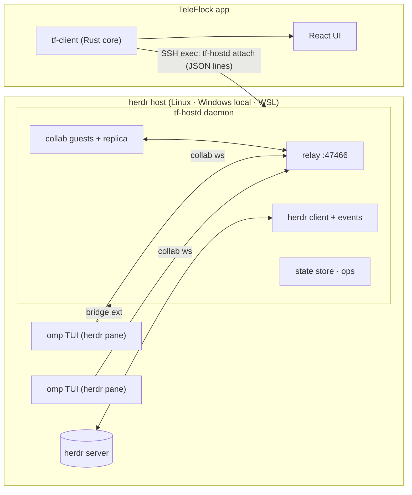

# TeleFlock architecture (v1)

Status: **decided** (phase B). Inputs:
- `docs/research/herdr.md`
- `docs/research/omp-collab.md`
- `docs/research/omp.md`
- `docs/research/platform.md`
- `docs/build.md`

The wire protocol lives in **`crates/tf-proto`**, the single source of truth. Its TypeScript bindings are generated into `src/core/gen/` by `scripts/gen-proto-ts.sh`.

## 1. Decision (ADR-001): how omp runs and how TeleFlock talks to it
**omp runs as the normal interactive TUI inside a herdr pane.**
- herdr keeps tracking its state through omp's own herdr integration (`working`/`blocked`/`idle`).
- The terminal in TeleFlock shows the real omp TUI.

**TeleFlock reaches omp through a host daemon, `tf-hostd`.** It runs on the herdr host, outlives app disconnects, and is shared by all clients (desktop and phone at once). It does four jobs:
1. **Relay.** It embeds an omp **collab relay** on `127.0.0.1:47466`, a private loopback port. omp sessions host collab rooms on it (the fallback data plane, below).
2. **Data plane.** One session replica per omp session (`tf-collab` `Replica`), fed by the first of:
   - **the companion extension's data plane** (bridge ≥ 2.0, `hello.caps.live`, `crate::feed`): its ordered live feed (collab-shaped `live` frames, a `resync` of everything in flight) plus omp's session `.jsonl`, read by hostd itself (`crate::journal`). No collab room is joined for these sessions: omp ends a room at 256 queued frames, which busy sessions with several streaming subagents hit. Prompts (images, delivery), aborts, dialog answers (`uiResponse`), subagent commands and transcripts (their files) go through the bridge;
   - **a full-control collab guest** in the session's room, for sessions without such a bridge (bridges < 2.0, no extension). That yields entries, live events, state, subagents, `ui-request`, prompt, abort, ui-response, agent-cmd and fetch-transcript.

   Either way hostd **compacts** omp's quadratic `message_update` stream into deltas; the keys never leave the host.
3. **Control plane.** It talks to the **TeleFlock companion extension** (`host/teleflock-bridge/teleflock-bridge.ts`) loaded in omp. The extension provides precise controls that a collab guest lacks: model, thinking, fast, plan-review answers, rename, compact, fork/branch/tree, follow-up queue, btw, export.
   - When the extension is absent, the fallback is herdr keystroke injection, following the safety rules in §5.4.
4. **herdr.** It drives herdr through the local API socket: one request per connection, plus one `events.subscribe` stream, coalesced. It bridges terminals through `herdr terminal session control`.

**How sessions get shared and bridged:**
- **Agents TeleFlock starts** are launched with:
  - `--config ~/.teleflock/omp-overlay.yml`, which sets `collab.autoStart: control` and `collab.relayUrl: ws://127.0.0.1:47466`;
  - `-e ~/.teleflock/ext/teleflock-bridge.ts`.

  No global config is touched.
- **Global opt-in (recommended).** Host setup can, with the user's consent:
  - write the two collab settings to omp's global config with `omp config set`;
  - copy the extension into `~/.omp/agent/extensions/`.

  This covers sessions the user starts by hand and sessions herdr restores (restore drops `--config`/`-e`). A TeleFlock-started omp then loads the extension twice (the global copy plus `-e`); the copies elect one bridge per process (§4), and hostd routes a pid's requests to its newest bridge when older copies that don't negotiate connect too.
- **Existing unshared sessions.** `agent.connect` submits `/collab ws://127.0.0.1:47466`, through the bridge's `slash` op when the global extension is connected, else by injection (§3.6). omp runs this builtin at once even while the agent streams, so Connect works while it is working. This creates a room but no bridge.

**Rejected alternatives:**
- **omp RPC mode in the pane.** It loses the real TUI and herdr's state target, and a second process cannot attach to a live session (it forks).
- **Guest inside the app over a `direct-tcpip` tunnel.** About 10× the bandwidth on mobile, and the room keys would travel to the device.
- **Slash injection only.** Fragile (see `omp.md` §1.2).



## 2. Repository layout and ownership

| Path | What |
|---|---|
| `crates/tf-proto` | Wire types and methods (orchestrator-owned contract). Run `scripts/gen-proto-ts.sh` after changes. |
| `crates/tf-herdr` | herdr API client: socket/pipe, typed calls, events, terminal sessions, server discovery. |
| `crates/tf-collab` | omp collab: link, crypto, frames, relay server, guest, registry, **replica normalizer** (omp → tf-proto). |
| `crates/tf-hostd` | Host daemon binary: daemon/attach, client protocol, state store, agent ops, injection, bridge server, fs/git/gh/host ops. |
| `host/teleflock-bridge/` | omp companion extension (TypeScript, loaded by omp directly). |
| `crates/tf-transport` | App-side transports: Tailscale SSH (russh), Local, WSL. |
| `crates/tf-client` | App core: profiles, connections, deploy, protocol client, aggregation, app methods, tunnels, notification policy. |
| `crates/tf-devserver` | WebSocket bridge exposing tf-client to a browser (dev and verification) and serving `dist/`. |
| `src-tauri/` | Tauri app shell (Windows + Android) and Kotlin plugin under `src-tauri/plugins/` or `plugins/`. |
| `src/core/` | Frontend core: transports (tauri, ws, demo), typed client, zustand stores, rAF batching, **demo host**. |
| `src/features/*` | Feature UIs. |
| `src/design/` | Design system (done, see the DesignSystem inventory). |

Every Rust crate is a workspace member (`crates/*`). Each agent compiles with its own `CARGO_TARGET_DIR=target/<Agent>`.

## 3. Host daemon `tf-hostd`

### 3.1 Files and processes (Linux/macOS; Windows uses the same paths under `%USERPROFILE%`)

| Path | Purpose |
|---|---|
| `~/.teleflock/bin/tf-hostd` | Binary, uploaded by the app. Its version must equal the app's embedded version. |
| `~/.teleflock/run/hostd.sock` | Client socket (0600). On Windows: pipe `\\.\pipe\teleflock-hostd-<user>`; a home other than `~/.teleflock` (lab) adds `-<FNV-1a of the home>`. The suffix follows the home path, not whether `TF_HOSTD_HOME` is set: the app runs `attach` without it and `attach` starts the daemon with it, and both must name the same pipe. |
| `~/.teleflock/run/bridge.sock` | Companion-extension socket. On Windows: pipe `\\.\pipe\teleflock-bridge-<user>`. |
| `~/.teleflock/run/hostd.lock` | Single-instance lock (holds the pid). |
| `~/.teleflock/state.json` | Persistent per-herdr-session state: archived agents (by agent id and omp session), turn counters, first-seen times, activity ring, parked agents (`parked`: agent id → snapshot record, §3.5) and the prune list (`pruned`, ≤ 200, 30 days); plus the daily usage ledger and image-original links. Every field defaults when absent, so older files load unchanged. Compact JSON (older pretty files load the same), written within a second of a change, except usage-ledger-only changes (a working agent's cost moves with every reply): at most every 60 s, and at shutdown. |
| `~/.teleflock/hostd.log` | Rolling log. |
| `~/.teleflock/ext/teleflock-bridge.ts` | Companion extension, uploaded by the app. |
| `~/.omp/agent/extensions/teleflock-bridge.ts` (omp's agent dir: `PI_CODING_AGENT_DIR`, else `~/.omp/agent`) | Global copy of the extension, present only after the user applied the `install-global-bridge` fix. tf-hostd never creates it, but keeps it equal to the uploaded `ext/teleflock-bridge.ts` (at daemon start and on every host probe; only when it is a TeleFlock bridge), because omp loads it next to the `-e` copy in every session TeleFlock starts and a stale one breaks the bridge. Daemons on other homes (lab / dev) leave it alone unless `PI_CODING_AGENT_DIR` gives them their own. |
| `~/.teleflock/omp-overlay.yml` | Per-process collab overlay, uploaded by the app. |
| `~/.teleflock/originals/<sha256>.<ext>` | Full-size originals of images TeleFlock sent while omp was working (omp saves only a downscaled copy then), served by `session.image {original}`; 0600, pruned after 30 days and above 1 GiB, oldest first. |
| `~/.teleflock/notes/<omp session id>.jsonl` | Row notes (`notes.rs`): what hostd saw of a session's transcript rows live that omp's session file does not keep (the TeleFlock device that sent a prompt, a steer, how long the model thought), one appended line per note; handed back to the replica before its next snapshot so rows rebuilt from the file (a resync, a hostd restart) equal the live ones field for field and keep their row hash. 0600 in a 0700 folder, pruned at start after 90 days and above 64 MiB, oldest first. |
| `~/.teleflock/uploads/<yyyy-mm-dd>/<name>` | Files uploaded for prompts (`upload.*`, §3.13: videos from the composers, terminal pastes): 0600 in 0700 folders, outside every repo and worktree; `uploads/.partial/<uploadId>.part` while one runs. Pruned after 30 days and above 10 GiB, oldest first. |
| `~/.teleflock/tools.json` | Tool updater status (§3.9): the per-host `auto` switch, last check/install per tool. |
| `~/.cache/teleflock-tools.lock` | Per-user install lock of the tool updater (§3.9) and of Host setup installs (§3.12): held by whichever daemon (real or lab home) is installing. |
| `~/.teleflock/tmp/` | Scratch space of Host setup installs (§3.12): downloaded installer scripts and the gh archive, removed after each install. |
| `~/.teleflock/automations.json` | Automations (definitions per herdr session), their last ≤ 100 runs, per-automation schedule cursors, the pile-up guard's last started agent and skip streaks (§3.11); 0600, atomic writes. |
| `/etc/systemd/system/teleflock-hostd-<hash>.{service,timer}` (root) or `~/.config/systemd/user/…` (lingering users) | Keepalive units, present only while an automation is enabled (§3.11). `<hash>` = FNV-1a of the hostd home, so lab homes get their own pair. |

**Processes outlive the login that started them.** On Linux with systemd, a process started from an SSH command lives in that login's `session-*.scope`, and systemd kills everything in the scope when logind tears the session down (logout with `KillUserProcesses=yes`, or a restarted logind cleaning up sessions that already ended). So the daemon (`attach`) and every herdr server it starts (`tf_herdr::durable`) each run in a fresh transient scope: `systemd-run --scope` of the system manager for root (`teleflock-hostd-*.scope`, `teleflock-herdr-<session>-*.scope` in `system.slice`), of the user manager for other users only when lingering is enabled (without it the user manager stops with the last session). herdr has its own scope, so replacing or stopping the daemon never touches herdr and its agents. When `systemd-run` is missing or cannot create the unit (no bus, no permission), and on macOS, Windows and Linux without systemd, both are started plainly (`setsid`, null stdio). A herdr server that already runs in a login-session scope is a setup issue (`move-herdr-out-of-login-session`, §3.4 `ops::scope`); for root, `host.setupApply` moves it and its live process tree into a new scope without stopping anything.

**WSL stops idle distros.** WSL shuts a distro down `instanceIdleTimeout` (15 s by default) after its last `wsl.exe` client exits, and the daemon, herdr and every agent stop with it, scopes or not. While a WSL host is wanted, the app holds one client open across reconnects and backoff (`WslKeepalive`, §5.1–5.2); after Disconnect or quitting the app, agents keep running only with `instanceIdleTimeout=-1` in the `[general]` section of `%UserProfile%\.wslconfig`.

### 3.2 Commands
- `tf-hostd daemon`: the long-running daemon.
  - Startup order: the instance lock (refuses to start if another instance holds it), the client socket (unix: bound before anything else runs, so `attach` connects at once and its hello waits in the backlog), the user's PATH (below), logging, then the runtime with the relay port and the other sockets.
  - **The user's PATH.** `attach` runs in a login shell, `ensure` from a systemd timer: neither has what interactive rc files add (Ubuntu's `~/.bashrc` returns early unless interactive, and bun's and nvm's installers write there), so omp installed with bun (`#!/usr/bin/env bun`) failed with "/usr/bin/env: 'bun': No such file or directory". Before any thread exists, the daemon (`userenv.rs`) asks the user's shell (`$SHELL`, else the passwd entry) as an interactive login shell for its PATH: `$SHELL -i -l -c 'printf …'` with stdin `/dev/null`, in its own session, stderr dropped, the PATH read between unique markers (rc-file noise around it is ignored), killed after 6 s. PATH becomes that PATH, then entries only the inherited PATH has, then the well-known install dirs that exist (`~/.local/bin` and `~/.bun/bin` always: TeleFlock installs there), absolute entries only, each once. It is set for the whole process, so every child inherits it: omp and its interpreter, the herdr server and its panes, git, gh, installers. Any failure falls back to the inherited PATH plus the well-known dirs; the log says which (`user PATH source=… entries=… bytes=…`). `resolve_bin` still searches the well-known dirs after PATH, and `omp_bin` prefers an omp that can start (a script whose interpreter is missing loses to a later standalone binary). Windows: unchanged.
  - Logs to `~/.teleflock/hostd.log`.
- `tf-hostd attach [--session <herdr-session>]`: connects stdio to `hostd.sock`, starting the daemon detached (`setsid`, `</dev/null`; in its own systemd scope where §3.1 applies) if needed, and waits up to 30 s for the socket (a daemon that exits is noticed at once; the full wait only runs while it is still starting, e.g. on a cold WSL VM). This is the **only** thing the app runs for the data channel.
- `tf-hostd stop [--force]`: graceful shutdown. A daemon that is replaced by a newer binary gets `stop` from `attach --replace`.
- `tf-hostd ensure`: starts the daemon detached (same scope path as `attach`) unless it is running, then exits. The automations keepalive timer runs it (§3.11).
- **Several devices, one daemon.** Every device of the user attaches to the same daemon, and their apps update at different times. A host therefore only moves forward (`tf_proto::version`: semver, then protocol):
  - `attach --replace` replaces an older daemon (its clients reconnect to the new one), never a newer one, and another build of the same version only when no client is connected.
  - While clients are connected, the daemon refuses `stop` from an older build, and from builds that predate this rule (they send no version with `stop`); that build's `attach` then connects to the running daemon. An idle daemon always stops.
  - Without these rules two apps of different versions restart the daemon under each other on every reconnect, and both devices drop every few seconds.
- `tf-hostd --version`: prints the version on one line (`tf-hostd 0.1.0 proto 1`).

### 3.3 Client protocol
`tf_proto::host::{ClientMsg, ServerMsg}` as JSON lines (`host.rs` documents the flow).

**Liveness.** The app pings every 15 s (§5.2). The daemon drops a client after 45 s without a line from it, counted in steps of at most 5 s of the daemon's own running time (`clients.rs` `read_or_silence`): after the daemon itself was suspended (system sleep, which Windows' clock counts; a stopped process, whose first wake-up on Linux fires overdue timers before it reads the socket), the overdue check counts one step and the ping the client queued meanwhile is read first. A client that really says nothing is dropped after 45 s as before.

**Revisions.** Revisions are per herdr session. Session subscriptions with `sessionSync` are numbered per subscription (`seq`, below).

**Coalescing.** The daemon coalesces before sending:
- state patches: at most 10 Hz
- pulses: at most 10 Hz
- session `append` deltas: one per 50 ms per item
- session `meta`: at most one per session per 500 ms, rebuilt from the latest state after the flush's other events (the ones in between fold into it); nothing is built for a session nobody has open. The session tree (`meta.tree`, 38–104 KB on long sessions) goes to apps ≥ 0.5.1 (hello `client.version`, pre-releases included) only when it changed, since their reducer keeps the previous tree when a `meta` comes without one; older apps get it in every `meta`, and `reset` snapshots always carry it.

A client sees one `snapshot` on hello, then patches.

**Features and zstd** (`clients.rs`). `hello.client.features` lists what the app speaks; hostd answers with the subset it accepts in `welcome.features` (an app that asks for nothing gets the welcome and messages it always got; an older hostd ignores the field). With `zstd`, everything after `welcome` is one zstd stream per direction (hostd → app with a 2 MiB window; app → hostd with 128 KiB, since requests and keystrokes are small and the window is what each side allocates per connection; inbound windows capped at 8 MiB); every batch of queued lines is written and flushed as one zstd block, so nothing waits for more input.

**Session sync** (`sessionSync`, `sync.rs`; the app side is §5.2). `omp.rs` hands each omp session's subscribers to a `sync::Fanout`. A plain subscription (old apps, `session.open` without `have`) gets exactly the stream above. With `have` (the omp session id, the client's newest rows with the hashes hostd gave them, its meta hash), `session.open` answers a delta: the window (newest `limit` rows of the replica's current path) minus the rows held with the same hash, `sync.order` listing the whole window, and a placeholder meta when the meta hash matches (`metaSame`). Row hashes are sha-256 of the row's JSON (first 8 bytes). Every later `session` message of the subscription carries `seq` (a re-open continues the numbering, so the client can drop the old subscription's messages); upserts carry their hash `h`, appends the UTF-8 length of the field before them (`at`), computed backwards from the replica in the flush (appends a later upsert/remove/reset of the row makes moot are dropped); `meta` becomes `metaPatch` (changed top-level fields, `null` clears) and `treePatch` (changed/removed nodes and the leaf; a reorder falls back to remove-all + upsert-all); live `reset`s (collab or bridge resyncs, rewritten files) become delta snapshots against what that subscriber holds (hostd tracks it: its snapshot window, then every upsert/append/remove it was sent). The session tree is hashed and copied once per tree revision (`OmpSession` bumps it when the tree changes) and shared by every subscriber's meta: a `meta` flush with the tree unchanged (`tps`, context and cost change twice a second while streaming) serializes the small fields only. `session.history` with a cursor the session does not have (a live-only notice a client kept from before tf-hostd restarted) answers `not_found`, never other rows; notice and retry row ids carry the replica's lifetime (`n<epoch>.<seq>`, `r<epoch>.<seq>`), so a later replica never reuses one a client keeps.

### 3.4 Internal modules (crate `tf-hostd`)

| Module | Owner | Responsibility |
|---|---|---|
| `main.rs`, `daemon.rs`, `attach.rs` | HostdCore | CLI, lock, sockets, detach/replace, logging |
| `userenv.rs` | HostdCore | The user's PATH for the daemon and every child (§3.2); `#!` interpreter detection |
| `clients.rs` | HostdCore | Per-client sessions: hello/welcome, rev, subscriptions, request dispatch, pulse fan-out |
| `state/` | HostdCore | `HostState` builder: herdr ↔ omp merge, columns, liveness, needs, archive persistence, activity, notifications |
| `omp.rs` | HostdSessions | One `Replica` per omp session and its transport (bridge feed or collab guest), registry polling, collab joins, link lifecycle and reasons, routing of prompt/abort/answer/agent-cmd/transcripts to the path serving the session |
| `feed.rs` | HostdSessions | Bridge data plane: per-session feed driver (`liveSubscribe`, resync, `seq`-ordered live frames, session-file tail interleaved before frames that start something, every file read on the blocking pool and outside the session lock), bridge loss and collab fallback, subagent transcripts from their files |
| `journal.rs` | HostdSessions | omp's session `.jsonl`: full read through the resync's `lastEntryId`, tail of complete lines (both blocking, run off the runtime); shrink, inode change or changed anchor bytes → rewrite, vanished → moved |
| `notes.rs` | HostdSessions | Row notes store (`<home>/notes/<session>.jsonl`): persists the replica's `Signal::Noted` and hands the notes back (`Replica::keep_notes`) before a session's first snapshot, so rows rebuilt from the session file equal the live ones |
| `ops/agent.rs`, `inject.rs` | HostdCore | All `agent.*` and `session.*` methods. Session data path first (bridge data plane, else collab), bridge control plane second, injection last. |
| `bridge.rs` | BridgeExt | Extension socket server, typed control calls, `hello.caps`, the lossless per-session live feed and the data-plane ops (`prompt`, `uiResponse`, `agentCmd`) |
| `ops/{fs,git,gh,workspace,worktree,host,term}.rs` | HostdOps | fs.*, git.*, gh.*, workspace.*, worktree.*, host.*, term.* |
| `ops/limits.rs` | HostdOps | `host.limits`: subscription limits from `omp usage --json` / `--history --json` (see below) |
| `ops/ai.rs` | HostdOps | `ai.complete`: one short completion from omp's `tiny` model role (see §3.8) |
| `ops/scope.rs` | HostdOps | Setup issue + fix `move-herdr-out-of-login-session`: a herdr server (`SO_PEERCRED` on its socket) in a `session-*.scope` is moved with its process tree into a new scope (`StartTransientUnit`, see §3.1) |
| `ops/tools.rs` | HostdOps | omp/herdr updater (one per daemon), `host.toolsUpdate`, `host.toolsConfig`, `HostInfo.tools` (see §3.9); its process runner and install lock also serve `ops/install.rs` |
| `ops/install.rs` | HostdOps | Setup issues + fixes for missing omp (or its interpreter), herdr, gh, git, ffmpeg (see §3.12) |
| `ops/upload.rs` | HostdOps | Owner-only chunked uploads for prompts and pastes: names, offsets, caps, idle and age cleanup (see §3.13) |
| `ops/omp_config.rs` | OmpSettings | `omp.settings` / `omp.settingsSet`: omp's own settings schema + global config (see §3.10) |
| `automations/`, `ops/automation.rs` | Automations | Store, cron/next-run, scheduler loop, run recipe, systemd keepalive; `automation.*` (§3.11) |

**Link lifecycle (`omp.rs`, `feed.rs`, `tf_collab::{registry, guest, relay}`).** What a session's `omp.link`, `linkReason`, `linkVia`, `linkSince` and `linkError` say and when hostd retries. `linkReason` names the situation (`starting`, `syncing`, `joining`, `joinFailed`, `reconnecting`, `bridgeLost`, `roomClosed`, `noRoom`, `sharedElsewhere`, `viewOnly`, `relayDown`, `fallbackCollab`); `linkSince` is when the (state, reason, path) triple began (state store, per agent). Nothing gives up while the bridge or the room can come back; slow hosts (omp needs minutes to start and to serialize a large session on a starved WSL laptop) only make each step wait longer.
- **Bridge ≥ 2.0 (`caps.live`).** Its hello attaches the session (`syncing`, via `bridge`): `liveSubscribe`, then the `resync` → the session file through `lastEntryId` (or the resync's entries while omp has never written the file) → the in-flight frames (the resync's `streaming` flag, not the debounced `state` frame, says whether a turn runs; one that runs is a turn whose end counts) → `live` frames in `seq` order → `live` (via `bridge`). The file's tail is read after a frame that can start something arrives and applied before it, after a frame that settles something once the feed is idle, and every 250 ms; the read (a `stat` plus the appended bytes) runs on the blocking pool and only applying it takes the session lock. A `seq` gap, a rewritten or moved file (also a resync naming a file omp wrote that is gone: omp's `/move` renames it before the session points at the new path), a file that cannot be read, or `agent.connect` while the session loads subscribe again; live frames that arrive before the new resync belong to the subscription it replaced and are dropped. Restarts in a row (each subscription between them ending within 10 s) pause before subscribing again: not after the first, then 250 ms, doubling up to 30 s (`agent.connect` ends the pause), so neither omp's resyncs nor full reads of a large file run in a loop; a session that never loaded says why meanwhile (`syncing`: "TeleFlock could not load the session (…); retrying"). Rooms of such processes are never joined; a session a collab guest served is taken over at the first resync (the guest leaves). A session switch ends the old session; omp's `bye` ends it once the bridge does not return.
- **Bridge lost.** The replica and its subscribers stay (`connecting`, `bridgeLost`, "TeleFlock's bridge in omp disconnected; waiting for it to reconnect"). If it is not back within 10 s and the session's room is published, the room takes over (`live`, via `collab`, `fallbackCollab`); the bridge takes the session back when it returns. Without a room the link says so, in the same words on every poll (`linkSince` tells how long; a changing text would patch every board each poll); the session is dropped once its omp process is gone (Linux `/proc`) or after 10 min.
- **Join grace.** A room is joined only once it was listed for 8 s, unless its process's bridge is connected and lacks the data plane: after a hostd restart bridges reconnect within 5 s, and a join would make omp serialize a session its bridge serves. Meanwhile the session is `connecting` (`starting`: "waiting for TeleFlock's bridge in omp to connect before joining its collab room"), not `joining`.
- **Just started.** For 8 s after hostd starts (bridges reconnect within 5 s) and until its first registry poll, an omp session that has neither a room nor a bridge yet is `connecting` (`starting`: "TeleFlock just started; waiting for this omp's bridge or collab room"), whatever its pane runs, never `notShared`; the next poll after that announces the end of the grace so the boards read the link again.
- **No room yet.** An omp process started with TeleFlock's overlay (`--config …/omp-overlay.yml` in `/proc/<pid>/cmdline`), or any omp while omp's global config shares (`HostInfo.setup.globalSharing`), is `connecting` (`starting`: "omp is starting; waiting for its TeleFlock bridge or collab room") for up to 5 min after hostd first sees it, then `notShared` (`noRoom`). Other omp processes are `notShared` (`noRoom`) at once (Connect injects `/collab`). A room on another relay is `sharedElsewhere`, one without control access `viewOnly`; a relay that is not listening `relayDown`.
- **Registry polls** every 1.5 s, 2.5 s per host (omp's own lister: 1.5 s). A host that accepts but does not answer in time (busy event loop) keeps its last snapshot for 45 s instead of dropping out; `link` requests wait 10 s. A poll lists `collab-hosts` once and re-reads a publication only when its size or mtime changed; one that refuses the connection while its process is gone (Linux: no `/proc/<pid>`; killed omps leave their files behind) is not asked again until its file changes.
- **Joins.** Join timeouts start at omp's 30 s (welcome, then per snapshot chunk) and double after each join that timed out, up to 4 min. A failed join is retried after 2 s, doubling to 60 s (±25 %), while the room is published; failure records outlive a missed poll by 2 min, a new room generation starts over. Meanwhile the link stays `connecting` (`joinFailed`) with `linkError` "join attempt N failed: …; retrying". Only failures retrying cannot fix change it: another relay answering our port (identity proof) or an unusable link → `error`; a collab protocol mismatch → `unsupported`.
- **Room reset.** From the second join in a row that timed out on one room, hostd resets the room before the next try: the relay closes the host's connection with 1012, omp reconnects within ~1 s and the room starts over without per-guest state (observed: a resumed session's room that let every join time out for hours until a relay restart). The same applies to a joined guest whose reconnects time out twice in a row.
- **Joined.** The guest reconnects by itself (1 → 30 s backoff, `connecting`: `roomClosed` "omp closed its collab room; waiting for omp to reopen it" for 4001/4004, else `reconnecting` with the cause; its join timeouts double after a reconnect that timed out). A guest that ends (room gone, fatal) rejoins through the registry after the join backoff; a `bye` (rotation) at once.
- **Relay.** Drops a silent peer after 180 s (omp, which answers pings on its event loop, can block for over a minute serializing a large session; a dead loopback peer closes its socket anyway).
- **Retry now.** `agent.connect` on a `connecting` session calls `OmpHandle::retry_now`: the bridge feed subscribes again (unless the subscription that was loading has gone live meanwhile), or the join (or the guest's reconnect) runs now, after a room reset when its joins were timing out.

**Dispatcher contract.** HostdCore owns it. `clients.rs` parses `HostMethod::parse(method, params)`. For each method family it calls an async handler fn:

```rust
pub async fn handle(ctx: &Ctx, req: HostMethod, client: &ClientHandle) -> Result<serde_json::Value, ApiError>
```

`Ctx` gives:
- `ctx.herdr: Arc<HerdrClient>`
- `ctx.state: StateHandle` (read snapshot, mutate, emit)
- `ctx.omp: OmpHandle` (guests by agent)
- `ctx.bridge: BridgeHandle`
- `ctx.terms: TermRegistry`
- `ctx.paths: Paths`

HostdOps implements `ops::{fs,git,gh,workspace,worktree,host,term,ai}::handle(ctx, req, client)` against that `Ctx`.

**Subscription limits (`host.limits`).** omp already knows each connected account's quota windows: it fetches per-account reports from the provider usage endpoints (Claude `api/oauth/usage`, ChatGPT/Codex `backend-api`, Copilot, Gemini, …), caches them ~5 min ±25 % per account in `~/.omp/agent/agent.db` (`cache` rows `usage_cache:report:…`), refreshes the window rows from live response headers at most once a minute, and appends hourly `usage_history` rows. `ops/limits.rs` never calls a provider and never sees a token: it runs `omp usage --json` (5 min hostd cache, matching omp's own; `refresh: true` → 10 s) and `omp usage --history --json --days 8` (10 min cache), keeps its own per-poll readings, and returns `AccountLimits { fetchedAt, accounts: LimitAccount[], sessions: LimitSession[], error? }`. Each `LimitAccount` (`key` = `provider|email:…|org:…`) carries `plan`, `fetchedAt`, `resetsAvailable`, `error`/`disabled` (omp's `accountsWithoutUsage` / `disabledCredentials`) and `LimitWindow`s (`used` fraction, `resetsAt`, `durationMs`, `tier`, `status`, ≤ 120 `samples` of the current window period). `sessions` maps each live omp session to the account omp pinned it to: `agent.db` `cache` row `session:sticky:<provider>:<sessionId>` → `credentialId` → `auth_credentials.identity_key` (read-only; the credential `data` column is never selected); a provider with one account needs no pin. The client (`src/core/limits.ts`) computes the pace (used-fraction change per hour over a fifth of the window, 30 min … 24 h) and projects "runs out in ~X" vs "resets first".

### 3.5 Board mapping and liveness (state store)

**Columns:**
- `needs` if herdr is `blocked`, or the replica has a pending `UiRequest`, or the bridge reports a plan review.
- Otherwise `running` if herdr is `working`.
- Otherwise `done` if archived.
- Otherwise `review`. This covers idle/done after work, and also fresh idle agents, which the UI labels "Ready".

**Archive state.** Archiving is persisted. An agent that starts working again is un-archived automatically (activity `unarchived`).

**Parked agents (Mark done closes the pane, `state/parked.rs`).** `agent.archive {archived:true, close:true}` archives as before and starts a 10 s undo window; un-archiving (Undo) or a newer Mark done cancels it. The pending window stays registered until the close is done, so an Undo that arrives just after the deadline, while the pane is being closed, still cancels it (the archive mark is re-checked right before closing). At the deadline the agent is parked only if it is still archived, idle (herdr `idle`/`done`, no needs), an omp agent, and its session file exists; otherwise its pane stays open. Parking snapshots a `ParkedRecord` into `state.json` (agent id, herdr name, kind, title, cwd, repo, branch, omp session id + file, model, thinking, started/archived/parked times, turns, diff, cost, last line, the linked worktree and the workspace it lived in), then closes: the whole herdr workspace when the agent's pane is its only pane (a Dispatch / worktree workspace), a shell tab first and then the pane when that sole pane belongs to a primary workspace grouping linked worktrees (never close a group), else just the pane. The board can lag herdr (panes opened seconds ago, a busy event stream), so the choice is verified against herdr right before closing (`parked::verify_close`): `pane.get` must still show the agent's terminal in that pane (else nothing is closed and the record is dropped), and a workspace is closed only when `workspace.get` reports exactly one tab with one pane; otherwise just the pane goes. Activity: `stopped` "Closed X (done)". Every rebuild adds a parked card per record: same agent id, `paneId/tabId/workspaceId` empty, `state idle`, column `done`, `archived`, `parked {at, sessionFile, worktree?}`, `omp.link notShared`, default liveness. `parked.worktree {path, repoRoot}` (hosts ≥ 0.5.2) is the linked worktree it ran in, because the workspace that named it is usually gone: `worktree.remove {workspaceId: "", path}` deletes that checkout (`ops/worktree.rs`: through herdr when a workspace holds the folder again, else `git worktree remove` run from the main worktree, only for a linked worktree, with `-c safe.directory=*` under `trust`; a folder already gone counts as removed, and only its own registration is dropped, never a repository-wide `git worktree prune` that would also drop other missing worktrees such as one on an unmounted disk) and then drops `worktree` from every parked record at that path; the card stays in Done with its transcript, and resuming it fails with `not_found` (its folder is gone). A record whose agent id is still live (pane closing) stays hidden; a record whose omp session (id or file) runs in another live agent is dropped together with its archive marks (it is live again). Per-agent controls on a parked card fail with code `parked` ("Resume it first"); `session.open` returns a read-only snapshot (meta from the record, caps all off but `prompt`; the last rows of the session file, ≤ 16 MiB tail, mapped by `tf_collab::replica::transcript_page`, no subscription or paging) because that parser already reads omp session files cheaply; `term.open` on it fails with `parked`. `host.sessions` lists a parked session with its `agentId` and `live: false`. Existing archived agents with open panes are left alone on upgrade.

**Pruning.** At start and every 60 s the store stats the session file of each parked record and of each archived, idle live omp agent. Only a definite deletion counts (`parked::check_file`): `NotFound` while the file's folder is a folder (or, that folder deleted too, the sessions root above it is a non-empty folder). Any other outcome (permission or I/O errors, a stale or unmounted file system, folders gone) skips every file under the same sessions root (`<sessions>/<slug>/<file>` → `<sessions>`; a file system that errs may err for all its files) for that pass: nothing under it is pruned or forgotten, while other roots are judged as usual (an archived agent whose session lived in a deleted lab folder no longer blocks pruning everywhere). Each skipped root is logged once, again when its reason changes or after an hour. A missing parked file removes the record, its archive marks, turns and activity and adds `PrunedAgent {agentId, sessionId, at}` to `HostInfo.pruned` (newest first, ≤ 200, 30 days). An archived live agent is pruned the same way (pane closed first, verified as above) once its file was seen on disk and then was missing on two passes in a row (omp writes the file lazily). `HostInfo.pruned` comes from `state.json` in every rebuild and survives info re-probes.

**Background work and its pace.** Repo facts (`RepoInfo` of agent cwds and workspace folders) come from one `git rev-parse` per folder and one `git status` per worktree top (folders in one worktree share it). They are refreshed at once on turn ends, cwd changes (new folders in a snapshot or `pane_updated`), TeleFlock's own git operations and a client connecting; while clients are connected, facts older than 5 min are refreshed (checked every 30 s); with no client nothing polls. Host facts (`probe_info`: versions, setup checklist, herdr sessions, global bridge refresh) are probed at context start, when a client connects, after setup fixes and tool installs, and every 10 min while clients are connected; `omp --version` is cached per binary (path, size, mtime) and omp's `collab.autoStart` / `collab.relayUrl` are read from its `config.yml` (cached by mtime; `omp config get` only for shapes the reader does not take on). A board rebuild reads the persisted maps without the activity ring and a slim omp view (summaries, no lists or tree); the 5 s clock rebuild runs only while an agent works.

**Liveness:**
- `lastEventAt` comes from any guest event; for non-omp agents it comes from herdr `pane_updated`.
- `streaming`/`thinking` reflect `message_update` deltas.
- `tool` is the open `tool_execution_*` call.
- `tps` sums every spender's output rate, split in `tpsSplit {main, subagents, advisor}`. The main agent's rate is a 3-second rolling count of its streamed deltas (chars / 4). Subagents and advisors stream nowhere a guest can see, so each of their finished replies (read from the session's artifacts dir, below) is replayed at its real decode rate, `usage.output / (duration − ttft)`, from the moment tf-hostd reads it: the sparkline's area is exact, its timing one reply late. Replies that ended over a minute ago are not replayed, and `tps` is absent when nothing produces output.
- `cost` (`OmpInfo.cost`, `SessionMeta.cost`) is omp's status-line total `$main (+subagents) + advisor`, split in `cost.split`. Main: the main agent's assistant `usage.cost.total` (collab entries) plus `model_usage` side calls (journal). Subagents: `max` of completed `task` results (`details.usage`), the artifact tree and the live `progress.cost` sum. Advisor: `__advisor*.jsonl` at the top of the artifacts dir. Collab mirrors neither advisor turns nor subagent transcripts, so tf-hostd tails `<session>/` (the dir next to `<session>.jsonl`, found under `<omp agent dir>/sessions/*/`) with `tf_collab::ArtifactLedger`: top-level `__advisor*.jsonl` bill the advisor, every other session transcript (subagents, nested subagents and their advisors) bills the subagent tree, counting only assistant turns and `model_usage` entries so nothing is counted twice. The host usage ledger (board "today") accounts the growth of this total with a high-water mark per session.
- `line` uses the active tool label, else the last assistant sentence fragment (≤ 80 chars).
- Pulses carry kind and intensity per agent at ≤ 10 Hz.

**Needs-you:**
- `ask` comes from select/editor ui-requests. Options use the **exact labels**. "Other (type your own)" becomes `allowOther`; "Chat about this" becomes `allowChat`.
- `approval` comes from `Allow tool:` selects (`omp-collab.md` §7).
- `planReview` comes from the bridge.
- `blocked` without a visible request (`answerable:false`) means: open the terminal.

**Notifications** fire on these transitions:
- → `needs`
- `running` → `review` (finished)
- an error notice
- quiet (> 120 s of no events while `working`), at most once per turn

Each notification carries actions for the first ≤ 3 options.

**Panes** (`Workspace.tabs[].panes[]`) list every herdr pane, agent or not, so clients can attach to panes opened anywhere (herdr's TUI or CLI included): `workspace.*`, `tab.*` and `pane.created/closed` events trigger a debounced re-snapshot (~120 ms), plus a 15 s healing snapshot. `PaneInfo.process` is the pane's foreground process (`state/procs.rs`). herdr has no batch process API, so hostd asks `pane.process_info` once per pane terminal (new pane or respawned terminal) for the shell pid; on Linux, rebuilds then read the terminal's foreground group from `/proc/<shell>/stat` (`tpgid`) and its `comm` (at most every 250 ms per pane, the same lookup herdr does). Without readable `/proc` (Windows, foreign pid namespace) the name comes from herdr and is refetched every 60 s at snapshot time. Older apps ignore the field.

### 3.6 Herdr injection safety (`inject.rs`), from `omp.md` §1.2

Only inject when all of these hold:
- the agent is idle, or the command is safe while streaming;
- the composer is visible at the bottom of the pane (read the pane's `detection` source, 12 lines);
- no overlay is visible.

`parse_composer` knows omp's 8 `composer.shape`s (default `band`) and its 3 symbol presets (`unicode` default, `nerd`, `ascii`); the locale changes nothing (lab: identical captures with `LANG`/`LC_*` unset). It skips up to 6 rows under the composer: extension statuses from `ui.setStatus` (the bridge's `⇄ teleflock`), the status bar and widgets of the non-box shapes. It refuses a box border at the bottom (ask, approval, selector, `/session` or `/model` panel), a box border directly above the composer (approvals and asks over a draft render above a still-mounted composer, and typing there would deny the tool and steer), and the autocomplete menu. Refusals are retryable `busy`: "a dialog or panel is open in the omp TUI", "omp's autocomplete menu is open", else "omp's composer isn't visible at the bottom of the pane". Fixtures: 94 omp 18.13.1 captures in `docs/research/omp-samples/composer/`.

Always use canonical full forms:
- `/switch <provider/id:level>`
- `/effort <level>`
- `/fast on|off`
- `/plan`
- `/goal …`
- `/compact`
- `/rename …`
- `/collab ws://127.0.0.1:<port>`

After submitting, re-read the pane. If the composer still holds the text, send one more `enter`. Never inject names that aren't in the catalog: unknown commands go to the model and cost tokens.

### 3.7 Launch recipe (`agent.start`, `worktree.create` + agent, `host.resume`)

```
herdr --session S agent start <name> --kind omp --pane <pane> -- \
  --config ~/.teleflock/omp-overlay.yml -e ~/.teleflock/ext/teleflock-bridge.ts \
  [--model <provider/id>] [--thinking <level>] [--resume=<file>]
```

Once the agent is idle and `link=live`:
- `plan: true` → bridge `setPlan`, or inject `/plan`;
- an initial prompt and/or `images` (`AgentSpec.images`, image-only allowed) → collab `prompt` with the images as `ImageContent` (same mapping as `agent.prompt`). If the link never comes up (90 s; the omp registry is re-polled once per second meanwhile), the text goes in through herdr and the images, which herdr cannot type, are reported as an `error` activity ("Image not delivered") instead of being dropped silently.

**Slow shells.** herdr refuses `agent start` with `agent_pane_busy` while the pane's foreground job is not its bare shell, e.g. a fresh shell still running its startup files. In a pane hostd just created (`Workspace`/`Cwd` targets, `worktree.create`, automations, a parked resume into a new tab or worktree) the start is retried for 45 s; in a pane the client picked (`StartTarget::Pane`) for 2 s. Then it fails as a retryable `busy`: "the new pane's shell never became ready (waited 45 s)" with a hint about slow shell startup files, or "the shell in pane <id> is not at an idle prompt". omp then gets 90 s to become interactive (herdr `timeout_ms`). Creating a workspace, tab or pane gets a 30 s herdr request timeout, starting a herdr server 45 s. A launch can therefore take ~140 s; the app's request timeout for launch methods is 180 s.

The new agent appears through herdr events. The response returns `Started{paneId, workspaceId, agentId?}`.

**Resuming a parked agent** (`agent.resume`; also `agent.prompt` and `agent.archive {archived:false}` on a parked card, and `host.resume` of its session file). Live agents fail with `invalid_params`; a second concurrent resume of the same card fails with `busy`; a session file that is definitely deleted (as for pruning, §3.5) prunes the card and fails with `not_found`; one that cannot be read (permissions, I/O, unmounted) fails with a retryable `io_error` and the card stays. Target: a new tab in its old workspace when that is still open at the same folder; else, for a linked git worktree (from the record, else `git rev-parse --git-dir --git-common-dir`), herdr `worktree.open {cwd: <repo root>, path: <checkout>}` so the workspace is grouped under its repo again (falls back to a plain workspace when herdr refuses); else a new workspace at its folder (a missing folder fails with `not_found` and a hint). The launch above runs with the parked name (deduped against live names), model and thinking level, `--resume=<file>`, and, for a prompt, `spec.prompt`/`spec.images` delivered once linked. The archive marks are cleared, so the agent lands in Review; the parked card is dropped in the same patch that first shows the new agent (a start that never shows up gives the card back after 90 s). Activity: `unarchived` "Resumed X".

**Worktree base (`worktree.create`, `ops/worktree.rs`).** A new branch forks from the given `base`, else from `git.branches`' `defaultBase`: `origin/<default>` when that remote-tracking ref exists (else the local default's remote upstream, else the local default), never herdr's implicit HEAD, which is usually a local `main` that only moves when someone pulls. Before forking from a remote-tracking base hostd runs `git fetch <remote> refs/heads/<branch>` (no hooks, no prompts: `GIT_TERMINAL_PROMPT=0`, an empty `GIT_ASKPASS` so neither `core.askPass` nor `SSH_ASKPASS` dialogs open, `SSH_ASKPASS_REQUIRE=never`, and `-o BatchMode=yes -o ConnectTimeout=5` appended to the ssh command git would use (`GIT_SSH_COMMAND`, else `core.sshCommand`, else an OpenSSH `GIT_SSH` program); 8 s, so fetch + checkout + agent start fit the app's 180 s launch timeout even when the remote silently drops traffic on a slow host; single-flight per repo + branch with a 20 s answer cache for fan-outs); a failure is logged and creation continues from the ref it has, so offline hosts still create worktrees. herdr's `git worktree add -b B P origin/main` makes `B` track `origin/main`; hostd then removes that upstream (retrying while parallel creations hold `.git/config.lock`, then verifying), so ahead/behind and review don't compare against main. `git.push` never relies on it: a branch whose upstream is not its namesake on a remote (no upstream, a local one, or the base it forked from) pushes with `--set-upstream <the upstream's remote, else origin> HEAD`, so `B` is published under its own name and never pushed into main. Review's merge-base uses the default branch's local and remote refs together (`git merge-base HEAD main origin/main`), so it is the real fork point whichever one the branch came from. Clients send no `base` when the Base select is untouched (they show `defaultBase`); older hosts without `defaultBase` get the shown ref, as before.

### 3.8 AI through omp's tiny role (`ai.complete`, `ops/ai.rs`)

TeleFlock names dispatch branches, agents and titles and drafts commit messages, PR titles/bodies and template names with the user's own omp, on the host. There is no TeleFlock model key and no TeleFlock server.

**Flow.** UI → `src/core/ai.ts` (`suggestBranch`, `suggestCommitMessage`, …: per-task system prompt, input clipped to 2 000 chars of task text / 12 000 of patch, 10 min cache per host + task + input, shared in-flight calls) → `ai.complete { task, system, prompt, role?, timeoutMs?, cwd? }` → hostd runs

```
omp --mode json --no-session --no-tools --no-extensions --no-skills --no-rules --no-lsp --no-title \
    --model @tiny --system-prompt <system>      # prompt on stdin, NO_COLOR=1, cwd = given dir or home
```

without a shell, reads the JSONL events and answers with the last assistant text of `agent_end` (text parts only, thinking dropped; the assistant `message_end` if the stream ends first). The child is killed as soon as the answer is in: the reply takes ~4–8 s and omp would otherwise linger ~8 s more. The client sanitizes the text (first usable line, labels/quotes/prefixes stripped, kebab case or sentence case, word and length caps) and returns `null` for junk, so every caller keeps a deterministic fallback.

**Naming prompts.** omp appends its own agent instructions ("each response MUST advance the task", verify before yielding) and, with `cwd` in a repo, that repo's context files to every system prompt, even a custom one, so a tiny model easily answers a long task as if it had to do it ("I need to inspect the repository" → `need-inspect-repository`). The naming prompts (`branch`, `agentName`, `title`, `templateName`) therefore put the user's text between tags (`<task>…</task>`, a closing tag inside it is dropped), state that it is text to label and not an instruction, ask for the overall goal of multi-point tasks, and end with "Branch slug for the task above:". The sanitizer rejects agent-speak (first person, "let me", apologies, refusals, requests for details) and slugs that start with `i`/`need`/`sure`/… or are about looking at the repository (unless the task is), so the caller falls back to `slugFromPrompt`, which names the lead sentence's goal ("Fix the following points and release 0.5.0 when you are done. - … - …" → `release-0-5-0-fixes`). A version (`0-5-0`) counts as one word.

**Limits.** Role default `tiny` (validated `^[a-z][a-z0-9-]{0,31}$`); a failed attempt (exit, error event, empty text) is retried once with `smol` while ≥ 1.5 s remain. Timeout default 20 s, clamped 2–60 s, queue time included → `timeout` (retryable). At most 3 omp processes per daemon (semaphore). Errors: omp missing or no such role → `ai_unavailable`; anything else → `ai_failed` with ≤ 300 chars of stderr/error text. The client treats `ai_unavailable` and `unknown_method` (older hostd) as "skip this host for 10 min".

**Privacy.** Prompts (task text, file lists, patches) go only to omp on the host and from there to the model provider the user configured for omp's tiny role, like any other omp session. Nothing is stored: `--no-session` writes no session file, hostd neither logs nor returns prompt or system text (logs carry task, role, model, ms, outcome), and the client cache lives in memory only. Settings → AI naming turns it all off.

### 3.9 Keeping omp and herdr up to date (`ops/tools.rs`)

Every tf-hostd keeps the host's omp and herdr current, so all hosts run the versions TeleFlock is tested against without anyone logging in. On by default for the real home (`~/.teleflock`; `attach` starts every daemon with `TF_HOSTD_HOME` set, so the check compares the home itself); a daemon on any other home (lab / dev) starts with it off unless its `tools.json` says otherwise, so it never updates the machine's tools by itself. `host.toolsConfig {auto}` turns it on or off per host (persisted in `tools.json`).

**Cadence.** One updater per daemon. First run 2 min after the daemon starts (or 6 h after the last complete check when that is later, so restarts don't refetch), then every 6 h + up to 10 min jitter while `auto` is on. One tool at a time; every command runs without a shell, stdin closed, `NO_COLOR=1`, in its own process group, with a timeout; on timeout (or when the run is dropped) the whole group is killed, installers it started (`bun install -g`, `npm i -g`, …) included (Windows: `taskkill /T`, best effort). Runs that may install take an OS lock on `~/.cache/teleflock-tools.lock` first (per user, not per hostd home), so the real daemon and lab daemons never run installers at the same time; a run waits up to 12 min for it, then reports that another daemon is updating. Installed versions are probed at start (no network). `tools.json` saves are serialized (snapshot and write under one lock).

**omp.** `omp update --check` (60 s) → `Already up to date` / `New version available: X` / `… kept up to date by <manager>` (bun/npm global installs owned by Homebrew, mise, …: a note, nothing runs) / `Failed to check for updates: …`. When newer: `omp update` (5 min), then `omp --version`. Never `--force`, `--canary` or `--stable`: the channel stays whatever the user chose. Running agents keep the old omp until they restart (shown as a note).

**herdr.** `herdr --version`, `herdr status` (channel, server version, `server_binary_stale`), and on the stable channel the manifest `herdr update` itself reads (`curl https://herdr.dev/latest.json`). When newer (or the manifest is unreachable), plain `herdr update` (5 min) with `HERDR_ENV`/`HERDR_SOCKET_PATH`/`HERDR_CLIENT_SOCKET_PATH`/`HERDR_SESSION` removed so it plans against every session. It installs the new client and keeps running servers (and their agents) running; the status then notes "the herdr server keeps running X until it restarts". **Never `--handoff`** (live server replacement is experimental). A release for another endpoint generation would need servers stopped: herdr declines that by itself when stdin is not a terminal ("Herdr was not updated"), and the updater doesn't even start it when the manifest's `endpoint_generation` differs from the running client's; the note asks the user to run `herdr update` when ready. Homebrew / mise / Nix installs refuse self-update; their command becomes the note.

**Status.** `ToolUpdates {auto, omp, herdr, nextCheckAt}` lives in a `watch` channel; every herdr session context publishes it as `HostInfo.tools` (an `info` patch on each change: `updating`, results, errors, notes) and re-probes `HostInfo.omp/herdr` after an install. `set_info` keeps `tools`, so the periodic host probe never drops it. Older apps ignore the field; older hostds don't send it, and the app hides the row.

**Methods.** `host.toolsUpdate {tool?, checkOnly}` starts a run now (manual runs work with `auto` off; `checkOnly` never installs). A request covered by the newest run (same or more tools, install ⊇ check) joins it; others queue behind it. The reply comes when the run is done or after 20 s (the app's request timeout is 30 s) with the current status; progress keeps arriving through `HostInfo.tools`. `host.toolsConfig {auto}` persists and reschedules.

The updater only updates what is installed; installing a missing omp or herdr is a Host setup fix (§3.12), which uses the same runner (`tools::run`) and the same install lock.

### 3.10 omp settings (`omp.settings`, `omp.settingsSet`, `ops/omp_config.rs`)

The app's omp settings page (`src/features/ompSettings`) edits everything `omp config` can, with omp's own labels, tabs, groups and choices.

**Schema.** `omp config list --json` only has key, type and description. The full registry (`@oh-my-pi/pi-coding-agent/config/all-settings` → `orderedSettings()`: type, default, enum values, item vocabularies, env override, credential flag, and `ui {tab, group, label, description, options | "runtime", condition, warning, editor}`) is only reachable from inside omp, so hostd starts a throwaway

```
omp --mode rpc --no-session --no-skills --no-rules --no-lsp --no-tools --no-extensions -e <home>/ext/teleflock-bridge.ts
    # env TF_OMP_SCHEMA_OUT=<home>/run/omp-schema-<pid>-<ns>.json, NO_COLOR=1, stdin /dev/null, cwd home
```

and the companion extension's schema-dump mode (§4) writes the definitions there and exits. hostd waits ≤ 20 s for the file, kills the child, deletes the file, and caches the schema per omp binary (canonical path + size + mtime) in memory and in `<home>/cache/omp-settings-schema.json` (≈ 2 s once per omp build; `refresh: true` reads again). A failed dump is remembered for that omp binary + extension file until either changes. An extension without the dump mode (bridge < 1.2.0, detected by the `TF_OMP_SCHEMA_OUT` marker in the file) is never started for a dump: it would run as a normal bridge.

**Values.** `omp config list --json` (omp's global config, else defaults; omp itself redacts credentials), cached 10 s, dropped after every write; a list that started before a write never fills the cache (generation counter), so a write's answer never shows the old value. Credentials (`credential`, `ui.secret`, or `redacted` in the list) never carry a value or default in the answer. Without a schema the answer is `source: "cli"` from the list alone (omp's order, no labels/tabs): every key stays editable.

**Writes.** `omp.settingsSet` checks every key against the current settings first (one unknown key → `invalid_params`, nothing written), then runs `omp config set -- <key> <text>` / `omp config reset -- <key>` one at a time without a shell (writes are serialized per daemon). Text per type: strings as-is unless omp's parser would alter them (surrounding whitespace, leading `"`, line breaks: then JSON-quoted, which omp unquotes exactly), numbers/booleans as text, arrays/records as compact JSON. omp validates (enum values, item vocabularies, shapes); its message (`Invalid value: x. Valid values: …`) comes back as `invalid_params`, earlier changes of the batch stay applied. A `modelRoles` write also drops the `host.models` cache. Logs carry keys and outcomes only, never values. The answer is the fresh `OmpSettings`.

**Credential writes never use argv** (`/proc/<pid>/cmdline` is readable by every local user). A batch that sets a credential (schema `credential`; with `source: "cli"` also keys named like secrets: `…token`, `…apiKey`, `…password`, `…secret`, `…credential`) goes whole through the companion extension's settings-write mode (bridge ≥ 1.3.0, §4): hostd writes `{changes: [{key, text}]}` (`text` exactly as for `config set`, `null` = reset) to an owner-only `<home>/run/omp-settings-in-<pid>-<ns>.json`, starts the same throwaway omp as for the schema with `TF_OMP_SETTINGS_IN=<that file>` and `TF_OMP_SETTINGS_OUT=<home>/run/omp-settings-out-….json` (paths only), and the extension reads and deletes the input at once, applies the changes in order through omp's Settings API exactly as `omp config set|reset` does (`setting.parse(text)` → `set`, or `unset`; `flush`), stops at the first failure and writes `{results: [{key, ok, error?}], error?}`. hostd waits ≤ 20 s, kills the child, removes both files and maps the results as above. An extension without the mode (no `TF_OMP_SETTINGS_IN` marker in the file) is never started for it: the write is refused with `unsupported`, nothing is saved, and the hint names the setting's environment override (`$OMP_…`) as the other way to set it. Resetting a credential carries no value and stays on the CLI.

### 3.11 Automations (`automations/`, `ops/automation.rs`)

Scheduled omp agents: at every tick of a 5-field cron schedule tf-hostd starts an agent with the configured prompt, whether or not an app is connected.

**Storage.** `~/.teleflock/automations.json` (0600, written atomically after every change, under the store lock): `automations` (the `Automation` wire type minus `nextRunAt`/`lastRun`, which `automation.list` computes), `runs` (newest first, ≤ 100 for the whole host), `scheduledThrough` (automation id → the latest schedule time already handled), `lastStarted` (automation id → `{runId, agentId, at}` of its latest started run, outside the capped history so the pile-up guard never forgets it; seeded from `runs` for older files) and `skipStreaks` (automation id → the history entry standing for its current run of identical skips). An unreadable file is renamed to `automations.json.bad-<ms>` and the daemon starts empty. An automation belongs to the herdr session of the client that created it (`herdrSession`); `automation.list|save|delete|run` only see the caller's session.

**Schedules** (`automations/cron.rs`, `jiff` for the zone). Fields `min hour dom month dow` with `*`, `a`, `a-b`, `*/n`, `a-b/n`, `a/n`, lists, month/day names, `0`/`7` = Sunday, macros `@hourly|@daily|@midnight|@weekly|@monthly|@yearly|@annually`; restricted dom and dow match with OR (classic cron). Times are the host's local zone (`AutomationScheduler.timezone`: IANA name, else `UTC±hh:mm`). DST as Vixie cron: a specific time inside the skipped spring hour runs once right after the jump; every-hour jobs simply skip the missing hour; in the repeated autumn hour specific times run once (the first), every-hour jobs run in both. `automation.preview` returns the next 5 times and a description (`At 09:00, Monday through Friday`); a schedule that never fires (`0 0 30 2 *`) is invalid.

**Scheduler** (one per daemon, started in `daemon::async_main`). It sleeps until the earliest next fire time (at most 60 s, so suspend and clock changes are noticed) or a change (save/delete). Per enabled automation it decides from its cursor (`automations::decide`):
- next time in the future → wait;
- due, and the latest due time is ≤ 2 min old → run (`trigger: schedule`);
- older (the daemon was down, the machine slept) → only the latest missed time counts: with `catchUp` it runs once (`trigger: catchUp`), otherwise it is passed over. Several missed times never run more than once.

The cursor moves before the run starts, so a crash never repeats a run; saving an automation sets it to now (edits and re-enabling never fire past times).

**Pile-up guard.** A scheduled or catch-up run is recorded as `skipped` when the agent of the automation's last started run (`lastStarted`) is still `working` or `blocked` (needs you), or when the previous launch is still in progress. `Run now` (`manual`) skips only the in-progress case. Consecutive skips for the same reason fold into one history entry (same run id, moved to the top with the latest time, `error` ending in "(skipped N times in a row since Fri 18:00)"); only the first one logs an activity event. So a blocked agent over a weekend costs one row of the shared 100-run history, not all of it.

**Run recipe** (`Automations::launch`). `daemon.ctx_for(herdrSession)` (creates the context and starts the herdr server when needed), then with `AgentSpec { kind: omp, model, thinking, plan, prompt }`:
- worktree mode: `ops::worktree::checkout` (the worktree part of `worktree.create`) with branch `automation/<slug>-<yyyymmdd-hhmm>` (host local time; `-2`…`-5` when it exists), `base: None` (the default base, §`worktree.create`), label = the automation's name, then the agent in the new workspace's root pane. Should the agent not start, the worktree stays and the failed run names it (`branch`, `path`, `workspaceId`, and "the worktree … was kept" in `error`);
- in place: a new workspace at `cwd` (`ops::agent::open_workspace`), then the agent in its root pane; should the agent not start, that workspace is closed again when herdr reports it holds nothing else.

Agent names are `auto-<slug>` made unique (`-2`, `-3`, …) against the board **and** the names other launches in flight in the same herdr session have claimed (automations that fire together, whose slugs share the 24-char prefix, never pick the same name); when herdr still answers `agent_name_taken` (a launch elsewhere won it), the next free name is tried, up to 4 times.

Both follow §3.7. The run (agent, workspace, branch, path, or the error) is stored, an activity event goes to the agent's feed, and the session's clients get a `Notification { kind: info, title: "Automation <name> started <agent>" }` (failures: `… failed` with the error; skips don't notify). Nothing else is published.

**systemd keepalive** (`automations/systemd.rs`). Schedules only fire while the daemon runs, so on Linux with systemd, while at least one automation is enabled, hostd installs `teleflock-hostd-<hash>.service` (`Type=oneshot`, `Environment=TF_HOSTD_HOME=…` plus the installing daemon's `HOME`, `PATH`, `USER`, `LANG`, `ExecStart=<this binary> ensure --relay-port <port>`) and `.timer` (`OnBootSec=1min`, `OnUnitActiveSec=10min`, `WantedBy=timers.target`), runs `daemon-reload` when they changed and `enable --now` the timer; it removes both (`disable --now`, delete the units and the `timers.target.wants` link, `daemon-reload`) when none is enabled. Root uses the system manager (`/etc/systemd/system`); other users their user manager (`~/.config/systemd/user`) only with lingering — without it the user manager neither starts at boot nor survives logout, so `scheduler.note` asks for `loginctl enable-linger <user>`. Units installed while lingering was on are still removed once none is enabled after lingering was turned off (the files always; `systemctl --user` too while a user manager runs). `ensure` starts the daemon in its own transient scope (§3.1), so the oneshot service's cgroup teardown does not kill it. Elsewhere (macOS, Windows, no systemd) `scheduler.kind` is `daemon`: automations run while tf-hostd runs, which starts when an app connects and keeps running after it disconnects, until the host restarts.

Reported `AutomationList.scheduler`: `systemd` + `persistent` while the timer is active; `systemd` without `persistent` and without a note while nothing is enabled (no timer needed yet); `systemd` with a note when lingering is missing or installing failed; `daemon` + note elsewhere. Reconciling runs at daemon start and inside `automation.save|delete` before they answer, so the next `automation.list` is current.

**Security.** Automations run only what the user configured through an authenticated client of this host (same trust as `agent.start`): a prompt, a folder, model/thinking/plan. hostd never runs commands from the store other than `herdr`/`git`/`omp` through the regular launch path; the store is owner-only. The keepalive units run only `tf-hostd ensure` from the installing binary's path, as the same user.

### 3.12 Installing what a host lacks (`ops/install.rs`, Host setup)

`host.setup` lists what is missing next to TeleFlock's own items, and `host.setupApply` installs it, only on an explicit request with the fix ids (the app asks for consent and says what runs and where it installs):

| Issue / fix id | When | What runs |
|---|---|---|
| `install-omp` | no omp; or omp is a script whose interpreter (node, …) is missing | omp's official installer in binary mode: `curl -fsSL https://omp.sh/install \| sh -s -- --binary` (Windows-local: `& ([scriptblock]::Create((irm https://omp.sh/install.ps1))) -Binary`) → `~/.local/bin/omp`. `omp_bin` then prefers it: a standalone binary needs no interpreter |
| `install-bun` | omp is a `#!/usr/bin/env bun` script and bun is not on the daemon's PATH | bun's installer `curl -fsSL https://bun.sh/install \| bash` → `~/.bun/bin/bun` (it also adds that dir to the user's shell rc file); needs unzip |
| `install-herdr` | the session's herdr binary does not exist | herdr's installer `curl -fsSL https://herdr.dev/install.sh \| sh` (Windows-local: `irm https://herdr.dev/install.ps1 \| iex`) → `~/.local/bin/herdr`, then `ensure_server` for the session |
| `install-gh` | no gh | the latest GitHub CLI release archive for the host's OS/arch (`api.github.com/repos/cli/cli/releases/latest`; Linux `.tar.gz`, macOS `.zip`), sha256-checked against the release's `checksums.txt`, `bin/gh` copied to `~/.local/bin/gh` (no root). Windows: not fixable, `winget install --id GitHub.cli -e` |
| `install-git`, `install-ffmpeg` | no git; no ffmpeg or ffprobe (omp reads video attachments with them) | the system package manager (apt-get, then dnf, pacman, zypper, apk; Fedora's package is `ffmpeg-free`) as root or through passwordless `sudo -n` (checked with `sudo -n true`, cached 10 min); else Homebrew as the user. Otherwise not fixable, and the detail names the command to run (`sudo apt-get install -y -q --no-install-recommends git`). apt: `DEBIAN_FRONTEND=noninteractive`, one `apt-get update` and retry when the install fails. Windows: `winget` hints |

A host without herdr still serves its sessions: when herdr is not found, the session's client points at herdr's install path (`$HERDR_INSTALL_DIR`, else `~/.local/bin/herdr`; Windows `%LOCALAPPDATA%\Programs\Herdr\bin`), so the checklist can offer `install-herdr` and the server starts once it ran; the herdr integration item waits until herdr exists.

**Running.** Installer scripts are downloaded into `~/.teleflock/tmp/<fix>-…` first (curl, else wget) and run from there with `sh`/`bash`, so a failed download never runs half a script. Every install runs through `tools::run` (no shell, no TTY, stdin closed, `NO_COLOR=1`, its own process group, killed with the group on timeout: 10 min per script, 15 min per package-manager run) under the user-wide install lock (`~/.cache/teleflock-tools.lock`, shared with §3.9). Then the tool must be found where hostd looks for it (the daemon's PATH already holds `~/.local/bin` and `~/.bun/bin`, §3.2; `git_bin` caches only a found git), else the fix fails with `install_failed` "the installer finished, but … is still not found". omp's, bun's and herdr's scripts download with curl themselves, so without curl only gh is fixable; the others say which package to install first. The log has one line per install (fix, seconds, outcome; never installer output beyond the error's last line).

**Independent fixes, progress.** One batch per daemon at a time, fixes in a fixed order (installs, then the herdr scope, integration, sharing, bridge, then git, gh, ffmpeg); each runs on its own and a failure never stops the next. `SetupStatus` carries `applying` (fixes queued or running, host-wide) and `failed` (`SetupFixError {id, error}`: open issues whose last attempt failed and that are not being retried). `host.setupApply` answers once the batch is done or after 20 s (the app's request timeout is 30 s) with the current status; a batch with installs republishes `HostInfo` (with `setup`) when it starts and after each fix, and every batch at its end. Older apps ignore the new fields; older hostds fail the whole call at the first failing fix, which the app still shows as one error.

**Lab hook.** `TF_HOSTD_TEST_INSTALLERS=<dir>`: a fix whose `<dir>/<fix id>.sh` exists runs that script (with `sh`) instead of its real procedure; lock, timeout, verification and publishing stay the same.

### 3.13 Uploads (`upload.*`, `ops/upload.rs`)

Videos reach an agent as files on the host, not inline like images (a prompt's images stay under the relay's 16 MiB message cap, and app requests time out after 30 s). The agent reads the file with its own tools: omp's `read` turns a video into a preview grid plus metadata, or one frame with a `:412` / `:1m30s` selector (needs ffmpeg and ffprobe on the host, a Host setup item). Prompts carry one line per video, `Attached video "clip.mp4" (12.3 MB): <absolute host path> (read it to see it)`; omp expands `@path` mentions only for prompts typed in its own editor, not for the collab frames hostd sends.

- `upload.begin {name, size, mime?}` → `{uploadId, path, maxChunk}`: 1 B to 2 GiB, at most 8 uploads at once (`busy`, retryable). The name is the client's last path component reduced to letters, digits, `-_.` (anything else becomes `-`), no leading or trailing dots and dashes, ≤ 64 characters before the extension, which is kept lowercased (omp tells videos by it) or taken from `mime`; Windows device names get `-file`; `-2`, `-3`, … when the day folder already has it or a running upload reserved it. Any mime is accepted (terminal pastes send images).
- `upload.chunk {uploadId, offset, data}` → `{received, size}`: base64, ≤ `maxChunk` (1 MiB) decoded. `offset` must equal the bytes received so far: a repeated or skipped chunk is `upload_offset` (message: where it stands), one past the size `invalid_params`; nothing is written then. Bytes go to `.partial/<uploadId>.part` and into a running SHA-256. A failed write ends the upload.
- `upload.status {uploadId}` → `{received, size}`: where to continue after a lost answer or a reconnect. `upload.finish {uploadId, sha256?}` → `{path, size, sha256}`: checks the size (and the digest when given; a mismatch is `checksum_mismatch` and drops the upload), renames the partial into place (another free name if one appeared meanwhile), prunes. A finished id answers `finish`/`status` again for a day. `upload.cancel {uploadId}` deletes the partial, or the finished file (its prompt was never sent); unknown ids are fine.
- One registry per daemon; per upload, chunk/status/finish/cancel run one at a time. Uploads without a chunk for an hour are dropped with their partial (swept every 5 min); partials no running upload owns (an earlier daemon run) are deleted when the first session context starts, which also prunes. `not_found` means the upload is gone: the client starts over.
- The app (`src/core/upload.ts`) sends one chunk at a time, about 3 s of data each at the measured rate (64 KiB to 1 MiB, halved after a timeout), retries transient errors (timeout, lost connection) with backoff for 10 minutes, asking `upload.status` before resending, and begins again on `not_found`. The composers (`src/core/draftVideos.ts`) upload a video as soon as its host is known, one per host at a time; Dispatch Auto uploads to the host each task goes to, and an entry waits in `uploading` before `worktree.create`.

### 3.14 Accounts and sign-in flows (`auth.*`, `accounts.*`; `authflow.rs`, `ops/accounts.rs`)

Wire types `tf_proto::accounts`; research `docs/research/omp.md` §12. A **sign-in flow** runs on the host and is completed from the device: linking an omp account (`accounts.link`) and MCP server OAuth (`mcp.authStart`, §3.15) share one `AuthFlow` type, one registry and one app component.

**Flow registry** (`authflow.rs`). `start(kind, title, subject, ttl)` registers a flow (`starting`) and returns its driver (`FlowCtl`): `publish_url` (`waiting`; an authorization URL whose `redirect_uri` is `http://localhost|127.0.0.1|[::1]:<port>/…` sets `callbackPort`, `redirectUri` and `paste: fallback`, and `expiresAt` to when omp's callback server gives up, 5 min on (`CALLBACK_WAIT`, the app's countdown; the TTL stays the hard stop, so omp's own message comes first)), `update`, `next_input`, `finish`; dropping the driver fails the flow, the TTL expires it, `auth.cancel` cancels it (its driver stops at once: the login process and its callback server die with it). Final flows stay readable 10 min. `auth.wait {flowId, afterRev, waitMs ≤ 20 000}` long-polls a `rev` change; `auth.submit {flowId, text}` hands a paste or an answer to the driver and returns **its verdict** (a wrong paste is `invalid_params` where it was made; an empty text only answers a prompt); `auth.list` lists running and recent flows. `replay_redirect` delivers a pasted address (or `code`, `code#state`) to the loopback callback server as the browser would have (`GET 127.0.0.1|::1:<port><path>?<query>`); `check_paste` refuses another sign-in's address (other port or path) or text with spaces before anything sees it.

**Accounts** (`ops/accounts.rs`). `accounts.list` = providers (`omp auth-broker list --json`, omp's `/login` order, cached per omp binary) + omp's credential rows in `<agent dir>/agent.db` (read-only; identity fields taken with `json_extract`, the tokens never leave SQLite; the MCP servers' OAuth sign-ins omp keeps in the same table, `mcp_oauth:…` / `mcp_oauth_…`, belong to §3.15 and are left out) merged with `omp usage --json` (plan, quota windows; `limits.rs`), live sessions per credential (omp's `session:sticky:<provider>:<sessionId>` pins), `auth.accountPolicies` preferences, the auth broker URL and running link flows. Tombstones omp removed on purpose (`replaced by…`, `deleted by user`, `logged out by user`, or an identity that is linked again) are hidden; others show as expired logins to re-link, the newest per identity (omp rewrites only active rows' causes, so an account that expired, was linked again and expired again leaves two). `accounts.link {provider}` runs `omp login <provider>` with piped stdio as a flow (`LINK_TTL` 15 min; one per provider, a second call returns the running one): its printed URL, instructions, device code (`Enter code: …`), questions (an unterminated line quiet for 150 ms; masked when it asks for a key/token/secret) and paste prompt become the flow; answers and pastes go to its stdin, and when omp shows no paste prompt a paste is replayed to its callback server (then `paste: none`, "Checking the code…"). An answer's verdict is what omp does next: the very question again (or the paste prompt again after a paste) refuses it, anything else takes it (omp's logins never ask a question twice, so a new one is the next question: Cloudflare's token → account ID → gateway ID); 3 s of silence takes it too. A no-op `xdg-open`/`open`/`wslview` first on its `PATH` stops omp opening a browser on the host. `Logged in to … as <who>` makes it `done` (`account`); `Login failed: …` or an exit without it `failed`. Before a link reports `done`, and after an unlink, the usage report and the `host.models` cache are dropped (a new login brings its provider's models). `accounts.unlink` is omp's RPC `logout` (one credential) in a throwaway headless omp; one that exits without answering (no model to start with, a broken config) is reported with what it printed on stderr (its `Error:` line, else its last line). `accounts.prefer` writes `auth.accountPolicies[]` priority 100 for the account's exact identity (omp has no default account; the priority ranks it first for new sessions after omp's hard checks) and answers with the accounts as cached (config only: the quota report isn't read again); API keys, expired logins, broker accounts and identities omp can't single out are `preferBlocked`. The app gives both changes 180 s (tf-client `timeout_for`, the devserver socket just above): an unlink may take omp's logout (90 s) plus a fresh `omp usage` (45 s) and omp's config.

**Same-port tunnel** (`tf-client/tunnel.rs`). `tunnel.open {hostId, port, localPort}` listens on exactly that port of the device (`127.0.0.1`, plus `[::1]` when the device has IPv6) and pipes connections to the host's `127.0.0.1:<port>` over the host's transport: the provider's redirect to `http://localhost:<port>/…` in the device's browser reaches omp's callback server on the host. A port another program holds on either address is `port_in_use` (browsers may try `[::1]` first, so a program there would get the redirect; another TeleFlock tunnel that holds it is named), another bind failure `port_unavailable`; an existing tunnel to the same target on that port is returned. Such a sign-in tunnel lives only while its sign-in does, whoever opened it: tf-client asks the host every 5 s (`auth.list`) and closes it once no running flow there has that `callbackPort` (an answer from before a sign-in got the tunnel again doesn't count), and by itself 10 min after it was last opened when the host can't tell (offline, an older tf-hostd; `SIGN_IN_TUNNEL_TTL`, above omp's 5-min callback wait and the 6-min MCP sign-in limit); the app gets a `tunnels` event. So a window that went away mid sign-in (reload, crash, closed tab, an Android activity recreated) never leaves a port such as 3000 of the device forwarded to the host once its sign-in is over. A preview that reuses it keeps it open.

**Lab** (`scripts/lab-remote-auth.sh up|status|down`, root, Linux). The device and the host must not share a loopback, or a sign-in "works" without the tunnel. The script puts the host in a network namespace (veth `10.231.77.1` device ↔ `10.231.77.2` host, NAT for real provider logins) with its own sshd and a throwaway user (copies of omp and herdr, own `TF_HOSTD_HOME` and `PI_CODING_AGENT_DIR`), runs `ops/mcp/testdata/oauth_server.py` (OAuth authorization server + protected MCP endpoint, consent page) on `10.231.77.1:47681`, which browser and host both reach, and writes a devserver data dir with the host profile (key sign-in). Then `tf-devserver --data-dir <lab>/devserver --hostd-bin <tf-hostd>` and a browser on this machine drive the real UI: MCP sign-in through the tunnel, the paste path with the device port taken first (`python3 -m http.server <port> --bind 127.0.0.1`, or `--bind ::1`), account links up to the URL / device code. `down` removes the namespace, iptables rules, user and files.

**App** (`src/features/auth`). `useRemoteAuth({hostId, start | flowId, autoOpen, onDone, onFinal})` drives one flow (`RemoteAuthController`, tested against the demo engine in `remoteAuth.test.ts`): long-polls `auth.wait` (a host that drops off is followed again with backoff; the flow keeps running there), opens the same-port tunnel while the flow waits on `callbackPort` (none for `local` hosts; none from a plain browser that isn't on the devserver's machine) and closes it when the flow ends, also one that was open already (listening on the remote port's own number makes it a sign-in's: one left by a page that reloaded mid sign-in, or this flow followed again; a preview of the same remote port listens elsewhere and is left alone), raises `paste` to `primary` when the tunnel can't bind, opens the page, http(s) only through `safeHref` (`app.openExternal` in Tauri — desktop and Android — and for demo hosts; `window.open` inside the click in a plain browser; `autoOpen` only in Tauri and never for device codes or questions), submits pastes and answers, and on cancel, unmount (StrictMode-safe) or a final state closes its tunnel and cancels a running flow, reported to `onFinal` once the host answered the cancel (so the Accounts page reads its list after the sheet's cancel landed, and never offers the flows the sheet ran in its "still in progress" banner). `RemoteAuthPanel` renders every stage: starting, browser (tunnel chip, "the browser showed an error page?" paste), paste (busy-port explanation), device code (copy, "Copy code & open"), prompt (masked keys), working, done, failed/expired/cancelled with retry; its footer counts down `expiresAt` (omp's 5-min callback wait for a browser sign-in). The Accounts page (`src/features/accounts`, `#/accounts/<host>[/link[/<provider>]]`) and the MCP page use it; the link-account nudge (board notice box, host card) shows for an online host whose omp lists no model and stores no active credential.

### 3.15 MCP servers (`mcp.*`, `ops/mcp/`, helper `host/teleflock-mcp/teleflock-mcp.ts`)

The app's MCP page (`src/features/mcp`, route `#/mcp[/:hostId]`) manages the MCP servers omp sessions on a host load (wire types `tf_proto::mcp`, research `docs/research/omp.md` §11). omp has no MCP CLI, so hostd edits omp's files itself and asks omp (through a helper extension) for everything that needs omp's code.

**Config** (`files.rs`, `json.rs`, `model.rs`). User scope `<omp agent dir>/mcp.json`, project scope `<folder>/.omp/mcp.json` (their `.mcp.json` siblings are read and edited in place). Files are omp's format: `JSON.parse` on read (a file omp can't read is reported in `McpList.fileErrors` and never written), `JSON.stringify(…, null, 2)` with `$schema` first and no trailing newline on write, keys in file order (an order-preserving value type: the workspace's `serde_json` sorts keys), unknown fields and the `auth` block omp's sign-in writes kept in place, 0600 temp file + rename, 0700 folders. Every read-modify-write holds **omp's own lock** for that file: pi-natives `FileLock` on `<path.resolve(file)>.lock`, an abstract Unix datagram socket `omp-file-lock-<xxh64(lockPath, 0x4f4d502d4c4f434b)><xxh64(lockPath, 0x50492d46494c454c)>` on Linux (verified against omp 18.13.2: omp sees hostd's lock held), a named mutex `Global\…` on Windows, `flock(2)` on the sidecar elsewhere; 50 tries × 100 ms like omp. Enable/disable is omp's `setMcpServerEnabled`: `enabled` on the first writable definition (the row's own file, then project, then user), else the user-level `disabledServers` (denylist, wins) / `enabledServers` (overrides another tool's `enabled: false`), sorted, dropped when empty, stale entries cleaned. A rename moves list entries along. Names follow omp's `validateServerName`.

**Secrets** (`secrets.rs`). Answers mask with `SECRET_MASK` (`••••••••`): env and header values named like credentials (word match on `token`, `key`, `secret`, `password`, `auth`, `cookie`, `session`, …; camelCase split) or holding a URL password, secret URL query values and URL passwords, `--token=…` / `--api-key …` argument values, credential keys in a JSON object argument (Smithery's `--config {…}`), the OAuth client secret. `${VAR}` references and `!command` values are not secrets and stay visible. A draft that sends the mask back keeps the stored value (env/headers by key, URL by parameter name, arguments by position or flag, JSON arguments by key path); a mask with nothing to restore is `invalid_params` naming the field.

**Helper** (`helper.rs`). Everything that needs omp's code runs in a throwaway `omp --mode rpc --no-session --no-skills --no-rules --no-lsp --no-tools --no-extensions -e <home>/ext/teleflock-mcp.ts` (cwd = the project folder, or the empty `<home>/cache/mcp-user` for user-level answers, so no project config leaks in). The helper is embedded in tf-hostd and written there when it differs. Request: owner-only `TF_MCP_IN` file (deleted on read; a draft may hold secrets), answer: JSON lines appended to `TF_MCP_OUT` (`hello` with omp's version, events, then one `result` or `error`), pasted sign-in input: `TF_MCP_INPUT`. It works inside the extension factory (omp waits for it, so no model or session is needed), imports omp internals dynamically (`mcp/manager`, `mcp/config`, `mcp/config-writer`, `mcp/oauth-reauth`, `mcp/oauth-credentials`, `mcp/smithery-registry`, `discovery`, `capability/mcp`; a missing one → `unsupported`, hint: update omp) and gets auth storage from `pi.discoverAuthStorage()`. Ops: `probe` (inventory of every source via `loadCapability(mcp).all`, user lists, `mcp.enableProjectConfig`, omp's Exa/browser filters, then an `MCPManager` of its own connects what sessions would, `waitForStartup(20 s)`; failures classified by omp's `analyzeAuthError` → `needsAuth` (`authType` oauth/apikey; it calls every 401 that names a bearer token `apikey`, which is what spec-compliant OAuth servers answer, so such a failure is `oauth` when omp's `discoverOAuthEndpoints` finds OAuth metadata within 5 s, as omp's own `/mcp add` decides)), `test` (one saved server through omp's loader, or a draft after `expandEnvVarsDeep`), `auth`, `unauth`, `search`. ≤ 4 helpers at once. **Deadlines and stopping:** every request has a deadline (check 60 s, test/sign-out/search 26 s, sign-in 6 min) that includes waiting for a helper slot (4 shared by checks, tests, sign-outs and searches, 2 for sign-ins; `busy` when none frees up in time). The helper gets it as `deadlineAt` and fits its work into it: omp's discovery window is kept at 1 ms (`OMP_MCP_STARTUP_TIMEOUT_MS=1`, which overrides what the helper asks; `0` would wait for every server's first connection, without a limit for `timeout: 0`), the helper waits for the servers itself (`waitForStartup` with a positive window), an unanswered server is `pending`, then every server is disconnected and what still runs of the processes it started is killed. The helper leads its own process group; on Linux omp starts stdio servers in sessions of their own, so tf-hostd also finds them under the helper through `/proc` and stops a helper that overran with them: SIGTERM, 1 s, SIGKILL (omp's `__omp_worker_*` daemons are left alone). Windows: `taskkill /T`.

**Checks.** `mcp.list` answers from the files at once and merges the last check per folder: results are kept per (name, file) with a fingerprint of the definition and its enabled state; a changed server shows `checking` and only it is checked again (`only`), a server marked dirty (signed in/out, switched) too; everything again after 10 min or with `refresh`. One check per folder at a time; `waitMs` (≤ 25 s) long-polls a running one. A failing helper is retried at most every 30 s unless refreshed (`check.error`). Other tools' servers (Claude Code, Cursor, Codex, plugins, project `mcp.json`, …) are listed from the check, read-only (masked), with omp's provider name; `shadowed` marks a definition a higher-precedence one of the same name hides. The fingerprint also covers whether another definition hides the server; removing or renaming one marks its name for checking again in the lists it shows in. Other tools' servers are on or off as the user-level lists say when the list is built (switched in another folder's list shows everywhere); a result taken while it was switched the other way is not shown.

**Running sessions** (`reload.rs`). omp has no MCP config watcher, so every change (save, remove, switch, sign-in, sign-out) runs omp's `/mcp reload` through the companion extension's `slash` op in the interactive sessions it concerns (all for user scope, those whose cwd is the folder for project scope): idle ones at once, busy ones when their turn ends (one waiter per session, ≤ 2 h), answered as `McpReload {reloaded, queued, restartNeeded, errors}`. Sessions without a bridge or not interactive, and omp agents on the board whose session has no bridge, count as `restartNeeded`. "Idle" means the turn is over and none of the session's subagents runs (they share its MCP manager; hostd's replica knows them); a change asked for while a queued reload runs gets a reload of its own.

**Sign-in** (`auth.rs`, shared flow §3.14). `mcp.authStart` checks the server (native, http/sse, on), starts the helper's `auth` op (omp's `/mcp reauth` engine `reauthorizeMcpServer`: protected-resource and authorization-server discovery, dynamic client registration, PKCE, omp's loopback callback server on `oauth.callbackPort` or 3000 (random only when omp falls back), credential in omp's auth storage, `auth` block written under omp's lock) and returns an `AuthFlow` (`kind: "mcp"`, `ttl` 6 min; omp gives up after 5). The flow's `url` is omp's authorization URL; its loopback `redirect_uri` gives `callbackPort`, so the app's same-port tunnel delivers the browser's redirect to omp's callback server. A pasted address is checked (`check_paste`) and replayed to that server (`replay_redirect`; non-2xx → `invalid_params` shown at the paste field); without a loopback redirect it goes to omp's manual-code input. Cancelling or expiry kills the helper (and its callback server). On success the server is checked again and its sessions reload. `mcp.signOut` runs omp's `/mcp unauth` steps (credential rows of the auth block and the server URL, `auth` block stripped). Sign-in and sign-out work on the row's own file: omp looks the server up from the project folder for a project server and from the neutral folder for a user one, and the helper refuses when omp's lookup lands on another file (a hidden user server is never taken for the project server of its name). `.mcp.json` siblings are refused (omp's `/mcp reauth` reads `mcp.json` only). The flow is done as soon as omp stored the credential; the lists and running sessions catch up after.

**Search.** `mcp.search` runs omp's Smithery registry client (`registry.smithery.ai`, no key needed; a stored Smithery key is used when present) and answers ready drafts (`http` for hosted servers without settings, else `bunx @smithery/cli run … --config {}`) with their settings to fill.

**Tests.** `cargo test -p tf-hostd ops::mcp` (format round trips byte-identical to omp's writer, key order, unknown fields, masks and restores, omp's enable/disable semantics, lock exclusion, check lifecycle against a scripted omp, helper protocol, errors, timeouts). `cargo test -p tf-hostd mcp_real -- --ignored --nocapture` uses the real omp with a temp agent dir: lock interop, a Python stdio test server (`ops/mcp/testdata/stdio_server.py`) connected with its tools, `mcp.test`, a registry search. `ops/mcp/testdata/oauth_server.py` is a standard-library OAuth 2.1 server (discovery, DCR, PKCE, consent page) in front of an OAuth-protected MCP endpoint for sign-in labs.

## 4. Companion extension `teleflock-bridge.ts` (owner: BridgeExt)

**Connection.** At load it connects to `bridge.sock` and retries every 5 s while hostd is absent. It never throws into omp: every timer goes through `ctx.setInterval`, and every handler is wrapped in try/catch.

**One bridge per process** (bridge ≥ 1.4.0). The global install and the `-e` copy (possibly different versions) meet in a process-wide slot `globalThis[Symbol.for("teleflock.bridge")]` `{owners: {[endpoint]: {version, stop()}}, cmdCtx?, attachWaiters}`. Per hostd endpoint the highest version owns it (equal versions: the first claimant, i.e. the global copy); only the owner connects, ticks and shows `⇄ teleflock`, and a newer copy that loads later takes over through the old owner's `stop()`. The command context is captured through `/teleflock-control`, a name only 1.4.0+ copies register (older copies keep `/teleflock-attach`, and omp 18.13.1 dispatched that shared name to the legacy global copy in some processes); whichever 1.4.0+ copy omp runs it in stores the context in the slot and the owner reads it from there. While omp compacts, the queued command makes tree/branch/new-session fail fast with a retryable `busy`. hostd covers copies older than 1.4.0, which never negotiate: per pid only the connection with the highest `bridgeVersion` is routed (`bridge.rs` `on_hello`; equal versions: latest `hello`; another pid always takes a session over), and when the board still maps an agent to its previous session right after a switch, `bridge_sid` falls back to the bridge session of the agent's omp pid. Details: `docs/bridge-protocol.md` "One bridge per omp process".

**Protocol** (JSON lines, documented in `docs/bridge-protocol.md`):
- On connect, the extension sends `hello {pid, sessionId, sessionFile, cwd, ompVersion, bridgeVersion, caps?}`. Bridge ≥ 2.0 adds `caps {live, dialogs, subagentCtl, prompt}`; with `caps.live ≥ 1` hostd serves the session from the bridge (§3.4 link lifecycle) and never joins its collab room.
- **Events** (extension → hostd):
  - `session_switch`
  - `plan_review_requested` / `plan_review_resolved`
  - `model` / `thinking` changes
  - `queue_update`
  - `btw_delta` (per conversation turn; also for `/btw` typed in omp's TUI)
- **Requests** (hostd → extension), answered with `res`:
  - `setModel`, `setThinking`, `setFast`, `setPlan`
  - `goal`, `compact`, `rename`
  - `followUp`, `navigateTree`, `branch`, `fork`, `newSession`
  - `resolvePlanReview`, `export`, `handoff`
  - `btw` (omp's own `/btw`, shown in the TUI and its BTW history; `btwId` follows up), `btwCancel`, `getBtwHistory`
  - `getTree`, `getQueue`
- **Data plane** (bridge ≥ 2.0; frames and flow control in `docs/bridge-protocol.md`): `liveSubscribe` answers with a `resync` (everything in flight, `lastEntryId` of the session file) before its `res`, then ordered `live` frames shaped exactly like omp collab host → guest frames (`event`, `bus`, `agents`, `state`, `ui-request`, `ui-request-end`), `seq` +1 per frame per connection; a session switch (`hello {reason: "switch"}`) ends the feed and hostd subscribes again. Requests: `prompt {text, images, delivery}`, `uiResponse {reqId, value}` (collab's exact values; `null` cancels), `agentCmd {cmd, agentId, text?}`. Roster entries carry `sessionFile`, so hostd reads subagent transcripts from disk.

**Schema dump mode** (bridge ≥ 1.2.0). With `TF_OMP_SCHEMA_OUT=<file>` in its environment at load, the extension does nothing else: it imports `@oh-my-pi/pi-coding-agent/config/all-settings` (literal specifier; older omp builds without it report `error`), writes `{bridgeVersion, ompVersion, settings: <definition>[] | null, error?}` atomically to the file (functions dropped by JSON) and exits right after loading. Only tf-hostd's throwaway omp (§3.10) sets the variable.

**Settings-write mode** (bridge ≥ 1.3.0). With `TF_OMP_SETTINGS_IN=<file>` and `TF_OMP_SETTINGS_OUT=<file>` at load, the extension likewise does nothing else: it reads `{changes: [{key, text | null}]}` from the owner-only input file and deletes it at once, applies the changes in order through omp's Settings API (`config/settings` → `Settings.instance`, `config/all-settings` → `orderedSettings()`: `parse(text)` → `set`, or `unset`; then `flush`), exactly what `omp config set|reset` does, stops at the first failure, writes `{bridgeVersion, results: [{key, ok, error?}], error?}` atomically to the output file and exits. Values are never echoed. Only tf-hostd's throwaway omp sets the variables, for credential writes (§3.10).

## 5. App side

### 5.1 `tf-transport` (owner: AppTransport)

```rust
#[async_trait] pub trait Transport: Send + Sync {
    async fn exec(&self, cmd: &Cmd) -> Result<Output, TransportError>;       // one-shot (stdin optional, timeout)
    async fn spawn(&self, cmd: &Cmd) -> Result<Child, TransportError>;       // long-lived stdio (attach, uploads)
    async fn forward_tcp(&self, host: &str, port: u16) -> Result<BoxedStream, TransportError>; // previews
    fn kind(&self) -> HostKind;
    async fn close(&self);
}
pub struct Cmd { pub argv: Vec<String>, pub env: Vec<(String, String)>, pub cwd: Option<String>, pub stdin: Option<Vec<u8>>, pub timeout: Option<Duration> }
pub async fn connect(profile: &HostProfile, opts: &ConnectOptions, ev: mpsc::Sender<TransportEvent>) -> Result<Arc<dyn Transport>, TransportError>; // opts: known_hosts path (TOFU), timeouts
pub enum TransportEvent { Phase(ConnPhase, Option<String>), AuthUrl(String), Latency(u32), Closed(Option<String>) }
```

**SSH:**
- russh with the `ring` backend.
- Sign-in per `HostProfile.auth` (`ssh/auth.rs`):
  - `tailscale` (default, recommended): `none` auth. A banner containing a `login.tailscale.com` URL becomes `AuthUrl` and the `authRequired` phase; keep waiting up to 30 min. Other methods offered instead → `NotTailscaleSsh`.
  - `key` / `password` (Advanced: authentication in the host editor): the credential is loaded first (key from `keyPath` on this device or the key saved in the app, decrypted with the saved passphrase; OpenSSH, PEM PKCS#1/PKCS#8/SEC1, PuTTY), then `none` learns what the host offers, then the configured credential is tried once (a password also answers a `keyboard-interactive` password prompt). No agent, default key files or other secrets are ever tried. Failures name the method and cause and are not retryable: `passwordRejected`, `keyRejected` (fingerprint), `authMethodNotAllowed`, `keyPassphraseNeeded`, `keyPassphraseWrong`, `keyUnreadable`, `credentialMissing`, `authIncomplete`, `signInClosed`.
  - Host key checks (TOFU via `hosts.trustKey` outside the tailnet) run in the handshake, before any credential is sent, for every method.
- Secrets (`HostSecrets`: password, imported key, passphrase) are write-only: `hosts.save` / `hosts.test` take them beside the profile (`HostSaveParams.secrets`; absent = keep, empty = delete), the app core keeps them in `data_dir/secrets.json` (0600, keyed by host id; only what the method uses), `hosts.secretStatus` reports which exist, `hosts.remove` deletes them. They never appear in `hosts.json`, results, events, logs or the state cache.
- Our own keepalive runs after login (avoid the russh `keepalive_interval` bug).
- Remote argv is POSIX-quoted and run via `exec sh -c 'exec "${SHELL:-/bin/sh}" -lc "$1"' sh '<cmd>'` (login shell → PATH includes `~/.local/bin`).

**Local:** `tokio::process`, no shell.

**WSL:**
- Commands run as `wsl.exe -d <distro> --exec sh -c <login wrapper> sh <cmd>` (`--exec`: no Windows-side shell layer; the same login wrapper as SSH). The warm-up in `connect` runs `wsl.exe -d <distro> --exec true` itself, without the login shell, whose profile files can cost seconds on a slow laptop.
- `wsl.exe -l -v` and `wsl.exe -l --running -q` (run at once) list distros. Previews use plain localhost (WSL2 forwards it).
- **Keepalive.** WSL stops a distro `instanceIdleTimeout` (default 15 s) after its last `wsl.exe` client exits, and tf-hostd, herdr and every agent in it with it; `attach`, the app's only long-lived client, ends with every reconnect. `WslKeepalive` holds one client, `wsl.exe -d <distro> --exec sleep 2147483647` (no shell; 68 years instead of `sleep infinity`, which old busybox lacks, so nothing needs a fallback), and kills it on drop. tf-client keeps one per wanted WSL host (§5.2). Agents that must outlive the app (Disconnect, quit) need this in `%UserProfile%\.wslconfig`, applied after `wsl --shutdown`:
  ```ini
  [general]
  instanceIdleTimeout=-1
  ```

### 5.2 `tf-client` (owner: AppCore)
- **Engine API:**
  ```rust
  Engine::start(cfg: EngineConfig, platform: Arc<dyn Platform>) -> (Engine, broadcast::Receiver<AppEvent>)
  engine.call(host_id: Option<String>, method: &str, params: Value) -> Result<Value, ApiError>
  ```
  - Host methods require `host_id` and are forwarded to that host's hostd.
  - App methods are handled locally.
- **`Platform` trait:**
  - `notify(host, &Notification, style)` (one live OS notification per agent; a newer one replaces it)
  - `retract(host_id, &Notification)` (remove it unless a newer one of the agent replaced it)
  - `open_external(url)`
  - `set_keep_alive(bool)`
  - `device_name()`
  - `set_badge(BadgeState)`
- **Notification sync** ("handled in one place = done everywhere"). The engine remembers the last 100 notifications per host with their state (posted to the OS, read, resolved) and reports changes as `AppEvent::NotifyDone { hostId, ids, resolved }`:
  - **Needs-you, from host state.** After every snapshot/patch, a needs-you notification whose request left the state (the agent's `needs.requestId` went away or changed, or the agent is gone or archived) is resolved, whoever handled it: inline card, toast, board quick answer, Answer-next HUD, OS action or reply, another device, the omp TUI, cancel/stop. Resolution needs the request to have been seen pending first (hostd publishes the state before the notification). Its OS notification is retracted and the UI dismisses the toast and shows the list item as resolved.
  - **Read.** `app.notifyRead { hostId, agentId? }` (the UI calls it when an agent's session is viewed with the app in front, on "mark all read" and on "clear"), an OS body tap (`notification_action` without action) and an OS dismissal (`notification_dismissed`) mark notifications read; read ones are retracted from the OS, except needs-you ones whose request is still pending. The UI dismisses read toasts except pending needs-you ones.
  - **Fail safe.** OS answers (`notification_action` with an action or reply) to a needs-you notification whose request is resolved or no longer the pending one fail with `stale` instead of reaching the next request.
  - Removing a host retracts all its notifications. Cross-device sync is what host state carries: needs-you resolution; read state is per device. The ring lives in memory, so OS notifications left by a previous process (Android) are not retracted.
- **Per-host connection state machine.** Phases: connecting → authenticating → (authRequired) → deploying → starting → online. On failure: reconnecting with backoff 1, 2, 4 … 30 s plus jitter, reset after 60 s online. It retries immediately on `hosts.connect`, window focus, network changes and foreground. Only non-retryable errors stop it (`error` phase); a WSL start failure is retryable unless WSL or the distro is missing (a cold or busy VM fails `wsl.exe` now and then).
- **WSL keepalive.** From a WSL host's first connect attempt until it is no longer wanted (Disconnect, a permanent error, removal, quit), its host task holds one `WslKeepalive` for the distro (§5.1), restarted at the next attempt if it ended and moved when the distro changes; reconnects and backoff therefore never leave WSL without a client long enough to stop the distro.
- **Deploy:**
  1. Run `uname -sm` to pick the embedded hostd for that arch.
  2. Compare `~/.teleflock/bin/tf-hostd --version`. If the host's tf-hostd is **newer** than this build (another device runs a newer app), stop here: upload nothing, attach to it as is. A protocol this app doesn't speak fails with `version_mismatch` and an "update TeleFlock on this device" hint. Every remote step runs through a login shell (WSL: a `wsl.exe` start each); the probe may take 60 s.
  3. If it differs, upload through `exec` with stdin: a temp file whose sha256 must match, `chmod +x`, then its `--version` must print the expected line before `mv` replaces the installed binary (else `version_mismatch`, and the old binary stays). Local hosts are written directly and run `--version` afterwards (30 s; a run that cannot finish in time is retryable, not `version_mismatch`).
  4. Upload the extension and the overlay (with the relay port) when they differ, in one `exec` (the extension on stdin, the few lines of overlay inline in the script).
  5. Then `spawn tf-hostd attach --session S` (`--replace` after an upload, §3.2).

  A steady WSL connect is 3 `wsl.exe` starts (warm-up without a login shell, probe, attach); after an app update 5: those plus the hostd upload (which checks its own `--version`) and one for the extension and the overlay (7 before 0.5.1).
- **Protocol client.**
  - Hello (asking for the `zstd` and `sessionSync` features) and welcome; with `zstd` accepted, both directions switch to zstd streams right after the welcome (`link.rs`; an older hostd answers without features and everything stays plain). The link counts bytes on the wire and as JSON (`Link::totals`, logged when it closes).
  - Relays snapshot/patch, session, term, pulse and notify messages as `AppEvent`s.
  - Correlates requests (30 s default timeout; `term.open` 15 s; 180 s for methods that may launch an omp agent: `agent.start`, `agent.resume`, `agent.archive`, `agent.prompt`, `host.resume`, `worktree.create`, `automation.run`). The welcome may take 60 s (attach's 30 s daemon start plus the herdr session context).
  - Pings every 15 s (latency). **Liveness by unanswered pings:** the link closes once nothing at all arrived since a ping sent 30 s ago, i.e. at most 45 s after the host went silent. The tick pings before it judges anything, and a tick that comes a whole period late (system sleep, which Windows' monotonic clock counts; a stopped or starved app) judges nothing sent before it, so waking from sleep keeps a healthy link instead of reconnecting. The timestamps are tokio's monotonic clock, never the wall clock.
  - **Resume checks** (`Engine::resume(Resume)`): window focus (desktop, every alt-tab) pings only links the host has been quiet on for 20 s and gives them 15 s (a busy WSL VM is slow, not gone); Android resume and network changes ping every live link with 5 s. A link that misses its deadline reconnects.
- **Cache.** The last `HostState` per host is stored in `data_dir/cache/<hostId>.json` and emitted as `HostSnapshot` with `status.phase` ≠ online before the live connection is up (the UI marks it stale). Compact JSON, serialized from the live state under its lock; written only when something besides a health sample changed, at most every 60 s, and on every disconnect and at shutdown.
- **Session mirrors** (`sessions.rs`, with a hostd that speaks `sessionSync`, §3.3). Every session the UI opens goes through a per-host mirror: `session.open` sends what the mirror holds (`have`: the agent's omp session id from host state, its newest `limit` rows with hashes, the meta hash) and merges the delta; the mirror applies the live stream, verifying `seq` and append offsets (a gap, a wrong offset or a delta naming a row it lacks re-opens with `have`, silently; more than 3 re-opens a minute fall back to a plain subscription), and hands the UI the plain events it always got (`reset`, `upsert`, `append`, `remove`, `meta` — a `metaPatch` becomes a `meta` without the tree, which the UI keeps; a `treePatch` a `meta` with it). The mirror keeps the session tree apart from the meta and shared, so a `metaPatch` never copies or re-serializes it. Session messages that arrive while an open is in flight wait in the mirror until its snapshot says where they start. Opens are serialized per agent (the UI's, the re-open after a reconnect, a repair); an open of a session already live on the link is answered from the mirror (another devserver tab, the UI re-opening after the reconnect re-open). An open the UI or a page close abandons while it waits for hostd releases the subscription hostd made for it (`session.close`). A re-open that finds no answer or no session while the link stays up (the bridge reconnecting) is tried again after 1 s, twice as long each time up to 30 s, as long as the UI has the session open; one that cannot work, or a session that ended while it re-opened, reaches the UI as `ended` with the reason. Rows older than the synced window stay while the window's first row is held unchanged (the same entry has the same past), so `session.history` pages fetched once are served from the mirror (a partial page is completed from hostd); an oldest row hostd answers `not_found` for (a live-only notice of an earlier tf-hostd) is dropped and paging goes on from the next. Closed mirrors stay in memory up to a size budget per host (their JSON: 32 MiB, 8 MiB on Android), least recently used leaving first; a mirror an open, a re-open, a cache write or a history page is working on never leaves. With an older hostd, opens and events pass through and the mirror only remembers what to re-open.
- **Session cache** (`session_cache.rs`). Mirrors are written per host and omp session to `data_dir/sessions/<hostId>/<sessionId>.json.zst` (zstd JSON, at most 3000 rows; the directories 0700 and the files 0600 on Unix: tool output can hold secrets) when the UI closes them, at a disconnect, at a page close and at shutdown, and while open on a 15 s tick when they changed (rows, meta, tree; not a dialog, a side answer or a re-open that brought nothing new), a big one at most once per 15 s per MiB (up to 2 min); files beyond the budget (64 MiB on Android, 256 MiB elsewhere) are evicted least recently used first (reads count as use, file times carry it across restarts); `hosts.remove` deletes the host's dir. A file carries its format and the app version that wrote it: rows and meta keep hostd's hashes, and another app version may keep other fields of them, so another version's file is a miss. After an app restart, opening a cached session emits its cached rows as a `reset` at once (when host state says hostd has it live), then the delta lands as the open's result. **Offline opens** (`engine.rs` `session_open`, `sessions.rs` `open_offline`/`history_offline`): while the host's link is not up (connecting, deploying tf-hostd, offline), `session.open` is answered from the mirror or the cache at once, with every control off and no dialog (`offline_caps`; the UI shows the copy under LinkGate's "Showing the copy saved on this device" strip with the composer disabled), `session.history` from the rows the mirror holds, and `session.close` closes the mirror locally; once the link is up the mirror re-opens with `have` and the delta arrives as a `reset` with the real controls; a session nothing is held of waits for the link (up to 15 s while tf-hostd deploys or starts). A close (the UI's or a page close) that lands while an open waits (for the link, its turn or the cache) wins: the engine takes the open's ticket as the request arrives (`OpenTicket`: the mirror, held, and the closes it had seen), so the open answers `not_connected`, is not open and sends hostd nothing, and no later link subscribes it (a subscription hostd made while the open waited for its answer is released). In the UI only the latest open of a session sets its state (`client.ts` `loadSession`), so an earlier one failing late changes nothing. Lab (`sessions.rs` `lab_wire_bytes`, a real 1190-entry session): first open 428 KB → 78 KB, re-open from the cache 477 KB → 3 KB, reconnect mid-stream 475 KB → 3 KB.
- **Tunnels.** `tunnel.open` binds `127.0.0.1:0` (or exactly `localPort` for sign-ins, §3.14) and pipes each accepted connection over `transport.forward_tcp`.
- **Embedded artifacts.** `build.rs` embeds the binaries found under `$TF_HOSTD_DIST` (default `target/hostd-dist/<triple>/tf-hostd[.exe]`) plus `host/teleflock-bridge/teleflock-bridge.ts`. The devserver may override this with `--hostd-bin`.

### 5.3 `tf-devserver` (owner: AppCore)
`tf-devserver --bind 127.0.0.1:7420 --data-dir <dir> [--static dist] [--hostd-bin <path>] [--token <t>] [--allow-host <name[:port]>]… [--allow-origin <origin>]… [--allow-remote]`.

**Access control.** `/ws` drives every host, so it is gated against other web origins (CSWSH), DNS rebinding and other machines:
- **Token.** A random 256-bit token is generated per launch (`--token` overrides it; at least 22 chars of `[A-Za-z0-9_-]`). Startup prints `http://<bind>/?token=<t>`. `/ws` requires it as `?token=<t>` or as the subprotocol `teleflock.<t>` (echoed back); otherwise it answers 401.
- **Origin.** If present, `Origin` must be the served origin (`http[s]://<Host>`) or an `--allow-origin` (e.g. `http://localhost:5173` for a `vite dev` UI using `?core=`); otherwise 403. Non-browser clients without `Origin` need only the token.
- **Host.** Every route rejects (421) a `Host` other than the bind IP, `localhost` or a loopback IP on the bound port (any IP literal when bound to `0.0.0.0`/`::`), or an `--allow-host` name (`name` matches any port).
- **Remote.** A non-loopback `--bind` is refused unless `--allow-remote` is passed.
- **Index.** The served `index.html` (also for `/` and SPA routes, `Cache-Control: no-store`) gets `<meta name="tf-token" content="<t>">` after `<head>` when a loopback client addresses a loopback name, or when the page URL has the right `?token=`.

**WebSocket `/ws`:**
- **Client → server:** `{id, hostId?, method, params}`.
- **Server → client:**
  - `{id, result}` or `{id, error}`
  - `{event: AppEvent}`
  - a terminal input fast path: `{termIn: {hostId, termId, data}}`

**Static.** It serves the built UI, so a browser on the tailnet (with `--allow-remote`, `--allow-host` and the token URL) can run the full app against real hosts. This is used for verification.

### 5.4 `src-tauri` (owner: TauriShell)
- **Core bridge.** Commands are `core_call(hostId?, method, params)` and `core_term_input(hostId, termId, data)`. `core_events(channel: Channel<AppEvent[]>)` subscribes the webview: the replay (with held UI intents), then the live events in order, in batches. Every channel send is a script evaluation in the webview (plus a fetch from 8 KB up), so each live event goes out with whatever queued behind it meanwhile; nothing waits for company (1,000 events in bursts of 50: 37 sends instead of 1,000). `src/core/transport/tauri.ts` hands each batch's events to its listeners one by one.
- **Drag and drop.** The main window has `dragDropEnabled: false` (base, Linux and macOS configs; the platform files replace the `windows` array): Tauri's native drag-drop handler would block every HTML5 file drop, so the session composer, Dispatch and the terminal (paste-by-path uploads) get dropped files from the webview. A file dropped outside a drop zone is refused app-wide (`src/features/shell/fileDrops.ts`, installed in `main.tsx`: `dropEffect` "none") so the webview never opens it in place of the app. Nothing uses `tauri://drag-drop`.
- **Windows:**
  - Custom chrome via `TitleBar`; Snap Layouts via `tauri-plugin-snap-layout`.
  - Tray icon with the needs-you count, taskbar overlay badge and progress bar (only Lively animates the tray comet and the progress marquee, §6.3), single instance, deep link `teleflock://`.
  - Toast notifications with actions; retracted from Action Center (tag + group) when handled elsewhere, user dismissal reported to the engine.
- **Android.** A Kotlin plugin provides:
  - a foreground service (`remoteMessaging`) holding the core alive while `keepAlive`, also after the activity is gone (closed from recents). `MainActivity` reports its lifecycle over JNI: without an activity, Kotlin commands (notifications included) are skipped, and the next activity gets the main window rebuilt, since Tauri creates windows once per process (`src-tauri/README.md`, "App closed from recents");
  - notifications with action buttons (≤ 3) and inline reply, routed back to `agent.answer` / `agent.prompt`; cancelled by tag + id when handled elsewhere (group summary follows), swipe-away reported over JNI;
  - `POST_NOTIFICATIONS` permission flow and haptics;
  - dictation for the composer's mic: the `RECORD_AUDIO` permission flow (asked on the first tap, explained after a denial, **Open settings** once Android blocks the prompt) and `android.speech.SpeechRecognizer`, its partial and final phrases streamed to the webview over a channel, since Android's WebView has no working Web Speech API (`src-tauri/README.md`). Other platforms keep the Web Speech API.
- **Builds.** Windows NSIS via cargo-xwin; signed APK (`docs/build.md`). `scripts/build-hostd.sh` builds tf-hostd for `x86_64/aarch64-unknown-linux-musl` (zigbuild) and `x86_64-pc-windows-msvc` before the app.

## 6. Frontend

### 6.1 Core (`src/core`, owner: FrontCore)
**Transports** (`CoreTransport`):
```ts
interface CoreTransport {
  call(hostId: string | null, method: string, params: unknown): Promise<unknown>;
  termInput(hostId: string, termId: string, data: string): void;
  subscribe(onEvent: (e: AppEvent) => void): () => void;
}
```
- `tauri`: invoke + Channel.
- `ws`: devserver. Its URL comes from `?core=ws://…` or the same origin `/ws` when served by the devserver.
- `demo`: in-process TS simulator, `src/core/demo/`.
- Selection:
  - Inside Tauri, use tauri.
  - When served by the devserver, use ws.
  - With `?demo` or when no backend is reachable, use demo.
  - The demo host is also a selectable host kind (`demo`) inside the real app: demo profiles are routed to the demo engine.

**Typed client:**
```ts
core.app<M extends keyof AppMethods>(method: M, params: AppMethods[M]['params']): Promise<AppMethods[M]['result']>
core.host(hostId)<M extends keyof HostMethods>(method: M, params: HostMethods[M]['params']): Promise<HostMethods[M]['result']>
```
Errors reject with `ApiError`.

**Event pipeline.**
- Events are queued and flushed once per animation frame into zustand (`unstable_batchedUpdates` is not needed with React 19).
- Pulses and terminal frames bypass React: they go to imperative subscriber registries (`pulseBus`, `termBus`).

**Stores and hooks.** Fine-grained selectors only. Agent keys are `${hostId}::${agentId}`.
- `useHosts()`: profiles, statuses, active filter.
- `useHostState(hostId)`.
- `useAgent(key)`.
- `useAgentKeys(filter)`.
- `useColumnKeys(column, filter)`.
- `useWorkspaces(hostId)`.
- `useSession(key)`:
  - meta, `ui`, ordered item ids;
  - `useSessionItem(key, itemId)`: per-row subscription;
  - `openSession(key)` and `closeSession(key)` are ref-counted.
- `useInbox()`: needs items across hosts, oldest first.
- `useNotifications()`, `useActivity(hostId)`, `useSettings()`, `useTunnels()`.
- `useAccountLimits(hostIds, everyMs)` (`limits.ts`): one shared `host.limits` poller per host; the shortest cadence among its subscribers wins and `null` subscribes without polling. The board headline and a session's inspector ask every 5 min (`LIMITS_EVERY_MS`, omp's own cache), the Usage page every minute (`LIMITS_USAGE_EVERY_MS`) plus its refresh button; all pass `null` while the window is inactive. A host whose last answer is older than the cadence is asked as soon as a subscriber polls again (window back in front, Usage opened, host back online); a remount within the cadence reuses the cached answer instead of running `omp usage` again.
- `pulseBus.subscribe(key, cb)`.
- `termBus.subscribe(hostId, termId, cb)`.
- `useUi()`: navigation (view, selected agent, split, palette, sheets, mobile tab, pager).
- `@/core/clipboardImages`: `imageFiles(clipboardData | dataTransfer)` reads the files of `items` (WebKitGTK puts pasted screenshots only there), or of `files` when `items` lists none, never both (Chromium lists a pasted image in both as two File objects with different `lastModified`, so merging attached it twice); `attachImages(draftKey, files)` scales images over 3 MB down to ≤ 2560 px (`shrinkImage`) and adds them to the draft within one prompt's caps (`fitImages`: 8 images, `MAX_PROMPT_IMAGE_CHARS` = 12 MiB of base64 under the relay's 16 MiB message cap, checked against the images attached by then). Used by the session composer and Dispatch, which also refuse a send above the cap.
- `@/core/workload`: per-host load for Dispatch Auto (`hostLoad`, `rankHosts`, `pickHost`, `describeLoad`): running agents and dispatches on their way, needs-you agents, CPU pressure (max of CPU% and load/cores), memory above 85 %; offline hosts never picked.

**Parked and pruned agents** (`store/lifecycle.ts` pure, `agentLifecycle.ts` effects):
- Mark done sends `agent.archive {archived: true, close: Settings.closeDone}`; the Undo toast unarchives (inside the host's 10 s window that just cancels the close, after it the host resumes the parked agent). Older hosts ignore `close`.
- A parked agent (`Agent.parked`: column done, no pane/tab/workspace, same id) shows a quiet "closed" chip on the board and in Dispatch, and has no workspace in the sidebar tree. Resume (`resumeAgent(key)` → `agent.resume`), Reopen (unarchive) and a prompt (`agent.prompt`) all resume it; Terminal resumes first, then opens the new pane. While it resumes, `useResuming(key)` says "Resuming…". With `parked.worktree` (hosts ≥ 0.5.2) its card checks that worktree's pull request and, once it is merged or closed, offers Delete worktree by path (`worktree.remove {workspaceId: "", path}`); the card stays.
- Following a resume: the resumed agent has a new id and the same omp session. The reducer links old key → new key in `CoreState.successors`, from `Started.agentId` (`$successor`) or by matching `omp.sessionId`/`sessionFile` against a parked agent that left the list within 30 s (either patch order, or the new agent first). Once the new agent is in host state the core redirects the route (agent and terminal, `replace`), the split and the board cursor; `onAgentMoved` listeners move the unsent drafts (text and images) and the Terminal tab's memory. `useSuccessor(key)` resolves the chain for anything else.
- Session view on a parked agent: `session.open` may return a read-only snapshot (caps all false except `prompt`): the transcript shows under a "Done and closed" strip with Resume; if it fails (`parked`), a notice with Resume replaces the transcript. The composer stays usable either way: sending resumes the agent with the prompt. The terminal view of a parked agent shows the same notice.
- Pruned (`HostInfo.pruned` gained entries, earlier ids before resumes included): the reducer drops the agents' notifications and session caches and ignores late `notify`s about them; `onAgentsPruned` listeners (replayed to late registrants, idempotent) drop drafts and draft images, the mute entry, toasts, Dispatch entries (`pruneAgents`, by agent id or the `sessionId` captured while live) and the Terminal tab's memory; a route, split or board cursor on the agent goes back to the board.
- Older hosts: no `parked`, `agent.resume` → `unknown_method` (Resume is only offered on parked agents; the toast says to update the host).

**Demo host.** A rich live simulation of the draft data:
- 10 agents across 4 repos, every column populated;
- streaming tokens around 40 tok/s with thinking;
- tool calls including diffs and bash output;
- asks and approvals that can be answered;
- todos progressing, subagents, a cost ticker, health jitter;
- fake terminal frames (ANSI);
- done agents' lifecycle (`demo/parking.ts`): Mark done with close parks an idle agent after 10 s (a worktree agent keeps `parked.worktree`, and its PR stays known by path), resume/prompt/unarchive brings it back under a new id with the same session, `tokens` and `gobump` (merged PR, Delete worktree by path) are seeded parked, and `spike` (seeded parked) is pruned 60 s after start.

It must exercise every UI state, including disconnected, stale and auth-required on a second demo host.

### 6.2 Feature ownership

| Agent | Owns | Scope |
|---|---|---|
| FrontShell | `src/app/**`, `src/features/{shell,hosts,settings,palette,notify}/**` | Desktop chrome and layout (title bar with host pill and global heartbeat, sidebar tree, view routing, split view frame, ambient glow), command palette, notification center and toasts, hosts manager and connect flow (Tailscale auth-required card, diagnostics), host setup checklist, settings, keyboard map and shortcuts sheet, mobile shell (bottom nav, sheets host, gestures) |
| FrontBoard | `src/features/{board,inbox,activity,usage}/**` | Bento summary row, kanban (dnd-kit, card flights, liveness cards, quick answers, filters, J/K), mobile Flock home, inbox and answer-next HUD (Ctrl+J), activity feed with "while you were away", usage dashboard |
| FrontSession | `src/features/session/**` | Session view on desktop and mobile: virtualized transcript, streaming markdown with highlighting, tool cards, ask/approval/plan-review cards, composer (slash palette, @files, images, steer/follow-up queue), model/thinking/plan/goal/fast controls, inspector (context, cost, tps, todos, subagents, files, tree, actions), btw, non-omp terminal-first view, mobile agent pager |
| FrontTerminal | `src/features/terminal/**` | xterm.js WebGL terminal (frames, input, resize, scroll), tabs, send-keys bar, mobile extra keys (sticky Ctrl/Alt), images/videos pasted, dropped or picked → uploaded (`upload.*`) and their host paths pasted as one bracketed paste (omp attaches them; `src/features/terminal/README.md`), embeddable `<TerminalPane>` for split view and session |
| FrontOps | `src/features/{worktree,workspace,review,preview,history}/**` | New worktree/agent wizard with remote folder browser, workspace ops, review and ship (git diff viewer, commit/push/PR/merge), preview tunnels, past sessions and resume |
| Dispatch | `src/features/dispatch/**` | Dispatch screen: per-repo chat thread where each message creates a worktree + omp agent, with live reply cards; images; Auto mode over a host group |
| OmpSettings | `src/features/ompSettings/**` | Per-host omp settings page: omp's tabs/groups/labels, search, per-type controls, model-roles editor, Other tab for keys omp's panel lacks (§3.10) |
| Automations | `src/features/automations/**` | Per-host Automations page: list with next/last run, editor with schedule builder and live preview, run history, scheduler status (§3.11) |
| FrontCore | `src/core/**` (except `gen/`) | §6.1 |

Shared UI building blocks come from `@/design` only. A feature that needs a cross-cutting primitive asks FrontShell (for layout) or adds it in its own folder.

Routes (hash router, `src/app/router.ts`):
- `#/board` and `#/` (home)
- `#/dispatch`
- `#/agent/:hostId/:agentId` (session)
- `#/terminal/:hostId[/:termTarget]`
- `#/review/:hostId/:workspaceId`
- `#/activity`
- `#/usage`
- `#/hosts`
- `#/settings`
- `#/omp[/:hostId]` (omp settings of a host)
- `#/automations[/:hostId]` (automations of a host)
- `#/design`

On mobile, the same routes render mobile layouts (`useIsMobile`).

### 6.3 Rendering budget (design system, `src/design`)
An open, idle window must cost next to nothing: WebView2 on iGPU laptops and WebKitGTK at fractional scale pay for every composited frame and every translucent pixel.
- **Motion levels** (`html[data-motion]`, `MotionProvider`, `motion.css`). Calm (default) holds the screen still: no drifting ambient glow, no running-state loops, shimmer text ("Thinking…", "reconnecting") stands still; attention loops (needs-you breath/ping/sunset pulse/glow border, tool ring) play three cycles when they appear and end on the element's base style, so no finished animation keeps a compositor layer. Values that change jump in Calm and glide only in Lively with the window active: sparkline paths (`.tf-spark-path`, a main-thread CSS `d` transition), proportional bars (`.tf-glide-width`/`.tf-glide-grow`: lane bar, RAM bars; CSS transitions, no JS springs) and the todo ring's glow filter (`.tf-ring__arc`). Lively loops everything and drifts the ambient blooms; Reduced animates nothing. `useMotionLevel()` returns the level; `useCalmMotion()` means *reduced*.
- **Inactive window** (`lib/windowActive.ts`: window blurred or Tauri `onFocusChanged` false, or hidden): `html[data-active="false"]` pauses every loop in place (`tf-keep` spinners excepted), motion's transform and layout animations jump to their end (`MotionConfig reducedMotion="always"`), heartbeats stop scrolling and limits polling pauses (§6.1). **Hidden window** (document hidden, or in the desktop app the native window minimized or hidden to the tray: WebView2 keeps a visible document then, so `isVisible`/`isMinimized` are asked every 2 s while the window has no focus): additionally the shared clocks hold still (time texts, `TpsSparkline` and inspector throughput sampling freeze; every clock ticks once when the window is shown again) and the board's live terminal tile detaches (no attach, no xterm work). Clocks and the tile keep running while merely unfocused, so a board watched on a second monitor stays truthful.
- **Surfaces.** `glass` is a translucent tint without `backdrop-filter` (sidebar, session, inspector, composer, split view; mobile header/nav are dense tints): over the soft ambient glow a blur is invisible but re-blurs its backdrop whenever anything inside or behind changes. `glass-blur` keeps the blur for small transient overlays above sharp content (selection bar, jump-to-latest pill); tooltips, popovers, toasts and dialog scrims keep theirs.
- **Layers.** No permanent `will-change`; `TiltCard` carries a transform only while hovered. An idle Calm board is ~17 compositor layers (75 before 0.5.0).
- **Layout measurement.** Every motion `layout` element names what moves it in `layoutDependency`, so a re-render for data reads no layout (without it motion snapshots on every render and the root re-measures scroll inside the commit): sidebar agent rows their index, Activity rows their index in the day, Dispatch items their index, notifications their index and resolved/answered state, the session view's columns focus mode and the inspector rail. Board cards (`CardFlight`) sit in a `FlightGroup` whose `arrangement` is every lane's keys in order: any change re-measures the whole group at once, which is what lets a card fly between lanes and its neighbours slide.
- **Per-second work.** One shared clock per period (`useNow`, `null` = not subscribed); components needing it are leaves (`Elapsed`, heartbeat age, `QuietChip`); `useQuiet` is a threshold timer; `useActivity` ticks only while it has recent beats; `TpsSparkline` stops on a flat zero line. Heartbeats scroll at frame rate only in Lively; Calm, Reduced, an inactive window or an off-screen trace step the trace once per beat (≤ 2.8 Hz per agent) and flatline in one step ~5 s after the last one. In Calm the title bar's flock heartbeat takes at most one beat per second (`liveness.ts`). A trace narrower than 40 px (a squeezed board card) has no canvas.
- **React Compiler.** Components are compiled (`babel-plugin-react-compiler` through `@rolldown/plugin-babel`), which requires `@babel/core` 7: under Babel 8 every destructuring default bailed out silently (86 functions in 0.5.0). `vite build` compiles a canary of everyday component syntax first and fails when the compiler skips any of it; components that bail out for reasons of their own (try/finally, refs read in render, eslint suppressions; 45 functions) still build, and the build log counts them (`react-compiler: N functions compiled, M skipped`; `TF_COMPILER_REPORT=1` lists them).
- **Session tree.** The inspector's tree renders only the rows in view (fixed 24 px rows, 30 px on touch) and lays the tree out again only when its leaf or node count changes: hostd re-sends the whole tree with every session meta.
- **Terminal.** WebGL for full panes (board tiles stay on DOM), context released explicitly on dispose (`WEBGL_lose_context`); xterm pauses cursor blink while unfocused.
- **Windows/Linux windows.** The Windows window is opaque (`transparent: false`; nothing uses Mica, and a transparent WebView2 window is alpha-composited every frame). On Linux no WebKitGTK env var is set by default; `WEBKIT_DISABLE_DMABUF_RENDERER=1` (blank or flickering window on some NVIDIA/Wayland stacks) and `WEBKIT_DISABLE_COMPOSITING_MODE=1` are user opt-ins, see `docs/build.md`.
- **Tray and taskbar (shell).** While agents run, only Lively orbits the tray comet (an icon swap every 110 ms: rasterize, `CreateIcon`, `Shell_NotifyIconW`, an explorer redraw, ~9 per second for as long as anything runs) and shows the taskbar's indeterminate marquee. Calm and Reduced keep a still comet and a still full progress bar (paused yellow while something needs you, in every level); Linux never animates the tray (`src-tauri/src/tray.rs`).

## 7. Testing and verification
- **Golden fixtures.** Collab frames (`docs/research/omp-collab-samples/`) feed `tf-collab` replica tests. herdr samples (`docs/research/herdr-samples/`) feed `tf-herdr` parser tests.
- **Lab sessions.** E2E runs use the herdr session `tf-lab` (never `default`), with a dedicated hostd instance through `TF_HOSTD_HOME=/tmp/tf-lab-home` (the env var overrides `~/.teleflock`). The relay uses a non-default port in the lab (`--relay-port 47566`) so it never collides with a real daemon.
- **UI verification.** Headless Chromium against the devserver (real host = this machine, lab session) and against the demo host, at 1440×900 and 412×892.

## 8. Security model (post-review, phase D)

**Trust boundary.** Whoever can reach a host's TeleFlock surfaces can drive that host's agents and shells. Every surface is therefore bound to the host user:

| Surface | Protection |
|---|---|
| App ⇄ host | **Tailscale SSH** (default): tailnet identity, no stored credentials. Hosts set to key or password sign-in keep those secrets on the device only (`secrets.json`, 0600, never returned or logged, §5.1), and send them only after the host key is pinned or confirmed. |
| Host keys | Tailnet addresses (100.64.0.0/10, fd7a:115c:a1e0::/48) are pinned on first use silently, because Tailscale authenticates the node. Any other address stops at `ConnPhase::HostKey` until the user confirms the fingerprint (`hosts.trustKey`). A changed key is always an error. |
| `tf-hostd` sockets | Unix sockets are 0600 inside a 0700 `run/` dir. On Windows, both pipes have a DACL for the current user SID plus SYSTEM, and the Rust client refuses a pipe owned by another user. |
| Companion extension | hostd writes `run/bridge.secret` (0600 / user ACL). The extension accepts requests only after the secret handshake (`docs/bridge-protocol.md`). |
| Collab relay (`127.0.0.1:47466`) | Loopback only. Requests carrying an `Origin` header (browsers) get 403. Caps: 256 rooms, 512 connections, 32 MiB queued per guest. hostd checks its own relay with a `/healthz?nonce=` proof before joining rooms. A failed bind is surfaced as a setup issue. Room keys never leave the host. |
| Files | `~/.teleflock` is 0700; `state.json`, logs and the secret are 0600; deploys run under `umask 077`. Uploaded binaries are verified with sha256 on the host before the atomic `mv`. On the device, the session cache (`data_dir/sessions`: transcripts, tool output included) is 0700 folders with 0600 files on Unix, like `secrets.json`. |
| git | Read-only calls run with `core.fsmonitor=false` and hooks off. Diff/show/log add `--no-textconv --no-ext-diff`. **Folder browsing never runs git**: badges come from `.git`/`HEAD` on disk, because filter drivers can't be disabled per call. |
| Preview tunnels | Bound to `127.0.0.1` on the device; targets are restricted to host loopback; tunnels close on disconnect. |
| `tf-devserver` | Per-launch 256-bit token, Origin and Host checks, loopback-only unless `--allow-remote`. |
| Webview | Strict CSP. Agent-controlled links (markdown, web sources, xterm OSC 8) allow only `http(s)` and open externally through `app.openExternal`; other schemes render inert. `TF_HOSTD_BIN` deploy override works in debug builds only. Android has backups disabled (`allowBackup=false`, data-extraction rules exclude everything); cleartext traffic is allowed only to loopback (preview iframe). |
| Host config | Only two code paths change omp or herdr config, both only on an explicit user action in the UI: `host.setupApply` (fixed fix ids only) and `omp.settingsSet`, which writes omp's global config through `omp config set\|reset` (keys checked against omp's own schema, values validated by omp, never through a shell). Credentials are write-only: never returned or logged, and never in a command line (argv is readable by every local user): batches that set one go through the companion extension's settings-write mode, values in an owner-only file under `~/.teleflock/run` that is deleted on read; without that mode (extension < 1.3.0) the write is refused and the hint points to the setting's environment override (§3.10). |
| Tool updates | Only `omp update [--check]` and plain `herdr update` (never `--handoff`, never a channel switch, stdin closed so no prompt can stop a server), as the host user, with the binaries hostd already runs, each in its own process group that is killed whole on timeout. Installs are serialized across every daemon of the user (`~/.cache/teleflock-tools.lock`). `host.toolsConfig {auto: false}` stops automatic runs per host; daemons on a home other than `~/.teleflock` (lab / dev) start with automatic runs off. |
| Host setup installs | Only on an explicit `host.setupApply` with fixed fix ids, after the app showed what runs and where it installs and the user ticked consent (§3.12): the official installers of omp, bun and herdr over HTTPS (downloaded into the owner-only hostd home, then run as the host user), the gh release archive only when its sha256 matches the release's checksums, system packages only through the package manager when hostd runs as root or has passwordless `sudo -n`. No TTY, stdin closed, own process group, timeout, under the user-wide install lock. The only automatic file change is replacing a global bridge copy the user installed with the extension the app uploaded (never created). |
